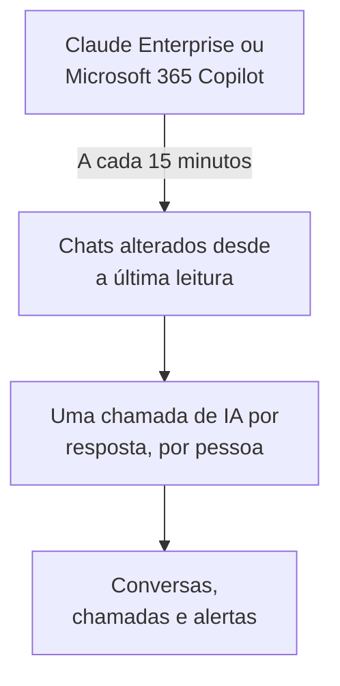

# Ferramentas de IA da empresa

Veja o que sua equipe pergunta às ferramentas de IA que sua empresa paga, como conversas por pessoa. Conecte o Claude Enterprise ou o Microsoft 365 Copilot com uma credencial que só pode ler, e o OneUptime traz cada novo chat para **Conversas** a cada 15 minutos. Só os proprietários e administradores do projeto podem lê-las, a menos que você decida outra coisa.

:::cards
- [Avise sua equipe primeiro](#avise-sua-equipe-primeiro): Os chats dela são as próprias palavras dela.
- [Conectar uma ferramenta](#conectar-uma-ferramenta): Cole a credencial, escolha quem pode ler, teste e conecte.
- [Privacidade](#privacidade): Quem pode ler as conversas, e se as palavras são guardadas.
- [Outras ferramentas de IA](#outras-ferramentas-de-ia): ChatGPT Enterprise, Gemini, Open WebUI, LibreChat e assistentes de programação.
:::

## Avise sua equipe primeiro

> [!IMPORTANT]
> São as próprias palavras da sua equipe. Antes de conectar uma ferramenta, diga às pessoas que os chats delas com ela são guardados e quem pode lê-los, e confirme com seu time jurídico ou de RH o que suas políticas e a lei local exigem.

## Como funciona

A cada 15 minutos, o OneUptime pede à ferramenta os chats que mudaram desde a última leitura. Cada resposta vira uma chamada de IA da pessoa que perguntou, com as perguntas feitas desde a resposta anterior, e cada chat vira uma conversa.

Os chats chegam do mesmo jeito que as chamadas de IA das suas aplicações, então regras de limpeza, filtros de descarte, retenção e os alertas de IA valem para eles. As ferramentas são pagas por licença, então essas chamadas não trazem tokens nem custo. Uma pergunta sem resposta por uma hora chega sozinha, então até um chat que a IA nunca respondeu aparece.

## Antes de começar

- O papel Project Owner ou Project Admin. Só eles podem conectar, alterar ou remover uma ferramenta.
- Um administrador da ferramenta, para criar a credencial: a seção de cada ferramenta, abaixo, diz qual.
- Sua equipe avisada, e a resposta do seu time jurídico ou de RH.

## Conectar uma ferramenta

:::steps
### Abra Conectar

Abra **Produtos → AI / LLM → Conectar**. Em **As ferramentas de IA da sua empresa**, clique no bloco da ferramenta.

### Cole a credencial

Em **Credenciais**, preencha o que a ferramenta pede. Os segredos são guardados criptografados e nunca mais são mostrados.

### Escolha quem pode ler

Em **Privacidade**, defina **Quem pode ler as conversas** e **Manter o que foi escrito**, como explica [Privacidade](#privacidade).

### Teste

Em **Testar**, clique em **Testar conexão**. O OneUptime conta os chats dos últimos 7 dias: nada do que alguém escreveu é lido, mostrado ou guardado.

### Conecte

Clique em **Conectar**. A primeira leitura começa em até um minuto e traz os últimos 7 dias.
:::

## Claude Enterprise

O OneUptime lê cada chat do claude.ai da sua organização pela Compliance API: quem perguntou, o que perguntou ao Claude, o que ele respondeu e qual modelo usou. Um chat que recebe uma mensagem nova é lido de novo, e as respostas já trazidas são reconhecidas e puladas.

:::steps
### Ative a Compliance API

O proprietário principal da sua organização abre Organization settings, API no claude.ai e ativa a Compliance API.

### Crie uma chave de acesso de compliance

Ali, crie uma chave com o escopo `read:compliance_user_data`. Ela começa com `sk-ant-api01-`.

### Conecte o Claude Enterprise

Cole a chave como **Chave de acesso de conformidade**.
:::

## Microsoft 365 Copilot

O OneUptime lê o histórico de interações com o Copilot de cada pessoa pelo Microsoft Graph: o que ela perguntou ao Copilot no Teams, Outlook, Word, Excel, PowerPoint, Loop ou Copilot Chat, o que ele respondeu e em qual app. Um prompt e as respostas dele viram uma chamada de IA, e uma sessão do Copilot vira uma conversa. Um tenant grande é lido em partes, continuando de onde a última leitura parou.

:::steps
### Registre um app

No Microsoft Entra ID, registre um app e crie um segredo do cliente para ele.

### Conceda as permissões

Dê ao app as permissões de aplicativo `AiEnterpriseInteraction.Read.All` e `User.Read.All` do Microsoft Graph e conceda o consentimento do administrador.

### Conecte o Copilot

Preencha **ID do diretório (tenant)**, **ID do aplicativo (cliente)** e **Segredo do cliente**. Para ler só algumas pessoas, coloque o ID de objeto de um grupo em **Somente pessoas deste grupo**, em **Mais campos**, e dê ao app também `GroupMember.Read.All`. Para o Azure Government, altere **Nuvem** ali.
:::

## Privacidade

| Configuração | O que faz |
| --- | --- |
| **Quem pode ler as conversas** | **Proprietários e administradores do projeto**, o padrão: ninguém mais no projeto vê essas conversas, nem as chamadas de IA que as compõem, em nenhum lugar do OneUptime. **Todos que podem ler chamadas de IA**: todos que podem ler os traces do projeto. |
| **Manter o que foi escrito** | Ligado, o padrão: as perguntas e as respostas são guardadas. Desligado: o OneUptime guarda quem perguntou, quando, com qual modelo e em qual app, mas não as palavras. |

Uma mudança em quem pode ler vale em até um minuto. Desligar **Manter o que foi escrito** vale para os chats lidos depois; o que foi guardado antes fica até o fim da retenção.

Para guardar as palavras mas mascarar partes delas, como endereços de e-mail ou números de cartão, use **Regras de mascaramento** em **Traços → Configurações**: elas valem antes de qualquer coisa ser guardada. As conversas são mantidas enquanto o serviço da conexão mantiver seus traces: veja [Retenção de dados](/docs/telemetry/data-retention). Remover uma conexão interrompe as leituras dela; o que ela leu fica, legível pelas mesmas pessoas, até o fim da retenção.

## Outras ferramentas de IA

Estas ferramentas não têm uma API com a qual o OneUptime possa ler os chats das pessoas, ou precisam de outro caminho.

### ChatGPT Enterprise

A OpenAI abre a Compliance API para um workspace só mediante pedido e não publica o que os registros dela contêm, então o OneUptime ainda não consegue ler os chats do ChatGPT Enterprise. Conectar sua organização da OpenAI como [conta de provedor](/docs/telemetry/ai-provider-accounts#openai) mostra o uso e o custo de API dela, que não incluem o ChatGPT.

### Gemini para Google Workspace

O Google não oferece nenhuma API para ler os chats do Gemini das pessoas. O Google Vault os guarda para eDiscovery.

### Assistentes de programação

Claude Code, Codex, Gemini CLI, GitHub Copilot e Cursor enviam o próprio OpenTelemetry: veja [Assistentes de programação com IA](/docs/telemetry/ai-coding-assistants).

### Open WebUI e LibreChat

Aplicações de chat auto-hospedadas chamam os modelos por uma API que você define. Coloque um proxy do LiteLLM na frente dos modelos e envie os traces dele ao OneUptime como mostra [Gateways de IA](/docs/telemetry/ai-gateways#litellm-proxy): os prompts e as respostas de cada chat chegam como chamadas de IA. Uma chave virtual por pessoa diz quem perguntou; uma chave que todos compartilham não cita ninguém. A exportação OpenTelemetry do próprio Open WebUI rastreia as requisições web e as chamadas ao banco de dados dele, não os chats.

## Solução de problemas

:::details O teste não encontra chats
Ninguém usou a ferramenta nos últimos 7 dias, ou a credencial pertence a outra organização ou a outro tenant. No Copilot, confira se o grupo em **Somente pessoas deste grupo** é o que você quer.
:::

:::details A credencial funciona, mas não pode ler o que a conexão precisa
No Copilot, conceda o consentimento do administrador para as permissões do Graph do app, e também `GroupMember.Read.All` quando você indicar um grupo. No Claude Enterprise, crie a chave com o escopo `read:compliance_user_data`.
:::

:::details Alguém não consegue ver as conversas
**Quem pode ler as conversas** está em **Proprietários e administradores do projeto**. Um proprietário ou administrador pode mudar isso com **Editar** na linha da conexão.
:::

:::details As conversas mostram quem perguntou, mas não as palavras
**Manter o que foi escrito** estava desligado quando elas foram lidas. Ligá-lo vale para os chats lidos depois.
:::

## Próximos passos

:::cards
- [Observabilidade de IA / LLM](/docs/telemetry/ai-llm-observability): Leia e reproduza conversas, e saiba quando as respostas dão errado.
- [Contas de provedores de IA](/docs/telemetry/ai-provider-accounts): Uso e custo das suas contas da OpenAI, Anthropic, Azure, Bedrock e Vertex AI.
- [Assistentes de programação com IA](/docs/telemetry/ai-coding-assistants): Gasto por engenheiro com as ferramentas de programação.
- [Retenção de dados](/docs/telemetry/data-retention): Por quanto tempo as conversas são mantidas.
:::
