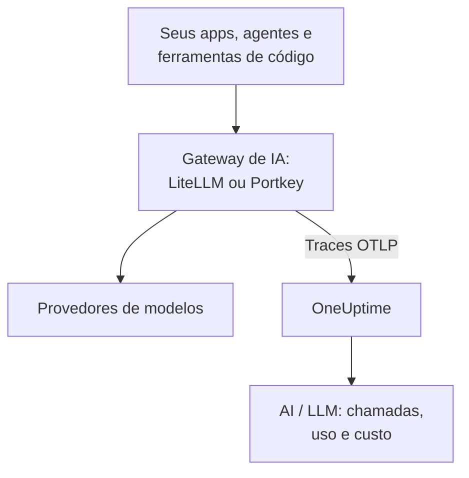

# Gateways de IA (LiteLLM, Portkey)

Um gateway de IA fica entre os seus apps e os provedores de modelos, então toda chamada ao modelo passa por ele. Envie o OpenTelemetry do gateway ao OneUptime uma vez, e toda chamada por trás dele chega em [AI / LLM](/docs/telemetry/ai-llm-observability) com modelo, tokens, custo e, a menos que você desative, o prompt e a resposta, sem instrumentar cada app.

:::cards
- [LiteLLM Proxy](#litellm-proxy): Exportação integrada, configurada com três variáveis.
- [Quem gastou o quê](#uma-chave-virtual-por-funcionário): Uma chave virtual do LiteLLM por funcionário nomeia cada pessoa.
- [Portkey](#portkey): Exportação integrada em gateways auto-hospedados; nos demais, instrumente o app.
- [Confira se as chamadas chegam](#confira-se-as-chamadas-chegam): O que você deveria ver, e o que fazer se não vir.
:::

## Como funciona



| | LiteLLM Proxy | Portkey, auto-hospedado ou Enterprise | Portkey, código aberto ou hospedado |
| --- | --- | --- | --- |
| Exportação para o OneUptime | Integrada | Integrada, experimental | Nenhuma: instrumente o app no lugar |
| Endpoint a configurar | `https://oneuptime.com/otlp/v1/traces` | `https://oneuptime.com/otlp` | O exportador do próprio app |
| Nomeia cada pessoa | Sim, com uma chave virtual por funcionário | Não | Só o que o app enviar |
| Prompts e respostas | Enviados a menos que você os desative | Sempre enviados | Depende da instrumentação |

## Antes de começar

- Uma chave de ingestão: abra **Configurações do projeto → Telemetria e APM → Chaves de ingestão** e clique em **Criar chave de ingestão**.
- A sua URL base de OTLP: `https://oneuptime.com/otlp`, ou `https://YOUR-ONEUPTIME-HOST/otlp` se você hospeda o OneUptime por conta própria. O OneUptime aceita OTLP sobre HTTP, em protobuf e em JSON.
- A chave viaja no cabeçalho `x-oneuptime-token` de cada requisição de exportação.

## LiteLLM Proxy

O callback de OpenTelemetry do LiteLLM faz parte do proxy de código aberto, e a imagem Docker oficial (`ghcr.io/berriai/litellm`) traz os pacotes de que ele precisa.

:::steps
### Ative o callback otel

Adicione `otel` aos callbacks no `config.yaml` do proxy:

```yaml title="config.yaml"
model_list:
  - model_name: gpt-4o
    litellm_params:
      model: openai/gpt-4o
      api_key: os.environ/OPENAI_API_KEY

litellm_settings:
  callbacks: ["otel"]
```

### Aponte o exportador para o OneUptime

Defina três variáveis no proxy:

```bash
export OTEL_EXPORTER="otlp_http"
export OTEL_ENDPOINT="https://oneuptime.com/otlp/v1/traces"
export OTEL_HEADERS="x-oneuptime-token=YOUR_INGESTION_TOKEN"
```

### Inicie o proxy

:::tabs
@tab Docker
```bash
docker run \
  -v $(pwd)/config.yaml:/app/config.yaml \
  -e OPENAI_API_KEY="sk-..." \
  -e OTEL_EXPORTER="otlp_http" \
  -e OTEL_ENDPOINT="https://oneuptime.com/otlp/v1/traces" \
  -e OTEL_HEADERS="x-oneuptime-token=YOUR_INGESTION_TOKEN" \
  -e OTEL_SERVICE_NAME="litellm-gateway" \
  -p 4000:4000 \
  ghcr.io/berriai/litellm:main-stable \
  --config /app/config.yaml
```
@tab pip
```bash
pip install 'litellm[proxy]' opentelemetry-api opentelemetry-sdk opentelemetry-exporter-otlp
litellm --config config.yaml
```
:::

`litellm[proxy]` sozinho não inclui os pacotes do OpenTelemetry, então instale-os junto.

### Envie uma requisição por ele

Chame o proxy uma vez e depois confira AI / LLM como descrito em [Confira se as chamadas chegam](#confira-se-as-chamadas-chegam).
:::

| Variável | Valor | Observações |
| --- | --- | --- |
| `OTEL_EXPORTER` | `otlp_http` | Também lida como `OTEL_EXPORTER_OTLP_PROTOCOL` |
| `OTEL_ENDPOINT` | `https://oneuptime.com/otlp/v1/traces` | O caminho completo `/v1/traces` funciona em todas as versões do LiteLLM; também lida como `OTEL_EXPORTER_OTLP_ENDPOINT` |
| `OTEL_HEADERS` | `x-oneuptime-token=YOUR_INGESTION_TOKEN` | Pares `key=value` separados por vírgula; também lida como `OTEL_EXPORTER_OTLP_HEADERS` |
| `OTEL_SERVICE_NAME` | O nome do seu gateway | O serviço sob o qual as chamadas aparecem; `litellm` se não for definida |

### O que o LiteLLM envia

Cada chamada carrega `gen_ai.system`, `gen_ai.request.model`, `gen_ai.response.model`, `gen_ai.usage.input_tokens` e `gen_ai.usage.output_tokens`, os seus parâmetros, o prompt e a resposta: tudo o que o OneUptime precisa para [ler a chamada](/docs/telemetry/ai-llm-observability).

Desde o LiteLLM 1.81, esses atributos ficam no span `Received Proxy Server Request` da requisição, e não há mais um span `litellm_request` separado. Quando uma requisição faz várias chamadas ao modelo, cada chamada sobrescreve ali os atributos da anterior, então defina `USE_OTEL_LITELLM_REQUEST_SPAN=true` para ter um span `litellm_request` por chamada.

O LiteLLM precifica cada chamada por conta própria, incluindo tarifas personalizadas definidas no proxy, e informa o preço como `gen_ai.cost.total_cost`. O OneUptime prefere um custo informado à própria estimativa, e [estima a partir dos tokens](/docs/telemetry/ai-llm-observability) só quando o LiteLLM não conseguiu precificar a chamada, como em um modelo personalizado sem preço definido.

### Uma chave virtual por funcionário

Dê a cada pessoa a sua própria chave virtual do LiteLLM, e cada chamada que ela fizer chega com a sua identidade. O LiteLLM grava no span o ID, o e-mail e a equipe do dono da chave, e o OneUptime os lê como o funcionário e a equipe, então a aba **Uso** classifica o gasto por pessoa sem configurar nada nas máquinas delas.

Chaves virtuais exigem um banco de dados e uma chave mestra no proxy (`DATABASE_URL` e `LITELLM_MASTER_KEY`). Crie um usuário com o e-mail dele e depois uma chave para esse usuário:

```bash
curl -X POST "http://localhost:4000/user/new" \
  -H "Authorization: Bearer YOUR_MASTER_KEY" \
  -H "Content-Type: application/json" \
  -d '{"user_email": "alice@example.com"}'

curl -X POST "http://localhost:4000/key/generate" \
  -H "Authorization: Bearer YOUR_MASTER_KEY" \
  -H "Content-Type: application/json" \
  -d '{"user_id": "USER_ID_FROM_THE_FIRST_CALL", "team_id": "platform"}'
```

| Atributo de span do LiteLLM | O OneUptime o lê como |
| --- | --- |
| `metadata.user_api_key_user_id` | O ID do funcionário |
| `metadata.user_api_key_user_email` | O e-mail do funcionário |
| `metadata.user_api_key_team_id` | A equipe |
| `metadata.user_api_key_end_user_id` | Nunca o funcionário: é o `user` que o seu app envia para o próprio cliente |

No modo OpenTelemetry v2 do LiteLLM, os mesmos valores chegam com o prefixo `litellm.` (`litellm.metadata.user_api_key_user_email` e assim por diante), que o OneUptime também lê.

### Deixe os prompts de fora

O callback `otel` envia por padrão prompts e respostas completos. Para deixá-los de fora, use uma destas opções:

:::tabs
@tab Todos os callbacks
```yaml title="config.yaml"
litellm_settings:
  callbacks: ["otel"]
  turn_off_message_logging: true
```
@tab Só o callback OTel
```yaml title="config.yaml"
litellm_settings:
  callbacks: ["otel"]

callback_settings:
  otel:
    message_logging: False
```
@tab Variável de ambiente
```bash
export OTEL_INSTRUMENTATION_GENAI_CAPTURE_MESSAGE_CONTENT="NO_CONTENT"
```
:::

`callback_settings` é uma chave de nível superior, não uma chave dentro de `litellm_settings`. Para manter os prompts mas mascarar partes deles, use regras de limpeza em **Traços → Configurações**.

:::details O modo OpenTelemetry v2 do LiteLLM
Versões mais novas do LiteLLM têm um modo OpenTelemetry v2 opcional (`LITELLM_OTEL_V2=true`, sem mudar o `config.yaml`). Ele envia um trace por requisição, com o tratamento HTTP, a autenticação, os guardrails e a chamada ao modelo como spans GenAI com nomes como `chat gpt-4o`. No modo v2 os prompts ficam desativados por padrão; ative-os com `OTEL_INSTRUMENTATION_GENAI_CAPTURE_MESSAGE_CONTENT`. O custo dele chega como `litellm.cost.total`, que o OneUptime também lê. Use um modo ou o outro, não os dois.
:::

## Portkey

O que o Portkey pode enviar depende de como você o executa:

| Implantação | Exportação para o OneUptime |
| --- | --- |
| Gateway auto-hospedado ou Enterprise | Integrada (experimental): defina as variáveis abaixo |
| Gateway de código aberto (`portkey-ai/gateway`) | Nenhuma: instrumente o app que o chama |
| Gateway hospedado (portkey.ai) | Nenhuma no gateway: instrumente o app que o chama |

O Portkey também tem um endpoint de OpenTelemetry próprio (`api.portkey.ai/v1/otel`). Ele recebe traces dentro do Portkey, a direção contrária à desta página.

### Gateways auto-hospedados e Enterprise

Defina estas variáveis no contêiner do gateway:

```yaml title="docker-compose.yml"
services:
  portkey-gateway:
    environment:
      EXPERIMENTAL_GEN_AI_OTEL_TRACES_ENABLED: "true"
      EXPERIMENTAL_GEN_AI_OTEL_EXPORTER_OTLP_ENDPOINT: "https://oneuptime.com/otlp"
      EXPERIMENTAL_GEN_AI_OTEL_EXPORTER_OTLP_HEADERS: "x-oneuptime-token=YOUR_INGESTION_TOKEN"
```

- Informe a URL base de OTLP: o Portkey acrescenta `/v1/traces` sozinho.
- Os cabeçalhos são pares `key=value` separados por vírgula. `EXPERIMENTAL_GEN_AI_OTEL_RESOURCE_ATTRIBUTES` acrescenta atributos de recurso do mesmo jeito, como `deployment.environment=production`.
- O Portkey envia OTLP sobre HTTP só em JSON, que o OneUptime aceita sem um coletor no meio.
- Cada chamada é um span chamado `{operation} {model}`, como `chat gpt-4o`, sob o serviço `portkey`, com `gen_ai.provider.name`, o modelo pedido e o servido, as contagens de tokens, `gen_ai.conversation.id`, e as mensagens em `gen_ai.input.messages` e `gen_ai.output.messages`.
- Prompts e respostas completos são sempre incluídos. Mascare o que for preciso com regras de limpeza em **Traços → Configurações**.
- Cada chamada é enviada sozinha depois da resposta, sem agrupamento e sem novas tentativas: uma exportação que falha se perde. Trate-a como observabilidade, não como log de auditoria.
- Quando o seu `x-portkey-trace-id` é um ID de trace válido (32 caracteres hexadecimais), o Portkey o reaproveita, então os spans do gateway se juntam ao trace do seu próprio app.

O Portkey marca esta exportação como experimental. Se as variáveis não tiverem efeito, compare a documentação atual do Portkey com a versão do seu gateway.

### Gateways de código aberto e hospedados

O gateway de código aberto não tem exportador, e no gateway hospedado você não pode definir as variáveis dele. Instrumente então o app que chama o Portkey. O Portkey fala a API da OpenAI, então as instrumentações GenAI de [Observabilidade de IA / LLM](/docs/telemetry/ai-llm-observability) (OpenLLMetry, OpenInference, OpenLIT) rastreiam as chamadas do seu SDK mesmo com a URL base apontando para o Portkey:

```python
from traceloop.sdk import Traceloop
from openai import OpenAI

Traceloop.init(
    app_name="my-ai-agent",
    api_endpoint="https://oneuptime.com/otlp",
    headers={"x-oneuptime-token": "YOUR_INGESTION_TOKEN"},
)

client = OpenAI(
    base_url="https://api.portkey.ai/v1",   # or your gateway's URL
    default_headers={"x-portkey-api-key": "PORTKEY_API_KEY"},
)
# Calls through Portkey are now traced to OneUptime.
```

Esses spans descrevem a chamada como o seu app a fez: o modelo que ele pediu, o tempo que esperou, os tokens que recebeu. O que o gateway decidiu no caminho, como um fallback, uma nova tentativa ou um acerto de cache, fica no Portkey. Para ver isso no OneUptime, use a exportação do gateway auto-hospedado.

## Confira se as chamadas chegam

:::steps
1. Envie uma requisição pelo gateway e espere alguns segundos.
2. Abra **Produtos → AI / LLM → Chamadas**. A chamada aparece com o provedor, o modelo e os tokens.
3. Clique na chamada para abrir o trace e abra a aba **LLM** do span: o modelo, os tokens, os parâmetros e, a menos que você os tenha desativado, o prompt e a resposta.
4. Abra **Uso**: a chamada conta nos totais, com o custo informado pelo gateway ou o estimado pelo OneUptime.
:::

## Solução de problemas

:::details Nada chega do LiteLLM
Defina `OTEL_EXPORTER="console"` por um instante. Se aparecerem spans na saída do proxy, o LiteLLM está rastreando, e o problema é o endpoint ou a chave. `DEBUG_OTEL="true"` mostra o que o exportador faz.
:::

:::details A chave é recusada
O OneUptime responde `401` para uma chave ausente, desconhecida ou expirada, e `422` para uma chave desativada ou uma chave de navegador. Crie uma chave de servidor em **Configurações do projeto → Telemetria e APM → Chaves de ingestão** e envie-a em `x-oneuptime-token`.
:::

:::details O endpoint está errado
O LiteLLM recebe o caminho completo, `https://oneuptime.com/otlp/v1/traces`. O Portkey recebe a URL base, `https://oneuptime.com/otlp`, e acrescenta `/v1/traces` sozinho.
:::

:::details Spans chegam, mas não em AI / LLM
Filtre **Traços** pelo serviço do gateway (`litellm`, `portkey` ou o seu `OTEL_SERVICE_NAME`) para ver os spans brutos. Um span só conta como chamada ao modelo quando carrega atributos `gen_ai.*`: confira se o callback é `otel` e se a chamada foi a um modelo.
:::

:::details O gasto aparece sem atribuição
As chamadas não nomeiam nenhuma pessoa. Dê a cada funcionário a sua própria chave virtual, como em [Uma chave virtual por funcionário](#uma-chave-virtual-por-funcionário). O campo `user` que o seu app envia nomeia o cliente dele, não o funcionário, e nunca é lido como o funcionário.
:::

:::details Das várias chamadas, só a última aparece
Desde o LiteLLM 1.81, as chamadas ao modelo de uma requisição compartilham um span. Defina `USE_OTEL_LITELLM_REQUEST_SPAN=true` para ter um span por chamada.
:::

## Próximos passos

:::cards
- [Observabilidade de IA / LLM](/docs/telemetry/ai-llm-observability): Conversas, alertas, uso e orçamentos diários de custo para essas chamadas.
- [Assistentes de código com IA](/docs/telemetry/ai-coding-assistants): Coloque um gateway na frente das ferramentas que não enviam telemetria própria.
- [Disjuntores para agentes de IA](/docs/telemetry/ai-agent-circuit-breaker): Pare um agente descontrolado quando o alerta dele disparar.
- [Monitor de traces](/docs/monitor/traces-monitor): Alerte sobre padrões de spans, como uma ferramenta chamada em loop.
:::
