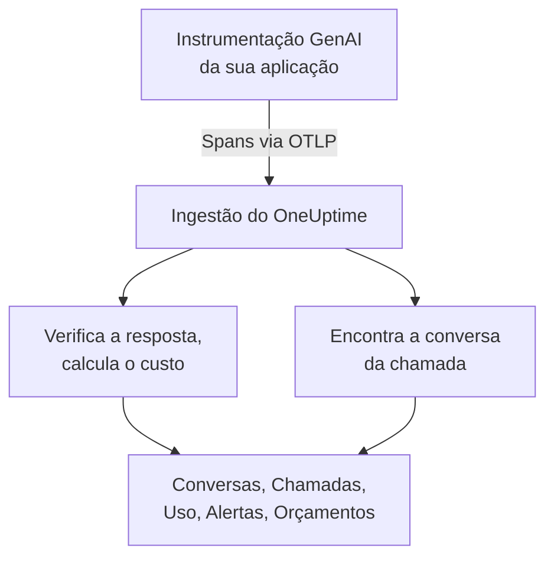
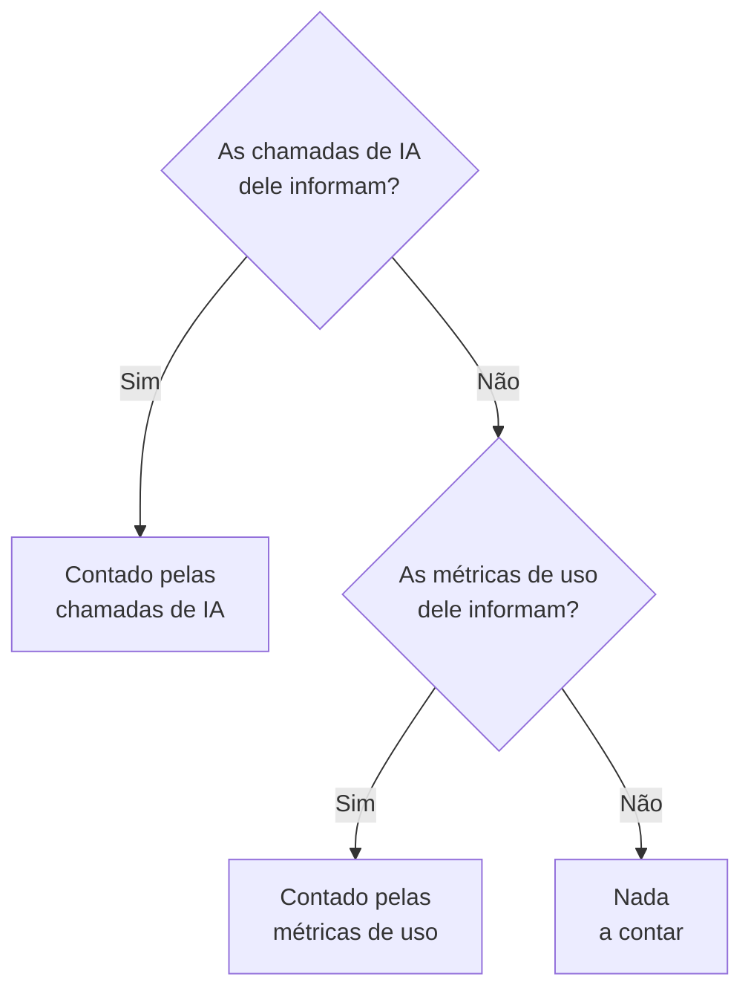

# Observabilidade de IA / LLM

Leia cada conversa que sua IA teve, repita-a do jeito que aconteceu e seja avisado quando ela responder mal. O OneUptime constrói tudo isso a partir do OpenTelemetry padrão: se sua aplicação envia spans com as **convenções semânticas GenAI** (`gen_ai.*`), você obtém conversas, alertas, uso e custo, sem nenhum SDK proprietário.

:::cards
- [Três formas de entrada](#três-formas-de-entrada): Suas aplicações, suas contas de provedores de IA e as ferramentas de IA da sua empresa.
- [Configure](#configure-em-cinco-passos): Cinco passos, do primeiro span às respostas sinalizadas.
- [Repita uma conversa](#leia-e-repita-uma-conversa): Leia um chat como a pessoa o viu, no ritmo em que aconteceu.
- [Receba alertas](#seja-avisado-quando-a-ia-responder-mal): Alertas prontos para respostas que falham, são recusadas, cortadas, sinalizadas ou lentas.
- [Acompanhe o gasto](#veja-quem-gasta-o-quê): Custo por pessoa, equipe, modelo e aplicação, com orçamentos diários.
:::

## Como funciona

A instrumentação GenAI da sua aplicação exporta cada chamada ao modelo como um span do OpenTelemetry. Quando o span chega, o OneUptime lê seus atributos `gen_ai.*`, verifica se a resposta tem problemas, calcula o preço da chamada e a arquiva na conversa a que pertence.



Abra **Produtos → IA / LLM**, em **Observabilidade**. O produto tem sete abas:

| Aba | O que mostra |
| --- | --- |
| **Conversas** | Cada conversa que sua IA teve, primeiro as que precisam de atenção. Acima da lista: conversas, respostas da IA, quantas precisam de atenção, custo e o tempo de resposta típico. |
| **Chamadas** | Cada chamada de modelo, embedding, agente e ferramenta. Filtre por serviço, provedor, modelo, operação, pessoa, equipe ou conversa; clique em uma chamada para abri-la no visualizador de traces. |
| **Uso** | Chamadas, tokens e custo de um período, ordenados por funcionário, equipe, modelo, provedor ou aplicação; em **Contas de provedor**, o que foi cobrado das suas contas conectadas. |
| **Alertas** | Alertas prontos para quando a IA responde mal, e seus monitores de IA / LLM. |
| **Orçamentos** | Limites de custo diários, publicados como métricas sobre as quais você pode alertar. |
| **Preços** | Seus próprios preços para modelos que a lista de preços embutida não conhece. |
| **Conectar** | As três formas de entrada, lado a lado, cada uma marcada assim que começa a funcionar. |

No visualizador de traces, o span de cada chamada de IA também tem uma aba **LLM**: provedor, modelo, tokens, custo, parâmetros da requisição, e o prompt e a resposta.

## Três formas de entrada

As três ficam em **Produtos → IA / LLM → Conectar**. Use uma, duas ou todas: tudo chega às mesmas **Conversas**, **Uso**, **Alertas** e **Orçamentos**.

| Forma de entrada | O que você recebe | Como |
| --- | --- | --- |
| **Seus aplicativos** | Cada chamada de IA enquanto acontece: a conversa, a pessoa, o prompt e a resposta, tokens, custo e erros | OpenTelemetry do seu código ou de um gateway, em cinco passos |
| **Suas contas de provedores de IA** | O que cada conta da OpenAI, Anthropic, Azure, Bedrock, Vertex AI ou Cursor usou e custou, por dia ou por hora | Uma credencial somente leitura e nenhum código: [Contas de provedores de IA](/docs/telemetry/ai-provider-accounts) |
| **As ferramentas de IA da sua empresa** | O que sua equipe pergunta ao Claude Enterprise ou ao Microsoft 365 Copilot, por pessoa | Uma credencial somente leitura e nenhum código: [Ferramentas de IA da empresa](/docs/telemetry/ai-company-tools) |

As contas de provedor e os assistentes de programação trazem uso e custo, nunca uma chamada: preenchem **Uso**, e **Conversas** e **Chamadas** ficam vazias até seus aplicativos enviarem suas chamadas de IA ou uma ferramenta de IA da empresa ser conectada. [Verifique o que está chegando](#verifique-o-que-está-chegando) mostra qual caminho traz o quê.

## Verifique o que está chegando

A **Verificação da configuração**, no topo de **Conectar**, diz o que cada caminho está trazendo agora, e **Verificar de novo** a lê outra vez. Uma lista vazia de **Conversas** ou **Chamadas** começa pela mesma constatação, com um botão para o próximo passo.

| O que ela encontra | O que fazer |
| --- | --- |
| Nenhum aplicativo enviou uma chamada de IA | [Envie suas chamadas de IA](#envie-suas-chamadas-de-ia): as contas de provedor conectadas trazem uso e custo por dia, nunca uma chamada |
| Um aplicativo chama a API de um provedor de IA, e nenhuma instrumentação GenAI a registra | Adicione uma para a linguagem do aplicativo: a verificação encontrou os spans de cliente HTTP do aplicativo para `api.openai.com`, `*.openai.azure.com`, `*.services.ai.azure.com` ou a API de outro provedor de IA |
| As chamadas chegam sem prompts ou respostas | [Registre o que foi dito](#registre-o-que-foi-dito), nos spans ou como eventos de log |
| Prompts e respostas chegam como eventos de log | Nada: as conversas os leem, e quem pode ler os logs do aplicativo também pode lê-los na página **Registros** |
| As chamadas estão logo fora do intervalo | A lista oferece o intervalo que contém a mais recente |
| Uma conta de provedor não lê nenhum uso | Sua linha diz o último dia com uso, ou o primeiro dia lido; uma conexão do Azure que não encontra nenhum recurso precisa de Monitoring Reader onde os recursos estão |

## Antes de começar

- Um projeto do OneUptime em que você possa criar uma chave de ingestão de telemetria.
- Uma aplicação que chama um modelo, e uma instrumentação GenAI para a linguagem dela: **OpenLLMetry** (Traceloop), **OpenInference** (Arize), o **Vercel AI SDK**, ou as instrumentações do OpenTelemetry para OpenAI, Anthropic e Gemini.

> [!TIP]
> O tráfego para os modelos que passa por um gateway como LiteLLM ou Portkey pode ser exportado pelo gateway em vez de por cada aplicação: veja [Gateways de IA](/docs/telemetry/ai-gateways). Para os assistentes de programação que seus engenheiros usam, veja [Assistentes de programação com IA](/docs/telemetry/ai-coding-assistants).

## Configure em cinco passos

O primeiro passo é tudo de que você precisa para ver chamadas. Cada passo seguinte mostra mais.

:::steps
### Envie suas chamadas de IA

Em **Seus aplicativos**, dentro de **Conectar**, escolha uma chave de ingestão ou crie uma, e copie o snippet da sua linguagem com seu endpoint e sua chave já preenchidos. Ou crie uma chave em **Configurações do projeto → Telemetria e APM → Chaves de ingestão** (o [início rápido do OpenTelemetry](/docs/telemetry/open-telemetry#criar-uma-chave-de-ingestão) mostra como) e aponte sua instrumentação para o OneUptime:

:::tabs
@tab Python
```bash
pip install traceloop-sdk opentelemetry-exporter-otlp
```

```python
from traceloop.sdk import Traceloop

Traceloop.init(
    app_name="my-ai-agent",
    api_endpoint="https://oneuptime.com/otlp",
    headers={"x-oneuptime-token": "YOUR_INGESTION_TOKEN"},
)
# Your OpenAI, Anthropic and LangChain calls are now traced.
```
@tab Node.js
```bash
npm install @traceloop/node-server-sdk
```

```typescript
import * as traceloop from "@traceloop/node-server-sdk";

traceloop.initialize({
  appName: "my-ai-agent",
  baseUrl: "https://oneuptime.com/otlp",
  headers: { "x-oneuptime-token": "YOUR_INGESTION_TOKEN" },
});
```
@tab .NET
```bash
dotnet add package OpenTelemetry.Extensions.Hosting
dotnet add package OpenTelemetry.Exporter.OpenTelemetryProtocol
```

```csharp
// Before any OpenAI or Azure OpenAI client is created:
AppContext.SetSwitch("OpenAI.Experimental.EnableOpenTelemetry", true);

builder.Services.AddOpenTelemetry()
    .WithTracing(tracing => tracing.AddSource("OpenAI.*").AddOtlpExporter())
    .WithMetrics(metrics => metrics.AddMeter("OpenAI.*").AddOtlpExporter());
```
@tab Java
```bash
curl -L -O https://github.com/open-telemetry/opentelemetry-java-instrumentation/releases/latest/download/opentelemetry-javaagent.jar
java -javaagent:opentelemetry-javaagent.jar -jar my-ai-agent.jar
```
@tab OpenTelemetry SDK
```bash
export OTEL_EXPORTER_OTLP_ENDPOINT="https://oneuptime.com/otlp"
export OTEL_EXPORTER_OTLP_HEADERS="x-oneuptime-token=YOUR_INGESTION_TOKEN"
export OTEL_EXPORTER_OTLP_PROTOCOL="http/protobuf"
export OTEL_SERVICE_NAME="my-ai-agent"
```
:::

Cada um rastreia da mesma forma as chamadas ao OpenAI, Azure OpenAI e Microsoft Foundry. No .NET e no Java, defina também as variáveis da aba OpenTelemetry SDK: as bibliotecas OpenAI e Azure.AI.OpenAI rastreiam suas chamadas quando a opção delas está ligada, e o agente Java rastreia o SDK Java da OpenAI.

Hospeda o OneUptime por conta própria? Use `https://YOUR-ONEUPTIME-HOST/otlp` em vez de `https://oneuptime.com/otlp`. Chame seu modelo uma vez, e a chamada aparece em **Chamadas**.

### Registre o que foi dito

Uma conversa mostra o que as pessoas perguntaram e o que a IA respondeu somente quando sua instrumentação registra isso. O OpenLLMetry registra prompts e respostas, a menos que você defina `TRACELOOP_TRACE_CONTENT=false`. As instrumentações do OpenTelemetry só os registram quando você pede:

```bash
export OTEL_INSTRUMENTATION_GENAI_CAPTURE_MESSAGE_CONTENT=true
```

Instrumentações mais novas do OpenTelemetry aceitam `span_only`, `event_only` ou `span_and_event` em vez de `true`. Sem conteúdo registrado, uma conversa ainda mostra seus tempos, seu custo e seus problemas. Os prompts podem conter dados sensíveis: [Privacidade e ocultação](#privacidade-e-ocultação) mostra como mascará-los antes de serem armazenados.

As conversas leem o que é registrado no span da chamada, e os eventos de log que o aplicativo envia com os ids de trace e de span da chamada. A instrumentação do OpenTelemetry para Python o registra no span com `span_only`; as instrumentações para JavaScript e Java, e a de Python com `true` ou `event_only`, o enviam como eventos de log, que chegam ao OneUptime com os logs do aplicativo. O SDK AI Inference do Azure o registra no span com `AZURE_TRACING_GEN_AI_CONTENT_RECORDING_ENABLED=true`, o Microsoft.Extensions.AI com `EnableSensitiveData`; a biblioteca OpenAI para .NET não registra nada.

### Agrupe as chamadas em conversas

Um aplicativo de chat faz uma chamada ao modelo por turno. Defina `gen_ai.conversation.id` (ou `session.id`) com o id do seu chat em cada chamada de IA, e cada chat aparece como uma única conversa, não importa quantas chamadas e traces ele tenha levado. Com o OpenLLMetry, defina uma vez por requisição:

```python
from traceloop.sdk import Traceloop

Traceloop.set_association_properties({
    "session_id": chat.id,
    "user_email": user.email,
})
```

Com o Vercel AI SDK, passe o id do chat como `experimental_telemetry: { metadata: { sessionId } }`. Chamadas sem id de conversa continuam aparecendo, uma requisição (um trace) de cada vez.

### Informe quem perguntou

Defina `user.id` ou `user.email` em cada chamada de IA (a propriedade de associação acima define o e-mail). Cada conversa passa então a mostrar com quem foi, você pode buscar na lista por pessoa, e a aba **Uso** ordena o gasto por funcionário. [Atribuição a funcionários e equipes](/docs/telemetry/ai-coding-assistants#atribuição-a-funcionários-e-equipes) lista cada chave de identidade que o OneUptime lê.

### Sinalize respostas ruins

O OneUptime verifica cada resposta assim que ela chega e marca o que deu errado:

| Problema | O que significa | Detectado por |
| --- | --- | --- |
| Com falha | A chamada terminou em erro, então nenhuma resposta chegou | O status do span Error, `error.type`, ou um motivo de término `error` |
| Recusada | A IA se recusou, ou um filtro de segurança bloqueou a resposta | Um motivo de término de recusa ou de segurança (`content_filter`, `refusal`, `SAFETY` e similares), uma recusa na resposta, ou uma resposta que começa com uma recusa padrão em inglês |
| Cortada | A resposta parou no limite de tokens | Um motivo de término `length`, `max_tokens` ou `MAX_TOKENS` |
| Vazia | Nenhum texto e nenhuma chamada de ferramenta | Conteúdo registrado que não contém nada, ou 0 tokens de saída |
| Sinalizada | Uma avaliação enviada pela sua aplicação disse que a resposta era ruim | Um evento `gen_ai.evaluation.result` |

As quatro primeiras não precisam de nada da sua parte. Para sinalizar uma resposta que seu guardrail, sua avaliação ou um botão de polegar para baixo rejeita, adicione um evento `gen_ai.evaluation.result` ao span da resposta, enquanto o span está aberto, com `gen_ai.evaluation.score.label` definido como `fail`:

```python
from opentelemetry import trace

trace.get_current_span().add_event(
    "gen_ai.evaluation.result",
    {
        "gen_ai.evaluation.name": "relevance",
        "gen_ai.evaluation.score.label": "fail",
        "gen_ai.evaluation.explanation": "The answer is about another product.",
    },
)
```

Rótulos como `incorrect`, `wrong`, `unhelpful`, `toxic`, `unsafe` e `hallucination` também contam como falha. O OneUptime nunca envia suas conversas a outra IA para julgá-las: cada verificação lê apenas o que a própria chamada carrega.
:::

## Leia e repita uma conversa

Uma conversa abre inteira, do jeito que um aplicativo de chat mostra o histórico: o que a pessoa disse à direita, as respostas da IA à esquerda com modelo, hora, tokens e custo, as chamadas de ferramentas no meio, e o que deu errado marcado onde aconteceu. **Detalhes** abaixo de uma resposta mostra por que ela parou, suas avaliações e um link para a chamada em Traços.

A barra na parte de baixo repete a conversa do jeito que a pessoa a viveu:

| Controle | O que faz |
| --- | --- |
| **Repetir** | Reproduz a conversa desde a primeira mensagem, no ritmo em que aconteceu. "A IA está respondendo…" conta o tempo enquanto uma resposta está a caminho. Clique na hora de qualquer mensagem para repetir a partir dali. |
| **Pular esperas** | Ativado por padrão: encurta qualquer silêncio de mais de 3 segundos. |
| `1x` | Muda a velocidade: 1x, 2x, 4x ou 8x. |
| **K**, **J** ou **←**, **L** ou **→** | Reproduzir ou pausar, voltar uma mensagem, avançar uma mensagem. |

O endereço da página guarda a mensagem em que uma repetição parou (`?step=`), então um link que você compartilha abre naquele momento.

## Seja avisado quando a IA responder mal

A aba **Alertas** lista os alertas que a maioria das aplicações de IA quer. Escolher um abre **Criar monitor** já preenchido, e você pode mudar qualquer coisa antes de salvar:

| Alerta | Quando avisa você | Severidade |
| --- | --- | --- |
| As respostas dão errado | Mais de 5% das respostas em 15 minutos falham, são recusadas, cortadas, vazias ou sinalizadas | Aviso |
| As chamadas de IA falham | Mais de 10% das chamadas ao modelo em 5 minutos terminam em erro | Critical |
| A IA se recusa a responder | Mais de 5% das respostas em 30 minutos são recusas | Aviso |
| As respostas são cortadas | 3 ou mais respostas em 30 minutos param no limite de tokens | Aviso |
| As respostas são sinalizadas | Uma avaliação marca uma resposta como ruim | Aviso |
| As respostas estão lentas | Mais de 10% das respostas em 15 minutos levam mais de 30 segundos | Aviso |
| A IA para de responder | A IA não dá nenhuma resposta por 30 minutos | Critical |

Os alertas sobre uma parcela das respostas também esperam por pelo menos 3 respostas ruins, então uma resposta ruim em duas não aciona ninguém. Um alerta Critical recebe a severidade de alerta mais alta do seu projeto e um alerta Warning a seguinte: High e Low em um projeto novo.

Cada alerta é um monitor de **IA / LLM**. As configurações dele dizem o que conta como resposta ruim (**Contar uma resposta como ruim quando ela**, **Ou leva mais de (segundos)**), até onde cada verificação olha para trás (**Janela de tempo**, 15 minutos por padrão), quais **Apps** ele observa e, em **Mais campos**, qual **Modelo**. Uma **Pré-visualização** mostra o que o monitor contaria agora. Seus critérios comparam três números: **Respostas ruins da IA (em %)**, **Respostas ruins da IA** e **Respostas da IA**.

Um alerta pronto dispara um alerta que se resolve sozinho, e mostra o monitor como **Degraded** enquanto as respostas estão ruins. O incidente dele vem preenchido, mas desativado: ative-o para acionar alguém.

## Veja quem gasta o quê

A aba **Uso** mostra as chamadas, os tokens e o custo de um período (os últimos 7 dias, a menos que você escolha outro), e uma tabela dos 25 primeiros em uma de cinco divisões: **Funcionário**, **Equipe**, **Modelo**, **Provedor** e **Aplicação / Serviço**. Chamadas que não citam ninguém são contadas em **Sem atribuição**, nunca descartadas.

Estas são **Suas chamadas de IA**. Escolha **Contas de provedor** para ver o que foi cobrado das suas contas conectadas da OpenAI, Anthropic, Azure, Bedrock, Vertex AI e Cursor: veja [Contas de provedores de IA](/docs/telemetry/ai-provider-accounts#ver-o-uso). As duas coisas nunca são somadas.

Pessoas e equipes vêm dos atributos de identidade da chamada: veja [Atribuição a funcionários e equipes](/docs/telemetry/ai-coding-assistants#atribuição-a-funcionários-e-equipes).

### Cada serviço é contado pelo que envia

O uso de IA chega de duas formas. Spans GenAI são chamadas de IA: um por chamada, com o modelo, os tokens e o custo dela. Métricas GenAI são métricas de uso: contadores de tokens e de custo que a maioria dos assistentes de programação envia no lugar de spans, e que algumas instrumentações enviam ao lado dos seus spans, para as mesmas chamadas. Somar as duas contaria essas chamadas duas vezes, então o OneUptime conta cada serviço por uma delas: os tokens, pelas chamadas de IA dele quando elas informam tokens e, se não, pelas métricas de uso dele; e o custo do mesmo jeito, separadamente. Assim, um assistente de programação que envia só métricas é contado ao lado das aplicações que enviam spans, no mesmo projeto, e uma aplicação que envia as duas coisas é contada uma vez.



| Onde | Das chamadas de IA | Das métricas de uso |
| --- | --- | --- |
| Tokens de entrada e de saída | Os tokens de cada chamada ao modelo, uma vez | Os tokens de um serviço, quando as chamadas de IA dele não informam nenhum |
| Custo (USD) | O custo de cada chamada ao modelo, uma vez | O custo de um serviço, quando as chamadas de IA dele não informam nenhum, com o custo em micro-USD do Codex convertido para USD |
| Chamadas de IA | Cada chamada de IA, como **Chamadas** as lista | Nunca: uma métrica não conta chamadas |
| Tabelas **Funcionário**, **Equipe**, **Modelo**, **Provedor**, **Aplicação / Serviço** | As chamadas, os tokens e o custo de cada linha | Os tokens e o custo dos serviços contados pelas métricas, sob a pessoa, a equipe, o modelo ou o provedor que os pontos deles citam |
| Conversas | Construídas a partir das chamadas de IA | Nunca |

Sob cada número, a aba Uso diz de onde ele veio: **Das chamadas de IA**, **Das métricas de uso** ou **Das chamadas de IA e das métricas de uso** quando alguns serviços enviaram chamadas e outros, métricas. Uma linha da tabela contada pelas métricas de uso diz isso sob o nome dela, e a célula de chamadas dela mostra `—` quando ela não tem nenhuma chamada de IA, porque uma métrica não tem detalhe por chamada; o cabeçalho da tabela cita os serviços contados pelas métricas de uso, exceto em **Aplicação / Serviço**, cujas linhas são os próprios serviços. Uma métrica de uso que não cita nenhum serviço é contada em **Serviço desconhecido**, um serviço como qualquer outro. Se a sua função pode ler traces, mas não métricas, as métricas de uso ficam de fora, e a tabela diz isso.

Cada chamada ao modelo é contada uma vez. Uma execução de agente, ou o span de um framework em volta do span do próprio SDK, costuma repetir os tokens e o custo das chamadas que contém: os tokens de um span, ou o custo dele, ficam de fora sempre que uma chamada dentro dele os informa, e uma execução de agente mantém os próprios números quando nenhuma chamada dentro dela os informa. Os orçamentos e a lista **Conversas** contam do mesmo jeito, enquanto **Chamadas** lista cada span com os próprios números.

Uma métrica de tokens ou de custo é um contador. Os pontos de um contador delta são somados; um contador cumulativo, o padrão dos SDKs do OpenTelemetry, conta quanto cresceu no período, cada série por si, então um total corrente exportado a cada minuto é contado uma vez, e uma queda é lida como um reinício a partir de 0, como o `increase()` do Prometheus a lê. Os orçamentos contam as métricas GenAI do mesmo jeito.

## Quanto custa uma chamada

Um custo informado pela sua instrumentação (`gen_ai.usage.cost`) é usado como está, mesmo quando é 0. Quando nenhum é informado, o OneUptime estima um quando o span chega, a partir das contagens de tokens e de uma lista de preços embutida para modelos comuns da OpenAI, Anthropic, Google Gemini, Mistral, DeepSeek, xAI, Cohere, Amazon Nova e Meta Llama. O preço do modelo servido é buscado primeiro, depois o do modelo solicitado.

Cada modelo tem o próprio preço, seja qual for a forma do seu id: `gpt-4o-2024-08-06` é o GPT-4o, e `claude-opus-4-5-20251101`, `us.anthropic.claude-opus-4-5-20251101-v1:0`, `claude-opus-4-5@20251101` e `anthropic/claude-opus-4.5` são todos o Claude Opus 4.5. Um lançamento mais novo nunca herda o preço de um modelo mais antigo: um modelo que a lista não conhece nunca é adivinhado, e seu custo fica em 0 até você definir um preço.

Os tokens que um span informa como lidos do cache de prompts do provedor ou gravados nele recebem as tarifas de cache do provedor, as gravações pela tarifa de 5 minutos, e um modelo que cobra mais por um prompt longo, como o Claude Haiku 5.5 acima de 100.000 tokens, recebe o preço pelo comprimento do prompt. As estimativas são preços de tabela: descontos de lote, modos rápidos e acréscimos regionais não são aplicados.

Para definir você mesmo o preço de um modelo (uma tarifa negociada, um modelo com fine-tuning ou um modelo que você hospeda), adicione-o na aba **Preços**, em **Preços personalizados de LLM**: um **Prefixo do modelo**, um **Preço de entrada (USD por 1M de tokens)** e um **Preço de saída (USD por 1M de tokens)**. Vence o prefixo correspondente mais longo entre os seus preços e a lista embutida; em caso de empate, vence o seu preço. O seu preço vale para cada token de entrada, em cache ou não. Um preço se aplica às chamadas que chegam cerca de um minuto depois de você salvá-lo; as chamadas já armazenadas mantêm o custo.

## Orçamentos de custo diários

Um orçamento acompanha o gasto de um dia, em USD, ao longo do dia UTC. A cada 15 minutos, o OneUptime soma o gasto de IA do dia (cada serviço pelas chamadas de IA dele, ou pelas métricas de custo dele quando as chamadas não informam nenhum custo), mostra-o no orçamento e publica duas métricas. Um orçamento cujo **Contar gastos de** é **Contas de provedor** conta, em vez disso, o que foi cobrado das suas contas conectadas: veja [Contas de provedores de IA](/docs/telemetry/ai-provider-accounts#orçamentos-e-alertas).

| Métrica | O que é |
| --- | --- |
| `oneuptime.llm.budget.spend.usd` | O gasto do dia até agora, em USD |
| `oneuptime.llm.budget.percent.used` | O gasto como porcentagem do limite diário |

Ambas carregam `oneuptime.llm.budget.id` e `oneuptime.llm.budget.name`, e o escopo do orçamento quando ele tem um.

:::steps
### Crie o orçamento

Na aba **Orçamentos**, clique em **Criar: LLM Cost Budget**. Dê a ele um nome e um **Orçamento diário (USD)**, e deixe o escopo vazio para o projeto inteiro, ou escolha um **Serviço (opcional)**, um **Provedor de LLM (opcional)** ou um **Modelo de LLM (opcional)**. Vários orçamentos podem acompanhar escopos diferentes.

### Alerte sobre ele

Crie um [monitor de métricas](/docs/monitor/metrics-monitor) sobre `oneuptime.llm.budget.percent.used`, filtrado por `oneuptime.llm.budget.id` (o nome muda quando você renomeia o orçamento). Adicione um critério `>= 80` que dispara um aviso e outro `>= 100` que dispara um alerta crítico.

### Amplie a janela

Defina a janela móvel do monitor como 30 minutos. Um orçamento publica um ponto a cada 15 minutos, então a janela padrão de 1 minuto não encontraria nada entre dois pontos.
:::

Um alerta de orçamento também pode executar um workflow que interrompe um agente descontrolado: veja [Disjuntores para agentes de IA](/docs/telemetry/ai-agent-circuit-breaker).

## Dashboards e alertas de métricas

Métricas GenAI como `gen_ai.client.token.usage` e `gen_ai.client.operation.duration` chegam como métricas comuns do OpenTelemetry. Mostre-as em um [dashboard](/docs/dashboards/index), ou alerte sobre elas com um [monitor de métricas](/docs/monitor/metrics-monitor), por exemplo quando o p95 de `gen_ai.client.operation.duration` passa de um limite, agrupado por modelo.

## Privacidade e ocultação

As chamadas de IA são armazenadas como spans de trace, então as **Regras de mascaramento** e os **Filtros de descarte** dos traces se aplicam a elas: mascare um atributo, ou descarte um span, antes que ele seja armazenado. Você encontra os dois em **Traços → Configurações**. A coluna de e-mail do funcionário é mascarada junto com o atributo de onde foi lida, então uma regra que mascara e-mails também a cobre.

Prompts e respostas enviados como eventos de log são armazenados como logs, então se aplicam a eles as **Regras de mascaramento** e os **Filtros de descarte** dos logs, em **Registros → Configurações**: uma regra que mascara e-mails nos traces não os mascara nos eventos de log. Uma conversa só os mostra a quem também pode ler os logs desse aplicativo, e quem pode lê-los também os encontra na página **Registros**.

As conversas são lidas com a mesma permissão dos traces: quem pode ler os traces do projeto pode ler suas conversas, e mais ninguém. As conversas de uma ferramenta de IA da empresa são a exceção: só os proprietários e administradores do projeto podem lê-las, a menos que a conexão dela diga outra coisa ([Ferramentas de IA da empresa](/docs/telemetry/ai-company-tools#privacidade)).

## Atributos que o OneUptime lê

O OneUptime lê as convenções GenAI do OpenTelemetry, e as grafias que o OpenLLMetry, o OpenInference, o Vercel AI SDK e o LiteLLM usam, então as bibliotecas comuns funcionam como estão. Para cada valor, vence a primeira chave que o span carrega:

| Valor | Chaves, na ordem em que são testadas |
| --- | --- |
| Provedor | `gen_ai.system`, `gen_ai.provider.name`, `llm.system`, `llm.provider` |
| Operação | `gen_ai.operation.name`, `llm.request.type`, `openinference.span.kind` |
| Modelo solicitado | `gen_ai.request.model`, `llm.model_name`, `llm.request.model` |
| Modelo servido | `gen_ai.response.model`, `llm.response.model` |
| Tokens de entrada | `gen_ai.usage.input_tokens`, `gen_ai.usage.prompt_tokens`, `llm.token_count.prompt`, `llm.usage.prompt_tokens` |
| Tokens de saída | `gen_ai.usage.output_tokens`, `gen_ai.usage.completion_tokens`, `llm.token_count.completion`, `llm.usage.completion_tokens` |
| Total de tokens | `gen_ai.usage.total_tokens`, `llm.token_count.total`, `llm.usage.total_tokens` |
| Tokens lidos do cache | `gen_ai.usage.cache_read.input_tokens`, `gen_ai.usage.cache_read_input_tokens`, `llm.token_count.prompt_details.cache_read` |
| Tokens gravados no cache | `gen_ai.usage.cache_write.input_tokens`, `gen_ai.usage.cache_creation.input_tokens`, `gen_ai.usage.cache_creation_input_tokens`, `llm.token_count.prompt_details.cache_write` |
| Custo (USD) | `gen_ai.usage.cost`, `gen_ai.usage.cost_usd`, `gen_ai.usage.total_cost`, `llm.usage.total_cost`, `gen_ai.cost.total_cost`, `litellm.cost.total` |
| Conversa | `gen_ai.conversation.id`, `session.id`, `langfuse.session.id`, `traceloop.association.properties.session_id`, `ai.telemetry.metadata.sessionId` |
| Agente | `gen_ai.agent.name`, `agent.name` |
| Ferramenta | `gen_ai.tool.name`, `tool.name`, `ai.toolCall.name` |
| Motivo de término | `gen_ai.response.finish_reasons`, `gen_ai.response.finish_reason`, `llm.response.finish_reason`, `ai.response.finishReason` |
| Erro | `error.type` |

Um span conta como chamada de IA quando carrega qualquer um desses valores, ou qualquer atributo que comece com `gen_ai.`, `llm.` ou `traceloop.`. O total de tokens é entrada mais saída quando nenhum total é informado. As chaves `gen_ai.usage.total_tokens` e `gen_ai.usage.cost` não fazem parte das convenções, que não definem nenhuma das duas; o OneUptime as lê porque instrumentações comuns as enviam.

O provedor é guardado com o nome das convenções, seja qual for a grafia que chega: `az.ai.openai` e `azure_openai` como `azure.ai.openai`, `az.ai.inference` como `azure.ai.inference`, `OpenAI` como `openai`. Uma chamada que um SDK da OpenAI chama de `openai`, mas envia a um endpoint do Azure OpenAI ou do Microsoft Foundry, pelo seu `server.address` ou pelo `gen_ai.openai.api_base` do OpenLLMetry, é guardada como `azure.ai.openai`. **Chamadas** mostra o provedor pelo nome, e a chamada de um deployment do Azure mostra o deployment pedido com, embaixo, o modelo que a atendeu e define seu preço.

Os tokens de entrada contam também os do cache, como as convenções os contam: quando as contagens de cache de um span são maiores que a sua contagem de entrada, esta as deixou de fora, e o OneUptime as soma. O beta de traces do Claude Code não envia chaves `gen_ai.usage.*`: em um span que nomeia o seu modelo, o OneUptime lê os `input_tokens`, `output_tokens`, `cache_read_tokens` e `cache_creation_tokens` dele e soma as duas contagens de cache a `input_tokens`, que as deixa de fora.

As chaves de identidade (quem fez a chamada, e a equipe dessa pessoa) estão listadas em [Atribuição a funcionários e equipes](/docs/telemetry/ai-coding-assistants#atribuição-a-funcionários-e-equipes).

### De onde os prompts e as respostas são lidos

A visualização da conversa lê as mensagens de uma chamada, nesta ordem, de:

- o evento `gen_ai.client.inference.operation.details`;
- os atributos `gen_ai.input.messages`, `gen_ai.output.messages` e `gen_ai.system_instructions`;
- os eventos antigos por papel: `gen_ai.system.message`, `gen_ai.user.message`, `gen_ai.assistant.message`, `gen_ai.tool.message` e `gen_ai.choice`, com a mensagem em `gen_ai.event.content` quando o SDK AI Inference do Azure ou o Semantic Kernel os enviou;
- os atributos indexados: `gen_ai.prompt.N.content` e `gen_ai.completion.N.content` do OpenLLMetry, `llm.input_messages.N.message.content` e `llm.output_messages.N.message.content` do OpenInference;
- os arrays de mensagens em `gen_ai.prompt`, `gen_ai.completion`, `ai.prompt.messages`, `ai.response.text`, `input.value` e `output.value`.

Quando o span de uma chamada não tem prompt ou não tem resposta, eles são lidos dos registros de log que carregam os ids de trace e de span da chamada: os mesmos eventos, enviados pelo sinal de logs, com o nome no atributo `event.name` do registro ou no seu campo de nome do evento. Um registro com o id do trace e sem id de span vai para a única chamada ao modelo do trace, ou para a chamada durante a qual foi enviado, e fica de fora quando isso não é uma só chamada. O que o span registra prevalece, então uma chamada registrada das duas formas mostra cada mensagem uma vez.

## Solução de problemas

:::details Há contas de provedor conectadas, mas Conversas e Chamadas estão vazias
Uma conta de provedor traz o que usou e custou, por dia, nunca uma chamada ou uma conversa: essas vêm dos seus aplicativos. A **Verificação da configuração** em **Conectar** diz se algum aplicativo envia chamadas de IA; envie-as como mostra [Envie suas chamadas de IA](#envie-suas-chamadas-de-ia).
:::

:::details As chamadas chegam, mas nenhuma conversa mostra texto
Sua instrumentação não está registrando o conteúdo, ou o envia como eventos de log e os logs do aplicativo não chegam ao OneUptime. Ative-o como mostra [Registre o que foi dito](#registre-o-que-foi-dito), e envie os logs com os traces; as chamadas feitas antes disso ficam sem texto.
:::

:::details Cada chamada de um chat aparece como uma conversa separada
As chamadas não carregam um id de conversa. Defina `gen_ai.conversation.id` ou `session.id` em cada chamada do chat, como mostra [Agrupe as chamadas em conversas](#agrupe-as-chamadas-em-conversas).
:::

:::details As chamadas mostram tokens, mas custam US$ 0
O modelo não está na lista de preços embutida, ou o span não cita nenhum modelo. Adicione os preços do modelo na aba **Preços**; as chamadas que chegarem depois terão preço. Uma chamada do Azure OpenAI tem o preço do modelo que a atendeu, `gen_ai.response.model`: quando seu span não cita nenhum, dê um preço ao nome do deployment.
:::

:::details A aba Uso diz Das métricas de uso e mostra `—` em chamadas
Os números vêm de um serviço que envia métricas e nenhum span GenAI, como um assistente de programação. Uma métrica traz custo e tokens, mas nenhum detalhe por chamada, então as células de chamadas ficam vazias. Veja [Cada serviço é contado pelo que envia](#cada-serviço-é-contado-pelo-que-envia).
:::

:::details O custo da aba Uso é menor que a soma dos custos em Chamadas
Alguns spans repetem os tokens e o custo das chamadas que contêm, como uma execução de agente ou o span de um framework em volta do span do próprio SDK. **Chamadas** lista cada span com os próprios números, enquanto a aba Uso, os orçamentos e a lista **Conversas** contam cada chamada ao modelo uma vez.
:::

:::details Um monitor de orçamento alterna entre dois estados
A janela móvel do monitor é menor que 15 minutos, então às vezes ela não encontra nenhum ponto. Defina-a como 30 minutos.
:::

## Próximos passos

:::cards
- [Contas de provedores de IA](/docs/telemetry/ai-provider-accounts): Uso e custo das suas contas da OpenAI, Anthropic, Azure, Bedrock, Vertex AI e Cursor, sem código.
- [Ferramentas de IA da empresa](/docs/telemetry/ai-company-tools): O que sua equipe pergunta ao Claude Enterprise e ao Microsoft 365 Copilot.
- [Assistentes de programação com IA](/docs/telemetry/ai-coding-assistants): Gasto por engenheiro para Claude Code, Cursor, Codex, Gemini CLI e Copilot.
- [Gateways de IA](/docs/telemetry/ai-gateways): Faça o trace das chamadas a modelos de todas as aplicações a partir de um único gateway LiteLLM ou Portkey.
- [Disjuntores para agentes de IA](/docs/telemetry/ai-agent-circuit-breaker): Pare um agente descontrolado quando um alerta de orçamento disparar.
- [OpenTelemetry](/docs/telemetry/open-telemetry): Endpoints, chaves de ingestão e limites para cada sinal.
:::
