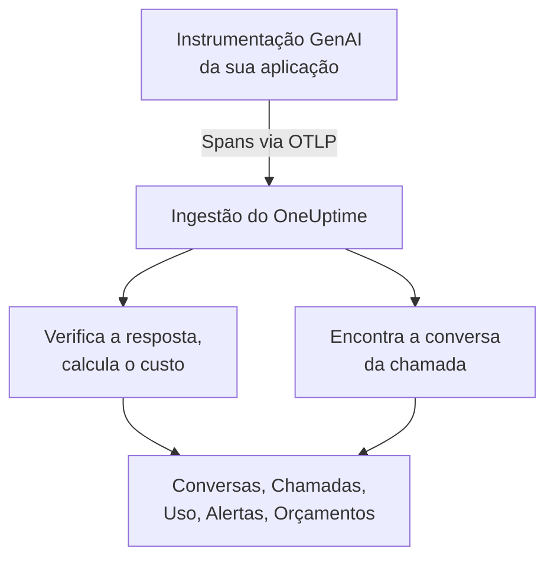
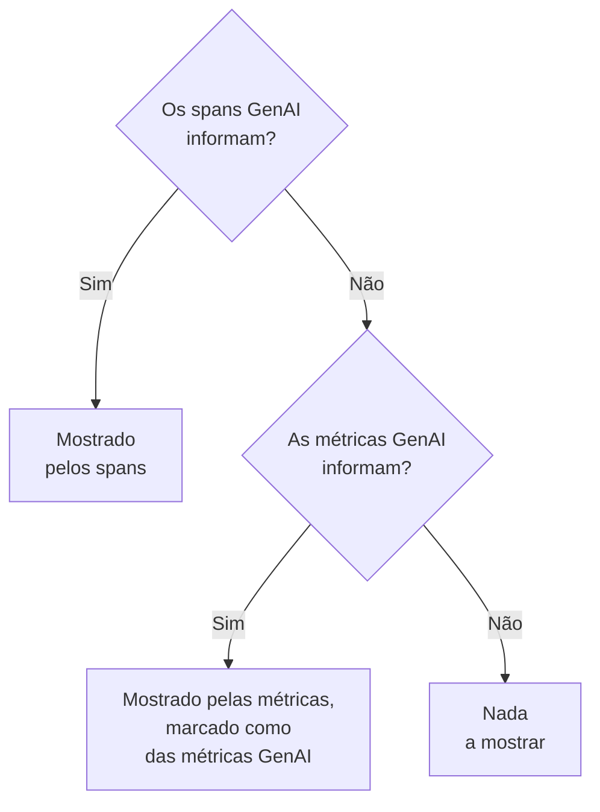

# Observabilidade de IA / LLM

Leia cada conversa que sua IA teve, repita-a do jeito que aconteceu e seja avisado quando ela responder mal. O OneUptime constrói tudo isso a partir do OpenTelemetry padrão: se sua aplicação envia spans com as **convenções semânticas GenAI** (`gen_ai.*`), você obtém conversas, alertas, uso e custo, sem nenhum SDK proprietário.

:::cards
- [Configure](#configure-em-cinco-passos): Cinco passos, do primeiro span às respostas sinalizadas.
- [Repita uma conversa](#leia-e-repita-uma-conversa): Leia um chat como a pessoa o viu, no ritmo em que aconteceu.
- [Receba alertas](#seja-avisado-quando-a-ia-responder-mal): Alertas prontos para respostas que falham, são recusadas, cortadas, sinalizadas ou lentas.
- [Acompanhe o gasto](#veja-quem-gasta-o-quê): Custo por pessoa, equipe, modelo e aplicação, com orçamentos diários.
:::

## Como funciona

A instrumentação GenAI da sua aplicação exporta cada chamada ao modelo como um span do OpenTelemetry. Quando o span chega, o OneUptime lê seus atributos `gen_ai.*`, verifica se a resposta tem problemas, calcula o preço da chamada e a arquiva na conversa a que pertence.



Abra **Produtos → AI / LLM**, em **Observabilidade**. O produto tem sete abas:

| Aba | O que mostra |
| --- | --- |
| **Conversas** | Cada conversa que sua IA teve, primeiro as que precisam de atenção. Acima da lista: conversas, respostas da IA, quantas precisam de atenção, custo e o tempo de resposta típico. |
| **Chamadas** | Cada chamada de modelo, embedding, agente e ferramenta. Filtre por serviço, provedor, modelo, operação, pessoa, equipe ou conversa; clique em uma chamada para abri-la no visualizador de traces. |
| **Uso** | Chamadas, tokens e custo de um período, ordenados por funcionário, equipe, modelo, provedor ou aplicação. |
| **Alertas** | Alertas prontos para quando a IA responde mal, e seus monitores de IA / LLM. |
| **Orçamentos** | Limites de custo diários, publicados como métricas sobre as quais você pode alertar. |
| **Preços** | Seus próprios preços para modelos que a lista de preços embutida não conhece. |
| **Configuração** | Os cinco passos abaixo, com o endpoint do seu projeto. |

No visualizador de traces, o span de cada chamada de IA também tem uma aba **LLM**: provedor, modelo, tokens, custo, parâmetros da requisição, e o prompt e a resposta.

## Antes de começar

- Um projeto do OneUptime em que você possa criar uma chave de ingestão de telemetria.
- Uma aplicação que chama um modelo, e uma instrumentação GenAI para a linguagem dela: **OpenLLMetry** (Traceloop), **OpenInference** (Arize), o **Vercel AI SDK**, ou as instrumentações do OpenTelemetry para OpenAI, Anthropic e Gemini.

> [!TIP]
> O tráfego para os modelos que passa por um gateway como LiteLLM ou Portkey pode ser exportado pelo gateway em vez de por cada aplicação: veja [Gateways de IA](/docs/telemetry/ai-gateways). Para os assistentes de programação que seus engenheiros usam, veja [Assistentes de programação com IA](/docs/telemetry/ai-coding-assistants).

## Configure em cinco passos

O primeiro passo é tudo de que você precisa para ver chamadas. Cada passo seguinte mostra mais.

:::steps
### Envie suas chamadas de IA

Crie uma chave de ingestão em **Configurações do projeto → Telemetria e APM → Chaves de ingestão** (o [início rápido do OpenTelemetry](/docs/telemetry/open-telemetry#criar-uma-chave-de-ingestão) mostra como). Depois aponte sua instrumentação para o OneUptime:

:::tabs
@tab Python
```bash
pip install traceloop-sdk opentelemetry-exporter-otlp
```

```python
from traceloop.sdk import Traceloop

Traceloop.init(
    app_name="my-ai-agent",
    api_endpoint="https://oneuptime.com/otlp",
    headers={"x-oneuptime-token": "YOUR_INGESTION_TOKEN"},
)
# Your OpenAI, Anthropic and LangChain calls are now traced.
```
@tab Node.js
```bash
npm install @traceloop/node-server-sdk
```

```typescript
import * as traceloop from "@traceloop/node-server-sdk";

traceloop.initialize({
  appName: "my-ai-agent",
  baseUrl: "https://oneuptime.com/otlp",
  headers: { "x-oneuptime-token": "YOUR_INGESTION_TOKEN" },
});
```
@tab OpenTelemetry SDK
```bash
export OTEL_EXPORTER_OTLP_ENDPOINT="https://oneuptime.com/otlp"
export OTEL_EXPORTER_OTLP_HEADERS="x-oneuptime-token=YOUR_INGESTION_TOKEN"
export OTEL_EXPORTER_OTLP_PROTOCOL="http/protobuf"
export OTEL_SERVICE_NAME="my-ai-agent"
```
:::

Hospeda o OneUptime por conta própria? Use `https://YOUR-ONEUPTIME-HOST/otlp` em vez de `https://oneuptime.com/otlp`. Chame seu modelo uma vez, e a chamada aparece em **Chamadas**.

### Registre o que foi dito

Uma conversa mostra o que as pessoas perguntaram e o que a IA respondeu somente quando sua instrumentação registra isso. O OpenLLMetry registra prompts e respostas, a menos que você defina `TRACELOOP_TRACE_CONTENT=false`. As instrumentações do OpenTelemetry só os registram quando você pede:

```bash
export OTEL_INSTRUMENTATION_GENAI_CAPTURE_MESSAGE_CONTENT=true
```

Instrumentações mais novas do OpenTelemetry aceitam `span_only`, `event_only` ou `span_and_event` em vez de `true`. Sem conteúdo registrado, uma conversa ainda mostra seus tempos, seu custo e seus problemas. Os prompts podem conter dados sensíveis: [Privacidade e ocultação](#privacidade-e-ocultação) mostra como mascará-los antes de serem armazenados.

### Agrupe as chamadas em conversas

Um aplicativo de chat faz uma chamada ao modelo por turno. Defina `gen_ai.conversation.id` (ou `session.id`) com o id do seu chat em cada chamada de IA, e cada chat aparece como uma única conversa, não importa quantas chamadas e traces ele tenha levado. Com o OpenLLMetry, defina uma vez por requisição:

```python
from traceloop.sdk import Traceloop

Traceloop.set_association_properties({
    "session_id": chat.id,
    "user_email": user.email,
})
```

Com o Vercel AI SDK, passe o id do chat como `experimental_telemetry: { metadata: { sessionId } }`. Chamadas sem id de conversa continuam aparecendo, uma requisição (um trace) de cada vez.

### Informe quem perguntou

Defina `user.id` ou `user.email` em cada chamada de IA (a propriedade de associação acima define o e-mail). Cada conversa passa então a mostrar com quem foi, você pode buscar na lista por pessoa, e a aba **Uso** ordena o gasto por funcionário. [Atribuição a funcionários e equipes](/docs/telemetry/ai-coding-assistants#atribuição-a-funcionários-e-equipes) lista cada chave de identidade que o OneUptime lê.

### Sinalize respostas ruins

O OneUptime verifica cada resposta assim que ela chega e marca o que deu errado:

| Problema | O que significa | Detectado por |
| --- | --- | --- |
| Com falha | A chamada terminou em erro, então nenhuma resposta chegou | O status do span Error, `error.type`, ou um motivo de término `error` |
| Recusada | A IA se recusou, ou um filtro de segurança bloqueou a resposta | Um motivo de término de recusa ou de segurança (`content_filter`, `refusal`, `SAFETY` e similares), uma recusa na resposta, ou uma resposta que começa com uma recusa padrão em inglês |
| Cortada | A resposta parou no limite de tokens | Um motivo de término `length`, `max_tokens` ou `MAX_TOKENS` |
| Vazia | Nenhum texto e nenhuma chamada de ferramenta | Conteúdo registrado que não contém nada, ou 0 tokens de saída |
| Sinalizada | Uma avaliação enviada pela sua aplicação disse que a resposta era ruim | Um evento `gen_ai.evaluation.result` |

As quatro primeiras não precisam de nada da sua parte. Para sinalizar uma resposta que seu guardrail, sua avaliação ou um botão de polegar para baixo rejeita, adicione um evento `gen_ai.evaluation.result` ao span da resposta, enquanto o span está aberto, com `gen_ai.evaluation.score.label` definido como `fail`:

```python
from opentelemetry import trace

trace.get_current_span().add_event(
    "gen_ai.evaluation.result",
    {
        "gen_ai.evaluation.name": "relevance",
        "gen_ai.evaluation.score.label": "fail",
        "gen_ai.evaluation.explanation": "The answer is about another product.",
    },
)
```

Rótulos como `incorrect`, `wrong`, `unhelpful`, `toxic`, `unsafe` e `hallucination` também contam como falha. O OneUptime nunca envia suas conversas a outra IA para julgá-las: cada verificação lê apenas o que a própria chamada carrega.
:::

## Leia e repita uma conversa

Uma conversa abre inteira, do jeito que um aplicativo de chat mostra o histórico: o que a pessoa disse à direita, as respostas da IA à esquerda com modelo, hora, tokens e custo, as chamadas de ferramentas no meio, e o que deu errado marcado onde aconteceu. **Detalhes** abaixo de uma resposta mostra por que ela parou, suas avaliações e um link para a chamada em Traços.

A barra na parte de baixo repete a conversa do jeito que a pessoa a viveu:

| Controle | O que faz |
| --- | --- |
| **Repetir** | Reproduz a conversa desde a primeira mensagem, no ritmo em que aconteceu. "A IA está respondendo…" conta o tempo enquanto uma resposta está a caminho. Clique na hora de qualquer mensagem para repetir a partir dali. |
| **Pular esperas** | Ativado por padrão: encurta qualquer silêncio de mais de 3 segundos. |
| `1x` | Muda a velocidade: 1x, 2x, 4x ou 8x. |
| **K**, **J** ou **←**, **L** ou **→** | Reproduzir ou pausar, voltar uma mensagem, avançar uma mensagem. |

O endereço da página guarda a mensagem em que uma repetição parou (`?step=`), então um link que você compartilha abre naquele momento.

## Seja avisado quando a IA responder mal

A aba **Alertas** lista os alertas que a maioria das aplicações de IA quer. Escolher um abre **Criar monitor** já preenchido, e você pode mudar qualquer coisa antes de salvar:

| Alerta | Quando avisa você | Severidade |
| --- | --- | --- |
| As respostas dão errado | Mais de 5% das respostas em 15 minutos falham, são recusadas, cortadas, vazias ou sinalizadas | Warning |
| As chamadas de IA falham | Mais de 10% das chamadas ao modelo em 5 minutos terminam em erro | Critical |
| A IA se recusa a responder | Mais de 5% das respostas em 30 minutos são recusas | Warning |
| As respostas são cortadas | 3 ou mais respostas em 30 minutos param no limite de tokens | Warning |
| As respostas são sinalizadas | Uma avaliação marca uma resposta como ruim | Warning |
| As respostas estão lentas | Mais de 10% das respostas em 15 minutos levam mais de 30 segundos | Warning |
| A IA para de responder | A IA não dá nenhuma resposta por 30 minutos | Critical |

Os alertas sobre uma parcela das respostas também esperam por pelo menos 3 respostas ruins, então uma resposta ruim em duas não aciona ninguém. Um alerta Critical recebe a severidade de alerta mais alta do seu projeto e um alerta Warning a seguinte: High e Low em um projeto novo.

Cada alerta é um monitor de **IA / LLM**. As configurações dele dizem o que conta como resposta ruim (**Contar uma resposta como ruim quando ela**, **Ou leva mais de (segundos)**), até onde cada verificação olha para trás (**Janela de tempo**, 15 minutos por padrão), quais **Apps** ele observa e, em **Mais campos**, qual **Modelo**. Uma **Pré-visualização** mostra o que o monitor contaria agora. Seus critérios comparam três números: **Respostas ruins da IA (em %)**, **Respostas ruins da IA** e **Respostas da IA**.

Um alerta pronto dispara um alerta que se resolve sozinho, e mostra o monitor como **Degraded** enquanto as respostas estão ruins. O incidente dele vem preenchido, mas desativado: ative-o para acionar alguém.

## Veja quem gasta o quê

A aba **Uso** mostra as chamadas, os tokens e o custo de um período (os últimos 7 dias, a menos que você escolha outro), e uma tabela dos 25 primeiros em uma de cinco divisões: **Funcionário**, **Equipe**, **Modelo**, **Provedor** e **Aplicação / Serviço**. Chamadas que não citam ninguém são contadas em **Sem atribuição**, nunca descartadas.

Pessoas e equipes vêm dos atributos de identidade da chamada: veja [Atribuição a funcionários e equipes](/docs/telemetry/ai-coding-assistants#atribuição-a-funcionários-e-equipes).

### Primeiro os spans, as métricas completam

Os spans GenAI carregam o modelo, os tokens e o custo de uma chamada, então, onde existem, respondem a tudo. Algumas ferramentas publicam métricas de tokens e de custo e nenhum span GenAI, como a maioria dos assistentes de programação. O OneUptime lê essas métricas apenas para um número que os spans não informaram, e nunca soma os dois: muitas instrumentações enviam ambos para a mesma chamada, e somá-los contaria cada dólar duas vezes.



| Onde | O que recorre às métricas | Quando |
| --- | --- | --- |
| Tokens de entrada e de saída | Os dois totais | Os totais de tokens dos spans são ambos 0 |
| Custo (USD) | O custo, com o custo em micro-USD do Codex convertido para USD | O total de custo dos spans é 0 |
| Chamadas de LLM | Nada: apenas spans | — |
| Tabelas **Funcionário**, **Equipe**, **Modelo** | Só o custo; as células de chamadas e tokens mostram `—` | Essa tabela não encontrou linhas de spans |
| Tabelas **Provedor**, **Aplicação / Serviço** | Nada: apenas spans | — |
| Conversas | Nada: as conversas são construídas a partir de spans | — |

Um número tirado das métricas é marcado como **das métricas GenAI**, porque não tem linhas correspondentes em **Chamadas**. Então, quando seus spans GenAI informam um número, a parcela de uma ferramenta que envia só métricas não aparece. Para ver o gasto dessa ferramenta separadamente, envie-a para um projeto só dela, onde não chegam spans GenAI.

## Quanto custa uma chamada

Um custo informado pela sua instrumentação (`gen_ai.usage.cost`) é usado como está, mesmo quando é 0. Quando nenhum é informado, o OneUptime estima um quando o span chega, a partir das contagens de tokens e de uma lista de preços embutida para modelos comuns da OpenAI, Anthropic, Google Gemini, Mistral, DeepSeek, xAI, Cohere, Amazon Nova e Meta Llama. O preço do modelo servido é buscado primeiro, depois o do modelo solicitado.

Os modelos são casados pelo prefixo de nome mais longo, então ids com data ou decorados pelo fornecedor, como `gpt-4o-2024-08-06` e `us.anthropic.claude-sonnet-4-5-20250929-v1:0`, encontram o preço da sua família. Um modelo que a lista não conhece, inclusive um lançamento novo, nunca é adivinhado: seu custo fica em 0 até você definir um preço. As estimativas usam preços de tabela, sem descontos de cache ou de lote.

Para definir você mesmo o preço de um modelo (uma tarifa negociada, um modelo com fine-tuning ou um modelo que você hospeda), adicione-o na aba **Preços**, em **Preços personalizados de LLM**: um **Prefixo do modelo**, um **Preço de entrada (USD por 1M de tokens)** e um **Preço de saída (USD por 1M de tokens)**. Vence o prefixo correspondente mais longo entre os seus preços e a lista embutida; em caso de empate, vence o seu preço. Um preço se aplica às chamadas que chegam cerca de um minuto depois de você salvá-lo; as chamadas já armazenadas mantêm o custo.

## Orçamentos de custo diários

Um orçamento acompanha o gasto de um dia, em USD, ao longo do dia UTC. A cada 15 minutos, o OneUptime soma o gasto de IA do dia (dos spans, ou das métricas de custo GenAI quando nenhum span informou gasto), mostra-o no orçamento e publica duas métricas:

| Métrica | O que é |
| --- | --- |
| `oneuptime.llm.budget.spend.usd` | O gasto do dia até agora, em USD |
| `oneuptime.llm.budget.percent.used` | O gasto como porcentagem do limite diário |

Ambas carregam `oneuptime.llm.budget.id` e `oneuptime.llm.budget.name`, e o escopo do orçamento quando ele tem um.

:::steps
### Crie o orçamento

Na aba **Orçamentos**, clique em **Criar: LLM Cost Budget**. Dê a ele um nome e um **Orçamento diário (USD)**, e deixe o escopo vazio para o projeto inteiro, ou escolha um **Serviço (opcional)**, um **Provedor de LLM (opcional)** ou um **Modelo de LLM (opcional)**. Vários orçamentos podem acompanhar escopos diferentes.

### Alerte sobre ele

Crie um [monitor de métricas](/docs/monitor/metrics-monitor) sobre `oneuptime.llm.budget.percent.used`, filtrado por `oneuptime.llm.budget.id` (o nome muda quando você renomeia o orçamento). Adicione um critério `>= 80` que dispara um aviso e outro `>= 100` que dispara um alerta crítico.

### Amplie a janela

Defina a janela móvel do monitor como 30 minutos. Um orçamento publica um ponto a cada 15 minutos, então a janela padrão de 1 minuto não encontraria nada entre dois pontos.
:::

Um alerta de orçamento também pode executar um workflow que interrompe um agente descontrolado: veja [Disjuntores para agentes de IA](/docs/telemetry/ai-agent-circuit-breaker).

## Dashboards e alertas de métricas

Métricas GenAI como `gen_ai.client.token.usage` e `gen_ai.client.operation.duration` chegam como métricas comuns do OpenTelemetry. Mostre-as em um [dashboard](/docs/dashboards/index), ou alerte sobre elas com um [monitor de métricas](/docs/monitor/metrics-monitor), por exemplo quando o p95 de `gen_ai.client.operation.duration` passa de um limite, agrupado por modelo.

## Privacidade e ocultação

As chamadas de IA são armazenadas como spans de trace, então as **Regras de mascaramento** e os **Filtros de descarte** dos traces se aplicam a elas: mascare um atributo, ou descarte um span, antes que ele seja armazenado. Você encontra os dois em **Traços → Configurações**. A coluna de e-mail do funcionário é mascarada junto com o atributo de onde foi lida, então uma regra que mascara e-mails também a cobre.

As conversas são lidas com a mesma permissão dos traces: quem pode ler os traces do projeto pode ler suas conversas, e mais ninguém.

## Atributos que o OneUptime lê

O OneUptime lê as convenções GenAI do OpenTelemetry, e as grafias que o OpenLLMetry, o OpenInference, o Vercel AI SDK e o LiteLLM usam, então as bibliotecas comuns funcionam como estão. Para cada valor, vence a primeira chave que o span carrega:

| Valor | Chaves, na ordem em que são testadas |
| --- | --- |
| Provedor | `gen_ai.system`, `gen_ai.provider.name`, `llm.system`, `llm.provider` |
| Operação | `gen_ai.operation.name`, `llm.request.type`, `openinference.span.kind` |
| Modelo solicitado | `gen_ai.request.model`, `llm.model_name`, `llm.request.model` |
| Modelo servido | `gen_ai.response.model`, `llm.response.model` |
| Tokens de entrada | `gen_ai.usage.input_tokens`, `gen_ai.usage.prompt_tokens`, `llm.token_count.prompt`, `llm.usage.prompt_tokens` |
| Tokens de saída | `gen_ai.usage.output_tokens`, `gen_ai.usage.completion_tokens`, `llm.token_count.completion`, `llm.usage.completion_tokens` |
| Total de tokens | `gen_ai.usage.total_tokens`, `llm.token_count.total`, `llm.usage.total_tokens` |
| Custo (USD) | `gen_ai.usage.cost`, `gen_ai.usage.cost_usd`, `gen_ai.usage.total_cost`, `llm.usage.total_cost`, `gen_ai.cost.total_cost`, `litellm.cost.total` |
| Conversa | `gen_ai.conversation.id`, `session.id`, `langfuse.session.id`, `traceloop.association.properties.session_id`, `ai.telemetry.metadata.sessionId` |
| Agente | `gen_ai.agent.name`, `agent.name` |
| Ferramenta | `gen_ai.tool.name`, `tool.name`, `ai.toolCall.name` |
| Motivo de término | `gen_ai.response.finish_reasons`, `gen_ai.response.finish_reason`, `llm.response.finish_reason`, `ai.response.finishReason` |
| Erro | `error.type` |

Um span conta como chamada de IA quando carrega qualquer um desses valores, ou qualquer atributo que comece com `gen_ai.`, `llm.` ou `traceloop.`. O total de tokens é entrada mais saída quando nenhum total é informado. As chaves `gen_ai.usage.total_tokens` e `gen_ai.usage.cost` não fazem parte das convenções, que não definem nenhuma das duas; o OneUptime as lê porque instrumentações comuns as enviam.

As chaves de identidade (quem fez a chamada, e a equipe dessa pessoa) estão listadas em [Atribuição a funcionários e equipes](/docs/telemetry/ai-coding-assistants#atribuição-a-funcionários-e-equipes).

### De onde os prompts e as respostas são lidos

A visualização da conversa lê as mensagens de uma chamada, nesta ordem, de:

- o evento `gen_ai.client.inference.operation.details`;
- os atributos `gen_ai.input.messages`, `gen_ai.output.messages` e `gen_ai.system_instructions`;
- os eventos antigos por papel: `gen_ai.system.message`, `gen_ai.user.message`, `gen_ai.assistant.message`, `gen_ai.tool.message` e `gen_ai.choice`;
- os atributos indexados: `gen_ai.prompt.N.content` e `gen_ai.completion.N.content` do OpenLLMetry, `llm.input_messages.N.message.content` e `llm.output_messages.N.message.content` do OpenInference;
- os arrays de mensagens em `gen_ai.prompt`, `gen_ai.completion`, `ai.prompt.messages`, `ai.response.text`, `input.value` e `output.value`.

## Solução de problemas

:::details As chamadas chegam, mas nenhuma conversa mostra texto
Sua instrumentação não está registrando o conteúdo. Ative-o como mostra [Registre o que foi dito](#registre-o-que-foi-dito); as chamadas feitas antes disso ficam sem texto.
:::

:::details Cada chamada de um chat aparece como uma conversa separada
As chamadas não carregam um id de conversa. Defina `gen_ai.conversation.id` ou `session.id` em cada chamada do chat, como mostra [Agrupe as chamadas em conversas](#agrupe-as-chamadas-em-conversas).
:::

:::details As chamadas mostram tokens, mas custam US$ 0
O modelo não está na lista de preços embutida, ou o span não cita nenhum modelo. Adicione os preços do modelo na aba **Preços**; as chamadas que chegarem depois terão preço.
:::

:::details A aba Uso diz das métricas GenAI e mostra `—` em chamadas e tokens
Os números vêm de uma ferramenta que envia métricas e nenhum span GenAI, como um assistente de programação. Uma métrica carrega o custo, mas nenhum detalhe por chamada, então essas células ficam vazias. Veja [Primeiro os spans, as métricas completam](#primeiro-os-spans-as-métricas-completam).
:::

:::details Um monitor de orçamento alterna entre dois estados
A janela móvel do monitor é menor que 15 minutos, então às vezes ela não encontra nenhum ponto. Defina-a como 30 minutos.
:::

## Próximos passos

:::cards
- [Assistentes de programação com IA](/docs/telemetry/ai-coding-assistants): Gasto por engenheiro para Claude Code, Cursor, Codex, Gemini CLI e Copilot.
- [Gateways de IA](/docs/telemetry/ai-gateways): Faça o trace das chamadas a modelos de todas as aplicações a partir de um único gateway LiteLLM ou Portkey.
- [Disjuntores para agentes de IA](/docs/telemetry/ai-agent-circuit-breaker): Pare um agente descontrolado quando um alerta de orçamento disparar.
- [OpenTelemetry](/docs/telemetry/open-telemetry): Endpoints, chaves de ingestão e limites para cada sinal.
:::
