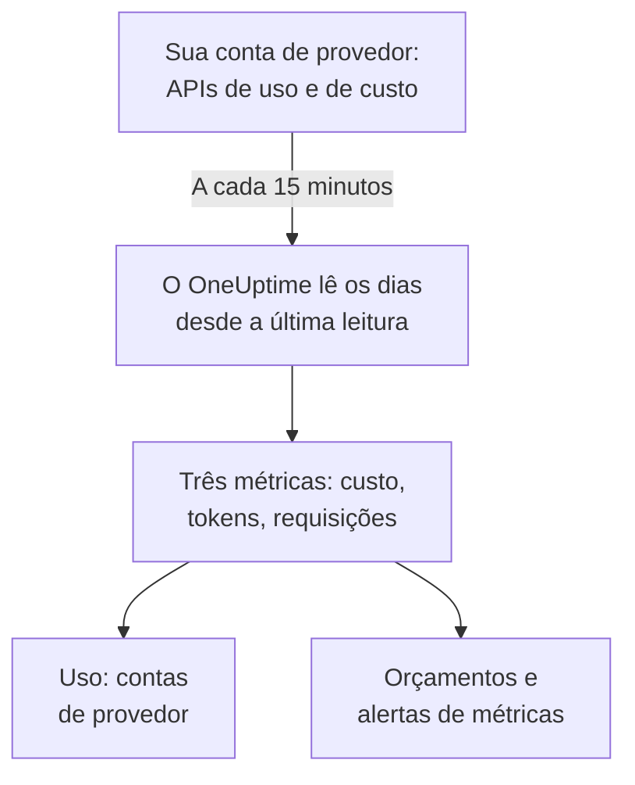

# Contas de provedores de IA

Veja o que suas contas de provedores de IA usaram e quanto custaram, sem mudar suas aplicações. Conecte uma conta da OpenAI, Anthropic, Azure OpenAI e Microsoft Foundry, Amazon Bedrock ou Google Vertex AI com uma credencial que só pode ler, e o OneUptime lê o uso dela a cada 15 minutos em **Uso**, **Orçamentos** e métricas sobre as quais você pode criar alertas.

:::cards
- [Conectar uma conta](#conectar-uma-conta): Escolha o provedor, cole a credencial, teste e conecte.
- [O que cada provedor oferece](#o-que-cada-provedor-oferece): Custo, tokens e requisições, e como cada provedor os agrupa.
- [Ver o uso](#ver-o-uso): Por modelo, pessoa, projeto ou recurso, chave de API e conexão.
- [Orçamentos e alertas](#orçamentos-e-alertas): Um orçamento diário sobre a fatura e alertas sobre as métricas.
:::

## Como funciona

A cada 15 minutos, o OneUptime pede a cada conta conectada o uso dela por dia UTC e o guarda como três métricas do serviço próprio da conexão. Cada leitura pega os dias desde a última leitura e, de novo, os últimos 3 dias, hoje incluído, porque os provedores continuam somando ao dia de hoje e corrigem os dias que acabaram de passar.

O uso de uma conta é o que foi cobrado dela, um dia de cada vez. Ele não tem conversas, prompts nem respostas: para isso, envie as chamadas de IA das suas aplicações como mostra [Observabilidade de IA / LLM](/docs/telemetry/ai-llm-observability). As duas coisas ficam separadas, então nada é contado duas vezes.

## Antes de começar

- O papel Project Owner ou Project Admin. Só eles podem conectar, alterar ou remover uma conta; todos que leem a telemetria do projeto veem as conexões e o uso.
- Uma credencial da conta, de alguém que a administra. A seção de cada provedor, abaixo, diz qual e onde ela é criada.
- Nada para instalar: o OneUptime chama a API do provedor a partir dos próprios servidores.

## Conectar uma conta

:::steps
### Abra Conectar

Abra **Produtos → AI / LLM → Conectar**. Em **Suas contas de provedores de IA**, clique no bloco do provedor.

### Cole a credencial

Em **Credenciais**, preencha o que o provedor pede. Os segredos são guardados criptografados e nunca mais são mostrados, nem no Dashboard nem pela API. **Nome** e as configurações que quase ninguém muda ficam em **Mais campos**.

### Teste

Em **Testar**, clique em **Testar conexão**. O OneUptime lê o uso dos últimos 7 dias e mostra o que encontrou: custo, tokens, requisições, modelos, pessoas, chaves e projetos. Nada é guardado até você conectar.

### Conecte

Clique em **Conectar**. A primeira leitura começa em até um minuto e traz os últimos 30 dias.
:::

As contas conectadas aparecem abaixo dos blocos, com **Status** e **Última leitura**. **Ler agora** lê na hora, **Testar** confere de novo as configurações guardadas, **Desativar** para de ler e mantém o que foi lido, e **Editar** muda as configurações: um segredo deixado em branco mantém o guardado. **View error** mostra por que uma leitura falhou, sem nenhum segredo.

## O que cada provedor oferece

| Provedor | Custo | Agrupado por | Credencial |
| --- | --- | --- | --- |
| OpenAI | O que a OpenAI informa | Projeto, chave de API, pessoa e modelo | Uma chave de administrador |
| Anthropic | O que a Anthropic informa | Workspace, chave de API, pessoa e modelo | Uma chave de administrador |
| Azure OpenAI e Microsoft Foundry | Estimado a partir dos tokens | Recurso e modelo | Um app com Monitoring Reader |
| Amazon Bedrock | Estimado a partir dos tokens | Região e modelo | Uma chave de acesso que lê o CloudWatch |
| Google Vertex AI | Estimado a partir dos tokens | Região e modelo | Uma conta de serviço com Monitoring Viewer |

Todos os provedores, menos a Anthropic, também contam as requisições: o relatório de uso da Anthropic não tem nenhuma. Um custo estimado usa a lista de preços de [Quanto custa uma chamada](/docs/telemetry/ai-llm-observability#quanto-custa-uma-chamada) e seus próprios preços em **Preços**, e é marcado como estimativa. Um modelo que a lista de preços não conhece fica sem custo até você definir o preço dele lá.

Nenhuma dessas credenciais pode chamar um modelo: cada uma lê uso, custo ou métricas, e nada mais.

## OpenAI

O OneUptime lê sua organização da OpenAI com uma chave de administrador: o uso de completions e embeddings por dia, modelo, projeto, chave de API e pessoa, e os custos de cada dia por projeto e item de linha. Um item de custo é dividido entre as chaves e as pessoas que usaram o modelo dele, então a linha de uma pessoa também tem custo. Os nomes de projetos e chaves e os e-mails das pessoas substituem os IDs da OpenAI.

:::steps
### Crie uma chave de administrador da OpenAI

No painel da OpenAI, abra Settings, Organization, Admin keys e crie uma chave. Só os proprietários da organização podem. Ela começa com `sk-admin-`.

### Conecte a OpenAI

Cole a chave como **Chave de administrador**.
:::

## Anthropic

O OneUptime lê sua organização da API do Claude com uma chave de administrador: o relatório de uso de mensagens por dia, modelo, workspace, chave de API e pessoa, e o relatório de custos por workspace e item, dividido do mesmo jeito. O Claude Code usado com as chaves ou os logins do Console da organização também está nesses relatórios, sob a pessoa ou a chave que o usou.

:::steps
### Crie uma chave de administrador da Anthropic

No Claude Console, abra Settings, Admin keys e crie uma chave. Só os administradores da organização podem. Ela começa com `sk-ant-admin01-`.

### Conecte a Anthropic

Cole a chave como **Chave de administrador**.
:::

## Azure OpenAI e Microsoft Foundry

O OneUptime lê cada recurso do Azure OpenAI e do Foundry de uma assinatura pelo Azure Monitor: tokens e requisições por dia, recurso e modelo. O Azure Monitor conta tokens, não dinheiro, e não cita pessoa nem chave, então o custo é a estimativa do OneUptime e a pessoa e a chave ficam vazias.

:::steps
### Registre um app

No Microsoft Entra ID, registre um app e crie um segredo do cliente para ele.

### Deixe-o ler as métricas

Na assinatura, dê ao app a função Monitoring Reader.

### Conecte o Azure

Preencha **ID do diretório (tenant)**, **ID do aplicativo (cliente)**, **ID da assinatura** e **Segredo do cliente**. Para o Azure Government, altere **Nuvem** em **Mais campos**.
:::

## Amazon Bedrock

O OneUptime lê as métricas do CloudWatch `AWS/Bedrock` de cada região que você indicar: tokens de entrada, de saída e de cache, e invocações, por dia e modelo. O CloudWatch conta tokens, não dinheiro, e não cita pessoa nem chave: o custo é a estimativa do OneUptime, e cada região aparece como um projeto.

:::steps
### Crie uma chave de acesso

Crie um usuário ou uma função do IAM cuja política permita `cloudwatch:GetMetricData` e `cloudwatch:ListMetrics`, e uma chave de acesso para ele.

### Conecte o Bedrock

Preencha **ID da chave de acesso**, **Chave de acesso secreta** e **Regiões**, separadas por vírgulas: `us-east-1` se você não mudar.
:::

## Google Vertex AI

O OneUptime lê as métricas do Cloud Monitoring que a Vertex AI publica para os modelos dela, o Gemini e modelos de parceiros como o Claude: tokens de entrada e de saída, e invocações, por dia, região e modelo. O Cloud Monitoring conta tokens, não dinheiro, e não cita pessoa nem chave: o custo é a estimativa do OneUptime.

:::steps
### Crie uma conta de serviço

No projeto, crie uma conta de serviço com a função Monitoring Viewer e uma chave JSON para ela.

### Conecte a Vertex AI

Preencha **ID do Projeto** e cole o arquivo de chave inteiro como **Chave da conta de serviço (JSON)**.
:::

## Ver o uso

Abra **Uso** e escolha **Contas de provedor**. Ali aparecem o custo, os tokens e as requisições que suas contas informaram para o período, ordenados por **Modelo**, **Pessoa**, **Provedor**, **Projeto ou recurso**, **Chave de API** ou **Conexão**. O período começa à meia-noite UTC do primeiro dia, porque os provedores informam dias inteiros.

**Contas de provedor** e **Suas chamadas de IA** nunca são somados. Uma chamada que sua aplicação faz com uma chave de uma conta conectada está nos dois, então somá-los a contaria duas vezes.

## Orçamentos e alertas

Um orçamento conta um ou outro. Em **Orçamentos**, crie um orçamento e defina **Contar gastos de** como **Contas de provedor**: ele conta o que foi cobrado das contas conectadas no dia UTC, restrito por **Provedor de LLM (opcional)** e **Modelo de LLM (opcional)** quando você os define. Os provedores informam o uso de um dia com minutos ou horas de atraso, então, para alertas em minutos, use **Suas chamadas de IA** no orçamento.

O uso de cada conta é guardado como três métricas, que você pode exibir em um [dashboard](/docs/dashboards/index) ou vigiar com um [Monitor de métricas](/docs/monitor/metrics-monitor):

| Métrica | O que é |
| --- | --- |
| `oneuptime.llm.provider.cost` | O custo de um dia, em USD |
| `oneuptime.llm.provider.tokens` | Os tokens de um dia, por `gen_ai.token.type`: `input` (tokens em cache incluídos), `output`, `cache_read` e `cache_write` |
| `oneuptime.llm.provider.requests` | As requisições de um dia |

Cada ponto tem o horário de início do seu dia UTC. Ele traz `oneuptime.llm.connection.id` e `oneuptime.llm.connection.name`, e o que o provedor cita: `gen_ai.provider.name`, `gen_ai.request.model`, `user.email`, `oneuptime.llm.provider.project` e `oneuptime.llm.provider.api_key`. Um custo estimado traz `oneuptime.llm.cost.estimated`.

## Quando as leituras acontecem

| Leitura | Quando |
| --- | --- |
| A primeira | Em até um minuto após conectar, 30 dias para trás |
| As seguintes | A cada 15 minutos |
| Depois que uma chave ou permissão é recusada | 60 minutos depois |
| Depois de qualquer outra falha | 15 minutos depois |
| Desligada | Nenhuma até ser ligada de novo |

Um plano sem recursos de telemetria não lê nada. Remover uma conexão interrompe as leituras dela e mantém o que ela leu até a retenção do serviço apagar.

## Por que o OneUptime não tem um gateway próprio

O OneUptime lê suas contas; ele nunca fica entre suas aplicações e os provedores. Um proxy guardaria suas chaves de provedor e acrescentaria um salto a cada chamada de modelo que suas aplicações fazem. Se o seu tráfego de modelos já passa pelo LiteLLM, pelo Portkey ou pelo OpenRouter, envie os traces do gateway ao OneUptime como mostra [Gateways de IA](/docs/telemetry/ai-gateways), e conecte a conta para a fatura dela.

## Solução de problemas

:::details O teste diz que a chave ou o segredo não foi aceito
Confira se você copiou tudo, se ela não foi revogada e se é do tipo que este provedor pede: uma chave de administrador da OpenAI ou da Anthropic, não uma chave de projeto ou de API.
:::

:::details A credencial funciona, mas não pode ler o que a conexão precisa
Dê a ela a função que esta página cita para o provedor: Monitoring Reader na assinatura do Azure, as duas ações do CloudWatch na AWS, Monitoring Viewer no projeto do Google Cloud.
:::

:::details O teste passa, mas nada aparece para hoje
Os provedores informam o uso de um dia minutos ou horas depois e o corrigem por um ou dois dias. As próximas leituras o trazem.
:::

:::details O custo é diferente da fatura
Um custo informado é o número do provedor antes de impostos, créditos e descontos. Um custo estimado são tokens ao preço de tabela, ou aos seus próprios preços em **Preços**.
:::

## Próximos passos

:::cards
- [Observabilidade de IA / LLM](/docs/telemetry/ai-llm-observability): Conversas, alertas e custo das chamadas de IA das suas próprias aplicações.
- [Ferramentas de IA da empresa](/docs/telemetry/ai-company-tools): O que sua equipe pergunta ao Claude Enterprise e ao Microsoft 365 Copilot.
- [Gateways de IA](/docs/telemetry/ai-gateways): Rastreie cada chamada de modelo pelo LiteLLM, Portkey ou OpenRouter.
- [Monitor de métricas](/docs/monitor/metrics-monitor): Crie alertas sobre as métricas dos provedores.
:::
