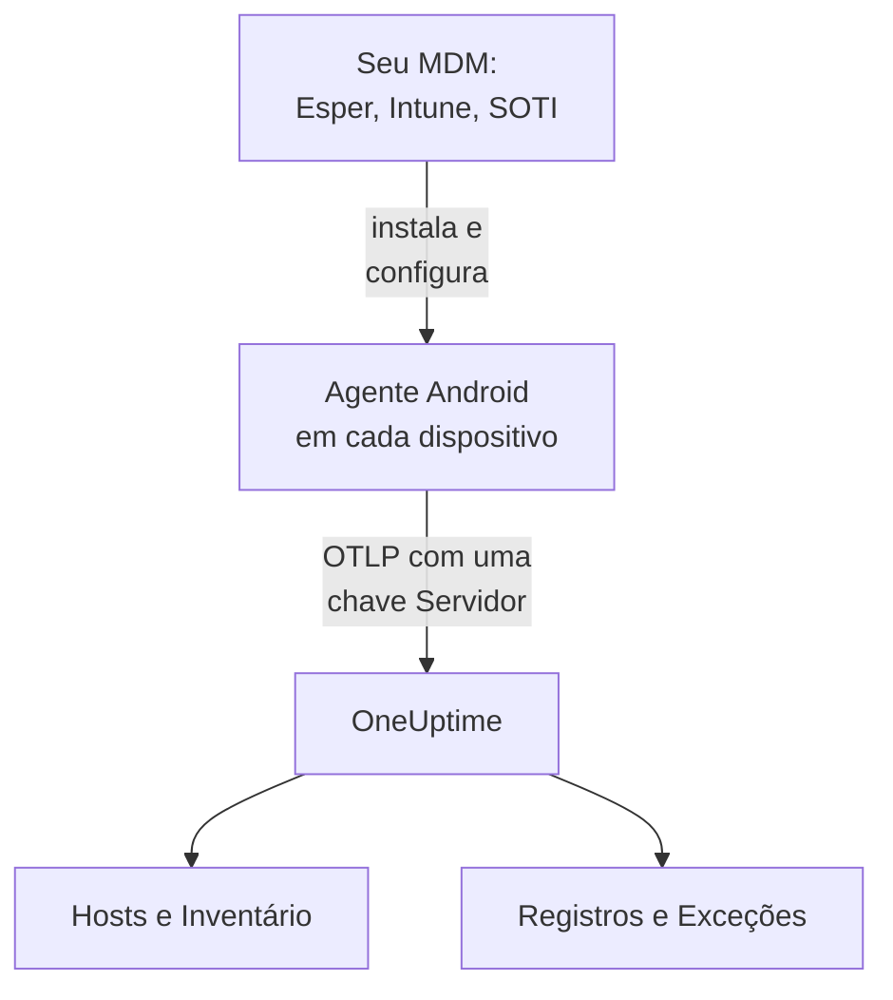

# Agente Android

O agente Android do OneUptime envia ao OneUptime os dados de um dispositivo Android da sua organização, como um quiosque de pedidos, um terminal de PDV, um coletor portátil ou um player de sinalização digital: a memória, o armazenamento, a rede, a bateria e a temperatura dele, as reinicializações, os aplicativos instalados nele e os crashes e logs desses aplicativos. O seu gerenciador de dispositivos o instala e configura em toda a frota de uma só vez. Cada dispositivo vira um host em **Hosts** e um item em **Inventário**, ao lado dos seus servidores e das suas máquinas Windows.

:::cards
- [Quando usar](#o-agente-ou-a-instrumentação-do-aplicativo): O agente vê o dispositivo; a instrumentação do aplicativo vê o seu aplicativo.
- [Implantar com o Esper](#implantar-com-o-esper): Envie o APK, distribua as configurações e inicie o agente uma vez.
- [Configurações](#configurações): Cada chave da configuração gerenciada do agente.
- [Ler os logs de outros aplicativos](#ler-os-logs-de-outros-aplicativos): Conceda READ_LOGS uma vez, com o adb ou com o seu gerenciador de dispositivos.
- [Sessões de registros](#sessões-de-registros): Os logs de todos os aplicativos por um tempo, permitidos pela pessoa diante do dispositivo.
:::

## Como funciona

O agente é um pequeno aplicativo que roda como um serviço em primeiro plano. A cada minuto, ele lê a integridade do dispositivo e a envia ao seu OneUptime por OTLP com uma chave de ingestão **Servidor**, junto com as reinicializações, os aplicativos instalados e os logs do dispositivo. Ele inicia sozinho quando o dispositivo é ligado, guarda no próprio dispositivo o que coleta enquanto a rede está fora do ar e envia tudo quando a rede volta. Ele nunca mantém acordado um dispositivo em repouso e comprime o que envia.



## O agente ou a instrumentação do aplicativo

| | [OpenTelemetry Android](/docs/rum/android-setup) no seu aplicativo | O agente Android |
| --- | --- | --- |
| O que ele vê | O seu aplicativo: os crashes, ANRs, telas, sessões, requisições e fluxos de trabalho dele | O dispositivo: memória, armazenamento, rede, bateria, reinicializações, aplicativos instalados e os crashes e ANRs de todos os aplicativos |
| Onde aparece | **Monitoramento de Usuários Reais**, **Traços** e **Exceções** | **Hosts**, **Inventário**, **Registros** e **Exceções** |
| Como instalar | No código do seu aplicativo | Como um aplicativo, pelo seu gerenciador de dispositivos |

Nos dispositivos que você possui, use os dois e dê ao dispositivo o mesmo nome nos dois lugares: a configuração `device_name` do agente e o `host.name` que o seu aplicativo define. O dispositivo passa então a ser um único item em **Inventário**, com a telemetria do aplicativo e a do dispositivo juntas.

## Antes de começar

- Dispositivos com Android 7.0 ou posterior, administrados por um gerenciador de dispositivos compatível com as configurações gerenciadas do Android: Esper, Microsoft Intune, Workspace ONE, SOTI e outros gerenciadores de dispositivos do Android Enterprise. Para um único dispositivo, o adb basta.
- Uma chave de ingestão **Servidor**, criada em **Configurações do projeto → Telemetria e APM → Chaves de ingestão** com **Criar chave de ingestão**.
- O agente: `oneuptime-android-agent.apk`, anexado a cada [versão do OneUptime](https://github.com/OneUptime/oneuptime/releases/latest).
- HTTPS de saída dos dispositivos para a sua URL do OneUptime. O agente recusa uma URL que não comece com `https://`, porque toda requisição leva a chave de ingestão.

## Implantar com o Esper

:::steps
### Enviar o APK

No console do Esper, envie `oneuptime-android-agent.apk` para a **App Library** e adicione-o ao blueprint dos dispositivos que você quer monitorar.

### Distribuir as configurações

No blueprint, abra a **Managed Configuration** do agente e cole as configurações dele. O Esper preenche os placeholders em cada dispositivo, com o Esper Agent 8.00.0764 ou posterior:

```json title="Managed configuration"
{
  "oneuptime_url": "https://oneuptime.com",
  "oneuptime_token": "YOUR_TELEMETRY_INGESTION_TOKEN",
  "device_name": "${esper.deviceName}",
  "device_serial": "${esper.serialNumber}",
  "device_type": "kiosk",
  "labels": "region=emea"
}
```

Se você hospeda o OneUptime por conta própria, coloque a sua própria URL em `oneuptime_url`. Depois, faça a convergência dos dispositivos, para que eles leiam as novas configurações.

### Iniciá-lo uma vez

Enquanto um aplicativo recém-instalado não tiver sido aberto uma vez, o Android não o inicia quando o dispositivo é ligado. Ative **Launch on Start** para o agente no blueprint, no modo Multi-App, ou abra o agente uma vez em cada dispositivo. A partir daí, ele inicia sozinho sempre que o dispositivo é ligado e depois de cada atualização.

### Encontrar os dispositivos no OneUptime

Em até um minuto, cada dispositivo aparece em **Hosts**, com o nome do `device_name` dele, e em **Inventário**. A própria tela do agente no dispositivo diz se ele está enviando dados e, quando não está, o que o impede.
:::

Outros gerenciadores de dispositivos funcionam do mesmo jeito: adicione o APK como um aplicativo de linha de negócios ou interno, defina as mesmas chaves na configuração do aplicativo e abra-o uma vez em cada dispositivo.

## Configurações

O agente lê estas chaves da configuração gerenciada dele. Um dispositivo sem configuração gerenciada pode, em vez disso, ser configurado na própria tela do agente, com a URL, a chave de ingestão e o nome do dispositivo. Uma chave digitada ali é armazenada criptografada com o Android Keystore.

| Chave | O que define | Padrão |
| --- | --- | --- |
| `oneuptime_url` | A sua URL do OneUptime | `https://oneuptime.com` |
| `oneuptime_token` | Uma chave de ingestão **Servidor** | Nenhum: sem a chave, o agente não envia nada |
| `device_name` | O nome do dispositivo em **Hosts** e **Inventário**, que é a identidade dele ali | O modelo e o início do Android ID do dispositivo |
| `device_serial` | O número de série, que o Android não fornece aos aplicativos a partir do Android 10 | Nenhum |
| `device_type` | O que o dispositivo é, como um quiosque, um terminal de PDV ou um coletor portátil | `Android device` |
| `device_location` | Onde ele está, como o número de uma loja | Nenhum |
| `labels` | Rótulos para o host, como pares `name=value` separados por vírgulas | Nenhum |
| `collection_interval_seconds` | Com que frequência ele envia dados, de 30 a 600 segundos | `60` |
| `logcat_enabled` | Se ele envia o que lê do Logcat | `true` |
| `logcat_min_level` | A severidade mínima das linhas do Logcat que ele envia no Android 12 e anteriores: `verbose`, `debug`, `info`, `warn`, `error` ou `fatal` | `warn` |
| `installed_apps_enabled` | Se ele envia a lista de aplicativos instalados | `true` |

Um placeholder que o seu gerenciador de dispositivos não preencheu, como `${esper.deviceName}` enviado do jeito que está, é ignorado, e a tela do agente avisa isso. Depois que um dispositivo começar a enviar dados, mantenha o `device_name` dele: um nome novo é um host novo.

A tela do agente, as notificações dele e os títulos e descrições que o seu gerenciador de dispositivos mostra para estas chaves ficam no idioma do dispositivo, em todos os idiomas que o painel do OneUptime fala.

## Ler os logs de outros aplicativos

O Android só deixa um aplicativo ler os logs de outros aplicativos com a permissão READ_LOGS, e só o adb pode concedê-la: nem o próprio aplicativo, nem uma política de dispositivo. Conceda-a uma vez em cada dispositivo, e ela continua concedida depois de reinicializações e atualizações:

```bash
adb shell pm grant com.oneuptime.androidagent android.permission.READ_LOGS
```

Com o Esper, execute esse comando pelo **Secure Remote ADB**: ative o acesso ADB para o dispositivo, conecte-se com `espercli secureadb connect --device DEVICE_ID` e depois execute o comando. O Android reinicia o agente quando a permissão é concedida, e o agente começa a ler na mesma hora. A coluna **ID no gerenciador de dispositivos** do inventário traz o `DEVICE_ID` de cada dispositivo.

O que o agente passa a ler depende da versão do Android:

- Android 13 e posteriores: os crashes e ANRs de todos os aplicativos. O Android só mostra as linhas de log de outros aplicativos a um aplicativo que está na tela, depois que a pessoa diante do dispositivo permite, então um agente rodando em segundo plano não consegue lê-las. Peça-as por um tempo com uma [sessão de registros](#sessões-de-registros).
- Android 12 e anteriores: os crashes e ANRs de todos os aplicativos, e as linhas de log de todos os aplicativos a partir de `logcat_min_level`.

Sem READ_LOGS, o agente envia todo o resto, e tanto a tela dele quanto os logs do dispositivo explicam como conceder a permissão.

### Stack traces de crashes e motivos de reinicialização

O Android guarda na DropBox dele o relatório completo de cada crash de aplicativo, crash nativo e ANR, e o motivo de cada reinicialização. O agente os lê de todos os aplicativos quando tem READ_LOGS e acesso ao uso e, no Android 15 e posteriores, READ_DROPBOX_DATA. Conceda-os uma vez com o adb, como a READ_LOGS:

```bash
adb shell pm grant com.oneuptime.androidagent android.permission.READ_DROPBOX_DATA
adb shell appops set com.oneuptime.androidagent GET_USAGE_STATS allow
```

O primeiro comando é para o Android 15 e posteriores; o acesso ao uso também pode ser ativado no dispositivo, em **Configurações → Acesso ao uso**. Uma política de dispositivo não consegue concedê-los, e a tela do agente lista os comandos que ainda faltam executar. Com eles, cada crash em **Exceções** tem o stack trace completo, um crash nativo o sinal e a biblioteca em que ele ocorreu, um ANR a pilha da thread principal, e uma reinicialização em **Registros** o motivo que o Android dá para ela. Números de cartão, endereços de e-mail, tokens e senhas no que o agente lê são substituídos por `[card number]`, `[email]`, `[token]` e `[redacted]` antes do envio.

### Conceder as permissões em toda a frota

Cada relatório do agente diz quais dessas permissões ainda lhe faltam. Para listar os dispositivos que precisam delas, abra **Inventário**, depois **Todos os itens**, e filtre por **Permissões do agente**: **Ausente**. Ative a coluna **Permissões do agente** para ver o que falta em cada dispositivo e exporte a lista como CSV. Ative também a coluna **ID no gerenciador de dispositivos**, e a exportação traz o ID do Esper de cada dispositivo, o `DEVICE_ID` que o `espercli secureadb connect --device` recebe.

Uma política de dispositivo não consegue concedê-las: READ_LOGS e READ_DROPBOX_DATA são permissões que só o adb, o sistema ou o fabricante do dispositivo podem dar, e o acesso ao uso é definido pelo adb ou pela pessoa diante do dispositivo. O que o Esper oferece, e por que nada disso as concede:

- **Permissões de aplicativo**, em um blueprint ou com o comando `SET_APP_PERMISSION`, passam pela API de proprietário do dispositivo do Android, que só concede as permissões que um aplicativo pede à pessoa diante do dispositivo. O Android recusa essas três.
- **Configuração gerenciada** define as configurações do próprio agente, nunca as permissões do Android.
- **Run Shell Script** roda em dispositivos Linux e Windows, não em dispositivos Android.
- **Secure Remote ADB** alcança um dispositivo por vez, a partir de um computador que roda o `espercli`. Em dispositivos com Esper Foundation, ele não precisa de ninguém diante do dispositivo. Em outros dispositivos, alguém diante do dispositivo aceita **Allow USB debugging?** na primeira vez.

Por isso, conceda-as com o adb:

- **Antes de um dispositivo ser enviado**, quando ele é preparado com um cabo USB. Isto concede as três em todos os dispositivos conectados ao computador:

  ```bash
  for serial in $(adb devices | awk 'NR > 1 && $2 == "device" { print $1 }'); do
    adb -s "$serial" shell pm grant com.oneuptime.androidagent android.permission.READ_LOGS
    adb -s "$serial" shell pm grant com.oneuptime.androidagent android.permission.READ_DROPBOX_DATA
    adb -s "$serial" shell appops set com.oneuptime.androidagent GET_USAGE_STATS allow
  done
  ```

  No Android 14 e anteriores, o segundo comando diz que a permissão é desconhecida: esse dispositivo não precisa dela.
- **Em um dispositivo em campo**, pelo Secure Remote ADB, um dispositivo da lista **Ausente** por vez.
- **Só o acesso ao uso** pode ser ativado pela pessoa diante do dispositivo, em **Configurações → Acesso ao uso**, ou com o botão na tela do agente.

O próximo relatório do dispositivo, em até um minuto, o tira da lista **Ausente**.

### Uso de CPU

A partir do Android 8, o sistema esconde dos aplicativos o uso de CPU de um dispositivo. Só um aplicativo proprietário do dispositivo consegue lê-lo, e só em dispositivos cujo hardware o informa. O agente o lê quando é o proprietário do dispositivo, o que você define com o adb em um dispositivo sem contas e sem outro proprietário:

```bash
adb shell dpm set-device-owner com.oneuptime.androidagent/.admin.AgentDeviceAdminReceiver
```

Um dispositivo do qual o seu gerenciador de dispositivos já é proprietário não pode ter um segundo proprietário, então o uso de CPU dele não está disponível, e a tela do agente avisa isso. O uso de CPU dele fica então de fora da lista de Hosts, e o modelo **High CPU Utilization** não é oferecido para ele.

## Sessões de registros

Uma sessão de registros envia os logs de todos os aplicativos de um dispositivo por um tempo, para a solução de problemas. No Android 13 e posteriores, é a única forma de ler as linhas de log de outros aplicativos, porque o Android só as mostra a um aplicativo que está na tela, depois que a pessoa diante do dispositivo permite.

:::steps
### Solicitar uma

Abra o dispositivo em **Hosts**, depois **Registros**, e clique em **Solicitar sessão de registros** em **Sessões de registros**. Escolha por quanto tempo o dispositivo envia os logs, de 15 minutos a 4 horas, e o nível mais baixo que ele envia: **Info**, **Depuração** ou **Detalhado**. Adicione uma **Nota** para dizer por que você está pedindo, como "Verificando por que o app de pagamento trava depois das 18h".

### Permitir no dispositivo

Em até um minuto, o dispositivo mostra uma notificação de que alguém pediu os logs dele, com o nome dessa pessoa e a sua nota. A pessoa diante do dispositivo abre o agente, onde a solicitação aparece com a sua nota embaixo, e toca em **Permitir**. No Android 13 e posteriores, o Android pede em seguida para permitir o acesso a todos os registros do dispositivo, e a pessoa permite isso também.

### Ler as linhas

A sessão mostra **Coletando**, e as linhas de todos os aplicativos chegam aos logs do dispositivo. Clique em **Mostrar linhas** para ver só as linhas da sessão, ou em **Baixar linhas** para salvá-las em um arquivo. A sessão termina quando o tempo dela acaba, ou quando alguém a interrompe no dispositivo ou a cancela no OneUptime.
:::

A nota é uma linha de até 200 caracteres. O dispositivo a mostra do jeito que você a escreveu, entre aspas, na notificação e na tela do agente enquanto a sessão aguarda ou roda; ela nunca é traduzida. Quebras de linha viram espaços, e números de cartão, endereços de e-mail, tokens e senhas nela são substituídos por `[card number]`, `[email]`, `[token]` e `[redacted]` antes que ela seja guardada, como acontece com o que o agente envia. A lista de sessões a mostra abaixo de quem pediu, e os **Registros de auditoria** do host a guardam com a solicitação.

**Baixar linhas** salva as linhas da sessão em um arquivo de texto no formato que o `logcat -v threadtime` imprime, que o suporte de um fornecedor consegue ler: cada linha com o horário exato ao milissegundo, o processo e a thread, o nível, a tag e a mensagem. Os horários estão em UTC. As primeiras linhas do arquivo dizem a que sessão, dispositivo e nota ele se refere, e quem pediu. Ele contém as linhas que a página **Registros** mostra, já com os dados ocultados pelo agente, então exige a mesma permissão necessária para ler os logs do dispositivo. Um arquivo contém no máximo 100.000 linhas e 32 MB; o arquivo de uma sessão mais longa termina dizendo quantas linhas a sessão tem.

Uma sessão precisa de READ_LOGS e de `logcat_enabled`; sem eles, ela mostra **Indisponível**. Só uma sessão por vez roda em um dispositivo. Uma solicitação que ninguém permite em até uma hora expira, e uma sessão durante a qual o dispositivo reinicia termina com essa reinicialização, já que a permissão do Android termina com o processo do agente. Pedir uma sessão exige permissão para editar o host, e os **Registros de auditoria** do host guardam quem pediu, e quando.

## O que ele relata

| O quê | Onde aparece no OneUptime |
| --- | --- |
| Memória, armazenamento, rede e tempo de atividade | A página do dispositivo em **Hosts**: as mesmas métricas que o coletor de um servidor envia, então os modelos de alerta de host funcionam |
| Carga e temperatura da bateria, e se o dispositivo está ligado a uma fonte de energia externa | As métricas `hw.battery.charge`, `hw.temperature` e `android.battery.plugged` |
| Estado térmico | As métricas `android.thermal.status` e `android.thermal.headroom` |
| Uso de CPU | A métrica `system.cpu.utilization`: no Android 7, e no Android 8 e posteriores quando o agente é o [proprietário do dispositivo](#uso-de-cpu) |
| Reinicializações | **Registros**, com `@event.name:device.boot`: quanto tempo o dispositivo ficou ligado, se ele desligou corretamente, quanto tempo ficou desligado, por que reiniciou e loops de reinicialização |
| Aplicativos instalados | **Registros**, com `@event.name:android.package.inventory` uma vez por dia, e cada instalação, atualização e remoção |
| Crashes e ANRs de todos os aplicativos | **Exceções**, como não tratados, com o nome do aplicativo, e com as pilhas quando o agente lê a [DropBox](#stack-traces-de-crashes-e-motivos-de-reinicialização) |
| Marca, modelo, número de série, versão do sistema operacional, nível do patch de segurança e firmware | O item do dispositivo em **Inventário**, com o filtro e a coluna **Nível do patch de segurança** |
| A idade do nível do patch de segurança | A métrica `android.os.security_patch.age`, em dias |
| As permissões que ainda faltam ao agente | O item do dispositivo em **Inventário**, com o filtro e a coluna **Permissões do agente** |

Em **Hosts**, o sistema operacional do dispositivo aparece como Android, com o logotipo do Android.

Um dispositivo está atrasado nos patches de segurança quando o nível do patch de segurança dele tem mais de 90 dias. O Google publica um boletim de segurança do Android todo mês, e o Android Enterprise Recommended exige que o fabricante de um dispositivo distribua cada um em até 90 dias, então um dispositivo mais atrasado do que isso não tem correções que o fabricante dele já deveria ter distribuído. Em **Inventário**, o filtro **Nível do patch de segurança** lista esses dispositivos em **Atualização necessária**; o modelo **Security Patch Out of Date** abre um alerta para cada um. Um dispositivo Android que um gerenciador de dispositivos importa, e que não executa o agente, recebe o alerta do modelo da própria conexão dele, como **Esper Security Patch Out of Date**, pelo nível do patch que o gerenciador de dispositivos informa; um dispositivo que executa o agente fica a cargo deste modelo, então nunca alerta duas vezes.

As inicializações do dispositivo na última hora são a métrica `android.boot.recent_count`, e um dispositivo que não para de reiniciar registra um aviso a cada inicialização. Em **Hosts**, um dispositivo Android recebe modelos de alerta próprios: Device Unplugged, Low Battery, Device Overheating, Restart Loop, Storage Nearly Full e Security Patch Out of Date, junto com Host Stopped Reporting, Host Restarted e High Memory Utilization, e High CPU Utilization quando ele passa a informar o uso de CPU. Os primeiros comandos de depuração de cada alerta são comandos adb. Veja [Monitor de hosts](/docs/monitor/host-monitor#dispositivos-android).

## Solução de problemas

:::details Um dispositivo não aparece em Hosts
Abra o agente no dispositivo: a tela dele diz o que está faltando, como uma chave de ingestão, uma URL que ele não pode usar ou um envio que falhou, e por quê. Em um dispositivo em que o agente nunca foi aberto depois de instalado, ele ainda não foi iniciado: abra-o uma vez ou ative **Launch on Start**.
:::

:::details O agente diz que o OneUptime recusou a chave de ingestão
Use uma chave **Servidor** que esteja ativada e não tenha expirado. Uma chave **Navegador** é recusada a partir de um dispositivo.
:::

:::details Nenhum log de outros aplicativos
Conceda READ_LOGS, como explica [Ler os logs de outros aplicativos](#ler-os-logs-de-outros-aplicativos). No Android 13 e posteriores, só são lidos os crashes e ANRs de outros aplicativos, a menos que uma [sessão de registros](#sessões-de-registros) esteja em andamento.
:::

:::details Uma sessão de registros fica em Aguardando aprovação
Ninguém diante do dispositivo a permitiu ainda. Alguém precisa abrir o agente no dispositivo e tocar em **Permitir** e, no Android 13 e posteriores, permitir também a solicitação do Android, enquanto o agente está na tela. Uma sessão que a solicitação do Android recusou mostra **Recusado**: solicite outra.
:::

:::details Dois dispositivos aparecem como um único host
Eles têm o mesmo `device_name`. Use um placeholder que mude de um dispositivo para outro, como `${esper.deviceName}` ou `${esper.serialNumber}`.
:::

## Próximos passos

:::cards
- [Configuração para Android](/docs/rum/android-setup): Instrumentar o seu próprio aplicativo com o OpenTelemetry Android.
- [Hosts](/docs/telemetry/hosts): As páginas, as leituras e os alertas de um host.
- [Monitor de hosts](/docs/monitor/host-monitor): Receber um alerta quando um dispositivo parar de enviar dados ou ficar com pouco armazenamento.
- [Exceções](/docs/telemetry/exceptions): Fazer a triagem dos crashes e ANRs que os seus dispositivos relatam.
:::
