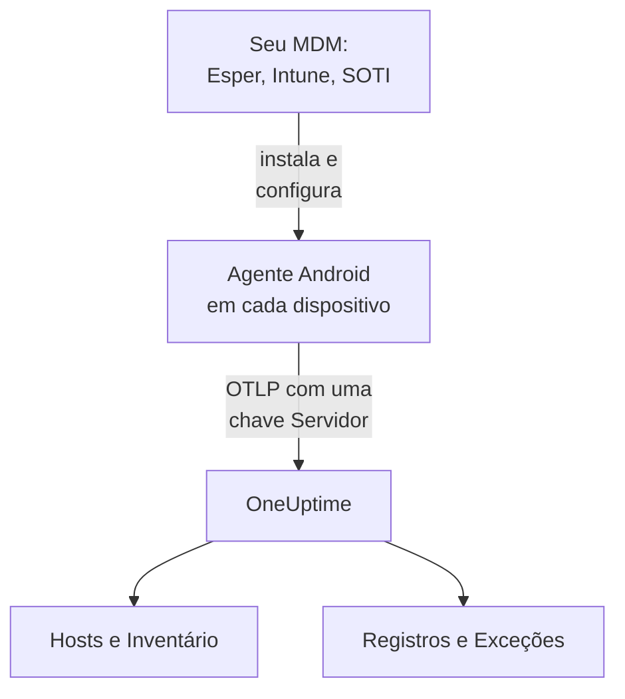

# Agente Android

O agente Android do OneUptime envia ao OneUptime os dados de um dispositivo Android da sua organização, como um quiosque de pedidos, um terminal de PDV, um coletor portátil ou um player de sinalização digital: a memória, o armazenamento, a rede, a bateria e a temperatura dele, as reinicializações, os aplicativos instalados nele e os crashes e logs desses aplicativos. O seu gerenciador de dispositivos o instala e configura em toda a frota de uma só vez. Cada dispositivo vira um host em **Hosts** e um item em **Inventário**, ao lado dos seus servidores e das suas máquinas Windows.

:::cards
- [Quando usar](#o-agente-ou-a-instrumentação-do-aplicativo): O agente vê o dispositivo; a instrumentação do aplicativo vê o seu aplicativo.
- [Implantar com o Esper](#implantar-com-o-esper): Envie o APK, distribua as configurações e inicie o agente uma vez.
- [Configurações](#configurações): Cada chave da configuração gerenciada do agente.
- [Ler os logs de outros aplicativos](#ler-os-logs-de-outros-aplicativos): Conceda READ_LOGS uma vez, com o adb ou com o seu gerenciador de dispositivos.
:::

## Como funciona

O agente é um pequeno aplicativo que roda como um serviço em primeiro plano. A cada minuto, ele lê a integridade do dispositivo e a envia ao seu OneUptime por OTLP com uma chave de ingestão **Servidor**, junto com as reinicializações, os aplicativos instalados e os logs do dispositivo. Ele inicia sozinho quando o dispositivo é ligado, guarda no próprio dispositivo o que coleta enquanto a rede está fora do ar e envia tudo quando a rede volta. Ele nunca mantém acordado um dispositivo em repouso e comprime o que envia.



## O agente ou a instrumentação do aplicativo

| | [OpenTelemetry Android](/docs/rum/android-setup) no seu aplicativo | O agente Android |
| --- | --- | --- |
| O que ele vê | O seu aplicativo: os crashes, ANRs, telas, sessões, requisições e fluxos de trabalho dele | O dispositivo: memória, armazenamento, rede, bateria, reinicializações, aplicativos instalados e os crashes e ANRs de todos os aplicativos |
| Onde aparece | **Monitoramento de Usuários Reais**, **Traços** e **Exceções** | **Hosts**, **Inventário**, **Registros** e **Exceções** |
| Como instalar | No código do seu aplicativo | Como um aplicativo, pelo seu gerenciador de dispositivos |

Nos dispositivos que você possui, use os dois e dê ao dispositivo o mesmo nome nos dois lugares: a configuração `device_name` do agente e o `host.name` que o seu aplicativo define. O dispositivo passa então a ser um único item em **Inventário**, com a telemetria do aplicativo e a do dispositivo juntas.

## Antes de começar

- Dispositivos com Android 7.0 ou posterior, administrados por um gerenciador de dispositivos compatível com as configurações gerenciadas do Android: Esper, Microsoft Intune, Workspace ONE, SOTI e outros gerenciadores de dispositivos do Android Enterprise. Para um único dispositivo, o adb basta.
- Uma chave de ingestão **Servidor**, criada em **Configurações do projeto → Telemetria e APM → Chaves de ingestão** com **Criar chave de ingestão**.
- O agente: `oneuptime-android-agent.apk`, anexado a cada [versão do OneUptime](https://github.com/OneUptime/oneuptime/releases/latest).
- HTTPS de saída dos dispositivos para a sua URL do OneUptime. O agente recusa uma URL que não comece com `https://`, porque toda requisição leva a chave de ingestão.

## Implantar com o Esper

:::steps
### Enviar o APK

No console do Esper, envie `oneuptime-android-agent.apk` para a **App Library** e adicione-o ao blueprint dos dispositivos que você quer monitorar.

### Distribuir as configurações

No blueprint, abra a **Managed Configuration** do agente e cole as configurações dele. O Esper preenche os placeholders em cada dispositivo, com o Esper Agent 8.00.0764 ou posterior:

```json title="Managed configuration"
{
  "oneuptime_url": "https://oneuptime.com",
  "oneuptime_token": "YOUR_TELEMETRY_INGESTION_TOKEN",
  "device_name": "${esper.deviceName}",
  "device_serial": "${esper.serialNumber}",
  "device_type": "kiosk",
  "labels": "region=emea"
}
```

Se você hospeda o OneUptime por conta própria, coloque a sua própria URL em `oneuptime_url`. Depois, faça a convergência dos dispositivos, para que eles leiam as novas configurações.

### Iniciá-lo uma vez

Enquanto um aplicativo recém-instalado não tiver sido aberto uma vez, o Android não o inicia quando o dispositivo é ligado. Ative **Launch on Start** para o agente no blueprint, no modo Multi-App, ou abra o agente uma vez em cada dispositivo. A partir daí, ele inicia sozinho sempre que o dispositivo é ligado e depois de cada atualização.

### Encontrar os dispositivos no OneUptime

Em até um minuto, cada dispositivo aparece em **Hosts**, com o nome do `device_name` dele, e em **Inventário**. A própria tela do agente no dispositivo diz se ele está enviando dados e, quando não está, o que o impede.
:::

Outros gerenciadores de dispositivos funcionam do mesmo jeito: adicione o APK como um aplicativo de linha de negócios ou interno, defina as mesmas chaves na configuração do aplicativo e abra-o uma vez em cada dispositivo.

## Configurações

O agente lê estas chaves da configuração gerenciada dele. Um dispositivo sem configuração gerenciada pode, em vez disso, ser configurado na própria tela do agente, com a URL, a chave de ingestão e o nome do dispositivo. Uma chave digitada ali é armazenada criptografada com o Android Keystore.

| Chave | O que define | Padrão |
| --- | --- | --- |
| `oneuptime_url` | A sua URL do OneUptime | `https://oneuptime.com` |
| `oneuptime_token` | Uma chave de ingestão **Servidor** | Nenhum: sem a chave, o agente não envia nada |
| `device_name` | O nome do dispositivo em **Hosts** e **Inventário**, que é a identidade dele ali | O modelo e o início do Android ID do dispositivo |
| `device_serial` | O número de série, que o Android não fornece aos aplicativos a partir do Android 10 | Nenhum |
| `device_type` | O que o dispositivo é, como um quiosque, um terminal de PDV ou um coletor portátil | `Android device` |
| `device_location` | Onde ele está, como o número de uma loja | Nenhum |
| `labels` | Rótulos para o host, como pares `name=value` separados por vírgulas | Nenhum |
| `collection_interval_seconds` | Com que frequência ele envia dados, de 30 a 600 segundos | `60` |
| `logcat_enabled` | Se ele envia o que lê do Logcat | `true` |
| `logcat_min_level` | A severidade mínima das linhas do Logcat que ele envia no Android 12 e anteriores: `verbose`, `debug`, `info`, `warn`, `error` ou `fatal` | `warn` |
| `installed_apps_enabled` | Se ele envia a lista de aplicativos instalados | `true` |

Um placeholder que o seu gerenciador de dispositivos não preencheu, como `${esper.deviceName}` enviado do jeito que está, é ignorado, e a tela do agente avisa isso. Depois que um dispositivo começar a enviar dados, mantenha o `device_name` dele: um nome novo é um host novo.

## Ler os logs de outros aplicativos

O Android só deixa um aplicativo ler os logs de outros aplicativos com a permissão READ_LOGS, e só o adb pode concedê-la: nem o próprio aplicativo, nem uma política de dispositivo. Conceda-a uma vez em cada dispositivo, e ela continua concedida depois de reinicializações e atualizações:

```bash
adb shell pm grant com.oneuptime.androidagent android.permission.READ_LOGS
```

Com o Esper, execute esse comando pelo **Secure Remote ADB**: ative o acesso ADB para o dispositivo, conecte-se com `espercli secureadb connect -d DEVICE_ID` e depois execute o comando. O Android reinicia o agente quando a permissão é concedida, e o agente começa a ler na mesma hora.

O que o agente passa a ler depende da versão do Android:

- Android 13 e posteriores: os crashes e ANRs de todos os aplicativos. O Android só mostra as linhas de log de outros aplicativos a um aplicativo que está na tela, depois que a pessoa diante do dispositivo permite, então um agente rodando em segundo plano não consegue lê-las.
- Android 12 e anteriores: os crashes e ANRs de todos os aplicativos, e as linhas de log de todos os aplicativos a partir de `logcat_min_level`.

Sem READ_LOGS, o agente envia todo o resto, e tanto a tela dele quanto os logs do dispositivo explicam como conceder a permissão.

## O que ele relata

| O quê | Onde aparece no OneUptime |
| --- | --- |
| Memória, armazenamento, rede e tempo de atividade | A página do dispositivo em **Hosts**: as mesmas métricas que o coletor de um servidor envia, então os modelos de alerta de host funcionam |
| Carga e temperatura da bateria, e se o dispositivo está ligado a uma fonte de energia externa | As métricas `hw.battery.charge`, `hw.temperature` e `android.battery.plugged` |
| Estado térmico | As métricas `android.thermal.status` e `android.thermal.headroom` |
| Reinicializações | **Registros**, com `@event.name:device.boot`: quanto tempo o dispositivo ficou ligado, se ele desligou corretamente, quanto tempo ficou desligado e loops de reinicialização |
| Aplicativos instalados | **Registros**, com `@event.name:android.package.inventory` uma vez por dia, e cada instalação, atualização e remoção |
| Crashes e ANRs de todos os aplicativos | **Exceções**, como não tratados, com o nome do aplicativo |
| Marca, modelo, número de série, versão do sistema operacional e firmware | O item do dispositivo em **Inventário** |

A partir do Android 8, o sistema esconde dos aplicativos o uso de CPU do dispositivo, então o agente só informa o uso de CPU no Android 7 e nos builds que permitem lê-lo.

Os modelos de alerta de host adequados a um dispositivo são Host Stopped Reporting, High Memory Utilization, High Filesystem Usage e Host Restarted. Um dispositivo que não para de reiniciar registra um aviso a cada inicialização, com `android.boot.recent_count` definido como o número de inicializações na última hora.

## Solução de problemas

:::details Um dispositivo não aparece em Hosts
Abra o agente no dispositivo: a tela dele diz o que está faltando, como uma chave de ingestão, uma URL que ele não pode usar ou um envio que falhou, e por quê. Em um dispositivo em que o agente nunca foi aberto depois de instalado, ele ainda não foi iniciado: abra-o uma vez ou ative **Launch on Start**.
:::

:::details O agente diz que o OneUptime recusou a chave de ingestão
Use uma chave **Servidor** que esteja ativada e não tenha expirado. Uma chave **Navegador** é recusada a partir de um dispositivo.
:::

:::details Nenhum log de outros aplicativos
Conceda READ_LOGS, como explica [Ler os logs de outros aplicativos](#ler-os-logs-de-outros-aplicativos). No Android 13 e posteriores, só são lidos os crashes e ANRs de outros aplicativos.
:::

:::details Dois dispositivos aparecem como um único host
Eles têm o mesmo `device_name`. Use um placeholder que mude de um dispositivo para outro, como `${esper.deviceName}` ou `${esper.serialNumber}`.
:::

## Próximos passos

:::cards
- [Configuração para Android](/docs/rum/android-setup): Instrumentar o seu próprio aplicativo com o OpenTelemetry Android.
- [Hosts](/docs/telemetry/hosts): As páginas, as leituras e os alertas de um host.
- [Monitor de hosts](/docs/monitor/host-monitor): Receber um alerta quando um dispositivo parar de enviar dados ou ficar com pouco armazenamento.
- [Exceções](/docs/telemetry/exceptions): Fazer a triagem dos crashes e ANRs que os seus dispositivos relatam.
:::
