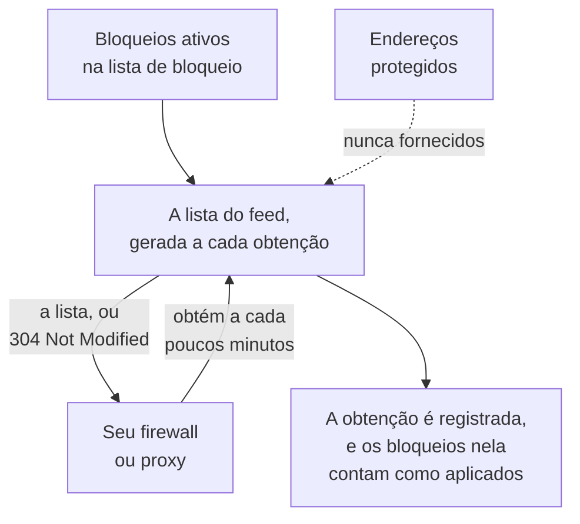

# Feeds da lista de bloqueio para firewalls e proxies

Um feed da lista de bloqueio é uma URL secreta da qual seu firewall ou proxy lê a [lista de bloqueio](/docs/telemetry/security-cases#lista-de-bloqueio) do seu projeto a cada poucos minutos. Palo Alto Networks, FortiGate, Check Point, Cisco Secure Firewall, OPNsense e pfSense o leem como uma lista externa, e comandos que você copia do OneUptime o aplicam com nftables, ipset, nginx, HAProxy ou o Firewall do Windows. É o seu firewall que se conecta ao OneUptime: o OneUptime nunca precisa de uma rota para dentro da sua rede nem de uma senha do seu firewall.

:::cards
- [Crie um feed](#crie-um-feed): Escolha o firewall, copie o segredo e siga as etapas dele.
- [Configure seu firewall](#configure-seu-firewall): As etapas de cada firewall e proxy, e com que frequência ele obtém a lista.
- [Quando um bloqueio é aplicado](#quando-um-bloqueio-é-aplicado): Só depois que um firewall obteve uma lista que o contém.
- [Rotacione ou revogue o segredo](#rotacione-ou-revogue-o-segredo): Um novo segredo com um dia de sobreposição, ou nenhum, imediatamente.
:::

## Como funciona



Cada obtenção gera a lista a partir dos bloqueios ativos naquele momento. Um bloqueio que expira ou é revogado some da obtenção seguinte, e um endereço protegido nunca aparece nela, nem mesmo um que foi protegido depois de ser bloqueado. Um bloqueio só conta como aplicado pelo feed depois que um firewall obteve uma lista que o contém.

## Antes de começar

- Um firewall ou proxy que lê uma lista de endereços de uma URL `https`, ou um host Linux ou Windows onde você pode executar comandos como root ou como administrador.
- Uma saída do firewall para o OneUptime por HTTPS: `https://oneuptime.com` ou o endereço do seu próprio servidor OneUptime.
- Uma função que possa criar feeds: Proprietário do projeto, Administrador do projeto ou Administrador de segurança. Membro de segurança e Visualizador de segurança podem ler os feeds e as obtenções deles. Veja [Funções](/docs/permissions/reference#funções).

## Crie um feed

:::steps
### Abra Feeds da lista de bloqueio

Abra **Produtos → Eventos de segurança → Playbooks → Feeds da lista de bloqueio**.

### Crie o feed

Clique em **Criar: Feed da lista de bloqueio** e escolha o **Firewall** que o lê. **Nome** é como a Lista de bloqueio chama o feed onde um bloqueio é aplicado; se ficar vazio, ele recebe o nome do firewall, como "FortiGate feed". Em **Mais campos**, **Fornece** escolhe IPv4 e IPv6, somente IPv4 ou somente IPv6, e **Endereços de origem permitidos** limita quem pode ler o feed.

### Copie o segredo

A página do feed abre com o segredo dele, mostrado uma única vez: o OneUptime guarda apenas o hash. Copie-o e clique em **Concluído**. Até você sair da página, as etapas nela preenchem o segredo para você.

### Siga as etapas do seu firewall

**Configurar seu firewall** mostra a URL a colar, como seu firewall envia o segredo e as etapas no próprio console dele, já preenchidas. Escolha outro firewall ali para ver as etapas dele. Depois da primeira obtenção do seu firewall, o status do feed diz **Lendo**, e **Obtenções** lista a obtenção.
:::

## O que um feed fornece

| Arquivo | Para | O que contém |
| --- | --- | --- |
| `blocklist.txt` | Palo Alto Networks, pfSense, ipset, HAProxy, Firewall do Windows e qualquer outro firewall | Um endereço ou intervalo por linha. |
| `blocklist.txt?comments=1` | FortiGate, Check Point, Cisco Secure Firewall e OPNsense, que ignoram linhas que começam com `#` | Cada endereço ou intervalo depois de uma linha que diz por que ele está bloqueado. |
| `nftables.nft` | nftables | Um arquivo para `nft -f` que esvazia os sets `blocklist_v4` e `blocklist_v6` da tabela `inet oneuptime` e os preenche de novo. |
| `nginx.conf` | nginx | Uma linha `deny` para cada endereço ou intervalo. |
| O nome de um arquivo seguido de `.md5`, como `blocklist.txt.md5` | Cisco Secure Firewall | O MD5 do arquivo, para que o firewall baixe a lista só quando ela mudou. |

A URL de um feed é `https://oneuptime.com/api/blocklist-feed/<feed ID>/<file>`, e a página do feed a mostra preenchida para o seu firewall. Com `?comments=1`, a lista fica assim:

```text
# OneUptime case CASE-42 until 2026-11-21 10:42 UTC
203.0.113.7
# OneUptime blocklist until lifted
198.51.100.0/24
```

Um feed fornece os bloqueios ativos cuja ação é **Bloquear**. Ele nunca fornece um desafio, que um firewall não consegue fazer, e um feed que fornece somente IPv4 ou somente IPv6 deixa os outros endereços de fora. O arquivo do nftables deixa de fora um endereço que um intervalo da lista já contém, porque o nftables recusa entradas sobrepostas em um set.

Quando nada está bloqueado, `blocklist.txt` contém um endereço, `192.0.2.1` (`2001:db8::1` para um feed que fornece somente IPv6). É um endereço reservado para documentação, do qual nenhum tráfego da internet vem: Palo Alto Networks e Cisco mantêm a última lista que leram quando uma lista volta vazia, então uma lista vazia continuaria bloqueando o que você revogou.

Cada resposta traz um `ETag`. Um firewall que o devolve em `If-None-Match` recebe `304 Not Modified` enquanto a lista não muda, e os comandos que o OneUptime dá a você fazem isso.

## Como um firewall envia o segredo

| Como | O que o firewall envia | Usado por |
| --- | --- | --- |
| Autenticação básica | Qualquer nome de usuário, como `oneuptime`, com o segredo como senha | Palo Alto Networks (somente por HTTPS), FortiGate e Check Point |
| Token bearer | `Authorization: Bearer <secret>` | Os comandos para nftables, ipset, nginx, HAProxy e Firewall do Windows |
| Segredo na URL | `https://oneuptime.com/api/blocklist-feed/<feed ID>/<secret>/blocklist.txt` | Cisco Secure Firewall, OPNsense e pfSense, que não documentam outra forma de enviá-lo |

Uma requisição sem segredo, ou com um errado, recebe `401 Unauthorized`. Uma URL com um segredo errado recebe `404 Not Found`, como um endereço que não existe. O próprio servidor web do OneUptime não grava URLs de feed no log de acesso dele, então um segredo em uma URL não vai parar lá.

## Limite quem pode ler um feed

**Endereços de origem permitidos**, em **Mais campos**, aceita até 50 endereços e intervalos, um por linha, como `203.0.113.7` ou `198.51.100.0/24`. Uma requisição de qualquer outro endereço recebe `403 Forbidden`, mesmo com o segredo certo. Deixe o campo vazio para que qualquer endereço que tenha o segredo possa ler o feed.

Cada endereço pode obter um feed 60 vezes por minuto, e obter feeds 600 vezes por minuto no total. Acima disso, recebe `429 Too Many Requests` com um cabeçalho `Retry-After`.

## Quando um bloqueio é aplicado

Um bloqueio conta como aplicado por um feed depois que um firewall obteve uma lista que o contém, após o bloqueio ser criado, e durante dez minutos após cada obtenção desse tipo. Uma resposta `304 Not Modified` conta como uma obtenção da mesma lista. Na **Lista de bloqueio**, o chip do feed em **Aplicado por** fica então verde, e a dica dele diz quanto tempo depois do bloqueio o firewall o obteve, como "Um firewall obteve este bloqueio de FortiGate feed 3 min depois de ele ser criado. Última obtenção há 2 minutos."

Depois de dez minutos sem obtenção, o chip diz que o firewall não obteve o feed desde então: o firewall ainda pode estar bloqueando o endereço, mas o OneUptime não consegue saber. Por isso, faça seu firewall obter o feed a cada cinco minutos ou com mais frequência. Um firewall que obtém com menos frequência, como o OPNsense, continua bloqueando entre as obtenções, e o OneUptime só considera o bloqueio aplicado ali durante os dez minutos após cada uma.

Um bloqueio que expira ou é revogado some da obtenção seguinte, e o chip dele aguarda um firewall obter a lista sem ele. Quando o OneUptime não consegue ler quais endereços estão protegidos, o feed responde `503 Service Unavailable` com `Retry-After: 60` em vez de uma lista que poderia conter um deles, e o firewall mantém a lista que tem.

## Quando um firewall para de ler

O OneUptime aprende com que frequência cada feed é obtido. Quando um feed não é obtido por três vezes o intervalo habitual dele, e por pelo menos dez minutos, o status dele diz **Parou de ler**, a **Lista de bloqueio** o cita acima da lista, e os Proprietários do projeto recebem um e-mail: "Your firewall stopped reading the blocklist feed _nome do feed_". Até um firewall obter um feed duas vezes, o OneUptime espera uma obtenção a cada cinco minutos, a cada hora do OPNsense e a cada dia do pfSense.

A obtenção seguinte desfaz isso, e uma nova parada envia outro e-mail. Um feed cujo segredo foi revogado nunca conta como parado.

## Rotacione ou revogue o segredo

**Rotacionar segredo**, na página do feed, cria um novo segredo e o mostra uma única vez. O segredo substituído continua funcionando por 24 horas, para que você possa passar o novo a cada firewall; **Obtenções** marca uma obtenção que ainda enviou o antigo como **Segredo anterior**. Rotacionar de novo dentro dessas 24 horas encerra o segredo mais antigo imediatamente.

**Revogar segredo** encerra o segredo, e o anterior, imediatamente: use-o quando um segredo vazar. O feed então não responde a ninguém, e os firewalls dele mantêm a lista que têm sem atualizá-la, até que **Rotacionar segredo** crie um novo segredo. Excluir um feed encerra o feed, o segredo e as obtenções dele.

## Configure seu firewall

A página do feed mostra estas etapas para o firewall que você escolher, com a URL, o nome de usuário e, logo depois de o segredo ser criado, o segredo preenchidos.

| Firewall | Arquivo | Segredo | Obter a cada | Comporta no máximo |
| --- | --- | --- | --- | --- |
| Palo Alto Networks | `blocklist.txt` | Autenticação básica | 5 minutos, o menor que ele oferece | 30 listas personalizadas e 50.000 endereços no total (150.000 nas séries PA-3200, PA-5200 e PA-7000) |
| FortiGate | `blocklist.txt?comments=1` | Autenticação básica | 5 minutos (de 1 a 43.200; 5 por padrão) | 300.000 endereços, somando todos os seus feeds de ameaças |
| Check Point | `blocklist.txt?comments=1`, IPv4 | Autenticação básica | 5 minutos (a cada hora por padrão) | 50.000 endereços em um feed |
| Cisco Secure Firewall | `blocklist.txt?comments=1` e o MD5 dele | Na URL | 5 minutos (2 horas por padrão) | |
| OPNsense | `blocklist.txt?comments=1` | Na URL | 1 hora, o menor que ele oferece | |
| pfSense | `blocklist.txt` | Na URL | 1 dia, o menor que ele oferece | |
| nftables, ipset, nginx, HAProxy, Firewall do Windows | Os próprios | Token bearer | 1 minuto | |

### Palo Alto Networks

1. Na interface web, vá para **Objects → External Dynamic Lists** e clique em **Add**.
2. Defina **Type** como **IP List** e **Source** como a URL do feed, `https://oneuptime.com/api/blocklist-feed/<feed ID>/blocklist.txt`.
3. Ative **Client Authentication**, com **Username** `oneuptime` e o segredo do feed como **Password**.
4. Defina **Check for updates** como **Every Five Minutes**, clique em **OK** e faça o commit.
5. Em **Policies → Security**, adicione uma regra com a lista como **Source Address** e a ação **Deny**, e faça o commit.

O Palo Alto Networks envia o nome de usuário e a senha somente por HTTPS. Ele só lê um comentário depois de um endereço, nunca em uma linha própria, então o feed dele é a lista simples. Veja [Configure the Firewall to Access an External Dynamic List](https://docs.paloaltonetworks.com/pan-os/11-1/pan-os-admin/policy/use-an-external-dynamic-list-in-policy/configure-the-firewall-to-access-an-external-dynamic-list).

### FortiGate

1. Vá para **Security Fabric → External Connectors**, clique em **Create New** e escolha **IP Address** em **Threat Feeds**.
2. Defina **URL of external resource** como a URL do feed, `https://oneuptime.com/api/blocklist-feed/<feed ID>/blocklist.txt?comments=1`.
3. Ative **HTTP basic authentication**, com **Username** `oneuptime` e o segredo do feed como **Password**.
4. Defina **Refresh Rate** como 5 minutos e clique em **OK**.
5. Em **Policy & Objects → Firewall Policy**, use o feed como **Source** de uma política e defina **Action** como **DENY**.

Veja [Configuring a threat feed](https://docs.fortinet.com/document/fortigate/7.6.0/administration-guide/379433/configuring-a-threat-feed).

### Check Point

1. No SmartConsole, abra o **Object Explorer** e escolha **New → More → Network Object → Network Feed**.
2. Defina **Feed URL** como a URL do feed, `https://oneuptime.com/api/blocklist-feed/<feed ID>/blocklist.txt?comments=1`, **Format** como **Flat list** e **Data type** como **IP Address**.
3. Em **Advanced Settings**, informe **Username** `oneuptime` e o segredo do feed como senha em **Authentication**.
4. Defina **Check feed interval** como 5 minutos, clique em **Test Feed** e depois em **OK**.
5. Use o feed como **Source** de uma regra de Access Control cuja ação seja **Drop** e instale a política.

A Check Point documenta endereços IPv4 para um feed de rede, então um feed criado para ela fornece somente IPv4. Veja [Network Feed](https://sc1.checkpoint.com/documents/R82/WebAdminGuides/EN/CP_R82_SecurityManagement_AdminGuide/Content/Topics-SECMG/Network_Feed.htm).

### Cisco Secure Firewall

1. No management center, escolha **Objects → Security Intelligence** e clique em **Add Network Lists and Feeds**.
2. Defina **Type** como **Feed**, **Feed URL** como a URL do feed, `https://oneuptime.com/api/blocklist-feed/<feed ID>/<secret>/blocklist.txt?comments=1`, e **MD5 URL** como a mesma URL com `.md5` depois de `blocklist.txt`.
3. Defina **Update Frequency** como 5 minutos e salve.
4. Na sua política de controle de acesso, abra **Security Intelligence → Networks**, adicione o feed à **Block List** e depois salve e implante.

A Cisco exige uma URL de MD5 para uma frequência de atualização de 30 minutos ou menos, e os dispositivos gerenciados dela recebem atualizações do management center a cada 30 minutos, então um bloqueio chega a eles até 30 minutos depois de o feed ser obtido. Veja [Creating Security Intelligence feeds](https://docs.manage.security.cisco.com/cdfmc/t_creating_security_intelligence_feeds.html).

### OPNsense

1. Vá para **Firewall → Aliases** e adicione um alias do tipo **URL Table (IPs)**.
2. Defina **Content** como a URL do feed, `https://oneuptime.com/api/blocklist-feed/<feed ID>/<secret>/blocklist.txt?comments=1`, e **Refresh Frequency** como 0 dias e 1 hora.
3. Salve, clique em **Apply** e depois, em **Firewall → Rules**, adicione uma regra que bloqueie o tráfego cuja **Source** seja o alias.

O OPNsense obtém uma tabela de URL no máximo uma vez por hora, então o OneUptime confirma os bloqueios dele só durante os dez minutos após cada obtenção. Nesse meio-tempo, ele continua bloqueando. Veja [Aliases](https://docs.opnsense.org/manual/aliases.html).

### pfSense

1. Vá para **Firewall → Aliases**, clique em **Add** e escolha **URL Table (IPs)**.
2. Insira a URL do feed, `https://oneuptime.com/api/blocklist-feed/<feed ID>/<secret>/blocklist.txt`, e defina o intervalo de atualização como 1 dia.
3. Clique em **Save** e em **Apply Changes** e depois, em **Firewall → Rules**, adicione uma regra com o alias como **Source** e a ação **Block**.

> [!WARNING]
> O pfSense obtém uma tabela de URL no máximo uma vez por dia: devagar demais para bloquear um ataque enquanto ele acontece. Use-o para bloqueios longos, junto com um firewall que obtenha a lista a cada poucos minutos.

Veja [Alias Types](https://docs.netgate.com/pfsense/en/latest/firewall/aliases-types.html).

### nftables

Como root, execute uma vez os comandos que a página do feed mostra. Eles criam a tabela `inet oneuptime` com dois sets, `blocklist_v4` e `blocklist_v6`, regras nas chains `input` e `forward` dela que descartam o tráfego vindo dos endereços contidos neles, e o script `/usr/local/sbin/oneuptime-blocklist`, que guarda o segredo em `/etc/oneuptime-blocklist`, legível somente pelo root.

```bash
# Run once, as root.
install -d -m 700 /etc/oneuptime-blocklist /var/lib/oneuptime-blocklist
printf 'Authorization: Bearer %s\n' 'YOUR_FEED_SECRET' > /etc/oneuptime-blocklist/auth
chmod 600 /etc/oneuptime-blocklist/auth
cat > /usr/local/sbin/oneuptime-blocklist <<'SCRIPT'
#!/bin/sh
# Loads the OneUptime blocklist into nftables when it changed.
set -eu
URL='https://oneuptime.com/api/blocklist-feed/<feed ID>/nftables.nft'
STATE=/var/lib/oneuptime-blocklist
if ! nft list table inet oneuptime >/dev/null 2>&1; then
  rm -f "$STATE/etag"
  nft -f - <<'NFT'
table inet oneuptime {
  set blocklist_v4 { type ipv4_addr; flags interval; auto-merge; }
  set blocklist_v6 { type ipv6_addr; flags interval; auto-merge; }
  chain input {
    type filter hook input priority filter; policy accept;
    ip saddr @blocklist_v4 drop
    ip6 saddr @blocklist_v6 drop
  }
  chain forward {
    type filter hook forward priority filter; policy accept;
    ip saddr @blocklist_v4 drop
    ip6 saddr @blocklist_v6 drop
  }
}
NFT
fi
TMP=$(mktemp)
trap 'rm -f "$TMP" "$TMP.h"' EXIT
ETAG=$(cat "$STATE/etag" 2>/dev/null || true)
CODE=$(curl --silent --show-error --max-time 60 --header @/etc/oneuptime-blocklist/auth \
  ${ETAG:+--header "If-None-Match: $ETAG"} \
  --dump-header "$TMP.h" --output "$TMP" --write-out '%{http_code}' "$URL")
[ "$CODE" = 304 ] && exit 0
[ "$CODE" = 200 ] || { echo "oneuptime-blocklist: the feed answered $CODE" >&2; exit 1; }
nft -f "$TMP"
sed -n 's/^[Ee][Tt][Aa][Gg]:[[:space:]]*//p' "$TMP.h" | tr -d '\r' > "$STATE/etag"
SCRIPT
chmod 700 /usr/local/sbin/oneuptime-blocklist
echo '* * * * * root flock -n /run/oneuptime-blocklist.lock /usr/local/sbin/oneuptime-blocklist' > /etc/cron.d/oneuptime-blocklist
/usr/local/sbin/oneuptime-blocklist
```

O script roda a cada minuto a partir de `/etc/cron.d/oneuptime-blocklist`. Ele carrega `nftables.nft` só quando a lista mudou, em uma única transação, para que os sets nunca fiquem preenchidos pela metade. Veja [Sets](https://wiki.nftables.org/wiki-nftables/index.php/Sets).

### ipset e iptables

Como root, execute uma vez os comandos que a página do feed mostra. Eles criam dois sets, `oneuptime_v4` e `oneuptime_v6`, e regras na chain `PREROUTING` da tabela `raw`, para iptables e ip6tables, que descartam o tráfego vindo dos endereços contidos neles.

O script roda a cada minuto pelo cron. Quando a lista mudou, ele preenche dois sets novos e os troca pelos antigos, para que as regras nunca vejam um set preenchido pela metade. Veja [ipset](https://ipset.netfilter.org/ipset.man.html).

### nginx

Adicione a linha include ao bloco `server` de cada site a proteger e depois execute uma vez, como root, os comandos que a página do feed mostra:

```nginx
server {
    include /etc/nginx/oneuptime-blocklist.conf;
}
```

```bash
# Run once, as root.
install -d -m 700 /etc/oneuptime-blocklist /var/lib/oneuptime-blocklist
printf 'Authorization: Bearer %s\n' 'YOUR_FEED_SECRET' > /etc/oneuptime-blocklist/auth
chmod 600 /etc/oneuptime-blocklist/auth
touch /etc/nginx/oneuptime-blocklist.conf
cat > /usr/local/sbin/oneuptime-blocklist <<'SCRIPT'
#!/bin/sh
# Writes the OneUptime blocklist for nginx when it changed, and reloads nginx.
set -eu
URL='https://oneuptime.com/api/blocklist-feed/<feed ID>/nginx.conf'
STATE=/var/lib/oneuptime-blocklist
TMP=$(mktemp)
trap 'rm -f "$TMP" "$TMP.h"' EXIT
ETAG=$(cat "$STATE/etag" 2>/dev/null || true)
CODE=$(curl --silent --show-error --max-time 60 --header @/etc/oneuptime-blocklist/auth \
  ${ETAG:+--header "If-None-Match: $ETAG"} \
  --dump-header "$TMP.h" --output "$TMP" --write-out '%{http_code}' "$URL")
[ "$CODE" = 304 ] && exit 0
[ "$CODE" = 200 ] || { echo "oneuptime-blocklist: the feed answered $CODE" >&2; exit 1; }
cp /etc/nginx/oneuptime-blocklist.conf "$STATE/last.conf"
cp "$TMP" /etc/nginx/oneuptime-blocklist.conf
if nginx -t -q; then nginx -s reload; else cp "$STATE/last.conf" /etc/nginx/oneuptime-blocklist.conf; exit 1; fi
sed -n 's/^[Ee][Tt][Aa][Gg]:[[:space:]]*//p' "$TMP.h" | tr -d '\r' > "$STATE/etag"
SCRIPT
chmod 700 /usr/local/sbin/oneuptime-blocklist
echo '* * * * * root flock -n /run/oneuptime-blocklist.lock /usr/local/sbin/oneuptime-blocklist' > /etc/cron.d/oneuptime-blocklist
/usr/local/sbin/oneuptime-blocklist

# Then add this line to the server block of the site to protect, and reload nginx:
#   include /etc/nginx/oneuptime-blocklist.conf;
```

O script roda a cada minuto pelo cron. Quando a lista mudou, ele grava `/etc/nginx/oneuptime-blocklist.conf`, verifica a configuração com `nginx -t` e recarrega o nginx, e restaura o arquivo anterior se a verificação falhar.

Atrás de um balanceador de carga ou de uma CDN, o nginx vê o endereço do balanceador, não o do visitante, a menos que o módulo realip esteja configurado: defina `set_real_ip_from` como os endereços do balanceador e `real_ip_header` como o cabeçalho que ele envia, ou bloqueie no balanceador. Veja [ngx_http_access_module](https://nginx.org/en/docs/http/ngx_http_access_module.html).

### HAProxy

Como root, crie o arquivo da lista e adicione duas linhas ao `haproxy.cfg`, e depois recarregue o HAProxy uma vez: a Runtime API dele só atualiza uma lista que o HAProxy já lê.

```text
global
    stats socket /run/haproxy/admin.sock mode 660 level admin

frontend www
    http-request deny if { src -n -f /etc/haproxy/oneuptime-blocklist.lst }
```

Depois execute o restante dos comandos que a página do feed mostra. O script roda a cada minuto pelo cron e, quando a lista mudou, grava `/etc/haproxy/oneuptime-blocklist.lst` e atualiza o HAProxy pela Runtime API dele, sem recarregar. Veja [The Runtime API](https://docs.haproxy.org/3.4/management.html#9.3).

### Firewall do Windows

No PowerShell como administrador, execute uma vez os comandos que a página do feed mostra. Eles salvam um script e o segredo em `C:\ProgramData\OneUptime\Blocklist`, que só SYSTEM e Administradores podem ler, e registram a tarefa agendada "OneUptime Blocklist", que executa o script a cada minuto como SYSTEM.

O script mantém regras de entrada que bloqueiam cada endereço da lista, 1.000 por regra: "OneUptime blocklist 0", "OneUptime blocklist 1" e assim por diante. Veja [Set-NetFirewallRule](https://learn.microsoft.com/en-us/powershell/module/netsecurity/set-netfirewallrule).

### Outros firewalls

1. Aponte seu firewall ou proxy para a URL do feed, `https://oneuptime.com/api/blocklist-feed/<feed ID>/blocklist.txt`: um endereço ou intervalo por linha.
2. Envie o segredo do feed como senha da autenticação básica, com qualquer nome de usuário, ou como token bearer.
3. Faça com que ele obtenha a lista a cada 5 minutos ou com mais frequência: um bloqueio conta como aplicado ali durante dez minutos após cada obtenção.

### Kubernetes

Bloqueie na borda ou no WAF de nuvem na frente do cluster, conectado como destino da lista de bloqueio em **Conexões de segurança** ou **Conexões de nuvem**, ou em um proxy que você executa na frente dele com os comandos do nginx ou do HAProxy. O controlador comunitário Ingress NGINX foi descontinuado, e o repositório dele foi arquivado em março de 2026, então o OneUptime não documenta as anotações dele. Veja [Ingress NGINX Retirement](https://kubernetes.io/blog/2025/11/11/ingress-nginx-retirement/).

## Limites

| O quê | Limite |
| --- | --- |
| Entradas em um feed | 20.000 |
| Endereços de origem permitidos | 50 endereços e intervalos |
| Obtenções de um feed a partir de um endereço | 60 por minuto |
| Obtenções de todos os feeds a partir de um endereço | 600 por minuto |
| Um segredo substituído continua funcionando | 24 horas |
| Um bloqueio conta como aplicado após uma obtenção | 10 minutos |
| Obtenções guardadas | 30 dias |

## Solução de problemas

:::details O firewall recebe 401 Unauthorized
O segredo que ele envia não é o do feed. Confira se a senha, ou o token bearer, é o segredo inteiro, sem nada antes ou depois. Um segredo substituído há mais de 24 horas não funciona mais: **Rotacionar segredo** cria um novo.
:::

:::details O firewall recebe 404 Not Found
A URL aponta para um feed que não existe, um arquivo que um feed não fornece ou um segredo errado na URL. Copie a URL de novo da página do feed.
:::

:::details O firewall recebe 403 Forbidden
**Endereços de origem permitidos** do feed não contém o endereço do qual o firewall obtém. **Obtenções** mostra o endereço de origem de cada obtenção.
:::

:::details O chip de um bloqueio diz que está aguardando um firewall obter o feed
Nenhum firewall obteve o feed desde que o bloqueio foi criado. Confira **Obtenções** na página do feed: um firewall que obtém a cada cinco minutos passa a ter o bloqueio em até cinco minutos.
:::

## Próximos passos

:::cards
- [Casos de segurança e playbooks](/docs/telemetry/security-cases): Bloqueie um endereço a partir de um caso, manualmente ou por um playbook.
- [Inteligência de ameaças](/docs/telemetry/threat-intelligence): Traga para o OneUptime endereços maliciosos conhecidos.
- [Eventos de segurança](/docs/telemetry/security-events): Encontre os endereços que vale a pena bloquear.
:::
