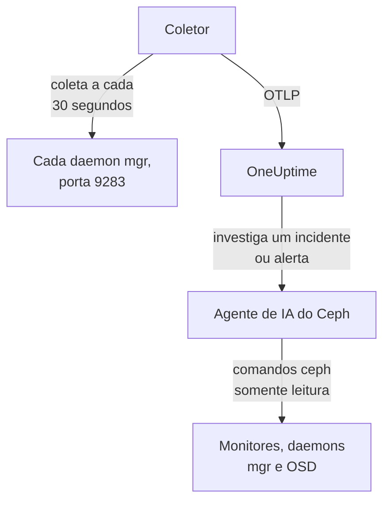

# Agente Ceph

O agente Ceph do OneUptime monitora um cluster Ceph: a saúde, o quórum dos monitores, os OSDs, os pools e os placement groups. Ele coleta o módulo `prometheus` do mgr do Ceph em cada daemon mgr, marca cada métrica com o nome do seu cluster e a envia ao OneUptime, onde o cluster aparece com seus OSDs, pools e daemons. Os [monitores Ceph](/docs/monitor/ceph-monitor) alertam sobre o que chega.

:::cards
- [Instalar o agente](#instale-o-agente): Ative o módulo do mgr e depois o script de instalação ou o Docker Compose.
- [O que o agente coleta](#o-que-o-agente-coleta): As séries por trás das páginas do Ceph, das métricas e dos modelos de alerta.
- [Agente de IA](#agente-de-ia): Deixe a OneUptime AI ler o cluster enquanto investiga.
- [Solução de problemas](#solução-de-problemas): Um script de diagnóstico, e os problemas mais comuns.
:::

## Como funciona

O agente são dois contêineres que você executa com o Docker Compose em uma máquina. Um OpenTelemetry Collector coleta o módulo `prometheus` do mgr em cada daemon mgr a cada 30 segundos. Só o mgr ativo responde com métricas, então, quando ele passa para um standby, as métricas continuam chegando sem nenhuma mudança. O agente de IA do Ceph, ao lado, permite que a OneUptime AI execute comandos `ceph` somente leitura enquanto investiga um incidente ou alerta.



O cluster se registra com os primeiros dados, com o nome que o agente marca em cada métrica como `ceph.cluster.name`.

## Antes de começar

- Docker Engine 20.10 ou mais recente com o plugin Docker Compose v2, em uma máquina que alcance os seus daemons mgr do Ceph na porta 9283.
- Um shell em um nó de administração do Ceph, onde a CLI `ceph` funcione com direitos de administrador.
- Uma chave de ingestão. Crie uma em **Configurações do projeto → Telemetria e APM → Chaves de ingestão** e copie o valor.
- HTTPS de saída dessa máquina para a sua URL do OneUptime.

## Instale o agente

:::steps
### Ativar o módulo prometheus do mgr

Em um nó de administração do Ceph:

```bash
ceph mgr module enable prometheus
```

Cada daemon mgr passa então a servir métricas do Prometheus na porta `9283`, em `/metrics`. Só o mgr ativo retorna métricas: os mgrs em standby respondem com uma resposta vazia, ou com um erro HTTP se `mgr/prometheus/standby_behaviour` estiver definido como `error`. É por isso que o agente coleta todos os mgrs. Liste-os:

```bash
ceph mgr stat                    # active mgr
ceph orch ps --daemon-type mgr   # all mgrs (cephadm clusters)
```

### Instale e inicie o agente

:::tabs
@tab install.sh
Baixe o script de instalação e execute-o na máquina que vai hospedar o agente:

```bash
curl -sSL https://raw.githubusercontent.com/OneUptime/oneuptime/master/agents/CephAgent/install.sh -o install.sh
bash install.sh
```

O script pede a sua URL do OneUptime, a chave de ingestão, um nome para o cluster e os endpoints dos mgrs, e se o [agente de IA](#agente-de-ia) pode aplicar correções. Onde `ceph` funciona com direitos de administrador, ele também oferece criar o cliente Ceph próprio do agente de IA. Ele instala em `/opt/oneuptime-ceph-agent`, grava um arquivo `.env` com `0600` e inicia o agente com o Docker Compose. Executar o script de novo reutiliza tudo o que está nesse `.env` em vez de perguntar de novo, e é assim que você [atualiza o agente](#atualizando-o-agente).
@tab Docker Compose
Baixe `docker-compose.yml` e `otel-collector-config.yaml` do [diretório CephAgent](https://github.com/OneUptime/oneuptime/tree/master/agents/CephAgent) para uma pasta nova:

```bash
mkdir oneuptime-ceph-agent && cd oneuptime-ceph-agent
curl -fsSLO https://raw.githubusercontent.com/OneUptime/oneuptime/master/agents/CephAgent/docker-compose.yml
curl -fsSLO https://raw.githubusercontent.com/OneUptime/oneuptime/master/agents/CephAgent/otel-collector-config.yaml
```

Crie um arquivo `.env` ao lado deles:

```bash title=".env"
ONEUPTIME_URL=YOUR_ONEUPTIME_URL
ONEUPTIME_TELEMETRY_INGESTION_KEY=YOUR_TELEMETRY_INGESTION_TOKEN
CEPH_CLUSTER_NAME=my-ceph-cluster
CEPH_MGR_ENDPOINTS=[ceph-mon-1:9283,ceph-mon-2:9283,ceph-mon-3:9283]
```

Liste cada daemon mgr, o ativo e os em standby, separados por vírgulas e entre colchetes: os colchetes fazem o coletor ler o valor como uma lista de alvos de coleta. Inicie o agente:

```bash
docker compose up -d
```

O contêiner do agente de IA também inicia e espera por um cliente Ceph próprio: veja [Agente de IA](#agente-de-ia).
:::

### Verifique se o agente está em execução

```bash
docker compose ps
docker logs -f oneuptime-ceph-agent
```

`docker compose ps` lista o coletor (`oneuptime-ceph-agent`) e o agente de IA (`oneuptime-ceph-ai-agent`). Depois que o coletor iniciar, os logs dele devem mostrar esta linha:

```text
Everything is ready. Begin running and processing data.
```

### Encontre o cluster no OneUptime

Abra **Produtos → Infraestrutura → Ceph → Todos os clusters**. O cluster aparece com o seu `CEPH_CLUSTER_NAME` em cerca de um minuto, com seus OSDs, pools e daemons.
:::

## Variáveis de ambiente

O script de instalação grava estes valores em `/opt/oneuptime-ceph-agent/.env`; uma instalação com o Docker Compose os lê do `.env` ao lado de `docker-compose.yml`. Depois de mudar um deles, execute `docker compose up -d` nessa pasta.

| Variável | Obrigatória | Descrição |
| --- | --- | --- |
| `ONEUPTIME_URL` | Sim | A sua URL do OneUptime, como `https://oneuptime.com` ou a sua instância auto-hospedada. Use `http://` e a porta dela se a instância for só HTTP. |
| `ONEUPTIME_TELEMETRY_INGESTION_KEY` | Sim | A chave de ingestão de **Configurações do projeto → Telemetria e APM → Chaves de ingestão**. |
| `CEPH_CLUSTER_NAME` | Sim | O nome do cluster no OneUptime, marcado em cada métrica como o atributo de recurso `ceph.cluster.name`. Mantenha-o estável: mudá-lo depois registra um segundo cluster. O padrão é `ceph`. |
| `CEPH_MGR_ENDPOINTS` | Sim | Cada daemon mgr como uma lista `host:port` separada por vírgulas e entre colchetes, como `[ceph-mon-1:9283,ceph-mon-2:9283,ceph-mon-3:9283]`. O script de instalação adiciona os colchetes para você. |

As configurações próprias do agente de IA estão em [Agente de IA](#agente-de-ia).

## Como o agente coleta

- **Cada mgr, a cada 30 segundos.** O módulo `prometheus` do mgr guarda cada coleta em cache por `mgr/prometheus/scrape_interval` (15 segundos por padrão). Nunca colete com mais frequência que isso: você só leria o cache de novo.
- **`honor_labels: true`.** Os rótulos que o Ceph exporta (`ceph_daemon`, `pool_id`, rótulos de instância por daemon) são mantidos como estão. Sem isso, o rótulo `instance` seria reescrito para cada alvo de coleta e mudaria toda vez que o mgr ativo mudasse, o que quebra todas as séries.

## O que o agente coleta

O agente envia tudo o que o módulo `prometheus` do mgr exporta. As páginas do Ceph, o catálogo de métricas e os modelos de alerta do OneUptime se baseiam nestas séries:

| Categoria | Métricas |
| --- | --- |
| Saúde do cluster | `ceph_health_status` (0 = OK, 1 = WARN, 2 = ERR), `ceph_health_detail` (uma série por verificação de saúde ativa, com os rótulos `name` e `severity`, a partir do Quincy; por trás dos modelos de alerta de verificações de saúde e das **Active Health Checks** da visão geral), `ceph_healthcheck_slow_ops`, `ceph_daemon_health_metrics` (por daemon, pela chave `type`), `ceph_mon_quorum_status`, `ceph_mon_metadata`, `ceph_cluster_total_bytes`, `ceph_cluster_total_used_bytes` |
| OSD | `ceph_osd_up`, `ceph_osd_in`, `ceph_osd_apply_latency_ms`, `ceph_osd_commit_latency_ms`, `ceph_osd_stat_bytes`, `ceph_osd_stat_bytes_used`, `ceph_osd_numpg`, `ceph_osd_metadata`, por OSD pelo rótulo `ceph_daemon` (como `osd.3`) |
| Pool | `ceph_pool_stored`, `ceph_pool_max_avail`, `ceph_pool_objects`, `ceph_pool_rd`, `ceph_pool_wr`, `ceph_pool_rd_bytes`, `ceph_pool_wr_bytes`, `ceph_pool_metadata`. As séries de dados trazem só um rótulo `pool_id`; o nome do pool fica em `ceph_pool_metadata`. |
| Placement groups | `ceph_pg_total`, `ceph_pg_active`, `ceph_pg_clean`, `ceph_pg_degraded`, `ceph_pg_undersized` (todas por pool, pelo `pool_id`), `ceph_num_objects_degraded`, `ceph_num_objects_misplaced` |
| Daemons | `ceph_mgr_metadata`, `ceph_mds_metadata` e `ceph_rgw_metadata`, além dos metadados de monitores e OSDs acima. Cada uma nomeia um daemon e traz a versão dele no rótulo `ceph_version`: a página **Daemons** os lista. |

### Mais alvos de coleta

O módulo do mgr cobre a saúde e a capacidade do cluster. Para olhar mais de perto, adicione mais jobs em `scrape_configs` no `otel-collector-config.yaml`:

- **`ceph-exporter` (Reef 18.2 e posteriores).** O cephadm executa um daemon `ceph-exporter` em cada host do cluster, que serve contadores de desempenho por daemon na porta `9926`. Adicione um alvo por host.
- **`node_exporter`.** O companheiro habitual para as métricas de CPU, memória, disco e rede de cada host Ceph, na porta `9100` por padrão.

Os dois recebem o atributo de recurso `ceph.cluster.name` do processador `resource` incluído, então chegam ao mesmo cluster no OneUptime.

## Opcional — Enviar o log do cluster Ceph

O agente pode acompanhar `/var/log/ceph/ceph.log` e enviá-lo ao OneUptime, o que preenche a página **Cluster Log** do cluster. Isso vem desativado por padrão porque o agente precisa rodar em um host que tenha o log do cluster: por padrão, um host de monitor.

:::steps
### Ative o receiver

Em `otel-collector-config.yaml`, descomente o receiver `filelog` e o pipeline `logs`.

### Montar o diretório de logs

Em `docker-compose.yml`, descomente o volume que monta o diretório no coletor:

```yaml
- /var/log/ceph:/var/log/ceph:ro
```

### Reiniciar o agente

```bash
docker compose up -d
```
:::

As linhas são enviadas à medida que são escritas. O OneUptime lê o formato do `ceph.log` (hora, daemon, nível `INF`/`WRN`/`ERR`, mensagem) ao exibi-las, e o processador `resource` marca `ceph.cluster.name`, então o log chega a este cluster.

## Marcar o cluster com rótulos do projeto

Um atributo de recurso que começa com `oneuptime.label.` vira um rótulo do projeto no cluster: `oneuptime.label.<dimension>=<value>` é o rótulo `<dimension>:<value>`. Adicione os atributos ao processador `resource` em `otel-collector-config.yaml`, ao lado de `ceph.cluster.name`:

```yaml
processors:
  resource:
    attributes:
      # ...existing attributes...
      - key: oneuptime.label.team
        value: storage
        action: upsert
      - key: oneuptime.label.env
        value: production
        action: upsert
```

O coletor só lê a configuração quando inicia: execute `docker compose restart oneuptime-ceph-agent`. O cluster passa então a mostrar os rótulos `team:storage` e `env:production`. Os rótulos são comparados sem diferenciar maiúsculas e minúsculas, então um rótulo `Production` existente é reutilizado em vez de duplicado, e o agente nunca remove um rótulo que alguém adicionou no OneUptime.

## Execute como um serviço do systemd

Para iniciar o agente junto com a máquina e reiniciá-lo quando falhar, instale a unidade do systemd dele. Ela supõe que o agente fica em `/opt/oneuptime-ceph-agent`, onde o script de instalação o coloca:

```bash
sudo curl -fsSL https://raw.githubusercontent.com/OneUptime/oneuptime/master/agents/CephAgent/systemd/oneuptime-ceph-agent.service -o /etc/systemd/system/oneuptime-ceph-agent.service
sudo systemctl daemon-reload
sudo systemctl enable --now oneuptime-ceph-agent
```

## Atualizando o agente

O agente informa como **Versão do agente** a versão do coletor que os arquivos dele fixam. Quando ela é mais antiga que a versão que esta versão do OneUptime fixa, um sinal de aviso aparece ao lado dela na **Visão geral** do cluster. Selecione-o para ver estes comandos. Um agente instalado antes de os arquivos dele informarem uma versão não mostra nenhuma até ser atualizado dessa forma.

A imagem do coletor está fixada em `docker-compose.yml`, e a configuração dele é um arquivo ao lado, então só baixar as imagens não faz o agente avançar. Execute `install.sh` de novo: ele reutiliza todos os valores do seu `.env` atual (nada é perguntado de novo), renova `docker-compose.yml` e `otel-collector-config.yaml` (um arquivo que você editou é guardado como `<file>.bak.<timestamp>`), baixa as imagens e recria o agente para que o coletor leia a nova configuração. A pasta `ceph/` do agente de IA fica como está.

```bash
curl -sSL https://raw.githubusercontent.com/OneUptime/oneuptime/master/agents/CephAgent/install.sh -o install.sh
bash install.sh
```

Instalou com o Docker Compose? Na pasta do agente, baixe de novo os dois arquivos (e refaça qualquer alteração que você tenha feito neles), depois baixe as imagens e recrie o agente:

```bash
curl -fsSLO https://raw.githubusercontent.com/OneUptime/oneuptime/master/agents/CephAgent/docker-compose.yml
curl -fsSLO https://raw.githubusercontent.com/OneUptime/oneuptime/master/agents/CephAgent/otel-collector-config.yaml
docker compose pull
docker compose up -d --force-recreate
```

## Desinstalando o agente

```bash
cd /opt/oneuptime-ceph-agent
docker compose down
```

Se você criou o cliente Ceph do agente de IA, remova-o em um nó de administração com `ceph auth del client.oneuptime-ai`.

## Agente de IA

O `docker-compose.yml` do agente também executa o **Agente de IA do Ceph**, `oneuptime-ceph-ai-agent` (imagem `oneuptime/resource-ai-agent:release`). Enquanto a OneUptime AI investiga um incidente ou alerta neste cluster, ela executa por meio dele comandos `ceph` somente leitura — `ceph health detail`, `ceph osd tree`, `ceph pg dump_stuck`, `ceph crash ls` — e, só se você permitir, aplica correções como marcar um OSD de volta como in ou limpar `noout`. Ele se registra como o cluster chamado `CEPH_CLUSTER_NAME`, como o coletor, e aparece na página **IA → Agente de IA** do cluster no OneUptime.

- **As investigações de IA vêm ativadas por padrão.** Assim que o agente se conecta, a OneUptime AI investiga com ele os incidentes e alertas deste cluster, e a **Visão geral** do cluster mostra o status do agente. Para parar, defina `ONEUPTIME_AI_INVESTIGATION=false` onde o agente é executado (**Alterar**, em **O que a IA pode fazer** na página do agente de IA, mostra como), ou deixe o agente de fora.
- **O próprio cliente Ceph dele é o limite rígido.** Ele se conecta como `client.oneuptime-ai`, com o `ceph.conf` mínimo do cluster e o keyring desse cliente em uma pasta `ceph/` ao lado de `docker-compose.yml` (montada somente leitura em `/etc/ceph`). Com caps de leitura, nada do que ele executa pode mudar o cluster. Numa instalação nova, `install.sh` oferece criar o cliente; executá-lo de novo nunca faz isso. Nunca coloque o keyring de admin nessa pasta.
- Ele é **somente leitura**, a menos que você defina `ONEUPTIME_AI_ALLOW_WRITES=true` e dê ao cliente os caps das correções (o README do agente os lista); `ONEUPTIME_AI_WRITE_TARGETS` (por exemplo `osd.*,cluster`) limita o que uma correção pode tocar. `ONEUPTIME_AI_FIXES`, no mesmo `.env`, diz como as correções rodam — `ask-for-approval` (uma pessoa aprova cada uma), `automatic` ou `bypass-approval` — e a página do agente de IA mostra isso somente leitura ([O que a IA pode fazer, definido pelo agente](/docs/ai/infrastructure-ai-agents#what-ai-may-do-set-by-the-agent)).
- Ele se conecta de saída aos monitores (TCP 3300 e 6789) e aos daemons mgr e OSD (TCP 6800–7300), roda como UID 1000 sem capabilities e nunca executa `auth`, `config-key`, `tell` nem nada que apague dados. Exclua o serviço `oneuptime-ceph-ai-agent` do `docker-compose.yml` se você não usa a OneUptime AI.

Para criar o cliente à mão, execute isto em um nó de administração do Ceph, na pasta do agente (copie os dois arquivos para a pasta `ceph/` da máquina do agente, se for outra):

```bash
mkdir -p ceph
ceph config generate-minimal-conf > ceph/ceph.conf
ceph auth get-or-create client.oneuptime-ai mon 'allow r' mgr 'allow r' osd 'allow r' -o ceph/ceph.client.oneuptime-ai.keyring
sudo chown 1000:1000 ceph/ceph.client.oneuptime-ai.keyring
sudo chmod 600 ceph/ceph.client.oneuptime-ai.keyring
docker compose up -d
```

O que ele pode executar, como as correções funcionam e como solucionar problemas: [Infrastructure AI Agents](/docs/ai/infrastructure-ai-agents#ceph-clusters).

## Solução de problemas

:::details Execute primeiro o script de diagnóstico
O agente vem com um script, [`troubleshoot.sh`](https://github.com/OneUptime/oneuptime/blob/master/agents/CephAgent/troubleshoot.sh), que verifica a cadeia inteira: o runtime de contêineres, cada endpoint de mgr configurado, o nome do cluster marcado em cada métrica, o formato do token, as métricas do próprio coletor e se o OneUptime aceita a chave de ingestão. Ele avisa quando nenhum endpoint retorna `ceph_health_status`, ou quando só um está configurado, já que só o mgr ativo serve métricas. A verificação da chave é a que mais importa. O OneUptime recusa uma chave inválida com `401` (`422` para uma chave desativada ou uma chave de navegador), e o coletor trata os dois como permanentes: ele descarta o lote e registra um único erro `Exporting failed`, fácil de passar despercebido enquanto o contêiner continua saudável. O script consulta `GET <url>/otlp/v1/validate` de dentro da rede do agente para obter direto um `200` (válida) ou `401` (inválida), e recorre a `POST /fluentd/v1/logs` em servidores mais antigos.

```bash
curl -sSL https://raw.githubusercontent.com/OneUptime/oneuptime/master/agents/CephAgent/troubleshoot.sh -o troubleshoot.sh
bash troubleshoot.sh    # add -d <dir> if you installed outside /opt/oneuptime-ceph-agent
```

Ele termina com um veredito que cita a causa mais provável.
:::

:::details Nenhum cluster aparece no OneUptime
1. Leia os logs do coletor: `docker logs oneuptime-ceph-agent`. Um `401` na exportação significa uma chave de ingestão inválida; conexão recusada significa uma `ONEUPTIME_URL` errada.
2. Verifique se um mgr serve métricas: `curl http://ACTIVE_MGR_HOST:9283/metrics | head` deve imprimir linhas `ceph_*`. Se não imprimir, ative o módulo com `ceph mgr module enable prometheus`.
3. Verifique se `CEPH_MGR_ENDPOINTS` está entre colchetes. Sem eles, o coletor lê a lista inteira separada por vírgulas como um único alvo, que não existe.
:::

:::details O cluster aparece como desconectado
Um cluster passa a desconectado quando o OneUptime não recebe nada dele por 15 minutos; o OneUptime verifica a cada 5 minutos, e o tempo em que ele mesmo não estava recebendo dados não conta. Verifique se o coletor está rodando (`docker compose ps`), se os logs dele não mostram erros de exportação e se a máquina ainda alcança a sua URL do OneUptime. O cluster volta a ficar conectado com os próximos dados.
:::

:::details As métricas param depois de um failover do mgr
Provavelmente você está coletando só o mgr que era o ativo antes. Liste cada daemon mgr em `CEPH_MGR_ENDPOINTS`: coletar os standbys quase não custa nada, e eles respondem com respostas vazias.
:::

:::details Erros de coleta de mgrs em standby nos logs do coletor
É o esperado quando `mgr/prometheus/standby_behaviour` está definido como `error` no seu cluster: os standbys respondem então com HTTP 500. A coleta do mgr ativo continua funcionando, então os erros são ruído; volte o comportamento para `default` para silenciá-los.
:::

:::details As métricas chegam ao cluster errado
O OneUptime registra um cluster Ceph pelo `ceph.cluster.name` dele, que o agente tira de `CEPH_CLUSTER_NAME`. Mudá-lo depois dos primeiros dados cria um segundo cluster em vez de renomear o primeiro.
:::

## Próximos passos

:::cards
- [Monitor de Ceph](/docs/monitor/ceph-monitor): Alertas sobre saúde, OSDs, placement groups, capacidade, falhas e operações lentas.
- [Agente Proxmox](/docs/telemetry/proxmox): Roda o Ceph sob o Proxmox VE? Monitore o cluster também.
- [Infrastructure AI Agents](/docs/ai/infrastructure-ai-agents): O que o agente de IA do Ceph pode executar e como as correções funcionam.
- [Coletor OpenTelemetry no host](/docs/telemetry/host-otel-collector): A visão do sistema operacional de cada host Ceph.
:::
