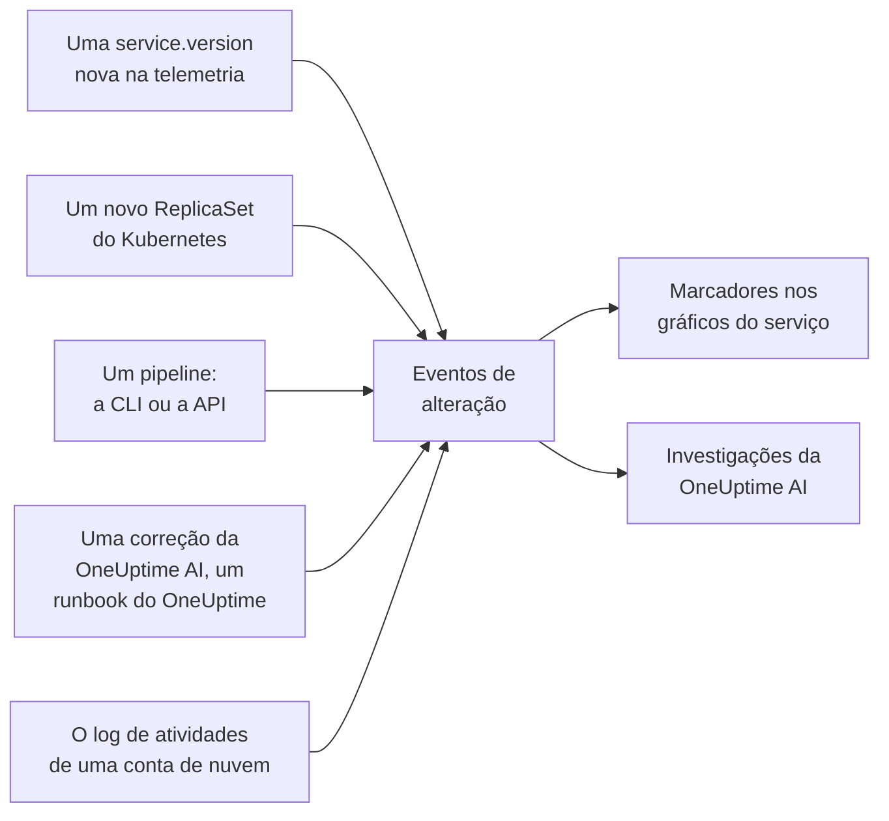

# Deploys e alterações

O OneUptime mantém um registro do que mudou no seu projeto: deploys, rollouts do Kubernetes, alterações de configuração, as alterações nas suas contas de nuvem conectadas e as correções que ele mesmo executou. Cada alteração aparece como um marcador nos gráficos do serviço ou do recurso de nuvem a que pertence, e a OneUptime AI as lê quando investiga um incidente, então "começou logo depois do deploy das 10:02" é a primeira coisa que você descobre, não a última.

:::cards
- [O que o OneUptime registra sozinho](#o-que-o-oneuptime-registra-sozinho): Deploys e rollouts a partir da telemetria, as alterações das suas contas de nuvem, e as próprias correções dele.
- [Registrar um deploy a partir de um pipeline](#registrar-um-deploy-a-partir-de-um-pipeline): A CLI, o GitHub Actions e a API.
- [Como a OneUptime AI usa as alterações](#como-a-oneuptime-ai-usa-as-alterações): As alterações suspeitas em cada investigação.
- [Referência](#referência): Campos, atributos e limites.
:::

## Como funciona



## O que o OneUptime registra sozinho

Você não precisa enviar nada para que estas alterações sejam registradas. O OneUptime as registra a partir da telemetria que já recebe e do que ele mesmo faz.

| Alteração | Registrada quando | Origem |
| --- | --- | --- |
| Um deploy | Um serviço começa a reportar uma `service.version` que ainda não tinha reportado no seu ambiente | `service-version` |
| Um rollout | Os pods de um Deployment do Kubernetes começam a executar um ReplicaSet que ainda não tinham executado: uma nova imagem, uma variável de ambiente ou uma referência de configuração alterada, ou um reinício | `kubernetes` |
| Uma correção que a OneUptime AI executou | Um agente de IA reporta o resultado de um comando que altera algo, como `kubectl rollout restart` | `oneuptime-ai` |
| Um runbook | Um runbook que o OneUptime executou é concluído, falha ou é cancelado depois de ter começado | `runbook` |
| Uma alteração na nuvem | O log de atividades de uma conta de nuvem conectada registra uma alteração: AWS CloudTrail, o log de atividades do Azure ou o log de auditoria Admin Activity do Google Cloud | `cloud` |
| Um evento do provedor | O provedor de nuvem publica um evento de integridade sobre a conta: AWS Health, Azure Service Health ou Resource Health, ou Google Cloud Service Health | `cloud-health` |

- **A primeira versão que um serviço reporta é a linha de base dele, não um deploy.** Um serviço que roda há meses não recebe um deploy no momento em que o OneUptime começa a receber a telemetria dele.
- **Um rollback para uma versão vista nos últimos 30 dias não é registrado,** porque essa versão não é nova. Um rollback que a OneUptime AI executa é registrado como uma correção.
- **Acima de 6 novas versões ou ReplicaSets em uma hora, o registro para até a hora terminar.** Caso contrário, uma "versão" que muda a cada pod, como um carimbo de data e hora do build, registraria um deploy para cada pod.

Um deploy só é registrado para um serviço que reporta `service.version`. Defina-a, com o ambiente e o commit, nos atributos de recurso do seu SDK ou collector do OpenTelemetry:

```bash
OTEL_RESOURCE_ATTRIBUTES="service.version=2.3.1,deployment.environment.name=production,vcs.ref.head.revision=$GIT_SHA"
```

Um rollout precisa do [agente Kubernetes](/docs/telemetry/kubernetes-agent), que marca a telemetria de cada pod com o Deployment e o ReplicaSet dele.

Uma alteração na nuvem ou um evento do provedor precisa de uma [conta de nuvem conectada](/docs/telemetry/cloud-accounts). Cada um fica vinculado ao recurso de nuvem que ele nomeia, quando o OneUptime lista esse recurso, e aparece nos gráficos do recurso. O tipo vem da operação: `deployment`, `scaling` ou `rollback` quando o nome da operação diz isso, `config-change` nos outros casos, e `provider-event` para um evento de integridade. Gráficos que não estão filtrados para nenhum recurso deixam de fora o log de atividades de uma conta de nuvem, para que uma conta movimentada não esconda os seus deploys; os eventos de integridade do provedor continuam neles.

## Registrar um deploy a partir de um pipeline

Um pipeline pode registrar um deploy, ou qualquer outra alteração, no momento em que ela acontece: uma alteração de configuração, uma migração, uma feature flag. Ele grava com uma chave de ingestão de telemetria do seu projeto, do mesmo tipo com que suas aplicações enviam telemetria. Crie uma em **Configurações do projeto → Telemetria e APM → Chaves de ingestão**.

Uma chave vinculada a um único serviço registra todas as alterações nesse serviço.

:::tabs
@tab CLI
```bash
oneuptime deploy \
  --service checkout \
  --service-version 2.3.1 \
  --commit "$GIT_SHA" \
  --environment production \
  --url https://oneuptime.com \
  --ingestion-key "$ONEUPTIME_TELEMETRY_INGESTION_KEY"
```
@tab GitHub Actions
```yaml title=".github/workflows/deploy.yml"
- name: Record the deploy in OneUptime
  env:
    ONEUPTIME_URL: https://oneuptime.com
    ONEUPTIME_TELEMETRY_INGESTION_KEY: ${{ secrets.ONEUPTIME_TELEMETRY_INGESTION_KEY }}
  run: |
    npx -y @oneuptime/cli deploy \
      --service checkout \
      --service-version "${{ github.ref_name }}" \
      --commit "${{ github.sha }}" \
      --repository "${{ github.server_url }}/${{ github.repository }}" \
      --environment production
```
@tab API
```bash
curl -X POST https://oneuptime.com/telemetry/change-events/v1/ingest \
  -H "Content-Type: application/json" \
  -H "x-oneuptime-token: $ONEUPTIME_TELEMETRY_INGESTION_KEY" \
  -d '{"events": [{"serviceName": "checkout", "version": "2.3.1", "commit": "1a2b3c4", "environment": "production"}]}'
```
:::

Em um OneUptime auto-hospedado, use o seu próprio endereço em vez de `https://oneuptime.com`. A API responde com quantos eventos armazenou e quantos ignorou:

```json
{ "ingested": 1, "skipped": 0 }
```

Veja [`oneuptime deploy`](/docs/cli/command-reference#oneuptime-deploy) para todas as opções da CLI.

## Como a OneUptime AI usa as alterações

Toda [investigação de IA](/docs/ai/ai-sre) de um incidente ou de um alerta parte das alterações registradas nas 2 horas anteriores a ele, e nos 10 minutos seguintes, para o caso de um pipeline que registra o deploy só depois que o rollout terminou. As alterações nos serviços, clusters, hosts e recursos de nuvem aos quais o incidente está vinculado vêm primeiro.

Para até 4 delas que indicam um serviço, o OneUptime lê a telemetria do serviço nos 30 minutos antes e depois da alteração e marca a alteração como **suspeita** quando o serviço ficou mensuravelmente pior logo depois dela:

| Sinal | Suspeita quando |
| --- | --- |
| Spans com falha | A taxa de erros pelo menos dobrou e subiu pelo menos um ponto percentual, com pelo menos 10 spans com falha |
| Latência | O p99 aumentou em pelo menos metade do seu valor, e em pelo menos 100 ms |
| Exceções | Pelo menos três vezes mais por minuto, e pelo menos 10 delas |
| Novas exceções | Um tipo de exceção visto pela primeira vez na versão que a alteração entregou, entre 10 minutos antes da alteração e 30 minutos depois, ocorreu pelo menos 3 vezes |

O OneUptime decide qual alteração é suspeita a partir desses números, não do que diz o título de uma alteração. A investigação verifica primeiro uma alteração suspeita, diz se ela causou o incidente e diz se revertê-la é a correção segura mais rápida.

Quando a alteração suspeita é um rollout do Kubernetes em um cluster cujas [correções de IA](/docs/ai/ai-sre#como-as-correções-funcionam) estão ativadas, a OneUptime AI o reverte primeiro, com um `kubectl rollout undo` que o OneUptime monta a partir da alteração registrada. Um deploy que entrega código é revertido pelos seus commits: a investigação aponta o commit ou o pull request que causou o problema, para que um [pull request de correção](/docs/ai/ai-sre#correções-automáticas-de-código) possa reverter exatamente isso.

O OneUptime também verifica cada deploy por conta própria, quer alguém seja acionado ou não. Passados os 30 minutos depois de um deploy, ele os compara com os 30 minutos anteriores pelos mesmos limites e, quando o serviço piorou, um [insight de IA](/docs/ai/ai-sre#insights-detecção-proativa) aponta o deploy nesse serviço.

Um pull request de correção que a OneUptime AI abriu é verificado da mesma forma: assim que um deploy registrado contém o commit dele, o OneUptime observa ali aquilo para o que a correção servia - a exceção, a operação que ela deixou mais rápida, o monitor por trás do incidente ou do alerta, a telemetria que ela adiciona - e informa se a correção funcionou (veja [Correções automáticas de código](/docs/ai/ai-sre#correções-automáticas-de-código)). A correção implantada só é lida na versão do deploy quando a própria telemetria do serviço informa essa versão, e caso contrário a partir de 10 minutos depois do deploy, quando as instâncias antigas já pararam.

Em uma investigação e no [Ask AI](/docs/ai/ask-ai), `recent_changes` lista as alterações de qualquer janela de tempo, e `get_change_details` mostra o que um deploy entregou: os commits desde o deploy anterior do serviço, os autores deles, os pull requests e os arquivos que eles alteraram. Isso exige o commit na alteração e um repositório conectado pelo [GitHub App](/docs/ai/github-app).

## Referência

### Campos

| Campo | O que é |
| --- | --- |
| `title` | O que mudou, como `Deploy 2.3.1`. Um deploy que envia `version` pode omiti-lo |
| `eventType` | O tipo de alteração: `deployment` (o padrão), `config-change`, `scaling`, `rollback`, `feature-flag` ou um tipo próprio |
| `serviceName` | O serviço ao qual ela pertence. Sem ele, a alteração vale para o projeto inteiro |
| `time` | Quando aconteceu, em ISO 8601 ou em segundos ou milissegundos de epoch. O padrão é o momento em que ela chegou |
| `description` | Detalhes da alteração |
| `version` | A versão implantada |
| `previousVersion` | A versão que ela substituiu |
| `commit` | O commit implantado (também `commitSha` ou `sha`) |
| `repository` | O repositório do commit (também `repositoryUrl`) |
| `branch` | A branch implantada |
| `pullRequest` | O pull request implantado |
| `environment` | O ambiente em que foi feito o deploy |
| `attributes` | Até 50 atributos a mais, como texto, números ou booleanos |

Os campos de nível superior são armazenados como atributos com os nomes do OpenTelemetry: `version` como `service.version`, `commit` como `vcs.ref.head.revision`, `repository` como `vcs.repository.url.full`, `branch` como `vcs.ref.head.name`, `pullRequest` como `vcs.change.id` e `environment` como `deployment.environment.name`. Um atributo enviado com um desses nomes prevalece sobre o campo correspondente.

Os atributos cujos nomes começam com `oneuptime.` são do próprio OneUptime e são descartados do que um pipeline envia. Cada alteração que um pipeline registra diz isso em `oneuptime.change.source`, cujo valor é `api`.

Uma alteração lida de uma conta de nuvem nomeia a conta e o recurso com os nomes do OpenTelemetry, `cloud.provider`, `cloud.account.id`, `cloud.region` e `cloud.resource_id`, e guarda a operação em `oneuptime.cloud.operation`, quem a executou em `oneuptime.cloud.actor`, se ela falhou em `oneuptime.change.status` e a conta de nuvem em `oneuptime.cloud_account.id`.

### Limites

| Limite | Valor |
| --- | --- |
| Eventos em uma requisição | 100 |
| Título | 500 caracteres |
| Descrição | 5.000 caracteres |
| Atributos | 50 |
| Horário | Um horário de mais de 366 dias atrás, ou de mais de 60 minutos à frente, é substituído pelo horário em que o evento chegou |

## Próximos passos

:::cards
- [AI SRE](/docs/ai/ai-sre): O que uma investigação lê, e como ela corrige o que encontra.
- [Referência de comandos](/docs/cli/command-reference): Todos os comandos da CLI.
- [OpenTelemetry](/docs/telemetry/open-telemetry): Envie a telemetria dos seus serviços, com as versões deles.
- [Conectar uma conta de nuvem](/docs/telemetry/cloud-accounts): As alterações e os eventos de integridade das suas contas da AWS, do Azure e do Google Cloud.
:::
