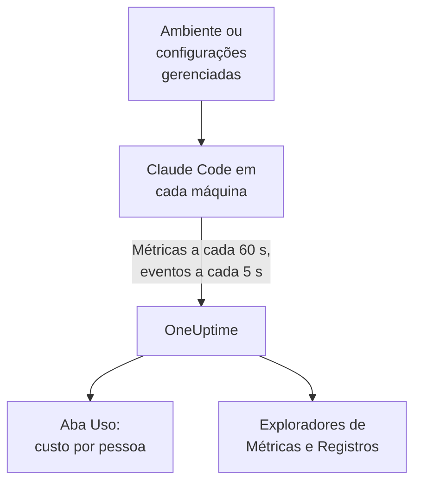

# Claude Code

O Claude Code exporta métricas e eventos do OpenTelemetry por conta própria, direto para o OneUptime: sem collector e sem gateway no meio. Ative-o com algumas variáveis de ambiente, ou para uma frota inteira com um único arquivo de configurações gerenciadas, e veja custo, tokens, sessões, commits e edições aceitas por desenvolvedor.

:::cards
- [Configure uma máquina](#configure-uma-máquina): Seis variáveis de ambiente e uma reinicialização.
- [Implante na frota](#implante-na-frota): Um arquivo de configurações gerenciadas em cada máquina.
- [Atribua o gasto a pessoas](#atribua-o-uso-a-pessoas-e-equipes): Quem fez login, e quando você mesmo precisa definir a identidade.
- [Solução de problemas](#solução-de-problemas): O que verificar quando nada chega.
:::

## Como funciona



O Claude Code envia:

- **Custo e tokens**: `claude_code.cost.usage` (USD) e `claude_code.token.usage`, por modelo, por agente principal ou subagente, e pelo agente, skill, plugin ou servidor MCP que fez a chamada.
- **Atividade**: sessões, commits, pull requests, linhas de código adicionadas e removidas, e tempo ativo.
- **Decisões de edição**: `claude_code.code_edit_tool.decision` conta as edições aceitas e rejeitadas, então a taxa de aceitação é `accept / (accept + reject)`, por linguagem e por ferramenta.
- **Eventos**: prompts, resultados de ferramentas, requisições e erros de API, mudanças de modo de permissão e conexões com servidores MCP, como registros de log OTLP.

Cada ponto de dados de métrica e cada evento carrega `user.email` quando o desenvolvedor fez login com uma conta Claude, e o OneUptime o lê como o funcionário nas métricas, que é onde estão o custo e os tokens.

## Antes de começar

1. Crie uma chave de ingestão de telemetria em **Configurações do projeto → Telemetria e APM → Chaves de ingestão**.
2. Seu endpoint OTLP é `https://oneuptime.com/otlp`, ou `https://YOUR-ONEUPTIME-HOST/otlp` se você hospeda o OneUptime por conta própria.
3. Use uma única chave para a frota inteira. Ela acaba em cada máquina de desenvolvedor, então trate-a como uma credencial compartilhada que só pode enviar dados, e faça a rotação dela como de qualquer outra.

## Configure uma máquina

:::steps
### Exporte as variáveis

Adicione-as ao perfil do seu shell (`.zshrc` ou `.bashrc`), ou exporte-as no terminal em que você inicia o Claude Code:

```bash
export CLAUDE_CODE_ENABLE_TELEMETRY=1
export OTEL_METRICS_EXPORTER=otlp
export OTEL_LOGS_EXPORTER=otlp
export OTEL_EXPORTER_OTLP_PROTOCOL=http/protobuf
export OTEL_EXPORTER_OTLP_ENDPOINT="https://oneuptime.com/otlp"
export OTEL_EXPORTER_OTLP_HEADERS="x-oneuptime-token=YOUR_INGESTION_TOKEN"
```

| Variável | O que faz |
| --- | --- |
| `CLAUDE_CODE_ENABLE_TELEMETRY` | A chave principal: sem ela nada é exportado. |
| `OTEL_METRICS_EXPORTER`, `OTEL_LOGS_EXPORTER` | `otlp` envia para o OneUptime. `otlp,console` também imprime o que é enviado, útil durante a configuração. |
| `OTEL_EXPORTER_OTLP_PROTOCOL` | `http/protobuf`; `http/json` e `grpc` também funcionam. |
| `OTEL_EXPORTER_OTLP_ENDPOINT` | A URL base. O Claude Code adiciona `/v1/metrics` e `/v1/logs` por conta própria. |
| `OTEL_EXPORTER_OTLP_HEADERS` | Pares `key=value` separados por vírgula; aqui, sua chave de ingestão. |

### Reinicie o Claude Code

As variáveis são lidas quando o Claude Code inicia. As métricas são enviadas a cada 60 segundos e os eventos a cada 5 segundos, então use o Claude Code por um minuto antes de olhar.

### Verifique se os dados chegam

Abra **Métricas** e procure `claude_code.token.usage`, depois abra **Produtos → AI / LLM** e vá para **Uso**: seu custo aparece sob seu e-mail, marcado como **das métricas GenAI**.
:::

Para enviar métricas e eventos para lugares diferentes, defina em vez disso `OTEL_EXPORTER_OTLP_METRICS_ENDPOINT` e `OTEL_EXPORTER_OTLP_LOGS_ENDPOINT`, com o caminho completo (`https://oneuptime.com/otlp/v1/metrics`, `https://oneuptime.com/otlp/v1/logs`).

## Implante na frota

Para uma organização, distribua as mesmas variáveis em um arquivo de configurações gerenciadas. Ele tem o formato de `settings.json`, com as variáveis em um bloco `env`:

```json title="managed-settings.json"
{
  "env": {
    "CLAUDE_CODE_ENABLE_TELEMETRY": "1",
    "OTEL_METRICS_EXPORTER": "otlp",
    "OTEL_LOGS_EXPORTER": "otlp",
    "OTEL_EXPORTER_OTLP_PROTOCOL": "http/protobuf",
    "OTEL_EXPORTER_OTLP_ENDPOINT": "https://oneuptime.com/otlp",
    "OTEL_EXPORTER_OTLP_HEADERS": "x-oneuptime-token=YOUR_INGESTION_TOKEN",
    "OTEL_RESOURCE_ATTRIBUTES": "team.id=platform,cost_center=eng-123"
  }
}
```

:::steps
### Coloque o arquivo onde o Claude Code o lê

| Plataforma | Caminho |
| --- | --- |
| macOS | `/Library/Application Support/ClaudeCode/managed-settings.json` |
| Linux e WSL | `/etc/claude-code/managed-settings.json` |
| Windows | `C:\Program Files\ClaudeCode\managed-settings.json` |

O Claude Code não lê mais o antigo caminho do Windows `C:\ProgramData\ClaudeCode\managed-settings.json`. Se você já distribui um arquivo de configurações gerenciadas, adicione em vez disso um arquivo complementar, como `managed-settings.d/10-telemetry.json` ao lado dele: o Claude Code mescla primeiro `managed-settings.json`, depois cada arquivo `*.json` em `managed-settings.d/` em ordem alfabética.

### Verifique uma máquina

Execute `/status` no Claude Code. A linha `Setting sources` deve dizer `Enterprise managed settings (file)`, ou `(drop-ins)` ou `(file + drop-ins)` para um arquivo complementar. Outra fonte entre parênteses significa que uma fonte de prioridade maior venceu, e a sua não foi usada.

### Veja a frota chegar

Na aba **Uso**, cada desenvolvedor aparece como uma linha assim que usa o Claude Code com as novas configurações.
:::

O mesmo JSON também pode vir das configurações gerenciadas pelo servidor no console de administração do claude.ai (buscadas na inicialização e a cada hora), de um perfil de configuração do macOS no domínio `com.anthropic.claudecode`, ou de um valor `Settings` em `HKLM\SOFTWARE\Policies\ClaudeCode` no Windows.

:::details Qual fonte gerenciada vence, e como as variáveis de telemetria se combinam
Por padrão, o Claude Code usa a fonte de maior prioridade que define qualquer chave de política, e ignora as outras: configurações gerenciadas pelo servidor, depois uma política de MDM ou do sistema operacional, depois os arquivos de configurações gerenciadas, depois o valor de registro `HKCU` por usuário. O bloco `env` é a exceção: desde a versão 2.1.223 ele é mesclado variável por variável entre as fontes de administração.

As variáveis de telemetria não: as variáveis `OTEL_EXPORTER_OTLP_*`, as chaves de conteúdo `OTEL_LOG_*`, `OTEL_LOGS_EXPORTER` e as variáveis do tracing em beta vêm juntas da fonte de maior prioridade que define qualquer uma delas, então um endpoint de uma fonte nunca se combina com as credenciais de outra. Se uma fonte de maior prioridade define qualquer uma delas, um arquivo complementar de telemetria não contribui com nada.

As configurações gerenciadas pelo servidor precisam de mais um passo: um `OTEL_EXPORTER_OTLP_ENDPOINT` não vazio só é aplicado depois que cada desenvolvedor aceita uma caixa de diálogo de aprovação de segurança em uma sessão interativa, e as mudanças nas configurações do exportador valem a partir da próxima inicialização. Arquivos e políticas de MDM não têm caixa de diálogo.
:::

:::details Fazer a rotação da chave de ingestão sem editar cada máquina
Em vez de um cabeçalho fixo, defina `"otelHeadersHelper": "/path/to/generate-otel-headers.sh"` nas configurações. O script imprime um objeto JSON simples de cabeçalhos, como `{"x-oneuptime-token":"..."}`. O Claude Code o executa na inicialização e de novo a cada `CLAUDE_CODE_OTEL_HEADERS_HELPER_DEBOUNCE_MS` milissegundos (`1740000` por padrão, 29 minutos). As falhas aparecem em `/status`.
:::

## Atribua o uso a pessoas e equipes

**O funcionário é `user.email`.** O Claude Code o envia quando o desenvolvedor fez login com uma conta Claude, e não há variável para desativá-lo. O OneUptime o lê de cada ponto de dados de custo e de tokens, sem configuração.

**Outros logins não enviam e-mail.** Com uma chave de API, ou com o Claude no Amazon Bedrock, no Google Cloud ou no Microsoft Foundry, não há conta Claude na sessão, e o Claude Code envia só `user.id` e `session.id`. Defina você mesmo a identidade, por máquina, nas configurações gerenciadas ou em um script de inicialização:

```bash
export OTEL_RESOURCE_ATTRIBUTES="user.email=jdoe@example.com,team.id=platform"
```

**`user.id` não é uma pessoa.** É um id aleatório que o Claude Code grava em `~/.claude.json` na primeira execução: um por instalação, e um novo se o arquivo for apagado. Sem um e-mail, cada instalação aparece como uma linha própria. Uma exceção: uma sessão com login em um gateway de apps do Claude envia a identidade do login (`user.id` é o subject do provedor de identidade, `user.email` o e-mail) e ignora as chaves `user.*` que você mesmo define.

**Equipes e centros de custo** vêm de `OTEL_RESOURCE_ATTRIBUTES`: o OneUptime lê `team.id`, `team`, `cost_center` e `department`. Os valores não podem conter espaços, e aspas não os protegem: escreva `team=Platform_Engineering`, ou use codificação percentual, como em `team=Platform%20Engineering`. O Claude Code copia essas chaves para cada ponto de dados (`OTEL_METRICS_INCLUDE_RESOURCE_ATTRIBUTES`, ativado por padrão), e o OneUptime as lê de qualquer forma. Uma chave que você define nunca substitui uma que o próprio Claude Code define.

## O que o OneUptime mostra

Em **Produtos → AI / LLM → Uso**, `claude_code.cost.usage` alimenta as tabelas **Funcionário**, **Equipe** e **Modelo**, e `claude_code.token.usage` os totais de tokens. Duas regras decidem o que você vê:

- **As métricas completam os spans; nunca são somadas a eles.** Se o mesmo projeto recebe spans GenAI com custo das suas próprias aplicações, o gasto do Claude Code não aparece. Envie o Claude Code para um projeto só dele. Veja [Primeiro os spans, as métricas completam](/docs/telemetry/ai-llm-observability#primeiro-os-spans-as-métricas-completam).
- **Uma linha vinda das métricas carrega só o custo.** As células de chamadas e tokens dela mostram `—`, e as tabelas **Provedor** e **Aplicação / Serviço** ficam vazias: as métricas não citam nenhum provedor e não pertencem a nenhum serviço do OneUptime.

Todo o resto, como taxa de aceitação, linhas de código, commits e pull requests por desenvolvedor, ou gasto por `query_source`, você mostra em um [dashboard](/docs/dashboards/index) a partir das métricas abaixo, e alerta sobre isso com um [monitor de métricas](/docs/monitor/metrics-monitor).

## Métricas

Cada métrica é um contador, e carrega os atributos padrão além dos próprios.

| Métrica | Unidade | Atributos próprios |
| --- | --- | --- |
| `claude_code.session.count` | nenhuma | `start_type`: `fresh`, `resume`, `continue`, `agents_view` |
| `claude_code.lines_of_code.count` | nenhuma | `type`: `added`, `removed`; `model` |
| `claude_code.commit.count` | nenhuma | nenhum |
| `claude_code.pull_request.count` | nenhuma | nenhum |
| `claude_code.cost.usage` | USD | `model`; `query_source`: `main`, `subagent`, `auxiliary`; `speed`: `fast`, `normal`; `effort`; `agent.name`, `skill.name`, `plugin.name`, `marketplace.name`, `mcp_server.name`, `mcp_tool.name` |
| `claude_code.token.usage` | tokens | `type`: `input`, `output`, `cacheRead`, `cacheCreation`; e os mesmos atributos de `claude_code.cost.usage` |
| `claude_code.code_edit_tool.decision` | nenhuma | `tool_name`: `Edit`, `Write`, `NotebookEdit`; `decision`: `accept`, `reject`; `source`; `language` |
| `claude_code.active_time.total` | s | `type`: `user` (no teclado), `cli` (ferramentas e respostas do modelo) |

Os atributos padrão são `session.id`, `app.version`, `app.entrypoint`, `organization.id`, `user.account_uuid`, `user.account_id`, `user.id`, `user.email` e `terminal.type`, mais o seu `OTEL_RESOURCE_ATTRIBUTES`. Alguns deles podem ser desativados: veja [Mantenha o volume de métricas baixo](#mantenha-o-volume-de-métricas-baixo).

- Os tipos de token de cache estão em camelCase: `cacheRead` e `cacheCreation`. Os totais de tokens do OneUptime contam só `input` e `output`.
- Nas métricas de custo e de tokens, os nomes dos seus próprios agentes e servidores MCP, e de plugins e skills de terceiros, aparecem como `custom` ou `third-party`, a menos que `OTEL_LOG_TOOL_DETAILS=1` esteja definido (Claude Code 2.1.273 ou posterior).

## Eventos

Os eventos chegam como registros de log OTLP, cada um com `event.name`, `event.timestamp` e `event.sequence`. Os que você mais vai usar:

| Evento | O que registra |
| --- | --- |
| `claude_code.user_prompt` | Um prompt: seu tamanho e seu comando; o texto só se você ativar |
| `claude_code.api_request` | Uma requisição ao modelo: `model`, `cost_usd`, `cost_usd_micros`, `duration_ms`, `input_tokens`, `output_tokens`, tokens de cache |
| `claude_code.api_error` | Uma requisição que falhou depois das novas tentativas: `model`, `error`, `status_code`, `attempt` |
| `claude_code.tool_result` | Uma execução de ferramenta: `tool_name`, `success`, `duration_ms`, e a decisão que a permitiu |
| `claude_code.tool_decision` | Se uma ferramenta foi permitida, e pelo quê |
| `claude_code.mcp_server_connection` | Um servidor MCP conectando ou falhando |

O Claude Code envia muitos outros, como recusas, mudanças de modo de permissão e eventos de plugins, hooks e skills: a [referência de monitoramento](https://code.claude.com/docs/en/monitoring-usage) da Anthropic lista todos. Em `cost_usd_micros`, o custo é um número inteiro de milionésimos de USD, que se soma sem desvios de arredondamento.

## Mantenha o volume de métricas baixo

O Claude Code coloca `session.id` em cada ponto de dados por padrão, e cada sessão é uma nova série. Em uma frota, esse único atributo faz o volume de métricas disparar, e os relatórios de custo não precisam dele:

```bash
export OTEL_METRICS_INCLUDE_SESSION_ID=false
```

| Variável | Padrão | Adiciona |
| --- | --- | --- |
| `OTEL_METRICS_INCLUDE_SESSION_ID` | `true` | `session.id`, um valor novo a cada sessão |
| `OTEL_METRICS_INCLUDE_VERSION` | `false` | `app.version` |
| `OTEL_METRICS_INCLUDE_ACCOUNT_UUID` | `true` | `user.account_uuid` e `user.account_id` |
| `OTEL_METRICS_INCLUDE_ENTRYPOINT` | `false` | `app.entrypoint` |
| `OTEL_METRICS_INCLUDE_RESOURCE_ATTRIBUTES` | `true` | Suas chaves de `OTEL_RESOURCE_ATTRIBUTES` |
| `OTEL_METRICS_INCLUDE_REPOSITORY` | `false` | Os atributos `vcs.*` do repositório |

`user.email`, `user.id`, `organization.id` e `terminal.type` não têm chave para desativar. Os eventos são o sinal mais movimentado: cada desenvolvedor ativo envia a cada 5 segundos (`OTEL_LOGS_EXPORT_INTERVAL`, em milissegundos). Aumente esse valor para enviar lotes menos frequentes e maiores, ou defina `OTEL_LOGS_EXPORTER=none` se você só precisa de custo e uso, que ficam todos nas métricas.

## O conteúdo de prompts e ferramentas vem desativado por padrão

O Claude Code não exporta prompts, respostas, argumentos nem saídas de ferramentas, a menos que você ative cada um:

| Variável | Padrão | O que `1` ativa |
| --- | --- | --- |
| `OTEL_LOG_USER_PROMPTS` | desativado | O texto dos prompts |
| `OTEL_LOG_ASSISTANT_RESPONSES` | desativado | O texto das respostas; quando não definida, segue `OTEL_LOG_USER_PROMPTS` |
| `OTEL_LOG_TOOL_DETAILS` | desativado | Os parâmetros das ferramentas, os comandos Bash, e os nomes reais de agentes, plugins, skills e servidores MCP |
| `OTEL_LOG_TOOL_CONTENT` | desativado | A entrada e a saída das ferramentas, só em spans de trace |
| `OTEL_LOG_RAW_API_BODIES` | desativado | Os corpos completos das requisições e respostas da API (`file:<dir>` os grava em disco em vez disso) |

Recomendamos deixá-los desativados: as métricas e os eventos ocultados já respondem quem gastou o quê, com qual modelo e com qual taxa de aceitação. Capturar conteúdo leva prompts, código-fonte e saídas de ferramentas para um armazenamento de telemetria com controles de acesso diferentes dos seus repositórios. Se você o ativar para uma investigação, `CLAUDE_CODE_OTEL_CONTENT_MAX_LENGTH` (`61440` por padrão) limita quanto viaja por registro, e as **Regras de mascaramento** e os **Filtros de descarte** dos traces, em **Traços → Configurações**, mascaram ou descartam o conteúdo antes que ele seja armazenado.

## As métricas chegam como deltas

O Claude Code envia métricas delta por padrão: cada ponto de dados é o aumento desde a última exportação, não um total acumulado. Quando você as mostrar em gráficos ou alertar sobre elas, some os pontos de dados na janela, e não aplique uma função de taxa ou de reinício de contador como faria com um contador cumulativo: os números saem errados sem parecer quebrados.

```bash
export OTEL_EXPORTER_OTLP_METRICS_TEMPORALITY_PREFERENCE=cumulative
```

Fixe `cumulative` só se todos os exportadores da sua organização o usarem, e não misture os dois em uma frota.

## Traces (beta)

O Claude Code também tem um exportador de traces em beta, que desenha cada interação como uma árvore de spans: `claude_code.interaction`, com `claude_code.llm_request` e `claude_code.tool` abaixo dele.

```bash
export CLAUDE_CODE_ENHANCED_TELEMETRY_BETA=1
export OTEL_TRACES_EXPORTER=otlp
```

> [!WARNING]
> Mantenha o beta de traces fora do projeto que você usa para o gasto. Os spans de modelo dele carregam `gen_ai.system` e `gen_ai.request.model`, então o OneUptime os lista em **Chamadas**, mas os tokens deles estão em `input_tokens` e `output_tokens`, não nas chaves `gen_ai.usage.*`, então chegam sem tokens e sem custo. Assim que existem, são as linhas que as tabelas **Funcionário**, **Equipe** e **Modelo** mostram, a US$ 0, no lugar do gasto das métricas.

Em sessões do Agent SDK e em sessões não interativas `-p`, o Claude Code aproveita um `TRACEPARENT` recebido, então os spans dele entram no trace de quem o chamou; as sessões interativas o ignoram. Ele só envia o cabeçalho `traceparent` ao modelo quando `ANTHROPIC_BASE_URL` não está definido ou é a API da Anthropic; atrás do seu próprio proxy, defina `CLAUDE_CODE_PROPAGATE_TRACEPARENT=1`.

## Solução de problemas

:::details Nada chega
Verifique primeiro `CLAUDE_CODE_ENABLE_TELEMETRY=1`: sem ela, nenhuma outra variável faz nada. Depois adicione `console` aos exportadores (`OTEL_METRICS_EXPORTER=otlp,console`) e observe o terminal: se pontos de dados forem impressos, o Claude Code está funcionando e o problema é o endpoint, a chave ou a rede.
:::

:::details O arquivo de configurações gerenciadas parece ser ignorado
Execute `/status` e leia a linha `Setting sources`. Nenhuma fonte gerenciada listada significa que o arquivo está no caminho errado, não é um JSON válido ou não pode ser lido pela conta do desenvolvedor. Outra fonte listada significa que ela venceu, e a sua não foi usada. As configurações gerenciadas pelo servidor também esperam o desenvolvedor aceitar a caixa de diálogo de aprovação em uma sessão interativa.
:::

:::details O gasto aparece como Sem atribuição, ou como uma linha por instalação
Esses desenvolvedores não fizeram login com uma conta Claude: eles usam uma chave de API, o Amazon Bedrock, o Google Cloud ou o Microsoft Foundry. Defina `user.email` em `OTEL_RESOURCE_ATTRIBUTES` para eles, como mostra [Atribua o uso a pessoas e equipes](#atribua-o-uso-a-pessoas-e-equipes).
:::

:::details A equipe ou o centro de custo está faltando
Verifique se `OTEL_RESOURCE_ATTRIBUTES` está definida na máquina, não contém espaços e não reutiliza uma chave que o próprio Claude Code define: o valor do Claude Code vence.
:::

:::details Os números parecem pequenos ou grandes demais
O Claude Code envia deltas: some os pontos de dados na janela, como explica [As métricas chegam como deltas](#as-métricas-chegam-como-deltas). E espere um minuto inteiro: as métricas são enviadas a cada 60 segundos.
:::

:::details A chave é recusada
O OneUptime recusa um `x-oneuptime-token` errado. Copie a chave de novo em **Configurações do projeto → Telemetria e APM → Chaves de ingestão**, e verifique se o cabeçalho diz `x-oneuptime-token=YOUR_INGESTION_TOKEN` sem espaços em volta do `=`.
:::

## Próximos passos

:::cards
- [Assistentes de programação com IA](/docs/telemetry/ai-coding-assistants): Como o gasto é atribuído em todos os assistentes de programação.
- [Observabilidade de IA / LLM](/docs/telemetry/ai-llm-observability): Conversas, alertas, custo e orçamentos para as suas próprias chamadas de IA.
- [Monitor de métricas](/docs/monitor/metrics-monitor): Alerte sobre o gasto ou os tokens por desenvolvedor.
:::
