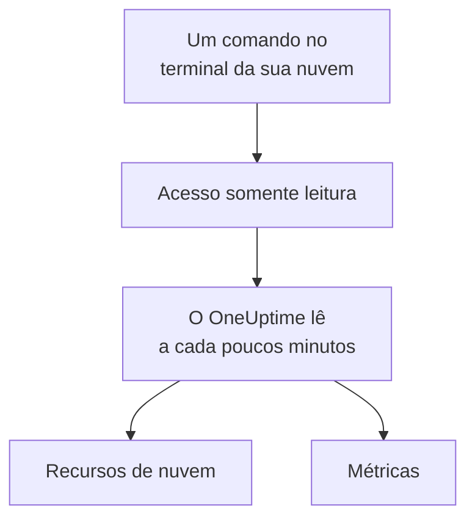

# Conectar uma conta de nuvem

Conecte uma conta da AWS, uma assinatura do Azure ou um projeto do Google Cloud pelo painel, e o OneUptime lista os recursos dela e lê as principais métricas deles de forma programada. Você executa um comando no terminal do navegador da sua nuvem e cola o que ele exibir: não há coletor para rodar nem nada para instalar.

:::cards
- [Amazon Web Services](#amazon-web-services): Uma função do IAM com a qual o OneUptime faz login, ou uma chave de acesso.
- [Microsoft Azure](#microsoft-azure): Um aplicativo com a função Monitoring Reader.
- [Google Cloud](#google-cloud): Uma conta de serviço com o papel Monitoring Viewer.
- [O que o OneUptime lê](#o-que-o-oneuptime-lê): Quais recursos e métricas, com que frequência e quanto custa.
:::

## Como funciona



- **O acesso só pode ler.** O comando cria um acesso que lê métricas e nada mais: três ações de leitura na AWS, a função **Monitoring Reader** no Azure e o papel **Monitoring Viewer** no Google Cloud. Exclua-o para cortar o acesso do OneUptime.
- **O OneUptime lê de forma programada.** A cada 5 minutos para o Azure e o Google Cloud, e a cada 10 minutos para a AWS, a menos que você escolha outro intervalo ao conectar.
- **Cada recurso tem uma página própria.** Os recursos aparecem em **Nuvem → Todos os recursos** com as principais métricas, os responsáveis e os rótulos, como os recursos que um coletor reporta.

## Antes de começar

- **Um proprietário ou administrador do projeto.** Só eles podem conectar, testar e editar contas de nuvem.
- **O terminal da sua nuvem** (AWS CloudShell, Azure Cloud Shell ou Google Cloud Shell), com login de alguém que possa criar uma função ou um usuário do IAM, um registro de aplicativo ou uma conta de serviço.

## Amazon Web Services

:::steps
### Abrir o formulário da AWS

Acesse **Nuvem → Conectar** e escolha **Amazon Web Services**.

### Executar o comando no AWS CloudShell

Escolha como o OneUptime faz login. Uma **Função do IAM** é o jeito recomendado: nada secreto é armazenado, e você pode excluir a função a qualquer momento. O formulário mostra o comando escrito para o seu projeto: ele cria uma função que confia na conta da AWS do OneUptime com o ID externo do seu projeto, e exibe o ARN da função. Use uma **Chave de acesso** quando uma função não for possível. Este comando cria um usuário com as mesmas permissões e exibe a chave dele:

```bash
aws iam create-user --user-name OneUptimeReadOnly > /dev/null 2>&1 || true
aws iam put-user-policy --user-name OneUptimeReadOnly --policy-name OneUptimeReadOnly --policy-document '{"Version":"2012-10-17","Statement":[{"Effect":"Allow","Action":["cloudwatch:GetMetricData","cloudwatch:ListMetrics","tag:GetResources"],"Resource":"*"}]}'
aws iam create-access-key --user-name OneUptimeReadOnly
```

### Colar o que o comando da AWS exibiu

Cole tudo o que o comando exibiu em **O que o comando exibiu**. O OneUptime separa o ARN da função, ou o ID da chave de acesso e o segredo dela.

### Testar e conectar a AWS

O OneUptime testa a conexão assim que esta etapa abre: faz login, conta os recursos que encontra e diz quanto custa lê-los. Selecione **Conectar** para salvar.
:::

A função e o usuário podem fazer três coisas, e nada mais:

| Ação | Para que o OneUptime a usa |
| --- | --- |
| `cloudwatch:ListMetrics` | Encontrar os recursos que reportam métricas, em cada região |
| `cloudwatch:GetMetricData` | Ler as principais métricas deles |
| `tag:GetResources` | Nomear cada recurso pela tag `Name` dele |

> [!NOTE]
> Em um OneUptime auto-hospedado, o jeito **Função do IAM** precisa de uma identidade da AWS do próprio OneUptime: defina `CLOUD_CONNECT_AWS_ACCESS_KEY_ID` e `CLOUD_CONNECT_AWS_SECRET_ACCESS_KEY` com a chave de um usuário do IAM que possa chamar `sts:AssumeRole`. Sem elas, o formulário oferece uma **Chave de acesso**.

## Microsoft Azure

:::steps
### Abrir o formulário do Azure

Acesse **Nuvem → Conectar** e escolha **Microsoft Azure**.

### Executar o comando no Azure Cloud Shell

O comando cria um aplicativo com a função **Monitoring Reader** na sua assinatura atual, e exibe os detalhes dele:

```bash
az ad sp create-for-rbac --name OneUptimeReadOnly --role "Monitoring Reader" --scopes "/subscriptions/$(az account show --query id --output tsv)"
```

### Colar o que o comando do Azure exibiu

Cole tudo o que o comando exibiu em **O que o comando exibiu**. O OneUptime separa `tenant`, `appId` e `password`.

### Testar e conectar o Azure

O OneUptime testa a conexão assim que esta etapa abre. Selecione **Conectar** para salvar.
:::

Para ler mais assinaturas com o mesmo aplicativo, dê a ele a função em cada uma delas:

```bash
az role assignment create --assignee <APP_ID> --role "Monitoring Reader" --scope /subscriptions/<SUBSCRIPTION_ID>
```

O OneUptime lê todas as assinaturas que o aplicativo pode ler, a menos que você liste algumas em **Assinaturas**.

## Google Cloud

:::steps
### Abrir o formulário do Google Cloud

Acesse **Nuvem → Conectar** e escolha **Google Cloud**.

### Executar o comando no Google Cloud Shell

Execute-o no projeto a monitorar. Ele ativa a API do Cloud Monitoring, cria uma conta de serviço com o papel **Monitoring Viewer** e exibe a chave dela:

```bash
PROJECT_ID=$(gcloud config get-value project)
gcloud services enable monitoring.googleapis.com
gcloud iam service-accounts create oneuptime-read-only --display-name "OneUptime (read only)"
gcloud projects add-iam-policy-binding "$PROJECT_ID" --member "serviceAccount:oneuptime-read-only@$PROJECT_ID.iam.gserviceaccount.com" --role roles/monitoring.viewer --condition=None > /dev/null
gcloud iam service-accounts keys create oneuptime-key.json --iam-account "oneuptime-read-only@$PROJECT_ID.iam.gserviceaccount.com"
cat oneuptime-key.json && rm oneuptime-key.json
```

### Colar a chave

Cole tudo o que o comando exibiu. O OneUptime lê o próprio projeto da chave e armazena a chave criptografada.

### Testar e conectar o Google Cloud

O OneUptime testa a conexão assim que esta etapa abre. Selecione **Conectar** para salvar.
:::

Para ler mais projetos com a mesma conta de serviço, dê a ela o papel em cada um deles e liste-os em **Projetos**:

```bash
gcloud projects add-iam-policy-binding <PROJECT_ID> --member "serviceAccount:oneuptime-read-only@<KEY_PROJECT_ID>.iam.gserviceaccount.com" --role roles/monitoring.viewer
```

## O que o OneUptime lê

| | AWS | Azure | Google Cloud |
| --- | --- | --- | --- |
| Recursos | Os que reportam métricas ao CloudWatch, em todas as regiões que você usa | Todos os recursos das assinaturas | Os que reportam métricas ao Cloud Monitoring |
| Métricas | As principais métricas de cada serviço, como CPU, rede e verificações de status de uma instância | Até 8 métricas principais por recurso | As principais métricas de cada tipo de recurso |
| Lido a cada | 10 minutos | 5 minutos | 5 minutos |
| Um recurso excluído | Arquivado após 7 dias sem métricas | Arquivado na leitura seguinte | Arquivado após 7 dias sem métricas |

Cada leitura continua de onde a anterior parou, então cada ponto de dados é gravado uma só vez. A primeira leitura de uma conexão nova começa em até um minuto e volta uma hora; depois de uma pausa, uma leitura volta no máximo 6 horas.

As chamadas do OneUptime são cobradas na sua conta de nuvem, pelos preços da sua nuvem. O teste estima o custo do que encontra, e ler com menos frequência custa menos: altere **Frequência de leitura de métricas** em **Mais campos**.

| Nuvem | Preço |
| --- | --- |
| AWS | CloudWatch `GetMetricData`: $0.01 por 1.000 métricas, e cada métrica principal de um recurso é uma métrica por leitura |
| Azure | As primeiras 1.000.000 leituras de métricas por mês de cada assinatura são gratuitas; depois, $0.01 por 1.000 |
| Google Cloud | As primeiras 1.000.000 séries temporais lidas por mês são gratuitas; depois, $0.50 por milhão |

## Solução de problemas

:::details O teste diz que a chave ou o segredo não foi aceito
Copie tudo o que o comando exibiu e cole de novo. Uma chave criada há um minuto pode levar um minuto para funcionar.
:::

:::details O teste faz login, mas não consegue ler
Execute o comando de novo: ele concede a função de que o OneUptime precisa. Na AWS, execute o comando que o formulário mostra para este projeto: uma função criada para outro projeto confia no ID externo daquele projeto, não no deste.
:::

:::details O Google Cloud não deixa o comando criar uma chave
Uma política da organização, `iam.disableServiceAccountKeyCreation`, pode proibir chaves de contas de serviço. Peça ao administrador da sua organização uma exceção para o projeto, ou [envie as métricas com o seu próprio coletor](/docs/telemetry/cloud-resources).
:::

:::details Nenhum recurso aparece
Na AWS e no Google Cloud, um recurso aparece quando reporta métricas. Se uma conexão não estiver funcionando, **View error** em **Nuvem → Conectar** diz por que a última leitura dela falhou.
:::

## Próximos passos

:::cards
- [Recursos de nuvem](/docs/telemetry/cloud-resources): Rode o seu próprio OpenTelemetry Collector, ou transmita as métricas do CloudWatch.
- [Monitor de métricas](/docs/monitor/metrics-monitor): Crie alertas sobre as métricas de um recurso.
:::
