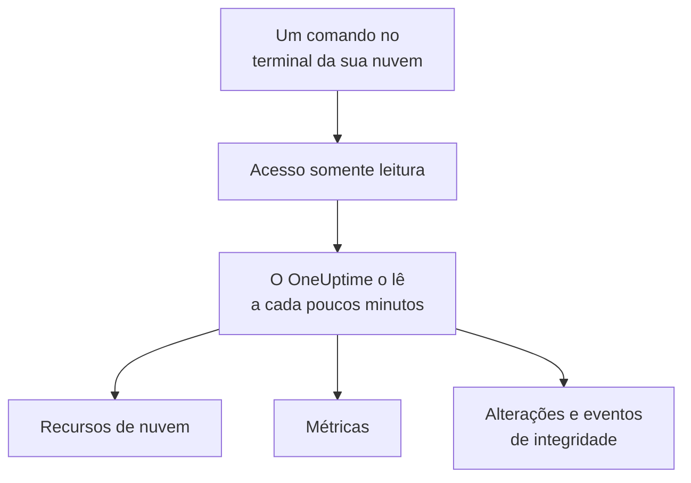

# Conectar uma conta de nuvem

Conecte uma conta da AWS, uma assinatura do Azure ou um projeto do Google Cloud pelo painel, e o OneUptime lista cada recurso dela, lê as principais métricas deles e registra o que mudou neles e o que o seu provedor de nuvem diz sobre a integridade deles. Você executa um comando no terminal do navegador da sua nuvem e cola o que ele exibe: não há coletor para rodar nem nada para instalar.

:::cards
- [Amazon Web Services](#amazon-web-services): Uma função do IAM com a qual o OneUptime faz login, ou uma chave de acesso.
- [Microsoft Azure](#microsoft-azure): Um aplicativo com a função Monitoring Reader.
- [Google Cloud](#google-cloud): Uma conta de serviço com quatro papéis somente leitura.
- [O que o OneUptime lê](#o-que-o-oneuptime-lê): Recursos, métricas, alterações e eventos de integridade, com que frequência e quanto custa.
- [Segurança de dados](#segurança-de-dados): O que a conexão permite que a Segurança de dados leia, e o que cada nível acrescenta ao comando.
- [Permitir que a IA corrija problemas](#permitir-que-a-ia-corrija-problemas): Mais um comando, e o OneUptime AI pode corrigir o que encontra.
:::

## Como funciona



- **O acesso só pode ler.** O comando cria um acesso que lê os seus recursos e como estão configurados, as métricas deles, o que mudou e os eventos de integridade do seu provedor, e nada mais: as ações listadas abaixo na AWS, a função **Monitoring Reader** no Azure e quatro papéis de leitura no Google Cloud. O OneUptime nunca lê dados ou segredos com ele, exceto linhas de log quando você deixa a IA ler os logs de uma conta e amostras de conteúdo quando você as ativa para a [Segurança de dados](#segurança-de-dados). Exclua-o para cortar o acesso do OneUptime.
- **O OneUptime lê de forma programada.** A cada 5 minutos para o Azure e o Google Cloud, e a cada 10 minutos para a AWS, a menos que você escolha outro intervalo ao conectar. Cada leitura também registra o que mudou desde a anterior, e a cada 30 minutos uma leitura lista todos os recursos de novo.
- **Cada recurso tem uma página própria.** Os recursos aparecem em **Nuvem → Todos os recursos** com as principais métricas, os responsáveis e os rótulos. A página de um recurso listado também mostra os **Recursos conectados** (onde ele é executado, o que lhe envia tráfego), os endpoints, tags e configurações, e os **Incidentes**, **Alertas** e **Alterações** dele.
- **Cada conta tem uma página própria.** As contas aparecem em **Nuvem → Contas** com os recursos por tipo e região, as **Alterações** e uma **Topologia** de como os recursos se encaixam.
- **O OneUptime AI lê o que mudou.** Uma investigação de um incidente ou alerta vinculado a um recurso de nuvem lê primeiro as alterações desse recurso e lê de novo o log de atividades da conta ao começar.

## Antes de começar

- **Um proprietário ou administrador do projeto.** Só eles podem conectar, testar e editar contas de nuvem.
- **O terminal da sua nuvem** (AWS CloudShell, Azure Cloud Shell ou Google Cloud Shell), com login de alguém que possa criar uma função ou um usuário do IAM, um registro de aplicativo ou uma conta de serviço.

## Amazon Web Services

:::steps
### Abrir o formulário da AWS

Vá para **Nuvem → Conectar** e escolha **Amazon Web Services**.

### Executar o comando no AWS CloudShell

Escolha como o OneUptime faz login. Uma **Função do IAM** é o caminho recomendado: nada secreto é armazenado, e você pode excluir a função a qualquer momento. O formulário mostra o comando escrito para o seu projeto: ele cria uma função que confia na conta da AWS do OneUptime com o ID externo do seu projeto e exibe o ARN da função.

Em **O que ler**, escolha esta conta ou todas as contas da sua AWS Organization. Execute o comando da organização na conta de gerenciamento dela: ele adiciona um StackSet que coloca a mesma função em cada conta, agora e à medida que contas entram, e permite que a função da conta de gerenciamento liste as contas. Uma conexão lê até 50 contas.

Use uma **Chave de acesso** quando uma função não for possível: ela lê apenas a própria conta. Este comando cria um usuário com as mesmas permissões e exibe a chave dele:

```bash
aws iam create-user --user-name OneUptimeReadOnly > /dev/null 2>&1 || true
aws iam put-user-policy --user-name OneUptimeReadOnly --policy-name OneUptimeReadOnly --policy-document '{"Version":"2012-10-17","Statement":[{"Effect":"Allow","Action":["cloudwatch:GetMetricData","cloudwatch:ListMetrics","tag:GetResources","iam:ListAccountAliases","cloudformation:ListResources","ec2:DescribeInstances","ec2:DescribeVolumes","ec2:DescribeVpcs","ec2:DescribeNatGateways","autoscaling:DescribeAutoScalingGroups","elasticloadbalancing:DescribeLoadBalancers","elasticloadbalancing:DescribeLoadBalancerAttributes","elasticloadbalancing:DescribeTargetGroups","elasticloadbalancing:DescribeTargetGroupAttributes","elasticloadbalancing:DescribeTargetHealth","elasticloadbalancing:DescribeTags","ecs:ListClusters","ecs:DescribeClusters","ecs:ListServices","ecs:DescribeServices","lambda:ListFunctions","rds:DescribeDBInstances","rds:DescribeDBClusters","elasticache:DescribeReplicationGroups","sqs:ListQueues","sqs:GetQueueAttributes","sns:ListTopics","sns:GetTopicAttributes","sns:ListSubscriptionsByTopic","dynamodb:ListTables","dynamodb:DescribeTable","kinesis:ListStreams","kinesis:DescribeStreamSummary","states:ListStateMachines","states:DescribeStateMachine","cloudfront:ListDistributions","elasticfilesystem:DescribeFileSystems","es:ListDomainNames","es:DescribeDomains","apprunner:ListServices","apprunner:DescribeService","cloudtrail:LookupEvents","health:DescribeEvents","health:DescribeEventDetails","rds:DescribeEvents","autoscaling:DescribeScalingActivities","ec2:DescribeInstanceStatus","ecs:DescribeTaskDefinition","lambda:GetFunctionConfiguration","lambda:GetFunctionConcurrency","lambda:GetAlias","servicequotas:ListServiceQuotas","logs:DescribeLogGroups","logs:FilterLogEvents"],"Resource":"*"},{"Effect":"Allow","Action":["apigateway:GET"],"Resource":["arn:aws:apigateway:*::/restapis","arn:aws:apigateway:*::/restapis/*","arn:aws:apigateway:*::/apis","arn:aws:apigateway:*::/apis/*"]}]}'
aws iam create-access-key --user-name OneUptimeReadOnly
```

### Colar o que o comando da AWS exibiu

Cole tudo o que o comando exibiu em **O que o comando exibiu**. O OneUptime extrai o ARN da função, ou o ID da chave de acesso e o segredo dela.

### Testar e conectar a AWS

O OneUptime testa a conexão assim que esta etapa abre: ele faz login, conta os recursos que encontra e informa quanto custa lê-los. Selecione **Conectar** para salvar.
:::

A função e o usuário podem fazer isto, e nada mais:

| Para que o OneUptime os usa | Ações |
| --- | --- |
| Encontrar os recursos que informam métricas e ler as métricas deles | `cloudwatch:GetMetricData`, `cloudwatch:ListMetrics` |
| Nomear cada recurso e ler as tags dele | `tag:GetResources`, `iam:ListAccountAliases` |
| Listar cada recurso e como está configurado, pelo Cloud Control | `cloudformation:ListResources`, `ec2:DescribeInstances`, `ec2:DescribeVolumes`, `ec2:DescribeVpcs`, `ec2:DescribeNatGateways`, `autoscaling:DescribeAutoScalingGroups`, `elasticloadbalancing:DescribeLoadBalancers`, `elasticloadbalancing:DescribeLoadBalancerAttributes`, `elasticloadbalancing:DescribeTargetGroups`, `elasticloadbalancing:DescribeTargetGroupAttributes`, `elasticloadbalancing:DescribeTargetHealth`, `elasticloadbalancing:DescribeTags`, `ecs:ListClusters`, `ecs:DescribeClusters`, `ecs:ListServices`, `ecs:DescribeServices`, `lambda:ListFunctions`, `rds:DescribeDBInstances`, `rds:DescribeDBClusters`, `elasticache:DescribeReplicationGroups`, `sqs:ListQueues`, `sqs:GetQueueAttributes`, `sns:ListTopics`, `sns:GetTopicAttributes`, `sns:ListSubscriptionsByTopic`, `dynamodb:ListTables`, `dynamodb:DescribeTable`, `kinesis:ListStreams`, `kinesis:DescribeStreamSummary`, `states:ListStateMachines`, `states:DescribeStateMachine`, `cloudfront:ListDistributions`, `elasticfilesystem:DescribeFileSystems`, `es:ListDomainNames`, `es:DescribeDomains`, `apprunner:ListServices`, `apprunner:DescribeService`, `apigateway:GET` |
| Ler o que mudou: os eventos de gerenciamento da conta | `cloudtrail:LookupEvents` |
| Ler os próprios eventos de integridade da AWS para a conta | `health:DescribeEvents`, `health:DescribeEventDetails` |
| Ler o status atual e os eventos recentes de um recurso durante uma investigação | `rds:DescribeEvents`, `autoscaling:DescribeScalingActivities`, `ec2:DescribeInstanceStatus`, `ecs:DescribeTaskDefinition`, `lambda:GetFunctionConfiguration`, `lambda:GetFunctionConcurrency`, `lambda:GetAlias` |
| Ler as cotas da conta durante uma investigação | `servicequotas:ListServiceQuotas` |
| Ler linhas de log, só quando você deixa a IA ler os logs de uma conta | `logs:DescribeLogGroups`, `logs:FilterLogEvents` |
| Listar as contas da organização, a partir da conta de gerenciamento dela | `organizations:ListAccounts` |

`apigateway:GET` só é permitido nas definições das próprias APIs, nunca nas chaves delas, e só a função da conta de gerenciamento pode listar as contas da organização. O AWS Health responde apenas a contas com um plano de suporte Business, Enterprise On-Ramp ou Enterprise: sem um, o OneUptime pergunta de novo um dia depois.

> [!NOTE]
> Em um OneUptime auto-hospedado, o caminho da **Função do IAM** precisa de uma identidade da AWS própria do OneUptime: defina `CLOUD_CONNECT_AWS_ACCESS_KEY_ID` e `CLOUD_CONNECT_AWS_SECRET_ACCESS_KEY` com a chave de um usuário do IAM que possa chamar `sts:AssumeRole`. Sem elas, o formulário oferece uma **Chave de acesso**.

## Microsoft Azure

:::steps
### Abrir o formulário do Azure

Vá para **Nuvem → Conectar** e escolha **Microsoft Azure**.

### Executar o comando no Azure Cloud Shell

O comando cria um aplicativo com a função **Monitoring Reader** na sua assinatura atual e exibe os detalhes dele com a data em que o segredo expira:

```bash
SCOPE="/subscriptions/$(az account show --query id --output tsv)"
OUT=$(az ad sp create-for-rbac --name OneUptimeReadOnly --role "Monitoring Reader" --scopes "$SCOPE")
APP=$(echo "$OUT" | jq -r .appId)
END=$(az ad app credential list --id "$APP" --query "max([].endDateTime)" --output tsv)
echo "$OUT" | jq --arg end "$END" '. + {endDateTime: $end}'
```

Em **O que ler**, escolha em vez disso todas as assinaturas do locatário, e a função é atribuída ao grupo de gerenciamento raiz do locatário:

```bash
SCOPE="/providers/Microsoft.Management/managementGroups/$(az account show --query tenantId --output tsv)"
OUT=$(az ad sp create-for-rbac --name OneUptimeReadOnly --role "Monitoring Reader" --scopes "$SCOPE")
APP=$(echo "$OUT" | jq -r .appId)
END=$(az ad app credential list --id "$APP" --query "max([].endDateTime)" --output tsv)
echo "$OUT" | jq --arg end "$END" '. + {endDateTime: $end}'
```

### Colar o que o comando do Azure exibiu

Cole tudo o que o comando exibiu em **O que o comando exibiu**. O OneUptime extrai o `tenant`, o `appId`, o `password` e a data em que ele expira.

### Testar e conectar o Azure

O OneUptime testa a conexão assim que esta etapa abre. Selecione **Conectar** para salvar.
:::

Para ler mais assinaturas com o mesmo aplicativo, dê a ele a função em cada uma delas:

```bash
az role assignment create --assignee <APP_ID> --role "Monitoring Reader" --scope /subscriptions/<SUBSCRIPTION_ID>
```

O OneUptime lê cada assinatura que o aplicativo pode ler, até 50, a menos que você liste algumas em **Assinaturas**. O segredo do aplicativo para de funcionar na data em que expira: a partir de 30 dias antes, cada leitura avisa sobre isso. Execute o comando de novo e cole o que ele exibe para dar a ele um novo.

## Google Cloud

:::steps
### Abrir o formulário do Google Cloud

Vá para **Nuvem → Conectar** e escolha **Google Cloud**.

### Executar o comando no Google Cloud Shell

Execute-o no projeto a monitorar. Ele ativa as APIs que o OneUptime lê, cria uma conta de serviço com os papéis **Monitoring Viewer**, **Cloud Asset Viewer**, **Logs Viewer** e **Service Health Viewer** e exibe a chave dela:

```bash
PROJECT_ID=$(gcloud config get-value project)
gcloud services enable monitoring.googleapis.com cloudasset.googleapis.com logging.googleapis.com cloudresourcemanager.googleapis.com servicehealth.googleapis.com
gcloud iam service-accounts create oneuptime-read-only --display-name "OneUptime (read only)" > /dev/null 2>&1 || true
gcloud projects add-iam-policy-binding "$PROJECT_ID" --member "serviceAccount:oneuptime-read-only@$PROJECT_ID.iam.gserviceaccount.com" --role roles/monitoring.viewer --condition=None > /dev/null
gcloud projects add-iam-policy-binding "$PROJECT_ID" --member "serviceAccount:oneuptime-read-only@$PROJECT_ID.iam.gserviceaccount.com" --role roles/cloudasset.viewer --condition=None > /dev/null
gcloud projects add-iam-policy-binding "$PROJECT_ID" --member "serviceAccount:oneuptime-read-only@$PROJECT_ID.iam.gserviceaccount.com" --role roles/logging.viewer --condition=None > /dev/null
gcloud projects add-iam-policy-binding "$PROJECT_ID" --member "serviceAccount:oneuptime-read-only@$PROJECT_ID.iam.gserviceaccount.com" --role roles/servicehealth.viewer --condition=None > /dev/null
gcloud iam service-accounts keys create oneuptime-key.json --iam-account "oneuptime-read-only@$PROJECT_ID.iam.gserviceaccount.com"
cat oneuptime-key.json && rm oneuptime-key.json
```

Em **O que ler**, escolha em vez disso todos os projetos da organização, e os papéis são atribuídos à organização do projeto:

```bash
PROJECT_ID=$(gcloud config get-value project)
ORG_ID=$(gcloud projects get-ancestors "$PROJECT_ID" --format="value(id)" | tail -1)
gcloud services enable monitoring.googleapis.com cloudasset.googleapis.com logging.googleapis.com cloudresourcemanager.googleapis.com servicehealth.googleapis.com
gcloud iam service-accounts create oneuptime-read-only --display-name "OneUptime (read only)" > /dev/null 2>&1 || true
gcloud organizations add-iam-policy-binding "$ORG_ID" --member "serviceAccount:oneuptime-read-only@$PROJECT_ID.iam.gserviceaccount.com" --role roles/monitoring.viewer --condition=None > /dev/null
gcloud organizations add-iam-policy-binding "$ORG_ID" --member "serviceAccount:oneuptime-read-only@$PROJECT_ID.iam.gserviceaccount.com" --role roles/cloudasset.viewer --condition=None > /dev/null
gcloud organizations add-iam-policy-binding "$ORG_ID" --member "serviceAccount:oneuptime-read-only@$PROJECT_ID.iam.gserviceaccount.com" --role roles/logging.viewer --condition=None > /dev/null
gcloud organizations add-iam-policy-binding "$ORG_ID" --member "serviceAccount:oneuptime-read-only@$PROJECT_ID.iam.gserviceaccount.com" --role roles/servicehealth.viewer --condition=None > /dev/null
gcloud iam service-accounts keys create oneuptime-key.json --iam-account "oneuptime-read-only@$PROJECT_ID.iam.gserviceaccount.com"
cat oneuptime-key.json && rm oneuptime-key.json
```

### Colar a chave

Cole tudo o que o comando exibiu. O OneUptime lê o próprio projeto da chave e armazena a chave criptografada.

### Testar e conectar o Google Cloud

O OneUptime testa a conexão assim que esta etapa abre. Selecione **Conectar** para salvar.
:::

Para ler mais projetos com a mesma conta de serviço, dê a ela os quatro papéis em cada um deles e liste-os em **Projetos**:

```bash
for ROLE in roles/monitoring.viewer roles/cloudasset.viewer roles/logging.viewer roles/servicehealth.viewer; do gcloud projects add-iam-policy-binding <PROJECT_ID> --member "serviceAccount:oneuptime-read-only@<KEY_PROJECT_ID>.iam.gserviceaccount.com" --role "$ROLE"; done
```

A conexão de uma organização lê até 50 dos projetos dela, a menos que você liste alguns em **Projetos**.

## Segurança de dados

A mesma conexão pode permitir que a [Segurança de dados](/docs/data-security/index) leia os repositórios de dados da conta: os buckets, bancos de dados e data warehouses dela. Em **Mais campos**, **Segurança de dados** fica em **Desativado** até você escolher outra opção, e o comando que o formulário mostra muda junto:

| Segurança de dados | O que a Segurança de dados pode ler | O que o comando acrescenta |
| --- | --- | --- |
| **Desativado** | Nenhum dos repositórios da conta | Nada |
| **Somente configuração** | Quem pode acessar cada repositório, e como ele é criptografado, copiado em backup e registrado em logs. Nunca dados. | Na AWS, uma segunda política em linha, `OneUptimeDataSecurity`, com ações de leitura. No Azure e no Google Cloud, nada: **Monitoring Reader** e **Cloud Asset Viewer** já leem isso. |
| **Configuração e amostras de conteúdo** | Isso, e amostras de objetos e linhas, para encontrar dados sensíveis neles | Na AWS, a mesma política com `s3:ListBucket`, `s3:GetObject` e `kms:Decrypt` somente através do S3. No Azure, **Storage Blob Data Reader**. No Google Cloud, `roles/storage.objectViewer`, `roles/bigquery.dataViewer` e a API do BigQuery. |

Na AWS, o comando da função acrescenta a política com mais uma linha. No nível de conteúdo, ela é:

```bash
aws iam put-role-policy --role-name "$ROLE" --policy-name OneUptimeDataSecurity --policy-document '{"Version":"2012-10-17","Statement":[{"Effect":"Allow","Action":["s3:ListAllMyBuckets","s3:GetBucketLocation","s3:GetBucketPolicyStatus","s3:GetBucketPublicAccessBlock","s3:GetAccountPublicAccessBlock","s3:GetBucketAcl","s3:GetBucketPolicy","s3:GetEncryptionConfiguration","s3:GetBucketVersioning","s3:GetBucketLogging","s3:GetBucketOwnershipControls","s3:GetReplicationConfiguration","s3:GetBucketTagging","rds:DescribeDBInstances","rds:DescribeDBClusters","rds:DescribeDBSnapshots","rds:DescribeDBSnapshotAttributes","rds:DescribeDBClusterSnapshots","rds:DescribeDBClusterSnapshotAttributes","dynamodb:ListTables","dynamodb:DescribeTable","dynamodb:DescribeContinuousBackups","redshift:DescribeClusters","redshift:DescribeLoggingStatus","es:ListDomainNames","es:DescribeDomains","elasticache:DescribeReplicationGroups","elasticfilesystem:DescribeFileSystems","kms:ListAliases"],"Resource":"*"},{"Effect":"Allow","Action":["s3:ListBucket"],"Resource":"arn:aws:s3:::*"},{"Effect":"Allow","Action":["s3:GetObject"],"Resource":"arn:aws:s3:::*/*"},{"Effect":"Allow","Action":["kms:Decrypt"],"Resource":"*","Condition":{"StringLike":{"kms:ViaService":"s3.*.amazonaws.com"}}}]}'
```

O IAM limita as políticas em linha de um usuário a 2.048 caracteres no total, então com uma **Chave de acesso** a política vai para um grupo, `OneUptimeDataSecurity`, ao qual o usuário é adicionado:

```bash
aws iam create-user --user-name OneUptimeReadOnly > /dev/null 2>&1 || true
aws iam put-user-policy --user-name OneUptimeReadOnly --policy-name OneUptimeReadOnly --policy-document '{"Version":"2012-10-17","Statement":[{"Effect":"Allow","Action":["cloudwatch:GetMetricData","cloudwatch:ListMetrics","tag:GetResources","iam:ListAccountAliases","cloudformation:ListResources","ec2:DescribeInstances","ec2:DescribeVolumes","ec2:DescribeVpcs","ec2:DescribeNatGateways","autoscaling:DescribeAutoScalingGroups","elasticloadbalancing:DescribeLoadBalancers","elasticloadbalancing:DescribeLoadBalancerAttributes","elasticloadbalancing:DescribeTargetGroups","elasticloadbalancing:DescribeTargetGroupAttributes","elasticloadbalancing:DescribeTargetHealth","elasticloadbalancing:DescribeTags","ecs:ListClusters","ecs:DescribeClusters","ecs:ListServices","ecs:DescribeServices","lambda:ListFunctions","rds:DescribeDBInstances","rds:DescribeDBClusters","elasticache:DescribeReplicationGroups","sqs:ListQueues","sqs:GetQueueAttributes","sns:ListTopics","sns:GetTopicAttributes","sns:ListSubscriptionsByTopic","dynamodb:ListTables","dynamodb:DescribeTable","kinesis:ListStreams","kinesis:DescribeStreamSummary","states:ListStateMachines","states:DescribeStateMachine","cloudfront:ListDistributions","elasticfilesystem:DescribeFileSystems","es:ListDomainNames","es:DescribeDomains","apprunner:ListServices","apprunner:DescribeService","cloudtrail:LookupEvents","health:DescribeEvents","health:DescribeEventDetails","rds:DescribeEvents","autoscaling:DescribeScalingActivities","ec2:DescribeInstanceStatus","ecs:DescribeTaskDefinition","lambda:GetFunctionConfiguration","lambda:GetFunctionConcurrency","lambda:GetAlias","servicequotas:ListServiceQuotas","logs:DescribeLogGroups","logs:FilterLogEvents"],"Resource":"*"},{"Effect":"Allow","Action":["apigateway:GET"],"Resource":["arn:aws:apigateway:*::/restapis","arn:aws:apigateway:*::/restapis/*","arn:aws:apigateway:*::/apis","arn:aws:apigateway:*::/apis/*"]}]}'
aws iam create-group --group-name OneUptimeDataSecurity > /dev/null 2>&1 || true
aws iam put-group-policy --group-name OneUptimeDataSecurity --policy-name OneUptimeDataSecurity --policy-document '{"Version":"2012-10-17","Statement":[{"Effect":"Allow","Action":["s3:ListAllMyBuckets","s3:GetBucketLocation","s3:GetBucketPolicyStatus","s3:GetBucketPublicAccessBlock","s3:GetAccountPublicAccessBlock","s3:GetBucketAcl","s3:GetBucketPolicy","s3:GetEncryptionConfiguration","s3:GetBucketVersioning","s3:GetBucketLogging","s3:GetBucketOwnershipControls","s3:GetReplicationConfiguration","s3:GetBucketTagging","rds:DescribeDBInstances","rds:DescribeDBClusters","rds:DescribeDBSnapshots","rds:DescribeDBSnapshotAttributes","rds:DescribeDBClusterSnapshots","rds:DescribeDBClusterSnapshotAttributes","dynamodb:ListTables","dynamodb:DescribeTable","dynamodb:DescribeContinuousBackups","redshift:DescribeClusters","redshift:DescribeLoggingStatus","es:ListDomainNames","es:DescribeDomains","elasticache:DescribeReplicationGroups","elasticfilesystem:DescribeFileSystems","kms:ListAliases"],"Resource":"*"},{"Effect":"Allow","Action":["s3:ListBucket"],"Resource":"arn:aws:s3:::*"},{"Effect":"Allow","Action":["s3:GetObject"],"Resource":"arn:aws:s3:::*/*"},{"Effect":"Allow","Action":["kms:Decrypt"],"Resource":"*","Condition":{"StringLike":{"kms:ViaService":"s3.*.amazonaws.com"}}}]}'
aws iam add-user-to-group --user-name OneUptimeReadOnly --group-name OneUptimeDataSecurity
aws iam create-access-key --user-name OneUptimeReadOnly
```

No Azure, o nível de conteúdo acrescenta **Storage Blob Data Reader** no mesmo escopo que **Monitoring Reader**:

```bash
SCOPE="/subscriptions/$(az account show --query id --output tsv)"
OUT=$(az ad sp create-for-rbac --name OneUptimeReadOnly --role "Monitoring Reader" --scopes "$SCOPE")
APP=$(echo "$OUT" | jq -r .appId)
az role assignment create --assignee "$APP" --role "Storage Blob Data Reader" --scope "$SCOPE" > /dev/null
END=$(az ad app credential list --id "$APP" --query "max([].endDateTime)" --output tsv)
echo "$OUT" | jq --arg end "$END" '. + {endDateTime: $end}'
```

No Google Cloud, ele acrescenta os dois papéis e ativa `bigquery.googleapis.com`:

```bash
PROJECT_ID=$(gcloud config get-value project)
gcloud services enable monitoring.googleapis.com cloudasset.googleapis.com logging.googleapis.com cloudresourcemanager.googleapis.com servicehealth.googleapis.com bigquery.googleapis.com
gcloud iam service-accounts create oneuptime-read-only --display-name "OneUptime (read only)" > /dev/null 2>&1 || true
gcloud projects add-iam-policy-binding "$PROJECT_ID" --member "serviceAccount:oneuptime-read-only@$PROJECT_ID.iam.gserviceaccount.com" --role roles/monitoring.viewer --condition=None > /dev/null
gcloud projects add-iam-policy-binding "$PROJECT_ID" --member "serviceAccount:oneuptime-read-only@$PROJECT_ID.iam.gserviceaccount.com" --role roles/cloudasset.viewer --condition=None > /dev/null
gcloud projects add-iam-policy-binding "$PROJECT_ID" --member "serviceAccount:oneuptime-read-only@$PROJECT_ID.iam.gserviceaccount.com" --role roles/logging.viewer --condition=None > /dev/null
gcloud projects add-iam-policy-binding "$PROJECT_ID" --member "serviceAccount:oneuptime-read-only@$PROJECT_ID.iam.gserviceaccount.com" --role roles/servicehealth.viewer --condition=None > /dev/null
gcloud projects add-iam-policy-binding "$PROJECT_ID" --member "serviceAccount:oneuptime-read-only@$PROJECT_ID.iam.gserviceaccount.com" --role roles/storage.objectViewer --condition=None > /dev/null
gcloud projects add-iam-policy-binding "$PROJECT_ID" --member "serviceAccount:oneuptime-read-only@$PROJECT_ID.iam.gserviceaccount.com" --role roles/bigquery.dataViewer --condition=None > /dev/null
gcloud iam service-accounts keys create oneuptime-key.json --iam-account "oneuptime-read-only@$PROJECT_ID.iam.gserviceaccount.com"
cat oneuptime-key.json && rm oneuptime-key.json
```

O comando de um nível mais baixo substitui a política da AWS pela do nível mais baixo. **Desativado** não acrescenta nada, então deixa no lugar o que um comando anterior concedeu até você excluí-lo: a política `OneUptimeDataSecurity` na AWS, com `aws iam delete-role-policy --role-name <your role> --policy-name OneUptimeDataSecurity`, e os papéis do nível de conteúdo no Azure e no Google Cloud. De qualquer forma, a Segurança de dados para de ler na hora: ela lê só o que o nível da conexão indica. [Configurar a Segurança de dados](/docs/data-security/setup) lista cada ação da política, e o que a Segurança de dados guarda do que lê.

## O que o OneUptime lê

| | AWS | Azure | Google Cloud |
| --- | --- | --- | --- |
| Recursos | Cada recurso dos tipos que o OneUptime conhece, em cada região que você usa, pelo Cloud Control | Cada recurso das assinaturas, pelo Resource Graph | Cada recurso dos projetos, pelo Cloud Asset Inventory |
| Métricas | As principais métricas de cada serviço, como CPU, rede e verificações de status de uma instância | Até 8 métricas principais por recurso | As principais métricas de cada tipo de recurso |
| Alterações | Os eventos de gerenciamento do CloudTrail | Os eventos administrativos do log de atividades | O log de auditoria Admin Activity |
| Eventos de integridade | AWS Health | Service Health e Resource Health | Service Health |
| Leitura a cada | 10 minutos | 5 minutos | 5 minutos |
| Um recurso excluído | Arquivado assim que uma listagem completa não o tem mais | Arquivado assim que uma listagem completa não o tem mais | Arquivado assim que uma listagem completa não o tem mais |

Cada leitura continua de onde a anterior parou, então cada ponto de dados e cada alteração são gravados uma única vez. A primeira leitura de uma conexão nova começa em até um minuto e volta uma hora para as métricas e 2 horas para as alterações; depois de uma pausa, uma leitura volta no máximo 6 horas. Um recurso que só informa métricas, e que nenhuma listagem tem, é arquivado após 7 dias sem métricas.

As chamadas que o OneUptime faz são cobradas da sua conta de nuvem, aos preços da sua nuvem. Listar recursos e ler alterações e eventos de integridade não custa nada nas três nuvens; ler métricas, sim. O teste estima o custo do que encontra, e ler com menos frequência custa menos: altere **Frequência de leitura de métricas** em **Mais campos**.

| Nuvem | Preço |
| --- | --- |
| AWS | CloudWatch `GetMetricData`: $0.01 a cada 1.000 métricas, e cada métrica principal de um recurso é uma métrica por leitura |
| Azure | As primeiras 1.000.000 leituras de métricas por mês de cada assinatura são gratuitas, depois $0.01 a cada 1.000 |
| Google Cloud | As primeiras 1.000.000 séries temporais lidas por mês são gratuitas, depois $0.50 por milhão |

## O que você vê no OneUptime

- **A página de uma conta.** Em **Nuvem → Contas**, a visão geral de uma conta conta os recursos dela por tipo e região e diz quando uma conexão a leu pela última vez. Os **Recursos** dela os listam, as **Alterações** listam o que mudou nela, os mais recentes primeiro, e a **Topologia** desenha as regiões, as redes nelas e o que roda em cada uma, com os incidentes e alertas abertos nos recursos aos quais estão vinculados. O **Feed** dela registra como a conta chegou ao OneUptime, quando o agente de IA de nuvem dela se conectou ou foi redefinido, e quem alterou o que o OneUptime AI pode fazer nela.
- **As alterações de um recurso.** Uma alteração é guardada como um evento de alteração vinculado ao recurso que ela alterou e à conta dele, e desenhada como um marcador nos gráficos de métricas do recurso, junto com os incidentes e alertas dele. Gráficos filtrados para nenhum recurso deixam de fora o log de atividades de uma conta de nuvem, para que uma conta movimentada não esconda os seus deploys; os eventos de integridade do provedor continuam neles.
- **Incidentes e alertas.** Vincule um recurso de nuvem a um monitor, um incidente ou um alerta nos recursos vinculados dele, e os incidentes e alertas dele são listados na página do recurso. Um monitor de site, API, SSL, ping ou porta cujo host leva a um endpoint de um recurso, diretamente ou pelo DNS, lista o recurso em **Recursos de nuvem sugeridos** no cartão **Recursos Vinculados**: selecione **Vincular recurso** para vinculá-lo.

## Permitir que a IA corrija problemas

O OneUptime AI lê toda conta conectada enquanto investiga, com o acesso somente leitura descrito acima. Para que ele também corrija problemas, como reiniciar um serviço, aumentar a escala dele ou revertê-lo, abra a conta em **Nuvem → Contas** e selecione **Permitir que a IA corrija problemas** no cartão **Agente de IA** da **Visão geral** dela.

A caixa de diálogo faz uma única pergunta, **Até onde a IA pode ir?**: **Perguntar antes**, o padrão, em que o OneUptime AI propõe cada correção e uma pessoa a aprova com um clique, ou **Corrigir problemas seguros por conta própria**, em que as alterações seguras são executadas sozinhas e as mais arriscadas continuam aguardando aprovação. Todo o resto tem um padrão seguro em **Mais campos**. Depois ela mostra um comando, escrito para esta conta: execute-o no AWS CloudShell, no Azure Cloud Shell ou no Google Cloud Shell, conectado como alguém que pode criar funções na conta. O comando cria uma função que só pode fazer as alterações ativadas e inicia com ela o agente de IA de nuvem na sua conta. O agente se conecta sozinho em poucos minutos, e a caixa de diálogo avisa: não há nada para colar de volta.

O agente é um pequeno contêiner que roda o mês inteiro na sua conta, cobrado pela sua nuvem aos preços de tabela dela:

| Nuvem | O que roda | Cerca de |
| --- | --- | --- |
| AWS | Uma tarefa do ECS Fargate de 0.25 vCPU e 0.5 GB, e o endereço IPv4 público dela, aos preços de `us-east-1` | $13 por mês |
| Azure | Uma réplica do Container Apps de 0.25 vCPU e 0.5 GiB, depois da cota gratuita mensal da assinatura, de 180.000 vCPU-segundos e 360.000 GiB-segundos | $14 por mês |
| Google Cloud | Uma instância do Cloud Run de 1 vCPU e 0.5 GiB com CPU sempre alocada, que ocupa uma vCPU inteira, depois do nível gratuito mensal de 240.000 vCPU-segundos e 450.000 GiB-segundos | $45 por mês |

O que o agente pode alterar, como cada alteração é classificada em níveis e desfeita, e como ler os registros dele: [Agentes de IA para a infraestrutura](/docs/ai/infrastructure-ai-agents#em-uma-conta-de-nuvem).

## Solução de problemas

:::details O teste diz que a chave ou o segredo não foi aceito
Copie tudo o que o comando exibiu e cole de novo. Uma chave criada há um minuto pode levar um minuto para funcionar. Um segredo do Azure expirado também é recusado: execute o comando de novo.
:::

:::details O teste faz login, mas não consegue ler
Execute o comando de novo: ele concede os papéis de que o OneUptime precisa. Na AWS, execute o comando que o formulário mostra para este projeto: uma função criada para outro projeto confia no ID externo daquele projeto, não no deste.
:::

:::details O Google Cloud não deixa o comando criar uma chave
Uma política da organização, `iam.disableServiceAccountKeyCreation`, pode proibir chaves de conta de serviço. Peça ao administrador da sua organização uma exceção para o projeto, ou [envie as métricas com o seu próprio coletor](/docs/telemetry/cloud-resources).
:::

:::details Nenhum recurso aparece
A primeira leitura lista cada recurso da conta, informe ele métricas ou não. Se uma conexão não estiver funcionando, **View error** em **Nuvem → Conectar** diz por que a última leitura dela falhou.
:::

:::details Faltam algumas contas da organização
Uma conexão lê até 50 contas, assinaturas ou projetos, e cada leitura avisa quando há mais. Conecte as outras com uma conexão própria.
:::

## Próximos passos

:::cards
- [Recursos de nuvem](/docs/telemetry/cloud-resources): Rode o seu próprio OpenTelemetry Collector, ou transmita as métricas do CloudWatch.
- [Deploys e alterações](/docs/telemetry/change-events): Cada alteração que o OneUptime registra, e como o OneUptime AI as lê.
- [Monitor de métricas](/docs/monitor/metrics-monitor): Crie alertas sobre as métricas de um recurso.
:::
