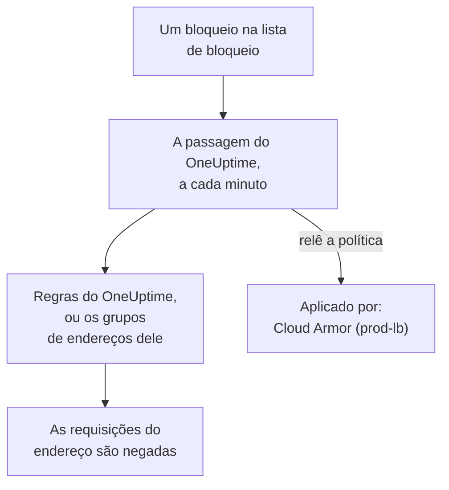

# Bloquear endereços no Cloud Armor

A lista de bloqueio do seu projeto pode ser aplicada nas políticas de segurança do Google Cloud Armor dos seus balanceadores de carga. Ative-a em uma conexão do Google Cloud que você já tem, escolha as políticas de segurança, e cada endereço que a lista de bloqueio bloqueia passa a ser bloqueado lá, tenha sido bloqueado por uma pessoa, por um playbook ou pelo OneUptime AI.

:::cards
- [Ativação](#ativação): Uma configuração na conexão do Google Cloud, e a função de que ela precisa.
- [O que o OneUptime cria](#o-que-o-oneuptime-cria): Regras próprias em cada política, ou grupos de endereços com o Cloud Armor Enterprise.
- [Qual endereço é comparado](#qual-endereço-é-comparado): O endereço que se conectou, ou o IP do usuário atrás de um proxy.
:::

## Como funciona

O OneUptime mantém regras próprias em cada política de segurança que você escolher, e coloca nelas os endereços que a lista de bloqueio bloqueia. A cada minuto, ele altera o que mudou, uma regra por vez, e depois relê a política. Na página **Lista de bloqueio**, a coluna **Aplicado por** de um bloqueio só nomeia Cloud Armor (prod-lb) depois que a política contém o bloqueio; até lá, o bloqueio não é aplicado.

## Antes de começar

- Um projeto do Google Cloud conectado ao OneUptime (veja [Conectar uma conta de nuvem](/docs/telemetry/cloud-accounts#google-cloud)).
- Uma função que possa mudar onde a lista de bloqueio é aplicada: **Proprietário do projeto**, **Administrador do projeto** ou **Administrador de segurança**.
- Alguém que possa criar funções e concedê-las no projeto do Google Cloud, para executar um comando no Cloud Shell.

## Ativação

:::steps
### Abrir a conexão
Abra **Nuvem → Conectar** e edite a conexão do Google Cloud.

### Ativar a configuração
Em **Mais campos**, defina **Bloquear endereços no Cloud Armor** como **Ativado** e salve. O comando de configuração que o formulário mostra agora concede a função descrita abaixo onde concede as outras. Uma conexão que você já tem não precisa executá-lo de novo: a caixa de diálogo **Adicionar WAF** dá as linhas que concedem a função no projeto da política.

### Adicionar as políticas de segurança
Abra **Eventos de segurança → Playbooks → Lista de bloqueio**. Em **WAFs de nuvem**, clique em **Adicionar WAF** e escolha uma política de segurança. O OneUptime pergunta ao Google Cloud se a conexão pode gravar nela, sem gravar nada.

### Conceder a função, se estiver faltando
Quando falta uma permissão, a caixa de diálogo mostra as linhas que a concedem no projeto da política. Execute-as no Cloud Shell, clique em **Verificar de novo** e depois adicione a política. O **Status** dela mostra **Aplicada** assim que o OneUptime a tiver configurado.
:::

As políticas de segurança vêm do inventário da conexão: uma que o OneUptime ainda não leu aparece após a próxima leitura. Enquanto uma política aplica a lista de bloqueio, a configuração da conexão dela não pode ser desativada e a conexão não pode ser excluída: remova primeiro a política, para que o OneUptime retire as regras dele.

## O que o OneUptime cria

O OneUptime escolhe como uma política contém a lista de bloqueio quando você a adiciona.

| O quê | Nome | Onde |
| --- | --- | --- |
| Regras que negam com 403, cada uma com até 10 endereços ou intervalos | A descrição delas começa com `OneUptime blocklist <project> #1`, `#2`, ... | Em cada política que você escolher, no máximo 20. |
| Dois grupos de endereços, IPv4 e IPv6 | `oneuptime-<project>-block-ipv4`, `oneuptime-<project>-block-ipv6` | Globais, no projeto da política. Só com o Cloud Armor Enterprise. |
| Uma regra que nega com 403 o que qualquer um dos grupos contém | A descrição dela começa com `OneUptime blocklist <project>, address groups` | Em cada política de back-end global que você escolher, com o Cloud Armor Enterprise. |

`<project>` são os oito primeiros caracteres do ID externo do seu projeto, então dois projetos do OneUptime que escolhem a mesma política nunca gravam as regras um do outro. O Cloud Armor identifica uma regra só pela prioridade dela, então o OneUptime reconhece as próprias regras pela descrição.

- **Regras.** O Cloud Armor comporta 10 endereços ou intervalos em uma regra, então uma política comporta até 200 bloqueios nas 20 regras do OneUptime; um bloqueio que não cabe informa isso na linha dele.
- **Grupos de endereços.** Uma política de back-end global de um projeto com o Cloud Armor Enterprise mantém, em vez disso, a lista de bloqueio em dois grupos de endereços: 10.000 intervalos IPv4 e 2.000 IPv6. Todas essas políticas do projeto os compartilham, e uma regra em cada política nega o que eles contêm. Os grupos ocupam 16.000 unidades da cota de grupos de endereços do projeto.

O OneUptime adiciona, altera e remove cada uma das regras dele separadamente, com os métodos de regra do Cloud Armor: ele nunca grava a política inteira e nunca grava uma regra sua. Um endereço único é escrito como `/32` ou `/128`.

## O lugar das regras na política

O OneUptime coloca as regras dele em prioridades livres antes da sua primeira regra que deixa uma requisição passar, a partir da mais baixa, para que nenhuma regra sua deixe passar um endereço bloqueado: uma regra que permite, limita, bane por taxa ou compartilha de forma justa. Uma regra sua que nega pode vir antes. O OneUptime nunca renumera, altera ou remove uma regra sua: quando não há prioridade livre antes da sua primeira regra desse tipo, a política mostra **Sem prioridade livre**, e o OneUptime adiciona a regra dele assim que você liberar uma.

## Qual endereço é comparado

| Política de segurança | Endereço do cliente | Quando escolher |
| --- | --- | --- |
| Back-end | **O endereço que se conectou ao balanceador de carga (origin.ip)** | O padrão. |
| Back-end | O IP do usuário dos cabeçalhos de requisição da política (origin.user_ip) | Para um balanceador de carga atrás de outro proxy ou CDN. |
| Borda | O endereço que se conectou ao balanceador de carga (origin.ip) | A única opção: uma política de borda não lê nenhum outro endereço. |

`origin.user_ip` é o endereço nos cabeçalhos de requisição de IP do usuário da política (`userIpRequestHeaders`), que um proxy ou CDN na frente do balanceador de carga escreve. Sem nenhum definido, ou sem um endereço válido neles, ele é `origin.ip`. Escolha-o só quando um proxy assim os escreve, já que um cliente que chega diretamente ao balanceador de carga pode escrevê-los ele mesmo. A opção fica em **Mais campos** na caixa de diálogo **Adicionar WAF**, e você pode alterá-la depois com **Endereço do cliente** na linha da política.

Uma política de segurança de borda de rede, para balanceadores de carga de rede de passagem, não pode ser escolhida, e a caixa de diálogo **Adicionar WAF** diz por quê: as regras dela comparam pacotes, não requisições.

As regras do OneUptime no Cloud Armor só negam. Um bloqueio que pede para aplicar um desafio a um endereço não é aplicado no Cloud Armor, e informa isso. O desafio de uma política de resposta automática é aplicado lá como um bloqueio pelo mesmo tempo.

## Quando uma regra é alterada manualmente

Quando alguém coloca uma das regras do OneUptime no modo de visualização, a altera ou a exclui, ou exclui um dos grupos de endereços dele, o OneUptime deixa tudo como ficou. A política mostra **Alterada manualmente**, e os bloqueios que ela continha não são aplicados, com o motivo, até que alguém clique em **Restaurar** na linha da política. Restaurar grava a regra de novo como o OneUptime a grava, na própria prioridade dela enquanto ela estiver livre, e cria de novo um grupo de endereços excluído.

O OneUptime não verifica se uma política está anexada a um serviço de back-end. Uma política que não está anexada a nenhum não bloqueia nada.

## Gerenciar uma política no Terraform

Um `google_compute_security_policy` com blocos `rule` é dono de todas as regras da política, então o próximo plan dele remove as regras do OneUptime. Mantenha as suas regras como recursos `google_compute_security_policy_rule`, que deixam as outras regras em paz, ou adicione `ignore_changes = [rule]` ao bloco `lifecycle` da política.

## Permissões

O comando de configuração adiciona uma função personalizada, `oneuptimeCloudArmorBlocklist`, onde concede as outras funções da conexão, e a concede à conta de serviço da conexão. As linhas que a caixa de diálogo **Adicionar WAF** mostra adicionam a mesma função no projeto da política. Uma política no modo de regras só precisa das permissões de políticas.

| Permissão | Por quê |
| --- | --- |
| `compute.securityPolicies.get`, `compute.securityPolicies.update` | Ler uma política global e alterar nela as regras do OneUptime. |
| `compute.regionSecurityPolicies.get`, `compute.regionSecurityPolicies.update` | Ler uma política regional e alterar nela as regras do OneUptime. |
| `compute.globalOperations.get`, `compute.regionOperations.get` | Esperar até que uma alteração termine. |
| `compute.projects.get` | Ler se o projeto tem o Cloud Armor Enterprise. |
| `networksecurity.addressGroups.get`, `networksecurity.addressGroups.list`, `networksecurity.addressGroups.create`, `networksecurity.addressGroups.update`, `networksecurity.addressGroups.delete`, `networksecurity.addressGroups.use` | Manter os grupos de endereços do OneUptime e referenciá-los na regra dele. Só com o Cloud Armor Enterprise. |
| `networksecurity.operations.get` | Esperar até que a alteração de um grupo de endereços termine. |

A função não pode excluir uma política, e o OneUptime nunca grava mais nada. O comando de configuração também ativa as APIs Compute Engine e Network Security.

## Desativação

:::steps
### Remover a política de segurança
Em **Eventos de segurança → Playbooks → Lista de bloqueio**, clique em **Remover** na linha da política. O OneUptime retira as regras dele da política e exclui os grupos de endereços dele assim que nenhuma outra política do projeto os usa.

### Desativar a configuração
Edite a conexão, defina **Bloquear endereços no Cloud Armor** como **Desativado** e salve. A configuração pode ser desativada assim que nenhuma política da conexão aplica a lista de bloqueio.
:::

Quando o OneUptime não puder mais gravar na política, marque **Remover apenas do OneUptime** na caixa de diálogo **Remover WAF**. O OneUptime remove a política da lista de bloqueio e nomeia as regras e os grupos de endereços que deixou: eles continuam bloqueando o que contêm até que você os exclua no Google Cloud.

## Solução de problemas

:::details Não aplicada
O status da política diz o que o Google Cloud respondeu e o que fazer. Uma recusa nomeia a permissão que falta: execute as linhas que **Adicionar WAF** mostra para a política e depois clique em **Verificar de novo**. Uma recusa por cota nomeia a cota: peça mais ao Google Cloud ou exclua regras que você não usa mais.
:::

:::details Sem prioridade livre
Todas as prioridades antes da sua primeira regra que deixa uma requisição passar estão ocupadas. Mova essa regra para um número mais alto e depois clique em **Verificar de novo**.
:::

:::details Uma política não está na lista
O OneUptime lista as políticas de segurança das conexões com a configuração ativada, depois de lê-las. Uma política adicionada desde então aparece após a próxima leitura da conexão.
:::

## Próximos passos

:::cards
- [Casos de segurança e playbooks](/docs/telemetry/security-cases): Bloqueie um endereço a partir de um caso e veja a etapa dele verificada.
- [Conectar uma conta de nuvem](/docs/telemetry/cloud-accounts): A conexão da qual esta configuração faz parte.
:::
