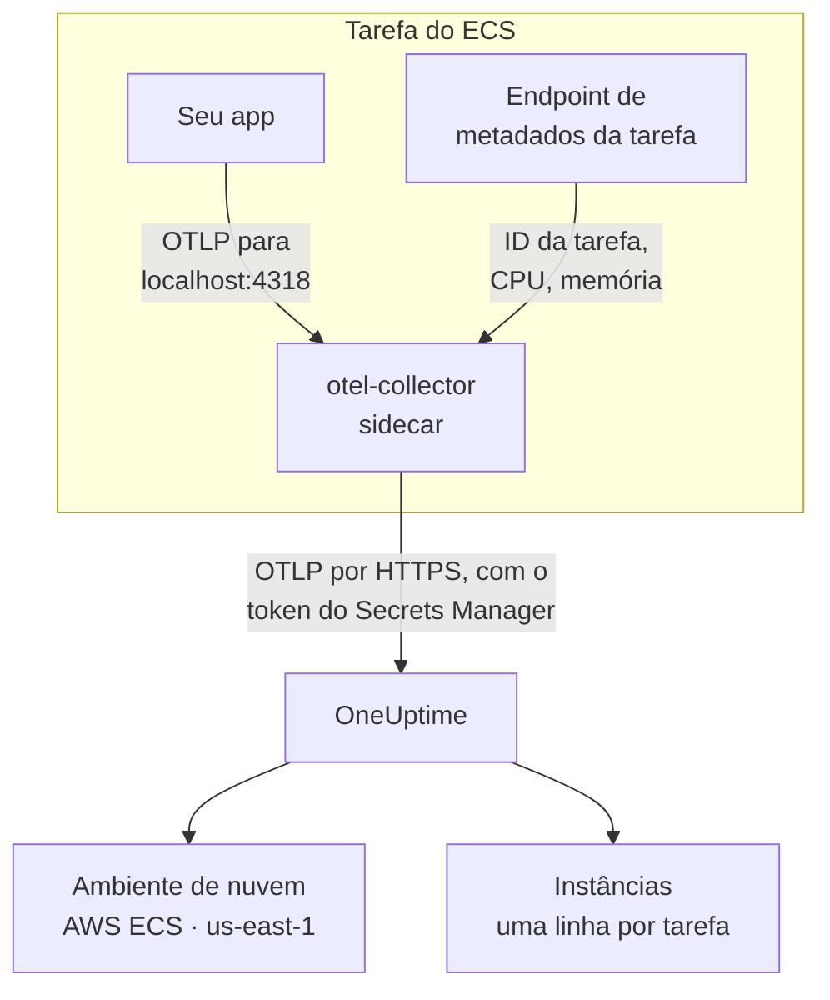

# AWS ECS / Fargate

Envie os traços, logs e métricas das suas tarefas do Amazon ECS para o OneUptime, tanto no tipo de inicialização Fargate quanto no EC2. Cada tarefa que reporta `cloud.platform=aws_ecs` entra em um **Cloud Environment** por conta da AWS e região, como _AWS ECS · us-east-1 · 123456789012_, rode ali um serviço ou cinquenta.

:::cards
- [Como funciona](#como-funciona): O que fazem o detector do ECS e o coletor sidecar.
- [Configuração](#configuração): Guardar o token, adicionar as configurações à definição de tarefa, implantar e verificar.
- [A definição de tarefa completa](#a-definição-de-tarefa-completa): Uma definição de tarefa do Fargate completa para registrar.
- [Solução de problemas](#solução-de-problemas): Tarefas presas em PENDING, exportações recusadas, instâncias ou blocos vazios.
:::

## Como funciona



- **O detector do ECS nomeia o ambiente.** O detector de recursos do ECS do OpenTelemetry, no SDK ou em um coletor, lê o endpoint de metadados de tarefa que o ECS fornece a cada contêiner e coloca a conta, a região e a tarefa em tudo o que a tarefa envia. Nada fica fixo no código.
- **A tarefa nomeia cada instância.** A aba **Instâncias** do ambiente lista as tarefas em execução pelo ID da tarefa, com a CPU e a memória de cada uma.
- **Um coletor sidecar acrescenta CPU e memória.** O receptor `awsecscontainermetrics` dele lê a CPU e a memória de cada tarefa no mesmo endpoint, e ele guarda o token, para que a aplicação nunca o veja.

O detector do ECS define estes atributos de recurso:

| Atributo | Definido pelo detector do ECS | Para que serve |
| ------------------------------------------------------------------ | ----------------------- | --------------------------------------------------------------------------------------------------------- |
| `cloud.platform` | `aws_ecs` | Arquiva a telemetria em **Ambientes de nuvem**. O valor precisa ser exato |
| `cloud.account.id` | `123456789012` | Parte da chave do ambiente |
| `cloud.region` | `us-east-1` | Parte da chave do ambiente |
| `aws.ecs.task.arn` | o ARN da tarefa | Nomeia uma tarefa em execução em **Instâncias**, pelo ID da tarefa no final dele |
| `aws.ecs.task.id` | o ID da tarefa | O mesmo; versões mais novas do detector definem os dois |
| `aws.ecs.cluster.arn`, `aws.ecs.task.family`, `aws.ecs.launchtype` | o cluster e a tarefa | Mantidos em cada span, log e métrica para você pesquisar; não fazem parte do ambiente |

A chave do ambiente é `aws_ecs|123456789012|us-east-1`. O ID da tarefa nomeia uma instância mesmo quando o SDK também define `service.instance.id`: as métricas de contêiner do sidecar trazem só o ID da tarefa, e usá-lo como chave mantém os spans de uma tarefa e a CPU e a memória dela em uma só linha. A regra completa está em [Ambientes de nuvem](/docs/telemetry/cloud-environments).

## Antes de começar

- **Uma chave de ingestão.** Crie uma chave **Servidor** em **Configurações do projeto → Telemetria e APM → Chaves de ingestão** e copie o token dela.
- **Um cluster do ECS e uma definição de tarefa que você possa revisar**, e a AWS CLI configurada para essa conta.
- **Sua aplicação instrumentada com um SDK do OpenTelemetry** que exporte OTLP, em qualquer linguagem.

## Escolher como a telemetria sai da tarefa

| | Sidecar collector | SDK direct |
| ----------------------- | ---------------------------------------------- | ----------------------------------------------- |
| Contêiner extra | `otel-collector` em cada tarefa | Nenhum |
| CPU e memória por tarefa | Sim, do receptor `awsecscontainermetrics` | Não |
| Guarda o token | O coletor | A aplicação |
| O segredo contém | Só o token | O cabeçalho completo `x-oneuptime-token=...` |

A maioria das equipes usa o coletor sidecar: ele coloca os atributos `cloud.*` até na telemetria de bibliotecas que não sabem nada do ECS. SDK direct é a escolha mais simples para um único serviço. Cada etapa abaixo tem uma aba para cada um; escolha uma e todas as etapas a seguem.

## Configuração

:::steps
### Guardar o token no Secrets Manager

> [!IMPORTANT]
> O token é um segredo. Guarde-o no AWS Secrets Manager e faça referência a ele na definição de tarefa com `secrets` e `valueFrom`. Um token em uma entrada `environment` comum fica visível para qualquer pessoa que consiga ler a definição de tarefa, e aparece em cada saída de `describe-task-definition` e em cada diff do CloudFormation.

:::tabs
@tab Sidecar collector
```bash
aws secretsmanager create-secret \
  --name oneuptime/ingestion-token \
  --region us-east-1 \
  --secret-string "YOUR_TELEMETRY_INGESTION_TOKEN"
```

A configuração do coletor acrescenta o nome do cabeçalho, então este segredo contém só o token.
@tab SDK direct
```bash
aws secretsmanager create-secret \
  --name oneuptime/ingestion-token \
  --region us-east-1 \
  --secret-string "x-oneuptime-token=YOUR_TELEMETRY_INGESTION_TOKEN"
```

O ECS coloca o valor de um segredo como está na variável, e `OTEL_EXPORTER_OTLP_HEADERS` precisa do par `name=value` completo, então este segredo contém o cabeçalho completo.
:::

Anote o ARN que o comando imprime. Ele termina em um sufixo aleatório, como `oneuptime/ingestion-token-AbCdEf`, e você vai colá-lo na definição de tarefa.

### Deixar a tarefa ler o segredo

A função de execução de tarefa (a função com que o ECS inicia a tarefa, não a função com que seu código roda) precisa ler o segredo. Anexe esta política a `ecsTaskExecutionRole`:

```json title="secret-access-policy.json"
{
  "Version": "2012-10-17",
  "Statement": [
    {
      "Effect": "Allow",
      "Action": ["secretsmanager:GetSecretValue"],
      "Resource": "arn:aws:secretsmanager:us-east-1:123456789012:secret:oneuptime/ingestion-token-*"
    }
  ]
}
```

Se uma chave do KMS gerenciada pelo cliente criptografa o segredo, a função também precisa de `kms:Decrypt` nessa chave. Sem qualquer um dos dois, a tarefa não inicia: ela para com `ResourceInitializationError: unable to pull secrets`.

### Adicionar as configurações à definição de tarefa

:::tabs
@tab Sidecar collector
1. **AWS Console → Amazon Elastic Container Service → Task definitions** → selecione a família → **Create new revision**.
2. Em **Container - 1** (sua aplicação), expanda **Environment variables** e adicione as variáveis da aplicação abaixo.
3. **+ Add container**: nome `otel-collector`, imagem `otel/opentelemetry-collector-contrib:latest` (fixe uma versão quando funcionar), **Essential container: No**. Em **Docker configuration → Command**, digite `--config=env:OTEL_COLLECTOR_CONFIG`.
4. No contêiner do coletor, adicione a variável de ambiente `ONEUPTIME_TOKEN` com **Value type: ValueFrom** e o ARN do segredo, e `OTEL_COLLECTOR_CONFIG` com **Value type: Value** e a configuração do coletor abaixo.
5. Em **Startup dependency ordering** no contêiner da aplicação, adicione `otel-collector` com a condição **Start**, para que a aplicação nunca inicie antes de algo escutar na porta 4318.
6. Em **Task execution role**, confira se é a função à qual você anexou a política.

Variáveis da aplicação. No modo de rede `awsvpc` (sempre, no Fargate), os contêineres de uma tarefa compartilham uma rede, então `localhost` é o sidecar:

```bash
OTEL_SERVICE_NAME=checkout-api
OTEL_EXPORTER_OTLP_ENDPOINT=http://localhost:4318
OTEL_EXPORTER_OTLP_PROTOCOL=http/protobuf
```

Configuração do coletor. O coletor a lê inteira da variável `OTEL_COLLECTOR_CONFIG`, então não há arquivo para colocar em uma imagem, e ele resolve `${env:ONEUPTIME_TOKEN}` a partir do segredo que o ECS coloca no ambiente dele:

```yaml title="OTEL_COLLECTOR_CONFIG"
receivers:
  otlp:
    protocols:
      http:
        endpoint: 0.0.0.0:4318
      grpc:
        endpoint: 0.0.0.0:4317
  # Per-task and per-container CPU / memory from the ECS task metadata
  # endpoint. This is what fills the CPU and memory tiles in OneUptime.
  awsecscontainermetrics:
    collection_interval: 20s
processors:
  # Stamps cloud.provider, cloud.platform=aws_ecs, cloud.account.id,
  # cloud.region and aws.ecs.task.arn on every span, log and metric.
  resourcedetection:
    detectors: [env, ecs]
    timeout: 5s
  batch: {}
exporters:
  otlphttp/oneuptime:
    endpoint: https://oneuptime.com/otlp
    headers:
      x-oneuptime-token: ${env:ONEUPTIME_TOKEN}
service:
  pipelines:
    traces:
      receivers: [otlp]
      processors: [resourcedetection, batch]
      exporters: [otlphttp/oneuptime]
    metrics:
      receivers: [otlp, awsecscontainermetrics]
      processors: [resourcedetection, batch]
      exporters: [otlphttp/oneuptime]
    logs:
      receivers: [otlp]
      processors: [resourcedetection, batch]
      exporters: [otlphttp/oneuptime]
```

Nem o detector `ecs` nem o receptor `awsecscontainermetrics` precisam de uma permissão do IAM: os dois leem o endpoint de metadados que o ECS fornece a cada contêiner em `ECS_CONTAINER_METADATA_URI_V4`.
@tab SDK direct
1. **AWS Console → Amazon Elastic Container Service → Task definitions** → selecione a família → **Create new revision**.
2. Em **Container - 1** (sua aplicação), expanda **Environment variables** e adicione as variáveis abaixo. Adicione `OTEL_EXPORTER_OTLP_HEADERS` com **Value type: ValueFrom** e o ARN do segredo como valor.
3. Adicione a configuração que ativa o detector de recursos do ECS da sua linguagem, conforme a tabela abaixo.
4. Em **Task execution role**, confira se é a função à qual você anexou a política.

```bash
OTEL_SERVICE_NAME=checkout-api
OTEL_EXPORTER_OTLP_ENDPOINT=https://oneuptime.com/otlp
OTEL_EXPORTER_OTLP_PROTOCOL=http/protobuf
# Injected from Secrets Manager (secrets / valueFrom), not typed here.
OTEL_EXPORTER_OTLP_HEADERS=x-oneuptime-token=YOUR_TELEMETRY_INGESTION_TOKEN
```

| Linguagem | Ativar o detector do ECS |
| -------- | --------------------------------------------------------------------------------------------------------------- |
| Node.js | `OTEL_NODE_RESOURCE_DETECTORS=env,host,os,aws` (auto-instrumentations-node) |
| Python | `pip install opentelemetry-sdk-extension-aws` e depois `OTEL_EXPERIMENTAL_RESOURCE_DETECTORS=aws_ecs` |
| Java | `-Dotel.resource.providers.aws.enabled=true` (o agente vem com o provedor desativado) |
| Go | `import "go.opentelemetry.io/contrib/detectors/aws/ecs"` e passe `ecs.NewResourceDetector()` para `resource.New` |
| .NET | O pacote `OpenTelemetry.Resources.AWS`: `.ConfigureResource(r => r.AddAWSECSDetector())` |

Em um arquivo de definição de tarefa, o segredo é `"secrets": [{ "name": "OTEL_EXPORTER_OTLP_HEADERS", "valueFrom": "<secret ARN>" }]`.
:::

Se você hospeda o OneUptime por conta própria, use `https://YOUR-ONEUPTIME-HOST/otlp` como endpoint.

### Implantar a nova revisão

Clique em **Create** e depois em **Clusters → your cluster → Services → select the service → Update → Task definition revision: latest → Deploy**. Ou pela CLI:

```bash
aws ecs update-service \
  --cluster production \
  --service checkout-api \
  --task-definition checkout-api
```

### Verificar a conexão

Verifique o token primeiro: é a verificação mais barata, e nada depois dela funciona sem ele.

```bash
curl -i https://oneuptime.com/otlp/v1/validate \
  -H "x-oneuptime-token: YOUR_TELEMETRY_INGESTION_TOKEN"
```

`200` com `"valid": true` significa que o token é aceito. `401` significa que ele é desconhecido, revogado, desativado ou expirado. Execute o mesmo comando de dentro da tarefa com o ECS Exec, para provar que a própria tarefa alcança o OneUptime:

```bash
aws ecs execute-command --cluster production --task <task id> \
  --container app --interactive --command "sh"
```

O fluxo de logs do CloudWatch do coletor (`otel/otel-collector/...`) deve dizer `Everything is ready`, sem linhas de `401` ou `connection refused`. Dentro de um minuto após o primeiro span, log ou métrica, o ambiente aparece em **Nuvem → All Environments** como _AWS ECS · us-east-1 · 123456789012_.
:::

## A definição de tarefa completa

A configuração com sidecar como um arquivo que você registra com `aws ecs register-task-definition --cli-input-json file://task-definition.json`. Substitua o ID da conta, a região, a imagem e o ARN do segredo:

```json title="task-definition.json"
{
  "family": "checkout-api",
  "requiresCompatibilities": ["FARGATE"],
  "networkMode": "awsvpc",
  "cpu": "512",
  "memory": "1024",
  "executionRoleArn": "arn:aws:iam::123456789012:role/ecsTaskExecutionRole",
  "taskRoleArn": "arn:aws:iam::123456789012:role/checkout-api-task-role",
  "containerDefinitions": [
    {
      "name": "app",
      "image": "123456789012.dkr.ecr.us-east-1.amazonaws.com/checkout-api:1.4.2",
      "essential": true,
      "portMappings": [{ "containerPort": 8080, "protocol": "tcp" }],
      "environment": [
        { "name": "OTEL_SERVICE_NAME", "value": "checkout-api" },
        {
          "name": "OTEL_EXPORTER_OTLP_ENDPOINT",
          "value": "http://localhost:4318"
        },
        { "name": "OTEL_EXPORTER_OTLP_PROTOCOL", "value": "http/protobuf" }
      ],
      "dependsOn": [
        { "containerName": "otel-collector", "condition": "START" }
      ],
      "logConfiguration": {
        "logDriver": "awslogs",
        "options": {
          "awslogs-group": "/ecs/checkout-api",
          "awslogs-region": "us-east-1",
          "awslogs-stream-prefix": "app"
        }
      }
    },
    {
      "name": "otel-collector",
      "image": "otel/opentelemetry-collector-contrib:latest",
      "essential": false,
      "command": ["--config=env:OTEL_COLLECTOR_CONFIG"],
      "secrets": [
        {
          "name": "ONEUPTIME_TOKEN",
          "valueFrom": "arn:aws:secretsmanager:us-east-1:123456789012:secret:oneuptime/ingestion-token-AbCdEf"
        }
      ],
      "environment": [
        {
          "name": "OTEL_COLLECTOR_CONFIG",
          "value": "receivers:\n  otlp:\n    protocols:\n      http:\n        endpoint: 0.0.0.0:4318\n      grpc:\n        endpoint: 0.0.0.0:4317\n  awsecscontainermetrics:\n    collection_interval: 20s\nprocessors:\n  resourcedetection:\n    detectors: [env, ecs]\n    timeout: 5s\n  batch: {}\nexporters:\n  otlphttp/oneuptime:\n    endpoint: https://oneuptime.com/otlp\n    headers:\n      x-oneuptime-token: ${env:ONEUPTIME_TOKEN}\nservice:\n  pipelines:\n    traces:\n      receivers: [otlp]\n      processors: [resourcedetection, batch]\n      exporters: [otlphttp/oneuptime]\n    metrics:\n      receivers: [otlp, awsecscontainermetrics]\n      processors: [resourcedetection, batch]\n      exporters: [otlphttp/oneuptime]\n    logs:\n      receivers: [otlp]\n      processors: [resourcedetection, batch]\n      exporters: [otlphttp/oneuptime]\n"
        }
      ],
      "logConfiguration": {
        "logDriver": "awslogs",
        "options": {
          "awslogs-group": "/ecs/checkout-api",
          "awslogs-region": "us-east-1",
          "awslogs-stream-prefix": "otel"
        }
      }
    }
  ]
}
```

O valor de `OTEL_COLLECTOR_CONFIG` é a configuração do coletor como uma única string JSON. Em vez de escapá-la à mão, mantenha o YAML em `collector.yaml` e deixe o `jq` fazer isso:

```bash
jq --rawfile cfg collector.yaml \
  '.containerDefinitions[1].environment[0].value = $cfg' \
  task-definition.json > task-definition.rendered.json
aws ecs register-task-definition --cli-input-json file://task-definition.rendered.json
```

## Rede

A tarefa precisa alcançar duas coisas fora da sua VPC: o Secrets Manager, para iniciar, e o OneUptime, para exportar.

- **Tarefas do Fargate em sub-redes privadas** precisam de uma rota para a internet: um NAT gateway na tabela de rotas da sub-rede, ou uma sub-rede pública com `assignPublicIp=ENABLED`. Uma tarefa sem nenhum dos dois fica parada em `PENDING` no segredo, antes de o coletor enviar qualquer coisa.
- **A saída do grupo de segurança** precisa permitir TCP 443 para o host do OneUptime: `oneuptime.com`, ou o seu próprio host na porta em que ele escuta. O grupo de segurança padrão permite toda a saída; um restrito muitas vezes não. A telemetria não precisa de nenhuma regra de entrada.
- **Endpoints de interface da VPC** para `com.amazonaws.us-east-1.secretsmanager` (e `ecr.api`, `ecr.dkr` e S3 para baixar imagens) mantêm as chamadas da AWS fora do caminho NAT. O próprio OneUptime continua precisando da rota para a internet.

```bash
aws ecs update-service \
  --cluster production \
  --service checkout-api \
  --task-definition checkout-api \
  --network-configuration "awsvpcConfiguration={subnets=[subnet-0abc1234],securityGroups=[sg-0def5678],assignPublicIp=ENABLED}"
```

## O que você recebe

- **Visão geral**: requisições, taxa de erro e latência p95 dos seus traços, os blocos **CPU** e **Memória** e **Principais instâncias por CPU**. Os blocos são preenchidos com `ecs.task.cpu.utilized` e `ecs.task.memory.utilized` do receptor `awsecscontainermetrics`, ou com qualquer métrica `container.cpu.utilization` e `container.memory.usage` que traga a identidade da tarefa. SDK direct não envia nenhuma das duas.
- **Instâncias**: uma linha por tarefa em execução, nomeada pelo ID da tarefa (o final de `aws.ecs.task.arn`), com a última CPU, a memória e o horário em que foi vista pela última vez. Uma tarefa que para de reportar passa a **Stale**.
- **Registros**, **Traços** e **Métricas**: tudo o que trouxe `cloud.platform=aws_ecs` para esta conta e esta região.
- **Serviços**: as mesmas tarefas, divididas por `service.name`.

## Solução de problemas

As falhas próprias do ECS, na ordem em que acontecem:

:::details Uma tarefa fica presa em PENDING com "unable to pull secrets"
O erro completo é `ResourceInitializationError: unable to pull secrets`. Ou a função de execução de tarefa não tem `secretsmanager:GetSecretValue` no segredo (ou `kms:Decrypt` na chave dele), ou a tarefa não tem rota para o Secrets Manager: nem NAT gateway nem endpoint da VPC. Veja [Rede](#rede).
:::

:::details O coletor registra 401
O segredo contém o valor errado. Para o coletor sidecar ele deve ser só o token; para SDK direct, o cabeçalho completo `x-oneuptime-token=...`. Verifique o próprio token com o comando em [Verificar a conexão](#verificar-a-conexão).
:::

:::details O ambiente aparece, mas Instâncias está vazia
A telemetria não traz nenhuma identidade de tarefa. Garanta que o detector `ecs` esteja rodando: o recurso precisa trazer `aws.ecs.task.arn`, `aws.ecs.task.id` ou `service.instance.id`.
:::

:::details As instâncias aparecem, mas os blocos CPU e Memória continuam vazios
O receptor `awsecscontainermetrics` está faltando no pipeline `metrics`, ou esse pipeline pula o processador `resourcedetection`, então as métricas de contêiner chegam sem `cloud.platform`. SDK direct nunca preenche esses blocos.
:::

Um ambiente que nunca aparece, cai em **Hosts** ou em **Funções serverless**, mostra **Desconectado** ou se divide em dois é tratado em [Solução de problemas na nuvem](/docs/telemetry/cloud-troubleshooting).

## Próximos passos

:::cards
- [Ambientes de nuvem](/docs/telemetry/cloud-environments): Como ambientes e instâncias são identificados.
- [Solução de problemas na nuvem](/docs/telemetry/cloud-troubleshooting): As falhas que todas as plataformas compartilham.
- [Recursos de nuvem (IaaS e PaaS)](/docs/telemetry/cloud-resources): Seus balanceadores de carga, bancos RDS e buckets, a partir do CloudWatch.
- [OpenTelemetry](/docs/telemetry/open-telemetry): Instrumentar sua aplicação, e os endpoints e limites.
:::
