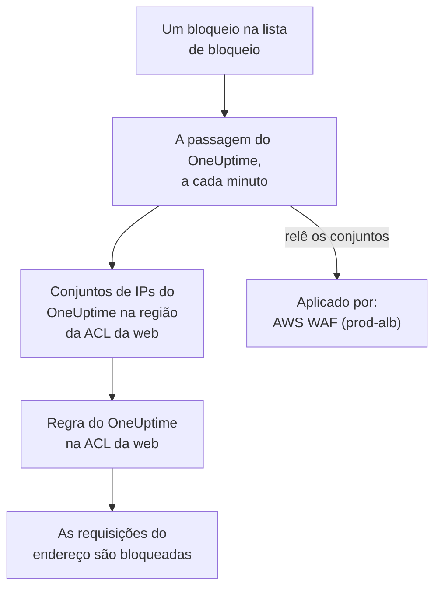

# Bloquear endereços no AWS WAF

A lista de bloqueio do seu projeto pode ser aplicada nas ACLs da web do AWS WAF que ficam na frente das suas distribuições do CloudFront, dos seus balanceadores de carga e dos seus API Gateways. Ative-a em uma conexão de nuvem da AWS que você já tem, escolha as ACLs da web, e cada endereço que a lista de bloqueio bloqueia passa a ser bloqueado lá, tenha sido bloqueado por uma pessoa, por um playbook ou pelo OneUptime AI.

:::cards
- [Ativação](#ativação): Uma configuração na conexão da AWS, e o comando de configuração dela de novo.
- [O que o OneUptime cria](#o-que-o-oneuptime-cria): Quatro conjuntos de IPs por região e duas regras por ACL da web.
- [Gerenciar a ACL da web em código](#gerenciar-a-acl-da-web-em-código): Adicione você mesmo as regras no Terraform ou no CloudFormation.
:::

## Como funciona

O OneUptime mantém os próprios conjuntos de IPs em cada região em que há uma ACL da web escolhida, e em cada ACL da web uma regra que bloqueia os endereços que eles contêm. A cada minuto, ele grava cada conjunto uma vez com o que a lista de bloqueio contém e depois relê os conjuntos. Na página **Lista de bloqueio**, a coluna **Aplicado por** de um bloqueio só nomeia AWS WAF (prod-alb) depois que o AWS WAF contém o bloqueio e a regra da ACL da web bloqueia o conjunto dele; até lá, o bloqueio não é aplicado.

## Antes de começar

- Uma conta da AWS conectada ao OneUptime (veja [Conectar uma conta de nuvem](/docs/telemetry/cloud-accounts#amazon-web-services)).
- Uma função que possa mudar onde a lista de bloqueio é aplicada: **Proprietário do projeto**, **Administrador do projeto** ou **Administrador de segurança**.
- Alguém que possa executar de novo o comando de configuração da conexão na conta da AWS.

## Ativação

:::steps
### Abrir a conexão
Abra **Nuvem → Conectar** e edite a conexão da AWS.

### Escolher quem adiciona a regra
Em **Mais campos**, defina **Bloquear endereços no AWS WAF** como **Ativado, e o OneUptime adiciona a regra dele**, ou como **Ativado, e eu adiciono a regra no código** se as suas ACLs da web são gerenciadas no Terraform ou no CloudFormation.

### Executar de novo o comando de configuração
O comando que o formulário mostra agora concede os conjuntos de IPs, e a regra quando o OneUptime a adiciona. Execute-o no AWS CloudShell e depois salve a conexão.

### Adicionar as ACLs da web
Abra **Eventos de segurança → Playbooks → Lista de bloqueio**. Em **WAFs de nuvem**, clique em **Adicionar ACL da web**, escolha uma ACL da web e de onde ela lê o endereço do cliente, e adicione-a. O OneUptime a configura na hora, e o **Status** dela mostra **Aplicada** quando a regra dela bloqueia os conjuntos.
:::

As ACLs da web vêm do inventário da conexão: uma que o OneUptime ainda não leu aparece após a próxima leitura. Enquanto uma ACL da web aplica a lista de bloqueio, a configuração da conexão dela não pode ser desativada nem passar de o OneUptime adicionar a regra para você adicioná-la em código, e a conexão não pode ser excluída: remova primeiro a ACL da web, para que o OneUptime retire a regra dele.

## O que o OneUptime cria

| O quê | Nome | Onde |
| --- | --- | --- |
| Quatro conjuntos de IPs: bloqueio e desafio, IPv4 e IPv6 | `oneuptime-<project>-block-ipv4`, `oneuptime-<project>-block-ipv6`, `oneuptime-<project>-challenge-ipv4`, `oneuptime-<project>-challenge-ipv6` | Em cada região em que há uma ACL da web escolhida. As ACLs da web do CloudFront são globais, e os conjuntos delas ficam em `us-east-1`. |
| Duas regras: uma bloqueia, a outra aplica um desafio | `OneUptime-Blocklist-<project>`, `OneUptime-Challenge-<project>` | Em cada ACL da web escolhida, quando o OneUptime adiciona a regra dele. |

`<project>` são os oito primeiros caracteres do ID externo do seu projeto, então dois projetos do OneUptime em uma mesma conta nunca gravam nos conjuntos um do outro. As ACLs da web de uma mesma região compartilham os conjuntos. Um endereço único é escrito como `/32` ou `/128`. O AWS WAF aceita 10.000 endereços em um conjunto e 100 conjuntos de IPs por região, a menos que a AWS tenha aumentado esse limite para você; um bloqueio que não cabe informa isso na linha dele.

## O lugar da regra na ACL da web

O OneUptime coloca as duas regras dele em prioridades livres abaixo da sua primeira regra, para que sejam executadas antes das regras que você escreveu. Sem nenhuma regra na ACL da web, elas ficam com as prioridades 0 e 1. O OneUptime nunca renumera, altera ou remove uma regra sua: quando não há duas prioridades livres abaixo da sua primeira regra, a ACL da web mostra **Sem prioridade livre**, e o OneUptime adiciona as regras dele assim que você liberar duas.

Cada regra corresponde quando um dos conjuntos dela, IPv4 ou IPv6, contém o endereço do cliente. O AWS WAF atualiza uma ACL da web inteira, então o OneUptime a lê, adiciona as regras dele e a grava de volta com o token de bloqueio da ACL da web, e a lê de novo quando outra pessoa a gravou nesse meio-tempo.

## Endereços encaminhados

Uma ACL da web atrás de outro proxy ou CDN vê o endereço do proxy, não o do cliente. Escolha de onde ela lê o endereço do cliente em **Endereço do cliente**:

| Endereço do cliente | O que a regra lê |
| --- | --- |
| **O endereço de origem da requisição** | O endereço de onde a requisição veio. O padrão. |
| O último endereço do cabeçalho `X-Forwarded-For` | O endereço que o último proxy acrescentou. Um endereço antes dele é um que a requisição declarou. |
| O cabeçalho `CF-Connecting-IP` | O único endereço que o Cloudflare escreve. |
| O cabeçalho `True-Client-IP` | O único endereço que o Akamai ou o Cloudflare Enterprise escreve. |

Uma requisição sem o cabeçalho não corresponde: o AWS WAF a deixa passar em vez de bloquear o endereço de um proxy.

## Gerenciar a ACL da web em código

Com **Ativado, e eu adiciono a regra no código**, o OneUptime cria só os conjuntos de IPs e nunca grava na sua ACL da web. Clique em **Mostrar regra** na linha da ACL da web: ela dá as duas regras em Terraform (blocos `rule` de `aws_wafv2_web_acl`) e em CloudFormation, com o ARN de cada conjunto e o cabeçalho que a ACL da web lê. Adicione-as ao seu código antes das suas outras regras e aplique-o.

Até que as regras estejam lá, a ACL da web mostra **Aguardando sua regra**, e os bloqueios dela não são aplicados. O OneUptime lê a ACL da web a cada passagem, e os bloqueios dela passam a ser aplicados a partir da primeira passagem que encontra uma regra bloqueando cada conjunto, seja qual for o nome que você deu a ela.

## Permissões

O comando de configuração adiciona à função uma política em linha, `OneUptimeWafBlocklist`. Com uma chave de acesso, o limite do IAM para as políticas próprias de um usuário faz com que ela vá para um grupo, `OneUptimeWafBlocklist-<project>`, ao qual o usuário é adicionado.

| Ação | Recurso | Por quê |
| --- | --- | --- |
| `wafv2:ListIPSets` | Qualquer | Encontrar os conjuntos de IPs do OneUptime em uma região. |
| `wafv2:GetIPSet`, `wafv2:CreateIPSet`, `wafv2:UpdateIPSet`, `wafv2:DeleteIPSet` | Só os conjuntos de IPs do OneUptime (`oneuptime-<project>-*`) | Manter os conjuntos e excluí-los quando você remove a última ACL da web de uma região. |
| `wafv2:GetSampledRequests` | ACLs da web | Ler as requisições que uma regra recusou: a evidência pela qual a etapa de bloqueio de um caso é verificada. |
| `wafv2:UpdateWebACL` | ACLs da web, e os conjuntos de IPs, conjuntos de expressões regulares e grupos de regras que elas referenciam | Adicionar as regras do OneUptime. Só com **Ativado, e o OneUptime adiciona a regra dele**. |

Ler uma ACL da web, `wafv2:GetWebACL`, já faz parte da política somente leitura da conexão.

## Desativação

:::steps
### Remover a ACL da web
Em **Eventos de segurança → Playbooks → Lista de bloqueio**, clique em **Remover** na linha da ACL da web. O OneUptime retira as regras dele da ACL da web, e esvazia e exclui os conjuntos de IPs dele assim que nenhuma outra ACL da web da região os usa.

### Desativar a configuração
Edite a conexão, defina **Bloquear endereços no AWS WAF** como **Desativado** e salve. A configuração pode ser desativada assim que nenhuma ACL da web da conexão aplica a lista de bloqueio.
:::

Quando o OneUptime não puder mais gravar na ACL da web, marque **Remover apenas do OneUptime** na caixa de diálogo **Remover ACL da web**. O OneUptime remove a ACL da web da lista de bloqueio e nomeia as regras e os conjuntos de IPs que deixou no AWS WAF: eles continuam bloqueando o que contêm até que você os exclua lá. Uma regra sua que ainda referencia um conjunto também o mantém: o OneUptime o esvazia e o nomeia.

## Solução de problemas

:::details Não aplicada
O status da ACL da web diz o que a AWS respondeu e o que fazer. Uma recusa nomeia a ação e a configuração que a concede: ative a configuração, ou escolha **Ativado, e o OneUptime adiciona a regra dele**, depois execute de novo o comando de configuração da conexão e clique em **Verificar de novo**.
:::

:::details Sem prioridade livre
A sua primeira regra está na prioridade 0 ou 1, então não há duas prioridades livres abaixo dela. Aumente em dois o número de prioridade das suas regras e depois clique em **Verificar de novo**.
:::

:::details Uma ACL da web não está na lista
O OneUptime lista as ACLs da web das conexões com a configuração ativada, depois de lê-las. ACLs da web vistas só pelas métricas delas precisam do comando de configuração da conexão de novo, que permite ao OneUptime lê-las.
:::

## Próximos passos

:::cards
- [Casos de segurança e playbooks](/docs/telemetry/security-cases): Bloqueie um endereço a partir de um caso e veja a etapa dele verificada.
- [Conectar uma conta de nuvem](/docs/telemetry/cloud-accounts): A conexão da qual esta configuração faz parte.
:::
