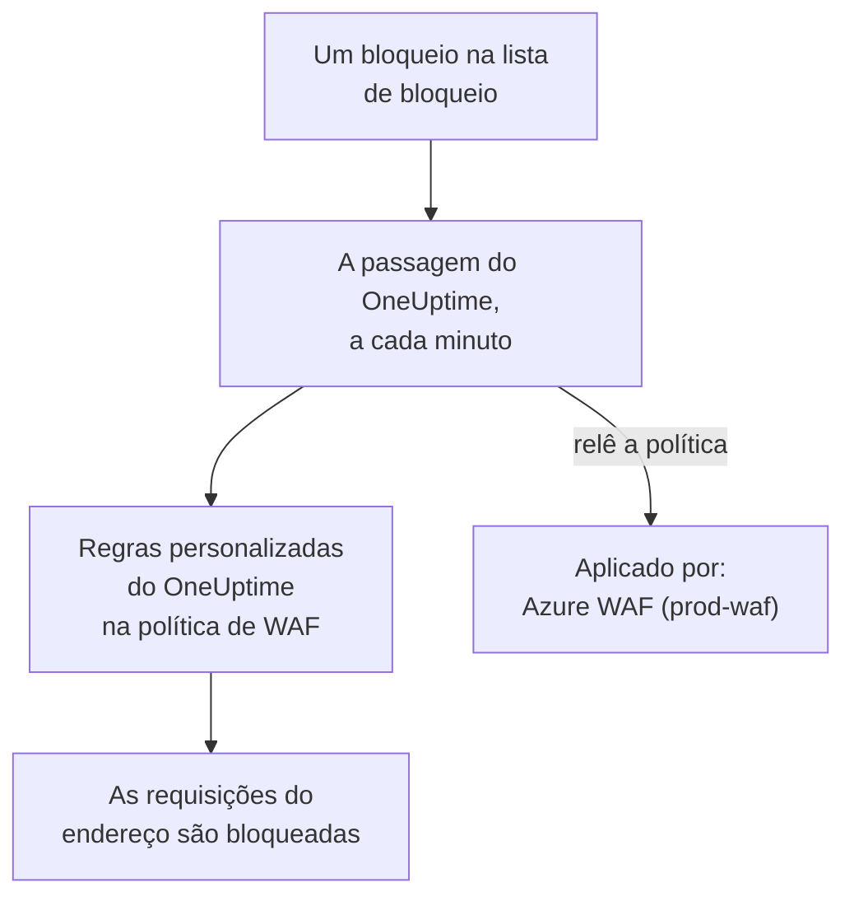

# Bloquear endereços no Azure WAF

A lista de bloqueio do seu projeto pode ser aplicada nas políticas do Azure WAF dos seus Application Gateways e Front Doors. Ative-a em uma conexão de nuvem do Azure que você já tem, escolha as políticas de WAF, e cada endereço que a lista de bloqueio bloqueia passa a ser bloqueado lá, tenha sido bloqueado por uma pessoa, por um playbook ou pelo OneUptime AI.

:::cards
- [Ativação](#ativação): Uma configuração na conexão do Azure, e a função de que ela precisa.
- [O que o OneUptime cria](#o-que-o-oneuptime-cria): Regras personalizadas próprias em cada política que você escolher.
- [Qual endereço é comparado](#qual-endereço-é-comparado): O endereço que se conectou, ou o cliente original atrás de um proxy.
:::

## Como funciona

O OneUptime mantém regras personalizadas próprias em cada política de WAF que você escolher, e coloca nelas os endereços que a lista de bloqueio bloqueia. A cada minuto, ele grava a política uma vez com o que a lista de bloqueio contém e depois a relê. Na página **Lista de bloqueio**, a coluna **Aplicado por** de um bloqueio só nomeia Azure WAF (prod-waf) depois que a política contém o bloqueio e o Azure aplicou a alteração; até lá, o bloqueio não é aplicado.

## Antes de começar

- Uma assinatura do Azure conectada ao OneUptime (veja [Conectar uma conta de nuvem](/docs/telemetry/cloud-accounts#microsoft-azure)).
- Uma função que possa mudar onde a lista de bloqueio é aplicada: **Proprietário do projeto**, **Administrador do projeto** ou **Administrador de segurança**.
- Alguém que possa atribuir funções na assinatura do Azure, para executar um comando no Azure Cloud Shell.

## Ativação

:::steps
### Abrir a conexão
Abra **Nuvem → Conectar** e edite a conexão do Azure.

### Ativar a configuração
Em **Mais campos**, defina **Bloquear endereços no Azure WAF** como **Ativado** e salve. O comando de configuração que o formulário mostra agora concede a função descrita abaixo em toda a assinatura. Uma conexão que você já tem não precisa executá-lo de novo: a caixa de diálogo **Adicionar WAF** dá as linhas que concedem a função em uma única política.

### Adicionar as políticas de WAF
Abra **Eventos de segurança → Playbooks → Lista de bloqueio**. Em **WAFs de nuvem**, clique em **Adicionar WAF** e escolha uma política de WAF. O OneUptime pergunta ao Azure se a conexão pode gravar nela, sem gravar nada.

### Conceder a função, se estiver faltando
Quando falta uma permissão, a caixa de diálogo mostra as linhas que a concedem apenas nessa política. Execute-as no Azure Cloud Shell, clique em **Verificar de novo** e depois adicione a política. O **Status** dela mostra **Aplicada** assim que o OneUptime a tiver lido.
:::

As políticas de WAF vêm do inventário da conexão: uma que o OneUptime ainda não leu aparece após a próxima leitura. Enquanto uma política aplica a lista de bloqueio, a configuração da conexão dela não pode ser desativada e a conexão não pode ser excluída: remova primeiro a política, para que o OneUptime retire as regras dele.

## O que o OneUptime cria

| O quê | Nome | Onde |
| --- | --- | --- |
| Regras personalizadas, cada uma com uma condição de correspondência de IP e a ação Block | `OneUptime<project>Block1`, `OneUptime<project>Block2`, ... | Em cada política de WAF que você escolher, no máximo 10. |

`<project>` são os oito primeiros caracteres do ID externo do seu projeto, então dois projetos do OneUptime que escolhem a mesma política nunca gravam as regras um do outro. Uma regra contém 540 endereços ou intervalos no Application Gateway, 600 com CRS 3.2 ou um Default Rule Set, e 600 no Front Door. Com dez regras, uma política contém 5.400 ou 6.000 bloqueios; um bloqueio que não cabe informa isso na linha dele.

O OneUptime não altera nada em uma política além das próprias regras. O Azure grava uma política de WAF apenas inteira, então o OneUptime lê a política com o ETag dela, altera as próprias regras e a grava de volta com o ETag em `If-Match`: todas as outras regras, configurações e conjuntos de regras gerenciados são gravados como foram lidos. Quando outra pessoa gravou a política nesse meio-tempo, o Azure recusa a gravação, e o OneUptime a lê de novo e faz a alteração dele sobre o que foi gravado.

## O lugar das regras na política

O OneUptime coloca as regras dele em prioridades livres antes da sua primeira regra que permite tráfego, a partir da mais baixa, para que nenhuma regra sua deixe passar um endereço bloqueado. Uma regra sua que bloqueia ou registra pode vir antes. O OneUptime nunca renumera, altera ou remove uma regra sua: quando não há prioridade livre antes da sua primeira regra Allow, a política mostra **Sem prioridade livre**, e o OneUptime adiciona a regra dele assim que você liberar uma.

## Qual endereço é comparado

| Política de WAF | Endereço do cliente | Quando escolher |
| --- | --- | --- |
| Front Door | **O endereço que se conectou ao Front Door (SocketAddr)** | O padrão. |
| Front Door | O cliente original, do X-Forwarded-For (RemoteAddr) | Para um Front Door atrás de outro proxy ou CDN. |
| Application Gateway | O endereço que se conectou ao gateway (RemoteAddr) | A única opção: a correspondência de IP dele não lê nenhum outro endereço. |

O Front Door obtém `RemoteAddr` do cabeçalho `X-Forwarded-For`, que um cliente que se conecta diretamente ao Front Door escreve ele mesmo. Escolha-o só quando outro proxy ou CDN na frente do Front Door escreve esse cabeçalho. A opção fica em **Mais campos** na caixa de diálogo **Adicionar WAF**, e você pode alterá-la depois com **Endereço do cliente** na linha da política.

A correspondência de IP do Application Gateway só lê endereços IPv4, então um bloqueio IPv6 não é aplicado lá, e a linha dele diz por quê.

As regras do OneUptime no Azure WAF só bloqueiam. Um bloqueio que pede para aplicar um desafio a um endereço não é aplicado no Azure WAF, e informa isso. O desafio de uma política de resposta automática é aplicado lá como um bloqueio pelo mesmo tempo.

## Quanto tempo uma alteração leva

O Application Gateway aplica uma alteração assim que o Azure a grava. O Front Door aceita a alteração e a propaga para as bordas dele nos minutos seguintes: a política mostra **Aplicando**, e a coluna **Aplicado por** de um novo bloqueio espera pela política até que o Azure a informe como provisionada. A partir daí, o bloqueio é aplicado.

## Quando uma regra é alterada manualmente

Quando alguém desativa, altera ou exclui uma das regras do OneUptime no Azure, o OneUptime a deixa como ficou. A política mostra **Alterada manualmente**, e os bloqueios que essa regra continha não são aplicados, com o motivo, até que alguém clique em **Restaurar** na linha da política. Restaurar grava a regra de novo como o OneUptime a grava, na própria prioridade dela enquanto ela estiver livre.

Uma política que não bloqueia nada também informa isso, e os bloqueios dela não são aplicados:

- Uma política desativada.
- Uma política no modo **Detection**, que só registra o que corresponde às regras do OneUptime.
- Uma política que não está associada a um gateway de aplicativo, a um ouvinte, a uma regra de caminho nem a um domínio do Front Door.

## Gerenciar uma política no Terraform

O Terraform também grava uma política de WAF inteira, então o próximo plan dele remove as regras do OneUptime. Para que o OneUptime as mantenha, adicione `ignore_changes = [custom_rules]` ao bloco `lifecycle` de um `azurerm_web_application_firewall_policy`, ou `ignore_changes = [custom_rule]` ao de um `azurerm_cdn_frontdoor_firewall_policy`, e deixe as suas próprias regras personalizadas fora do código dessa política.

## Permissões

O comando de configuração adiciona uma função personalizada, `OneUptime WAF Blocklist`, e a atribui ao aplicativo da conexão na assinatura. As linhas que a caixa de diálogo **Adicionar WAF** mostra atribuem a mesma função em uma única política.

| Ação | Por quê |
| --- | --- |
| `Microsoft.Network/ApplicationGatewayWebApplicationFirewallPolicies/read`, `Microsoft.Network/ApplicationGatewayWebApplicationFirewallPolicies/write` | Ler uma política de WAF do Application Gateway e gravar nela as regras do OneUptime. |
| `Microsoft.Network/FrontDoorWebApplicationFirewallPolicies/read`, `Microsoft.Network/FrontDoorWebApplicationFirewallPolicies/write` | Ler uma política de WAF do Front Door e gravar nela as regras do OneUptime. |

A função não pode excluir uma política, e o OneUptime nunca grava mais nada.

## Desativação

:::steps
### Remover a política de WAF
Em **Eventos de segurança → Playbooks → Lista de bloqueio**, clique em **Remover** na linha da política. O OneUptime retira as regras dele da política e não altera mais nada nela.

### Desativar a configuração
Edite a conexão, defina **Bloquear endereços no Azure WAF** como **Desativado** e salve. A configuração pode ser desativada assim que nenhuma política da conexão aplica a lista de bloqueio.
:::

Quando o OneUptime não puder mais gravar na política, marque **Remover apenas do OneUptime** na caixa de diálogo **Remover WAF**. O OneUptime remove a política da lista de bloqueio e nomeia as regras que deixou nela: elas continuam bloqueando o que contêm até que você as exclua no Azure.

## Solução de problemas

:::details Não aplicada
O status da política diz o que o Azure respondeu e o que fazer. Uma recusa nomeia a permissão que falta: execute as linhas que **Adicionar WAF** mostra para a política e depois clique em **Verificar de novo**.
:::

:::details Sem prioridade livre
A sua primeira regra que permite tráfego está na prioridade 1, ou todas as prioridades antes dela estão ocupadas. Aumente o número de prioridade dela e depois clique em **Verificar de novo**.
:::

:::details Uma política não está na lista
O OneUptime lista as políticas de WAF das conexões com a configuração ativada, depois de lê-las. Uma política adicionada desde então aparece após a próxima leitura da conexão.
:::

## Próximos passos

:::cards
- [Casos de segurança e playbooks](/docs/telemetry/security-cases): Bloqueie um endereço a partir de um caso e veja a etapa dele verificada.
- [Conectar uma conta de nuvem](/docs/telemetry/cloud-accounts): A conexão da qual esta configuração faz parte.
:::
