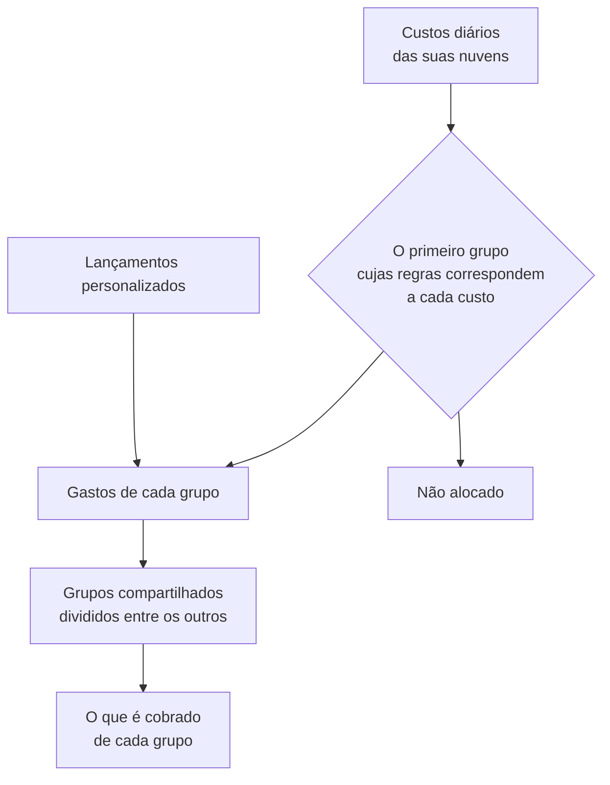

# Alocação de custos da nuvem

Os grupos de custos respondem à primeira pergunta de toda fatura mensal de nuvem: quem gastou. Uma **visão de custos** como "Por equipe" ou "Por centro de custo" distribui os gastos das suas contas conectadas em **grupos de custos** por regras, sem contar nada duas vezes. O que nenhuma regra pega fica à vista como gasto não alocado, e os custos compartilhados são divididos entre os grupos. Você os encontra em **Nuvem → Gastos → Grupos de custos**.

:::cards
- [Criar uma visão](#criar-uma-visão): Por equipe a partir dos proprietários que você já definiu, por uma tag ou com seus próprios grupos.
- [Escrever as regras de um grupo](#escrever-as-regras-de-um-grupo): Contas, serviços, tags, equipes proprietárias, rótulos e mais.
- [Gasto não alocado](#gasto-não-alocado): O que nenhuma regra pega, e um clique para distribuí-lo.
- [Custos compartilhados](#custos-compartilhados): Um plano de suporte ou um cluster compartilhado, dividido entre os grupos.
:::

## Como funciona



- **O primeiro grupo que corresponde fica com o custo.** Os grupos de uma visão têm uma ordem, e cada custo vai para o primeiro grupo cujas regras correspondem a ele, então nada é contado duas vezes. Os grupos e o gasto não alocado sempre somam o total do período.
- **As regras leem tudo o que um custo traz.** A conta, a nuvem, o serviço, a região, o recurso e suas tags, e o que o OneUptime sabe do recurso: suas equipes proprietárias, seus rótulos, seu ambiente e seu aplicativo de plataformas de aplicativos.
- **Tudo é calculado quando você olha.** Nada é gravado por custo. Uma regra que você muda distribui de novo cada mês que o OneUptime guarda, até 400 dias atrás, sem nada para esperar.
- **Várias visões podem distribuir os mesmos gastos.** "Por equipe" e "Por centro de custo" distribuem tudo, cada uma do seu jeito.

## Antes de começar

- **Custos que são lidos.** [Conecte uma conta de nuvem](/docs/telemetry/cloud-accounts) e deixe-a [ler seus custos](/docs/telemetry/cloud-costs).
- **Tags ou proprietários, se você quiser.** Regras sobre tags precisam de custos que as tenham; na AWS, ative [Custos por recurso](/docs/telemetry/cloud-costs#custos-por-recurso). As equipes proprietárias vêm dos proprietários de cada recurso, definidos à mão ou por [regras de proprietário](/docs/configuration/label-and-owner-rules).

## Criar uma visão

Abra **Nuvem → Gastos → Grupos de custos**. Um projeto ainda sem visão recebe três formas de começar:

| Início | O que cria |
| --- | --- |
| **Por equipe, pelos proprietários** | Um grupo para cada equipe proprietária de recursos de nuvem, vinculado à equipe. |
| **Por uma tag** | Um grupo para cada valor de uma tag que seus custos têm, como `team` ou `cost-center`. |
| **Seus próprios grupos** | Uma visão vazia. Você escreve as regras de cada grupo. |

O OneUptime cria os grupos de uma visão por tag ou por equipe proprietária quando você a salva e, depois, a cada hora, conforme surgem novos valores de tag e proprietários. Você pode renomear esses grupos, vinculá-los a uma equipe ou compartilhá-los. As regras deles continuam sendo do OneUptime. Para criar agora os grupos que faltam, abra a visão e clique em **Criar grupos agora**.

## Escrever as regras de um grupo

Abra uma visão e depois **Criar: Grupo de custos** em **Grupos**. Um custo é do grupo quando **qualquer** uma das regras corresponde a ele, e uma regra corresponde quando **todas** as suas condições correspondem. Uma condição compara algo que um custo traz com os valores que você escolhe ou digita:

| Campo | O que lê |
| --- | --- |
| **Marca** | O valor de uma tag, pela chave da tag. **está definido** e **não está definido** perguntam se o custo a tem. |
| **Conta** | A conta conectada para a qual o custo é cobrado. |
| **Equipe proprietária** | As equipes proprietárias do recurso no OneUptime. |
| **Serviço** | O serviço, como a cobrança da sua nuvem o chama. |
| **Rótulo** | Os rótulos do recurso, ou da conta dele, no OneUptime. |
| **Região** | A região. Deixe o valor vazio para um serviço global. |
| **Nuvem** | AWS, Azure ou Google Cloud. |
| **Recurso** | O recurso, como a sua nuvem o chama. |
| **Ambiente de plataformas de aplicativos** e **App** | O que é cobrado de um ambiente ou de um aplicativo, como **Nuvem → Gastos → Custos** conta. |
| **Namespace do Kubernetes** e **cluster Kubernetes** | Os namespaces de um cluster, quando um grupo compartilhado é dividido por eles. Veja [Clusters Kubernetes](#clusters-kubernetes). |

O texto é comparado sem diferenciar maiúsculas de minúsculas: `Payments` e `payments` são uma só equipe. A chave de uma tag é comparada como está escrita, como suas nuvens a guardam.

Por exemplo, um grupo **Pagamentos** com três regras fica com um custo marcado com `team: payments`, **ou** cobrado da conta payments, **ou** da equipe Pagamentos.

### A ordem dos grupos

Arraste os grupos em **Grupos** para mudar a ordem. Um grupo cujas regras um grupo anterior já cobre nunca pode ficar com um custo, e a linha dele diz qual grupo fica com tudo. Um grupo cujas regras também correspondem a custos que um grupo anterior pega diz quanto deles recebe.

### Recursos com várias equipes proprietárias

Um recurso de duas equipes é dividido igualmente entre elas: a metade de cada equipe passa pelas regras separadamente. Uma regra que não pergunta pelos proprietários, como uma tag ou uma conta, continua ficando com o custo inteiro. Uma metade cuja equipe não tem grupo fica não alocada.

## Gasto não alocado

A página de uma visão lista o que nenhuma regra pega ainda: os serviços, contas, valores de tag e equipes proprietárias que o compõem, os mais caros primeiro. Clique em **Adicionar ao grupo** ao lado de um deles para adicionar uma regra para ele a um grupo, ou a um novo grupo. Os custos passam para o grupo na hora, inclusive os dos meses passados.

## Custos compartilhados

Um plano de suporte, um cluster compartilhado ou um hub de rede é de todos. Torne-o um grupo próprio; depois, em **Mais campos**, ative **Compartilhado** e escolha como os custos dele são divididos entre os outros grupos da visão:

| Divisão | Como |
| --- | --- |
| **Dividir pela parte dos gastos** | Cada grupo fica com a sua parte dos gastos de nuvem dos outros grupos naquele mês. Um mês em que eles não gastaram nada é dividido igualmente. |
| **Dividir igualmente** | O mesmo valor para cada grupo. |
| **Dividir por porcentagens fixas** | As porcentagens que você define para cada grupo, somando 100. |
| **Dividir por namespaces do Kubernetes** | Quanto custou cada namespace de um cluster naquele mês. Veja abaixo. |

Os custos de um grupo compartilhado são divididos dia a dia com as partes de cada mês, então um mês dá os mesmos números lido por dia ou por mês. O gasto não alocado nunca recebe uma parte.

### Clusters Kubernetes

Os nós de um cluster são cobrados pela sua nuvem, enquanto o próprio mecanismo de custos do cluster diz o que cada namespace usou. Para cobrar de cada equipe as cargas de trabalho dela dentro de um cluster compartilhado:

1. Crie um grupo cujas regras correspondam aos nós do cluster, por exemplo **Marca** `eks:cluster-name` **é um de** `prod`.
2. Ative **Compartilhado**, escolha **Dividir por namespaces do Kubernetes** e selecione o **Cluster Kubernetes**.
3. Dê aos grupos das equipes regras que leiam os labels dos namespaces, que contam como tags. Por exemplo, **Marca** `team` **é um de** `payments`, ou **Namespace do Kubernetes** **começa com** `payments-`.

A cada mês, os custos dos nós são divididos pelo que cada namespace custou no [mecanismo de custos](/docs/telemetry/kubernetes-cost) do cluster, e a parte de cada namespace vai para o primeiro grupo cujas regras correspondem a ela. A capacidade ociosa, e um namespace que nenhum grupo pega, ficam com o grupo do cluster. Os custos precificados do próprio cluster nunca são somados à sua fatura, então nada é contado duas vezes.

## Lançamentos personalizados

Em **Lançamentos personalizados**, na página **Nuvem → Gastos → Grupos de custos**, adicione uma cobrança ou um crédito que as faturas das suas nuvens não trazem: parte de um contrato de suporte, um desconto empresarial, uma margem interna ou uma taxa de plataforma.

- **Uma vez ou todo mês.** Um lançamento mensal é distribuído pelos dias de cada mês, então parte de um mês recebe a sua parte.
- **Em uma conta ou em um grupo.** Um lançamento adicionado a uma conta passa pelas regras de cada visão como os custos da conta. Um adicionado a um grupo vai direto para ele.
- **Sempre à parte.** Todo número mantém os lançamentos à parte do que as nuvens cobraram, então os números das próprias nuvens continuam batendo com seus consoles.

## Ver os gastos de cada grupo

- **Nuvem → Gastos → Custos**: em **Para onde vai o dinheiro**, escolha **Grupos de custos** e uma visão. Os gastos de cada grupo, em relação ao período anterior.
- **A página de uma visão**: o que foi cobrado de cada grupo, com os custos compartilhados, o que nenhuma regra pega, e **Baixar CSV** para o rateio do mês.
- **A página de um grupo**: os gastos dele dia a dia, os serviços, recursos e contas mais cobrados dele, e as regras dele. Ela mostra só os gastos desse grupo, então vincule o grupo à sua **Equipe** e envie à equipe a página dele: qualquer pessoa que possa ler os gastos de nuvem pode abri-la.

## API, CLI e MCP

Visões, grupos e lançamentos são recursos da API (`cloud-cost-view`, `cloud-cost-group`, `cloud-cost-line-item`), com comandos da CLI e ferramentas MCP como todo recurso. As regras de um grupo são JSON:

```json
[
  { "conditions": [{ "field": "tag", "key": "team", "operator": "is", "values": ["payments"] }] },
  { "conditions": [{ "field": "ownerTeam", "operator": "is", "values": ["<team ID>"] }] }
]
```

Para ler o que uma visão distribui, em dias UTC inteiros de `startDate` a `endDate`:

```bash
curl -X POST "https://oneuptime.com/api/cloud-cost-view/<view ID>/allocation" \
  -H "apikey: <API key>" -H "tenantid: <project ID>" -H "Content-Type: application/json" \
  -d '{"startDate": "2026-11-01", "endDate": "2026-11-30", "currency": "USD"}'
```

A resposta traz o `total` de cada grupo e do que ele é feito (`cloud`, `lineItems`, `sharedIn`, `sharedOut`), os números por dia ou por mês, o período anterior e do que é feito o gasto não alocado. `POST /cloud-cost-group/<group ID>/spend` responde por um grupo.

## Limites

- Uma visão tem no máximo 500 grupos. Uma visão por tag cria grupos para os 500 valores mais caros.
- Um grupo tem no máximo 25 regras, uma regra 20 condições e uma condição 200 valores.
- Os custos são guardados por 400 dias, então uma visão lê no máximo 400 dias.

## Solução de problemas

:::details Um grupo não recebe nada
Talvez as regras dele ainda não correspondam a nenhum custo, ou um grupo anterior pegue todos os custos a que elas correspondem. A linha dele em **Grupos** então nomeia esse grupo: arraste este para cima dele, ou restrinja as regras do grupo anterior.
:::

:::details Um custo está no grupo errado
Um custo vai para o primeiro grupo cujas regras correspondem a ele. Arraste o grupo ao qual ele pertence para cima do grupo que fica com ele, ou restrinja as regras desse grupo.
:::

:::details Uma regra sobre uma tag não corresponde a nada
Um custo mantém as tags que tinha quando foi lido: os rótulos de uma exportação de faturamento do Google Cloud, senão as tags do recurso para o qual é cobrado, o que na AWS exige [Custos por recurso](/docs/telemetry/cloud-costs#custos-por-recurso). A chave de uma tag é comparada como está escrita.
:::

:::details Falta um grupo em uma visão por tag ou por equipe proprietária
O OneUptime cria os grupos que faltam a cada hora: um para cada valor de tag dos custos dos últimos 400 dias, ou para cada equipe proprietária de recursos de nuvem, até 500 grupos. Clique em **Criar grupos agora** na página da visão para criá-los na hora.
:::

:::details Os números deixam uma conta de fora
Os números de uma visão estão na moeda em que a maioria das suas contas é cobrada. Uma conta cobrada em outra fica de fora deles, assim como um lançamento em outra moeda.
:::

## Próximos passos

:::cards
- [Custos e economias da nuvem](/docs/telemetry/cloud-costs): Quanto custam suas contas conectadas e como gastar menos.
- [Regras de rótulos e proprietários](/docs/configuration/label-and-owner-rules): Dê aos recursos equipes proprietárias e rótulos para as regras lerem.
- [Observabilidade de custos do Kubernetes](/docs/telemetry/kubernetes-cost): Quanto custa cada carga de trabalho Kubernetes.
:::
