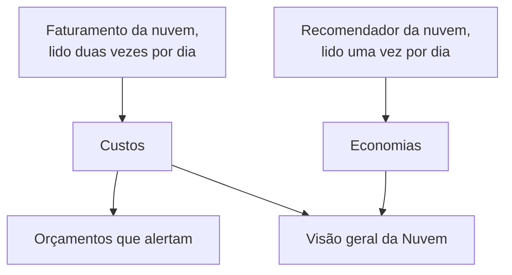

# Custos e economias da nuvem

Uma conta de nuvem conectada também diz quanto custa e como poderia custar menos. O OneUptime lê os custos de cada dia do próprio faturamento da sua nuvem e as recomendações do próprio recomendador da sua nuvem, mostra-os em **Nuvem → Gastos → Custos** e **Nuvem → Gastos → Economias**, lista seus Savings Plans, reservas e descontos por compromisso de uso em **Nuvem → Gastos → Compromissos**, e alerta antes que um mês custe mais do que o orçamento em **Nuvem → Gastos → Orçamentos**. Quando você permite, ele também aplica as economias que um proprietário aprova, para recursos que não são de produção fora do horário de trabalho e confere cada alteração na fatura.

:::cards
- [Amazon Web Services](#amazon-web-services): Cost Explorer e Cost Optimization Hub, cada um ativado uma vez.
- [Microsoft Azure](#microsoft-azure): Cost Management e Azure Advisor, com mais uma função.
- [Google Cloud](#google-cloud): A sua exportação de faturamento para o BigQuery e o Recommender.
- [Faturado, amortizado e líquido](#faturado-amortizado-e-líquido): Cada custo de três formas, para que compromissos e créditos caiam onde o dinheiro foi.
- [Compromissos e renovações](#compromissos-e-renovações): Cada compromisso, alertas antes que um termine ou enquanto é pouco usado, e o que renovar ou comprar.
- [Aplicar economias](#aplicar-economias): Aplique uma economia com a aprovação do proprietário, e desfaça-a.
- [Agendamentos fora do horário](#agendamentos-fora-do-horário): Pare recursos que não são de produção à noite e nos fins de semana.
- [Regras de IA para economias](#regras-de-ia-para-economias): Propostas para os proprietários, ou alterações dentro de um limite.
- [Orçamentos](#orçamentos): Um alerta quando os gastos de um mês ultrapassam uma parte do orçamento.
:::

## Como funciona



- **Os custos vêm do próprio faturamento da sua nuvem.** AWS Cost Explorer, Azure Cost Management e a exportação de faturamento do Google Cloud para o BigQuery, na moeda em que a conta é faturada, cada um guardado faturado, amortizado e líquido: veja [Faturado, amortizado e líquido](#faturado-amortizado-e-líquido). Cada valor é o de um dia, em dias UTC, como a sua nuvem os fatura.
- **Uma nuvem informa o último dia ou dois com atraso.** Cada leitura retoma a última semana, e o mês passado inteiro nos primeiros dias de um mês, então o custo de um dia se firma à medida que a sua nuvem o fecha. A primeira leitura de uma conexão volta até o início do penúltimo mês.
- **A projeção do mês segue o ritmo da última semana.** É quanto o mês custou até agora, com cada dia que falta pela média dos últimos sete dias completos.
- **As economias vêm do próprio recomendador da sua nuvem.** AWS Cost Optimization Hub, Azure Advisor e o Recommender do Google Cloud: um tamanho menor, um recurso ocioso, um compromisso que vale a pena, cada um com quanto economizaria por mês. Uma recomendação que você aplica ou descarta no console da sua nuvem some na leitura seguinte.

## Antes de começar

- **Uma conta conectada.** [Conectar uma conta de nuvem](/docs/telemetry/cloud-accounts) com o comando de configuração atual: ele permite que a conexão leia custos e recomendações. Uma conexão criada antes não lê nenhum dos dois até que você execute o comando dela novamente.

## Amazon Web Services

A conexão lê os custos com `ce:GetCostAndUsage`, seus compromissos com `ce:GetSavingsPlansCoverage`, `ce:GetSavingsPlansUtilization`, `ce:GetSavingsPlansUtilizationDetails`, `ce:GetReservationCoverage` e `ce:GetReservationUtilization`, os Savings Plans comprados com `savingsplans:DescribeSavingsPlans`, e as recomendações com `cost-optimization-hub:ListRecommendations` e `cost-optimization-hub:GetRecommendation`. O comando de configuração concede as leituras do Cost Explorer como três famílias, `ce:GetCostAndUsage*`, `ce:GetSavingsPlans*` e `ce:GetReservation*`, todas leituras, para que o usuário de uma chave de acesso ainda caiba nos 2.048 caracteres que o IAM permite à política dele. O Cost Explorer e o Cost Optimization Hub precisam ser ativados na conta primeiro:

:::steps
### Ativar o Cost Explorer

Abra o Cost Explorer uma vez no console AWS Billing and Cost Management: a AWS prepara os custos da conta em até um dia. Conecte a conta de gerenciamento da organização para ler os custos de cada conta-membro.

### Ativar o Cost Optimization Hub

Abra o Cost Optimization Hub no mesmo console e ative-o, para a organização a partir da conta de gerenciamento dela ou só para a conta. As recomendações dele chegam em até um dia.
:::

O Cost Explorer cobra $0.01 por solicitação: uma leitura dos custos faz duas ou algumas mais, uma para faturado e amortizado e uma para líquido, e os compromissos são lidos com quatro por dia para a cobertura e o uso deles, e mais seis a doze por dia para os de cada um. A API do Savings Plans e o Cost Optimization Hub são gratuitos.

### Custos por recurso

O Cost Explorer também informa quanto cada recurso custa, nos últimos 14 dias, depois que os dados no nível do recurso são ativados. No console AWS Billing and Cost Management, abra as preferências do Cost Management e ative os dados no nível do recurso com granularidade diária, para a organização pela conta de gerenciamento dela. A AWS os prepara em até 48 horas.

Depois edite a conexão em **Nuvem → Conectar** e, em **Mais campos**, ative **Custos por recurso**. A conexão os lê com `ce:GetCostAndUsageWithResources` uma vez por dia: os 14 dias na primeira vez, depois os três últimos de novo, com algumas solicitações a cada vez. O que ela lê fica com os custos da conta depois que o Cost Explorer o esquece. Uma conexão criada antes precisa executar o comando de configuração de novo, o que adiciona a ação.

## Microsoft Azure

O aplicativo lê os custos com a função **Cost Management Reader**, no mesmo escopo da **Monitoring Reader**: o comando de configuração concede as duas. As recomendações do Azure Advisor são lidas com a **Monitoring Reader**, então não há nada para ativar. Para dar a função a um aplicativo criado antes, execute:

```bash
az role assignment create --assignee <APP_ID> --role "Cost Management Reader" --scope /subscriptions/<SUBSCRIPTION_ID>
```

O Cost Management responde por cada assinatura, com o recurso a que cada custo se refere, e lê-lo não custa nada. Quando não consegue responder por uma assinatura, os **Custos** da conta dizem por quê.

O Cost Management limita a rapidez com que os custos de um locatário são lidos, igual para todos que os leem: cada consulta custa uma unidade de processamento de consultas (QPU) por mês de dados que lê, e um locatário tem 12 QPU a cada 10 segundos, 60 por minuto e 600 por hora. O OneUptime lê as assinaturas de um locatário uma após a outra dentro de dois terços de cada cota, espera o tempo que o Cost Management pedir quando recusa uma consulta e continua na leitura seguinte de onde parou. Uma assinatura ainda não lida diz **Na fila**, com quando é lida; uma que já tem valores os mantém enquanto isso. O custo amortizado dela é lido a cada leitura e o custo real uma vez por dia, então a primeira leitura de uma assinatura consulta o Cost Management duas vezes e gasta o dobro de unidades de consulta: os primeiros valores de um locatário grande levam algumas leituras a mais.

As reservas e os planos de economia do locatário são lidos com **Reservations Reader** e **Savings plan Reader**, que o Azure concede no escopo do próprio locatário, onde só um administrador global com acesso elevado pode concedê-los. O comando de configuração tenta, e avisa quando não pode. Para concedê-los depois, como administrador global com acesso elevado:

```bash
az role assignment create --assignee <APP_ID> --role "Reservations Reader" --scope /providers/Microsoft.Capacity
az role assignment create --assignee <APP_ID> --role "Savings plan Reader" --scope /providers/Microsoft.BillingBenefits
```

Sem eles, os custos e as recomendações são lidos como antes, e **Nuvem → Gastos → Compromissos** diz qual função conceder.

## Google Cloud

O Google Cloud não tem uma API para os custos de um projeto: o OneUptime os lê da exportação da sua conta de faturamento para o BigQuery.

:::steps
### Exportar o seu faturamento para o BigQuery

No console do Google Cloud, abra Billing, depois Billing export, e ative a exportação do custo de uso detalhado para um conjunto de dados do BigQuery. O Google a grava com algumas horas de atraso, a partir do dia em que você a ativa.

### Deixar a conta de serviço lê-la

Dê à conta de serviço da conexão **BigQuery Data Viewer** no conjunto de dados da exportação. O comando de configuração já deu a ela **BigQuery Job User**, para executar a consulta no próprio projeto.

### Informar a tabela da exportação

Edite a conexão em **Nuvem → Conectar** e, em **Mais campos**, defina **Tabela da exportação de faturamento** com o nome completo da tabela: `<PROJECT_ID>.<DATASET>.gcp_billing_export_resource_v1_<BILLING_ACCOUNT_ID>`.
:::

A exportação detalhada indica o recurso a que cada custo se refere; a padrão diz só o serviço e a região. O BigQuery cobra a consulta: o primeiro 1 TiB por mês é gratuito, depois $6.25 por TiB, e um mês de uma exportação vai de alguns megabytes a alguns gigabytes. As recomendações de tipo de máquina e de recursos ociosos do Recommender são lidas com **Compute Recommender Viewer**, que o comando de configuração concede, e não custam nada. Os compromissos do Compute Engine são listados pelo Cloud Asset Inventory com **Cloud Asset Viewer**, que o comando de configuração já concede: nada mais a dar.

## Faturado, amortizado e líquido

Cada custo é guardado de três formas, e **Nuvem → Gastos → Custos**, os **Custos** de uma conta, a visão geral da Nuvem e os orçamentos mostram a que você escolher:

- **Faturado** é cada cobrança no dia em que a sua nuvem a faturou, antes de créditos e reembolsos. Um Savings Plan ou uma reserva pagos adiantado são uma única cobrança grande no dia da compra, e o uso que cobrem parece gratuito pelo resto do prazo.
- **Amortizado** distribui as taxas de cada compromisso pelos dias e recursos que ele cobre, para que o dinheiro caia onde foi gasto. Ainda antes de créditos e reembolsos. É o que as páginas mostram, a menos que você escolha outra.
- **Líquido** é o amortizado, menos créditos, reembolsos e descontos: o valor da fatura.

| | Faturado | Amortizado | Líquido |
|---|---|---|---|
| AWS | O custo não combinado (unblended) do Cost Explorer | O custo amortizado do Cost Explorer | O custo amortizado líquido do Cost Explorer, com créditos e reembolsos |
| Azure | O custo real do Cost Management | O custo amortizado do Cost Management | O custo amortizado: o Azure desconta os créditos na conta de cobrança, que a conexão de uma assinatura não lê |
| Google Cloud | O custo da exportação | O custo menos os créditos dos descontos por compromisso de uso e das assinaturas | O custo menos todos os créditos |

O seletor acima dos valores muda a base na página, e o OneUptime lembra a sua escolha neste projeto, no seu navegador. A base do próprio projeto, com a qual as páginas abrem e que os orçamentos acompanham, fica em **Nuvem → Configurações → Configurações de custos**. Um orçamento pode acompanhar uma base própria: edite-o e defina **Base de custo**.

Os custos lidos antes de os três serem guardados mostram o valor faturado em todas as bases. Cada conexão lê os custos de novo uma vez, tão para trás quanto uma primeira leitura, para que cada base seja preenchida.

## Formas de gastar menos

**Nuvem → Gastos → Economias** lista cada recomendação, a maior economia primeiro: o que fazer, em qual recurso, o que mudaria e quanto economiza por mês. A faixa acima as soma, no total e por tipo: um tamanho menor, um recurso ocioso, um compromisso. Uma recomendação leva à página do recurso dela quando o OneUptime tem o recurso, e uma que o OneUptime pode aplicar tem **Aplicar**: veja [Aplicar economias](#aplicar-economias).

### Ajuste de tamanho com as leituras do próprio OneUptime

Um recurso de que nenhum recomendador cuida, porque ele não está ativado, não cobre o tipo do recurso ou o considera novo demais, é dimensionado pelo OneUptime com as leituras de CPU e memória que a conexão dele fez nos últimos 14 dias. O OneUptime dimensiona instâncias EC2, bancos de dados RDS e clusters do ElastiCache na AWS, máquinas virtuais, servidores flexíveis PostgreSQL e MySQL e planos do App Service no Azure, e VMs do Compute Engine e instâncias do Cloud SQL no Google Cloud:

- **Superprovisionado** quando o tamanho com metade, ou um quarto, ainda teria folga: no tamanho menor, o percentil 95 da CPU ficaria em no máximo 60%, a leitura de CPU mais alta em no máximo 100% e o pico da memória em no máximo 70%, quando a memória é lida.
- **Subprovisionado** quando o percentil 95 da CPU fica em 85% ou mais, ou o pico da memória em 90% ou mais: o tamanho com o dobro.

Um recurso é dimensionado assim que tem 6 dias de leituras. A página dele mostra o **Ajuste de tamanho** ao lado de quanto custa, e um superprovisionado aparece em **Nuvem → Gastos → Economias**, com o OneUptime como origem. O que uma mudança economiza é a parte dela no que o recurso custou nos últimos 30 dias, então isso é conhecido assim que sua nuvem fatura o recurso pelo nome: a exportação detalhada do Azure e do Google Cloud faz isso, e a AWS também, depois que Custos por recurso é ativado. Uma instância EC2 informa a memória só com o agente do CloudWatch, e uma VM do Compute Engine só com o Ops Agent: sem ele, é dimensionada apenas pela CPU. Tamanhos com burst, como t3, a série B e e2-micro, nunca são dimensionados.

### Compromissos

**Nuvem → Gastos → Economias** e os **Custos** de uma conta mostram quanto do gasto dos últimos 30 dias os compromissos de cada conta pagaram, e quanto deles foi usado, uma linha por tipo:

- AWS: Savings Plans e instâncias reservadas, pelo Cost Explorer. A conta de gerenciamento de uma organização os lê para cada conta da organização.
- Azure: planos de economia e reservas, pelo Cost Management, em custo amortizado.
- Google Cloud: descontos por compromisso de uso, pela sua exportação de faturamento. A exportação não diz quanto de um compromisso ficou sem uso, então quanto é usado não é mostrado.

Uma conta sem compromissos mostra o que rodou a preços sob demanda e que um compromisso pagaria por menos. Os valores de cada tipo são os da sua nuvem, e os tipos nunca são somados: uma reserva e um Savings Plan podem contar os dois o gasto da mesma máquina como deles para cobrir. Cada compromisso isoladamente é listado em **Nuvem → Gastos → Compromissos**: veja [Compromissos e renovações](#compromissos-e-renovações).

## Compromissos e renovações

**Nuvem → Gastos → Compromissos** lista cada Savings Plan, reserva e desconto por compromisso de uso que as suas conexões conseguem ler, para que nenhum termine sem ser notado:

- **Compromissos ativos**, no topo, conta os ativos e os que terminam em até 90 dias, **Utilização** quanto deles foi usado nos últimos 30 dias e o que ficou sem uso, e **Cobertura** quanto do gasto eles cobrem.
- **Terminam em breve** lista os que terminam em até 90 dias e não se renovam sozinhos, cada um com o plano de renovação: o que comprar para manter o desconto (o compromisso por hora ou as instâncias, na parte que foi usada), quanto isso custa e economiza por mês, quando se paga e quanto do gasto está coberto agora e depois que ele terminar. **Renovar no console** abre a página em que a sua nuvem o renova.
- **Todos os compromissos** é a lista completa: o que cada um é e cobre, a conta dele, quando termina, o prazo e a opção de pagamento, quanto dele foi usado nos últimos 30 dias, e o uso que ele pagou e quanto isso economizou.
- **Planos de compra** são o que o recomendador da sua nuvem sugere comprar, cada um com quanto custaria e economizaria por mês, quando se pagaria e como a cobertura mudaria. **Comprar no console** abre a página para comprá-lo.
- Abaixo deles, os compromissos de cada conta por tipo, como os **Custos** dela os mostram, e quando os compromissos alertam, com **Alterar alertas**.

O OneUptime só planeja: nunca compra, renova ou devolve um compromisso. Você compra no console da sua nuvem.

| | De onde vêm os compromissos | O que se sabe de cada um |
|---|---|---|
| AWS | Os Savings Plans e instâncias reservadas do Cost Explorer, cada um com o próprio uso, e a API do Savings Plans para os planos comprados, incluindo os que estão na fila para começar | O fim, o prazo, a opção de pagamento, o compromisso por hora ou as instâncias, as taxas e o uso nos últimos 30 e 7 dias |
| Azure | As reservas e os planos de economia do locatário | O fim, o prazo, o plano de cobrança, se ele se renova sozinho, e o uso nos últimos 30 e 7 dias |
| Google Cloud | Os compromissos do Compute Engine, pelo Cloud Asset Inventory | O fim, o plano, os recursos e se ele se renova sozinho. O Google Cloud não diz quanto de um compromisso é usado |

A conta de gerenciamento de uma organização lista os de cada conta na AWS. Os descontos por compromisso de uso baseados em gastos, que o Google Cloud mantém na conta de faturamento em vez de num projeto, ainda não são listados.

### Alertas de compromissos

Os compromissos geram alertas, acionados pelas políticas de plantão como qualquer alerta. Em **Nuvem → Configurações → Configurações de custos**, **Alertas de compromissos** diz quando:

- **Alertar antes do fim de um compromisso**: 90, 30 e 7 dias antes do fim, para começar. Um alerta no mais próximo desses dias que o compromisso atingiu, cada um mais próximo substituindo o anterior. Um compromisso que se renova sozinho, ou cuja renovação está na fila para começar quando ele terminar, não gera nenhum.
- **Alertar quando a utilização ficar abaixo de**: 80% para começar, dos últimos 7 dias de um compromisso, depois que ele rodou uma semana. O alerta é resolvido quando o uso volta.
- **Alertar quando a cobertura cair abaixo de**: 60% para começar, do gasto que os compromissos de um tipo de uma conta poderiam cobrir, depois de terem coberto mais. Ele é resolvido quando a cobertura volta. Vazio, a cobertura não gera alerta.

**Alertar sobre compromissos** desliga todos, e **Severidade do alerta**, **Políticas de plantão** e **Proprietários** dizem quão graves eles são, quem é acionado e de quem são. Cada alerta diz o que o compromisso cobre e o que pagou, e aponta para o plano de renovação. Um alerta é resolvido sozinho quando o compromisso termina, se renova ou deixa de ser listado.

## Aplicar economias

O OneUptime aplica uma economia pela conexão de nuvem da conta assim que a configuração **Ações de economia** dela permite: [Ações de economia](/docs/telemetry/cloud-accounts#ações-de-economia) diz o que cada opção concede. Ele só faz alterações de uma etapa: para uma instância ou um banco de dados ocioso, muda um volume gp2 para gp3, exclui um disco não anexado, um instantâneo antigo ou uma imagem sem uso, libera um endereço sem uso e, quando você permite, redimensiona uma instância ou um banco de dados para o tamanho recomendado. Ele nunca compra um compromisso: **Comprar no console** abre a página da sua nuvem para isso.

:::steps
### Selecione Aplicar

Em **Nuvem → Gastos → Economias**, selecione **Aplicar** em uma economia. A caixa de diálogo diz o que muda, quanto economiza por mês, como é desfeita ou que não pode ser, e quem a aprova.

### Um proprietário a aprova

Uma pessoa indicada como proprietária do recurso, ou um membro de uma equipe que o possui, que também possa editá-lo, aprova a alteração. Um recurso sem proprietário é aprovado por um Proprietário do projeto ou um Administrador do projeto. Quando você mesmo pode aprová-la, **Aplicar** a faz na hora, em seu nome. Caso contrário, ela aguarda em **Aguardando aprovação** até que um proprietário escolha **Aprovar**, ou **Dispensar** com um motivo.

### O OneUptime a faz

A alteração é feita pela conexão e fica nas linhas do tempo do recurso e da conta, com quem a aprovou. Um disco excluído recebe primeiro um instantâneo final, a menos que você desative **Fazer primeiro um instantâneo final**.
:::

Cada alteração diz como é desfeita: **Desfazer** em **Alterações feitas** inicia de novo uma instância parada, volta um volume ou um tamanho ao que era, ou recria um disco excluído a partir do instantâneo final. O que exclui para sempre, como um instantâneo, uma imagem ou um endereço liberado, não pode ser desfeito, e a caixa de diálogo diz isso antes de você aplicar. Quando o projeto exige duas aprovações com **Exigir duas aprovações para correções mais arriscadas**, uma alteração que não pode ser desfeita precisa de duas pessoas.

Um recurso cujas tags dizem que é gerenciado como código, por exemplo pelo Terraform ou CloudFormation, é alterado no código: a caixa de diálogo oferece **Abrir pull request** no repositório que o declara, para que o próximo apply não desfaça a economia.

### Comprovado pela fatura

**Economizado neste mês** conta só o que a fatura da sua nuvem mostra. Assim que três dias após uma alteração se assentam na fatura, o custo por dia do recurso é comparado com a semana anterior à alteração: ela fica **Visível na fatura** quando o custo caiu pelo menos um quarto do que foi prometido, **Não visível na fatura** quando não caiu, e **Não pode ser medida** quando sua nuvem não fatura o recurso pelo nome. **Verificando a fatura** conta as alterações que ainda aguardam esses dias.

## Agendamentos fora do horário

Em **Nuvem → Gastos → Agendamentos**, um agendamento para instâncias e bancos de dados que não são de produção fora do horário de trabalho, e os inicia de novo:

:::steps
### Escolha os recursos

Informe a tag da nuvem que os escolhe, por exemplo `Schedule` = `office-hours`, em uma conta ou em todas.

### Diga quando funcionam

Escolha os dias úteis, o horário em que iniciam e o horário em que param, no formato de 24 horas, e o fuso horário.
:::

Quando o horário de trabalho termina, um agendamento para, pela conexão da conta dele, cada recurso em execução que a tag dele escolhe e que se sabe que não é produção, e quando começa ele só inicia de novo o que parou: um recurso que alguém parou à mão continua parado. **Ver recursos** lista o que um agendamento escolhe agora e por que deixa algum em execução. Ele para instâncias EC2 e bancos de dados RDS na AWS, máquinas virtuais no Azure e instâncias do Compute Engine no Google Cloud. A AWS inicia de novo, por conta própria, um banco de dados parado há sete dias.

Um agendamento nunca para a produção, nem um recurso cujo ambiente nada indica. Sabe-se que um recurso não é produção quando:

- uma das tags dele diz isso, com uma chave como `environment`, `env`, `stage`, `tier` ou `deployment.environment`, e uma palavra como `dev`, `test`, `qa`, `staging` ou `sandbox`;
- a conta dele está marcada como **Não produção** em **Ambiente** nas **Configurações** da conta;
- ou um dos rótulos dele diz isso, por exemplo `Staging` ou `env: dev`.

A produção prevalece: uma tag que diz `prod`, `production` ou `live`, ou uma conta marcada como **Produção**, mantém um recurso em execução, diga o que disser o resto. O nome de um recurso nunca é lido para isso. Desative um agendamento e ele não para mais nada, e inicia de novo o que parou quando o horário de trabalho dele começa; exclua-o e o que ele parou é iniciado na hora.

## Regras de IA para economias

Com **Habilitar IA** ativado, o OneUptime AI propõe aos proprietários do recurso cada economia que pode aplicar, após cada leitura das economias da conta, e eles a aprovam ou dispensam em **Aguardando aprovação**. Em **Nuvem → Configurações → Regras de IA para economias**, uma regra diz o que o OneUptime AI faz com as economias que correspondem a ela, pelo tipo de alteração, pelo ambiente do recurso e pela nuvem: **Desativado**, **Propor ao proprietário** ou **Agir sem perguntar**, até um limite mensal. Sem regras, cada economia é proposta e nenhuma é feita; com regras, só o que corresponde a uma regra, e entre as regras que correspondem prevalece a mais cautelosa.

Uma regra só age sem perguntar em um recurso que se sabe que não é produção, só para uma alteração que pode ser desfeita, só até o menor limite das regras que correspondem, e no máximo 10 vezes por hora em um projeto: todo o resto é proposto. Uma alteração feita sem perguntar fica nas linhas do tempo com a regra que a fez, e os proprietários podem desfazê-la. Uma economia dispensada ou desfeita não é proposta de novo por 30 dias.

## Orçamentos

:::steps
### Criar um orçamento

Em **Nuvem → Gastos → Orçamentos**, crie um orçamento: o **Valor mensal**, a **Conta** a que ele se aplica, ou nenhuma para todas as contas, e a **Base de custo** que ele conta, ou nenhuma para a do projeto.

### Escolher quando ele alerta

**Alertar em** recebe as partes do orçamento em que alertar, em porcentagem: 80 e 100 para começar. **Alertar se estiver a caminho de ultrapassar** também alerta, uma vez por mês, quando o ritmo da última semana levaria o mês além do orçamento. **Alertar em dias incomuns** também alerta no dia seguinte a um dia que custou muito mais que o normal: veja [Dias incomuns](#dias-incomuns). **Severidade do alerta** e **Políticas de plantão** dizem quão graves são os alertas e quem é acionado.
:::

Um orçamento é verificado após cada leitura dos custos e a cada hora. Quando os gastos do mês passam de um limite, um alerta é gerado para ele, o mais alto quando uma leitura passa de vários de uma vez, e um mês novo resolve os alertas do mês passado. Um orçamento conta só as contas faturadas na moeda dele, na base dele: um orçamento amortizado não dispara por um compromisso pago adiantado, que um faturado conta no dia da compra.

Agentes de IA podem criar e alterar orçamentos pelo [servidor MCP](/docs/ai/mcp-server), e scripts com o comando `oneuptime cloud-budget` da CLI: veja [Operações de recursos](/docs/cli/resource-operations).

### Dias incomuns

Após cada leitura, cada um dos últimos 14 dias completos de uma conta é comparado com os 14 dias anteriores. Um dia é incomum quando um serviço custou o dobro do seu dia habitual ou mais, ou a conta inteira uma vez e meia o seu dia habitual ou mais. Nos dois casos, precisa ser pelo menos 10 a mais que o normal, na moeda da conta, e pelo menos 5% do dia habitual da conta, para que alguns centavos nunca contem como um pico. O valor habitual de um dia é a mediana dos 14 dias anteriores, então um pico isolado o move pouco, e uma conta só é avaliada quando tem uma semana de custos.

**Nuvem → Gastos → Custos** marca os dias incomuns no gasto diário, acima das barras deles, e os lista abaixo. Em todas as contas, cada marca abre os **Custos** da conta dela. Um orçamento que inclui a conta gera um alerta para cada conta e dia, no dia seguinte, nomeando cada serviço que subiu. Um pico que dura vários dias é avisado no dia em que começou, e um dia de mais de uma semana atrás não é avisado. Um orçamento criado antes de esses alertas existirem não os gera até que você o edite e os ative.

## Para onde vai o dinheiro

**Nuvem → Gastos → Custos** detalha o gasto de um período por serviço, região, conta ou recurso, e de mais três formas:

- Por ambiente de plataformas de aplicativos: o serviço de plataforma de cada ambiente na conta e na região dele, como Amazon ECS ou Cloud Run, e os recursos de um ambiente do Elastic Beanstalk pela tag que a AWS dá a eles.
- Por aplicativo: o que uma plataforma cobra de um aplicativo pelo nome, como um serviço do Cloud Run ou um Container App. O Amazon ECS cobra suas tarefas e o App Service seus planos, então os custos dos aplicativos deles ficam com o ambiente.
- Por tag: cada valor da tag que você escolher. Um custo mantém as tags que tinha quando foi lido: os rótulos de uma exportação de faturamento do Google Cloud ou, se não houver, as tags do recurso ao qual é cobrado, o que na AWS exige Custos por recurso.

Abaixo da lista, o card diz quanto deu o restante: o que não está em nenhum ambiente, o que é cobrado de um ambiente como um todo ou o que não tem a tag. Os custos lidos antes de as tags serem mantidas são lidos de novo uma vez, até onde vai uma primeira leitura, para que as tags deles sejam preenchidas.

## O que você vê no OneUptime

- **A visão geral da Nuvem.** **Nuvem → Visão geral** mostra os gastos do mês em relação aos do mês passado até o mesmo dia, os serviços que mais custam e as maiores formas de gastar menos, ao lado do que precisa de atenção.
- **Os gastos de cada dia.** **Nuvem → Gastos → Custos** desenha cada um dos últimos 30 dias marcando os dias que custaram muito mais que o normal, lista esses dias e detalha um período por serviço, região, conta, recurso, ambiente de plataformas de aplicativos, aplicativo ou tag, faturado, amortizado ou líquido. As contas cujos custos não são lidos aparecem abaixo, cada uma com o motivo.
- **Cada compromisso.** **Nuvem → Gastos → Compromissos** lista cada um com quando termina e quanto dele é usado, os que terminam em breve com o que renovar, e o que comprar.
- **Os custos de uma conta.** Os **Custos** de uma conta mostram o mesmo só para a conta, com os compromissos e as formas de gastar menos dela.
- **O custo de um recurso.** A página de um recurso mostra quanto ele custou este mês e nos últimos 30 dias quando a nuvem dele o fatura pelo nome, com as formas de gastar menos dele e o ajuste de tamanho dele.
- **O que foi economizado.** **Nuvem → Gastos → Economias** começa pelo que as alterações feitas economizaram neste mês, conforme a fatura, pelas alterações aguardando aprovação e as feitas, e pelas horas em que os agendamentos pararam recursos.

## Solução de problemas

:::details Uma conta diz Precisa de permissão
A conexão ainda não pode ler os custos da conta. Execute novamente o comando de configuração dela em **Nuvem → Conectar**: ele acrescenta o que a leitura dos custos precisa. No Google Cloud, dê também à conta de serviço **BigQuery Data Viewer** no conjunto de dados da exportação.
:::

:::details Uma conta diz Não configurado
A nuvem dela ainda não tem custos para fornecer. Na AWS, ative o Cost Explorer; no Google Cloud, informe a tabela da exportação em **Tabela da exportação de faturamento**. Os primeiros valores chegam com a leitura seguinte, em até 12 horas.
:::

:::details Uma conta diz Na fila
Os custos dela aguardam a vez: o Azure Cost Management limita a rapidez com que os custos de um locatário são lidos. A conta diz quando são lidos, na primeira leitura da conexão a partir de então, e não há nada a fazer. Uma conta que já tem valores os mantém enquanto isso.
:::

:::details Custos por recurso diz Não configurado
Os dados no nível do recurso não estão ativados para a conta. Ative-os com granularidade diária nas preferências do Cost Management do console AWS Billing and Cost Management, pela conta de gerenciamento da organização para os membros dela. A AWS os prepara em até 48 horas, e a leitura do dia seguinte os pega.
:::

:::details Os compromissos dizem Precisa de permissão
A conexão ainda não pode ler os Savings Plans e as reservas da conta. Execute o comando de configuração dela de novo em **Nuvem → Conectar**: ele adiciona as ações com que eles são lidos. No Azure, um administrador global com acesso elevado concede **Reservations Reader** e **Savings plan Reader**: veja [Microsoft Azure](#microsoft-azure).
:::

:::details Amortizado e líquido mostram o mesmo que faturado
Os custos lidos antes de os três serem guardados mostram o valor faturado em todas as bases até a próxima leitura de custos da conexão, que os lê de novo tão para trás quanto a primeira. No Azure, o líquido é sempre o custo amortizado.
:::

:::details Um compromisso termina e nenhum alerta chegou
Um compromisso que se renova sozinho, ou cuja renovação está na fila para começar quando ele terminar, não gera nenhum, e nem um de um projeto cujos alertas de compromissos estão desligados em **Nuvem → Configurações → Configurações de custos**. Um alerta também precisa que o projeto tenha uma severidade de alerta.
:::

:::details Os valores deixam uma conta de fora
Os valores estão na moeda em que a maioria das suas contas é faturada. Uma conta faturada em outra aparece abaixo com a moeda dela, e um orçamento conta só as contas faturadas na dele.
:::

:::details Uma economia não tem Aplicar
O OneUptime só faz alterações de uma etapa: um compromisso, ou uma recomendação que muda mais de uma coisa, é feito no console da sua nuvem. Aplicar abre uma caixa de diálogo que diz por que não pode ser feita daqui quando a conexão da conta não permite: ative as **Ações de economia** dela e execute de novo o comando de configuração dela.
:::

:::details Um agendamento deixa um recurso em execução
**Ver recursos** diz por quê: é produção, nada indica que não é produção, ou a conexão da conta dele não permite ações de economia. Adicione uma tag, por exemplo `environment` = `dev`, ou marque a conta dele como **Não produção**.
:::

:::details Este mês está mais baixo do que no console da sua nuvem
A sua nuvem informa o último dia ou dois com atraso, e os valores faturados e amortizados são antes de créditos e reembolsos. As leituras seguintes alcançam. Compare com a base que o console da sua nuvem mostra: a AWS abre nos custos não combinados, que são os faturados.
:::

## Próximos passos

:::cards
- [Alocação de custos da nuvem](/docs/telemetry/cloud-cost-allocation): Divida os gastos entre equipes, produtos e centros de custo.
- [Conectar uma conta de nuvem](/docs/telemetry/cloud-accounts): Conecte outra conta ou execute o comando dela novamente.
- [Recursos de nuvem](/docs/telemetry/cloud-resources): As métricas de cada recurso, a partir de um coletor seu.
- [Observabilidade de custos do Kubernetes](/docs/telemetry/kubernetes-cost): Quanto custa cada carga de trabalho do Kubernetes.
:::
