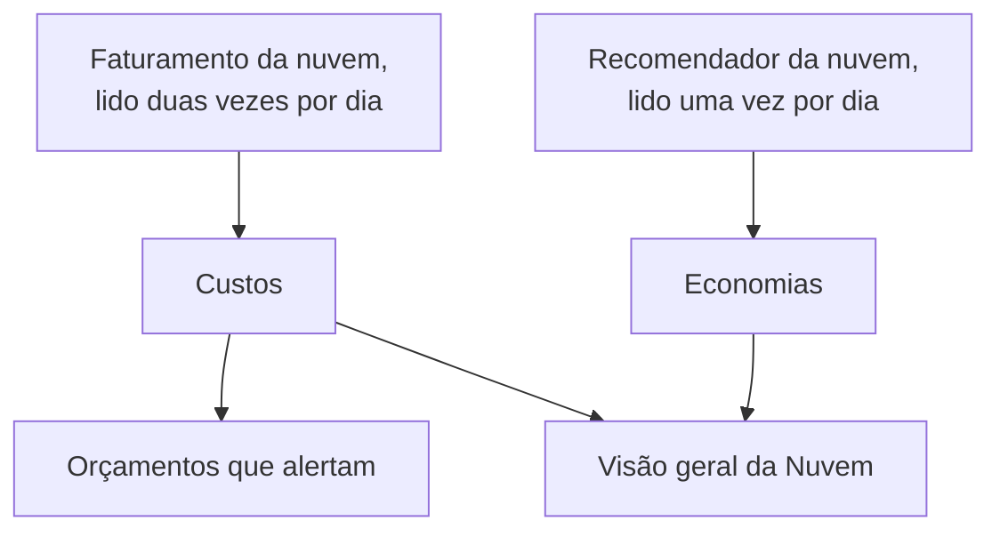

# Custos e economias da nuvem

Uma conta de nuvem conectada também diz quanto custa e como poderia custar menos. O OneUptime lê os custos de cada dia do próprio faturamento da sua nuvem e as recomendações do próprio recomendador da sua nuvem, mostra-os em **Nuvem → Gastos → Custos** e **Nuvem → Gastos → Economias**, e alerta antes que um mês custe mais do que o orçamento em **Nuvem → Gastos → Orçamentos**.

:::cards
- [Amazon Web Services](#amazon-web-services): Cost Explorer e Cost Optimization Hub, cada um ativado uma vez.
- [Microsoft Azure](#microsoft-azure): Cost Management e Azure Advisor, com mais uma função.
- [Google Cloud](#google-cloud): A sua exportação de faturamento para o BigQuery e o Recommender.
- [Orçamentos](#orçamentos): Um alerta quando os gastos de um mês ultrapassam uma parte do orçamento.
:::

## Como funciona



- **Os custos vêm do próprio faturamento da sua nuvem.** AWS Cost Explorer, Azure Cost Management e a exportação de faturamento do Google Cloud para o BigQuery, antes de créditos e reembolsos, na moeda em que a conta é faturada. Cada valor é o de um dia, em dias UTC, como a sua nuvem os fatura.
- **Uma nuvem informa o último dia ou dois com atraso.** Cada leitura retoma a última semana, e o mês passado inteiro nos primeiros dias de um mês, então o custo de um dia se firma à medida que a sua nuvem o fecha. A primeira leitura de uma conexão volta até o início do penúltimo mês.
- **A projeção do mês segue o ritmo da última semana.** É quanto o mês custou até agora, com cada dia que falta pela média dos últimos sete dias completos.
- **As economias vêm do próprio recomendador da sua nuvem.** AWS Cost Optimization Hub, Azure Advisor e o Recommender do Google Cloud: um tamanho menor, um recurso ocioso, um compromisso que vale a pena, cada um com quanto economizaria por mês. Uma recomendação que você aplica ou descarta no console da sua nuvem some na leitura seguinte.

## Antes de começar

- **Uma conta conectada.** [Conectar uma conta de nuvem](/docs/telemetry/cloud-accounts) com o comando de configuração atual: ele permite que a conexão leia custos e recomendações. Uma conexão criada antes não lê nenhum dos dois até que você execute o comando dela novamente.

## Amazon Web Services

A conexão lê os custos com `ce:GetCostAndUsage` e as recomendações com `cost-optimization-hub:ListRecommendations`. Cada um precisa que algo seja ativado na conta primeiro:

:::steps
### Ativar o Cost Explorer

Abra o Cost Explorer uma vez no console AWS Billing and Cost Management: a AWS prepara os custos da conta em até um dia. Conecte a conta de gerenciamento da organização para ler os custos de cada conta-membro.

### Ativar o Cost Optimization Hub

Abra o Cost Optimization Hub no mesmo console e ative-o, para a organização a partir da conta de gerenciamento dela ou só para a conta. As recomendações dele chegam em até um dia.
:::

O Cost Explorer cobra $0.01 por solicitação, e uma leitura dos custos faz algumas. O Cost Optimization Hub é gratuito.

## Microsoft Azure

O aplicativo lê os custos com a função **Cost Management Reader**, no mesmo escopo da **Monitoring Reader**: o comando de configuração concede as duas. As recomendações do Azure Advisor são lidas com a **Monitoring Reader**, então não há nada para ativar. Para dar a função a um aplicativo criado antes, execute:

```bash
az role assignment create --assignee <APP_ID> --role "Cost Management Reader" --scope /subscriptions/<SUBSCRIPTION_ID>
```

O Cost Management responde por cada assinatura, com o recurso a que cada custo se refere, e lê-lo não custa nada. Quando não consegue responder por uma assinatura, os **Custos** da conta dizem por quê.

## Google Cloud

O Google Cloud não tem uma API para os custos de um projeto: o OneUptime os lê da exportação da sua conta de faturamento para o BigQuery.

:::steps
### Exportar o seu faturamento para o BigQuery

No console do Google Cloud, abra Billing, depois Billing export, e ative a exportação do custo de uso detalhado para um conjunto de dados do BigQuery. O Google a grava com algumas horas de atraso, a partir do dia em que você a ativa.

### Deixar a conta de serviço lê-la

Dê à conta de serviço da conexão **BigQuery Data Viewer** no conjunto de dados da exportação. O comando de configuração já deu a ela **BigQuery Job User**, para executar a consulta no próprio projeto.

### Informar a tabela da exportação

Edite a conexão em **Nuvem → Conectar** e, em **Mais campos**, defina **Tabela da exportação de faturamento** com o nome completo da tabela: `<PROJECT_ID>.<DATASET>.gcp_billing_export_resource_v1_<BILLING_ACCOUNT_ID>`.
:::

A exportação detalhada indica o recurso a que cada custo se refere; a padrão diz só o serviço e a região. O BigQuery cobra a consulta: o primeiro 1 TiB por mês é gratuito, depois $6.25 por TiB, e um mês de uma exportação vai de alguns megabytes a alguns gigabytes. As recomendações de tipo de máquina e de recursos ociosos do Recommender são lidas com **Compute Recommender Viewer**, que o comando de configuração concede, e não custam nada.

## Formas de gastar menos

**Nuvem → Gastos → Economias** lista cada recomendação, a maior economia primeiro: o que fazer, em qual recurso, o que mudaria e quanto economiza por mês. A faixa acima as soma, no total e por tipo: um tamanho menor, um recurso ocioso, um compromisso. Uma recomendação leva à página do recurso dela quando o OneUptime tem o recurso.

### Ajuste de tamanho com as leituras do próprio OneUptime

Um recurso de que nenhum recomendador cuida, porque ele não está ativado, não cobre o tipo do recurso ou o considera novo demais, é dimensionado pelo OneUptime com as leituras de CPU e memória que a conexão dele fez nos últimos 14 dias. O OneUptime dimensiona instâncias EC2, bancos de dados RDS e clusters do ElastiCache na AWS, máquinas virtuais, servidores flexíveis PostgreSQL e MySQL e planos do App Service no Azure, e VMs do Compute Engine e instâncias do Cloud SQL no Google Cloud:

- **Superprovisionado** quando o tamanho com metade, ou um quarto, ainda teria folga: no tamanho menor, o percentil 95 da CPU ficaria em no máximo 60%, a leitura de CPU mais alta em no máximo 100% e o pico da memória em no máximo 70%, quando a memória é lida.
- **Subprovisionado** quando o percentil 95 da CPU fica em 85% ou mais, ou o pico da memória em 90% ou mais: o tamanho com o dobro.

Um recurso é dimensionado assim que tem 6 dias de leituras. A página dele mostra o **Ajuste de tamanho** ao lado de quanto custa, e um superprovisionado aparece em **Nuvem → Gastos → Economias**, com o OneUptime como origem. O que uma mudança economiza é a parte dela no que o recurso custou nos últimos 30 dias, então isso é conhecido assim que sua nuvem fatura o recurso pelo nome: a exportação detalhada do Azure e do Google Cloud faz isso, o AWS Cost Explorer não. Uma instância EC2 informa a memória só com o agente do CloudWatch, e uma VM do Compute Engine só com o Ops Agent: sem ele, é dimensionada apenas pela CPU. Tamanhos com burst, como t3, a série B e e2-micro, nunca são dimensionados.

## Orçamentos

:::steps
### Criar um orçamento

Em **Nuvem → Gastos → Orçamentos**, crie um orçamento: o **Valor mensal** e a **Conta** a que ele se aplica, ou nenhuma para todas as contas.

### Escolher quando ele alerta

**Alertar em** recebe as partes do orçamento em que alertar, em porcentagem: 80 e 100 para começar. **Alertar se estiver a caminho de ultrapassar** também alerta, uma vez por mês, quando o ritmo da última semana levaria o mês além do orçamento. **Alertar em dias incomuns** também alerta no dia seguinte a um dia que custou muito mais que o normal: veja [Dias incomuns](#dias-incomuns). **Severidade do alerta** e **Políticas de plantão** dizem quão graves são os alertas e quem é acionado.
:::

Um orçamento é verificado após cada leitura dos custos e a cada hora. Quando os gastos do mês passam de um limite, um alerta é gerado para ele, o mais alto quando uma leitura passa de vários de uma vez, e um mês novo resolve os alertas do mês passado. Um orçamento conta só as contas faturadas na moeda dele.

Agentes de IA podem criar e alterar orçamentos pelo [servidor MCP](/docs/ai/mcp-server), e scripts com o comando `oneuptime cloud-budget` da CLI: veja [Operações de recursos](/docs/cli/resource-operations).

### Dias incomuns

Após cada leitura, cada um dos últimos 14 dias completos de uma conta é comparado com os 14 dias anteriores. Um dia é incomum quando um serviço custou o dobro do seu dia habitual ou mais, ou a conta inteira uma vez e meia o seu dia habitual ou mais. Nos dois casos, precisa ser pelo menos 10 a mais que o normal, na moeda da conta, e pelo menos 5% do dia habitual da conta, para que alguns centavos nunca contem como um pico. O valor habitual de um dia é a mediana dos 14 dias anteriores, então um pico isolado o move pouco, e uma conta só é avaliada quando tem uma semana de custos.

**Nuvem → Gastos → Custos** lista os dias incomuns abaixo do gasto diário. Um orçamento que inclui a conta gera um alerta para cada conta e dia, no dia seguinte, nomeando cada serviço que subiu. Um pico que dura vários dias é avisado no dia em que começou, e um dia de mais de uma semana atrás não é avisado. Um orçamento criado antes de esses alertas existirem não os gera até que você o edite e os ative.

## O que você vê no OneUptime

- **A visão geral da Nuvem.** **Nuvem → Visão geral** mostra os gastos do mês em relação aos do mês passado até o mesmo dia, os serviços que mais custam e as maiores formas de gastar menos, ao lado do que precisa de atenção.
- **Os gastos de cada dia.** **Nuvem → Gastos → Custos** desenha cada um dos últimos 30 dias, lista os dias que custaram muito mais que o normal e detalha um período por serviço, região, conta ou recurso. As contas cujos custos não são lidos aparecem abaixo, cada uma com o motivo.
- **Os custos de uma conta.** Os **Custos** de uma conta mostram o mesmo só para a conta, com as formas de gastar menos dela.
- **O custo de um recurso.** A página de um recurso mostra quanto ele custou este mês e nos últimos 30 dias quando a nuvem dele o fatura pelo nome, com as formas de gastar menos dele e o ajuste de tamanho dele.

## Solução de problemas

:::details Uma conta diz Precisa de permissão
A conexão ainda não pode ler os custos da conta. Execute novamente o comando de configuração dela em **Nuvem → Conectar**: ele acrescenta o que a leitura dos custos precisa. No Google Cloud, dê também à conta de serviço **BigQuery Data Viewer** no conjunto de dados da exportação.
:::

:::details Uma conta diz Não configurado
A nuvem dela ainda não tem custos para fornecer. Na AWS, ative o Cost Explorer; no Google Cloud, informe a tabela da exportação em **Tabela da exportação de faturamento**. Os primeiros valores chegam com a leitura seguinte, em até 12 horas.
:::

:::details Os valores deixam uma conta de fora
Os valores estão na moeda em que a maioria das suas contas é faturada. Uma conta faturada em outra aparece abaixo com a moeda dela, e um orçamento conta só as contas faturadas na dele.
:::

:::details Este mês está mais baixo do que no console da sua nuvem
A sua nuvem informa o último dia ou dois com atraso, e os valores são antes de créditos e reembolsos. As leituras seguintes alcançam.
:::

## Próximos passos

:::cards
- [Conectar uma conta de nuvem](/docs/telemetry/cloud-accounts): Conecte outra conta ou execute o comando dela novamente.
- [Recursos de nuvem](/docs/telemetry/cloud-resources): As métricas de cada recurso, a partir de um coletor seu.
- [Observabilidade de custos do Kubernetes](/docs/telemetry/kubernetes-cost): Quanto custa cada carga de trabalho do Kubernetes.
:::
