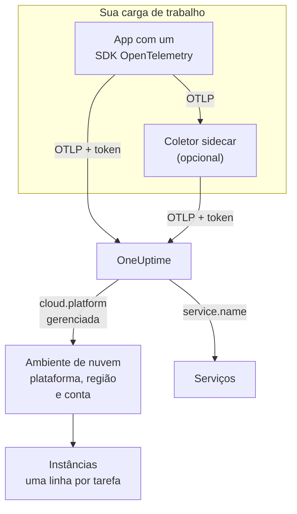

# Ambientes de nuvem

Um **Cloud Environment** é o lugar onde seus contêineres rodam em uma plataforma de nuvem gerenciada: a conta e a região de um cluster ECS, o projeto e a região do Cloud Run, a assinatura e a região do Container Apps. O OneUptime o cria na primeira vez que sua telemetria chega com os atributos de recurso certos, e agrupa cada carga de trabalho que roda ali. Não há nada para registrar à mão.

:::cards
- [AWS ECS / Fargate](/docs/telemetry/cloud-aws-ecs): Tarefas no Fargate ou no EC2, com a CPU e a memória de cada tarefa.
- [Google Cloud Run](/docs/telemetry/cloud-gcp-cloud-run): Serviços e jobs, também listados como funções serverless.
- [Azure Container Apps](/docs/telemetry/cloud-azure-container-apps): Réplicas, com a região e a assinatura definidas à mão.
- [Outras plataformas de nuvem](/docs/telemetry/cloud-other-platforms): Elastic Beanstalk, App Runner, App Engine, App Service e Container Instances.
:::

## Como funciona



- **Um detector de recursos diz onde a carga de trabalho roda.** Um detector de recursos do OpenTelemetry, no SDK ou em um coletor, lê os metadados da plataforma e coloca `cloud.platform`, `cloud.account.id` e `cloud.region` em tudo o que a carga de trabalho envia. Onde não existe detector, você os define.
- **O ambiente agrupa tudo.** Toda carga de trabalho com a mesma plataforma, a mesma conta e a mesma região cai em um único ambiente. Os serviços mantêm suas próprias linhas em **Serviços**.
- **Cada tarefa em execução é uma instância.** A aba **Instâncias** do ambiente lista suas tarefas, instâncias ou réplicas em execução, com CPU e memória ao vivo quando a plataforma consegue fornecê-las.

## Antes de começar

- **Uma chave de ingestão.** Crie uma chave **Servidor** em **Configurações do projeto → Telemetria e APM → Chaves de ingestão** e copie o token dela: veja [Criar uma chave de ingestão](/docs/telemetry/open-telemetry#criar-uma-chave-de-ingestão). Ela é um segredo: cada página de plataforma mostra onde guardá-la no cofre de segredos daquela nuvem.
- **OpenTelemetry na sua aplicação.** Um SDK do OpenTelemetry que exporte OTLP, ou um OpenTelemetry Collector rodando ao lado da aplicação.

## Plataformas compatíveis

| Plataforma | `cloud.platform` | `cloud.*` preenchidos por | Identidade da instância | Guia |
| ------------------------- | --------------------------- | ---------------------- | --------------------------------- | ------------------------------------------------------------------ |
| AWS ECS / Fargate | `aws_ecs` | detector de recursos | `aws.ecs.task.arn` | [AWS ECS / Fargate](/docs/telemetry/cloud-aws-ecs) |
| AWS Elastic Beanstalk | `aws_elastic_beanstalk` | detector de recursos | `host.id` | [Outras plataformas de nuvem](/docs/telemetry/cloud-other-platforms) |
| AWS App Runner | `aws_app_runner` | à mão | `host.name` | [Outras plataformas de nuvem](/docs/telemetry/cloud-other-platforms) |
| Google Cloud Run | `gcp_cloud_run` | detector de recursos | `faas.instance` | [Google Cloud Run](/docs/telemetry/cloud-gcp-cloud-run) |
| Google App Engine | `gcp_app_engine` | detector de recursos | `faas.instance` | [Outras plataformas de nuvem](/docs/telemetry/cloud-other-platforms) |
| Azure Container Apps | `azure_container_apps` | detector de recursos | `azure.container_app.instance.id` | [Azure Container Apps](/docs/telemetry/cloud-azure-container-apps) |
| Azure Container Instances | `azure_container_instances` | à mão | `host.name` | [Outras plataformas de nuvem](/docs/telemetry/cloud-other-platforms) |
| Azure App Service | `azure_app_service` | detector de recursos | `host.id` | [Outras plataformas de nuvem](/docs/telemetry/cloud-other-platforms) |

- **Detector de recursos:** um detector de recursos do OpenTelemetry, no SDK ou no processador `resourcedetection` do Collector, define os atributos `cloud.*` para você.
- **À mão:** não existe detector, então você coloca os atributos em `OTEL_RESOURCE_ATTRIBUTES`. A página da plataforma mostra a linha exata.
- **Os detectores do Azure sabem menos.** Os detectores do Container Apps não conhecem nem a região nem a assinatura, e os do App Service não conhecem a assinatura: defina você o que faltar.
- **As grafias do Azure com ponto funcionam.** Os detectores do Azure para Node.js e .NET escrevem `azure.container_apps` e `azure.app_service`. O OneUptime os reescreve para os valores com sublinhado acima ao recebê-los.

## Como o OneUptime identifica um ambiente

Existe um ambiente para cada combinação de três atributos de recurso:

| Atributo | Obrigatório | O que é |
| ------------------ | -------- | ------------------------------------------------------------------------------------------- |
| `cloud.platform` | Sim | Um dos valores de [Plataformas compatíveis](#plataformas-compatíveis) |
| `cloud.account.id` | Não | O ID da conta da AWS, o ID do projeto do Google Cloud ou o ID da assinatura do Azure |
| `cloud.region` | Não | A região, como `us-east-1`, `us-central1` ou `eastus` |

O OneUptime junta os três com `|` na **chave do ambiente**, e dá ao ambiente um nome com os mesmos valores, como _AWS ECS · us-east-1 · 123456789012_:

```text title="Environment keys"
aws_ecs|123456789012|us-east-1
gcp_cloud_run|my-project|us-central1
azure_container_apps|00000000-0000-0000-0000-000000000000|eastus
```

> [!IMPORTANT]
> Uma parte que falta fica na chave como um segmento vazio: `aws_ecs||us-east-1`. Por isso, uma carga de trabalho que omite `cloud.account.id` cai em um ambiente diferente de uma que o define. Esse é o motivo mais comum para ver dois ambientes onde você esperava um.

### Identidade da instância

Dentro de um ambiente, cada tarefa, instância ou réplica em execução ganha uma linha em **Instâncias**. O nome dela vem do primeiro destes atributos de recurso que a telemetria trouxer:

1. `aws.ecs.task.id`
2. `aws.ecs.task.arn` (encurtado para o ID da tarefa)
3. `faas.instance`
4. `azure.container_app.instance.id`
5. `service.instance.id`
6. `container.id`
7. `host.id`
8. `host.name`

A identidade própria da plataforma vem primeiro de propósito. Um coletor sidecar e o SDK da aplicação a enxergam, e ela sobrevive a reinicializações. Um SDK costuma inventar um `service.instance.id` novo para cada processo (o SDK do Node.js faz isso por padrão), então usá-lo como chave dividiria uma tarefa do ECS em duas linhas. `service.instance.id` é usado quando a plataforma não define uma identidade própria. A coluna **Identidade da instância** em [Plataformas compatíveis](#plataformas-compatíveis) indica o atributo que uma configuração típica usa em cada plataforma.

### Ambientes que você cria à mão

Raramente é preciso: a ingestão cria os ambientes para você. Para criar um antes da telemetria dele, abra **Nuvem → All Environments** e clique em **Criar: Recurso de nuvem**. Escolha a **Plataforma de nuvem** e digite o **ID da conta de nuvem** e a **Região de nuvem** exatamente como sua telemetria os informa. O OneUptime monta a chave `platform|account|region` com esses três valores, e a ingestão associa um ambiente apenas pela chave. Ele dá ao ambiente o nome que a ingestão daria; para mostrar outro nome, abra **Mais campos** e digite-o em **Nome de exibição**.

## O que não é um ambiente de nuvem

| Você roda em | Onde aparece | Por quê |
| ------------------------------------------------------------------------------------------------- | ------------------------ | ---------------------------------------------------------------------------------------------------- |
| EC2, Compute Engine, Azure VM (`aws_ec2`, `gcp_compute_engine`, `azure_vm`) | **Hosts** | Uma máquina virtual é um host. Veja [Coletor OpenTelemetry no host](/docs/telemetry/host-otel-collector) |
| EKS, GKE, AKS, Kubernetes autogerenciado | **Kubernetes** | Roteado pelos atributos `k8s.*`. Veja [Agente Kubernetes](/docs/telemetry/kubernetes-agent) |
| Lambda, Cloud Functions, Azure Functions (`aws_lambda`, `gcp_cloud_functions`, `azure_functions`) | **Funções serverless** | Roteado por `faas.name`, ou por `service.name` em uma `cloud.platform` FaaS. Veja [Funções serverless](/docs/telemetry/serverless-functions) |
| Balanceadores de carga, buckets, bancos de dados gerenciados e outros recursos IaaS ou PaaS | **Cloud Resources** | Descobertos a partir das métricas que o Azure Monitor, o CloudWatch e o Cloud Monitoring publicam. Veja [Recursos de nuvem](/docs/telemetry/cloud-resources) |

> [!NOTE]
> O Cloud Run e o App Engine aparecem em dois lugares de propósito. O detector deles define tanto uma `cloud.platform` gerenciada quanto `faas.name`, então cada serviço também é uma **Função serverless** própria, enquanto o **Cloud Environment** agrupa todos os serviços daquele projeto e daquela região. A mesma telemetria é arquivada nos dois.

## Conectar uma carga de trabalho

Cada página de plataforma traz estas etapas com os comandos e as telas de console daquela nuvem. Em resumo:

:::steps
### Colocar os atributos de nuvem na sua telemetria

:::tabs
@tab Sidecar collector
Um segundo contêiner na tarefa, na instância ou na réplica. A aplicação exporta para `localhost:4318`, e o processador `resourcedetection` do coletor coloca `cloud.*` em tudo o que passa por ele. O coletor guarda o token e, no ECS, também envia a CPU e a memória de cada tarefa:

```yaml title="collector.yaml"
processors:
  resourcedetection:
    detectors: [env, ecs] # [env, gcp] on Cloud Run and App Engine; [env, azurecontainerapps] on Container Apps
    timeout: 5s
```
@tab SDK direct
O SDK da aplicação exporta direto para o OneUptime. Ative no SDK o detector de recursos da plataforma, como `OTEL_NODE_RESOURCE_DETECTORS=env,host,os,aws` no Node.js: cada página de plataforma indica a configuração para cada linguagem. Não há contêiner extra, nem CPU ou memória de contêiner.
:::

### Exportar OTLP para o OneUptime

:::tabs
@tab Sidecar collector
```yaml title="collector.yaml"
exporters:
  otlphttp/oneuptime:
    endpoint: https://oneuptime.com/otlp
    headers:
      x-oneuptime-token: ${env:ONEUPTIME_TOKEN}

service:
  pipelines:
    traces:
      receivers: [otlp]
      processors: [resourcedetection, batch]
      exporters: [otlphttp/oneuptime]
    metrics:
      receivers: [otlp]
      processors: [resourcedetection, batch]
      exporters: [otlphttp/oneuptime]
    logs:
      receivers: [otlp]
      processors: [resourcedetection, batch]
      exporters: [otlphttp/oneuptime]
```

O coletor resolve `${env:ONEUPTIME_TOKEN}` a partir de uma variável de ambiente que a plataforma preenche com seu cofre de segredos: Secrets Manager, Secret Manager ou os segredos do Container Apps.
@tab SDK direct
```bash
OTEL_EXPORTER_OTLP_ENDPOINT="https://oneuptime.com/otlp"
OTEL_EXPORTER_OTLP_HEADERS="x-oneuptime-token=YOUR_TELEMETRY_INGESTION_TOKEN"
```
:::

Se você hospeda o OneUptime por conta própria, use `https://YOUR-ONEUPTIME-HOST/otlp`.

### Verificar a conexão

```bash
curl -i https://oneuptime.com/otlp/v1/validate \
  -H "x-oneuptime-token: YOUR_TELEMETRY_INGESTION_TOKEN"
```

`200` com `"valid": true` significa que o token é aceito. `401` significa que ele é desconhecido, revogado, desativado ou expirado, e a `message` da resposta diz qual. Dentro de um minuto após o primeiro span, log ou métrica, o ambiente aparece em **Nuvem → All Environments**.
:::

> [!TIP]
> As mesmas etapas estão no painel, com seu token já preenchido: em **Nuvem → All Environments** até seu primeiro ambiente chegar, e na aba **Documentação** de cada ambiente.

## O que você recebe

A **Visão geral** de um ambiente mostra:

- **Requisições**, **Taxa de erro** e **p95 latency**, a partir dos seus traços, com gráficos de requisições, erros e memória no intervalo de tempo que você escolher.
- **CPU** e **Memória** das instâncias ativas, e uma lista **Principais instâncias por CPU**. Vêm de métricas `container.cpu.utilization` e `container.memory.usage` que trazem a identidade da instância; no ECS, de `ecs.task.cpu.utilized` e `ecs.task.memory.utilized` do receptor `awsecscontainermetrics`.
- **Instâncias**: quantas reportaram nos últimos 15 minutos. A aba **Instâncias** tem uma linha para cada uma.
- As abas **Registros**, **Traços** e **Métricas**, filtradas para o ambiente.

Um ambiente cuja telemetria para por 15 minutos mostra **Desconectado**, e o próximo span, log ou métrica o traz de volta para **Conectado**. O tempo em que o próprio OneUptime esteve fora do ar ou se atualizando não conta para os 15 minutos.

### Rótulos e proprietários

- **A partir da sua telemetria:** um atributo de recurso como `oneuptime.label.team=payments` adiciona o rótulo `team:payments` ao ambiente.
- **A partir de regras:** **Nuvem → Configurações → Regras de Rótulos** e **Regras de proprietário** adicionam rótulos e proprietários aos ambientes correspondentes. Veja [Regras de rótulos e proprietários](/docs/configuration/label-and-owner-rules).

## Solução de problemas

[Solução de problemas na nuvem](/docs/telemetry/cloud-troubleshooting) percorre cada falha na ordem em que ela acontece: um ambiente que nunca aparece, que cai em **Hosts** ou só em **Funções serverless**, que não tem instâncias nem CPU e memória, que mostra **Desconectado**, que se divide em dois, ou que foi criado à mão e nunca é associado.

## Próximos passos

:::cards
- [AWS ECS / Fargate](/docs/telemetry/cloud-aws-ecs): A configuração mais comum, com uma definição de tarefa completa.
- [Solução de problemas na nuvem](/docs/telemetry/cloud-troubleshooting): O que verificar quando um ambiente falta ou está errado.
- [Recursos de nuvem (IaaS e PaaS)](/docs/telemetry/cloud-resources): Balanceadores de carga, buckets e bancos de dados gerenciados, a partir do próprio monitoramento da sua nuvem.
- [Funções serverless](/docs/telemetry/serverless-functions): Lambda, Cloud Functions e Azure Functions.
:::
