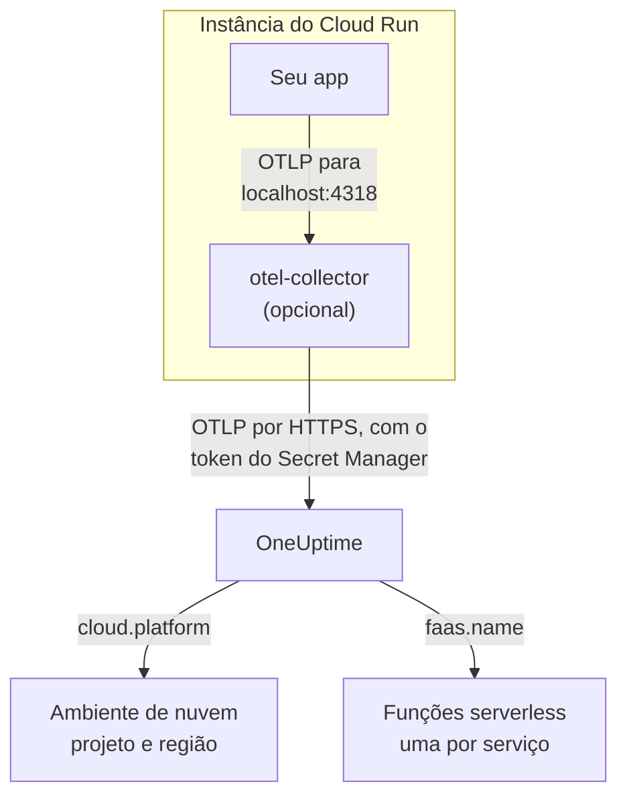

# Google Cloud Run

Envie os traços, logs e métricas dos seus serviços e jobs do Cloud Run para o OneUptime. Tudo o que reporta `cloud.platform=gcp_cloud_run` entra em um **Cloud Environment** por projeto do Google Cloud e região, como _GCP Cloud Run · us-central1 · my-project_, e cada serviço também aparece em **Funções serverless**.

:::cards
- [Como funciona](#como-funciona): O que o detector do GCP define, e por que um serviço aparece em dois lugares.
- [Configuração](#configuração): Guardar o token, configurar o serviço, implantar e verificar.
- [O YAML do serviço com um sidecar](#o-yaml-do-serviço-com-um-sidecar): Um serviço do Cloud Run completo com um coletor.
- [Solução de problemas](#solução-de-problemas): Erros de segredo, ordem de inicialização do sidecar e ambientes ausentes.
:::

## Como funciona



O detector de recursos do GCP do OpenTelemetry lê o servidor de metadados e as variáveis de ambiente `K_SERVICE` e `K_REVISION`, e define:

| Atributo | Valor no Cloud Run | Para que serve |
| ------------------ | ------------------------------ | ----------------------------------------------------------------------------------------- |
| `cloud.platform` | `gcp_cloud_run` | Arquiva a telemetria em **Ambientes de nuvem** |
| `cloud.account.id` | o ID do projeto | Parte da chave do ambiente |
| `cloud.region` | `us-central1` | Parte da chave do ambiente |
| `faas.name` | o nome do serviço (`K_SERVICE`) | Também lista o serviço em **Funções serverless** |
| `faas.version` | a revisão (`K_REVISION`) | Mostrado na visão geral da função serverless do serviço; o ambiente não o usa |
| `faas.instance` | o ID da instância | Nomeia uma instância em execução: uma linha para cada em **Instâncias** |

> [!NOTE]
> O Cloud Run aparece em dois lugares de propósito. Como o detector define `faas.name`, cada serviço também é uma **Função serverless**, com suas próprias invocações, taxa de erro e duração. O **Cloud Environment** agrupa todos os serviços daquele projeto e daquela região. Nada é armazenado duas vezes: a mesma telemetria é arquivada nos dois.

A chave do ambiente é `gcp_cloud_run|my-project|us-central1`.

## Antes de começar

- **Uma chave de ingestão.** Crie uma chave **Servidor** em **Configurações do projeto → Telemetria e APM → Chaves de ingestão** e copie o token dela.
- **`gcloud`**, conectado ao projeto, com a API do Secret Manager ativada: `gcloud services enable secretmanager.googleapis.com`.
- **Sua aplicação instrumentada com um SDK do OpenTelemetry** que exporte OTLP.

## Escolher como a telemetria sai do serviço

| | SDK direct | Sidecar collector |
| --------------- | ---------------------------------------------------- | ---------------------------------------------------------------------- |
| Contêiner extra | Nenhum | `otel-collector` no serviço |
| Ideal para | Um serviço, e os jobs do Cloud Run | Vários serviços em um projeto, ou um SDK que não consegue rodar um detector |
| Guarda o token | A aplicação | O coletor |
| O segredo | `oneuptime-otlp-headers`, o cabeçalho completo | `oneuptime-ingestion-token`, só o token |

Um job roda até terminar, então não há nada para manter um sidecar vivo: use SDK direct. Cada etapa abaixo tem uma aba para cada um; escolha uma e todas as etapas a seguem.

## Configuração

:::steps
### Guardar o token no Secret Manager

> [!IMPORTANT]
> O token é um segredo. Coloque-o no Secret Manager e faça referência a ele no serviço como uma variável de ambiente baseada em segredo. Uma variável de ambiente comum fica visível para todo leitor do projeto, no console e em `gcloud run services describe`.

:::tabs
@tab SDK direct
```bash
printf '%s' "x-oneuptime-token=YOUR_TELEMETRY_INGESTION_TOKEN" | gcloud secrets create oneuptime-otlp-headers \
  --data-file=- \
  --replication-policy=automatic

gcloud secrets add-iam-policy-binding oneuptime-otlp-headers \
  --member="serviceAccount:checkout-api@my-project.iam.gserviceaccount.com" \
  --role="roles/secretmanager.secretAccessor"
```

O Cloud Run coloca o valor de um segredo como está na variável, e `OTEL_EXPORTER_OTLP_HEADERS` precisa do par `name=value` completo, então este segredo contém o cabeçalho completo.
@tab Sidecar collector
```bash
printf '%s' "YOUR_TELEMETRY_INGESTION_TOKEN" | gcloud secrets create oneuptime-ingestion-token \
  --data-file=- \
  --replication-policy=automatic

gcloud secrets add-iam-policy-binding oneuptime-ingestion-token \
  --member="serviceAccount:checkout-api@my-project.iam.gserviceaccount.com" \
  --role="roles/secretmanager.secretAccessor"
```

A configuração do coletor acrescenta o nome do cabeçalho, então este segredo contém só o token.
:::

Coloque em `--member` a conta de serviço de execução do serviço, não o seu próprio usuário. Sem `roles/secretmanager.secretAccessor`, a revisão não é implantada e falha com `Permission denied on secret`. Se o serviço ainda roda como a conta de serviço padrão do Compute, conceda o papel a essa conta, e considere dar ao serviço uma conta própria: a padrão é compartilhada por todo o projeto.

### Configurar o serviço

:::tabs
@tab SDK direct
1. **Google Cloud console → Cloud Run → click the service → Edit & deploy new revision**.
2. Na aba **Containers**, abra seu contêiner e vá em **Variables & Secrets**. Adicione as variáveis abaixo.
3. Clique em **Reference a secret**, escolha `oneuptime-otlp-headers`, a versão `latest`, e exponha-o como a variável de ambiente `OTEL_EXPORTER_OTLP_HEADERS`.
4. Na aba **Security**, confira se a **Service account** é aquela que recebeu `roles/secretmanager.secretAccessor`.

```bash
OTEL_SERVICE_NAME=checkout-api
OTEL_EXPORTER_OTLP_ENDPOINT=https://oneuptime.com/otlp
OTEL_EXPORTER_OTLP_PROTOCOL=http/protobuf
# Secret-backed (Variables & Secrets → Reference a secret), not typed here.
OTEL_EXPORTER_OTLP_HEADERS=x-oneuptime-token=YOUR_TELEMETRY_INGESTION_TOKEN
```

Depois ative o detector de recursos do GCP da sua linguagem:

| Linguagem | Ativar o detector do GCP |
| -------- | ------------------------------------------------------------------------------------------------------------------- |
| Node.js | `OTEL_NODE_RESOURCE_DETECTORS=env,host,os,gcp` (auto-instrumentations-node) |
| Python | `pip install opentelemetry-resourcedetector-gcp` e depois `OTEL_EXPERIMENTAL_RESOURCE_DETECTORS=gcp_resource_detector` |
| Java | `-Dotel.resource.providers.gcp.enabled=true` |
| Go | `import "go.opentelemetry.io/contrib/detectors/gcp"` e passe `gcp.NewDetector()` para `resource.New` |
| .NET | O pacote `OpenTelemetry.Resources.Gcp`: `.ConfigureResource(r => r.AddGcpDetector())` |

Ou defina tudo pela CLI:

```bash
gcloud run services update checkout-api --region us-central1 \
  --set-env-vars "^@^OTEL_SERVICE_NAME=checkout-api@OTEL_EXPORTER_OTLP_ENDPOINT=https://oneuptime.com/otlp@OTEL_EXPORTER_OTLP_PROTOCOL=http/protobuf@OTEL_NODE_RESOURCE_DETECTORS=env,host,os,gcp" \
  --set-secrets "OTEL_EXPORTER_OTLP_HEADERS=oneuptime-otlp-headers:latest"
```

O prefixo `^@^` faz o `gcloud` dividir a lista dessa opção em `@` em vez de `,`. Sem ele, o `gcloud` divide `OTEL_NODE_RESOURCE_DETECTORS=env,host,os,gcp` em cada vírgula e falha com `Bad syntax for dict arg [host]`.
@tab Sidecar collector
1. **Google Cloud console → Cloud Run → click the service → Edit & deploy new revision**.
2. Na aba **Containers**, abra seu contêiner e vá em **Variables & Secrets**. Adicione as variáveis da aplicação abaixo.
3. Clique em **+ Add container**. Defina a URL da imagem do contêiner como `otel/opentelemetry-collector-contrib:latest`, e em **Container command and arguments** adicione o argumento `--config=env:OTEL_COLLECTOR_CONFIG`.
4. Na aba **Variables & Secrets** do novo contêiner, **Reference a secret**: `oneuptime-ingestion-token`, como a variável de ambiente `ONEUPTIME_TOKEN`. Adicione a variável `OTEL_COLLECTOR_CONFIG` com a configuração do coletor de [O YAML do serviço com um sidecar](#o-yaml-do-serviço-com-um-sidecar).
5. Na aba **Settings** do coletor, adicione uma **Startup probe** (HTTP, caminho `/`, porta `13133`), e em **Container start-up order** faça seu contêiner depender de `otel-collector`.
6. Na aba **Security**, confira se a **Service account** é aquela que recebeu `roles/secretmanager.secretAccessor`.

Os contêineres de uma mesma instância do Cloud Run compartilham `localhost`, então a aplicação exporta para o sidecar ali:

```bash
OTEL_SERVICE_NAME=checkout-api
OTEL_EXPORTER_OTLP_ENDPOINT=http://localhost:4318
OTEL_EXPORTER_OTLP_PROTOCOL=http/protobuf
```

Pela CLI, o sidecar é o YAML do serviço abaixo, implantado com `gcloud run services replace service.yaml --region us-central1`.
:::

Se você hospeda o OneUptime por conta própria, use `https://YOUR-ONEUPTIME-HOST/otlp` como endpoint.

### Implantar a nova revisão

No console, clique em **Deploy**. O Cloud Run inicia uma nova revisão com as configurações e envia tráfego para ela assim que fica pronta. Os comandos `gcloud` implantam uma nova revisão por conta própria.

### Verificar a conexão

```bash
curl -i https://oneuptime.com/otlp/v1/validate \
  -H "x-oneuptime-token: YOUR_TELEMETRY_INGESTION_TOKEN"
```

`200` com `"valid": true` significa que o token é aceito. `401` significa que ele é desconhecido, revogado, desativado ou expirado. Depois envie uma requisição ao serviço e procure nos logs do coletor no Cloud Logging (filtrando pelo contêiner `otel-collector`) por `401`, `connection refused` ou `context deadline exceeded`. Em um minuto, o ambiente aparece em **Nuvem → All Environments** como _GCP Cloud Run · us-central1 · my-project_, e o serviço em **Funções serverless**.
:::

## O YAML do serviço com um sidecar

O coletor lê toda a configuração de `OTEL_COLLECTOR_CONFIG` (`--config=env:OTEL_COLLECTOR_CONFIG`), e o token do segredo por meio de `${env:ONEUPTIME_TOKEN}`. A anotação `run.googleapis.com/container-dependencies` faz o Cloud Run iniciar primeiro o coletor e esperar a sonda de inicialização dele antes de iniciar a aplicação:

```yaml title="service.yaml"
apiVersion: serving.knative.dev/v1
kind: Service
metadata:
  name: checkout-api
spec:
  template:
    metadata:
      annotations:
        # "app" depends on "otel-collector": the collector starts first and
        # must pass its startup probe before the app container is started.
        run.googleapis.com/container-dependencies: '{"app":["otel-collector"]}'
    spec:
      serviceAccountName: checkout-api@my-project.iam.gserviceaccount.com
      containers:
        - name: app
          image: us-central1-docker.pkg.dev/my-project/apps/checkout-api:1.4.2
          ports:
            - containerPort: 8080
          env:
            - name: OTEL_SERVICE_NAME
              value: checkout-api
            - name: OTEL_EXPORTER_OTLP_ENDPOINT
              value: http://localhost:4318
            - name: OTEL_EXPORTER_OTLP_PROTOCOL
              value: http/protobuf
        - name: otel-collector
          image: otel/opentelemetry-collector-contrib:latest
          args:
            - --config=env:OTEL_COLLECTOR_CONFIG
          env:
            - name: ONEUPTIME_TOKEN
              valueFrom:
                secretKeyRef:
                  name: oneuptime-ingestion-token
                  key: latest
            - name: OTEL_COLLECTOR_CONFIG
              value: |
                receivers:
                  otlp:
                    protocols:
                      http:
                        endpoint: 0.0.0.0:4318
                      grpc:
                        endpoint: 0.0.0.0:4317
                processors:
                  # Stamps cloud.provider, cloud.platform=gcp_cloud_run,
                  # cloud.account.id, cloud.region and faas.* on everything.
                  resourcedetection:
                    detectors: [env, gcp]
                    timeout: 5s
                  batch: {}
                exporters:
                  otlphttp/oneuptime:
                    endpoint: https://oneuptime.com/otlp
                    headers:
                      x-oneuptime-token: ${env:ONEUPTIME_TOKEN}
                extensions:
                  health_check:
                    endpoint: 0.0.0.0:13133
                service:
                  extensions: [health_check]
                  pipelines:
                    traces:
                      receivers: [otlp]
                      processors: [resourcedetection, batch]
                      exporters: [otlphttp/oneuptime]
                    metrics:
                      receivers: [otlp]
                      processors: [resourcedetection, batch]
                      exporters: [otlphttp/oneuptime]
                    logs:
                      receivers: [otlp]
                      processors: [resourcedetection, batch]
                      exporters: [otlphttp/oneuptime]
          startupProbe:
            httpGet:
              path: /
              port: 13133
            periodSeconds: 2
            failureThreshold: 15
          resources:
            limits:
              cpu: 500m
              memory: 256Mi
```

Implante-o:

```bash
gcloud run services replace service.yaml --region us-central1
```

Só o contêiner que recebe requisições (`app`) declara `ports`; um sidecar não deve declarar.

## Rede

- **Por padrão**, um serviço do Cloud Run alcança a internet diretamente, e exportar para `oneuptime.com` não precisa de mais nada.
- **Com VPC egress: All traffic** (`--vpc-egress all-traffic`, por meio do Direct VPC egress ou de um conector do Serverless VPC Access), o tráfego de saída passa pela sua VPC, que então precisa do Cloud NAT (ou de uma rota para um proxy) para alcançar o host do OneUptime. Com o padrão `private-ranges-only`, só os endereços privados usam a VPC e o OneUptime é alcançado diretamente.
- **As regras de firewall de saída** da VPC precisam permitir TCP 443 para o host do OneUptime.
- **Um OneUptime auto-hospedado dentro da VPC** é o caso inverso: direcione o tráfego pela VPC (`private-ranges-only` ou `all-traffic`), para que `https://YOUR-ONEUPTIME-HOST/otlp` seja resolvido ali.

## O que você recebe

- **Visão geral**: requisições, taxa de erro e latência p95 dos seus traços.
- **Instâncias**: uma linha por instância do Cloud Run, nomeada por `faas.instance`. O Cloud Run não mostra a um sidecar o uso de recursos de um contêiner, então os blocos **CPU** e **Memória** ficam vazios, a menos que você envie métricas `container.cpu.utilization` e `container.memory.usage` com o mesmo `faas.instance`. Leia aqui os blocos de requisições, e deixe a CPU e a memória das instâncias para o Cloud Monitoring.
- **Registros**, **Traços** e **Métricas**, filtrados para o ambiente.
- O mesmo serviço em **Funções serverless** (por `faas.name`) e em **Serviços** (por `service.name`).

## Solução de problemas

:::details A revisão falha com "Permission denied on secret"
A conta de serviço de execução não tem `roles/secretmanager.secretAccessor` no segredo, ou a vinculação está em um segredo diferente daquele que o serviço referencia. Execute de novo o comando `gcloud secrets add-iam-policy-binding` com a conta de serviço de execução como `--member`.
:::

:::details O Cloud Run rejeita container-dependencies
A anotação nomeia um contêiner que não existe, ou o coletor não tem sonda de inicialização, então o Cloud Run não consegue saber quando ele está pronto.
:::

:::details O serviço está em Funções serverless, mas não existe nenhum ambiente
A telemetria não tem `cloud.platform`: o detector do GCP não está ativado no SDK, ou falta `gcp` na lista `detectors` do coletor.
:::

:::details O ambiente existe, mas Instâncias está vazia
A telemetria não tem nem `faas.instance` nem `service.instance.id`. A causa é a mesma: o detector não roda.
:::

Um ambiente que nunca aparece, mostra **Desconectado** ou se divide em dois é tratado em [Solução de problemas na nuvem](/docs/telemetry/cloud-troubleshooting).

## Próximos passos

:::cards
- [Ambientes de nuvem](/docs/telemetry/cloud-environments): Como ambientes e instâncias são identificados.
- [Funções serverless](/docs/telemetry/serverless-functions): A visão por serviço de cada serviço do Cloud Run.
- [Solução de problemas na nuvem](/docs/telemetry/cloud-troubleshooting): As falhas que todas as plataformas compartilham.
- [Recursos de nuvem (IaaS e PaaS)](/docs/telemetry/cloud-resources): Seu Cloud SQL, balanceadores de carga e buckets, a partir do Cloud Monitoring.
:::
