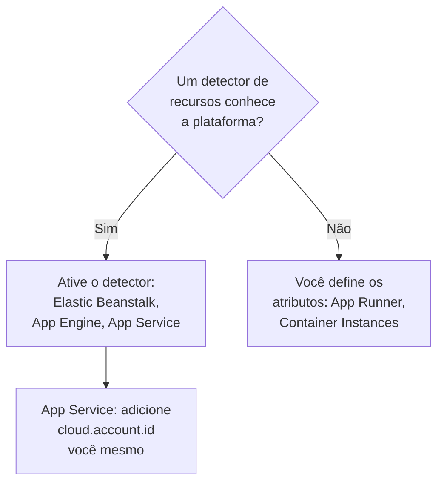

# Outras plataformas de nuvem

Configure as plataformas gerenciadas que não têm página própria: AWS Elastic Beanstalk, AWS App Runner, Google App Engine, Azure App Service e Azure Container Instances. A regra é a mesma de toda plataforma: a telemetria que traz um `cloud.platform` gerenciado, com `cloud.account.id` e `cloud.region`, entra em um **Cloud Environment** por plataforma, conta e região, e uma identidade de instância dá a cada instância em execução uma linha em **Instâncias**.

:::cards
- [AWS Elastic Beanstalk](#aws-elastic-beanstalk): Um coletor em cada instância, com os detectores do Beanstalk e do EC2.
- [AWS App Runner](#aws-app-runner): Os atributos definidos à mão, o token vindo do Secrets Manager.
- [Google App Engine](#google-app-engine): O detector do GCP, com as configurações em `app.yaml`.
- [Azure App Service](#azure-app-service): Os detectores do Azure, uma referência ao Key Vault e a assinatura à mão.
- [Azure Container Instances](#azure-container-instances): Os atributos definidos à mão, o token como variável segura.
:::

## O que cada plataforma precisa

O que muda entre essas plataformas é quem define os atributos `cloud.*`, e onde as configurações ficam no console da nuvem:



| Plataforma | `cloud.platform` | `cloud.*` preenchidos por | Identidade da instância |
| ------------------------- | --------------------------- | ------------------------------------------------------------------------------------------ | ----------------------------------------------------------- |
| AWS Elastic Beanstalk | `aws_elastic_beanstalk` | Os detectores `elastic_beanstalk` e `ec2` do Collector; `aws` no Node.js | `host.id` (remova o `service.instance.id` da implantação) |
| AWS App Runner | `aws_app_runner` | Você (nenhum detector) | `host.name` |
| Google App Engine | `gcp_app_engine` | O detector `gcp` (o do Collector e o de cada SDK) | `faas.instance` |
| Azure App Service | `azure_app_service` | O `azureappservice` do Collector, os detectores `azure` de Node.js e .NET; `cloud.account.id` por você | `service.instance.id`, depois `host.id` |
| Azure Container Instances | `azure_container_instances` | Você (nenhum detector) | `host.name` |

Cada seção abaixo precisa de uma chave de ingestão **Servidor** de **Configurações do projeto → Telemetria e APM → Chaves de ingestão**, e de uma aplicação instrumentada com um SDK do OpenTelemetry. Se você hospeda o OneUptime por conta própria, substitua `https://oneuptime.com/otlp` por `https://YOUR-ONEUPTIME-HOST/otlp`.

> [!IMPORTANT]
> O token é um segredo em todas essas plataformas. Cada seção indica o repositório de segredos da plataforma. Um token digitado em uma variável de ambiente comum pode ser lido por qualquer pessoa que consiga ler a configuração do app.

## AWS Elastic Beanstalk

`cloud.platform`: `aws_elastic_beanstalk`. O detector do Beanstalk lê `/var/elasticbeanstalk/xray/environment.conf` na instância e define `cloud.platform`, `service.instance.id`, `service.version` e o nome do ambiente. Ele não conhece a conta nem a região, então combine-o com o detector do EC2, que as conhece e que também define `host.id`.

Rode um OpenTelemetry Collector em cada instância, com esta configuração:

```yaml title="config.yaml"
receivers:
  otlp:
    protocols:
      http:
        endpoint: 0.0.0.0:4318
      grpc:
        endpoint: 0.0.0.0:4317
processors:
  # elastic_beanstalk sets cloud.platform and service.instance.id; ec2 adds
  # cloud.account.id, cloud.region and host.id. The first detector to set an
  # attribute wins, so elastic_beanstalk comes first.
  resourcedetection:
    detectors: [env, elastic_beanstalk, ec2]
    timeout: 5s
  # The Beanstalk detector's service.instance.id is the deployment ID, shared
  # by every instance of a deployment: drop it, so that ec2's host.id names
  # each instance.
  resource:
    attributes:
      - key: service.instance.id
        action: delete
  batch: {}
exporters:
  otlphttp/oneuptime:
    endpoint: https://oneuptime.com/otlp
    headers:
      x-oneuptime-token: ${env:ONEUPTIME_TOKEN}
service:
  pipelines:
    traces:
      receivers: [otlp]
      processors: [resourcedetection, resource, batch]
      exporters: [otlphttp/oneuptime]
    metrics:
      receivers: [otlp]
      processors: [resourcedetection, resource, batch]
      exporters: [otlphttp/oneuptime]
    logs:
      receivers: [otlp]
      processors: [resourcedetection, resource, batch]
      exporters: [otlphttp/oneuptime]
```

:::steps
1. Guarde o token no Secrets Manager: `aws secretsmanager create-secret --name oneuptime/ingestion-token --secret-string "YOUR_TELEMETRY_INGESTION_TOKEN"`. As propriedades de ambiente do Beanstalk ficam na configuração do ambiente, não em um repositório de segredos, então leia o segredo a partir de um hook da plataforma, com o perfil da instância. O perfil da instância precisa de `secretsmanager:GetSecretValue` nele.
2. Instale o coletor a partir de um script `.platform/hooks/postdeploy/` (ou `.ebextensions`): o pacote `otelcol-contrib`, com a configuração acima e o segredo no ambiente dele como `ONEUPTIME_TOKEN`.
3. **AWS Console → Elastic Beanstalk → Environments → your environment → Configuration**.
4. Na categoria **Updates, monitoring, and logging**, clique em **Edit** e role até **Environment properties**. Adicione `OTEL_SERVICE_NAME`, `OTEL_EXPORTER_OTLP_ENDPOINT` definido como `http://localhost:4318`, e `OTEL_EXPORTER_OTLP_PROTOCOL` definido como `http/protobuf`.
5. Clique em **Apply**. O Beanstalk reinicia a aplicação com as novas propriedades.
:::

Aplicações Node.js podem dispensar o coletor: os detectores do SDK incluem o Beanstalk e o EC2. Defina `OTEL_EXPORTER_OTLP_ENDPOINT` como `https://oneuptime.com/otlp`, `OTEL_EXPORTER_OTLP_HEADERS` como `x-oneuptime-token=YOUR_TELEMETRY_INGESTION_TOKEN` e `OTEL_NODE_RESOURCE_DETECTORS=env,host,os,aws`. O token fica então em uma propriedade de ambiente. Confira depois os atributos de recurso de um traço: se `cloud.platform` mostrar `aws_ec2`, a sua versão do SDK deixou o detector do EC2 vencer, e o coletor é o caminho confiável.

**Rede:** instâncias em uma sub-rede privada precisam de um gateway NAT, e o grupo de segurança da instância precisa permitir saída por TCP 443 até o host do OneUptime.

## AWS App Runner

`cloud.platform`: `aws_app_runner`. Não existe detector, então você mesmo define os atributos. O App Runner consegue colocar um segredo do Secrets Manager (ou do SSM Parameter Store) em uma variável de ambiente.

```bash
OTEL_SERVICE_NAME=checkout-api
OTEL_EXPORTER_OTLP_ENDPOINT=https://oneuptime.com/otlp
OTEL_EXPORTER_OTLP_PROTOCOL=http/protobuf
# From Secrets Manager: the secret holds the whole header.
OTEL_EXPORTER_OTLP_HEADERS=x-oneuptime-token=YOUR_TELEMETRY_INGESTION_TOKEN
OTEL_RESOURCE_ATTRIBUTES=cloud.provider=aws,cloud.platform=aws_app_runner,cloud.region=us-east-1,cloud.account.id=123456789012
OTEL_NODE_RESOURCE_DETECTORS=env,host,os
```

Substitua a região e o ID da conta pelos seus. O detector `host` fornece `host.name`, o nome de host do contêiner, que é diferente para cada instância do App Runner, e o OneUptime nomeia a instância por ele.

:::steps
1. Guarde o cabeçalho completo no Secrets Manager: `aws secretsmanager create-secret --name oneuptime/otlp-headers --secret-string "x-oneuptime-token=YOUR_TELEMETRY_INGESTION_TOKEN"`. O App Runner coloca o valor do segredo na variável como está.
2. **AWS Console → App Runner → Services → your service → Configuration → Configure service** (na aba **Configuration**, clique em **Edit**).
3. Em **Environment variables**, clique em **Add environment variable** para cada valor comum acima.
4. Adicione `OTEL_EXPORTER_OTLP_HEADERS` com **Source: Secrets Manager** e o ARN do segredo. Em **Security → Instance role**, escolha uma função com `secretsmanager:GetSecretValue` no segredo: a função da instância, não a função de acesso que baixa a imagem.
5. Clique em **Save changes**. O App Runner implanta uma nova versão.
:::

**Rede:** um serviço sem conector de VPC alcança a internet diretamente. Com **Outgoing network traffic: Custom VPC**, a saída passa pela sua VPC, que precisa de um gateway NAT e de uma regra de saída no grupo de segurança para TCP 443 até o host do OneUptime.

## Google App Engine

`cloud.platform`: `gcp_app_engine`. O detector do GCP reconhece o App Engine padrão e flexível a partir de `GAE_SERVICE`, `GAE_VERSION` e `GAE_INSTANCE` e do servidor de metadados. Ele define `cloud.account.id` (o projeto), `cloud.region`, `faas.name`, `faas.version` e `faas.instance`. Como no Cloud Run, `faas.name` faz cada serviço do App Engine aparecer também em **Funções serverless**, enquanto o ambiente agrupa o projeto e a região.

| Linguagem | Ativar o detector do GCP |
| -------- | ------------------------------------------------------------------------------------------------------------------- |
| Node.js | `OTEL_NODE_RESOURCE_DETECTORS=env,host,os,gcp` |
| Python | `pip install opentelemetry-resourcedetector-gcp`, depois `OTEL_EXPERIMENTAL_RESOURCE_DETECTORS=gcp_resource_detector` |
| Java | `-Dotel.resource.providers.gcp.enabled=true` |
| Go | `go.opentelemetry.io/contrib/detectors/gcp` → `gcp.NewDetector()` |
| .NET | `OpenTelemetry.Resources.Gcp` → `.AddGcpDetector()` |

O App Engine não tem editor de variáveis de ambiente no console: elas ficam em `app.yaml`.

```yaml title="app.yaml"
runtime: nodejs22
env_variables:
  OTEL_SERVICE_NAME: checkout-api
  OTEL_EXPORTER_OTLP_ENDPOINT: https://oneuptime.com/otlp
  OTEL_EXPORTER_OTLP_PROTOCOL: http/protobuf
  OTEL_NODE_RESOURCE_DETECTORS: env,host,os,gcp
  # Do not commit the real value. Template it in CI, or read the secret at
  # start-up with the Secret Manager client instead.
  OTEL_EXPORTER_OTLP_HEADERS: x-oneuptime-token=YOUR_TELEMETRY_INGESTION_TOKEN
```

:::steps
1. Guarde o cabeçalho completo no Secret Manager: `printf '%s' "x-oneuptime-token=YOUR_TELEMETRY_INGESTION_TOKEN" | gcloud secrets create oneuptime-otlp-headers --data-file=-`. Conceda à conta de serviço do App Engine (`my-project@appspot.gserviceaccount.com`) `roles/secretmanager.secretAccessor` nele.
2. Coloque o segredo em `app.yaml` no seu pipeline de implantação, mantendo um marcador no arquivo versionado. Ou leia `projects/PROJECT_ID/secrets/oneuptime-otlp-headers/versions/latest` na inicialização e passe-o para a opção `headers` do exportador no código.
3. Implante com `gcloud app deploy`. No console, **App Engine → Versions** mostra a nova versão, e **App Engine → Services** mostra o serviço que aparece em **Funções serverless**.
:::

**Rede:** o App Engine padrão alcança a internet diretamente. As instâncias do ambiente flexível ficam em uma VPC: se a sub-rede não tem IPs externos, elas precisam do Cloud NAT, e de uma regra de firewall de saída para TCP 443 até o host do OneUptime.

## Azure App Service

`cloud.platform`: `azure_app_service`. Os detectores do Azure de Node.js e .NET, e o detector `azureappservice` do Collector, leem as variáveis `WEBSITE_*` que o App Service define. Eles preenchem `cloud.platform`, `cloud.region`, `service.instance.id` (a partir de `WEBSITE_INSTANCE_ID`), `deployment.environment` (o slot) e `host.id`. Nenhum deles define `cloud.account.id`: adicione você mesmo o ID da assinatura, ou a chave do ambiente recebe um segmento de conta vazio.

```bash
OTEL_SERVICE_NAME=checkout-api
OTEL_EXPORTER_OTLP_ENDPOINT=https://oneuptime.com/otlp
OTEL_EXPORTER_OTLP_PROTOCOL=http/protobuf
# The Key Vault reference, which resolves to the whole header.
OTEL_EXPORTER_OTLP_HEADERS=@Microsoft.KeyVault(SecretUri=https://my-vault.vault.azure.net/secrets/oneuptime-otlp-headers/)
OTEL_RESOURCE_ATTRIBUTES=cloud.account.id=00000000-0000-0000-0000-000000000000
# Node.js:
OTEL_NODE_RESOURCE_DETECTORS=env,host,os,azure
```

Os detectores dos SDKs escrevem a plataforma como `azure.app_service`, com um ponto; o OneUptime a reescreve como `azure_app_service` ao recebê-la. No .NET, adicione `OpenTelemetry.Resources.Azure` e chame `.ConfigureResource(r => r.AddAzureAppServiceDetector())`. As outras linguagens adicionam `cloud.provider=azure,cloud.platform=azure_app_service,cloud.region=<region>` a `OTEL_RESOURCE_ATTRIBUTES`, e pegam `service.instance.id` de `WEBSITE_INSTANCE_ID` no código.

:::steps
1. Ative a identidade gerenciada atribuída pelo sistema do app (**Settings → Identity**), e conceda a ela **Key Vault Secrets User** no cofre. Guarde o cabeçalho completo, `x-oneuptime-token=YOUR_TELEMETRY_INGESTION_TOKEN`, como o segredo `oneuptime-otlp-headers`.
2. **Azure portal → App Services → your app → Settings → Environment variables** (**Configuration → Application settings** em portais mais antigos).
3. Use **+ Add** para cada variável acima. O valor de `OTEL_EXPORTER_OTLP_HEADERS` é a referência ao Key Vault.
4. Clique em **Apply**, depois em **Confirm**: o app reinicia com as novas configurações. Os slots de implantação têm configurações próprias: marque o token como **deployment slot setting** se só um slot deve enviar telemetria.
:::

**Rede:** o App Service alcança a internet diretamente, a menos que a **VNet integration** com **Route All** esteja ativada. Nesse caso a VNet precisa de um gateway NAT, ou de uma rota para um firewall que permita TCP 443 até o host do OneUptime.

## Azure Container Instances

`cloud.platform`: `azure_container_instances`. Não existe detector, então você mesmo define os atributos. As variáveis de ambiente de um grupo de contêineres são fixadas na criação: mudar uma significa criar o grupo de novo. Passe o token com `--secure-environment-variables`, para que `az container show` não o retorne:

```bash
az container create \
  --resource-group my-rg \
  --name checkout-api \
  --image myregistry.azurecr.io/checkout-api:1.4.2 \
  --location eastus \
  --environment-variables \
    OTEL_SERVICE_NAME=checkout-api \
    OTEL_EXPORTER_OTLP_ENDPOINT=https://oneuptime.com/otlp \
    OTEL_EXPORTER_OTLP_PROTOCOL=http/protobuf \
    "OTEL_RESOURCE_ATTRIBUTES=cloud.provider=azure,cloud.platform=azure_container_instances,cloud.region=eastus,cloud.account.id=00000000-0000-0000-0000-000000000000" \
    OTEL_NODE_RESOURCE_DETECTORS=env,host,os \
  --secure-environment-variables \
    "OTEL_EXPORTER_OTLP_HEADERS=x-oneuptime-token=YOUR_TELEMETRY_INGESTION_TOKEN"
```

O `host.name` do detector `host`, o nome de host do grupo de contêineres, nomeia a instância. Um coletor sidecar também funciona aqui, já que um grupo de contêineres roda vários contêineres como uma tarefa do ECS: use o padrão `detectors: [env]` mais `OTEL_RESOURCE_ATTRIBUTES` de [Azure Container Apps](/docs/telemetry/cloud-azure-container-apps). É ele também que preenche os blocos **CPU** e **Memória**, se enviar `container.cpu.utilization` e `container.memory.usage` com a identidade do grupo.

:::steps
1. **Azure portal → Container Instances → + Create**. Preencha a aba **Basics**: grupo de recursos, nome, região e imagem.
2. Na aba **Advanced**, em **Environment variables**, adicione cada variável. Para `OTEL_EXPORTER_OTLP_HEADERS`, defina **Mark as secure** como **Yes**, para que o portal e a API não mostrem o valor dela.
3. Clique em **Review + create**, depois em **Create**. Para mudar uma variável depois, exclua o grupo e crie-o de novo.
:::

**Rede:** um grupo de contêineres com IP público alcança a internet diretamente. Um grupo em uma sub-rede de VNet só sai pela rota da VNet: adicione um gateway NAT, ou libere TCP 443 até o host do OneUptime no firewall ou no NSG.

## Verificar a conexão

Seja qual for a plataforma configurada, verifique primeiro o token, depois procure o ambiente:

```bash
curl -i https://oneuptime.com/otlp/v1/validate \
  -H "x-oneuptime-token: YOUR_TELEMETRY_INGESTION_TOKEN"
```

`200` com `"valid": true` significa que o token é aceito. `401` significa que ele é desconhecido, revogado, desativado ou expirado. Em um minuto após o primeiro span, log ou métrica, o ambiente aparece em **Nuvem → All Environments**, com o nome da plataforma, da região e da conta.

## Solução de problemas

:::details As instâncias do Beanstalk aparecem em Hosts
O `cloud.platform=aws_ec2` do detector do EC2 venceu. O primeiro detector que define um atributo vence, então mantenha `elastic_beanstalk` antes de `ec2` em `detectors`. Sem um coletor, o SDK do Node.js também pode favorecer o detector do EC2: rode o coletor.
:::

:::details Todas as instâncias do Beanstalk dividem uma linha em Instâncias
O `service.instance.id` do detector do Beanstalk é o ID da implantação, compartilhado por todas as instâncias de uma implantação, e é lido antes de `host.id`. Mantenha em todo pipeline o processador `resource` que o remove.
:::

:::details Um app do App Service recebe 401
A referência ao Key Vault não foi resolvida, então o App Service repassou o texto literal `@Microsoft.KeyVault(...)` como cabeçalho. Dê à identidade gerenciada do app **Key Vault Secrets User** no cofre, e confira se o segredo contém o cabeçalho completo `x-oneuptime-token=...`.
:::

:::details Um ambiente do App Service tem um segmento de conta vazio
Nenhum dos detectores do App Service define `cloud.account.id`. Adicione o ID da assinatura a `OTEL_RESOURCE_ATTRIBUTES` em todos os apps: telemetria com e sem ele cai em dois ambientes.
:::

:::details Uma variável alterada do Container Instances não tem efeito
As variáveis de ambiente de um grupo de contêineres são fixadas na criação. Exclua o grupo e crie-o de novo com os novos valores.
:::

Veja [Solução de problemas na nuvem](/docs/telemetry/cloud-troubleshooting) para o resto, em especial um ambiente que aparece em **Hosts**, só em **Funções serverless** (App Engine sem o detector do GCP), ou duas vezes (`cloud.account.id` definido em algumas implantações e em outras não).

## Próximos passos

:::cards
- [Ambientes de nuvem](/docs/telemetry/cloud-environments): Como ambientes e instâncias são identificados.
- [Solução de problemas na nuvem](/docs/telemetry/cloud-troubleshooting): As falhas que todas as plataformas compartilham.
- [Funções serverless](/docs/telemetry/serverless-functions): Lambda, Cloud Functions e Azure Functions.
- [Recursos de nuvem (IaaS e PaaS)](/docs/telemetry/cloud-resources): Os recursos em torno dos seus apps, a partir do monitoramento do seu próprio provedor de nuvem.
:::
