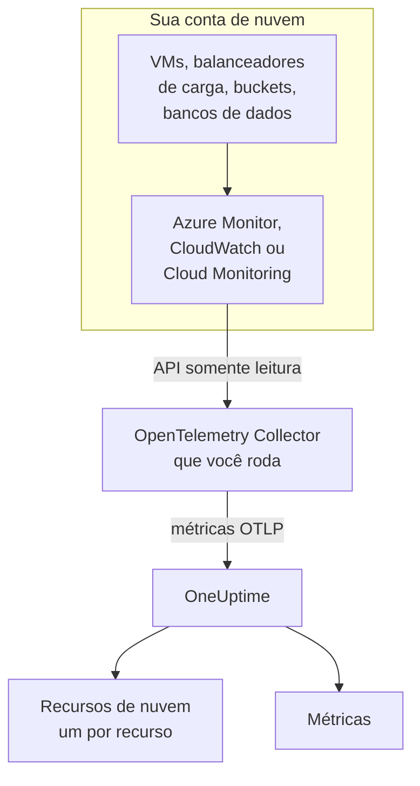
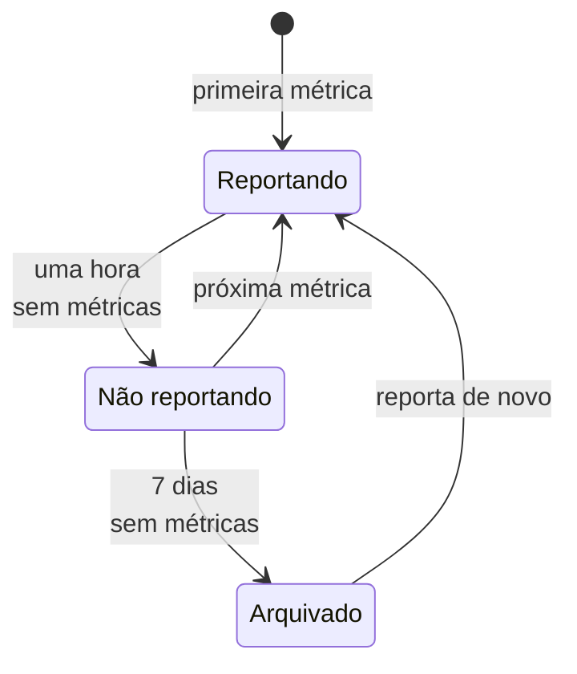

# Recursos de nuvem (IaaS e PaaS)

**Cloud Resources** lista os recursos IaaS e PaaS das suas contas AWS, Azure e Google Cloud: máquinas virtuais, discos, balanceadores de carga, buckets, bancos de dados gerenciados, caches, filas, gateways de API e o resto. Cada um ganha uma página própria, com o tipo, a região e a conta, o ID que o provedor dá a ele, todas as métricas que o provedor publica sobre ele, e proprietários e rótulos como qualquer outro recurso no OneUptime. Encontre-os em **Nuvem → Todos os recursos**.

:::cards
- [Conectar o Azure](#conectar-o-azure): Ler todos os recursos de uma assinatura a partir do Azure Monitor.
- [Conectar a AWS](#conectar-a-aws): Consultar o CloudWatch, ou recebê-lo em streaming pelo Amazon Data Firehose.
- [Conectar o Google Cloud](#conectar-o-google-cloud): Ler os serviços de um projeto a partir do Cloud Monitoring.
- [Como um recurso é identificado](#como-um-recurso-é-identificado): Todos os tipos de recurso que o OneUptime reconhece, por provedor.
:::

## Como funciona



- **O provedor já mede seus recursos.** O Azure Monitor, o Amazon CloudWatch e o Google Cloud Monitoring publicam métricas sobre cada recurso que executam para você.
- **Um coletor que você roda as lê.** Um OpenTelemetry Collector com acesso somente leitura a esse serviço de monitoramento exporta as métricas para o OneUptime. Nada é instalado nos recursos, e o OneUptime nunca guarda suas credenciais de nuvem: quem as guarda é o coletor, no seu ambiente.
- **Cada recurso aparece com sua primeira métrica.** O OneUptime descobre por cada ponto de dados a qual recurso ele se refere, e cria o recurso de nuvem na primeira vez que o vê.

Os recursos de nuvem são um dos vários lugares em que sua nuvem aparece:

| Você roda | Onde aparece | Como |
| --- | --- | --- |
| Contêineres no ECS, Cloud Run, Container Apps, App Service, … | **Nuvem → All Environments** | A própria telemetria das suas cargas de trabalho, pelo `cloud.platform` dela. Veja [Ambientes de nuvem](/docs/telemetry/cloud-environments) |
| Qualquer recurso IaaS ou PaaS que o provedor monitora | **Nuvem → Todos os recursos** | A API de monitoramento do provedor, lida por um coletor: esta página |
| Máquinas virtuais com um OpenTelemetry Collector instalado | **Hosts** | As próprias métricas e logs do host. Veja [Coletor OpenTelemetry no host](/docs/telemetry/host-otel-collector) |
| Filas e tópicos que suas aplicações usam | **Queues** | Spans, e as mesmas métricas de nuvem. Veja [Filas](/docs/telemetry/queues) |

Um recurso pode aparecer em mais de um lugar. Uma máquina virtual com o coletor instalado é um **Host**, e as métricas de plataforma dela (créditos de CPU, disco e rede como o hipervisor os vê) a tornam também um **Recurso de nuvem**. Uma fila SQS é uma **Queue** e um **Recurso de nuvem**. Cada visão mostra o que a sua fonte sabe.

## Antes de começar

- **Uma chave de ingestão.** Crie uma chave **Servidor** em **Configurações do projeto → Telemetria e APM → Chaves de ingestão**. Os coletores abaixo a leem da variável de ambiente `ONEUPTIME_TOKEN`, nunca do arquivo de configuração deles.
- **Um lugar para rodar o OpenTelemetry Collector**: a distribuição `otelcol-contrib`, imagem `otel/opentelemetry-collector-contrib`, com acesso de saída ao seu provedor de nuvem e ao OneUptime. Uma VM pequena, um contêiner ou o seu cluster Kubernetes servem, e um coletor pode ler várias contas e provedores.
- **Acesso de leitura à API de monitoramento do provedor.** A primeira etapa de cada provedor abaixo o cria.

> [!TIP]
> As mesmas etapas estão no painel, com o seu token já preenchido: em **Nuvem → Todos os recursos** até o primeiro recurso chegar, e na aba **Documentação** de cada recurso, que abre no provedor dele.

Se você hospeda o OneUptime por conta própria, substitua `https://oneuptime.com/otlp` por `https://YOUR-ONEUPTIME-HOST/otlp`.

## Conectar o Azure

O receiver `azure_monitor` lista os recursos de uma assinatura e lê as métricas de plataforma deles a cada minuto. Sem uma lista `services`, ele lê todos os tipos de recurso, então todo recurso da assinatura vira um recurso de nuvem.

:::steps
### Criar uma entidade de serviço com Monitoring Reader

**Monitoring Reader** lê métricas e lista recursos, e não pode alterar nada:

```bash
az ad sp create-for-rbac \
  --name oneuptime-cloud-collector \
  --role "Monitoring Reader" \
  --scopes /subscriptions/<SUBSCRIPTION_ID>
```

Ele imprime um `appId` (o ID do cliente), uma `password` (o segredo do cliente) e o `tenant`. Dê à mesma entidade de serviço a função em mais assinaturas para lê-las com o mesmo coletor.

### Configurar o receiver do Azure Monitor

Salve isto como `config.yaml`:

```yaml
extensions:
  azure_auth:
    service_principal:
      tenant_id: ${env:AZURE_TENANT_ID}
      client_id: ${env:AZURE_CLIENT_ID}
      client_secret: ${env:AZURE_CLIENT_SECRET}

receivers:
  azure_monitor:
    subscription_ids: ["${env:AZURE_SUBSCRIPTION_ID}"]
    auth:
      authenticator: azure_auth
    collection_interval: 60s
    # No `services` list: every resource type in the subscription.
    # Series Azure returns per metric and resource (default 10).
    maximum_number_of_records_per_resource: 50

processors:
  batch: {}

exporters:
  otlphttp/oneuptime:
    endpoint: https://oneuptime.com/otlp
    headers:
      x-oneuptime-token: ${env:ONEUPTIME_TOKEN}

service:
  extensions: [azure_auth]
  pipelines:
    metrics:
      receivers: [azure_monitor]
      processors: [batch]
      exporters: [otlphttp/oneuptime]
```

### Rodar o coletor do Azure

```bash
docker run -d --name oneuptime-cloud-collector --restart unless-stopped \
  -e ONEUPTIME_TOKEN=YOUR_TELEMETRY_INGESTION_TOKEN \
  -e AZURE_TENANT_ID=<TENANT> \
  -e AZURE_CLIENT_ID=<APP_ID> \
  -e AZURE_CLIENT_SECRET=<PASSWORD> \
  -e AZURE_SUBSCRIPTION_ID=<SUBSCRIPTION_ID> \
  -v "$(pwd)/config.yaml:/etc/otelcol-contrib/config.yaml" \
  otel/opentelemetry-collector-contrib:latest
```

Os recursos aparecem em **Nuvem → Todos os recursos** em poucos minutos.
:::

Opções do receiver `azure_monitor`:

| Opção | O que faz |
| --- | --- |
| `resource_groups`, `services`, `resource_tags` | Ler menos: uma lista de grupos de recursos, de tipos do Resource Manager (`Microsoft.Compute/virtualMachines`), ou de tags que um recurso precisa ter |
| `metrics` | Limita cada tipo de recurso às métricas e agregações que você listar. Depois que um tipo é listado, só as métricas listadas dele são lidas |
| `discover_subscriptions: true` | Lê todas as assinaturas que a entidade de serviço consegue ver, em vez de `subscription_ids` |
| `maximum_number_of_records_per_resource` | Quantas séries o Azure retorna por métrica e recurso (10 por padrão). Aumente quando uma métrica se divide por uma dimensão com muitos valores |
| `use_batch_api: true` | Para assinaturas grandes. O receiver faz uma chamada ao Resource Manager por recurso e lote de 20 métricas, e o Resource Manager permite cerca de 12.000 leituras por hora; a API em lote lê até 50 recursos por chamada do plano de dados do Azure Monitor, cujo limite é muito maior |
| `cache_resources` | Com que frequência, em segundos, o receiver lista os recursos: uma vez por dia por padrão. Um recurso criado depois que o coletor iniciou pode levar até um dia para aparecer; reinicie o coletor para listá-los na hora |

## Conectar a AWS

As métricas do CloudWatch chegam ao OneUptime de uma de duas formas:

| | Polling | Metric Streams |
| --- | --- | --- |
| Como | O receiver `aws_cloudwatch` do coletor consulta o CloudWatch | O CloudWatch envia pelo Amazon Data Firehose ao receiver `awsfirehose` do coletor |
| Precisa do lado da AWS | Só as credenciais | Um stream do Firehose e um metric stream em cada região |
| O coletor precisa ser alcançável pela AWS | Não | Sim, por HTTPS na porta 443 |
| Atraso | De 10 a 20 minutos | Poucos minutos |
| Indicado para | A maioria das contas | Contas grandes |

### Polling com o receiver aws_cloudwatch

:::steps
#### Permitir que o coletor leia o CloudWatch

Anexe esta política à função com que o coletor roda (um perfil de instância do EC2, uma função de tarefa do ECS, uma conta de serviço do EKS), ou a um usuário do IAM cujas chaves de acesso você entrega a ele:

```json
{
  "Version": "2012-10-17",
  "Statement": [
    {
      "Effect": "Allow",
      "Action": [
        "cloudwatch:ListMetrics",
        "cloudwatch:GetMetricData",
        "sts:GetCallerIdentity"
      ],
      "Resource": "*"
    }
  ]
}
```

`sts:GetCallerIdentity` permite que o receiver informe o ID da conta, de que o ARN de cada recurso precisa.

#### Configurar os receivers do CloudWatch

Um receiver lê um namespace em uma região, então adicione um para cada namespace e região que você quer. Este exemplo lê os mais comuns; salve-o como `config.yaml`:

```yaml
receivers:
  aws_cloudwatch/ec2:
    region: ${env:AWS_REGION}
    metrics:
      collection_interval: 5m
      period: 5m
      delay: 10m
      discovery:
        filters:
          namespace: AWS/EC2
        # Metrics read per scrape, at most. Each costs 4 GetMetricData queries.
        limit: 1000
  aws_cloudwatch/ebs:
    region: ${env:AWS_REGION}
    metrics:
      collection_interval: 5m
      period: 5m
      delay: 10m
      discovery:
        filters:
          namespace: AWS/EBS
        # Metrics read per scrape, at most. Each costs 4 GetMetricData queries.
        limit: 1000
  aws_cloudwatch/applicationelb:
    region: ${env:AWS_REGION}
    metrics:
      collection_interval: 5m
      period: 5m
      delay: 10m
      discovery:
        filters:
          namespace: AWS/ApplicationELB
        # Metrics read per scrape, at most. Each costs 4 GetMetricData queries.
        limit: 1000
  aws_cloudwatch/rds:
    region: ${env:AWS_REGION}
    metrics:
      collection_interval: 5m
      period: 5m
      delay: 10m
      discovery:
        filters:
          namespace: AWS/RDS
        # Metrics read per scrape, at most. Each costs 4 GetMetricData queries.
        limit: 1000
  aws_cloudwatch/lambda:
    region: ${env:AWS_REGION}
    metrics:
      collection_interval: 5m
      period: 5m
      delay: 10m
      discovery:
        filters:
          namespace: AWS/Lambda
        # Metrics read per scrape, at most. Each costs 4 GetMetricData queries.
        limit: 1000
  aws_cloudwatch/dynamodb:
    region: ${env:AWS_REGION}
    metrics:
      collection_interval: 5m
      period: 5m
      delay: 10m
      discovery:
        filters:
          namespace: AWS/DynamoDB
        # Metrics read per scrape, at most. Each costs 4 GetMetricData queries.
        limit: 1000

processors:
  batch: {}

exporters:
  otlphttp/oneuptime:
    endpoint: https://oneuptime.com/otlp
    headers:
      x-oneuptime-token: ${env:ONEUPTIME_TOKEN}

service:
  pipelines:
    metrics:
      receivers: [aws_cloudwatch/ec2, aws_cloudwatch/ebs, aws_cloudwatch/applicationelb, aws_cloudwatch/rds, aws_cloudwatch/lambda, aws_cloudwatch/dynamodb]
      processors: [batch]
      exporters: [otlphttp/oneuptime]
```

#### Rodar o coletor do CloudWatch

```bash
docker run -d --name oneuptime-cloud-collector --restart unless-stopped \
  -e ONEUPTIME_TOKEN=YOUR_TELEMETRY_INGESTION_TOKEN \
  -e AWS_REGION=us-east-1 \
  -e AWS_ACCESS_KEY_ID=<ACCESS_KEY_ID> \
  -e AWS_SECRET_ACCESS_KEY=<SECRET_ACCESS_KEY> \
  -v "$(pwd)/config.yaml:/etc/otelcol-contrib/config.yaml" \
  otel/opentelemetry-collector-contrib:latest
```

Em uma instância do EC2, tarefa do ECS ou pod do EKS que tenha a função, deixe de fora as duas variáveis de chave.
:::

- **Deixe `stats` sem definir.** Cada métrica é então lida como um resumo por período: quatro estatísticas, quatro consultas `GetMetricData`, e a AWS cobra `GetMetricData` por métrica solicitada. `discovery.limit` limita as métricas que um receiver lê por coleta (defina-o: o padrão do próprio receiver é 100), e um `collection_interval` mais longo as lê com menos frequência.
- **Os dados chegam atrasados.** `delay` espera o CloudWatch publicar um período, então os pontos de dados chegam de 10 a 20 minutos depois do momento que medem, e os recursos aparecem em cerca de vinte minutos.

### Streaming com CloudWatch Metric Streams

:::steps
#### Configurar o receiver do Firehose

O coletor precisa de um certificado para o endereço dele: o Firehose só entrega para `https://` na porta 443. Salve isto como `config.yaml`:

```yaml
extensions:
  awscloudwatchmetricstreams_encoding:
    format: opentelemetry1.0

receivers:
  awsfirehose:
    # Firehose delivers to HTTPS on port 443 only: expose this port as
    # 443, for example behind a load balancer.
    endpoint: 0.0.0.0:4433
    encoding: awscloudwatchmetricstreams_encoding
    access_key: ${env:FIREHOSE_ACCESS_KEY}
    tls:
      cert_file: /etc/otelcol-contrib/tls/server.crt
      key_file: /etc/otelcol-contrib/tls/server.key

processors:
  batch: {}

exporters:
  otlphttp/oneuptime:
    endpoint: https://oneuptime.com/otlp
    headers:
      x-oneuptime-token: ${env:ONEUPTIME_TOKEN}

service:
  extensions: [awscloudwatchmetricstreams_encoding]
  pipelines:
    metrics:
      receivers: [awsfirehose]
      processors: [batch]
      exporters: [otlphttp/oneuptime]
```

#### Rodar o coletor do Firehose

```bash
docker run -d --name oneuptime-cloud-collector --restart unless-stopped \
  -e ONEUPTIME_TOKEN=YOUR_TELEMETRY_INGESTION_TOKEN \
  -e FIREHOSE_ACCESS_KEY=<A_LONG_RANDOM_SECRET> \
  -p 4433:4433 \
  -v "$(pwd)/tls:/etc/otelcol-contrib/tls:ro" \
  -v "$(pwd)/config.yaml:/etc/otelcol-contrib/config.yaml" \
  otel/opentelemetry-collector-contrib:latest
```

O certificado e a chave dele vão em `tls/`, como `server.crt` e `server.key`. Publique a porta 4433 atrás de algo que responda na 443, como um balanceador de carga.

#### Criar o stream do Firehose e o metric stream

1. **Amazon Data Firehose → Create Firehose stream**: origem **Direct PUT**, destino **HTTP Endpoint**. A URL do endpoint é o endereço `https://` do coletor; a chave de acesso é `FIREHOSE_ACCESS_KEY`. Escolha ou crie um bucket S3 para as entregas que falharem.
2. **CloudWatch → Metrics → Streams → Create metric stream**: os namespaces a incluir (ou todos), o stream do Firehose e o formato de saída **OpenTelemetry 1.0**.
3. Repita em cada região: um metric stream transporta as métricas da própria região.
:::

A AWS cobra um metric stream por atualização de métrica entregue, mais as tarifas de dados do Firehose, então inclua só os namespaces que você quer. Um stream no formato **JSON** (`format: json` na extensão de codificação) nomeia os mesmos recursos, mas também escreve cada namespace em `service.name`, então todo namespace aparece também em **Serviços**: prefira **OpenTelemetry 1.0**.

## Conectar o Google Cloud

O receiver `googlecloudmonitoring` lê os tipos de métrica que o `metrics_list` dele nomeia, para um projeto.

:::steps
### Criar uma conta de serviço com Monitoring Viewer

**Monitoring Viewer** lê métricas, e não pode alterar nada:

```bash
gcloud iam service-accounts create oneuptime-cloud-collector \
  --project <PROJECT_ID>

gcloud projects add-iam-policy-binding <PROJECT_ID> \
  --member "serviceAccount:oneuptime-cloud-collector@<PROJECT_ID>.iam.gserviceaccount.com" \
  --role roles/monitoring.viewer

gcloud iam service-accounts keys create key.json \
  --iam-account oneuptime-cloud-collector@<PROJECT_ID>.iam.gserviceaccount.com
```

No próprio Google Cloud, rode o coletor como essa conta de serviço em vez de criar uma chave.

### Configurar o receiver do Cloud Monitoring

Cada filtro lê todos os tipos de métrica de um serviço. Salve isto como `config.yaml`:

```yaml
receivers:
  googlecloudmonitoring:
    project_id: ${env:GCP_PROJECT_ID}
    collection_interval: 2m
    # Only the metric types these filters list are read.
    metrics_list:
      - metric_descriptor_filter: 'metric.type = starts_with("compute.googleapis.com/")'
      - metric_descriptor_filter: 'metric.type = starts_with("cloudsql.googleapis.com/")'
      - metric_descriptor_filter: 'metric.type = starts_with("loadbalancing.googleapis.com/")'
      - metric_descriptor_filter: 'metric.type = starts_with("storage.googleapis.com/")'
      - metric_descriptor_filter: 'metric.type = starts_with("redis.googleapis.com/")'
      - metric_descriptor_filter: 'metric.type = starts_with("run.googleapis.com/")'

processors:
  batch: {}

exporters:
  otlphttp/oneuptime:
    endpoint: https://oneuptime.com/otlp
    headers:
      x-oneuptime-token: ${env:ONEUPTIME_TOKEN}

service:
  pipelines:
    metrics:
      receivers: [googlecloudmonitoring]
      processors: [batch]
      exporters: [otlphttp/oneuptime]
```

### Rodar o coletor do Google Cloud

```bash
docker run -d --name oneuptime-cloud-collector --restart unless-stopped \
  -e ONEUPTIME_TOKEN=YOUR_TELEMETRY_INGESTION_TOKEN \
  -e GCP_PROJECT_ID=<PROJECT_ID> \
  -e GOOGLE_APPLICATION_CREDENTIALS=/etc/otelcol-contrib/key.json \
  -v "$(pwd)/key.json:/etc/otelcol-contrib/key.json:ro" \
  -v "$(pwd)/config.yaml:/etc/otelcol-contrib/config.yaml" \
  otel/opentelemetry-collector-contrib:latest
```
:::

- **A lista é lida quando o coletor inicia:** reinicie-o depois de uma mudança. `metric_name: compute.googleapis.com/instance/cpu/utilization` lê um só tipo em vez de todos os tipos de um serviço.
- **Um receiver lê um projeto:** adicione um por projeto.
- **A leitura tem um custo e uma cota.** Cada tipo de métrica é uma leitura da API do Cloud Monitoring por intervalo de coleta. Ler as métricas do próprio Google Cloud é gratuito dentro da franquia mensal da API; um `collection_interval` mais longo mantém um projeto grande dentro dela, e dentro da cota por minuto.

## Manter o pipeline sem detecção de recursos

> [!WARNING]
> Não adicione o processador `resourcedetection` ao pipeline que lê o monitoramento da nuvem. Ele carimba o `host.name` e o `os.type` da própria máquina do coletor em cada ponto de dados, e o OneUptime então arquiva as métricas da sua nuvem também sob essa máquina em **Hosts**. Um coletor que também monitora o próprio host deve fazer isso em um pipeline separado.

## Como um recurso é identificado

Cada ponto de dados desses receivers nomeia um recurso, e o OneUptime associa o recurso de nuvem à identidade desse recurso, nunca ao nome dele, que você pode mudar. A identidade é comparada sem diferenciar maiúsculas de minúsculas, então um recurso informado com duas grafias é um recurso só.

### Azure

Cada ponto de dados traz o ID de recurso do Azure do seu recurso (`azuremonitor.resource_id`), então todo recurso que o receiver lê vira um recurso de nuvem: os tipos abaixo com um nome amigável, qualquer outro com o tipo do Resource Manager dele. O ID do recurso, a região, a assinatura e o grupo de recursos aparecem todos no recurso.

:::details Os tipos de recurso do Azure com um nome amigável
| Tipo de recurso | Mostrado como | Modelo |
| --- | --- | --- |
| `Microsoft.Compute/virtualMachines` | Virtual Machine | IaaS |
| `Microsoft.Compute/virtualMachineScaleSets` | Virtual Machine Scale Set | IaaS |
| `Microsoft.Compute/disks` | Managed Disk | IaaS |
| `Microsoft.Network/loadBalancers` | Load Balancer | IaaS |
| `Microsoft.Network/applicationGateways` | Application Gateway | IaaS |
| `Microsoft.Network/publicIPAddresses` | Public IP Address | IaaS |
| `Microsoft.Network/natGateways` | NAT Gateway | IaaS |
| `Microsoft.Network/virtualNetworkGateways` | Virtual Network Gateway | IaaS |
| `Microsoft.Network/expressRouteCircuits` | ExpressRoute Circuit | IaaS |
| `Microsoft.Network/azureFirewalls` | Azure Firewall | IaaS |
| `Microsoft.Network/frontdoors` | Front Door (classic) | IaaS |
| `Microsoft.Cdn/profiles` | Front Door and CDN Profile | IaaS |
| `Microsoft.Network/trafficmanagerprofiles` | Traffic Manager Profile | IaaS |
| `Microsoft.Network/networkInterfaces` | Network Interface | IaaS |
| `Microsoft.Network/virtualNetworks` | Virtual Network | IaaS |
| `Microsoft.Network/privateEndpoints` | Private Endpoint | IaaS |
| `Microsoft.Network/dnszones` | DNS Zone | IaaS |
| `Microsoft.Network/bastionHosts` | Bastion | IaaS |
| `Microsoft.Storage/storageAccounts` | Storage Account | IaaS |
| `Microsoft.RecoveryServices/vaults` | Recovery Services Vault | PaaS |
| `Microsoft.Web/sites` | App Service or Function App | PaaS |
| `Microsoft.Web/serverfarms` | App Service Plan | PaaS |
| `Microsoft.Web/staticSites` | Static Web App | PaaS |
| `Microsoft.App/containerApps` | Container App | PaaS |
| `Microsoft.App/managedEnvironments` | Container Apps Environment | PaaS |
| `Microsoft.ContainerInstance/containerGroups` | Container Instance | PaaS |
| `Microsoft.ContainerService/managedClusters` | AKS Cluster | PaaS |
| `Microsoft.ContainerRegistry/registries` | Container Registry | PaaS |
| `Microsoft.SignalRService/SignalR` | SignalR Service | PaaS |
| `Microsoft.Sql/servers/databases` | SQL Database | PaaS |
| `Microsoft.Sql/servers/elasticpools` | SQL Elastic Pool | PaaS |
| `Microsoft.Sql/managedInstances` | SQL Managed Instance | PaaS |
| `Microsoft.DBforPostgreSQL/flexibleServers` | PostgreSQL Flexible Server | PaaS |
| `Microsoft.DBforMySQL/flexibleServers` | MySQL Flexible Server | PaaS |
| `Microsoft.DocumentDB/databaseAccounts` | Cosmos DB Account | PaaS |
| `Microsoft.Cache/redis` | Azure Cache for Redis | PaaS |
| `Microsoft.Cache/redisEnterprise` | Azure Managed Redis | PaaS |
| `Microsoft.ServiceBus/namespaces` | Service Bus Namespace | PaaS |
| `Microsoft.EventHub/namespaces` | Event Hubs Namespace | PaaS |
| `Microsoft.EventGrid/topics` | Event Grid Topic | PaaS |
| `Microsoft.EventGrid/systemTopics` | Event Grid System Topic | PaaS |
| `Microsoft.EventGrid/namespaces` | Event Grid Namespace | PaaS |
| `Microsoft.ApiManagement/service` | API Management | PaaS |
| `Microsoft.Logic/workflows` | Logic App | PaaS |
| `Microsoft.DataFactory/factories` | Data Factory | PaaS |
| `Microsoft.Synapse/workspaces` | Synapse Workspace | PaaS |
| `Microsoft.Kusto/clusters` | Data Explorer Cluster | PaaS |
| `Microsoft.StreamAnalytics/streamingjobs` | Stream Analytics Job | PaaS |
| `Microsoft.CognitiveServices/accounts` | Azure AI Services or OpenAI | PaaS |
| `Microsoft.Search/searchServices` | AI Search Service | PaaS |
| `Microsoft.MachineLearningServices/workspaces` | Machine Learning Workspace | PaaS |
| `Microsoft.KeyVault/vaults` | Key Vault | PaaS |
| `Microsoft.Insights/components` | Application Insights | PaaS |
| `Microsoft.OperationalInsights/workspaces` | Log Analytics Workspace | PaaS |
| `Microsoft.Automation/automationAccounts` | Automation Account | PaaS |
| `Microsoft.Devices/IotHubs` | IoT Hub | PaaS |
:::

### AWS

Uma métrica do CloudWatch nomeia o recurso dela em uma dimensão que depende do namespace. Um ponto de dados que traz as dimensões em **Identificado por** é desse recurso, junto com a conta e a região dele; dimensões extras estreitam a série, não o recurso (as séries por grupo de destino de um Application Load Balancer são do balanceador de carga). Um ponto de dados agregado sobre outra coisa (`InstanceType`, `DatabaseClass`, um total da conta inteira) não nomeia nenhum recurso e não é descoberto. Nem um namespace que não está listado: as métricas dele ainda chegam a **Métricas**.

Cada recurso é mostrado com o ARN dele quando as métricas o nomeiam por completo; quando não nomeiam (o ARN de um grupo do Auto Scaling traz um UUID que nenhuma métrica informa), com o namespace e as dimensões dele.

:::details Os namespaces do CloudWatch e as dimensões que identificam um recurso
| Namespace | Identificado por | Mostrado como | Tipo de recurso | Modelo |
| --- | --- | --- | --- | --- |
| `AWS/EC2` | `InstanceId` | EC2 Instance | `AWS::EC2::Instance` | IaaS |
| `AWS/EC2` | `AutoScalingGroupName` (without `InstanceId`) | Auto Scaling Group | `AWS::AutoScaling::AutoScalingGroup` | IaaS |
| `AWS/AutoScaling` | `AutoScalingGroupName` | Auto Scaling Group | `AWS::AutoScaling::AutoScalingGroup` | IaaS |
| `AWS/EBS` | `VolumeId` | EBS Volume | `AWS::EC2::Volume` | IaaS |
| `AWS/ELB` | `LoadBalancerName` | Classic Load Balancer | `AWS::ElasticLoadBalancing::LoadBalancer` | IaaS |
| `AWS/ApplicationELB` | `LoadBalancer` | Elastic Load Balancer (ALB, NLB, GWLB) | `AWS::ElasticLoadBalancingV2::LoadBalancer` | IaaS |
| `AWS/NetworkELB` | `LoadBalancer` | Elastic Load Balancer (ALB, NLB, GWLB) | `AWS::ElasticLoadBalancingV2::LoadBalancer` | IaaS |
| `AWS/GatewayELB` | `LoadBalancer` | Elastic Load Balancer (ALB, NLB, GWLB) | `AWS::ElasticLoadBalancingV2::LoadBalancer` | IaaS |
| `AWS/NATGateway` | `NatGatewayId` | NAT Gateway | `AWS::EC2::NatGateway` | IaaS |
| `AWS/TransitGateway` | `TransitGateway` | Transit Gateway | `AWS::EC2::TransitGateway` | IaaS |
| `AWS/VPN` | `VpnId` | Site-to-Site VPN Connection | `AWS::EC2::VPNConnection` | IaaS |
| `AWS/DX` | `ConnectionId` | Direct Connect Connection | `AWS::DirectConnect::Connection` | IaaS |
| `AWS/CloudFront` | `DistributionId` | CloudFront Distribution | `AWS::CloudFront::Distribution` | IaaS |
| `AWS/GlobalAccelerator` | `Accelerator` (without `Listener`, `EndpointGroup`) | Global Accelerator | `AWS::GlobalAccelerator::Accelerator` | IaaS |
| `AWS/Route53` | `HealthCheckId` | Route 53 Health Check | `AWS::Route53::HealthCheck` | IaaS |
| `AWS/NetworkFirewall` | `FirewallName` | Network Firewall | `AWS::NetworkFirewall::Firewall` | IaaS |
| `AWS/WAFV2` | `WebACL` (without `Rule`, `RuleGroup`) | WAF Web ACL | `AWS::WAFv2::WebACL` | PaaS |
| `AWS/S3` | `BucketName` | S3 Bucket | `AWS::S3::Bucket` | IaaS |
| `AWS/EFS` | `FileSystemId` | EFS File System | `AWS::EFS::FileSystem` | IaaS |
| `AWS/FSx` | `FileSystemId` | FSx File System | `AWS::FSx::FileSystem` | IaaS |
| `AWS/ECS` | `ClusterName` + `ServiceName` | ECS Service | `AWS::ECS::Service` | PaaS |
| `AWS/ECS` | `ClusterName` (without `ServiceName`) | ECS Cluster | `AWS::ECS::Cluster` | PaaS |
| `AWS/AppRunner` | `ServiceName` | App Runner Service | `AWS::AppRunner::Service` | PaaS |
| `AWS/ElasticBeanstalk` | `EnvironmentName` | Elastic Beanstalk Environment | `AWS::ElasticBeanstalk::Environment` | PaaS |
| `AWS/Lambda` | `FunctionName` | Lambda Function | `AWS::Lambda::Function` | PaaS |
| `AWS/States` | `StateMachineArn` | Step Functions State Machine | `AWS::StepFunctions::StateMachine` | PaaS |
| `AWS/RDS` | `DBInstanceIdentifier` | RDS DB Instance | `AWS::RDS::DBInstance` | PaaS |
| `AWS/RDS` | `DBClusterIdentifier` (without `DBInstanceIdentifier`) | Aurora / RDS DB Cluster | `AWS::RDS::DBCluster` | PaaS |
| `AWS/DocDB` | `DBInstanceIdentifier` | DocumentDB Instance | `AWS::DocDB::DBInstance` | PaaS |
| `AWS/DocDB` | `DBClusterIdentifier` (without `DBInstanceIdentifier`) | DocumentDB Cluster | `AWS::DocDB::DBCluster` | PaaS |
| `AWS/Neptune` | `DBInstanceIdentifier` | Neptune Instance | `AWS::Neptune::DBInstance` | PaaS |
| `AWS/Neptune` | `DBClusterIdentifier` (without `DBInstanceIdentifier`) | Neptune Cluster | `AWS::Neptune::DBCluster` | PaaS |
| `AWS/DynamoDB` | `TableName` | DynamoDB Table | `AWS::DynamoDB::Table` | PaaS |
| `AWS/ElastiCache` | `CacheClusterId` | ElastiCache Cluster | `AWS::ElastiCache::CacheCluster` | PaaS |
| `AWS/ElastiCache` | `ReplicationGroupId` (without `CacheClusterId`) | ElastiCache Replication Group | `AWS::ElastiCache::ReplicationGroup` | PaaS |
| `AWS/ElastiCache` | `clusterId` (without `CacheClusterId`) | ElastiCache Serverless Cache | `AWS::ElastiCache::ServerlessCache` | PaaS |
| `AWS/MemoryDB` | `ClusterName` | MemoryDB Cluster | `AWS::MemoryDB::Cluster` | PaaS |
| `AWS/Redshift` | `ClusterIdentifier` | Redshift Cluster | `AWS::Redshift::Cluster` | PaaS |
| `AWS/ES` | `DomainName` | OpenSearch Domain | `AWS::OpenSearchService::Domain` | PaaS |
| `AWS/SQS` | `QueueName` | SQS Queue | `AWS::SQS::Queue` | PaaS |
| `AWS/SNS` | `TopicName` | SNS Topic | `AWS::SNS::Topic` | PaaS |
| `AWS/Kinesis` | `StreamName` | Kinesis Data Stream | `AWS::Kinesis::Stream` | PaaS |
| `AWS/Firehose` | `DeliveryStreamName` | Data Firehose Stream | `AWS::KinesisFirehose::DeliveryStream` | PaaS |
| `AWS/AmazonMQ` | `Broker` | Amazon MQ Broker | `AWS::AmazonMQ::Broker` | PaaS |
| `AWS/Kafka` | `Cluster Name` | MSK Cluster | `AWS::MSK::Cluster` | PaaS |
| `AWS/Events` | `RuleName` | EventBridge Rule | `AWS::Events::Rule` | PaaS |
| `AWS/ApiGateway` | `ApiName` | API Gateway REST API | `AWS::ApiGateway::RestApi` | PaaS |
| `AWS/ApiGateway` | `ApiId` (without `ApiName`) | API Gateway HTTP or WebSocket API | `AWS::ApiGatewayV2::Api` | PaaS |
| `AWS/AppSync` | `GraphQLAPIId` | AppSync GraphQL API | `AWS::AppSync::GraphQLApi` | PaaS |
| `AWS/CertificateManager` | `CertificateArn` | ACM Certificate | `AWS::CertificateManager::Certificate` | PaaS |
| `AWS/KMS` | `KeyId` | KMS Key | `AWS::KMS::Key` | PaaS |
| `AWS/Cognito` | `UserPool` | Cognito User Pool | `AWS::Cognito::UserPool` | PaaS |
| `AWS/SageMaker` | `EndpointName` | SageMaker Endpoint | `AWS::SageMaker::Endpoint` | PaaS |
| `AWS/Logs` | `LogGroupName` | CloudWatch Log Group | `AWS::Logs::LogGroup` | PaaS |
:::

### Google Cloud

O Cloud Monitoring nomeia o recurso monitorado de cada métrica com um tipo e rótulos. Um ponto de dados de um tipo abaixo é desse recurso, identificado pelos rótulos listados; os outros rótulos do recurso, e os rótulos de metadados dele, nunca o dividem. Os tipos do Kubernetes (`k8s_container`, `k8s_pod`, …) ficam para o produto [Kubernetes](/docs/telemetry/kubernetes-agent).

:::details Os tipos de recurso do Cloud Monitoring e os rótulos que os identificam
| Tipo de recurso monitorado | Identificado por | Mostrado como | Modelo |
| --- | --- | --- | --- |
| `gce_instance` | `project_id`, `zone`, `instance_id` | Compute Engine VM Instance | IaaS |
| `instance_group` | `project_id`, `location`, `instance_group_id` | Instance Group | IaaS |
| `gcs_bucket` | `project_id`, `bucket_name` | Cloud Storage Bucket | IaaS |
| `filestore_instance` | `project_id`, `location`, `instance_name` | Filestore Instance | IaaS |
| `https_lb_rule` | `project_id`, `url_map_name` | External Application Load Balancer | IaaS |
| `internal_http_lb_rule` | `project_id`, `region`, `url_map_name` | Internal Application Load Balancer | IaaS |
| `vpn_gateway` | `project_id`, `region`, `gateway_id` | Cloud VPN Gateway | IaaS |
| `nat_gateway` | `project_id`, `region`, `router_id`, `gateway_name` | Cloud NAT Gateway | IaaS |
| `gce_router` | `project_id`, `region`, `router_id` | Cloud Router | IaaS |
| `cloudsql_database` | `project_id`, `database_id` | Cloud SQL Instance | PaaS |
| `alloydb.googleapis.com/Instance` | `resource_container`, `location`, `cluster_id`, `instance_id` | AlloyDB Instance | PaaS |
| `redis_instance` | `project_id`, `region`, `instance_id` | Memorystore for Redis Instance | PaaS |
| `spanner_instance` | `project_id`, `instance_id` | Spanner Instance | PaaS |
| `bigtable_table` | `project_id`, `instance` | Bigtable Instance | PaaS |
| `bigquery_dataset` | `project_id`, `dataset_id` | BigQuery Dataset | PaaS |
| `cloud_function` | `project_id`, `region`, `function_name` | Cloud Run Function | PaaS |
| `cloud_run_revision` | `project_id`, `location`, `service_name` | Cloud Run Service | PaaS |
| `cloud_run_job` | `project_id`, `location`, `job_name` | Cloud Run Job | PaaS |
| `gae_app` | `project_id`, `module_id` | App Engine Service | PaaS |
| `pubsub_topic` | `project_id`, `topic_id` | Pub/Sub Topic | PaaS |
| `pubsub_subscription` | `project_id`, `subscription_id` | Pub/Sub Subscription | PaaS |
| `cloud_tasks_queue` | `project_id`, `location`, `queue_id` | Cloud Tasks Queue | PaaS |
| `cloud_composer_environment` | `project_id`, `location`, `environment_name` | Cloud Composer Environment | PaaS |
| `dataproc_cluster` | `project_id`, `region`, `cluster_name` | Dataproc Cluster | PaaS |
| `aiplatform.googleapis.com/Endpoint` | `resource_container`, `location`, `endpoint_id` | Vertex AI Endpoint | PaaS |
:::

### Nomes

Um recurso recebe o nome que o provedor dá a ele (`vm-prod-01`, `checkout`, `orders`). Os nomes são únicos dentro de um projeto, e os do provedor não: duas assinaturas têm cada uma um `web-01`, e um plano do App Service e o app dele se chamam ambos `checkout`. Por isso, um recurso cujo nome já está em uso recebe um nome com o tipo, depois o grupo de recursos ou a região, depois a conta: `web-01 (Virtual Machine, rg-prod)`. Renomeie qualquer recurso na aba **Configurações** dele: as métricas são associadas pela identidade, não pelo nome.

## Status, arquivamento e limites



- **Reportando** significa que o provedor enviou uma métrica sobre o recurso na última hora; depois de uma hora sem nenhuma, ele mostra **Não reportando**. Alguns recursos são silenciosos por natureza, como um Key Vault que ninguém chamou ou um bucket cujas métricas de armazenamento o CloudWatch publica uma vez por dia, e voltam com o próximo ponto de dados.
- Um recurso que não envia **nenhuma métrica por 7 dias** é arquivado automaticamente: uma instância que um grupo do Auto Scaling substituiu, um volume excluído, um bucket que não existe mais. Ele mantém os rótulos, os proprietários e o histórico em **Nuvem → Avançado → Arquivado**, e é restaurado sozinho assim que reportar de novo. Um recurso que você mesmo arquiva continua arquivado; um que você restaura enquanto está em silêncio fica na lista até reportar.
- Excluir um recurso que o provedor ainda informa não adianta: ele é descoberto de novo pelas próximas métricas. Arquive-o em vez disso.
- A descoberta para de criar recursos quando um projeto tem **5.000** ativos (não arquivados), e registra um aviso; recursos arquivados não contam.

Instalações auto-hospedadas podem mudar esses valores com variáveis de ambiente no app:

| Variável | Padrão | Significado |
| --- | --- | --- |
| `CLOUD_RESOURCE_AUTO_ARCHIVE_DAYS` | `7` | Dias sem métrica antes de um recurso ser arquivado (no mínimo 1) |
| `CLOUD_RESOURCE_AUTO_CREATE_BUDGET` | `5000` | Recursos ativos que um projeto pode ter antes de a descoberta parar de criar mais (`0` desliga a descoberta) |

## Alertas sobre um recurso

:::steps
1. Abra o recurso e a aba **Métricas** dele, que lista todas as métricas que o provedor informa sobre ele.
2. Abra uma métrica para vê-la em gráfico no explorador de métricas, já filtrada para o recurso.
3. Clique em **Criar monitor a partir desta visualização**: o monitor observa essa métrica para esse recurso.
:::

> [!IMPORTANT]
> O monitoramento da nuvem publica cada número minutos depois do momento que ele mede: de 10 a 20 minutos para o CloudWatch consultado como acima, poucos minutos para o Azure Monitor e o Cloud Monitoring. Ele é armazenado no momento que mede. Dê a um monitor sobre essas métricas uma janela maior que esse atraso (30 minutos para o CloudWatch, 15 para os outros), ou ele não vê dados e nunca dispara.

## Inventário e regras

- **Inventário:** os recursos de nuvem aparecem no [Inventário](/docs/inventory/overview) como itens **Recurso de nuvem**, com o ID do provedor como `cloud.resource.id` e o tipo como `cloud.resource.type`. As ferramentas de recursos do agente de IA também os listam.
- **Regras:** **Nuvem → Configurações → Regras de Rótulos** e **Regras de proprietário** se aplicam a eles como aos ambientes de nuvem.

## Solução de problemas

### Nenhum recurso aparece

1. Verifique o token: `curl -i https://oneuptime.com/otlp/v1/validate -H "x-oneuptime-token: YOUR_TELEMETRY_INGESTION_TOKEN"` precisa responder `200` com `"valid": true`.
2. Leia o log do coletor (`docker logs oneuptime-cloud-collector`). Um erro de autorização nomeia a permissão que falta: `AuthorizationFailed` (Azure: **Monitoring Reader** na assinatura), `AccessDenied` em `cloudwatch:GetMetricData` (AWS: a política acima), `PermissionDenied` (Google Cloud: **Monitoring Viewer**).
3. Procure em **Métricas** as métricas do provedor (`azure_…`, `amazonaws.com/aws/…`, `compute.googleapis.com/…`). Se elas estão lá mas nenhum recurso está, os pontos de dados não nomeiam nenhum recurso que o OneUptime reconheça: um namespace da AWS ou um tipo do Google Cloud que não está nas listas acima, ou um ponto de dados agregado sobre algo que não é um recurso.
4. Espere pelos dados atrasados: o CloudWatch consultado como acima está de 10 a 20 minutos atrás.

### Falta um recurso

- **Azure:** o receiver lista os recursos uma vez por dia; reinicie o coletor para listar os novos agora. Um tipo de recurso sem métricas de plataforma no Azure Monitor não tem nada a informar.
- **AWS:** cada receiver lê um namespace em uma região, e `discovery.limit` limita quantas métricas ele lê: aumente-o quando uma conta tiver mais.
- **Google Cloud:** `metrics_list` precisa nomear o serviço do recurso.
- **Qualquer provedor:** um projeto no limite não cria novos recursos até que alguns sejam arquivados. Veja [Status, arquivamento e limites](#status-arquivamento-e-limites).

### O mesmo recurso aparece duas vezes

Um recurso da AWS lido uma vez com o ID da conta e outra sem ele são dois recursos: o receiver de polling só informa a conta quando pode chamar `sts:GetCallerIdentity`. Dê essa permissão a todos os coletores, e arquive a cópia sem conta.

### As métricas da minha nuvem aparecem sob um host

O pipeline tem um processador `resourcedetection`. Veja [Manter o pipeline sem detecção de recursos](#manter-o-pipeline-sem-detecção-de-recursos).

## Limitações

- **Só métricas.** As APIs de monitoramento dos provedores não publicam logs nem traços sobre um recurso. Envie-os das suas cargas de trabalho com OpenTelemetry.
- **A descoberta segue as métricas.** Um recurso sobre o qual o provedor não publica métricas, ou que o coletor não lê, não é descoberto.
- **Nenhuma configuração de retenção própria.** As métricas de um recurso são mantidas pelo mesmo tempo que o restante das métricas que o coletor dele envia.
- **O polling custa dinheiro** e conta para os limites das APIs da nuvem: veja as observações de cada provedor acima.

## Próximos passos

:::cards
- [Ambientes de nuvem](/docs/telemetry/cloud-environments): Seus contêineres no ECS, Cloud Run e Container Apps, a partir da própria telemetria deles.
- [Filas](/docs/telemetry/queues): SQS, Service Bus e Pub/Sub, com as mesmas métricas de nuvem.
- [Regras de rótulos e proprietários](/docs/configuration/label-and-owner-rules): Rotular recursos e atribuir proprietários a eles conforme são descobertos.
- [Inventário](/docs/inventory/overview): Todos os hosts, dispositivos e recursos de nuvem em uma só lista.
:::
