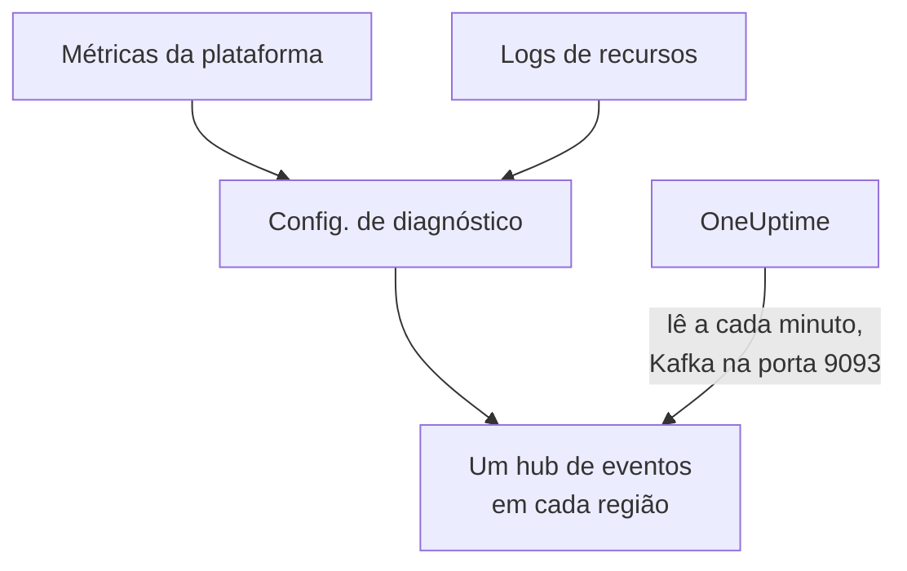

# Transmitir métricas e logs do Azure Monitor

Uma assinatura do Azure conectada pode transmitir as métricas do Azure Monitor e os logs de recursos para o OneUptime. As configurações de diagnóstico os enviam para hubs de eventos da sua assinatura, e o OneUptime lê os hubs de eventos a cada minuto: as métricas principais chegam poucos minutos depois de o Azure Monitor tê-las, em vez de esperar a próxima leitura da conexão, e os logs de recursos chegam como logs do OneUptime, cada um arquivado sob o recurso a que se refere. Um único comando no Azure Cloud Shell configura tudo, e não há nada para executar.

:::cards
- [Como funciona](#como-funciona): As configurações de diagnóstico enviam para um hub de eventos em cada região, e o OneUptime os lê.
- [Configurar a transmissão](#configurar-a-transmissão): Escolha o que transmitir, ative a leitura e execute um comando.
- [O que chega](#o-que-chega): As métricas nos recursos que elas medem, e os logs nos recursos de onde vêm.
- [O que o comando cria](#o-que-o-comando-cria): Cada recurso e cada permissão que o comando cria na sua assinatura.
- [Parar a transmissão](#parar-a-transmissão): Pare a leitura e depois exclua o que o comando criou.
:::

## Como funciona



- **Um hub de eventos em cada região.** Uma configuração de diagnóstico só envia para um hub de eventos da região do seu recurso, então o comando cria um namespace do Event Hubs em cada região onde estão seus recursos, todos em um único grupo de recursos, e aponta a configuração de diagnóstico de cada recurso para o da região dele.
- **O OneUptime os lê.** O Azure Monitor só envia para um hub de eventos, uma conta de armazenamento ou um workspace do Log Analytics, nunca para um endereço seu: um hub de eventos que o OneUptime lê é o caminho que não exige que você execute nada. O OneUptime entra como o aplicativo da conexão, que pode ler esses hubs de eventos e nada mais.
- **As leituras deixam as métricas transmitidas para o fluxo.** Enquanto o fluxo entrega as métricas principais de um tipo de recurso em uma região, as leituras da conexão deixam de gravá-las, então nenhum ponto de dados é contado duas vezes. As leituras continuam encontrando recursos, o estado deles e suas alterações, e retomam as métricas depois de 15 minutos sem um evento.
- **Nada se perde enquanto o OneUptime não pode ler.** Os eventos esperam nos hubs de eventos até o OneUptime lê-los, enquanto os hubs de eventos os guardarem, e o OneUptime guarda até onde leu cada partição, para continuar de onde parou.

## Antes de começar

- **Uma assinatura do Azure conectada.** Conecte-a primeiro em **Nuvem → Conectar**: veja [Conectar uma conta de nuvem](/docs/telemetry/cloud-accounts).
- **Um proprietário ou administrador do projeto.** Só eles podem ativar a leitura e parar a transmissão.
- **Azure Cloud Shell**, conectado como **Owner** das assinaturas, ou como **Contributor** que também seja **User Access Administrator**: o comando cria um grupo de recursos e uma atribuição de função, e altera configurações de diagnóstico.
- **Uma saída para o Azure, em um OneUptime auto-hospedado.** O OneUptime lê cada namespace em `<namespace>.servicebus.windows.net` na porta 9093, e os namespaces aceitam conexões da internet.

## Configurar a transmissão

:::steps
### Abrir a caixa de transmissão

Vá para **Nuvem → Conectar** e, na linha da assinatura do Azure, escolha **Transmitir métricas e logs**.

### Escolher o que transmitir

**Métricas** transmite cada métrica principal de cada recurso, minuto a minuto: as métricas que o OneUptime exibe em gráficos e usa para avaliar cada recurso. **Métricas e logs** acrescenta os logs próprios de cada recurso, cada categoria que o Azure mantém para ele, e **Registros** transmite só os logs de recursos.

### Ativar a leitura

Escolha **Ativar a leitura**. O OneUptime procura os hubs de eventos a cada minuto, e os aguarda até o comando criá-los.

### Executar o comando no Azure Cloud Shell

Copie o comando, execute-o no Azure Cloud Shell e aguarde terminar. Ele informa cada região em que criou um hub de eventos, quantos recursos enviam para eles e quais recursos deixou de fora, com o motivo do Azure.

### Aguardar os primeiros eventos

A caixa pergunta a cada poucos segundos o que chegou. O Azure começa a enviar poucos minutos depois de o comando terminar; a caixa diz então o que veio de onde, e a linha da conexão diz **Transmitindo**.
:::

**Mais campos** contém o resto:

| Campo | O que faz |
| --- | --- |
| **Assinaturas** | As assinaturas das quais transmitir: no início, as que a conexão lê. A primeira contém os hubs de eventos, e o OneUptime os lê lá. No máximo 50 |
| **Configurar de outra forma** | Os nomes que o comando usa, para configurar tudo com o Terraform ou o portal |

Quando a primeira assinatura não é aquela em que o OneUptime lê os hubs de eventos, a caixa avisa: escolha **Ler lá** antes de executar o comando.

## O que chega

| O quê | Onde chega |
| --- | --- |
| Métricas principais | Nos recursos de nuvem que elas medem, nas mesmas séries que as leituras da conexão gravam |
| Logs de recursos | No explorador de logs, sob o serviço de telemetria da conexão, com a assinatura, a região e a categoria como atributos |
| Logs de um recurso que o OneUptime conhece | Também nesse recurso: a página dele na Nuvem ganha uma aba **Registros** |

O fluxo leva as métricas principais que a conexão lê minuto a minuto. Uma métrica que ela lê em uma granularidade maior, como a capacidade usada de uma conta de armazenamento, continua com as leituras. Um log é arquivado sob o recurso pelo ID do ARM do recurso, levado como `cloud.resource_id`, e mantém a categoria, a operação, o resultado e as propriedades como atributos, por exemplo `azure.category`.

Máquinas virtuais, conjuntos de dimensionamento, discos, interfaces de rede, redes virtuais, pontos de extremidade privados, gateways NAT, zonas DNS e planos do App Service não enviam logs de recursos próprios, então as páginas deles não têm a aba **Registros**. Os logs de uma conta de armazenamento são os dos seus serviços, e os de um aplicativo de contêiner, os do seu ambiente.

## O que o comando cria

O grupo de recursos se chama `oneuptime-stream-` seguido dos 8 primeiros caracteres do ID da conexão. Ele não dá ao OneUptime nenhum acesso aos seus recursos: o aplicativo da conexão pode ler os hubs de eventos, e nada mais.

| Recurso | O que pode fazer |
| --- | --- |
| Um grupo de recursos, `oneuptime-stream-<suffix>`, na primeira assinatura | Contém os hubs de eventos, marcado com o ID da conexão como `oneuptime-connection` |
| Um namespace do Event Hubs em cada região, `oneuptime-<suffix>-<region>`, no nível Standard com 1 unidade de produtividade | Recebe o que as configurações de diagnóstico da região dele enviam |
| Um hub de eventos em cada um, `oneuptime`, com 2 partições | Guarda os eventos até o OneUptime lê-los |
| A função **Azure Event Hubs Data Receiver** para o aplicativo da conexão, só no grupo de recursos | Permite que o aplicativo leia os hubs de eventos, e nada mais |
| Uma configuração de diagnóstico em cada recurso, `OneUptime-<suffix>` | Envia as métricas, os logs ou ambos do recurso para o hub de eventos da região dele |

Um recurso de uma região global, como o Front Door, envia para o hub de eventos da primeira região. Um recurso do qual o Azure mantém só métricas ou só logs é configurado com o que tem, e um que já tem 5 configurações de diagnóstico, o máximo que o Azure permite, fica de fora. O Azure cobra a unidade de produtividade de cada namespace por hora, e os eventos que as configurações de diagnóstico enviam.

## Parar a transmissão

:::steps
### Parar a leitura

Na linha da assinatura em **Nuvem → Conectar**, escolha **Parar a transmissão**. O OneUptime para de ler os hubs de eventos na hora, e a conexão volta a ler todas as métricas conforme sua programação. O que foi lido permanece.

### Excluir o que o comando criou

Os hubs de eventos e as configurações de diagnóstico ficam no Azure, e o Azure os cobra, até serem excluídos. A caixa mostra o comando: ele exclui a configuração de diagnóstico de cada recurso e depois o grupo de recursos, em qualquer assinatura que o contenha.

```bash
oneuptime_stream_stop() {
  local SUB ID N=0
  for SUB in '11111111-aaaa-4aaa-8aaa-111111111111' '22222222-bbbb-4bbb-8bbb-222222222222'; do
    while IFS= read -r ID; do
      if [ -z "$ID" ]; then continue; fi
      az monitor diagnostic-settings delete --name OneUptime-6f1c3a2e --resource "$ID" --output none 2> /dev/null &
      N=$((N + 1))
      if [ $((N % 4)) -eq 0 ]; then wait; fi
    done < <(az resource list --subscription "$SUB" --query "[].id" --output tsv)
  done
  wait
  for SUB in '11111111-aaaa-4aaa-8aaa-111111111111' '22222222-bbbb-4bbb-8bbb-222222222222'; do
    if [ "$(az group exists --subscription "$SUB" --name oneuptime-stream-6f1c3a2e 2> /dev/null)" = true ]; then
      az group delete --subscription "$SUB" --name oneuptime-stream-6f1c3a2e --yes --no-wait && echo "Deleting oneuptime-stream-6f1c3a2e in $SUB."
    fi
  done
}
oneuptime_stream_stop
```
:::

Para mudar o que é transmitido, abra de novo **Transmitir métricas e logs**, escolha o que transmitir e execute o novo comando: ele atualiza o que a primeira execução criou, e não cria nada duas vezes.

## Configurar de outra forma

Com o Terraform ou o portal, crie o que o comando cria, com estes nomes:

| Configuração | Valor |
| --- | --- |
| Grupo de recursos | `oneuptime-stream-<suffix>`, na assinatura em que o OneUptime lê os hubs de eventos |
| Namespace do Event Hubs | `oneuptime-<suffix>-<region>`, um em cada região de um recurso a transmitir |
| Hub de eventos | `oneuptime`, em cada namespace |
| Configuração de diagnóstico | `OneUptime-<suffix>` em cada recurso, para o hub de eventos da região dele, com a regra `RootManageSharedAccessKey` do namespace |
| Função | **Azure Event Hubs Data Receiver** para o aplicativo da conexão, no grupo de recursos |

Depois ative a leitura, com essa assinatura em primeiro lugar em **Assinaturas**.

## Solução de problemas

:::details A caixa continua aguardando os primeiros eventos
Verifique se o comando terminou e se disse que o hub de eventos de uma região está pronto: `az eventhubs namespace list --resource-group oneuptime-stream-6f1c3a2e` lista os namespaces. Uma configuração de diagnóstico só envia o que o Azure Monitor tem, então um recurso que não faz nada envia pouco. Uma função nova pode levar alguns minutos para entrar em vigor: até lá, as leituras não veem os eventos.
:::

:::details A conexão diz Fluxo com falha
A caixa e a dica da linha dizem o porquê. Quando o aplicativo não pode ler os hubs de eventos, execute o comando de novo: ele devolve ao aplicativo a sua função. Quando o OneUptime não conseguiu alcançá-los, verifique se os namespaces aceitam conexões da internet, e se um OneUptime auto-hospedado pode alcançar a porta 9093.
:::

:::details O comando deixou recursos de fora
Ele os lista, cada um com o motivo do Azure. Um recurso de um tipo sem configurações de diagnóstico não envia nada, e em um que já tem 5 configurações de diagnóstico é preciso excluir uma antes. Depois execute o comando de novo.
:::

## Próximas etapas

:::cards
- [Conectar uma conta de nuvem](/docs/telemetry/cloud-accounts): O que uma conexão lê, e com que frequência.
- [Transmitir logs do Google Cloud](/docs/telemetry/cloud-streaming-google-cloud): Os logs de um projeto do Google Cloud, enviados pelo Pub/Sub.
- [Transmitir métricas e logs do CloudWatch](/docs/telemetry/cloud-streaming): Os de uma conta da AWS, entregues pelo Amazon Data Firehose.
- [Explorador de registros](/docs/telemetry/logs-explorer): Pesquise e filtre o que os fluxos entregaram.
:::
