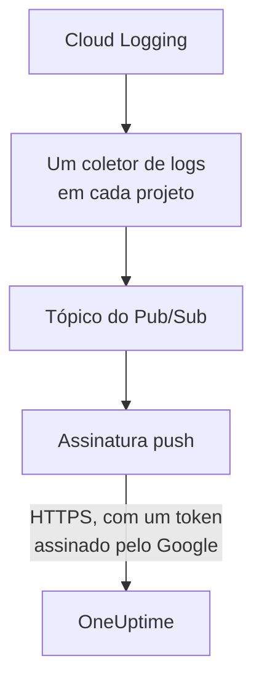

# Transmitir logs do Google Cloud

Um projeto do Google Cloud conectado pode transmitir os logs para o OneUptime assim que são gravados. O Cloud Logging os encaminha por um coletor de logs para um tópico do Pub/Sub, e a assinatura push do tópico entrega cada entrada ao OneUptime em até um minuto, como um log do OneUptime arquivado sob o recurso a que se refere. Um único comando no Google Cloud Shell configura tudo, e não há nada para executar. O Cloud Monitoring não tem exportação que envie métricas, então a conexão continua lendo as métricas conforme sua programação.

:::cards
- [Como funciona](#como-funciona): Um coletor de logs em cada projeto, um tópico e sua assinatura push.
- [Configurar a transmissão](#configurar-a-transmissão): Escolha quais logs, crie uma chave de fluxo e execute um comando.
- [O que chega](#o-que-chega): Os logs nos recursos de onde vêm.
- [O que o comando cria](#o-que-o-comando-cria): Cada recurso e cada permissão que o comando cria nos seus projetos.
- [Parar a transmissão](#parar-a-transmissão): Desative as chaves e depois exclua o que o comando criou.
:::

## Como funciona



- **Um coletor de logs em cada projeto.** O coletor de cada projeto encaminha as entradas que o filtro dele aceita para um único tópico do Pub/Sub, no projeto da conta de serviço da conexão.
- **Duas verificações em cada envio.** O Pub/Sub assina um token do OpenID Connect para uma conta de serviço criada só para os envios, e o público (audience) do token é a chave de fluxo da conexão. O OneUptime aceita um envio só quando o Google assinou o token dele para essa conta de serviço e a chave é uma das da conexão. A chave indica a conexão, e portanto o projeto: nada em um envio decide onde ele é gravado. O OneUptime guarda apenas o SHA-256 da chave.
- **Nada se perde enquanto o OneUptime não pode aceitar.** O Pub/Sub reenvia uma entrada recusada, esperando de 10 segundos até 10 minutos entre as tentativas, e a guarda por um dia.

## Antes de começar

- **Um projeto do Google Cloud conectado.** Conecte-o primeiro em **Nuvem → Conectar**: veja [Conectar uma conta de nuvem](/docs/telemetry/cloud-accounts).
- **Um proprietário ou administrador do projeto.** Só eles podem criar uma chave de fluxo e parar a transmissão.
- **Google Cloud Shell**, conectado como **Owner** dos projetos, ou como alguém que possa criar neles contas de serviço, tópicos do Pub/Sub e coletores de logs.
- **Um endereço HTTPS, em um OneUptime auto-hospedado.** O Pub/Sub só envia a endereços `https://`, com um certificado em que o Google confie, e o endereço precisa ser alcançável a partir do Google Cloud.

## Configurar a transmissão

:::steps
### Abrir a caixa de transmissão

Vá para **Nuvem → Conectar** e, na linha do projeto do Google Cloud, escolha **Transmitir logs**.

### Escolher quais logs

**Avisos e erros** transmite cada entrada de gravidade `WARNING` ou superior: o que deu errado, não cada solicitação. **Todos os logs** transmite cada entrada, exceto os logs de auditoria Data Access, que registram cada leitura e podem superar tudo o mais que um projeto grava. **Um filtro próprio** transmite as entradas que correspondem a uma consulta do Cloud Logging, escrita no campo **Filtro**.

### Criar uma chave de fluxo

Escolha **Criar uma chave de fluxo**. A chave é mostrada só desta vez, no comando: o OneUptime guarda apenas o SHA-256 dela.

### Executar o comando no Google Cloud Shell

Copie o comando, execute-o no Google Cloud Shell e aguarde terminar. Ele informa cada projeto em que configurou um coletor, e para na primeira etapa que o Google recusar, com o motivo do Google.

### Aguardar o primeiro envio

A caixa pergunta a cada poucos segundos o que chegou. O Pub/Sub envia uma entrada em até um minuto depois de um projeto gravar uma que o filtro aceite; a caixa diz então o que veio de onde, e a linha da conexão diz **Transmitindo**.
:::

**Mais campos** contém o resto:

| Campo | O que faz |
| --- | --- |
| **Projetos** | Os projetos dos quais transmitir logs: no início, os que a conexão lê. O tópico é criado no projeto da conta de serviço da conexão. No máximo 100 |
| **Configurar de outra forma** | O endpoint de envio, a conta de serviço push e a chave, para configurar tudo com o Terraform ou o console |

## O que chega

| O quê | Onde chega |
| --- | --- |
| Logs | No explorador de logs, sob o serviço de telemetria da conexão, com o projeto, a região e o nome do log como atributos |
| Logs de um recurso que o OneUptime conhece | Também nesse recurso: a página dele na Nuvem ganha uma aba **Registros** |

Cada log mantém o horário da entrada até o nanossegundo, a gravidade, o trace e o span, e a solicitação HTTP com os nomes das convenções semânticas do OpenTelemetry. Ele é arquivado sob um recurso quando o recurso monitorado dele é de um tipo cujas métricas o OneUptime lê, como uma VM (`gce_instance`), um serviço do Cloud Run (`cloud_run_revision`) ou uma instância do Cloud SQL (`cloudsql_database`), e leva o ID do recurso como `cloud.resource_id`. Os logs de solicitações de um balanceador de carga externo, gravados sob `http_load_balancer`, são arquivados sob o mapa de URL dele, a `https_lb_rule` em que as métricas dele chegam.

Os logs de um grupo de instâncias são os das VMs dele, então a página dele não tem a aba **Registros**. Uma entrada de outro tipo é transmitida mesmo assim, sob o projeto dela.

## O que o comando cria

Os recursos dele levam o nome dos 8 primeiros caracteres do ID da conexão. Ele não dá ao OneUptime nenhum acesso aos seus projetos: as entradas só saem.

| Recurso | O que pode fazer |
| --- | --- |
| Uma conta de serviço, `oneuptime-push-<suffix>`, no projeto da conta de serviço da conexão | Não tem nenhum papel: o Pub/Sub assina para ela os tokens dos envios |
| O papel **Service Account OpenID Connect Identity Token Creator** para o agente de serviço do Pub/Sub, só nessa conta de serviço | Permite que o Pub/Sub crie esses tokens, e nada mais |
| Um tópico do Pub/Sub, `oneuptime-stream-<suffix>` | Contém as entradas que os coletores encaminham |
| A assinatura push dele, `oneuptime-stream-<suffix>-push` | Envia cada entrada ao OneUptime, com um prazo de confirmação de 60 segundos, e guarda por um dia o que não conseguiu enviar |
| Um coletor de logs em cada projeto, `oneuptime-stream-<suffix>` | Encaminha para o tópico as entradas que o filtro dele aceita |
| O papel **Pub/Sub Publisher** para o gravador de cada coletor, só no tópico | Permite que o coletor publique no tópico, e nada mais |

O comando ativa as APIs do Pub/Sub e do Cloud Logging no projeto do tópico se estiverem desativadas. O Google cobra o Pub/Sub pelos logs que entrega: transmita só os logs de que você precisa.

## Parar a transmissão

:::steps
### Desativar as chaves

Na linha do projeto em **Nuvem → Conectar**, escolha **Parar a transmissão**. Todas as chaves de fluxo da conexão param de funcionar na hora, e o OneUptime recusa o que o Pub/Sub envia. O que foi entregue permanece.

### Excluir o que o comando criou

Os coletores, o tópico e a assinatura push dele ficam no Google Cloud, e o Pub/Sub continua enviando, até serem excluídos. A caixa mostra o comando, para os projetos que a conexão lê:

```bash
for SOURCE in 'acme-prod' 'acme-data'; do
  gcloud logging sinks delete oneuptime-stream-6f1c3a2e --project "$SOURCE" --quiet
done
gcloud pubsub subscriptions delete oneuptime-stream-6f1c3a2e-push --project 'acme-prod' --quiet
gcloud pubsub topics delete oneuptime-stream-6f1c3a2e --project 'acme-prod' --quiet
gcloud iam service-accounts delete 'oneuptime-push-6f1c3a2e@acme-prod.iam.gserviceaccount.com' --project 'acme-prod' --quiet
```
:::

Para mudar quais logs são transmitidos, abra de novo **Transmitir logs**, escolha **Criar uma nova chave** e execute o novo comando. A chave que ela substitui continua funcionando por 24 horas, então nenhum envio é recusado enquanto a assinatura é atualizada. No máximo 3 chaves substituídas funcionam ao mesmo tempo.

## Configurar de outra forma

Dê a um tópico do Pub/Sub uma assinatura push com estes valores, e permita que o agente de serviço do Pub/Sub crie tokens para a conta de serviço push:

| Configuração | Valor |
| --- | --- |
| Endpoint de envio | `https://oneuptime.com/telemetry/gcp-pubsub/v1/logs` |
| Autenticação | Um token do OpenID Connect para `oneuptime-push-<suffix>@<project>.iam.gserviceaccount.com` |
| Público (audience) | A chave de fluxo |
| Payload | Encapsulado, como o Pub/Sub o envia, a menos que se indique outra coisa |
| Prazo de confirmação | 60 segundos |
| Retenção de mensagens | 1 dia |

Depois encaminhe os logs de cada projeto para o tópico com um coletor de logs, e dê ao gravador de cada coletor **Pub/Sub Publisher** no tópico. Em um OneUptime auto-hospedado, substitua `https://oneuptime.com` pelo endereço HTTPS do seu OneUptime.

O OneUptime responde a cada envio como o Pub/Sub espera:

| Resposta | Quando | O que o Pub/Sub faz |
| --- | --- | --- |
| `204` | A entrada foi aceita, ou já tinha sido, ou a mensagem não é uma entrada de log | Segue em frente |
| `400` | Não é um envio do Pub/Sub que o OneUptime consiga ler | Reenvia, esperando mais a cada vez, por um dia |
| `401` | O token não foi assinado pelo Google para a conta de serviço push, ou o público dele não é uma chave da conexão | Reenvia, esperando mais a cada vez, por um dia |
| `402` | O projeto não pode ser cobrado por telemetria | Reenvia, esperando mais a cada vez, por um dia |
| `403` | A conexão está desativada, ou o projeto não pode aceitar telemetria | Reenvia, esperando mais a cada vez, por um dia |
| `413` | A solicitação passa de 1 MiB, ou a entrada dela passa de 512 KiB | Reenvia, esperando mais a cada vez, por um dia |
| `429` | A assinatura da conexão enviou mais de 12.000 entradas em um minuto | Reenvia, esperando mais a cada vez, por um dia |
| `503` | O OneUptime não conseguiu verificar o token nem enfileirar a entrada naquele momento | Reenvia, esperando mais a cada vez, por um dia |

## Solução de problemas

:::details A caixa continua aguardando o primeiro envio
Verifique se o comando terminou sem parar, e se um projeto gravou uma entrada que o filtro aceita: com **Avisos e erros**, um projeto tranquilo não envia nada. `gcloud pubsub subscriptions describe oneuptime-stream-6f1c3a2e-push --project acme-prod` mostra o endpoint da assinatura. Em um OneUptime auto-hospedado, verifique se o Google Cloud alcança o endereço dele por HTTPS.
:::

:::details A conexão diz Fluxo recusado
A caixa e a dica da linha dizem o porquê. Uma chave errada significa que a assinatura envia com uma chave que não funciona mais: crie uma nova chave e execute o comando de novo. Um envio não assinado para a conta de serviço push significa que a assinatura assina como outra conta, ou que o Pub/Sub não pode assinar por ela: execute o comando de novo.
:::

:::details Os logs de um recurso não aparecem na página dele
A página mostra os logs que o Cloud Logging arquiva sob o recurso monitorado do recurso, com os rótulos que as métricas dele têm. Os logs que uma carga de trabalho grava sob outro recurso, como os de um contêiner, são transmitidos só sob o projeto deles.
:::

## Próximas etapas

:::cards
- [Conectar uma conta de nuvem](/docs/telemetry/cloud-accounts): O que uma conexão lê, e com que frequência.
- [Transmitir métricas e logs do Azure Monitor](/docs/telemetry/cloud-streaming-azure): Os de uma assinatura do Azure, lidos de hubs de eventos.
- [Transmitir métricas e logs do CloudWatch](/docs/telemetry/cloud-streaming): Os de uma conta da AWS, entregues pelo Amazon Data Firehose.
- [Explorador de registros](/docs/telemetry/logs-explorer): Pesquise e filtre o que os fluxos entregaram.
:::
