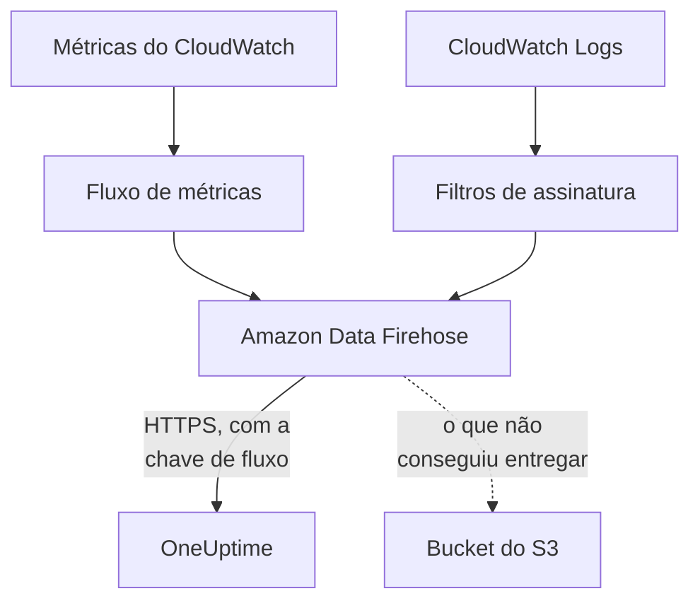

# Transmitir métricas e logs do CloudWatch

Uma conta da AWS conectada pode transmitir as métricas e os logs do CloudWatch para o OneUptime pelo Amazon Data Firehose. As métricas passam a chegar poucos minutos depois de o CloudWatch tê-las, em vez de na próxima leitura da conexão, e o CloudWatch Logs chega como logs do OneUptime, cada um arquivado sob o recurso a que se refere. Um único comando no AWS CloudShell configura tudo, e não há nada para executar.

:::cards
- [Como funciona](#como-funciona): Um fluxo de métricas e assinaturas de logs em cada região, entregues pelo Firehose.
- [Configurar a transmissão](#configurar-a-transmissão): Escolha o que transmitir, crie uma chave de fluxo e execute um comando.
- [O que chega](#o-que-chega): As métricas nos recursos que medem, e os logs nos recursos de onde vêm.
- [O que a pilha cria](#o-que-a-pilha-cria): Cada recurso e cada permissão que o comando cria na sua conta.
- [Parar a transmissão](#parar-a-transmissão): Desative as chaves e depois exclua as pilhas.
:::

## Como funciona



- **Uma pilha em cada região.** O comando implanta uma pilha do CloudFormation em cada região de onde você transmite. O fluxo de métricas e os filtros de assinatura de logs dela passam tudo para dois fluxos do Firehose, e o Firehose entrega ao OneUptime por HTTPS.
- **A chave de fluxo diz de quem é.** O Firehose envia a chave de fluxo da conexão em cada entrega. A chave identifica a conexão, e portanto o projeto: nada em uma entrega decide onde ela é gravada. O OneUptime guarda só o SHA-256 da chave.
- **As leituras deixam as métricas transmitidas para o fluxo.** Enquanto um fluxo entrega um namespace de uma região, as leituras da conexão deixam de gravar as métricas desse namespace, então nenhum ponto de dados é contado duas vezes. As leituras continuam encontrando recursos, a integridade e as mudanças deles, e retomam um namespace depois de 15 minutos sem entregas.
- **Nada se perde enquanto o OneUptime não pode aceitar.** O Firehose reenvia um lote recusado por até uma hora e depois o guarda por 30 dias no bucket do S3 da pilha.

## Antes de começar

- **Uma conta da AWS conectada.** Conecte-a primeiro em **Nuvem → Conectar**: veja [Conectar uma conta de nuvem](/docs/telemetry/cloud-accounts).
- **Um proprietário ou administrador do projeto.** Só eles podem criar uma chave de fluxo e parar a transmissão.
- **AWS CloudShell nessa conta**, conectado como alguém que possa criar pilhas do CloudFormation e funções do IAM.
- **Um endereço HTTPS, em um OneUptime auto-hospedado.** O Firehose só entrega a endereços `https://` na porta 443, com um certificado em que a AWS confie, e o endereço precisa estar acessível a partir da AWS.

## Configurar a transmissão

:::steps
### Abrir a caixa de transmissão

Vá em **Nuvem → Conectar** e, na linha da conta da AWS, escolha **Transmitir métricas e logs**.

### Escolher o que transmitir

**Métricas** transmite cada métrica-chave de cada recurso, uma vez por minuto: as métricas que o OneUptime exibe em gráficos e usa para avaliar cada recurso. **Métricas e logs** adiciona o CloudWatch Logs, e **Registros** transmite só o CloudWatch Logs.

Para os logs, informe os **Grupos de logs** um por linha, pelo nome na **Região** ao lado ou pelo ARN na região deles, ou escolha **Todos os grupos de logs da conta, inclusive os novos**. Um comando assina no máximo 50 grupos de logs pelo nome, em no máximo 10 regiões.

### Criar uma chave de fluxo

Escolha **Criar uma chave de fluxo**. A chave só é mostrada desta vez, no comando: o OneUptime guarda só o SHA-256 dela.

### Executar o comando no AWS CloudShell

Copie o comando, execute-o no AWS CloudShell e espere terminar. Ele grava o modelo em `oneuptime-stream.json` e o implanta em cada região, com a chave como um parâmetro que nunca mais é mostrado.

### Aguardar a primeira entrega

A caixa pergunta a cada poucos segundos o que chegou. O Firehose entrega poucos minutos depois de o comando terminar; a caixa diz então o que chegou e de onde, e a linha da conexão diz **Transmitindo**.
:::

**Mais campos** guarda o resto:

| Campo | O que faz |
| --- | --- |
| **Todas as métricas, não só as principais** | Transmite todas as métricas que o CloudWatch tem para a conta, inclusive as suas. A AWS cobra cada atualização de métrica que um fluxo envia, então pode custar muitas vezes mais |
| **Regiões** | De onde transmitir: de início, as regiões em que a conexão encontrou recursos. Se ficar vazio, o comando transmite da própria região do AWS CloudShell. No máximo 30 |
| **Configurar de outra forma** | Os endpoints de métricas e de logs e a chave, para configurar os fluxos com o Terraform ou o console |

**Baixar o modelo** salva o modelo que o comando implanta, para implantá-lo do seu jeito.

## O que chega

| O quê | Onde chega |
| --- | --- |
| Métricas | Nos recursos de nuvem que medem, com os nomes e atributos que as leituras da conexão dão a elas |
| Logs | No explorador de registros, sob o serviço de telemetria da conexão, com a conta, a região e o grupo de logs como atributos |
| Logs de um grupo de logs que a AWS nomeia com o nome de um recurso | Também nesse recurso: a página dele na Nuvem ganha uma aba **Registros** |

Um grupo de logs é arquivado sob um recurso quando a AWS lhe deu o nome de um:

| Grupo de logs | Tipo de recurso |
| --- | --- |
| `/aws/lambda/<function>` | `AWS::Lambda::Function` |
| `/aws/rds/instance/<instance>/<log>` | `AWS::RDS::DBInstance` |
| `/aws/rds/cluster/<cluster>/<log>` | `AWS::RDS::DBCluster` |
| `/aws/docdb/<cluster>/<log>` | `AWS::DocDB::DBCluster` |
| `/aws/neptune/<cluster>/<log>` | `AWS::Neptune::DBCluster` |
| `/aws/redshift/cluster/<cluster>/<log>` | `AWS::Redshift::Cluster` |
| `/aws/OpenSearchService/domains/<domain>/<log>` | `AWS::OpenSearchService::Domain` |
| `/aws/aes/domains/<domain>/<log>` | `AWS::OpenSearchService::Domain` |
| `/aws/apprunner/<service>/<service-id>/<log>` | `AWS::AppRunner::Service` |
| `/aws/elasticbeanstalk/<environment>/<log>` | `AWS::ElasticBeanstalk::Environment` |
| `/aws/ecs/containerinsights/<cluster>/performance` | `AWS::ECS::Cluster` |

Cada log leva o ID do recurso como `cloud.resource_id`, e os logs de uma função Lambda levam também `faas.name`, por isso aparecem também na função em Serverless. Um grupo de logs com outro nome é transmitido mesmo assim, sob a conta e a região dele. A gravidade de um log é a que a mensagem dele informa, do jeito que o Lambda a escreve.

## O que a pilha cria

A pilha se chama `OneUptimeStream-` seguido dos 8 primeiros caracteres do ID da conexão. Ela não dá ao OneUptime nenhum acesso à sua conta: os dados só saem.

| Recurso | O que pode fazer |
| --- | --- |
| Um fluxo de métricas do CloudWatch, no formato OpenTelemetry 1.0 | Gravar registros apenas no fluxo do Firehose de métricas |
| Filtros de assinatura de logs, ou uma política de assinatura de toda a conta para cada grupo de logs | Gravar registros apenas no fluxo do Firehose de logs |
| Dois fluxos do Firehose, `OneUptime-<suffix>-metrics` e `OneUptime-<suffix>-logs` | Entregar ao OneUptime com GZIP, um buffer de 1 MiB ou 60 segundos e uma hora de novas tentativas, e gravar no bucket o que não conseguiram entregar |
| Um bucket do S3 para o que não pôde ser entregue | Acesso público bloqueado, criptografado, esvaziado depois de 30 dias e mantido quando a pilha é excluída |
| Um grupo de logs, `/aws/kinesisfirehose/OneUptime-<suffix>` | Guarda os erros de entrega do próprio Firehose e nunca é transmitido |
| Três funções do IAM | Cada uma confia em um serviço da AWS desta conta e só permite o que as linhas acima dizem |

A AWS cobra o fluxo de métricas por cada atualização de métrica que ele envia, e o Firehose pelo que ele entrega. Transmita só as métricas e os grupos de logs de que precisa.

## Parar a transmissão

:::steps
### Desativar as chaves

Na linha da conta em **Nuvem → Conectar**, escolha **Parar a transmissão**. Todas as chaves de fluxo da conexão param de funcionar na hora, o OneUptime recusa o que os fluxos entregam, e a conexão volta a ler todas as métricas conforme a programação dela. O que os fluxos entregaram permanece.

### Excluir as pilhas

Os fluxos continuam na AWS, e a AWS os cobra, até as pilhas deles serem excluídas. A caixa mostra o comando, para as regiões em que a conexão encontrou recursos:

```bash
for REGION in us-east-1 eu-west-1; do
  aws cloudformation delete-stack --region "$REGION" --stack-name OneUptimeStream-6f1c3a2e
done
```
:::

Para mudar o que uma pilha transmite, abra de novo **Transmitir métricas e logs**, escolha **Criar uma nova chave** e execute o novo comando. A chave que ela substitui continua funcionando por 24 horas, então nenhuma entrega é recusada enquanto as pilhas são atualizadas. No máximo 3 chaves substituídas funcionam ao mesmo tempo.

## Configurar de outra forma

Dê a cada fluxo do Firehose um destino de endpoint HTTP com estes valores, e ao fluxo de métricas o formato de saída OpenTelemetry 1.0:

| Configuração | Valor |
| --- | --- |
| Endpoint de métricas | `https://oneuptime.com/telemetry/aws-firehose/v1/metrics` |
| Endpoint de logs | `https://oneuptime.com/telemetry/aws-firehose/v1/logs` |
| Chave de acesso | A chave de fluxo, enviada como `X-Amz-Firehose-Access-Key` |
| Codificação de conteúdo | `GZIP` |
| Buffer | 1 MiB ou 60 segundos |
| Duração das novas tentativas | 3600 segundos, com um bucket do S3 para o que não pôde ser entregue |

Em um OneUptime auto-hospedado, troque `https://oneuptime.com` pelo endereço HTTPS do seu OneUptime. O endpoint de métricas também aceita um fluxo de métricas no formato JSON.

O OneUptime responde a cada entrega como o Firehose espera:

| Resposta | Quando | O que o Firehose faz |
| --- | --- | --- |
| `200` | A entrega foi aceita, ou já tinha sido aceita antes | Segue em frente |
| `400` | Não é uma entrega do Firehose que o OneUptime consiga ler, como uma com mais de 10.000 registros | Reenvia por até uma hora |
| `401` | A chave não é uma das chaves da conexão | Reenvia por até uma hora |
| `402` | O projeto não pode ser cobrado pela telemetria | Reenvia por até uma hora |
| `403` | A conexão está desativada, ou o projeto não pode aceitar telemetria | Reenvia por até uma hora |
| `413` | A solicitação passa de 4 MiB, ou descompactada passa de 32 MiB | Guarda no bucket |
| `429` | Os fluxos da conexão enviaram mais de 600 entregas em um minuto | Reenvia mais tarde |

## Solução de problemas

:::details A caixa continua esperando a primeira entrega
Verifique se o comando terminou em cada região sem erros: `aws cloudformation describe-stacks --stack-name OneUptimeStream-6f1c3a2e` informa o status da pilha. Um fluxo de métricas só entrega métricas que o CloudWatch tem, então uma região sem recursos não envia nada. Em um OneUptime auto-hospedado, verifique se a AWS alcança o endereço dele por HTTPS na porta 443.
:::

:::details A conexão diz Fluxo recusado
A caixa e a dica da linha dizem por quê. Uma chave errada significa que as pilhas rodam com uma chave que não funciona mais: crie uma nova chave e execute o comando de novo. O Firehose continua enviando o que guarda, e isso é aceito assim que a chave estiver certa.
:::

:::details Os logs de uma função Lambda não aparecem na página dela
A página mostra os logs do grupo de logs com o nome da função, `/aws/lambda/<function>`. Uma função que grava em um grupo de logs com outro nome transmite os logs dela só sob a conta e a região.
:::

## Próximas etapas

:::cards
- [Conectar uma conta de nuvem](/docs/telemetry/cloud-accounts): O que uma conexão lê, e com que frequência.
- [Recursos de nuvem (IaaS e PaaS)](/docs/telemetry/cloud-resources): Cada tipo de recurso que o OneUptime reconhece.
- [Explorador de registros](/docs/telemetry/logs-explorer): Pesquise e filtre o que os fluxos entregaram.
:::
