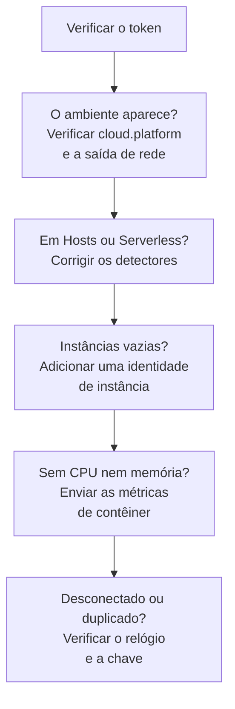

# Solução de problemas na nuvem

Descubra por que um ambiente de nuvem está faltando, foi arquivado no lugar errado, está vazio ou duplicado. As seções seguem a ordem em que essas coisas falham, e cada uma descarta uma camada, então siga de cima para baixo. As falhas que pertencem a uma única plataforma ficam no fim da página dela: [AWS ECS / Fargate](/docs/telemetry/cloud-aws-ecs), [Google Cloud Run](/docs/telemetry/cloud-gcp-cloud-run), [Azure Container Apps](/docs/telemetry/cloud-azure-container-apps) e [Outras plataformas de nuvem](/docs/telemetry/cloud-other-platforms).



## Verifique o token primeiro

É a verificação mais barata, e nada do que vem abaixo funciona sem ela:

```bash
curl -i https://oneuptime.com/otlp/v1/validate \
  -H "x-oneuptime-token: YOUR_TELEMETRY_INGESTION_TOKEN"
```

| Resposta | O que significa |
| ------------------------- | -------------------------------------------------------------------------------------------------------------------------- |
| `200`, `"valid": true` | O token é aceito. O `keyType` dele deve ser `Server`: uma chave `Browser` é recusada vinda de um coletor ou de um serviço de backend. |
| `401`, `"valid": false` | O token está ausente, é desconhecido, revogado, desativado ou expirado, e o `message` da resposta diz qual. Crie uma nova chave em **Configurações do projeto → Telemetria e APM → Chaves de ingestão** e implante-a de novo. |

Se você hospeda o OneUptime por conta própria, use `https://YOUR-ONEUPTIME-HOST/otlp/v1/validate`. Rode a verificação de dentro da tarefa, da instância ou da réplica quando puder (ECS Exec, `az containerapp exec`): ela prova que a própria carga de trabalho alcança o OneUptime, não só o seu notebook.

## O ambiente não aparece

Nada em **Nuvem → All Environments** um minuto depois da primeira requisição. Verifique estes três pontos, nesta ordem.

**`cloud.platform` está ausente, ou não é um valor gerenciado.** O OneUptime arquiva a telemetria em Ambientes de nuvem só quando o recurso traz um destes valores: `aws_ecs`, `aws_elastic_beanstalk`, `aws_app_runner`, `gcp_cloud_run`, `gcp_app_engine`, `azure_container_apps`, `azure_container_instances` ou `azure_app_service`. As causas mais comuns:

- O detector de recursos está desligado no SDK (`OTEL_NODE_RESOURCE_DETECTORS`, `OTEL_EXPERIMENTAL_RESOURCE_DETECTORS`, `-Dotel.resource.providers.<cloud>.enabled=true`).
- O pipeline do coletor pula o processador `resourcedetection`.
- Em uma plataforma sem detector, `OTEL_RESOURCE_ATTRIBUTES` tem um erro de digitação.

Os detectores do Azure de Node.js e .NET escrevem `azure.container_apps`, `azure.app_service` e `azure.functions`; o OneUptime os reescreve com sublinhado, então eles contam. Para ver o que a sua telemetria traz, abra o serviço em **Serviços**, abra um dos traços dele pela aba **Traços** e leia os atributos de recurso. Se `cloud.platform` não estiver lá, esse é o problema inteiro.

**O token está errado.** A verificação do token respondeu `401`. O coletor registra isso como `Permanent error: ... 401`. Um SDK registra uma vez e para de tentar de novo, o que é o comportamento correto do OTLP e fácil de não perceber.

**A saída de rede está bloqueada.** O coletor registra `connection refused`, `context deadline exceeded`, `i/o timeout` ou uma falha de DNS:

- **ECS e Fargate:** uma sub-rede privada precisa de um gateway NAT ou de `assignPublicIp=ENABLED`, e o grupo de segurança precisa permitir saída por TCP 443.
- **Cloud Run:** **VPC egress: All traffic** precisa do Cloud NAT.
- **Container Apps:** uma rota definida pelo usuário para um firewall precisa liberar o host do OneUptime.
- **Em todo lugar:** um OneUptime auto-hospedado atrás de um nome DNS privado precisa ser resolvível a partir da rede da carga de trabalho.

## Ele aparece em Hosts

O recurso traz a plataforma de uma máquina virtual (`aws_ec2`, `gcp_compute_engine` ou `azure_vm`), então o OneUptime o arquiva em **Hosts**: certo para uma máquina virtual, errado para computação gerenciada. O detector de uma máquina virtual venceu o gerenciado: `detectors: [ec2, elastic_beanstalk]` em um coletor, onde vence o primeiro detector que define `cloud.platform`, ou um SDK cuja ordem favorece o detector do EC2. Coloque `elastic_beanstalk` primeiro, ou defina você mesmo `cloud.platform` em `OTEL_RESOURCE_ATTRIBUTES` e mantenha só o detector `env`.

## Ele aparece só em Funções serverless

O recurso traz `faas.name`, mas nenhum `cloud.platform` gerenciado. O Cloud Run e o App Engine definem os dois quando o detector do GCP roda. Se você define `faas.name` à mão, ou um coletor descarta os atributos de recurso que o detector do SDK definiu, só o lado serverless é atendido. Ative o detector, ou defina você mesmo `cloud.platform=gcp_cloud_run` (ou `gcp_app_engine`), `cloud.account.id` e `cloud.region`.

> [!NOTE]
> No Cloud Run e no App Engine, um serviço deve aparecer nos dois lugares: o ambiente agrupa o projeto e a região, e **Funções serverless** mostra o serviço sozinho.

## Instâncias está vazia

O ambiente está lá, mas a aba **Instâncias** dele não lista nada: a telemetria não traz nenhuma identidade de instância. O OneUptime nomeia uma instância pelo primeiro destes atributos de recurso que encontrar:

1. `aws.ecs.task.id`
2. `aws.ecs.task.arn` (encurtado para o ID da tarefa)
3. `faas.instance`
4. `azure.container_app.instance.id`
5. `service.instance.id`
6. `container.id`
7. `host.id`
8. `host.name`

A identidade da própria plataforma vem antes de `service.instance.id`, então um ID que o SDK inventa para cada processo (o SDK do Node.js faz isso por padrão) não consegue separar uma tarefa da CPU e da memória do sidecar dela. O que define a identidade em cada plataforma:

| Plataforma | O que define a identidade |
| ----------------------------------------- | ------------------------------------------------------------------------------------------------------------------------------------------------ |
| ECS | O detector `ecs` define o ARN da tarefa |
| Cloud Run, App Engine | O detector `gcp` define `faas.instance` |
| Container Apps | O detector `azurecontainerapps` do Collector define o ID da réplica; ou defina `service.instance.id` a partir de `CONTAINER_APP_REPLICA_NAME`, ou rode o detector de host |
| App Runner, Container Instances | O `host.name` do detector de host |
| App Service, Elastic Beanstalk | O detector da plataforma define `service.instance.id`; no Beanstalk, remova-o para que `host.id` nomeie cada instância |

Uma instância aparece em um minuto após o primeiro sinal que traz o atributo.

## CPU e memória estão vazias

As instâncias estão listadas, mas os blocos **CPU** e **Memória** da visão geral, e as colunas de CPU e memória de **Instâncias**, estão vazios. Eles vêm de métricas, não de traços: pontos de dados `container.cpu.utilization` e `container.memory.usage` (ou `container.memory.usage.total`) cujo recurso traz a mesma identidade de instância dos traços, e `cloud.platform`.

- **No ECS,** o receiver `awsecscontainermetrics` em um coletor sidecar os fornece como `ecs.task.cpu.utilized` e `ecs.task.memory.utilized`. Mantenha-o no pipeline `metrics`, e mantenha também `resourcedetection` nesse pipeline, ou as métricas chegam sem `cloud.platform` e são arquivadas em outro lugar.
- **No Cloud Run, no Container Apps e nas outras plataformas,** a plataforma não mostra o uso dos contêineres a um sidecar. Os blocos ficam vazios a menos que você mesmo envie essas métricas: leia os blocos de requisições.
- **Com SDK direct,** nada envia métricas de contêiner, então blocos vazios são esperados.

## O ambiente mostra Desconectado

Um ambiente mostra **Desconectado** quando nenhuma telemetria chega para ele em 15 minutos, e o próximo span, log ou métrica o traz de volta. O tempo em que o próprio OneUptime esteve fora do ar ou se atualizando não conta. Enquanto a telemetria flui, o horário do último contato pode atrasar até cinco minutos, e é por isso que o limite é 15.

- **Um ambiente movimentado mostra Desconectado:** o exportador parou. Procure nos logs do coletor os erros de `401` e de saída de rede descritos acima.
- **Um ambiente de staging que escala para zero à noite** mostra Desconectado até a primeira requisição da manhã, o que está correto.

As instâncias seguem dois relógios:

- **Stale:** a aba **Instâncias** marca uma tarefa, instância ou réplica como **Stale** quando ela não reporta nos últimos 15 minutos, e a visão geral conta só as outras como ativas.
- **Excluída:** uma limpeza exclui as linhas de instâncias não vistas há `CLOUD_INSTANCE_STALE_MINUTES` (15 por padrão, no mínimo 10), contados a partir da última telemetria do próprio ambiente, então uma queda do coletor congela esse relógio em vez de apagar a última lista conhecida de tarefas. As funções serverless usam `SERVERLESS_INSTANCE_STALE_MINUTES`. Aumentar o limite mantém as linhas por mais tempo; não muda quando elas viram **Stale**.

## Dois ambientes onde deveria haver um

A chave do ambiente é `cloud.platform|cloud.account.id|cloud.region`, comparada caractere por caractere. Se algumas cargas de trabalho definem `cloud.account.id` e outras não, uma escreve `eastus` e outra `East US`, ou um coletor roda o detector `ecs` e outro não, você recebe `aws_ecs|123456789012|us-east-1` e `aws_ecs||us-east-1` lado a lado.

Abra a **Visão geral** de cada ambiente: a **Chave do ambiente** dele mostra qual parte difere. Corrija a carga de trabalho à qual falta o valor. O ambiente com a parte vazia para de receber telemetria, e você pode arquivá-lo.

## Um ambiente criado à mão nunca é associado

A ingestão associa um ambiente só pela chave dele, e a chave precisa ser exatamente `platform|account|region`, como `aws_ecs|123456789012|us-east-1`: o mesmo valor de plataforma, ID da conta e região que a telemetria traz. O formulário de criação (**Criar: Recurso de nuvem** em **Nuvem → All Environments**) monta a chave a partir dos campos **Plataforma de nuvem**, **ID da conta de nuvem** e **Região de nuvem**, então esses três precisam coincidir com a telemetria caractere por caractere. Se não coincidirem, a ingestão cria um segundo ambiente com a chave que calculou, e o seu fica vazio. Arquive o ambiente criado à mão e deixe a ingestão criar o certo, ou crie-o de novo com os valores corrigidos.

## Ainda sem solução

Reúna estas informações antes de pedir ajuda:

- Os atributos de recurso de um span ou registro de log real da carga de trabalho. O exportador `debug` do coletor os imprime, ou abra um traço do serviço em **Serviços**.
- A resposta da verificação `/otlp/v1/validate`, rodada de dentro da carga de trabalho.
- As últimas 50 linhas do log do coletor, ou o log de diagnóstico do SDK com `OTEL_LOG_LEVEL=debug`.
- A **Chave do ambiente** de qualquer ambiente que tenha aparecido.

Depois entre em contato com support@oneuptime.com, ou abra uma issue no [GitHub](https://github.com/OneUptime/oneuptime).

## Próximos passos

:::cards
- [Ambientes de nuvem](/docs/telemetry/cloud-environments): Como ambientes e instâncias são identificados.
- [AWS ECS / Fargate](/docs/telemetry/cloud-aws-ecs): A configuração do ECS, com uma definição de tarefa completa.
- [OpenTelemetry](/docs/telemetry/open-telemetry): Endpoints, limites e o que cada resposta significa.
:::
