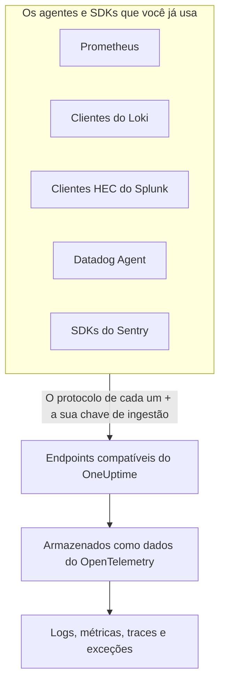

# Prometheus, Loki, Splunk, Datadog & Sentry

Já usa o Prometheus, um cliente do Loki, um encaminhador do Splunk, o Datadog Agent ou um SDK do Sentry? Não precisa trocar. O OneUptime aceita o que cada uma dessas ferramentas envia, nos caminhos que a ferramenta já usa, e armazena tudo como dados do OpenTelemetry. Experimentar o OneUptime é trocar uma URL e uma chave, não reinstrumentar, e os seus filtros de descarte, regras de mascaramento, pipelines de registros, retenção e orçamentos de ingestão valem para esses dados como para quaisquer outros.

:::cards
- [Prometheus remote write](#prometheus-remote-write): Métricas do Prometheus, do Grafana Alloy ou de qualquer emissor de remote write.
- [Loki](#loki): Logs do Promtail, do Grafana Alloy, do Fluent Bit ou do Vector.
- [Splunk HTTP Event Collector](#splunk-http-event-collector): Logs e eventos de métrica de qualquer cliente HEC.
- [Datadog Agent](#datadog-agent): Métricas e logs do Datadog Agent.
- [SDKs do Sentry](#sdks-do-sentry): Erros, transações e logs de qualquer SDK do Sentry.
:::

## Como funciona



Cada endpoint responde na língua da sua ferramenta — um `204` para o Prometheus e o Loki, o `{"text": "Success", "code": 0}` do HEC, o `202` do Datadog, o ID do evento do Sentry —, então a ferramenta informa sucesso e falha como sempre fez. Depois, os dados são processados exatamente como os de um SDK do OpenTelemetry.

## Antes de começar

- **Um projeto do OneUptime** – no OneUptime Cloud, a telemetria é cobrada por GB ingerido, e um projeto no plano Free precisa de um método de pagamento antes de poder enviar telemetria.
- **Chave de ingestão de telemetria** – crie uma chave **Servidor** em **Produtos → Configurações do projeto → Telemetria e APM → Chaves de ingestão** e copie a **Chave secreta** dela. Cada ferramenta a envia onde envia a sua própria credencial. O DSN do Sentry de uma aplicação de navegador leva, em vez disso, uma chave **Navegador**, limitada às origens do seu site.
- **O seu host** – os exemplos usam `oneuptime.com`. Se você hospeda o OneUptime por conta própria, use o seu próprio host.

> [!TIP]
> A aba Guia de configuração de Registros, Métricas, Traços e Exceções traz essas ferramentas entre as suas formas de enviar, com o seu host e uma chave à sua escolha já preenchidos.

## Endpoints

| Ferramenta | Aponte para | Onde vai a chave |
| --- | --- | --- |
| Prometheus remote write | `https://oneuptime.com/telemetry/prometheus/api/v1/write` | Um token bearer, ou autenticação basic com a chave como senha. |
| Loki | `https://oneuptime.com/telemetry/loki/api/v1/push` | Autenticação basic com a chave como senha, ou um token bearer. |
| Splunk HTTP Event Collector | `https://oneuptime.com/telemetry/services/collector` | O token do HEC: `Authorization: Splunk <key>`. |
| Datadog Agent | `https://oneuptime.com/telemetry/datadog` | A chave de API: `DD-API-KEY`. |
| SDKs do Sentry | O DSN `https://<key>@oneuptime.com/telemetry/sentry/1` | A chave pública do DSN. |

Todo endpoint também aceita a chave num cabeçalho `x-oneuptime-token`, e um cabeçalho `x-oneuptime-service-name` dá nome ao serviço a que pertence tudo o que a ferramenta envia. Uma chave pode ser escrita como os seus 32 dígitos hexadecimais, sem hífens; no DSN do Sentry e como chave de API do Datadog, ela precisa ser escrita assim.

## Prometheus remote write

Adicione o OneUptime como destino de remote write. O Prometheus continua fazendo scrape como hoje e envia uma cópia de cada amostra:

```yaml title="prometheus.yml"
remote_write:
  - url: https://oneuptime.com/telemetry/prometheus/api/v1/write
    authorization:
      credentials: YOUR_TELEMETRY_KEY
```

Com o Grafana Alloy, adicione um componente `prometheus.remote_write` e encaminhe os seus scrapes para ele:

```text title="config.alloy"
prometheus.remote_write "oneuptime" {
  endpoint {
    url          = "https://oneuptime.com/telemetry/prometheus/api/v1/write"
    bearer_token = "YOUR_TELEMETRY_KEY"
  }
}
```

Remote write 1.0 e 2.0 são aceitos, comprimidos com snappy, como todo emissor os envia.

### No que uma série se transforma

- **O nome e os rótulos ficam.** `http_requests_total{job="checkout", code="500"}` é a métrica `http_requests_total` com os atributos `job` e `code`, então uma consulta trazida do Grafana a encontra.
- **O job é o serviço.** Cada `job` vira um serviço, e cada `instance`, a instância desse serviço, como as regras de Prometheus do OpenTelemetry os mapeiam.
- **Os tipos são mantidos.** Os contadores, e os buckets e as contagens de um histograma, são somas cumulativas, então as suas taxas aparecem corretamente nos gráficos. O tipo vem dos metadados que o emissor inclui; sem eles, um nome terminado em `_total` é um contador, e um `_bucket` com um rótulo `le`, um bucket de histograma.
- **Os histogramas nativos** viram histogramas exponenciais, e os histogramas nativos com buckets personalizados viram histogramas.
- **Não mantidos:** marcadores de obsolescência e outras amostras NaN ou infinitas, as séries `_created` dos contadores e os exemplars.

## Loki

O OneUptime aceita a API de push do Loki no próprio caminho do Loki, em JSON ou como o protobuf comprimido com snappy que o Promtail e o Grafana Alloy enviam. Adicione-o como cliente:

```yaml title="promtail.yaml"
clients:
  - url: https://oneuptime.com/telemetry/loki/api/v1/push
    bearer_token: YOUR_TELEMETRY_KEY
```

A saída `loki` do Fluent Bit recebe o host e o caminho separados:

```text title="fluent-bit.conf"
[OUTPUT]
    Name         loki
    Match        *
    Host         oneuptime.com
    Port         443
    Tls          On
    Uri          /telemetry/loki/api/v1/push
    Http_User    oneuptime
    Http_Passwd  YOUR_TELEMETRY_KEY
    Labels       job=fluent-bit
```

### No que um fluxo se transforma

- **Cada entrada é um log**, com o seu próprio carimbo de data e hora, preciso ao nanossegundo, e a sua linha como corpo.
- **Rótulos e metadados estruturados viram atributos**, com os nomes que têm no Loki.
- **O serviço** vem do primeiro entre `service_name`, `service`, `app`, `application`, `name`, `app_kubernetes_io_name`, `container`, `container_name`, `component`, `workload` e `job` que um fluxo tiver, como o Loki o determina. Um rótulo `host` ou `hostname` dá nome ao host.
- **O nível** vem de um rótulo ou metadado `level`, `detected_level` ou `severity`, ou então de um `level=` em logfmt ou do campo `level` de uma linha JSON.
- **Contexto de trace:** um `trace_id` e um `span_id` nos metadados estruturados ligam o log ao seu trace.

## Splunk HTTP Event Collector

Use o OneUptime como HTTP Event Collector, com a sua chave de ingestão como token do HEC. O driver de logging do Docker para o Splunk adiciona o caminho sozinho, então só precisa do host:

```bash
docker run \
  --log-driver=splunk \
  --log-opt splunk-url=https://oneuptime.com \
  --log-opt splunk-token=YOUR_TELEMETRY_KEY \
  --log-opt splunk-format=json \
  your-image
```

Qualquer outro cliente HEC faz POST para `/services/collector/event` ou `/services/collector/raw`. Para enviar um evento:

```bash
curl https://oneuptime.com/telemetry/services/collector/event \
  -H "Authorization: Splunk YOUR_TELEMETRY_KEY" \
  -d '{"event": "Payment failed for order 42", "sourcetype": "app", "fields": {"service": "checkout"}}'
```

Um `200` com `{"text": "Success", "code": 0}` significa que o evento foi aceito. O endpoint também responde com os códigos próprios do HEC — `No data` (5), `Invalid data format` (6) com o número do evento que não era válido, e `Event field is required` (12) — e responde a `GET /services/collector/health` sem token.

### No que um evento se transforma

- **Um log**, com o seu `time` como carimbo de data e hora. Um evento que é uma string vira o corpo; num evento que é um objeto, `message`, `msg`, `log`, `line` ou `text` vira o corpo, e os demais campos viram atributos.
- **Os metadados ficam:** `host` é o host, e `source`, `sourcetype` e `index` são mantidos como `com.splunk.source`, `com.splunk.sourcetype` e `com.splunk.index`. Os `host`, `source`, `sourcetype` e `index` da query string completam o que um evento deixar de fora.
- **Os campos viram atributos.** Um campo `service.name` dá nome ao serviço, assim como o campo `service` de um log.
- **Eventos de métrica** (`"event": "metric"`, com `metric_name` e `_value`, ou campos `metric_name:<name>`) são armazenados como métricas, nunca como logs.
- **Não oferecido:** a confirmação do indexador. Um cliente que a pedir não recebe nenhum `ackId`.

## Datadog Agent

Aponte as métricas e os logs do Agent para o OneUptime, com a sua chave de ingestão como chave de API:

```yaml title="datadog.yaml"
api_key: YOUR_TELEMETRY_KEY_WITHOUT_HYPHENS
dd_url: https://oneuptime.com/telemetry/datadog
logs_enabled: true
logs_config:
  use_http: true
  logs_dd_url: oneuptime.com:443
apm_config:
  enabled: false
process_config:
  process_collection:
    enabled: false
```

O Agent adiciona os próprios caminhos a `dd_url` e envia os logs para `/api/v2/logs` no host e na porta que `logs_dd_url` indica. Na raiz, o OneUptime só responde a esses caminhos para uma requisição que leve um cabeçalho `DD-API-KEY`. Reinicie o Agent depois da mudança; `datadog-agent status` mostra a chave de API dele como válida quando o OneUptime a aceita.

### No que os dados do Agent se transformam

- **As métricas** mantêm os seus nomes. Gauges continuam gauges, contadores viram somas e taxas viram gauges do seu valor por segundo.
- **As distribuições** viram summaries com a sua contagem, soma, mínimo e máximo.
- **Os service checks** viram uma métrica com o nome do check, cujo valor é o status do check: 0 OK, 1 aviso, 2 crítico, 3 desconhecido.
- **Os logs** mantêm a mensagem, o status, o host e o serviço, e o resto dos campos como atributos.
- **As tags viram atributos**, e as tags `service`, `env` e `version` dão nome ao serviço, ao seu ambiente e à sua versão.
- **Ainda não lidos:** traces de APM, processos, contêineres, dados de rede e perfis. Deixe-os desligados no `datadog.yaml`, como acima.

Os clientes da API HTTP do Datadog — uma biblioteca de logs que faz POST para `/api/v2/logs`, um script que envia séries — podem enviar ao mesmo endpoint com o cabeçalho `DD-API-KEY`.

## SDKs do Sentry

Troque o DSN onde você configura o Sentry. O resto do seu código do Sentry continua como está:

```javascript
Sentry.init({
  dsn: "https://YOUR_TELEMETRY_KEY_WITHOUT_HYPHENS@oneuptime.com/telemetry/sentry/1",
  release: "checkout@1.4.2",
  environment: "production",
});
```

```python
sentry_sdk.init(
    dsn="https://YOUR_TELEMETRY_KEY_WITHOUT_HYPHENS@oneuptime.com/telemetry/sentry/1",
    release="checkout@1.4.2",
    environment="production",
)
```

O `1` no fim do DSN é exigido pelos SDKs do Sentry e não é lido. O DSN de uma aplicação de navegador é público, então use ali uma chave de ingestão **Navegador**, limitada às origens do seu site.

### No que um envelope se transforma

- **Os erros** aparecem em Exceções, com os seus stack traces e as exceções que os causaram, agrupados como qualquer outra exceção. Cada um é um span no seu trace, sob o span que estava ativo.
- **As transações** e os seus spans aparecem em Traços.
- **Os logs do Sentry** e as mensagens capturadas com `capture_message` aparecem em Registros.
- **O serviço** é uma tag `service` ou, se não houver, o nome da release antes do `@`: `checkout@1.4.2` é `checkout`. A release é a versão do serviço, e o ambiente é mantido.
- **Não mantidos:** sessões, replays, anexos, perfis e check-ins. O SDK continua a enviá-los; o OneUptime os aceita e descarta.

## Limites e orçamentos de ingestão

- **Tamanho da requisição** – o ingress do OneUptime aceita requisições de até 4 MB sob `/telemetry`, e cada corpo pode se descomprimir em no máximo 64 MB.
- **Orçamentos de ingestão** – o Prometheus remote write e o Loki são verificados contra o orçamento de métricas ou de logs antes de o corpo ser lido, e recusados com `403` quando ele se esgota. Um lote do HEC, uma carga do Datadog ou um envelope do Sentry pode levar vários sinais, então cada sinal é contado no seu próprio orçamento à medida que é armazenado, e descartado quando esse orçamento se esgota.

## Solução de problemas

### Toda requisição é recusada com 401

A chave não chegou aonde o endpoint a procura, ou não é uma chave deste projeto. Compare a configuração de credenciais da ferramenta com a tabela de [Endpoints](#endpoints) e verifique se a chave não está desativada nem expirada.

### Um SDK do Sentry diz que o DSN é inválido

Os SDKs do Sentry recusam um DSN cuja chave tenha hífens. Escreva a chave como os seus 32 dígitos hexadecimais, sem os hífens.

### As métricas do Datadog chegam, mas os logs não

Verifique se `logs_config.use_http` é `true` e se `logs_config.logs_dd_url` é um host e uma porta, não uma URL. O Agent envia os logs por TCP quando `use_http` não está definido.

### O Prometheus retorna 415

O emissor pediu um protocolo de remote write que o OneUptime não lê. Envie remote write 1.0 ou 2.0.
