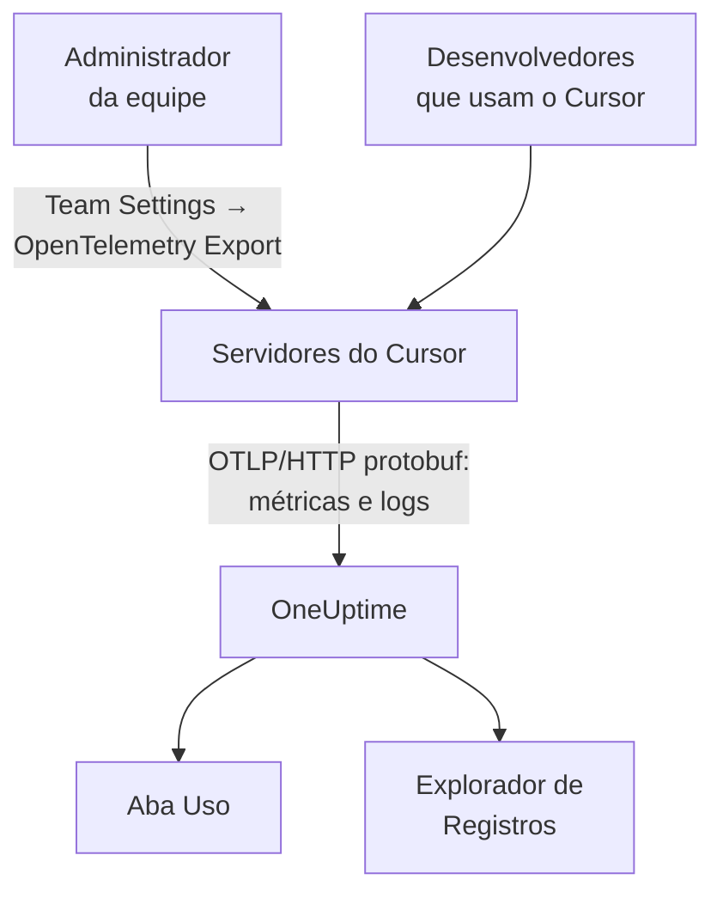

# Cursor

O Cursor exporta a telemetria da equipe a partir dos próprios servidores do Cursor. Um administrador da equipe adiciona o OneUptime como destino uma única vez, no painel do Cursor, e os tokens, o custo estimado e as chamadas de ferramentas da equipe inteira chegam: nada para instalar ou configurar nas máquinas dos desenvolvedores.

:::cards
- [Configure](#configure): Crie uma chave no OneUptime e um destino no Cursor.
- [O que você obtém](#o-que-você-obtém-e-o-que-não): Métricas e logs; nenhum trace.
- [Quem gastou o quê](#atribuição-a-funcionários): As pessoas chegam como ids de usuário do Cursor.
- [Solução de problemas](#solução-de-problemas): O que verificar quando nada chega.
:::

## Como funciona



## Antes de começar

- **O plano Enterprise do Cursor.** A tela OpenTelemetry Export não existe nos outros planos.
- **Um endpoint que o Cursor consiga alcançar pela internet.** É o Cursor que se conecta a você, a partir de um conjunto fixo de endereços. O OneUptime Cloud não precisa de mais nada; um OneUptime auto-hospedado atrás de um firewall precisa permitir os endereços de saída que o Cursor lista na página [OpenTelemetry Export](https://cursor.com/docs/enterprise/opentelemetry-export) dele.

## Configure

:::steps
### Crie uma chave de ingestão

No OneUptime, abra **Configurações do projeto → Telemetria e APM → Chaves de ingestão**, clique em **Criar chave de ingestão** e copie a chave. Sua URL base OTLP é `https://oneuptime.com/otlp`, ou `https://YOUR-ONEUPTIME-HOST/otlp` se você hospeda o OneUptime por conta própria.

### Crie o destino no Cursor

No painel web do Cursor, como administrador da equipe, abra **Team Settings → OpenTelemetry Export** e crie um destino:

| Campo | Valor |
| --- | --- |
| Endpoint (base URL) | `https://oneuptime.com/otlp` |
| Header name | `x-oneuptime-token` |
| Header value | `YOUR_INGESTION_TOKEN` |

Digite a URL base sem `/v1`: o Cursor adiciona `/v1/metrics` e `/v1/logs` por conta própria, e `https://oneuptime.com/otlp/v1` enviaria para `/otlp/v1/v1/metrics`, onde nada chega.

### Teste e ative

Clique em **Test connection** para verificar a URL e o cabeçalho, e depois em **Enable**. A exportação começa em cerca de um minuto; edições posteriores no cabeçalho levam cerca de 30 segundos.

### Verifique se os dados chegam

Use o Cursor por um ou dois minutos, depois abra **Registros** no OneUptime e filtre pelo nome de serviço `cursor`: registros `cursor.api.request` com contagens de tokens indicam que a chave e a URL estão certas.
:::

O Cursor fala OTLP sobre HTTP apenas com protobuf binário (sem gRPC, sem JSON), que o OneUptime aceita como está. Ele armazena o cabeçalho criptografado, e envia para um único destino por equipe: para enviar ao OneUptime e a outro lugar, coloque um collector na frente.

## O que você obtém, e o que não

| Sinal | Do Cursor |
| --- | --- |
| Métricas: tokens, custo estimado, chamadas de ferramentas | Sim, como deltas |
| Eventos de log: requisições, erros, correções, skills, hooks, plugins, agentes na nuvem | Sim |
| Texto de prompts e respostas | Só se você ativar a família `conversation_content` |
| Traces | Não |
| Qualquer coisa de antes de você ativar o destino | Não |

Então, no OneUptime, o Cursor aparece na aba **Uso** de **Produtos → AI / LLM**, a partir de `cursor.token.usage` e `cursor.cost.usage`, mas nunca em **Chamadas** ou **Conversas**, que são construídas a partir de traces. O detalhe por requisição é o evento `cursor.api.request` no explorador de **Registros**.

### Famílias

Cada sinal, e cada família de telemetria, tem sua própria chave nas configurações do Cursor:

| Família | Cobre |
| --- | --- |
| `model_usage` | `cursor.token.usage`, `cursor.cost.usage`, e os eventos `cursor.api.request`, `cursor.api.error` e `cursor.api.correction` |
| `tool_calls` | `cursor.tool.calls` |
| `skills_hooks_plugins` | Eventos de skills, hooks e plugins |
| `cloud_agents` | Eventos `cursor.cloud_agent.*` |
| `grok_bot_agent_actions` | Eventos `cursor.grok_bot.*`; exige Action Recording |
| `conversation_content` | O texto das mensagens e a entrada e a saída das ferramentas MCP; desativada por padrão |

Todas as famílias, menos `conversation_content`, começam ativadas. As famílias que o Cursor adicionar depois também começam ativadas, a menos que você desative `auto_enable_new_families`.

## Métricas e eventos

As três métricas são somas delta:

| Métrica | Unidade | Atributos |
| --- | --- | --- |
| `cursor.token.usage` | `{token}` | `cursor.token.type`: `input`, `output`, `cache_read`, `cache_creation`; `cursor.model.name`; `cursor.api.status`: `success`, `errored`, `aborted`; `cursor.api.billable` |
| `cursor.cost.usage` | `USD` | `cursor.model.name` |
| `cursor.tool.calls` | `{call}` | `cursor.tool.kind`: `builtin`, `mcp`; `cursor.tool.name`; `cursor.tool.status`: `success`, `failure`, `aborted`; `cursor.mcp.server.name` |

Os pontos de dados não carregam nenhum id de conversa ou de requisição, então o custo por sessão não está nas métricas. `cursor.model.name` é o modelo solicitado, com as escolhas roteadas agrupadas: uma divisão por modelo tem uma linha chamada `Auto` que não pode ser separada entre os modelos para os quais o Cursor a roteou.

O evento de log que você mais vai usar é `cursor.api.request`: um por requisição, com as contagens de tokens de entrada, de saída e de cache, o modelo e se ela foi cobrada. `cursor.api.error` registra uma requisição com falha (sem a mensagem de erro), e `cursor.api.correction` chega depois para dizer que uma requisição afinal não foi cobrada. A [referência do formato](https://cursor.com/docs/enterprise/opentelemetry-export/wire) do Cursor lista cada evento e atributo.

Cada registro carrega estes atributos de recurso:

| Atributo | O que é |
| --- | --- |
| `service.name` | Sempre `cursor`: filtre os exploradores de **Registros** e **Métricas** por ele |
| `cursor.team.id` | Sua equipe, um número inteiro; sempre presente |
| `cursor.user.id` | A pessoa, um número inteiro válido dentro da equipe; opcional |
| `cursor.surface` | De onde veio a atividade, como `desktop`, `cli`, `cloud_agent` ou `bugbot` |
| `cursor.entrypoint` | Como ela começou, como `desktop`, `cli`, `web`, `api` ou `github_pr` |

## Atribuição a funcionários

**O Cursor identifica uma pessoa por `cursor.user.id`, um número inteiro que só o Cursor consegue transformar em um nome, e muitas vezes o omite para agentes na nuvem.** O OneUptime o lê como o funcionário, e `cursor.team.id` como a equipe, então a aba **Uso** ordena pessoas e equipes sem configuração, mas as pessoas aparecem como números inteiros.

- Os dois chegam como atributos de recurso (`resource.cursor.user.id`, `resource.cursor.team.id`), que o OneUptime lê.
- O Cursor também pode enviar `cursor.user.email`, mas o OneUptime ainda não o lê, então a coluna de e-mail do funcionário fica vazia para o Cursor.
- `gen_ai.user`, `llm.user` e os ids de usuário final do LiteLLM nunca são lidos como o funcionário: eles identificam seus clientes, não sua equipe. Veja [Atribuição a funcionários e equipes](/docs/telemetry/ai-coding-assistants#atribuição-a-funcionários-e-equipes).

### Onde o Cursor aparece na aba Uso

O Cursor envia métricas e nenhum span GenAI, e as métricas só completam os spans: **se o mesmo projeto recebe spans GenAI com custo, o gasto do Cursor não aparece.** Envie o Cursor para um projeto só dele. Veja [Primeiro os spans, as métricas completam](/docs/telemetry/ai-llm-observability#primeiro-os-spans-as-métricas-completam).

| Divisão | Para o Cursor |
| --- | --- |
| **Funcionário** | Sim, por `cursor.user.id` |
| **Equipe** | Sim, por `cursor.team.id` |
| **Modelo** | Sim, por `cursor.model.name` |
| **Provedor** | Não: o Cursor nunca diz qual provedor atendeu uma chamada |
| **Aplicação / Serviço** | Não: as métricas do Cursor não pertencem a nenhum serviço do OneUptime |

Uma linha do Cursor carrega só o custo: as células de chamadas e tokens mostram `—`, porque `cursor.cost.usage` não tem detalhe por chamada. `cursor.token.usage` continua alimentando os totais de tokens acima da tabela (os tipos `input` e `output`; os tokens de cache ficam de fora), e você pode mostrá-lo em um dashboard por `cursor.token.type`.

:::details Transformar um id de usuário do Cursor em uma pessoa
Os nomes e os valores cobrados estão na Admin API do Cursor, que o OneUptime não chama: consulte-a você mesmo se precisar. Ela é só para o Enterprise, fica em `https://api.cursor.com`, e recebe uma chave de API de administrador como nome de usuário com uma senha vazia:

```bash
curl -u YOUR_API_KEY: https://api.cursor.com/teams/members
```

`GET /teams/members` lista o e-mail e o nome de cada membro. `POST /teams/filtered-usage-events` retorna o uso cobrado por evento; some os `chargedCents` dele para obter o gasto. O `conversationId` dele corresponde a `cursor.conversation.id` nos eventos de log do Cursor, o que liga uma pessoa e um valor cobrado a uma sessão que você já vê, quando os dois lados o carregam. O Cursor não documenta que o número inteiro `cursor.user.id` e os ids de usuário da Admin API são os mesmos, então confira isso com a sua própria equipe antes de cobrar alguém com base nisso.
:::

## Como o Cursor entrega

Estas regras mudam o que você vê nos gráficos, então conheça-as antes de relatar uma lacuna:

- **As métricas são enviadas no máximo uma vez.** Uma exportação com falha não é repetida, então uma breve lacuna depois de uma falha é esperada: não acione ninguém por lacunas nas métricas do Cursor.
- **Os logs são enviados pelo menos uma vez**, deduplicados por `cursor.event.id`, e repetidos automaticamente por cerca de 7 dias.
- **Não há ordem.** Um `cursor.api.correction` chega depois da requisição que ele corrige: ordene pelo timestamp do registro, nunca pela chegada.
- **Nada é preenchido retroativamente.** Nada de antes de você ativar o destino chega, e um destino deixado quebrado perde o que o Cursor não conseguiu enviar.
- **Desativar ou excluir um destino descarta os dados em trânsito.** Para trocar a chave de ingestão, edite o cabeçalho do destino em vez de excluí-lo e criá-lo de novo.

## O custo é uma estimativa, não uma fatura

O Cursor documenta `cursor.cost.usage` como uma estimativa aproximada. Ela não separa o uso incluído do uso cobrado sob demanda; com as suas próprias chaves de modelo, reflete só a tarifa de tokens do Cursor, não a fatura do seu provedor; e um `cursor.api.correction` posterior pode retirar um uso que já foi contado. Leia-a como uma tendência. Para um número que bata com a fatura, some os `chargedCents` da Admin API do Cursor.

## Solução de problemas

:::details Nada chega
Execute **Test connection** de novo no Cursor. Verifique se a URL base não termina em `/v1`, se o nome do cabeçalho é `x-oneuptime-token` e o valor é exatamente a chave, e se a família `model_usage` está ativada. A exportação começa cerca de um minuto depois de você ativar o destino.
:::

:::details Nada chega a um OneUptime auto-hospedado
O Cursor se conecta a partir dos próprios servidores: seu endpoint OTLP precisa ser acessível pela internet, com um nome DNS público, e permitir os endereços de saída do Cursor no seu firewall.
:::

:::details Os logs chegam, mas a aba Uso não mostra gasto do Cursor
O projeto também recebe spans GenAI com custo, então as métricas do Cursor não são lidas. Envie o Cursor para um projeto só dele, com sua própria chave de ingestão.
:::

:::details As pessoas aparecem como números
Isso é `cursor.user.id`: o único id de pessoa que o OneUptime lê do Cursor hoje. Associe-o a nomes com a Admin API do Cursor.
:::

## Próximos passos

:::cards
- [Assistentes de programação com IA](/docs/telemetry/ai-coding-assistants): Como o gasto é atribuído em todos os assistentes de programação.
- [Gateways de IA](/docs/telemetry/ai-gateways): Traces e prompts completos para as chamadas a modelos que suas próprias aplicações fazem.
- [Monitor de métricas](/docs/monitor/metrics-monitor): Alerte sobre `cursor.cost.usage`, `cursor.token.usage` ou `cursor.tool.calls`.
:::
