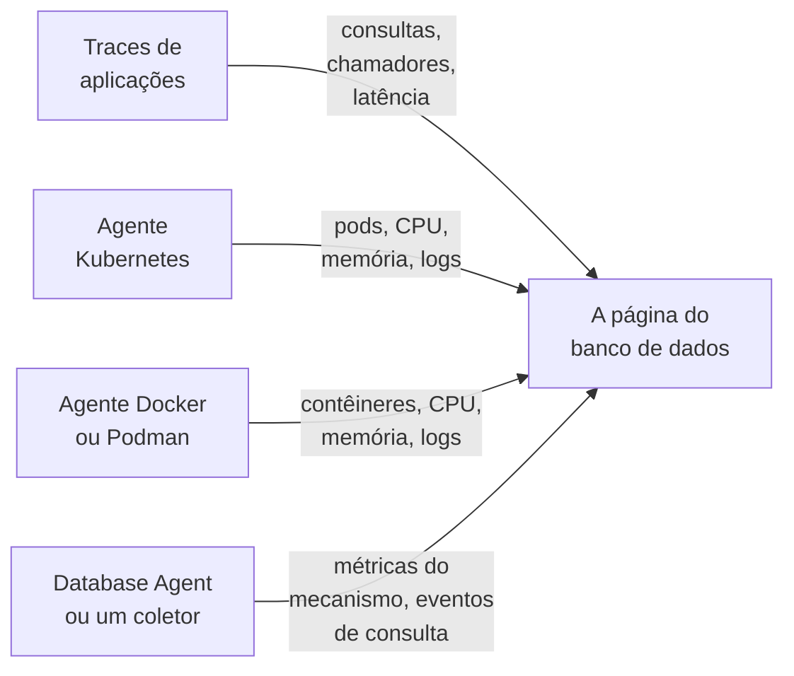

# Bancos de dados

**Databases** dá a cada servidor de banco de dados que o seu projeto executa ou acessa uma página própria: quem o chama e com que rapidez, onde ele é executado, as métricas de saúde do próprio mecanismo, seus logs e traces, os incidentes, alertas e manutenções programadas ligados a ele e os monitores de alerta recomendados para o seu mecanismo. Bancos de dados têm rótulos, proprietários, regras de rótulos e de proprietários, retenção por banco de dados e arquivamento, como qualquer outro recurso. Abra-os em **Produtos → Recursos → Bancos de dados**.

:::cards
- [O Database Agent](#o-database-agent): Métricas do mecanismo para PostgreSQL, MySQL, SQL Server, Oracle, Redis, MongoDB, Elasticsearch e Memcached.
- [Como os bancos de dados são detectados](#como-os-bancos-de-dados-são-detectados): A partir de traces, Kubernetes, Docker, Podman e coletores.
- [Alertas sobre um banco de dados](#alertas-sobre-um-banco-de-dados): Monitores recomendados e monitores que você cria.
- [Solução de problemas](#solução-de-problemas): Um script de diagnóstico, e os problemas mais comuns.
:::

## Como funciona

A maioria dos bancos de dados aparece sozinha. O OneUptime monta cada um a partir de até quatro fontes, e cada fonte contribui com algo diferente:

| Fonte | O que ela precisa de você | O que ela acrescenta à página do banco de dados |
| --- | --- | --- |
| **Traces de aplicações** | Aplicações instrumentadas (OpenTelemetry) | Consultas das aplicações: taxa de chamadas, erros, latência e os serviços que o chamam |
| **Kubernetes** | O [agente Kubernetes do OneUptime](/docs/telemetry/kubernetes-agent) | Onde ele é executado: pods, CPU e memória, e os logs dos pods |
| **Docker / Podman** | O [agente Docker](/docs/telemetry/docker-host) ou o [agente Podman](/docs/telemetry/podman-host) | Onde ele é executado: os contêineres, a CPU e a memória deles, e os logs deles |
| **Database Agent** (um OpenTelemetry Collector) | O [Database Agent](#o-database-agent) ou o seu próprio coletor | **Engine metrics**: conexões, throughput, taxa de acertos do cache, bloqueios, atraso de replicação, memória, na medida em que o mecanismo os tem (veja [O que é coletado](#o-que-é-coletado)), além de amostras de consultas opcionais, principais consultas e o arquivo de log do mecanismo |



As métricas do mecanismo só vêm de um coletor que conversa com o próprio banco de dados (ou, no caso de um banco de dados gerenciado na nuvem, com a API de monitoramento do provedor). Traces e inventários de contêineres dizem ao OneUptime que um banco de dados existe e como é usado, mas não como ele está por dentro: o status **Engine metrics** de cada banco de dados indica se essa parte está conectada.

Você também pode adicionar um banco de dados à mão: **Databases → Criar: Banco de dados** com o mecanismo, o endereço e a porta. Para uma verificação de saúde a partir de uma sonda que não precisa de nenhum agente, veja o [Monitor de saúde de banco de dados](/docs/monitor/database-health-monitor).

## Bancos de dados compatíveis

O OneUptime conhece pelo nome os mecanismos da tabela abaixo: normaliza o que as instrumentações colocam em `db.system.name` (ou no antigo `db.system`) para o valor da segunda coluna, mostra o nome do mecanismo, aplica a porta padrão dele quando um span ou um endereço não tem uma, reconhece as imagens de contêiner e os charts do Helm dele e sabe de onde vêm as métricas do mecanismo. Um mecanismo que não está na lista ainda funciona em todos os lugares onde um banco de dados é identificado pelo endereço; ele só aparece com o nome bruto que os seus spans informam e nunca é criado apenas a partir de traces.

Uma **família** é o mecanismo pelo qual se chega a um fork ou a um mecanismo compatível no protocolo: as bibliotecas cliente não distinguem MariaDB de MySQL nem Valkey de Redis, então um span diz `mysql` ou `redis` enquanto uma imagem de contêiner, um chart do Helm ou o Database Agent nomeiam o fork. Ambos chegam ao mesmo banco de dados, e o banco de dados mostra o mecanismo mais específico assim que a imagem de contêiner dele, ou uma fonte pelo menos tão forte quanto a que deu o mecanismo atual, o nomeia (veja [Qual mecanismo um banco de dados mostra](#qual-mecanismo-um-banco-de-dados-mostra)).

**Criado a partir de traces** indica se os spans de cliente sozinhos criam um banco de dados desse mecanismo (veja [A partir de traces de aplicações](#a-partir-de-traces-de-aplicações)): um serviço gerenciado acessado pelo host de API compartilhado do provedor e um mecanismo executado dentro do processo da sua aplicação nunca criam. **Engine metrics** indica de onde vêm as métricas de saúde do próprio mecanismo: uma configuração do Database Agent, um receptor do collector-contrib que você adiciona ao seu próprio coletor, o endpoint Prometheus do próprio mecanismo (`:port/path`, coletado com o receptor `prometheus` do coletor), a API de monitoramento do provedor de nuvem ou nada integrado. A guia **Documentação** de cada banco de dados transforma isso em uma configuração de coletor pronta para uso com esse banco de dados.

| Mecanismo | `db.system.name` | Porta padrão | Família | Criado a partir de traces | Engine metrics |
| --- | --- | --- | --- | --- | --- |
| Actian Ingres | `actian.ingres` | — | — | Sim | Nada integrado |
| Actian Zen (Pervasive PSQL) | `pervasive` | 1583 | — | Sim | Nada integrado |
| Aerospike | `aerospike` | 3000 | — | Sim | receptor `aerospike` |
| Amazon DocumentDB | `aws.documentdb` | 27017 | MongoDB | Sim | receptor `awsfirehose` (monitoramento de nuvem) |
| Amazon DynamoDB | `aws.dynamodb` | 443 | — | Não (API de nuvem) | receptor `awsfirehose` (monitoramento de nuvem) |
| Amazon Neptune | `aws.neptune` | 8182 | — | Sim | receptor `awsfirehose` (monitoramento de nuvem) |
| Amazon Redshift | `aws.redshift` | 5439 | PostgreSQL | Sim | receptor `awsfirehose` (monitoramento de nuvem) |
| Apache Derby | `derby` | 1527 | — | Não (no processo) | Nenhuma (no processo) |
| Apache Doris | `doris` | 9030 | MySQL | Sim | Prometheus, `:8030/metrics` |
| Apache Druid | `druid` | 8888 | — | Sim | Nada integrado |
| Apache Geode | `geode` | 10334 | — | Sim | Nada integrado |
| Apache HBase | `hbase` | — | — | Sim | Nada integrado |
| Apache Hive | `hive` | 10000 | — | Sim | Nada integrado |
| Apache Ignite | `ignite` | 10800 | — | Sim | Nada integrado |
| Apache Impala | `impala` | 21050 | — | Sim | Nada integrado |
| Apache Pinot | `pinot` | 8099 | — | Sim | Nada integrado |
| Apache Solr | `solr` | 8983 | — | Sim | Nada integrado |
| ArangoDB | `arangodb` | 8529 | — | Sim | Prometheus, `:8529/_admin/metrics/v2` |
| Azure Cosmos DB | `azure.cosmosdb` | 443 | — | Não (API de nuvem) | receptor `azure_monitor` (monitoramento de nuvem) |
| Cassandra | `cassandra` | 9042 | — | Sim | Nada integrado |
| Chroma | `chroma` | 8000 | — | Sim | Nada integrado |
| Claris FileMaker | `filemaker` | 2399 | — | Sim | Nada integrado |
| ClickHouse | `clickhouse` | 9000 | — | Sim | Prometheus, `:9363/metrics` |
| Cloud Bigtable | `gcp.bigtable` | 443 | — | Não (API de nuvem) | receptor `googlecloudmonitoring` (monitoramento de nuvem) |
| Cloud Firestore | `gcp.firestore` | 443 | — | Não (API de nuvem) | receptor `googlecloudmonitoring` (monitoramento de nuvem) |
| Cloud Spanner | `gcp.spanner` | 443 | — | Não (API de nuvem) | receptor `google_cloud_spanner` |
| CockroachDB | `cockroachdb` | 26257 | PostgreSQL | Sim | Prometheus, `:8080/_status/vars` |
| Couchbase | `couchbase` | 11210 | — | Sim | Prometheus, `:8091/metrics` |
| CouchDB | `couchdb` | 5984 | — | Sim | receptor `couchdb` |
| Databricks | `databricks` | 443 | — | Sim | Nada integrado |
| Dragonfly | `dragonfly` | 6379 | Redis | Sim | Database Agent (receptor `redis`) |
| DuckDB | `duckdb` | — | — | Não (no processo) | Nenhuma (no processo) |
| Elasticsearch | `elasticsearch` | 9200 | — | Sim | Database Agent (receptor `elasticsearch`) |
| etcd | `etcd` | 2379 | — | Sim | Prometheus, `:2379/metrics` |
| FerretDB | `ferretdb` | 27017 | MongoDB | Sim | Prometheus, `:8088/debug/metrics` |
| Firebird | `firebirdsql` | 3050 | — | Sim | Nada integrado |
| FoundationDB | `foundationdb` | 4500 | — | Sim | Nada integrado |
| Google BigQuery | `bigquery` | 443 | — | Não (API de nuvem) | receptor `googlecloudmonitoring` (monitoramento de nuvem) |
| Greenplum | `greenplum` | 5432 | PostgreSQL | Sim | Nada integrado |
| H2 | `h2database` | 9092 | — | Não (no processo) | Nenhuma (no processo) |
| Hazelcast | `hazelcast` | 5701 | — | Sim | Nada integrado |
| HyperSQL | `hsqldb` | 9001 | — | Não (no processo) | Nenhuma (no processo) |
| IBM Db2 | `ibm.db2` | 50000 | — | Sim | Nada integrado |
| IBM Informix | `ibm.informix` | 9088 | — | Sim | Nada integrado |
| IBM Netezza | `ibm.netezza` | 5480 | — | Sim | Nada integrado |
| InfluxDB | `influxdb` | 8086 | — | Sim | Prometheus, `:8086/metrics` |
| InstantDB | `instantdb` | — | — | Não (no processo) | Nenhuma (no processo) |
| InterBase | `interbase` | 3050 | Firebird | Sim | Nada integrado |
| InterSystems IRIS / Caché | `intersystems.cache` | 1972 | — | Sim | Prometheus, `:52773/api/monitor/metrics` |
| KeyDB | `keydb` | 6379 | Redis | Sim | Database Agent (receptor `redis`) |
| MariaDB | `mariadb` | 3306 | MySQL | Sim | Database Agent (receptor `mysql`) |
| Meilisearch | `meilisearch` | 7700 | — | Sim | Prometheus, `:7700/metrics` |
| Memcached | `memcached` | 11211 | — | Sim | Database Agent (receptor `memcached`) |
| Milvus | `milvus` | 19530 | — | Sim | Prometheus, `:9091/metrics` |
| MongoDB | `mongodb` | 27017 | — | Sim | Database Agent (receptor `mongodb`) |
| MySQL | `mysql` | 3306 | — | Sim | Database Agent (receptor `mysql`) |
| Neo4j | `neo4j` | 7687 | — | Sim | Prometheus, `:2004/metrics` |
| OceanBase | `oceanbase` | 2881 | MySQL | Sim | Nada integrado |
| OpenSearch | `opensearch` | 9200 | Elasticsearch | Sim | Database Agent (receptor `elasticsearch`) |
| Oracle | `oracle.db` | 1521 | — | Sim | Database Agent (receptor `oracledb`) |
| Pinecone | `pinecone` | 443 | — | Não (API de nuvem) | Nada integrado |
| PostgreSQL | `postgresql` | 5432 | — | Sim | Database Agent (receptor `postgresql`) |
| Presto | `presto` | 8080 | — | Sim | Nada integrado |
| Progress OpenEdge | `progress` | — | — | Sim | Nada integrado |
| Qdrant | `qdrant` | 6333 | — | Sim | Prometheus, `:6333/metrics` |
| QuestDB | `questdb` | 8812 | PostgreSQL | Sim | Prometheus, `:9003/metrics` |
| RavenDB | `ravendb` | 8080 | — | Sim | Nada integrado |
| Redis | `redis` | 6379 | — | Sim | Database Agent (receptor `redis`) |
| Riak KV | `riak` | 8087 | — | Sim | receptor `riak` |
| SAP ASE (Sybase) | `sybase` | 5000 | — | Sim | Nada integrado |
| SAP HANA | `sap.hana` | 30015 | — | Sim | receptor `saphana` |
| SAP MaxDB | `sap.maxdb` | 7210 | — | Sim | Nada integrado |
| ScyllaDB | `scylladb` | 9042 | Cassandra | Sim | Prometheus, `:9180/metrics` |
| SingleStore | `singlestore` | 3306 | MySQL | Sim | Prometheus, `:9104/metrics` |
| Snowflake | `snowflake` | 443 | — | Sim | receptor `snowflake` |
| Software AG Adabas | `softwareag.adabas` | — | — | Sim | Nada integrado |
| SQL Server | `microsoft.sql_server` | 1433 | — | Sim | Database Agent (receptor `sqlserver`) |
| SQLite | `sqlite` | — | — | Não (no processo) | Nenhuma (no processo) |
| StarRocks | `starrocks` | 9030 | MySQL | Sim | Prometheus, `:8030/metrics` |
| SurrealDB | `surrealdb` | 8000 | — | Sim | Nada integrado |
| Teradata | `teradata` | 1025 | — | Sim | Nada integrado |
| TiDB | `tidb` | 4000 | MySQL | Sim | Prometheus, `:10080/metrics` |
| Trino | `trino` | 8080 | — | Sim | Prometheus, `:8080/metrics` |
| Typesense | `typesense` | 8108 | — | Sim | Nada integrado |
| Valkey | `valkey` | 6379 | Redis | Sim | Database Agent (receptor `redis`) |
| Vertica | `vertica` | 5433 | — | Sim | Nada integrado |
| Vitess | `vitess` | 3306 | MySQL | Sim | Prometheus, `:15000/metrics` |
| Weaviate | `weaviate` | 8080 | — | Sim | Prometheus, `:2112/metrics` |
| YugabyteDB | `yugabytedb` | 5433 | PostgreSQL | Sim | Prometheus, `:9000/prometheus-metrics` |

As outras grafias comuns também são aceitas: `postgres` e `pg`, `mssql` e `sqlserver`, `oracle`, `mongo`, `scylla`, `dragonflydb`, `memsql`, e todo valor legado de `db.system` que o OpenTelemetry já usou (`db2`, `hanadb`, `cosmosdb`, `dynamodb`, `spanner`, `redshift`, `informix`, `maxdb`, `cache`, `h2`, `firebird`, `edb`, `cloudscape`, …). Um serviço gerenciado que fala o protocolo de um mecanismo (Amazon RDS e Aurora, Azure Database, Cloud SQL, AlloyDB, Neon, Supabase, PlanetScale, ElastiCache, Memorystore, MongoDB Atlas) é esse mecanismo.

## Como os bancos de dados são detectados

Cada banco de dados guarda a fonte que o criou (a coluna **Discovered from**), e o primeiro item do seu **Feed** diz o que o encontrou: o workload do Kubernetes e o cluster dele, o contêiner Docker ou Podman (ou o serviço do Compose ou do Swarm) e o host dele, o endpoint que as aplicações chamaram, ou o Database Agent (com a versão dele) ou o coletor que o informou. Fontes posteriores complementam o mesmo banco de dados em vez de criar outro, desde que descrevam o mesmo endpoint (veja [Endpoints](#endpoints-e-a-regra-do-proprietário-único)).

### A partir de traces de aplicações

A cada 10 minutos, o OneUptime resume os spans CLIENT que as suas aplicações enviaram nos últimos 15 minutos e que trazem `db.system.name` (ou o antigo `db.system`). O servidor vem de `server.address` (ou do antigo `net.peer.name`, depois `network.peer.address` / `net.sock.peer.addr`) e a porta de `server.port` (ou `net.peer.port`, `network.peer.port`, `net.sock.peer.port`); quando o span não tem porta, assume-se a porta padrão do mecanismo. Os nomes de mecanismo são normalizados (veja [Bancos de dados compatíveis](#bancos-de-dados-compatíveis)), então `postgres`, `pg` e `postgresql` são um único mecanismo, assim como `mssql` e `microsoft.sql_server`; `mariadb` e `mysql` são dois mecanismos de uma mesma família.

Um banco de dados só é **criado** a partir de traces quando todas estas condições valem; todo o resto continua contando para um banco de dados que já existe, mas nunca cria um:

- o endereço designa um único servidor em todo o projeto: um nome DNS, não um IP literal nem um nome que só resolve em uma máquina ou dentro de uma rede, a menos que o cluster Kubernetes de quem chama o qualifique (veja [Endpoints](#endpoints-e-a-regra-do-proprietário-único));
- a porta é uma em que um servidor escuta. Os sistemas operacionais atribuem a ponta do cliente de uma conexão a partir da porta 32768 (o intervalo efêmero padrão do Linux começa ali; Windows e macOS usam 49152–65535), então uma porta a partir de 32768 nunca cria um banco de dados, a menos que seja a porta padrão do próprio mecanismo (a 50000 do IBM Db2). A instrumentação eBPF, inclusive a do agente Kubernetes, pode entrar em uma conexão longa no meio do caminho e trocar as duas pontas dela. O span então nomeia a própria porta do cliente como servidor, e sem esta regra cada conexão viraria um banco de dados próprio;
- o mecanismo é um que o OneUptime conhece, com um endereço próprio: a coluna **Criado a partir de traces** de [Bancos de dados compatíveis](#bancos-de-dados-compatíveis). APIs de nuvem cujo host é compartilhado por todos os clientes (DynamoDB, BigQuery, Spanner, Firestore, Bigtable, Cosmos DB, Pinecone), mecanismos executados dentro da sua aplicação (SQLite, DuckDB, H2, HyperSQL, Derby) e mecanismos que o OneUptime não conhece nunca são criados a partir de traces; adicione-os à mão;
- o endpoint recebeu pelo menos 10 consultas na janela de 15 minutos que uma execução examina, para que um script avulso não crie um banco de dados. Os spans de gerenciamento de conexões de uma biblioteca cliente (`pg.connect` e `pg-pool.connect` do node-postgres, `redis-connect`, `connect`, …) não são consultas: não contam nem aqui nem nas **Consultas** de um banco de dados;
- o projeto está abaixo do seu [orçamento de criação automática](#o-orçamento-de-criação-automática).

Cada span CLIENT de banco de dados também é marcado com o seu endpoint quando é ingerido, então, assim que um banco de dados possui um endpoint, a seção **Consultas das aplicações** e a guia **Traços** mostram cada chamada a ele, inclusive as feitas antes de o banco de dados ser criado. As métricas `db.client.*` (por exemplo `db.client.operation.duration`) que trazem um `server.address` são marcadas da mesma forma.

**Clusters e listas de hosts.** Uma string de conexão que lista vários hosts (`m1:27017,m2:27017,m3:27017`) é um único banco de dados, seja qual for a ordem em que um cliente os lista. Os membros do MongoDB Atlas (`cluster0-shard-00-01.ab1cd.mongodb.net`) viram um único banco de dados com o nome do cluster deles (`cluster0.ab1cd.mongodb.net`), e cada membro visto vira um dos seus endpoints. Drivers que informam separadamente cada membro de um anel Cassandra, de um Redis Cluster, de um cluster Elasticsearch ou nós do ElastiCache ainda produzem um banco de dados por membro: nada nesses nomes de host diz a qual cluster eles pertencem. Mantenha um e [mescle](#endpoints-e-a-regra-do-proprietário-único) os outros nele.

### A partir do Kubernetes

A cada 5 minutos, o OneUptime examina os pods de cada cluster Kubernetes conectado e reconhece workloads de bancos de dados:

1. **Primeiro, os rótulos de operators e charts**: CloudNativePG, Zalando (Spilo), Crunchy PGO, os charts da Bitnami, ECK, Altinity ClickHouse, cass-operator, Percona, o operator do Oracle MySQL e o operator do Vitess (os pods `vtgate` dele são o banco de dados; `vttablet`, `vtctld`, `vtorc` e `vtbackup` são partes dele, não membros). Um cluster de operator vira um banco de dados. O próprio Service vtgate do cluster Vitess tem um nome com hash, então adicione-o na guia **Endpoints** do banco de dados se as aplicações se conectarem por ele.
2. **Senão, as imagens de contêiner**, pelo nome exato da imagem: as imagens oficiais, as da Bitnami (incluindo os repositórios realocados `bitnamilegacy` e `bitnamisecure`) e as da Red Hat / OpenShift de cada mecanismo de [Bancos de dados compatíveis](#bancos-de-dados-compatíveis) que publica uma (`postgres`, `bitnami/postgresql`, `rhel9/postgresql-16`, `mysql`, `mariadb`, `mssql/server`, `gvenzl/oracle-free`, `redis`, `valkey/valkey`, `mongo`, `cockroachdb/cockroach`, `pingcap/tidb`, `clickhouse/clickhouse-server`, `qdrant/qdrant`, …). Um fork é reconhecido como ele mesmo: uma imagem `mariadb` é MariaDB, uma imagem `valkey/valkey` é Valkey. Exportadores, operators, interfaces de administração, poolers de conexão (pgbouncer, pgpool, ProxySQL, HAProxy, Cloud SQL Proxy) e ferramentas de backup não são bancos de dados. Um pod que também executa um contêiner de aplicação também não é tratado como banco de dados (uma app com um sidecar de banco de dados continua sendo a app), embora um StatefulSet cujo contêiner de banco de dados declara a porta padrão do mecanismo possa ter um contêiner extra que o OneUptime não reconhece (um enviador de logs, por exemplo).

Uma imagem de banco de dados não faz de um pod um servidor de banco de dados, mas só uma evidência positiva o torna outra coisa. Um contêiner cujo programa é uma ferramenta cliente ou de dump (`psql`, `redis-cli`, `mongosh`, `pg_dump`, `mysql`), um keep-alive (`sleep infinity`, `tail -f /dev/null`) ou um shell interativo (ou cujo script `sh -c` não executa nada além dessas ferramentas, comandos internos do shell e utilitários simples como `echo` e `cp`) é uma execução cliente ou de depuração, não um banco de dados; o mesmo vale para um Sentinel do Redis ou do Valkey (`redis-sentinel`, `redis-server --sentinel`). Isso vale também atrás de um lançador: `env` (com as configurações `NAME=value` dele), `nohup`, `setsid`, `tini`, `dumb-init` e o `docker-entrypoint.sh` de uma imagem são atravessados até o programa que iniciam, assim como `exec`, `env` e `nohup` dentro de um script; então `env PGPASSWORD=… psql` e `tini -- redis-cli` são execuções cliente, enquanto `tini -- docker-entrypoint.sh postgres` é o servidor, e também `docker-entrypoint.sh -c max_connections=200`, o próprio servidor da imagem iniciado com uma flag. Um script que depois inicia qualquer outra coisa (`sleep 5 && exec redis-server`, `bash -ecx 'exec cockroach start …'`), um arquivo de script (`sh /start.sh`), um wrapper que recebe argumentos próprios antes do programa (`gosu postgres …`, `timeout 30 …`) ou um script longo demais para ler conta como um possível servidor. Pods concluídos, jobs em lote e pods avulsos de `kubectl run` que não declaram nenhuma porta também não são bancos de dados.

Um banco de dados aparece quando um dos seus pods fica Ready por cerca de 10 minutos (quando só um sidecar impede o pod de ficar Ready, conta em vez disso um contêiner de banco de dados pronto). Um pod em loop de falhas volta a ficar Ready a cada reinício, então nunca vira um banco de dados, nem um job de CI ou um pod que falhou depois de um minuto. Depois de criado, um banco de dados é atualizado a cada execução.

Os pods são agrupados pelo StatefulSet, Deployment ou cluster de operator deles, então um StatefulSet de três membros é um banco de dados com três membros. **Instâncias** na página dele conta os pods cujo contêiner de banco de dados está em execução: não um que espera em `CrashLoopBackOff` ou `ImagePullBackOff`, nem um que terminou, embora o Kubernetes ainda possa informar esse pod como Running; um workload escalado para zero mostra 0 e mantém a página até que o [arquivamento automático](#ciclo-de-vida-arquivamento-e-retenção) o retire. O caminho de volta também funciona: a página do StatefulSet ou Deployment do workload, e a página de cada um dos pods dele, nomeiam o banco de dados que ele executa com um link **Open database**, inclusive um StatefulSet ou Deployment com nome diferente do banco de dados dele (o `shop-redis-master` da Bitnami para `shop-redis`, o `cluster1-pxc` da Percona para `cluster1`), enquanto um workload de pooler ou de backup que um operator rotula como parte de um cluster informa que faz parte do cluster desse banco de dados.

O agente Kubernetes não informa objetos Service, então os nomes de Service de um banco de dados vêm das convenções que charts e operators seguem: o nome do StatefulSet ou Deployment proprietário, o Service headless do StatefulSet (e cada membro por trás dele, `<pod>.<headless-service>`), e os Services de proxy e pooler dos operators: HAProxy e ProxySQL do Percona XtraDB Cluster, o router e o HAProxy do Percona Server for MySQL, o mongos do Percona Server for MongoDB, o pgBouncer da Crunchy e os poolers do Zalando e do CloudNativePG. Cada um vira um endpoint qualificado pelo cluster (`postgres.prod.svc.cluster.local:5432@my-cluster`), então o mesmo nome em dois clusters continua sendo dois bancos de dados. Enquanto o projeto tem exatamente um cluster, o nome não qualificado `postgres.prod.svc.cluster.local:5432` também é adicionado, e é liberado de novo cerca de 2 horas depois que um segundo cluster aparece. Adicione um Service com qualquer outro nome na guia **Endpoints** do banco de dados.

Aplicações cuja telemetria passa pelo agente Kubernetes trazem o namespace e o cluster delas, então as chamadas delas são lidas como o resolvedor do pod as lê: `postgres` (do mesmo namespace), `postgres.prod` (o Service `postgres` no namespace `prod`), `postgres.prod.svc` e o nome completo são todos associados ao banco de dados, assim como `mongo-0.mongo-headless`, um membro de StatefulSet no próprio namespace de quem chama.

O OneUptime lê os metadados dos pods, rótulos, imagens, portas declaradas e o que a linha de comando de um contêiner executa (o nome do programa, as flags de um shell e quais comandos conhecidos de cliente, keep-alive e shell o script dele executa; qualquer outro comando é apenas anotado como não reconhecido), nunca variáveis de ambiente, valores de argumentos, texto de scripts ou segredos.

### A partir do Docker e do Podman

A cada 5 minutos, os contêineres de cada host Docker ou Podman conectado são classificados pela imagem da mesma forma e depois agrupados e filtrados pelos nomes e pelos rótulos de Compose, Swarm e Testcontainers deles, nunca pelo comando que executam (veja abaixo). Os contêineres de um mesmo serviço do Compose (pelos rótulos de projeto e serviço do Compose) ou de um mesmo serviço do Swarm são um banco de dados com vários membros, e o workload dele é esse serviço (`Compose service/<project>-<service>`, `Swarm service/<service>`). Qualquer outro contêiner é um banco de dados próprio com o nome exato dele (`Container/<name>`), então `redis-6379` e `redis-6380` continuam sendo dois. Testcontainers, execuções avulsas de `docker compose run`, contêineres que o kubelet executa em um nó Docker (a descoberta do Kubernetes os encontra como pods) e contêineres que rodam por menos de 10 minutos nunca viram bancos de dados. A idade de um contêiner é o tempo de atividade dele, então um que já roda há esse tempo vira um banco de dados na primeira execução depois que o agente é instalado. **Instâncias** conta os contêineres em execução, e a página de cada contêiner leva de volta ao banco de dados dele (**Open database**). Um host registrado duas vezes com o mesmo nome é lido uma vez, pelo registro visto mais recentemente.

O agente envia esses rótulos com as métricas de cada contêiner assim que o `otel-collector-config.yaml` dele os copia (`container_labels_to_metric_labels`). Um agente Docker ou Podman mais antigo não faz isso: atualize-o, ou cada contêiner vira um banco de dados próprio, incluindo execuções do Testcontainers e avulsas.

Ao contrário do Kubernetes, a linha de comando de um contêiner nunca é lida (os agentes não a enviam, porque ela pode conter segredos), então um contêiner cliente ou de depuração de longa duração de uma imagem de banco de dados (`sleep infinity`, um loop de `psql` ou `redis-cli`) vira um banco de dados depois de rodar por 10 minutos. Arquive-o para descartá-lo: um banco de dados que uma pessoa arquivou continua arquivado. Se você não fizer nada, ele é [arquivado automaticamente](#ciclo-de-vida-arquivamento-e-retenção) 7 dias depois que o contêiner para.

Os nomes de contêiner só resolvem dentro de uma rede Docker, então esses bancos de dados **não** recebem endpoints automaticamente; a página deles mostra as métricas e os logs dos próprios contêineres. Para juntar as consultas que as suas aplicações enviam, adicione o endereço que elas usam na guia [Endpoints](#endpoints-e-a-regra-do-proprietário-único).

Para as métricas do mecanismo, instale o [Database Agent](#o-database-agent) a partir da própria guia **Documentação** do banco de dados: o comando de instalação e o `.env` dele trazem `DATABASE_SERVER_ID`, já preenchido, para que os dados do agente se juntem a este banco de dados. Um agente instalado sem ele é associado pelo `DATABASE_SERVER_ADDRESS` dele, que um banco de dados de contêineres não possui: um nome DNS registra o servidor como um segundo banco de dados (uma página com os contêineres e outra com as métricas do mecanismo; veja [Dois bancos de dados para um servidor](#dois-bancos-de-dados-para-um-servidor)), e um IP privado ou um nome de contêiner não se liga a nada.

### A partir do Database Agent ou do seu próprio coletor

Quando métricas ou logs do mecanismo chegam de um receptor de banco de dados de um coletor, o OneUptime os associa a um banco de dados no momento em que são ingeridos: diretamente pelo id quando os dados trazem `oneuptime.database.server.id` (o `DATABASE_SERVER_ID` do agente) e, caso contrário, pelo endpoint que os dados nomeiam (`server.address` / `server.port`):

- os dados vinculados pelo id se ligam a esse banco de dados e aparecem nas páginas dele (e só ali), seja qual for o endereço que informem: um IP privado, um nome local do cluster, um endereço que outro banco de dados possui ou nenhum. Um endereço informado que designa um único servidor em todo o projeto e ainda não pertence a nenhum banco de dados é adicionado ao banco de dados como endpoint, para que traces de aplicações para esse endereço também cheguem ali;
- caso contrário, um endpoint que um banco de dados já possui liga os dados a esse banco de dados, seja qual for a fonte que o criou;
- caso contrário, um banco de dados é **criado**, mas só a partir de um nome que designa um único servidor em todo o projeto (um nome DNS, um IP público ou um nome local do cluster, `.internal` ou `.local` que os dados qualificam com o cluster Kubernetes deles, `k8s.cluster.name`, que o Database Agent nunca define) e só para um mecanismo que pode ser criado sozinho (a coluna **Criado a partir de traces** de [Bancos de dados compatíveis](#bancos-de-dados-compatíveis): nunca uma API de nuvem compartilhada, um mecanismo dentro do processo ou um desconhecido). IPs privados e link-local, nomes de rótulo único (`db`) e nomes não qualificados locais do cluster (`postgres.prod.svc.cluster.local`), `.internal` ou `.local` podem designar um servidor diferente em cada rede; o IP de um pod muda a cada reinício; e um nome de rótulo único que o próprio namespace do coletor completou pode ser um Service ou o próprio pod do coletor. Dados que nomeiam um deles só se juntam a um banco de dados que já o tem como endpoint: o workload detectado no Kubernetes, para os nomes de Service dele. Crie esse banco de dados à mão (**Databases → Criar: Banco de dados**, mesmo endereço e mesma porta) ou vincule o agente a ele com `DATABASE_SERVER_ID`. Em um projeto com um cluster Kubernetes, um nome de Service local do cluster é recusado sem o cluster: crie o banco de dados como `postgres.prod.svc.cluster.local:5432@my-cluster` e depois adicione o nome não qualificado `postgres.prod.svc.cluster.local:5432` (o que o agente informa) na guia **Endpoints** dele;
- um lote de receptor que não nomeia nenhum servidor é ignorado (veja [Usar o seu próprio OpenTelemetry Collector](#usar-o-seu-próprio-opentelemetry-collector)).

Os bancos de dados que um coletor cria contam para o [orçamento de criação automática](#o-orçamento-de-criação-automática) como qualquer outro banco de dados descoberto; um banco de dados que você criou à mão e vinculou com `DATABASE_SERVER_ID` nunca precisa de uma criação. Veja [O Database Agent](#o-database-agent).

### Qual mecanismo um banco de dados mostra

Quando as fontes discordam sobre o mecanismo de um banco de dados, vence a evidência mais forte: um mecanismo que uma pessoa definiu, depois um coletor ou o Database Agent (o mecanismo falando de si mesmo), depois uma imagem de contêiner ou um chart do Helm, depois os spans de cliente; um driver PostgreSQL informa `postgresql` mesmo quando conversa com o CockroachDB. Uma fonte só move um banco de dados para outra família de mecanismos quando a evidência dela é mais forte do que o que nomeou o mecanismo atual, e um mecanismo que uma pessoa definiu nunca é alterado pela descoberta. Dentro de uma família, um fork refina o mecanismo quando a fonte que o nomeia é pelo menos tão forte quanto a que nomeou o mecanismo atual, ou é uma imagem de contêiner: um span diz `redis`, a imagem diz `valkey` e o banco de dados mostra Valkey, mesmo onde o receptor `redis` de um coletor disse `redis`, já que ele não consegue distinguir os dois. Traces de aplicações sozinhos nunca refinam um mecanismo que uma imagem ou um coletor determinou: um cliente nomeia o protocolo que fala, e o MariaDB Connector/J informa `mariadb` para um servidor MySQL. Um coletor nomeia o fork quando o define em `db.system.name` (o Database Agent faz isso, a partir de `DATABASE_SYSTEM`) ou quando o `db.system.version` do lote o nomeia: uma string de versão que traz o nome do fork (`8.0.11-TiDB-v7.5.1`) ou uma versão principal que só o fork lançou; o MySQL não tem 10.x nem 11.x, então `mysql` com `11.4.13`, o número puro que o receptor `mysql` informa para o MariaDB 11.4, é MariaDB (veja [Usar o seu próprio OpenTelemetry Collector](#usar-o-seu-próprio-opentelemetry-collector)). Um fork só é desfeito por uma imagem de contêiner que nomeie o mecanismo da família dele, e só quando nada além de traces de aplicações nomeou o fork; um coletor ou um trace que nomeie a família nunca desfaz um. Um workload do Kubernetes cuja imagem muda para um fork da mesma família (`redis` para `valkey`) continua sendo o mesmo banco de dados.

### O orçamento de criação automática

Traces, Kubernetes, Docker, Podman e coletores só criam bancos de dados sozinhos enquanto o projeto tiver menos de 500 bancos de dados descobertos ativos e não arquivados (`DATABASE_SERVER_AUTO_CREATE_BUDGET`, veja [Ajustes para instalações auto-hospedadas](#ajustes-para-instalações-auto-hospedadas)). Bancos de dados que você cria à mão nunca contam e nunca são bloqueados; bancos de dados arquivados não contam, então o [arquivamento automático](#ciclo-de-vida-arquivamento-e-retenção) libera orçamento; e os bancos de dados que já existem continuam sendo associados e atualizados. Quando o orçamento é atingido, os dados de coletor para um endpoint novo não criam nada (só se juntam a bancos de dados existentes), e o OneUptime registra um aviso no máximo uma vez a cada 10 minutos por projeto.

## O Database Agent

O Database Agent do OneUptime é um OpenTelemetry Collector pré-configurado para **PostgreSQL**, **MySQL / MariaDB**, **SQL Server**, **Oracle**, **Redis / Valkey / KeyDB / Dragonfly**, **MongoDB**, **Elasticsearch / OpenSearch** e **Memcached**. Ele é só configuração: um contêiner `otel/opentelemetry-collector-contrib` padrão que executa o receptor nativo do coletor para o seu mecanismo, com uma configuração que marca cada lote com a identidade do banco de dados e o envia ao OneUptime por OTLP. Nada é instalado no servidor de banco de dados. O mesmo `docker-compose.yml` também executa o [agente de IA de banco de dados](#agente-de-ia) ao lado do coletor, para o OneUptime AI. Para os outros mecanismos de [Bancos de dados compatíveis](#bancos-de-dados-compatíveis), veja [Usar o seu próprio OpenTelemetry Collector](#usar-o-seu-próprio-opentelemetry-collector); a guia **Documentação** de cada banco de dados tem a configuração.

**Um agente monitora um servidor de banco de dados.** A identidade é marcada em tudo o que o agente envia, então execute um agente (um diretório de instalação) por servidor, e um por réplica se quiser as réplicas em páginas próprias.

O agente fica no [diretório DatabaseAgent](https://github.com/OneUptime/oneuptime/tree/master/agents/DatabaseAgent): `docker-compose.yml`, uma configuração de coletor por receptor (`configs/postgresql.yaml`, `configs/mysql.yaml`, `configs/sqlserver.yaml`, `configs/oracledb.yaml`, `configs/redis.yaml`, `configs/mongodb.yaml`, `configs/elasticsearch.yaml`, `configs/memcached.yaml`), `install.sh`, `troubleshoot.sh` e uma unidade do systemd. Um fork ou substituto compatível executa a configuração da família dele e informa o próprio nome: `DATABASE_SYSTEM=mariadb` executa `configs/mysql.yaml`, e o banco de dados aparece como MariaDB.

### Antes de começar

- Docker Engine 20.10 ou posterior com o plugin Docker Compose v2, em uma máquina que alcance a porta do banco de dados (ou um cluster Kubernetes: veja [Kubernetes](#kubernetes)).
- Um login no banco de dados que possa criar o usuário de monitoramento e conceder a ele as permissões de estatísticas abaixo.
- Uma chave de ingestão. Crie uma em **Configurações do projeto → Telemetria e APM → Chaves de ingestão** e copie o valor.

:::steps
### Crie um usuário de monitoramento

Dê ao agente um login próprio com acesso de leitura às estatísticas do mecanismo: nunca um administrador e nunca o login de uma aplicação. Se você já criou um usuário de monitoramento para o [Monitor de saúde de banco de dados](/docs/monitor/database-health-monitor#criar-um-usuário-de-monitoramento), as permissões dele no PostgreSQL, no MySQL e no SQL Server também cobrem o agente.

:::tabs
@tab PostgreSQL
```sql
CREATE USER oneuptime_monitor WITH PASSWORD 'a-strong-password';
GRANT pg_monitor TO oneuptime_monitor;
```

`pg_monitor` é um papel embutido (PostgreSQL 10 e posteriores) que concede acesso de leitura às visões de estatísticas e monitoramento e nenhum acesso às suas tabelas. Ele não é opcional: sem ele, `pg_stat_activity` não falha, mas retorna só a própria sessão do agente, então a contagem de conexões mostra `1` em um servidor que na verdade está cheio. O receptor se conecta a cada banco de dados para ler as estatísticas por banco, então o usuário também precisa de `CONNECT` em cada um (`PUBLIC` tem isso por padrão). O receptor do PostgreSQL não inicia sem senha.

As principais consultas (`DATABASE_QUERY_EVENTS=true`) também leem `pg_stat_statements`: carregue-o com `shared_preload_libraries = 'pg_stat_statements'` (um reinício) e crie-o em cada banco de dados monitorado:

```sql
CREATE EXTENSION IF NOT EXISTS pg_stat_statements;
```

Os planos de execução das principais consultas precisam de `SELECT` nas tabelas que as consultas acessam, o que `pg_monitor` não concede; conceda isso por esquema (`GRANT SELECT ON ALL TABLES IN SCHEMA app TO oneuptime_monitor`) se quiser planos. Sem isso, as principais consultas chegam mesmo assim, com planos vazios, e o coletor registra `failed to explain` para cada uma; o script de diagnóstico informa isso como um aviso, não como uma permissão ausente.

Em um serviço gerenciado onde `pg_monitor` não está disponível, `pg_read_all_stats` cobre as mesmas visões. O agente já ignora os bancos de dados internos do Amazon RDS, do Azure, do Cloud SQL e do AlloyDB que nenhum login de cliente consegue abrir.
@tab MySQL / MariaDB
```sql
CREATE USER 'oneuptime_monitor'@'%' IDENTIFIED BY 'a-strong-password';
GRANT PROCESS, REPLICATION CLIENT ON *.* TO 'oneuptime_monitor'@'%';
GRANT SELECT ON performance_schema.* TO 'oneuptime_monitor'@'%';
```

`PROCESS` e `REPLICATION CLIENT` cobrem os contadores de status globais, o status do InnoDB e o status das réplicas; `performance_schema` (ativado por padrão desde o MySQL 5.6) é lido para as amostras de consultas e as principais consultas. O MariaDB 10.5.9 e posteriores separaram o status das réplicas em um privilégio próprio, então execute também `GRANT SLAVE MONITOR ON *.* TO 'oneuptime_monitor'@'%';` nele. Defina `DATABASE_SYSTEM=mariadb` para um servidor MariaDB: a mesma configuração o monitora, e o banco de dados aparece como MariaDB. Essa é a forma confiável. Um agente instalado como `mysql` em um MariaDB 10 ou posterior também acaba ali, pelo número de versão (`11.4.13`; o MySQL nunca lançou uma 10.x nem uma 11.x), mas um MariaDB 5.5 continua sendo MySQL.
@tab SQL Server
```sql
CREATE LOGIN oneuptime_monitor WITH PASSWORD = 'a-strong-password';
GRANT VIEW SERVER STATE TO oneuptime_monitor;
GRANT VIEW ANY DEFINITION TO oneuptime_monitor;
```

`VIEW SERVER STATE` (no SQL Server 2022 e posteriores, `VIEW SERVER PERFORMANCE STATE` basta) lê as visões de gerenciamento dinâmico de onde vem cada métrica e não concede acesso aos seus dados. O receptor coloca o login em uma string de conexão sem aspas, então o nome de usuário e a senha não podem conter ponto e vírgula (`;`) nem aspas duplas (`"`), nem começar ou terminar com espaço; o `install.sh` os recusa. O driver negocia a criptografia com o próprio servidor, então as variáveis de TLS não se aplicam.

Para uma instância nomeada (`sql1.corp\INST01`), aponte `DATABASE_ENDPOINT` para a porta TCP própria da instância, nunca para a 1433 da instância padrão, que alcança a instância padrão em vez disso. O SQL Server Configuration Manager a mostra (o protocolo TCP/IP da instância, IPAll), ou execute `SELECT local_tcp_port FROM sys.dm_exec_connections WHERE session_id = @@SPID;` na instância. O `install.sh` recusa `host\instance` e pede `host:port`.
@tab Oracle
```sql
-- In the pluggable database the agent connects to, e.g. ALTER SESSION SET CONTAINER = FREEPDB1;
CREATE USER oneuptime_monitor IDENTIFIED BY "a-strong-password";
GRANT CREATE SESSION TO oneuptime_monitor;
GRANT SELECT_CATALOG_ROLE TO oneuptime_monitor;
```

`SELECT_CATALOG_ROLE` lê as visões `V$` e `DBA_` de onde vêm as métricas, as amostras de consultas e as principais consultas, e não concede acesso às suas tabelas. `DATABASE_ORACLE_SERVICE` nomeia o serviço ao qual o agente se conecta (`FREEPDB1`, `ORCLPDB1`, …).
@tab Redis / Valkey / KeyDB / Dragonfly
```text
ACL SETUSER oneuptime_monitor on >a-strong-password -@all +info +ping
```

O receptor só executa `INFO`. Torne o usuário persistente com `ACL SAVE` (ou uma linha `user` em `redis.conf` / no seu arquivo de ACL). Em um servidor protegido apenas por `requirepass`, deixe `DATABASE_USERNAME` vazio e defina `DATABASE_PASSWORD`; em um servidor sem autenticação, deixe os dois vazios. Defina `DATABASE_SYSTEM` como `valkey`, `keydb` ou `dragonfly` para esses servidores. O receptor lê a versão do `redis_version` de `INFO`, que o Valkey mantém em `7.2.4` (a versão do Redis da qual ele derivou) e que o Dragonfly define como a versão do Redis que emula. O OneUptime a ignora para eles, então um banco de dados Valkey ou Dragonfly mostra a versão da imagem de contêiner dele quando o Kubernetes, o Docker ou o Podman o executa, e nenhuma só com o agente.
@tab MongoDB
```js
db.getSiblingDB("admin").createUser({
  user: "oneuptime_monitor",
  pwd: "a-strong-password",
  roles: [{ role: "clusterMonitor", db: "admin" }],
});
```

`clusterMonitor` cobre todas as métricas. Os planos de execução das principais consultas precisam também de `{ role: "read", db: "<database>" }` para cada banco de dados monitorado; sem isso, as principais consultas chegam mesmo assim, com planos vazios. O agente se conecta a exatamente um membro (`direct_connection`), então execute um agente por membro do replica set.
@tab Elasticsearch / OpenSearch
```text
POST /_security/role/oneuptime_monitor
{ "cluster": ["monitor"], "indices": [{ "names": ["*"], "privileges": ["monitor"] }] }

POST /_security/user/oneuptime_monitor
{ "password": "a-strong-password", "roles": ["oneuptime_monitor"] }
```

Os privilégios `monitor` leem estatísticas de nós, do cluster e de índices, e nenhum documento. No OpenSearch com o plugin de segurança, conceda em vez disso a permissão de cluster `cluster_monitor` e a permissão de índice `indices_monitor` em `*`; em um cluster sem segurança, deixe `DATABASE_USERNAME` e `DATABASE_PASSWORD` vazios. Um agente monitora o cluster inteiro por um endpoint, uma URL (`http://search.internal:9200`, ou `https://` para TLS). Defina `DATABASE_SYSTEM=opensearch` para um cluster OpenSearch.
@tab Memcached
O Memcached não tem usuários: o receptor executa `stats` pelo protocolo de texto, então deixe `DATABASE_USERNAME` e `DATABASE_PASSWORD` vazios. Um servidor iniciado com autenticação SASL (`-S`) não pode ser monitorado dessa forma.
:::

### Instale e inicie o agente

Cada instância do OneUptime fornece o script de instalação e os arquivos do agente da própria versão: os comandos abaixo os baixam de `https://oneuptime.com`, então em uma instância auto-hospedada substitua esse endereço pela sua URL. O script de instalação é salvo primeiro como `install.sh`, para que você possa lê-lo antes de executá-lo.

:::tabs
@tab install.sh
Baixe o script de instalação e execute-o na máquina que vai hospedar o agente:

```bash
curl -fsSL https://oneuptime.com/install/database-agent -o install.sh
bash install.sh
```

O script pergunta a URL do seu OneUptime e a chave de ingestão, o mecanismo, o endpoint ao qual se conectar e as credenciais de monitoramento (a senha é lida sem eco) e, para um mecanismo compatível com o [agente de IA](#agente-de-ia), se ele pode aplicar correções e, nesse caso, um login próprio para ele. Ele baixa `docker-compose.yml` e o `configs/<receiver>.yaml` correspondente (salvo como `otel-collector-config.yaml`) em `/opt/oneuptime-database-agent`, grava um arquivo `.env` com permissões `0600` e inicia o agente. Quando o endpoint só faz sentido nesta máquina (`localhost`, `host.docker.internal`), ele também pergunta o nome de host que as suas aplicações usam, porque esse nome é a identidade do banco de dados; quando esse nome só resolve dentro de uma rede (um IP privado ou link-local, um nome de rótulo único, um nome local do cluster, `.internal` ou `.local`), ele pede o id do banco de dados no OneUptime (`DATABASE_SERVER_ID`), porque um nome assim nunca cria um sozinho.

Cada pergunta pode ser respondida com uma variável exportada de mesmo nome, e `INSTALL_DIR` escolhe o diretório; por exemplo, `INSTALL_DIR=/opt/oneuptime-database-agent-orders bash install.sh` para um segundo banco de dados. Executar o script de novo reutiliza todos os valores do seu `.env` existente (veja [Atualizar e desinstalar](#atualizar-e-desinstalar)).

Qualquer caractere serve na senha, exceto os poucos que a string de conexão do SQL Server não consegue levar (veja a guia SQL Server de [Crie um usuário de monitoramento](#crie-um-usuário-de-monitoramento)). O coletor expande mais uma vez os `$` nos valores que lê (`$$` vira `$` e `${NAME}` vira outra variável), então o script grava cada `$` de `DATABASE_USERNAME` e `DATABASE_PASSWORD` duplicado, além de colocar os valores entre aspas para o Docker Compose.
@tab Docker Compose
Baixe `docker-compose.yml` e a configuração do seu mecanismo do seu OneUptime para uma mesma pasta, salvando a configuração como `otel-collector-config.yaml`:

```bash
curl -fsSL https://oneuptime.com/install/database-agent/docker-compose.yml -o docker-compose.yml
curl -fsSL https://oneuptime.com/install/database-agent/configs/postgresql.yaml -o otel-collector-config.yaml
```

Crie um arquivo `.env` ao lado deles (`chmod 600 .env`; ele contém uma senha):

```bash
# DATABASE_USERNAME and DATABASE_PASSWORD are escaped for the collector: every $ is written as $$.
ONEUPTIME_URL=YOUR_ONEUPTIME_URL
ONEUPTIME_TELEMETRY_INGESTION_KEY=YOUR_TELEMETRY_INGESTION_KEY
DATABASE_SYSTEM=postgresql
DATABASE_ENDPOINT=db.example.com:5432
DATABASE_ENDPOINT_HOST=db.example.com
DATABASE_ENDPOINT_PORT=5432
DATABASE_ORACLE_SERVICE=
DATABASE_SERVER_ADDRESS=db.example.com
DATABASE_SERVER_PORT=5432
DATABASE_USERNAME=oneuptime_monitor
DATABASE_PASSWORD='a-strong-password'
DATABASE_TLS_INSECURE=true
DATABASE_TLS_INSECURE_SKIP_VERIFY=false
DATABASE_COLLECTION_INTERVAL=30s
DATABASE_QUERY_EVENTS=false
DATABASE_SERVER_ID=
```

Coloque a senha entre aspas simples e escreva cada `$` dela como `$$`. A primeira linha diz isso, com as palavras do `.env` que o `install.sh` grava, e o `install.sh`, executado de novo nesta pasta (`INSTALL_DIR`), lê o arquivo da mesma forma. Inicie-o:

```bash
docker compose up -d
```
:::

### Encontre o banco de dados no OneUptime

Depois da primeira coleta, o banco de dados aparece em **Databases** ou, se o OneUptime já o tinha detectado a partir de traces ou contêineres no mesmo endereço, o status **Engine metrics** dele passa para Conectado. Para um IP privado ou um nome que só resolve dentro da sua rede (`db.prod.internal`, um nome local do cluster), crie primeiro o banco de dados ou defina `DATABASE_SERVER_ID` (veja [A partir do Database Agent ou do seu próprio coletor](#a-partir-do-database-agent-ou-do-seu-próprio-coletor)).
:::

### Variáveis de ambiente

| Variável | Obrigatória | Descrição |
| --- | --- | --- |
| `ONEUPTIME_URL` | Sim | A URL da sua instância do OneUptime (por exemplo `https://oneuptime.com` ou o seu host auto-hospedado) |
| `ONEUPTIME_TELEMETRY_INGESTION_KEY` | Sim | A chave de ingestão de **Configurações do projeto → Telemetria e APM → Chaves de ingestão** |
| `DATABASE_SYSTEM` | Sim | O mecanismo, marcado como `db.system.name`: `postgresql`, `mysql`, `mariadb`, `redis`, `valkey`, `keydb`, `dragonfly`, `mongodb`, `microsoft.sql_server`, `oracle.db`, `elasticsearch`, `opensearch` ou `memcached`. O `install.sh` aceita as grafias comuns e baixa a configuração correspondente |
| `DATABASE_ENDPOINT` | Sim | `host:port` ao qual o agente se conecta. Use `host.docker.internal:<port>` quando o agente roda na máquina do banco de dados (veja [Solução de problemas](#solução-de-problemas) se isso for recusado). Para Elasticsearch / OpenSearch, uma URL: `http://host:9200`, ou `https://` para TLS |
| `DATABASE_ENDPOINT_HOST` | SQL Server | O host de `DATABASE_ENDPOINT` sozinho; o receptor do SQL Server recebe host e porta separados. O `install.sh` o grava |
| `DATABASE_ENDPOINT_PORT` | SQL Server | A porta de `DATABASE_ENDPOINT` sozinha. O `install.sh` a grava |
| `DATABASE_ORACLE_SERVICE` | Oracle | O serviço do Oracle ao qual se conectar, por exemplo `FREEPDB1` ou `ORCLPDB1` |
| `DATABASE_SERVER_ADDRESS` | Sim | A identidade do banco de dados, marcada como `server.address`: o nome de host que as suas **aplicações** usam para alcançá-lo. Nunca `localhost`; o OneUptime ignora endereços que só fazem sentido em uma máquina. Um nome que só resolve dentro de uma rede (um IP privado, um nome de rótulo único, um nome local do cluster, `.internal` ou `.local`) só se junta a um banco de dados que já o tem como endpoint. Mantenha-o estável; alterá-lo registra um segundo banco de dados |
| `DATABASE_SERVER_PORT` | Sim | A porta que as suas aplicações usam, marcada como `server.port` |
| `DATABASE_USERNAME` | PostgreSQL, MySQL, SQL Server, Oracle | O usuário de monitoramento. Opcional para servidores Redis, MongoDB e Elasticsearch sem autenticação; não é usado no Memcached |
| `DATABASE_PASSWORD` | PostgreSQL, SQL Server, Oracle | A senha dele. No `.env`, coloque-a entre aspas simples e escreva cada `$` como `$$` (o `install.sh` faz as duas coisas por você) |
| `DATABASE_TLS_INSECURE` | Não | `true` (padrão) conecta sem TLS; `false` ativa o TLS |
| `DATABASE_TLS_INSECURE_SKIP_VERIFY` | Não | `true` aceita um certificado em que a imagem do coletor não confia (autoassinado, CA privada). O padrão é `false` |
| `DATABASE_COLLECTION_INTERVAL` | Não | Com que frequência as estatísticas do mecanismo são lidas. O padrão é `30s` |
| `DATABASE_QUERY_EVENTS` | Não | `true` envia amostras de consultas e principais consultas como logs (PostgreSQL, MySQL, MongoDB, SQL Server e Oracle). Elas contêm o texto das consultas. O padrão é `false` |
| `DATABASE_SERVER_ID` | Não | O id de um banco de dados que o OneUptime já mostra (a guia **Documentação** dele o tem, já preenchido). Os dados então se juntam diretamente a esse banco de dados e aparecem nas páginas dele, seja qual for o endereço que informem (ou nenhum); é o caminho para o Kubernetes e para IPs privados. Precisa ser um banco de dados do projeto ao qual a chave de ingestão pertence |

### O que é coletado

| Mecanismo | Receptor | Também ativadas pelo agente (desativadas no upstream) | Eventos de consulta |
| --- | --- | --- | --- |
| PostgreSQL | `postgresql`: conexões em relação a `max_connections`, commits e rollbacks, leituras de blocos, tamanhos de bancos e tabelas, operações de linhas, atraso de replicação em bytes, idade do WAL, checkpoints, vacuums | `postgresql.blks_hit` / `postgresql.blks_read` (taxa de acertos do cache), `postgresql.deadlocks`, `postgresql.temp_files`, `postgresql.tup_*` (throughput de linhas), `postgresql.database.locks`, `postgresql.wal.delay` (atraso de replicação em tempo) | amostras de consultas (`pg_stat_activity`), principais consultas (`pg_stat_statements`) |
| MySQL / MariaDB | `mysql`: threads e conexões, uso e leituras do buffer pool, bloqueios de linhas e tabelas, handlers, operações de linhas (só MySQL), uptime | `mysql.query.count`, `mysql.query.slow.count`, `mysql.commands`, `mysql.connection.count`, `mysql.connection.errors`, `mysql.max_used_connections`, `mysql.replica.time_behind_source`, `mysql.client.network.io` | amostras de consultas, principais consultas (`performance_schema`) |
| SQL Server | `sqlserver`: conexões de usuário, solicitações em lote, compilações, taxa de acertos do cache de buffer, expectativa de vida das páginas, esperas de bloqueio | `sqlserver.deadlock.rate`, `sqlserver.processes.blocked`, `sqlserver.memory.grants.pending.count`, `sqlserver.cpu.utilization`, `sqlserver.database.io`, `sqlserver.database.latency`, `sqlserver.availability_group.database_replica.secondary_lag` | amostras de consultas, principais consultas (visões de gerenciamento dinâmico) |
| Oracle | `oracledb`: sessões, execuções, commits e rollbacks, parses, leituras lógicas e físicas, tempo de CPU, PGA, tamanhos de tablespaces (uma conexão a um pluggable database não informa a contagem de processos nem os limites de sessões ou processos) | `oracledb.db.time`, `oracledb.tablespace.utilization`, `oracledb.sga.usage`, `oracledb.sga.limit` | amostras de consultas, principais consultas (`V$SESSION`, `V$SQL`) |
| Redis / Valkey / KeyDB / Dragonfly | `redis`: clientes, comandos por segundo, acertos e falhas do keyspace, memória, remoções, expirações, offset de replicação, uptime | `redis.maxmemory`, `redis.role`, `redis.replication.replica_offset`, `redis.cmd.latency` | — |
| MongoDB | `mongodb`: conexões, operações e o tempo delas, operações de cache, memória, tamanhos de dados, armazenamento e índices, cursores, sessões | `mongodb.uptime`, `mongodb.operation.latency.time`, `mongodb.page_faults`, `mongodb.lock.deadlock.count`, `mongodb.active.reads`, `mongodb.active.writes` | amostras de consultas (`$currentOp`), principais consultas (profiler ou `getLog`) |
| Elasticsearch / OpenSearch | `elasticsearch`: saúde do cluster, shards e tarefas pendentes, documentos por nó, operações e o tempo delas, pools de threads, caches, disco, heap e GC da JVM, tamanhos e operações por índice | `jvm.memory.heap.utilization`, `elasticsearch.process.cpu.usage`, `elasticsearch.node.operations.current` | — |
| Memcached | `memcached`: conexões, comandos, acertos e falhas, remoções, itens, bytes, rede, threads, CPU (todas ativadas por padrão) | — | — |

A feature gate `postgresqlreceiver.preciselagmetrics` do receptor do PostgreSQL, ativada por padrão, registra o atraso de replicação em tempo como `postgresql.wal.delay` em vez de `postgresql.wal.lag`, e essa métrica é desativada no upstream; é por isso que o agente a ativa. Cada configuração lista outras métricas opcionais em um comentário; ative qualquer uma delas da mesma forma. A seção **Engine metrics** da visão geral de um banco de dados mostra um conjunto selecionado para cada mecanismo desta tabela (para Elasticsearch / OpenSearch, saúde do cluster, nós, shards não atribuídos, tarefas pendentes, heap da JVM, disco livre, buscas e indexação; para Memcached, conexões, memória, itens, acertos e falhas de get, comandos e remoções), e a guia **Métricas** tem tudo. Ali, uma métrica que a visão geral mostra exibe o valor da visão geral (as séries dela combinadas da mesma forma, um contador como taxa por segundo) com uma legenda que diz como (_total of series_, _per second, all series_); qualquer outra linha mostra a média das séries dela, e o mesmo faz cada linha enquanto você filtra a lista por um atributo. O MariaDB informa `mysql.buffer_pool.limit` como a contagem de páginas do buffer pool em vez dos bytes que o receptor declara, então em um banco de dados MariaDB essa linha e o gráfico dela são lidos em páginas. O MariaDB não tem contadores de status `Innodb_rows_*`, então o receptor não envia `mysql.row_operations` para ele, e a visão geral de um MariaDB não tem o gráfico **Row operations**; **Handler operations** mostra as leituras e gravações de linhas dele.

A **Versão** do banco de dados vem do receptor quando ele informa uma: `db.system.version` (MySQL / MariaDB, MongoDB), `redis.version` (Redis, KeyDB), `oracle.db.version` (Oracle) e `elasticsearch.node.version` (Elasticsearch / OpenSearch). Os receptores do PostgreSQL, do SQL Server e do Memcached não informam nenhuma, então só com o agente esses bancos de dados não mostram versão; um que também roda no Kubernetes, no Docker ou no Podman mostra a da imagem de contêiner dele.

As amostras de consultas e as principais consultas chegam à guia **Registros** do banco de dados, com o texto da consulta como mensagem. Os receptores as enviam com o corpo vazio e a consulta em `db.query.text`; o processador `transform/query_event_body` da configuração a copia para o corpo, mantém o atributo e dá a um evento sem texto de consulta o nome de evento dele (`db.server.query_sample`, `db.server.top_query`).

Cada lote traz `db.system.name` (a partir de `DATABASE_SYSTEM`), `server.address`, `server.port`, `oneuptime.database.agent` e `oneuptime.agent.version`, além de `oneuptime.database.server.id` quando `DATABASE_SERVER_ID` está definido. A configuração exclui `service.name` para que os dados nunca registrem um Service fantasma, as configurações do SQL Server e do Oracle desativam o `host.name` dos receptores (o nome da máquina do banco de dados), e nenhuma configuração tem um processador `resourcedetection`, então nenhuma máquina toma o lugar da identidade do banco de dados.

### Opcional: enviar o arquivo de log do banco de dados

As configurações do PostgreSQL, do MySQL, do Redis e do MongoDB têm um receptor `filelog` comentado. Descomente-o, adicione-o ao pipeline `logs` e monte o diretório de logs do mecanismo em `/var/log/database` no `docker-compose.yml` (por exemplo `- /var/log/postgresql:/var/log/database:ro`). O coletor roda como usuário não root, então os arquivos precisam ser legíveis para ele. O processador `resource` marca a mesma identidade, então as linhas chegam à guia **Registros** do banco de dados.

### Executar como serviço do systemd

```bash
sudo cp /opt/oneuptime-database-agent/systemd/oneuptime-database-agent.service /etc/systemd/system/
sudo systemctl daemon-reload
sudo systemctl enable --now oneuptime-database-agent
```

A unidade pressupõe `/opt/oneuptime-database-agent` (o padrão do script de instalação). Para um segundo banco de dados, copie-a com um novo nome e altere `WorkingDirectory`.

### Atualizar e desinstalar

Execute `install.sh` de novo: ele reutiliza todos os valores do seu `.env` existente, substitui `docker-compose.yml`, `otel-collector-config.yaml` e a unidade do systemd pelas versões atuais e recria o contêiner do agente para que a nova configuração entre em vigor. Um arquivo que você tinha editado (`network_mode: host`, um receptor `filelog` e a montagem dele, métricas extras) é mantido ao lado do novo como `<file>.bak.<timestamp>`, e o script o lista no final para que você possa reaplicar a edição. Aplique qualquer edição em `.env` ou em `otel-collector-config.yaml` com `docker compose up -d --force-recreate`: o coletor só lê a configuração ao iniciar, e um simples `docker compose up -d` deixa o contêiner em execução como está quando só o arquivo de configuração mudou. O script registra o que instalou em `.agent-files.sha256`, então um arquivo que ninguém editou é substituído sem cópia, por mais que a nova versão tenha mudado; em um diretório sem esse registro (um que você montou à mão), todo arquivo que difere da nova versão é mantido, já que pode conter edições. Para remover o agente: `cd /opt/oneuptime-database-agent && docker compose down`, e depois exclua o usuário de monitoramento (e o login próprio do agente de IA, se você criou um).

O agente informa como sua **Agent version** a versão do coletor que os arquivos dele fixam. Quando ela é mais antiga que a versão que esta versão do OneUptime fixa, um sinal de aviso aparece ao lado dela na **Visão geral** do banco de dados. Selecione-o para ver como atualizar: pelo script de instalação, com o Docker Compose ou, para um banco de dados no Kubernetes, com o Deployment do guia de configuração.

## Agente de IA

O `docker-compose.yml` do Database Agent também executa o **Agente de IA de banco de dados**, o serviço `oneuptime-database-ai-agent` (imagem `oneuptime/resource-ai-agent:release`). Enquanto o OneUptime AI investiga um incidente ou alerta deste banco de dados, ele pede diagnósticos ao agente (`db sessions --limit 20`, `db long-queries --min-seconds 30`, `db locks`, `db replication`, `db settings work_mem`) e, só se você permitir, aplica uma correção: cancelar uma consulta em execução ou encerrar uma sessão. `db` não é SQL: cada comando é uma operação de um catálogo fixo que o agente executa pelo driver do próprio mecanismo, em uma sessão somente leitura com um limite de tempo em cada instrução. O OneUptime AI nunca escreve SQL, um comando do Redis ou código do shell do MongoDB, e o texto das consultas volta com cada literal substituído por `?`.

- **As investigações de IA ficam ativadas por padrão.** Assim que o agente se conecta, o OneUptime AI o usa para investigar incidentes e alertas deste banco de dados, e a **Visão geral** do banco de dados mostra o status do agente. Para interromper, defina `ONEUPTIME_AI_INVESTIGATION=false` onde o agente roda (**Alterar** em **O que a IA pode fazer** na página do agente de IA mostra como), ou não instale o agente.
- Ele é compatível com PostgreSQL, MySQL (e MariaDB e Percona Server), Redis (e Valkey, KeyDB e Dragonfly) e MongoDB. Para SQL Server, Oracle, Elasticsearch / OpenSearch e Memcached ele não executa nada e informa isso na página **IA → Agente de IA** do banco de dados.
- Ele se registra como o banco de dados que o coletor informa (`DATABASE_SERVER_ID`, ou `DATABASE_SYSTEM`, `DATABASE_SERVER_ADDRESS` e `DATABASE_SERVER_PORT`) e se conecta a `DATABASE_ENDPOINT` com o login de monitoramento do coletor, do mesmo `.env`. **O login é o limite rígido**: o login de monitoramento pode ler e nada mais.
- Ele é **somente leitura**, a menos que você defina `ONEUPTIME_AI_ALLOW_WRITES=true`. As correções precisam de um login próprio do agente de IA que possa enviar sinais a outras sessões (`pg_signal_backend` no PostgreSQL, o privilégio `CONNECTION_ADMIN` no MySQL 8, `+client|kill` para um usuário de ACL do Redis, a ação `killop` no MongoDB), definido como `ONEUPTIME_AI_DATABASE_USERNAME` / `ONEUPTIME_AI_DATABASE_PASSWORD` no mesmo `.env`, para que o do coletor continue somente leitura (o README do agente tem as permissões, e [Credenciais e privilégio mínimo](/docs/ai/infrastructure-ai-agents#credenciais-e-privilégio-mínimo) as dos outros recursos). Ele nunca encerra a própria sessão. `ONEUPTIME_AI_FIXES` no mesmo `.env` diz como as correções são executadas (`ask-for-approval`, em que uma pessoa aprova cada uma, `automatic` ou `bypass-approval`), e a página do agente de IA mostra isso como somente leitura ([O que a IA pode fazer, definido pelo agente](/docs/ai/infrastructure-ai-agents#o-que-a-ia-pode-fazer-definido-pelo-agente)).
- Ele roda como UID 1000 sem capabilities. Exclua o serviço `oneuptime-database-ai-agent` do `docker-compose.yml` se você não usa o OneUptime AI.

As variáveis próprias dele, no mesmo `.env` (o arquivo compose as passa só para o agente de IA; execute `docker compose up -d` depois de alterar uma):

| Variável | Padrão | Descrição |
| --- | --- | --- |
| `ONEUPTIME_AI_INVESTIGATION` | `true` | `false` impede o OneUptime AI de executar até os diagnósticos somente leitura enquanto investiga |
| `ONEUPTIME_AI_FIXES` | `ask-for-approval` com `ONEUPTIME_AI_ALLOW_WRITES=true`, senão `off` | Como as correções são executadas: `off`, `ask-for-approval`, `automatic` ou `bypass-approval`. Qualquer modo além de `off` também precisa de `ONEUPTIME_AI_ALLOW_WRITES=true`. A página do agente de IA do banco de dados mostra os dois como somente leitura |
| `ONEUPTIME_AI_ALLOW_WRITES` | `false` | `true` permite que ele aplique correções; qualquer outro valor o mantém somente leitura |
| `ONEUPTIME_AI_WRITE_TARGETS` | qualquer sessão | Globs `session:<id>` separados por vírgula que uma correção pode tocar |
| `ONEUPTIME_AI_PROTECTED_TARGETS` | — | Globs `session:<id>` separados por vírgula que uma correção nunca toca |
| `ONEUPTIME_AI_DATABASE_USERNAME` | o login de monitoramento | Um login próprio do agente de IA, usado no lugar de `DATABASE_USERNAME` / `DATABASE_PASSWORD` quando uma dessas duas variáveis está definida. Escrito como é: ao contrário do login do coletor, os `$` dele não são duplicados |
| `ONEUPTIME_AI_DATABASE_PASSWORD` | — | A senha desse login; coloque-a entre aspas simples |
| `ONEUPTIME_AI_DATABASE_NAME` | `postgres` / `admin` | PostgreSQL: o banco de dados ao qual o agente se conecta. MongoDB: o banco de dados de autenticação do login |
| `ONEUPTIME_AI_DATABASE_CA_FILE` | — | Um pacote de CA em PEM, montado no contêiner (veja os `volumes` comentados de `oneuptime-database-ai-agent`), para verificar o certificado do servidor quando `DATABASE_TLS_INSECURE=false` |
| `ONEUPTIME_AI_AGENT_RESOURCE_NAME` | a identidade do coletor | Registra o agente de IA como um banco de dados diferente do do coletor: o id dele no OneUptime ou `<engine>\|<address>:<port>`. Deixe vazio |
| `LOG_LEVEL` | `info` | O nível de log do agente de IA: `debug`, `info`, `warn` ou `error` |

O que ele pode executar, como as correções funcionam e como solucionar problemas: [Infrastructure AI Agents](/docs/ai/infrastructure-ai-agents#servidores-de-banco-de-dados).

## Kubernetes

Os bancos de dados executados em um cluster com o agente Kubernetes do OneUptime são [detectados automaticamente](#a-partir-do-kubernetes) com os pods, o uso de recursos e os logs deles. As métricas do mecanismo precisam do Database Agent ao lado deles: execute-o como um pequeno Deployment no namespace do banco de dados, vinculado ao banco de dados detectado pelo id dele.

A guia **Documentação** no app de um banco de dados detectado gera este manifesto já preenchido para esse banco de dados: namespace, mecanismo, endereço e id. À mão:

:::steps
### Coloque a configuração e os segredos no namespace

Coloque a configuração do seu mecanismo em um ConfigMap e os segredos em um Secret (escreva cada `$` da senha como `$$`; o coletor o expande):

```bash
curl -fsSL https://oneuptime.com/install/database-agent/configs/postgresql.yaml -o config.yaml
kubectl -n prod create configmap oneuptime-database-agent --from-file=config.yaml=config.yaml
kubectl -n prod create secret generic oneuptime-database-agent \
  --from-literal=ONEUPTIME_TELEMETRY_INGESTION_KEY='YOUR_TELEMETRY_INGESTION_KEY' \
  --from-literal=DATABASE_PASSWORD='a-strong-password'
```

### Aplique o Deployment

```yaml
apiVersion: apps/v1
kind: Deployment
metadata:
  name: oneuptime-database-agent
  namespace: prod
spec:
  replicas: 1
  selector:
    matchLabels:
      app.kubernetes.io/name: oneuptime-database-agent
  template:
    metadata:
      labels:
        app.kubernetes.io/name: oneuptime-database-agent
    spec:
      containers:
        - name: otel-collector
          image: otel/opentelemetry-collector-contrib:0.161.0
          env:
            - name: ONEUPTIME_URL
              value: "YOUR_ONEUPTIME_URL"
            - name: ONEUPTIME_TELEMETRY_INGESTION_KEY
              valueFrom:
                secretKeyRef:
                  name: oneuptime-database-agent
                  key: ONEUPTIME_TELEMETRY_INGESTION_KEY
            - name: DATABASE_SYSTEM
              value: "postgresql"
            - name: DATABASE_ENDPOINT
              value: "postgres.prod.svc.cluster.local:5432"
            - name: DATABASE_ENDPOINT_HOST
              value: "postgres.prod.svc.cluster.local"
            - name: DATABASE_ENDPOINT_PORT
              value: "5432"
            - name: DATABASE_ORACLE_SERVICE
              value: ""
            - name: DATABASE_SERVER_ADDRESS
              value: "postgres.prod.svc.cluster.local"
            - name: DATABASE_SERVER_PORT
              value: "5432"
            - name: DATABASE_USERNAME
              value: "oneuptime_monitor"
            - name: DATABASE_PASSWORD
              valueFrom:
                secretKeyRef:
                  name: oneuptime-database-agent
                  key: DATABASE_PASSWORD
            - name: DATABASE_TLS_INSECURE
              value: "true"
            - name: DATABASE_TLS_INSECURE_SKIP_VERIFY
              value: "false"
            - name: DATABASE_COLLECTION_INTERVAL
              value: "30s"
            - name: DATABASE_QUERY_EVENTS
              value: "false"
            - name: DATABASE_SERVER_ID
              value: "YOUR_DATABASE_ID"
          volumeMounts:
            - name: config
              mountPath: /etc/otelcol-contrib
              readOnly: true
          resources:
            requests:
              cpu: 50m
              memory: 64Mi
            limits:
              memory: 320Mi
      volumes:
        - name: config
          configMap:
            name: oneuptime-database-agent
```
:::

Dois valores ligam as métricas ao banco de dados que o OneUptime já detectou:

- `DATABASE_SERVER_ID`: o id do banco de dados, da guia **Documentação** dele. Um nome local do cluster só é único dentro de um cluster, então nunca cria um banco de dados sozinho; o id liga os dados diretamente ao banco de dados detectado, e eles aparecem nas páginas desse banco de dados mesmo quando o projeto tem vários clusters. Sem ele, os dados só se juntam a um banco de dados que já tem o simples `<service>.<namespace>.svc.cluster.local:<port>` como endpoint, que o OneUptime só adiciona automaticamente enquanto o projeto tem exatamente um cluster.
- `DATABASE_SERVER_ADDRESS`: o nome completo do Service, `<service>.<namespace>.svc.cluster.local`, com `DATABASE_ENDPOINT` apontando para o mesmo Service. Para métricas por membro, execute um agente por membro com os dois definidos como o nome headless desse pod (`<pod>.<headless-service>.<namespace>.svc.cluster.local`) e o mesmo `DATABASE_SERVER_ID`: as séries dos membros ficam então separadas por `server.address`.

O agente nunca define `k8s.cluster.name`. O OneUptime lê esse atributo como o heartbeat do próprio agente Kubernetes, então o Database Agent faria o cluster parecer conectado, ou registraria um cluster novo por um erro de digitação.

A imagem do coletor monta o ConfigMap no caminho que o comando padrão dela já lê, então não é preciso `args`. Ela mesma não é detectada como banco de dados: os coletores são reconhecidos como infraestrutura.

## Usar o seu próprio OpenTelemetry Collector

Se você já executa coletores, adicione o receptor a um deles em vez de executar o agente. O OneUptime reconhece os dados dos receptores do collector-contrib `postgresql`, `mysql`, `sqlserver`, `oracledb`, `redis`, `mongodb`, `mongodbatlas`, `elasticsearch`, `memcached`, `couchdb`, `riak`, `saphana`, `snowflake`, `aerospike` e `googlecloudspanner` (os coletores atuais configuram os do Atlas e do Spanner como `mongodb_atlas` e `google_cloud_spanner`), e de qualquer recurso que traga ao mesmo tempo `db.system.name` (ou o antigo `db.system`) e `server.address` (por exemplo, uma coleta Prometheus do endpoint de métricas do próprio mecanismo que você mesmo marca). A guia **Documentação** de cada banco de dados gera a configuração completa do coletor para o mecanismo dele: receptor ou coleta Prometheus, marcação de identidade, exportador e pipeline. Três regras:

1. **Todo lote precisa nomear o servidor.** O OneUptime lê `server.address` / `server.port`, depois um `host:port` em `service.instance.id`, depois `mysql.instance.endpoint`, depois `mongodb_atlas.host.name` / `mongodb_atlas.process.port` e depois `saphana.host` (com a porta padrão do SAP HANA, 30015); valores que não identificam nada (`unknown`, um id de contêiner, o próprio nome do pod) contam como ausentes. Receptores que não informam nenhum deles (Redis, a menos que `resource_attributes.server.address` e `server.port` estejam ativados, Memcached, Elasticsearch, CouchDB, Snowflake, Riak, Aerospike e Cloud Spanner) são ignorados até que você marque `server.address` e `server.port` com um processador `resource`, como fazem as configurações do agente (ou marque `oneuptime.database.server.id`). Os lotes do receptor `saphana` se ligam pelo nome de host próprio do HANA; marque `server.address` e `server.port` (ou o id) mesmo assim quando esse nome de host for um nome de rótulo único (que só se junta a um banco de dados que já o tem e nunca cria um) ou não for o endereço que as suas aplicações usam. Uma instância de receptor por pipeline; senão, a marcação as mescla. Um receptor apontado para um fork informa a família dele: com as configurações padrão, o receptor `mysql` diz `mysql` para MariaDB e TiDB, e o receptor `redis` diz `redis` para Valkey. O receptor `mysql` nomeia o próprio MariaDB assim que o `resource_attributes.db.system.name` dele é ativado (fica desativado por padrão): ele então informa `mariadb`. Um `db.system.version` com a string de versão do próprio servidor também refina o mecanismo quando nomeia MariaDB, TiDB, Vitess ou OceanBase (`8.0.11-TiDB-v7.5.1` é TiDB). O receptor `mysql` informa ali só o número (`11.4.13`, nunca `11.4.13-MariaDB`); isso ainda nomeia o MariaDB 10 e posteriores, porque o MySQL nunca lançou uma 10.x nem uma 11.x, mas não um MariaDB 5.5, nem TiDB, Vitess ou OceanBase, cujos números são os do MySQL. Marcar `db.system.name` com o nome do fork é a forma confiável de vê-lo como ele mesmo; o Database Agent faz isso, a partir de `DATABASE_SYSTEM`.
2. **Mantenha `service.name` fora do recurso.** Dados com um `service.name` são direcionados primeiro a esse Service. O receptor do Prometheus sempre o define (com o nome do job), então exclua-o, junto com `service.instance.id`, o alvo da coleta, no processador `resource`.
3. **Nomeie o servidor que as suas aplicações usam.** Um endpoint de loopback (`localhost:5432`) não nomeia nenhum servidor. O OneUptime recorre ao `host.name` da máquina do coletor só para um coletor que roda diretamente em uma VM ou em um host bare metal (o detector `system` do `resourcedetection` informa `os.type`, e nada o marca como contêiner, pod ou tarefa serverless); em qualquer outro lugar, o lote é ignorado. Marcar `server.address` com o nome que as aplicações usam é mais confiável de qualquer forma, e é o que liga as métricas do mecanismo aos traces de aplicações. Dê aos receptores de banco de dados um pipeline próprio, como fazem as configurações do agente: os dados do receptor pertencem ao banco de dados dele de qualquer jeito (veja [As métricas vão para um host](#as-métricas-vão-para-um-host-ou-aparece-um-service-novo)), mas um processador `resource` que marca a identidade de um banco de dados a marca em cada recurso do pipeline dele, incluindo as métricas de host.

Para ligar um receptor a um banco de dados que o OneUptime já mostra, seja qual for o endereço dele, marque também `oneuptime.database.server.id` com o id desse banco de dados (a guia **Documentação** dele o tem). Os valores que o coletor lê do ambiente são expandidos mais uma vez, então escreva cada `$` de uma senha como `$$`.

Se você ativar os eventos de consulta de um receptor (`db.server.query_sample`, `db.server.top_query`), copie o texto da consulta para o corpo do log como fazem as configurações do agente: os receptores deixam o corpo vazio, e a guia **Registros** mostraria `{}` como mensagem de cada evento:

```yaml
processors:
  transform/query_event_body:
    error_mode: ignore
    log_statements:
      - set(log.body, log.attributes["db.query.text"]) where (log.body == nil or log.body == "") and log.attributes["db.query.text"] != nil and log.attributes["db.query.text"] != ""
      - set(log.body, log.event_name) where (log.body == nil or log.body == "") and log.event_name != ""
```

Adicione-o ao pipeline `logs`, antes de `batch`.

## Endpoints e a regra do proprietário único

Um endpoint é um `host:port` em que um banco de dados responde. A guia **Endpoints** de um banco de dados os lista: o principal (o endpoint a partir do qual o banco de dados foi criado, que não pode ser removido) e os aliases. Tudo o que nomeia um endpoint (um span, uma métrica `db.client.*`, um lote de receptor, um monitor de saúde de banco de dados ou de consulta SQL) é atribuído ao banco de dados que o possui, então são os endpoints que ligam traces, Kubernetes, métricas do mecanismo e alertas em uma única página.

- **Um proprietário.** Um endpoint pertence a no máximo um banco de dados em um projeto. Adicionar um alias que outro banco de dados já possui é recusado, nomeando esse banco de dados quando você pode vê-lo.
- **Adicionar ou remover um alias é uma edição.** Isso precisa de permissão para editar esse banco de dados (uma permissão de edição limitada por rótulo ou por proprietário só cobre os bancos de dados que alcança), e o endpoint principal nunca pode ser removido. Cada alias adicionado ou removido dessa forma vai para o **Feed** do banco de dados, com o endpoint e quem o alterou; as alterações de endpoints feitas pela própria descoberta, não.
- **Mesclar dois bancos de dados que são um só servidor.** Anote os endpoints do que você não vai manter, exclua-o e adicione esses endpoints como aliases no outro imediatamente. Excluir libera todos os endpoints do banco de dados excluído, inclusive o principal; arquivar não: um banco de dados arquivado mantém os endpoints dele. Depois que os aliases são adicionados, tudo o que os nomeia vai para o banco de dados que você manteve, então o excluído não volta.
- **Formas canônicas.** Os endpoints são armazenados em minúsculas com uma porta (a padrão do mecanismo quando nenhuma é dada), com IPv6 entre colchetes. Os nomes do Kubernetes são expandidos para `<service>.<namespace>.svc.cluster.local`, e os nomes que só resolvem dentro de uma rede recebem o cluster como sufixo (`postgres.prod.svc.cluster.local:5432@my-cluster`) sempre que o cluster é conhecido. Uma string de conexão que lista vários hosts é um único endpoint, seja qual for a ordem em que os lista.
- **Instâncias nomeadas do SQL Server.** Duas instâncias nomeadas em um mesmo host são dois bancos de dados. Um endereço que nomeia uma instância e nenhuma porta (`sql1.corp\INST01`, ou o `db.mssql.instance_name` de um span, ou a parte de instância de um `db.namespace` no formato `instance|database`) vira o endpoint `sql1.corp\inst01`, sem porta. Uma porta conhecida já identifica a instância, então `sql1.corp:14330` não precisa de nome de instância, e `MSSQLSERVER`, a instância padrão, não é instância nenhuma. Se algumas aplicações nomeiam uma instância e outras a porta dela, mescle os dois bancos de dados como acima.
- **Nomes só locais nunca identificam um banco de dados.** `localhost`, `127.0.0.1`, `::1`, `host.docker.internal`, `host.containers.internal`, qualquer outro nome `*.docker.internal` e os nomes `host.<tool>.internal` do minikube, k3d, Lima, OrbStack e Rancher Desktop apontam para um lugar diferente para cada chamador, em geral um proxy sidecar como o Cloud SQL Auth Proxy ou o pgbouncer no localhost. As chamadas para eles não são atribuídas a nenhum banco de dados, e eles não podem ser adicionados como aliases.
- **Nomes que só resolvem dentro de uma rede** (um nome de rótulo único como `postgres`, um nome local do cluster, um nome `.internal`, `.local`, `.home.arpa` ou `.localdomain`, um IP privado como `10/8`, `172.16/12`, `192.168/16`, `100.64/10` ou `fc00::/7`) são qualificados com o cluster de quem chama quando quem chama roda no Kubernetes. Sem um cluster (uma chamada de uma VM, de um notebook, de uma função serverless ou do Database Agent), eles são registrados nos spans e nos dados dos receptores, mas nunca criam um banco de dados: só se ligam a um banco de dados que já tem exatamente esse endpoint, um que você criou com esse endereço ou um ao qual você o adicionou como alias porque o nome é de fato único no seu projeto. Endereços link-local (`169.254/16`, `fe80::/10`) nunca criam um banco de dados, nem a partir de um pod: cada enlace de rede tem os seus.
- **Chamadas do Kubernetes trazem o cluster delas.** Uma aplicação cuja telemetria passa pelo agente Kubernetes informa o namespace e o cluster dela, então as chamadas dela são lidas como o resolvedor do pod as lê (`postgres` como o Service do próprio namespace, `postgres.prod` como o Service `postgres` no namespace `prod`), e os nomes que só resolvem dentro do cluster são registrados com o cluster anexado. Um nome de duas partes chamado de uma VM é um nome DNS comum.
- **Nomear o cluster você mesmo.** Ao digitar um endpoint (o endereço de um banco de dados que você cria ou um alias na guia Endpoints dele), escreva o cluster depois de um `@` para um nome que só resolve dentro de um cluster ou de uma rede: `postgres.prod.svc.cluster.local:5432@my-cluster` ou `postgres.prod:5432@my-cluster`, com o nome de cluster com que o seu agente Kubernetes foi instalado; senão, as chamadas desse cluster não vão corresponder. Em um banco de dados detectado no Kubernetes, um nome digitado sem cluster assume o do banco de dados. O qualificador é recusado em um nome que resolve igual em todo lugar (`db.example.com@prod`), um nome de rótulo único precisa primeiro do namespace (`postgres.prod@prod`, não `postgres@prod`), e `user@host` (`admin@10.0.0.5:5432`) é recusado: o usuário do banco de dados não pertence a um endpoint.
- **Independentes do mecanismo.** Os endpoints não carregam nenhum mecanismo, então mecanismos compatíveis no protocolo se juntam: um cluster CockroachDB ou YugabyteDB que as aplicações alcançam com um driver PostgreSQL, um servidor MariaDB que alcançam com um driver MySQL ou um cluster OpenSearch que os clientes informam como Elasticsearch ainda chega ao banco de dados dele, que mostra o mecanismo específico assim que uma imagem, um chart ou o agente o nomeia.
- **Endpoints descobertos mudam de lugar.** A coluna **Added by** diz se um endpoint foi adicionado por uma pessoa ou pela descoberta. A descoberta mantém os dela: um nome de Service do Kubernetes é liberado cerca de 2 horas depois que o workload para de produzi-lo (um Service renomeado, ou a forma não qualificada assim que o projeto tem um segundo cluster), e quando um workload é substituído (um Deployment que virou StatefulSet, uma imagem reconhecida como outro mecanismo), os endpoints do banco de dados antigo passam para o novo assim que o workload antigo fica uma hora sem ser visto. Eles também saem de uma duplicata intacta que os traces de aplicações criaram antes de o workload ser detectado, uma que ninguém renomeou, descreveu, rotulou, atribuiu a um proprietário, vinculou a um incidente, alerta ou manutenção programada, à qual ninguém adicionou um endpoint, alterou a retenção ou restaurou do arquivo nos últimos 30 dias. Endpoints que uma pessoa adicionou nunca são movidos nem liberados. **Last Matched** é atualizado no máximo uma vez por hora; para um nome de Service do Kubernetes, é quando o workload o produziu pela última vez.

O nome padrão de um banco de dados é o mecanismo e o endpoint dele (`PostgreSQL db.example.com:5432`) ou, para um banco de dados detectado a partir dos contêineres dele, o mecanismo e o workload dele: `<namespace>/<workload>` no Kubernetes (`PostgreSQL data/postgres`) e, no Docker ou no Podman, o nome do contêiner, o serviço do Compose dele (`<project>-<service>`) ou o serviço do Swarm dele. Ele pode ser renomeado livremente; o nome não é a identidade. Esse padrão facilita as regras de rótulos e de proprietários por nome: um padrão de nome `^PostgreSQL` corresponde a todo banco de dados PostgreSQL, e `^MariaDB` a todo banco de dados MariaDB.

## Alertas sobre um banco de dados

As guias **Alertas** e **Incidentes** de um banco de dados mostram o que os monitores que o nomeiam abriram. Enquanto o banco de dados está em uma janela de manutenção programada em andamento, esses monitores não abrem novos incidentes nem alertas, a menos que também nomeiem um recurso que está fora da janela. O status deles continua sendo atualizado, e o que abriram antes da janela continua sendo resolvido. Bancos de dados também podem ser ligados à mão a incidentes, alertas e manutenções programadas, como qualquer outro recurso: criar um a partir da própria guia **Incidentes**, **Alertas** ou **Manutenção programada** do banco de dados começa com o banco de dados já selecionado.

### Monitores recomendados

A guia **Recomendações** do banco de dados oferece monitores de métricas prontos para o mecanismo dele (conexões perto do limite, atraso de replicação, pressão de memória e de cache, sessões bloqueadas, tablespaces cheios, saúde do cluster, reinícios e uma verificação **Engine Metrics Stopped** que dispara quando as métricas do mecanismo param de chegar) para estes mecanismos: PostgreSQL, MySQL, MariaDB, SQL Server, Oracle, Redis, Valkey, KeyDB, Dragonfly, Memcached, MongoDB, CouchDB, Elasticsearch e OpenSearch. Eles leem as métricas que o receptor do mecanismo no coletor informa, então são oferecidos assim que uma dessas métricas chega marcada com o `oneuptime.database.server.id` do banco de dados nos últimos 30 dias (os logs dele, outro receptor, como o receptor `mongodbatlas` de um cluster do MongoDB Atlas, ou um exportador não contam, e até lá a guia explica por que está vazia), e cada um filtra pelo `oneuptime.database.server.id` do banco de dados. O selo ao lado da guia conta os que ainda não foram criados.

A documentação de um receptor lista o que ele pode informar, não o que chega de cada configuração, então os monitores do SQL Server e do Oracle só leem métricas que se viu chegarem das próprias configurações do Database Agent. Por isso o SQL Server não tem monitor de log de transações nem de tempo de espera de bloqueio (só os contadores de desempenho do Windows os informam, e o agente se conecta diretamente) e o Oracle não tem nenhum sobre o limite de sessões ou de processos (uma conexão a um pluggable database não os informa).

### Monitores que você cria

Um monitor que você cria liga os alertas e incidentes dele a um banco de dados quando nomeia o banco de dados:

- **Pelo id.** Um monitor de **Métricas** sobre uma métrica do mecanismo, ou um monitor de **Registros** sobre os eventos de consulta e o arquivo de log dele, que filtra por `oneuptime.database.server.id`, o id da guia **Documentação** do banco de dados. Para acompanhar muitos bancos de dados com um único monitor, agrupe a consulta por `oneuptime.database.server.id`: cada série então se liga ao próprio banco de dados e só é silenciada pela manutenção programada desse banco de dados.
- **Pelo endpoint.** Os monitores de **Database Health** e de **SQL Query** se ligam ao banco de dados cujos endpoints incluem o host e a porta aos quais eles se conectam (para uma instância nomeada do SQL Server, `host\instance`, o host e a instância dela: o driver ignora a porta em uma instância nomeada e pergunta ao SQL Browser a da instância), e o mesmo fazem os monitores de métricas e de **Traços** que filtram `server.address`, com `server.port` ou, senão, a porta padrão do mecanismo que um filtro de `db.system.name` ou uma métrica de receptor (`postgresql.backends`) nomeia. Um monitor de traces sobre as chamadas com falha para `orders-db.example.com` é desse banco de dados. O endereço é lido como o de um span, então um filtro de `k8s.namespace.name` ou `k8s.cluster.name` ao lado de um nome local do cluster o completa e o qualifica; uma sonda não carrega cluster, então só corresponde a um nome que resolve apenas dentro de um cluster enquanto o banco de dados também o tiver não qualificado (um projeto com um único cluster Kubernetes).

O jeito mais rápido de criar um é a partir do próprio gráfico: um gráfico aberto pela guia **Métricas** do banco de dados tem **Criar monitor**, que abre um novo monitor de métricas sobre essa métrica (com a agregação, os filtros de atributos e o intervalo de tempo do gráfico) filtrado pelo `oneuptime.database.server.id` do banco de dados, então ele pertence ao banco de dados desde o início. Um gauge selecionado que o gráfico soma entre séries (conexões por banco de dados, um agente por membro do replica set) vira um monitor que alerta sobre cada série (um monitor não consegue somar séries), e um cujo gráfico mostra o máximo ou o mínimo das séries é lido com Max ou Min; uma linha abaixo do botão indica isso. O botão fica desativado, e diz por quê, para um contador cumulativo (o gráfico mostra a taxa dele, e um monitor não tem taxa) e para uma métrica que não traz o id do banco de dados: as métricas `db.client.*` das aplicações que o chamam, ou a CPU e a memória dos pods e contêineres em que ele roda. Crie esses pelo explorador de métricas.

Agrupar por `server.address` não liga nada: agrupe por `oneuptime.database.server.id`. Os gráficos sobrepõem os incidentes e alertas de um banco de dados quando são filtrados por `oneuptime.database.server.id`, nunca por `oneuptime.database.server.name`, que é um nome de exibição formado a partir dos dados e não o nome do próprio banco de dados.

### Sobre o que alertar

Gauges com limite (conexões em relação ao limite delas, memória, atraso de replicação, taxa de acertos do cache, sessões bloqueadas) ou uma razão entre dois gauges da mesma coleta. Um contador cumulativo (consultas lentas, deadlocks, conexões recusadas, remoções) só cresce e os monitores não têm função de taxa, então um limite sobre o valor bruto dele dispara uma vez e nunca se recupera; a guia **Métricas** ainda o mostra como taxa. Para alertar sobre um deles, transforme-o em deltas no coletor com um processador `cumulativetodelta`: cada ponto passa a ser o aumento desde o anterior, e uma soma na janela do monitor aplica o limite. No `otel-collector-config.yaml` do agente, adicione o processador e coloque-o no pipeline `metrics` antes de `batch`:

```yaml
processors:
  cumulativetodelta/alerting:
    include:
      metrics:
        - postgresql.deadlocks
        - postgresql.rollbacks
      match_type: strict

service:
  pipelines:
    metrics:
      processors: [memory_limiter, resource, transform/optional_identity, cumulativetodelta/alerting, batch]
```

Liste só os contadores sobre os quais você alerta: a partir daí, os gráficos do banco de dados mostram essas métricas por intervalo. Uma atualização substitui a configuração e mantém a sua cópia editada ao lado dela (veja [Atualizar e desinstalar](#atualizar-e-desinstalar)), então reaplique a edição depois.

As métricas `sqlserver.*.rate` do SQL Server (solicitações em lote, compilações, esperas de bloqueio, deadlocks) são contadores disfarçados: pela conexão direta do agente, elas trazem o total do contador desde que o servidor iniciou em vez de uma taxa por segundo (só os contadores de desempenho do Windows informam a taxa), e o `cumulativetodelta` as deixa como estão porque o receptor as informa como gauges. Alerte em vez disso sobre os valores pontuais do SQL Server: sessões bloqueadas, concessões de memória pendentes, expectativa de vida das páginas, taxa de acertos do cache de buffer.

Para uma sonda que verifica um banco de dados sem nenhum agente, veja o [Monitor de saúde de banco de dados](/docs/monitor/database-health-monitor).

## Ciclo de vida, arquivamento e retenção

- **Visto pela última vez** é atualizado por todas as fontes, e a pílula no cabeçalho de um banco de dados o lê: _Visto recentemente_ enquanto alguma fonte viu o banco de dados nos últimos 30 minutos, _Não visto recentemente_ depois disso e _Nunca visto_ antes de qualquer fonte vê-lo. Ela não diz nada sobre as métricas do mecanismo, que têm um status próprio.
- **Engine metrics** mostra _Conectado_ enquanto os dados do coletor continuam chegando, _Desconectado_ assim que um coletor que informava para por 15 minutos e _Não conectado_ quando nenhum Database Agent ou coletor jamais informou. Os 15 minutos são um mínimo: o OneUptime registra o heartbeat de um coletor só a cada 5 minutos, mais ou menos, enquanto os dados fluem, então espera mais 7 minutos, contados a partir do último heartbeat registrado, e verifica a cada 5 minutos; um coletor que para mostra _Desconectado_ entre 15 e cerca de 27 minutos depois do último ponto de dados dele. O filtro **Engine metrics** da lista oferece os três.
- **Arquivar para descartar.** Excluir um banco de dados descoberto só o remove até que uma fonte o veja de novo: o próximo span ou pod o traz de volta como um banco de dados novo. Para descartar um de vez, **arquive-o**: um banco de dados arquivado mantém os endpoints dele, então tudo o que corresponde a eles continua ligado ao banco de dados arquivado em vez de criar um novo.
- **Bancos de dados criados para a porta de um cliente.** Um banco de dados que os traces de aplicações criaram para uma porta a partir de 32768 (diferente da padrão do mecanismo dele) é excluído, e não arquivado, se ninguém investiu nele, o renomeou, o descreveu, o arquivou ou o restaurou. A descoberta não cria mais esses bancos (veja [Um banco de dados por conexão](#um-banco-de-dados-por-conexão-cada-um-em-uma-porta-alta-diferente)), e um excluído não volta.
- **Arquivamento automático.** Um banco de dados descoberto que nenhuma fonte viu por 7 dias é arquivado automaticamente, a menos que alguém tenha investido nele: rótulos ou proprietários que uma pessoa adicionou, um incidente, alerta ou manutenção programada, um endpoint que uma pessoa adicionou ou uma configuração de retenção. Rótulos e proprietários que regras de rótulos ou de proprietários, ou atributos `oneuptime.label.*`, anexaram sozinhos não contam (senão uma regra genérica manteria todos os bancos de dados para sempre) até que uma pessoa os salve no banco de dados. Bancos de dados de um cluster Kubernetes ou de um host Docker ou Podman que ficou em silêncio não são arquivados enquanto ele estiver apagado: um banco de dados só conta como não visto quando deixou de ser visto bem antes do cluster ou do host dele.
- **Restauração.** Um banco de dados arquivado automaticamente é restaurado automaticamente assim que uma fonte o vê de novo, exceto o banco de dados de um workload Kubernetes, Docker ou Podman, que só o workload dele ou um coletor traz de volta: traces de aplicações que ainda nomeiam o Service dele não o restauram nem contam como tê-lo visto (o **Visto pela última vez** dele não se move). Bancos de dados que você criou, e os que uma pessoa arquivou, nunca são arquivados nem restaurados pela descoberta. Um banco de dados que uma pessoa restaura continua restaurado por 30 dias (ou pela janela de arquivamento, se for maior) mesmo que nada o veja; a partir do próximo avistamento dele, a regra dos 7 dias volta a valer.
- **Retenção.** A configuração de retenção da guia **Configurações** de um banco de dados se aplica à telemetria coletada do próprio banco de dados por um coletor ou pelo agente: métricas do mecanismo, eventos de consulta e o arquivo de log dele, incluindo os dados de um receptor de banco de dados que compartilha um coletor com métricas de host ou de Kubernetes. Sem configuração, vale o padrão do projeto. Os traces de aplicações seguem a retenção do serviço que os enviou, e os logs e métricas de contêineres a do cluster ou do host deles.

## Ajustes para instalações auto-hospedadas

Instalações auto-hospedadas podem ajustar a descoberta com estas variáveis de ambiente no app do OneUptime:

| Variável | Padrão | O que controla |
| --- | --- | --- |
| `DATABASE_SERVER_MIN_CALLS` | `10` | As consultas de que um endpoint precisa dentro da janela de 15 minutos que cada execução de 10 minutos examina antes que os traces criem um banco de dados para ele (spans de conexão como `pg.connect` não contam) |
| `DATABASE_SERVER_AUTO_CREATE_BUDGET` | `500` | Os bancos de dados descobertos ativos e não arquivados que um projeto pode ter antes que traces, Kubernetes, Docker, Podman e coletores parem de criar novos. Só os bancos de dados criados à mão ficam isentos; `0` desativa a criação automática |
| `DATABASE_SERVER_AUTO_ARCHIVE_DAYS` | `7` | Dias sem ser visto antes que um banco de dados descoberto intacto seja arquivado (mínimo 1) |
| `DATABASE_SERVER_COLLECTOR_STALE_MINUTES` | `15` | Minutos de silêncio do coletor antes que Engine metrics mostre Desconectado (mínimo 10): pelo menos esse tempo depois dos últimos dados, e até cerca de 12 minutos a mais (veja [Ciclo de vida](#ciclo-de-vida-arquivamento-e-retenção)) |

## Solução de problemas

### Execute primeiro o script de diagnóstico

```bash
curl -fsSL https://oneuptime.com/install/database-agent/troubleshoot.sh -o troubleshoot.sh
bash troubleshoot.sh    # add -d <dir> if you installed outside /opt/oneuptime-database-agent
```

Ele verifica o contêiner, a identidade no `.env`, a acessibilidade TCP do banco de dados a partir da própria rede do agente, erros de login, de permissão e de TLS no log do coletor (e nomeia qualquer outro erro de receptor que encontre ali) e a chave de ingestão. A verificação da chave é importante: os endpoints OTLP do OneUptime recusam uma chave inválida com `401` (`422` para uma chave desativada ou uma chave de navegador), e o coletor descarta todo lote que não consegue entregar, registrando por lote uma linha `Exporting failed` fácil de passar despercebida na saída do receptor. O script chama `GET <url>/otlp/v1/validate`, que responde `200` ou `401` diretamente. Ele executa as sondas a partir de uma imagem do curl fixada e passa a chave para ela pelo stdin, nunca em uma linha de comando.

### O agente está em execução, mas nenhum banco de dados aparece

- `DATABASE_SERVER_ADDRESS` é `localhost`, `127.0.0.1` ou `host.docker.internal`: endereços só locais são ignorados. Use o nome que as suas aplicações usam.
- É um IP privado, um nome de rótulo único ou um nome local do cluster (`*.svc.cluster.local`): nomes assim nunca criam um banco de dados sozinhos. Crie o banco de dados à mão com esse endereço e essa porta, ou defina `DATABASE_SERVER_ID`. Em um projeto com um cluster Kubernetes, crie um nome de Service local do cluster com o cluster dele (`postgres.prod.svc.cluster.local:5432@my-cluster`), já que o nome não qualificado é recusado ali, e depois adicione o nome não qualificado que o agente informa na guia **Endpoints** do banco de dados.
- `DATABASE_SERVER_ID` não é o id de um banco de dados do projeto ao qual a chave de ingestão pertence.
- A chave de ingestão está errada: execute o script de diagnóstico.
- O seu próprio coletor envia lotes de receptor sem `server.address`: **lotes de receptor que não nomeiam o servidor são ignorados**. Ative `resource_attributes.server.address` / `server.port` (Redis) ou marque os dois com um processador `resource` (Memcached, Elasticsearch, CouchDB, Snowflake, Riak, Aerospike, Cloud Spanner). Um recurso que você mesmo marca precisa de `db.system.name` (ou do antigo `db.system`) ao lado de `server.address`.
- Os lotes do seu próprio coletor só nomeiam um servidor por um nome de rótulo único (o nome de host próprio do SAP HANA, por exemplo), que nunca cria um banco de dados. Marque `server.address` / `server.port` com o nome que as aplicações usam, ou `oneuptime.database.server.id`.

### O coletor não consegue se conectar ao banco de dados

Dentro do contêiner do agente, `localhost` é o próprio contêiner. Use `host.docker.internal:<port>` (o arquivo compose o mapeia para a máquina também no Linux) com o banco de dados escutando também no endereço da bridge do Docker, ou descomente `network_mode: host` no `docker-compose.yml` e use `localhost:<port>`. Para servidores remotos, verifique o DNS, os firewalls e a lista de permissões do próprio servidor (`pg_hba.conf`, `bind-address`, `bind`, `net.bindIp`).

### Erros de login, de permissão ou de TLS no log do coletor

- `password authentication failed`, `Access denied for user`, `Login failed for user`, `ORA-01017`, `WRONGPASS`, `Authentication failed`: verifique as credenciais. O coletor expande mais uma vez os `$` dentro delas, então cada `$` precisa ser escrito como `$$` no `.env` ou em um Secret do Kubernetes (o `install.sh` faz isso). Coloque entre aspas, no `.env`, uma senha que contenha `#`, espaços ou aspas. No SQL Server, um login que contenha `;` ou `"`, ou com espaços ao redor, sempre falha: a string de conexão dele não consegue levá-los (veja a guia SQL Server de [Crie um usuário de monitoramento](#crie-um-usuário-de-monitoramento)).
- Conexões sempre em `1`, `permission denied`, `Access denied; you need … privilege(s)` (erro 1227 do MySQL / MariaDB: `PROCESS`, ou `SLAVE MONITOR` no MariaDB 10.5.9 e posteriores), `NOPERM`, `not authorized`, `VIEW SERVER STATE`, `ORA-00942`: falta uma permissão ao usuário de monitoramento; veja [Crie um usuário de monitoramento](#crie-um-usuário-de-monitoramento).
- `ORA-12514` ou `ORA-12505`: o listener do Oracle responde (então a verificação de conexão passa), mas não conhece o serviço que `DATABASE_ORACLE_SERVICE` nomeia; `lsnrctl services` no host do banco de dados lista os que ele conhece.
- `ORA-28000` ou `ORA-28001`: o usuário de monitoramento do Oracle está bloqueado ou a senha dele expirou.
- `failed to explain` nas principais consultas do PostgreSQL não é uma permissão ausente: os planos de execução precisam de `SELECT` nas suas tabelas, o que o `pg_monitor` deliberadamente não concede. Métricas e principais consultas não são afetadas; só os planos ficam vazios.
- `SSL is not enabled on the server`: defina `DATABASE_TLS_INSECURE=true`. Um servidor que exige TLS: `DATABASE_TLS_INSECURE=false`, mais `DATABASE_TLS_INSECURE_SKIP_VERIFY=true` para um certificado em que a imagem não confia. Para Elasticsearch / OpenSearch, quem decide é o `http://` ou o `https://` de `DATABASE_ENDPOINT`.
- Erros de `pg_stat_statements`: crie a extensão, ou defina `DATABASE_QUERY_EVENTS=false`.
- Para qualquer outro erro de receptor, o script de diagnóstico mostra o mais frequente, como o driver do banco de dados o redigiu (com a senha ocultada).

### As métricas vão para um host, ou aparece um Service novo

O OneUptime só atribui um lote a um banco de dados quando o lote nomeia o servidor do banco de dados ou traz o `oneuptime.database.server.id` dele. Um lote que não faz isso é atribuído pelos outros atributos dele: ao host do coletor quando o `resourcedetection` adicionou `host.name`, ou a um Service quando ele traz `service.name`, que vence até a identidade de um banco de dados. Marque `server.address` / `server.port` (veja [Usar o seu próprio OpenTelemetry Collector](#usar-o-seu-próprio-opentelemetry-collector)) e exclua `service.name` no processador `resource`.

Os dados de um receptor de banco de dados pertencem ao banco de dados mesmo quando o receptor compartilha um coletor (e um pipeline) com métricas de host ou de Kubernetes: cada receptor emite o próprio recurso, então um receptor do PostgreSQL adicionado a um pipeline de métricas de host ou do agente Kubernetes é atribuído ao banco de dados dele, não ao host nem ao cluster, e não registra um host de inventário nem mantém um vivo com um heartbeat. Só um recurso único que também traga ele mesmo métricas `system.*` ou `process.*` continua sendo um host. Os coletores configurados assim antes de o banco de dados existir agora enviam esses dados ao banco de dados (criado automaticamente quando o endereço dele permite), então:

- a retenção do banco de dados se aplica a eles (defina-a na guia **Configurações** do banco de dados) e, até você definir uma, a padrão do projeto, não a do host nem a do cluster;
- as linhas deles trazem `oneuptime.database.server.id` em vez de `oneuptime.host.id`: um monitor ou dashboard que agrupava essas métricas por `oneuptime.host.id` deve filtrar ou agrupar por `oneuptime.database.server.id`.

### Dois bancos de dados para um servidor

As fontes o nomearam de formas diferentes: um IP em um lugar e um nome DNS em outro, dois nomes DNS, uma instância do SQL Server nomeada pela instância em um lugar e pela porta em outro, ou um membro de cluster que um driver informou separadamente (Cassandra, Redis Cluster, Elasticsearch, ElastiCache). Exclua o que você não vai manter e adicione os endpoints dele como aliases no outro (veja [Endpoints](#endpoints-e-a-regra-do-proprietário-único)). Apontar o agente para o banco de dados com `DATABASE_SERVER_ID` evita o problema para as métricas do mecanismo, em especial para um banco de dados detectado a partir dos contêineres Docker ou Podman dele, que não tem nenhum endpoint com o qual o endereço do agente possa corresponder: instale o agente pela guia **Documentação** desse banco de dados, onde o id já vem preenchido.

### Um banco de dados por conexão, cada um em uma porta alta diferente

Muitos bancos de dados com o mesmo host e portas diferentes a partir de 32768, como `Redis my-worker.default.svc.cluster.local:46600`, `…:46482` e `…:60538`, todos encontrados por **Traces de aplicações**, não são bancos de dados. São a própria ponta do cliente de cada conexão. Uma instrumentação eBPF que entrou nas conexões no meio do caminho trocou as duas pontas delas, então cada span nomeou o workload chamador e a porta efêmera dele como servidor. A descoberta não cria mais um banco de dados para uma porta assim (veja [A partir de traces de aplicações](#a-partir-de-traces-de-aplicações)). Os criados antes são excluídos em até 5 minutos, a menos que alguém tenha renomeado, descrito, rotulado, atribuído a um proprietário, arquivado ou restaurado algum, o tenha vinculado a um incidente, alerta ou manutenção programada, tenha adicionado um endpoint a ele ou alterado a retenção dele. Exclua esses você mesmo.

### Um banco de dados que as minhas aplicações usam não foi criado

Provavelmente ele ficou fora da [regra de criação](#a-partir-de-traces-de-aplicações): um endereço IP, um nome só local ou de rótulo único, um nome que só resolve dentro de uma rede (um nome `.internal` ou `.local`, um nome local do cluster) chamado de fora do Kubernetes, uma porta a partir de 32768 que não é a padrão do mecanismo (uma porta do Docker publicada ao acaso, por exemplo), menos de 10 consultas nos últimos 15 minutos (spans de conexão como `pg.connect` e `pg-pool.connect` não contam), um mecanismo que nunca é criado a partir de traces (uma API de nuvem compartilhada, um mecanismo dentro do processo ou um que o OneUptime não conhece) ou o [orçamento de criação automática](#o-orçamento-de-criação-automática) do projeto. Crie-o à mão com o endereço que as suas aplicações usam: a seção **Consultas das aplicações** dele é preenchida a partir dos spans já armazenados.

### Um banco de dados do Kubernetes não foi detectado

O cluster precisa estar conectado (com o agente Kubernetes em execução), e um dos pods do banco de dados precisa ter ficado Ready por cerca de 10 minutos; um pod em `CrashLoopBackOff` volta a ficar Ready a cada reinício. Um pod que também executa um contêiner de aplicação, uma execução cliente ou de depuração de uma imagem de banco de dados (diretamente, por meio de `sh -c` ou atrás de `env`, `nohup`, `tini`, `dumb-init` ou `docker-entrypoint.sh`), um pod `kubectl run` que não declara nenhuma porta, uma imagem que o OneUptime não reconhece ou um pooler de conexões não é um banco de dados. Crie-o à mão e adicione os nomes de Service dele como endpoints com o cluster anexado (`postgres.prod.svc.cluster.local:5432@my-cluster`), para que as chamadas das aplicações no cluster correspondam.

### A seção Consultas das aplicações está vazia

Falta aos spans `db.system.name` / `db.system` ou `server.address`, ou eles usam um endereço que não é um dos endpoints do banco de dados: compare a guia **Endpoints** com o `server.address` de um span no explorador de **Traços** e adicione o alias que falta.

### Engine metrics mostra Desconectado ou Não conectado

_Não conectado_: nenhum Database Agent ou coletor jamais informou nada para este banco de dados; instale o agente pela guia **Documentação** dele. _Desconectado_: um informou e não enviou nada por pelo menos 15 minutos (veja [Ciclo de vida](#ciclo-de-vida-arquivamento-e-retenção)); execute o [script de diagnóstico](#execute-primeiro-o-script-de-diagnóstico) onde ele roda. Os monitores recomendados aparecem na guia **Recomendações** assim que chegam as métricas do próprio receptor do mecanismo.

### Os alertas de um monitor não aparecem no banco de dados

O monitor não nomeia o banco de dados. Filtre ou agrupe um monitor de métricas ou de logs por `oneuptime.database.server.id`, ou verifique se o host e a porta que um monitor de saúde de banco de dados, de consulta SQL, de métricas ou de traces nomeia são um dos endpoints do banco de dados, exatamente como a guia **Endpoints** os lista (veja [Monitores que você cria](#monitores-que-você-cria)).

## Próximos passos

:::cards
- [Monitor de métricas](/docs/monitor/metrics-monitor): Receba alertas sobre as métricas do mecanismo de um banco de dados, filtradas pelo `oneuptime.database.server.id` dele.
- [Monitor de saúde de banco de dados](/docs/monitor/database-health-monitor): Verifique PostgreSQL, MySQL ou SQL Server a partir de uma sonda, sem agente.
- [OpenTelemetry](/docs/telemetry/open-telemetry): Instrumente as suas aplicações para que as chamadas delas ao banco de dados preencham **Consultas das aplicações**.
- [Infrastructure AI Agents](/docs/ai/infrastructure-ai-agents): O que o agente de IA de banco de dados pode executar e como as correções funcionam.
:::
