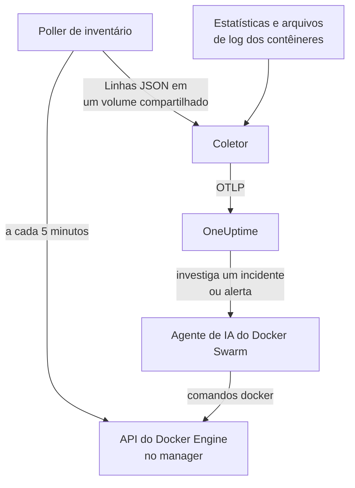

# Agente Docker Swarm

O agente Docker Swarm do OneUptime monitora um cluster Docker Swarm: os nós, serviços, tarefas, stacks, redes overlay, secrets, configs e volumes, além das métricas e dos logs de cada contêiner. Você o executa com o Docker Compose em um nó manager do swarm, e o cluster aparece no OneUptime com tudo isso. Os [monitores Docker Swarm](/docs/monitor/docker-swarm-monitor) alertam sobre o que chega.

:::cards
- [Instalar o agente](#instale-o-agente): O script de instalação ou o Docker Compose, em um nó manager.
- [O que o agente coleta](#o-que-o-agente-coleta): O inventário, as contagens do cluster e as métricas e logs dos contêineres.
- [Agente de IA](#agente-de-ia): Deixe a OneUptime AI ler o swarm enquanto investiga.
- [Solução de problemas](#solução-de-problemas): Um script de diagnóstico, e os problemas mais comuns.
:::

## Como funciona

O agente são três contêineres, todos definidos em um único `docker-compose.yml`:

1. **Coletor**: um OpenTelemetry Collector que lê `docker_stats` para as métricas de cada contêiner, acompanha os arquivos de log dos contêineres e acompanha o arquivo de snapshot do inventário. Ele marca tudo com o nome do seu cluster (`docker.swarm.cluster.name`) e envia ao OneUptime por OTLP.
2. **Poller de inventário**: um pequeno sidecar com `curl` e `jq` que, a cada 5 minutos, percorre a API do manager do swarm (`/nodes`, `/services`, `/tasks`, `/networks`, `/secrets`, `/configs`, `/volumes`) e deduz os stacks a partir do rótulo de serviço `com.docker.stack.namespace`. Ele grava uma linha JSON por objeto para o coletor encaminhar.
3. **Agente de IA**: `oneuptime-docker-swarm-ai-agent`, que executa os comandos `docker` que a OneUptime AI pede enquanto investiga um incidente ou alerta neste cluster. Ele é somente leitura, a menos que você permita correções (veja [Agente de IA](#agente-de-ia)).



O cluster se registra com os primeiros dados, com o nome de cluster que você configurar.

## Antes de começar

- Um nó **manager** do swarm para executar o agente: o poller de inventário e o agente de IA chamam endpoints da API que só os managers respondem.
- Docker Engine 20.10 ou mais recente com o plugin Docker Compose v2.
- Uma chave de ingestão. Crie uma em **Configurações do projeto → Telemetria e APM → Chaves de ingestão** e copie o valor.
- HTTPS de saída do nó para a sua URL do OneUptime.

### Onde executar o agente

Execute-o em um nó manager. O coletor relata os contêineres do nó em que roda, então, para as métricas de contêiner de todos os nós, execute o coletor em cada nó, todos com o mesmo `DOCKER_SWARM_CLUSTER_NAME`; o poller de inventário e o agente de IA só precisam rodar em um manager. `install.sh` deixa o agente de IA de fora em um nó que não é manager (e remove um que tenha instalado lá antes). Um agente de IA iniciado mesmo assim em um worker nunca se registra para o cluster: ele espera até o nó dele ser um manager, então não consegue tirar o lugar do agente de IA do manager. Vai implantar o agente como um stack do swarm em vez de usar o Compose? Mantenha o poller de inventário e o agente de IA em managers com a restrição `node.role == manager`.

## Instale o agente

:::steps
### Instale e inicie o agente

:::tabs
@tab install.sh
Baixe o script de instalação e execute-o em um nó manager:

```bash
curl -sSL https://raw.githubusercontent.com/OneUptime/oneuptime/master/agents/DockerSwarmAgent/install.sh -o install.sh
sh install.sh
```

O script pede a sua URL do OneUptime, a chave de ingestão e um nome para o cluster. Ele instala em `/opt/oneuptime-docker-swarm-agent`, grava um arquivo `.env` que só o dono pode ler e inicia os três contêineres. Adicione `--no-ai-agent` para deixar o agente de IA de fora.
@tab Docker Compose
Baixe `docker-compose.yml`, `otel-collector-config.yaml` e `inventory-snapshot.sh` do [diretório DockerSwarmAgent](https://github.com/OneUptime/oneuptime/tree/master/agents/DockerSwarmAgent) para uma pasta nova em um nó manager:

```bash
curl -fsSL https://raw.githubusercontent.com/OneUptime/oneuptime/master/agents/DockerSwarmAgent/docker-compose.yml -o docker-compose.yml
curl -fsSL https://raw.githubusercontent.com/OneUptime/oneuptime/master/agents/DockerSwarmAgent/otel-collector-config.yaml -o otel-collector-config.yaml
curl -fsSL https://raw.githubusercontent.com/OneUptime/oneuptime/master/agents/DockerSwarmAgent/inventory-snapshot.sh -o inventory-snapshot.sh
chmod +x inventory-snapshot.sh
```

Crie um arquivo `.env` ao lado deles. Ele guarda a chave de ingestão, então mantenha-o privado com `chmod 600 .env`:

```bash title=".env"
ONEUPTIME_URL=https://oneuptime.com
ONEUPTIME_SERVICE_TOKEN=your-telemetry-ingestion-key
DOCKER_SWARM_CLUSTER_NAME=my-swarm
```

Inicie o agente:

```bash
docker compose up -d
```
:::

### Verifique se o agente está em execução

```bash
docker compose ps
docker compose logs --tail 50 oneuptime-docker-swarm-agent oneuptime-docker-swarm-inventory
```

`docker compose ps` lista três contêineres: o coletor (`oneuptime-docker-swarm-agent`), o poller de inventário (`oneuptime-docker-swarm-inventory`) e o agente de IA (`oneuptime-docker-swarm-ai-agent`).

### Encontre o cluster no OneUptime

Abra **Produtos → Infraestrutura → Docker Swarm → Todos os clusters**. O cluster aparece em poucos minutos, e as páginas **Nós**, **Serviços**, **Tarefas**, **Stacks**, **Redes**, **Segredos**, **Configs** e **Volumes** dele são preenchidas depois do primeiro snapshot do inventário, em até 5 minutos.
:::

## Variáveis de ambiente

O script de instalação grava as três primeiras em `/opt/oneuptime-docker-swarm-agent/.env`; uma instalação com o Docker Compose as lê do `.env` ao lado de `docker-compose.yml`. Adicione ou mude qualquer uma delas ali e depois execute `docker compose up -d` nessa pasta.

| Variável | Obrigatória | Descrição |
| --- | --- | --- |
| `ONEUPTIME_URL` | Sim | A sua URL do OneUptime, como `https://oneuptime.com` ou a sua instância auto-hospedada. Use `http://` e a porta dela se a instância for só HTTP. |
| `ONEUPTIME_SERVICE_TOKEN` | Sim | A chave de ingestão de **Configurações do projeto → Telemetria e APM → Chaves de ingestão**. |
| `DOCKER_SWARM_CLUSTER_NAME` | Sim | O nome do cluster no OneUptime, e a chave pela qual os dados de cada nó se juntam: marcado em tudo como o atributo de recurso `docker.swarm.cluster.name`. Mantenha-o estável: mudá-lo depois registra um segundo cluster. O padrão é `docker-swarm`. |
| `DOCKER_INVENTORY_INTERVAL_SECONDS` | Não | Com que frequência o poller de inventário tira um snapshot, em segundos. O padrão é `300`. |
| `DOCKER_API_VERSION` | Não | A versão da API do Docker Engine que o coletor e o poller de inventário falam. O padrão é `1.44`; vazio, ela é negociada com o daemon (veja [Solução de problemas](#solução-de-problemas)). O agente de IA a negocia, a menos que você defina uma. |

As configurações próprias do agente de IA estão em [Agente de IA](#agente-de-ia).

## O que o agente coleta

| Sinal | Origem | Onde aparece |
| --- | --- | --- |
| Os nós, serviços, tarefas, stacks, redes, secrets, configs e volumes | O poller de inventário, a partir da API do manager do swarm | As listas e páginas de detalhes do cluster |
| Contagens do cluster (nós prontos, tarefas em execução, serviços, stacks, …) | O mesmo snapshot | Os cartões da visão geral e os badges do menu lateral |
| CPU, memória, número de processos e tempo de atividade dos contêineres | O receiver `docker_stats` | A página **Métricas** |
| Logs stdout e stderr dos contêineres | O receiver `filelog` | A página **Registros** |

### Como ele difere do agente Docker

O [agente Docker](/docs/telemetry/docker-host) modela um único host e marca `host.name` e `container.runtime=docker`. O agente Docker Swarm marca só `docker.swarm.cluster.name`, de propósito: assim o OneUptime arquiva os dados sob o cluster do swarm, em vez de registrar cada nó como um host próprio.

## Marcar o cluster com rótulos do projeto

Um atributo de recurso que começa com `oneuptime.label.` vira um rótulo do projeto no cluster: `oneuptime.label.<dimension>=<value>` é o rótulo `<dimension>:<value>`. Adicione os atributos ao processador `resource` em `otel-collector-config.yaml`, ao lado de `docker.swarm.cluster.name`:

```yaml
processors:
  resource:
    attributes:
      # ...existing attributes...
      - key: oneuptime.label.team
        value: platform
        action: upsert
      - key: oneuptime.label.env
        value: production
        action: upsert
```

O coletor só lê a configuração quando inicia: execute `docker compose restart oneuptime-docker-swarm-agent`. O cluster passa então a mostrar os rótulos `team:platform` e `env:production`. Os rótulos são comparados sem diferenciar maiúsculas e minúsculas, então um rótulo `Production` existente é reutilizado em vez de duplicado, e o agente nunca remove um rótulo que alguém adicionou no OneUptime.

## Execute como um serviço do systemd

Para iniciar o agente junto com o nó e reiniciá-lo quando falhar, instale a unidade do systemd dele. Ela supõe que o agente fica em `/opt/oneuptime-docker-swarm-agent`, onde o script de instalação o coloca:

```bash
sudo curl -fsSL https://raw.githubusercontent.com/OneUptime/oneuptime/master/agents/DockerSwarmAgent/systemd/oneuptime-docker-swarm-agent.service -o /etc/systemd/system/oneuptime-docker-swarm-agent.service
sudo systemctl daemon-reload
sudo systemctl enable --now oneuptime-docker-swarm-agent
```

## Atualizando o agente

O agente relata a versão do coletor que executa. Quando ela é mais antiga que a versão que esta versão do OneUptime fixa, um sinal de aviso aparece ao lado da versão do agente na página **Visão geral** do cluster. Selecione-o para ver estes comandos.

Execute o script de instalação de novo no nó manager e responda às perguntas dele com a mesma URL, a mesma chave e o mesmo nome de cluster. Ele baixa os arquivos mais recentes, baixa as imagens e reinicia o agente:

```bash
curl -sSL https://raw.githubusercontent.com/OneUptime/oneuptime/master/agents/DockerSwarmAgent/install.sh -o install.sh
sh install.sh
```

O script grava `.env` de novo a partir das suas respostas. Ele mantém só as listas de alvos do agente de IA e o que a IA pode fazer (`ONEUPTIME_AI_INVESTIGATION`, `ONEUPTIME_AI_FIXES`): adicione de volta qualquer variável que você mesmo definiu, como `DOCKER_API_VERSION`. Ativou as correções de IA? Execute-o como `ONEUPTIME_AI_ALLOW_WRITES=true sh install.sh` para mantê-las ativadas. Deixou o agente de IA de fora? Passe `--no-ai-agent` de novo.

Com o Docker Compose, baixe de novo os três arquivos na pasta do agente (depois refaça qualquer alteração que você tenha feito em `docker-compose.yml`), baixe as imagens e reinicie:

```bash
docker compose pull
docker compose up -d
```

A versão do coletor está fixada nos arquivos, então só baixar as imagens não faz o agente avançar.

## Desinstalando o agente

```bash
cd /opt/oneuptime-docker-swarm-agent
docker compose down
```

## Agente de IA

O `docker-compose.yml` do swarm (e o `install.sh`) também executa o **Agente de IA do Docker Swarm**: um terceiro contêiner, `oneuptime-docker-swarm-ai-agent` (imagem `oneuptime/resource-ai-agent:release`), que executa os comandos `docker` somente leitura que a OneUptime AI pede enquanto investiga um incidente ou alerta neste cluster — `docker node ls`, `docker service ps web --no-trunc`, `docker service logs --tail 200 web` — e, só se você permitir, aplica correções como um reinício gradual de um serviço específico. Ele lê as mesmas `ONEUPTIME_URL`, `ONEUPTIME_SERVICE_TOKEN` e `DOCKER_SWARM_CLUSTER_NAME` que o coletor, então atende exatamente a este cluster, e aparece na página **IA → Agente de IA** do cluster no OneUptime.

- **As investigações de IA vêm ativadas por padrão.** Assim que o agente se conecta, a OneUptime AI investiga com ele os incidentes e alertas deste cluster, e a **Visão geral** do cluster mostra o status do agente. Para parar, defina `ONEUPTIME_AI_INVESTIGATION=false` onde o agente é executado (**Alterar**, em **O que a IA pode fazer** na página do agente de IA, mostra como), ou deixe o agente de fora.
- Como o poller de inventário, ele **precisa rodar em um nó manager**: comandos de nós, serviços e tarefas só existem nos managers. Em um worker, ele não executa nada e não se registra para o cluster até o nó ser um manager (o `/status` dele diz por quê). Execute um por cluster.
- Ele é **somente leitura**, a menos que você defina `ONEUPTIME_AI_ALLOW_WRITES=true` em `.env` e execute `docker compose up -d` (ou execute `install.sh` com ela; o instalador grava `ONEUPTIME_AI_ALLOW_WRITES`, `ONEUPTIME_AI_INVESTIGATION`, `ONEUPTIME_AI_FIXES`, `ONEUPTIME_AI_WRITE_TARGETS` e `ONEUPTIME_AI_PROTECTED_TARGETS` do ambiente dele em `.env`, e uma nova execução mantém o que `.env` já tem para as quatro últimas, a menos que você passe essa variável, mesmo vazia); `ONEUPTIME_AI_WRITE_TARGETS` (globs de nomes de serviços e nós, por exemplo `web_*,api_*`) limita o que uma correção pode tocar. `ONEUPTIME_AI_FIXES`, no mesmo `.env`, diz como as correções rodam — `ask-for-approval` (uma pessoa aprova cada uma), `automatic` ou `bypass-approval` — e a página do agente de IA mostra isso somente leitura ([O que a IA pode fazer, definido pelo agente](/docs/ai/infrastructure-ai-agents#what-ai-may-do-set-by-the-agent)). Drenar um nó sempre exige a aprovação de uma pessoa, seja qual for o modo.
- Ele roda como root com o socket do Docker montado, porque o socket pertence ao root — e, em um manager, quem pode usar o socket controla o swarm inteiro, com `:ro` ou não. A política de comandos do agente é o limite: ele nunca cria nem remove serviços ou stacks, nunca mexe em secrets ou configs e nunca altera a si mesmo, o coletor, o poller de inventário ou qualquer coisa em `ONEUPTIME_AI_PROTECTED_TARGETS` (globs de nomes de serviços e nós).
- `install.sh --no-ai-agent` o deixa de fora; ou exclua o serviço `oneuptime-docker-swarm-ai-agent` do `docker-compose.yml`.

O que ele pode executar, como as correções funcionam e como solucionar problemas: [Infrastructure AI Agents](/docs/ai/infrastructure-ai-agents#docker-swarm-clusters).

## Solução de problemas

:::details Execute primeiro o script de diagnóstico
O agente vem com um script, [`troubleshoot.sh`](https://github.com/OneUptime/oneuptime/blob/master/agents/DockerSwarmAgent/troubleshoot.sh), que verifica a cadeia inteira: os contêineres, se o poller de inventário está em um manager (`docker node ls`), o arquivo de snapshot, o nome do cluster marcado em tudo, o formato do token, as métricas do próprio coletor e se o OneUptime aceita a chave de ingestão. Essa última verificação é a que mais importa. O OneUptime recusa uma chave inválida com `401` (`422` para uma chave desativada ou uma chave de navegador), e o coletor registra isso como uma linha `Exporting failed` por lote, fácil de passar despercebida. O script consulta `GET <url>/otlp/v1/validate` para obter direto um `200` (válida) ou `401` (inválida). Execute-o no nó manager:

```bash
curl -sSL https://raw.githubusercontent.com/OneUptime/oneuptime/master/agents/DockerSwarmAgent/troubleshoot.sh -o troubleshoot.sh
bash troubleshoot.sh    # add -d <dir> if you installed outside /opt/oneuptime-docker-swarm-agent
```
:::

:::details O cluster nunca aparece
Execute primeiro o script de diagnóstico. Caso contrário, leia os logs do coletor (`docker compose logs oneuptime-docker-swarm-agent`), verifique se `ONEUPTIME_SERVICE_TOKEN` e `ONEUPTIME_URL` em `.env` estão certos e se o nó alcança a sua URL do OneUptime.
:::

:::details Nenhum inventário aparece
Verifique se o poller de inventário roda em um manager: `docker node ls` precisa funcionar ali. Depois procure linhas `failed to emit ...` nos logs dele: `docker compose logs oneuptime-docker-swarm-inventory`.
:::

:::details O cluster passa a desconectado
Um cluster passa a desconectado quando o OneUptime não recebe nada dele por 15 minutos; o OneUptime verifica a cada 5 minutos, e o tempo em que ele mesmo não estava recebendo dados não conta. Garanta que o contêiner do coletor continue de pé: `docker compose ps` o mostra.
:::

:::details O coletor sai com "client version is too new"
Os logs do coletor mostram:

```text
Error: cannot start pipelines: failed to start "docker_stats" receiver:
Error response from daemon: client version 1.44 is too new.
Maximum supported API version is 1.41
```

A versão mais alta da API do daemon está abaixo do padrão `1.44` (o Docker Engine 20.10 para em `1.41`), então o receiver `docker_stats` não consegue iniciar e o contêiner reinicia em loop. Descubra a versão mais alta do daemon:

```bash
docker version --format '{{ .Server.APIVersion }}'
```

Defina `DOCKER_API_VERSION` com esse valor em `.env` e execute `docker compose up -d` em cada nó onde o agente roda. Daemons mais novos continuam servindo versões antigas da API, então a configuração continua funcionando depois de atualizar o Docker. Ou defina `DOCKER_API_VERSION=` (vazio) para o coletor negociar a versão com o daemon em vez de fixar uma.
:::

:::details O cluster aparece com o nome errado
O nome do cluster vem de `DOCKER_SWARM_CLUSTER_NAME`. Mude-o em `.env` e execute `docker compose up -d`: um nome novo registra um cluster novo em vez de renomear o antigo.
:::

## Próximos passos

:::cards
- [Monitor de Docker Swarm](/docs/monitor/docker-swarm-monitor): Alertas sobre nós, serviços, tarefas e contêineres.
- [Infrastructure AI Agents](/docs/ai/infrastructure-ai-agents): O que o agente de IA do Docker Swarm pode executar e como as correções funcionam.
- [Agente Docker](/docs/telemetry/docker-host): Monitore um único host Docker em vez disso.
:::
