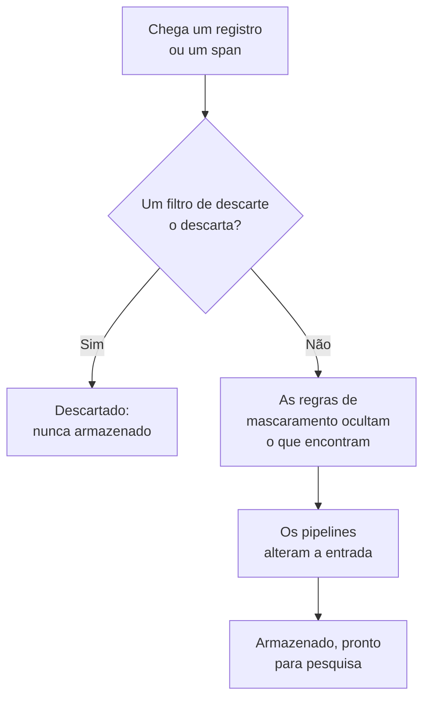

# Filtros de descarte e regras de mascaramento

Os filtros de descarte e as regras de mascaramento agem sobre os seus registros e spans à medida que chegam, antes que qualquer coisa seja armazenada. Um filtro de descarte joga fora as entradas de que você nunca precisa, ou mantém só uma amostra delas. Uma regra de mascaramento oculta dados pessoais e segredos, como endereços de e-mail, números de cartão e senhas, para que nunca cheguem ao seu armazenamento.

:::cards
- [Onde eles rodam](#onde-eles-rodam): Antes dos pipelines, antes do armazenamento.
- [Descartar ou amostrar entradas](#descartar-ou-amostrar-entradas): Selecionar entradas e depois descartá-las ou manter uma parte.
- [Mascarar dados sensíveis](#mascarar-dados-sensíveis): Ocultar, mascarar ou trocar por um hash o que um padrão encontra.
- [Verificar o que um filtro descartou](#verificar-o-que-um-filtro-descartou): Contagens em cada filtro.
:::

## Onde eles rodam

Os registros têm os seus em **Registros → Configurações**, e os spans em **Traços → Configurações**. Quando uma entrada chega, o OneUptime os executa nesta ordem:



- **Eles agem só sobre entradas novas.** Uma regra que você cria ou altera se aplica às entradas que chegam cerca de um minuto depois. As entradas já armazenadas não mudam.
- **Uma entrada descartada se foi.** Nenhuma pesquisa, gráfico, monitor ou regra de gravação a vê, e nenhuma exceção é criada a partir dela. No OneUptime Cloud, ela também não é cobrada.
- **Cada lista roda em ordem.** Arraste as linhas de uma lista para mudar a ordem. Só os filtros e as regras habilitados rodam.

Os filtros de descarte e as regras de mascaramento de registros valem igualmente para os registros do OpenTelemetry, do Syslog, do Fluent Bit e do Fluentd. [Pipelines de registros](/docs/telemetry/log-pipelines) explica a etapa seguinte.

## Antes de começar

- **Registros ou spans chegando.** Veja [OpenTelemetry](/docs/telemetry/open-telemetry).
- **Uma função que altere as configurações de telemetria.** Proprietário do projeto ou Administrador do projeto, ou uma função personalizada com a permissão para o que você altera, como Create Log Drop Filter ou Create Trace Scrub Rule. As funções de Telemetry podem ver os filtros e as regras, mas não alterá-los.

## Descartar ou amostrar entradas

:::steps
### Abrir os filtros de descarte

Acesse **Registros → Configurações → Filtros de descarte**, ou **Traços → Configurações → Filtros de descarte** para os spans.

### Selecionar as entradas

Clique em **Criar: Log Descarte Filtro**, ou em **Criar: Trace Descarte Filtro** para os spans. Em **Corresponder**, dê ao filtro um **Nome** e monte a sua **Consulta do filtro**: um campo, um operador e um valor para cada condição, e se devem corresponder **Todas as condições** ou **Qualquer condição**. Clique em **Próximo**.

### Escolher a ação

Em **Ação**, mantenha **Descartar** para jogar fora cada entrada correspondente, ou escolha **Amostra** e informe a **Porcentagem de amostragem** a manter, de 1 a 99. Depois crie o filtro.
:::

O filtro começa a descartar em até um minuto. Para salvá-lo sem descartar nada ainda, desative **Habilitado** em **Avançado** antes de criá-lo.

> [!WARNING]
> Uma entrada descartada não pode ser recuperada. Mantenha a consulta de um filtro restrita, e acompanhe a contagem **Descartadas** dele depois de criá-lo.

Um filtro pode testar estes campos, e qualquer atributo com **Custom Attribute...**:

| Entradas | Campos |
| --- | --- |
| Registros | **Gravidade**, **Corpo do registro**, **ID do serviço** |
| Spans | **Nome do span**, **Tipo de span**, **Status**, **Mensagem de status**, **ID do serviço**, **Tem exceção**, **É span raiz** |

| Operador | Corresponde a |
| --- | --- |
| **é igual a** | O valor exato, com as suas maiúsculas e minúsculas: `Debug` corresponde, `DEBUG` não. |
| **não é igual a** | Qualquer coisa exceto o valor exato. |
| **contém** | O valor em qualquer ponto do campo, sem diferenciar maiúsculas e minúsculas. Um `%` no valor é um curinga. |
| **é um de** | Um de uma lista de valores exatos, separados por vírgulas. |

**Preview query** mostra a consulta que as condições formam. Esta descarta as linhas de depuração de uma verificação de integridade:

```text
severityText = 'Debug' AND body LIKE 'healthcheck'
```

A amostragem decide entrada por entrada: com uma **Porcentagem de amostragem** de 10, cerca de uma em cada dez entradas correspondentes é mantida. Os filtros rodam na ordem da lista, e o primeiro que descarta uma entrada decide; uma entrada que uma amostra mantém segue para o filtro seguinte.

## Mascarar dados sensíveis

:::steps
### Abrir as regras de mascaramento

Acesse **Registros → Configurações → Regras de mascaramento**, ou **Traços → Configurações → Regras de mascaramento** para os spans.

### Escolher o que procurar

Clique em **Criar: Log Limpar Regra**, ou em **Criar: Trace Limpar Regra** para os spans, e escolha um **Tipo de padrão**. A regra recebe o nome dele, como **Limpar endereços de e-mail**, até você digitar um nome seu. Para **Regex personalizado**, informe também o **Padrão Regex Personalizado**.

### Escolher como mascarar

Em **Avançado**, escolha a **Ação de limpeza** e os **Campos a depurar**, ou deixe-os como estão: uma regra nova substitui cada correspondência por `[REDACTED]`, onde quer que esteja na entrada. Depois crie a regra.
:::

| Tipo de padrão | O que encontra |
| --- | --- |
| **Endereço de e-mail** | Endereços de e-mail, como `jane@example.com` |
| **Número do cartão de crédito** | Dezesseis dígitos em grupos de quatro, como `4111 1111 1111 1111` |
| **SSN (Número de Seguro Social)** | Números do Seguro Social dos EUA, como `123-45-6789` |
| **Número de telefone** | Números de telefone norte-americanos, como `555-123-4567` |
| **Endereço IP** | Endereços IPv4 e IPv6 públicos, como `203.0.113.7` ou `2001:db8::1`, mas não os privados, de loopback ou link-local |
| **Chaves de atributos sensíveis** | O valor inteiro de qualquer atributo cuja chave pareça secreta, como `password`, `token`, `api_key`, `authorization` ou `cookie` |
| **Regex personalizado** | A sua própria expressão regular, escrita sem barras nem flags, e comparada diferenciando maiúsculas e minúsculas |

| Ação de limpeza | No que uma correspondência se transforma |
| --- | --- |
| **Ocultar** | `[REDACTED]`, o padrão |
| **Máscara** | Quase toda oculta: um e-mail mantém a primeira letra e o fim do domínio, um número de cartão, de telefone ou do Seguro Social os últimos quatro dígitos, e uma correspondência personalizada ou um valor secreto o primeiro e o último caractere. Um endereço IP é ocultado por completo. |
| **Hash** | Um token exclusivo do seu projeto, sempre o mesmo para o mesmo valor, para que as repetições ainda possam ser contadas, sem que ninguém consiga chegar ao valor |

Por exemplo, uma regra de **Endereço de e-mail** armazena este corpo de registro:

```text
Payment failed for jane@example.com
```

de uma destas formas, conforme a sua **Ação de limpeza**:

```text
Redact: Payment failed for [REDACTED]
Mask:   Payment failed for j***@***.com
Hash:   Payment failed for [HASHED:5e29db14e508e09a]
```

**Campos a depurar** é **Ambos (Corpo e atributos)** para uma regra de registros, a menos que você escolha **Apenas o corpo** ou **Apenas atributos**, e **Todos (Nome, Atributos e Eventos)** para uma regra de spans, a menos que você escolha **Somente nome do span**, **Apenas atributos** ou **Apenas atributos do evento**. Os atributos dos links de um span são mascarados junto com os atributos do próprio span, e **Todos (Nome, Atributos e Eventos)** também mascara a mensagem de status de um span e os nomes dos seus eventos. Uma regra de **Chaves de atributos sensíveis** lê chaves, então sempre mascara os valores sob elas: nos atributos e no corpo JSON de um registro.

- **Uma regra pode valer para um só serviço.** Em **Avançado**, escolha o serviço em **Apenas para um serviço**: a regra mascara os registros desse serviço, e os dos outros serviços ficam como estão. Deixada vazia, ela mascara os registros de todos os serviços. A coluna **Escopo** da lista diz qual.
- **O formulário diz o que uma regra mudaria para os outros.** Antes de você criar uma regra, e quando ativa uma, o OneUptime lista o que lê os valores que ela ocultaria: monitores, painéis, visualizações salvas, regras de gravação e SLOs, cada um como um link, e o que os [Eventos de segurança](/docs/telemetry/security-events) perderiam. Um monitor que filtra por um valor oculto deixa de encontrá-lo. A regra é salva de qualquer forma.
- **Uma regra de endereço IP oculta os endereços que são dados pessoais.** São os endereços IPv4 e IPv6 públicos, como quer que sejam escritos: abreviados, como `2001:db8::1`, entre colchetes com uma porta, como `[2001:db8::1]:443`, que mantém os colchetes e a porta, com uma zona, como `2001:db8::2%eth0`, que mantém a zona, ou um endereço IPv4 escrito como IPv6, como `::ffff:203.0.113.7`, ocultado inteiro. Mantém os endereços privados, de loopback e link-local, como `10.0.0.12`, `127.0.0.1` e `fe80::1`, e o endereço de metadados da nuvem `169.254.169.254` na URL de uma requisição, onde [Eventos de segurança](/docs/telemetry/security-events) procura falsificação de requisição do lado do servidor. Para ocultar também os endereços internos, adicione para eles uma regra de **Regex personalizado**, como `\b(?:\d{1,3}\.){3}\d{1,3}\b` para todo endereço IPv4.
- **Um token de hash é do seu projeto.** Ele é criado com uma chave do seu projeto, derivada do `ENCRYPTION_SECRET` da instalação, então o mesmo valor tem outro token em outro projeto, e ninguém que leia um token consegue chegar ao valor nem calcular o hash de um palpite para comparar. Um endereço IP tem um só token, como quer que seja escrito: `::ffff:203.0.113.7` e `203.0.113.7` compartilham um. Os registros guardados antes de os tokens terem chave contêm tokens de 8 caracteres, como `[HASHED:8c87b489]`, diferentes dos atuais, de 16 caracteres: até que esses registros cheguem ao fim da retenção, procure os dois. Mudar o `ENCRYPTION_SECRET` muda todos os tokens, e numa instalação auto-hospedada os tokens são só tão secretos quanto ele.
- **Eventos de segurança ainda pode nomear um endereço IP com hash.** Quando [Eventos de segurança](/docs/telemetry/security-events) lê seus logs ou traces, uma regra de endereço IP que aplica hash também guarda cada endereço que oculta ao lado do seu token, num armazenamento que só as varreduras de Eventos de segurança leem: nenhuma página, busca, exportação, API ou ferramenta de IA consegue lê-lo. Assim, um ataque vindo de um endereço que seus logs mostram só como token ainda nomeia o endereço, e o caso dele diz qual endereço bloquear. Cada endereço é guardado até 30 dias depois da última vez em que foi visto. Uma regra que apaga ou mascara o endereço não guarda nada, e então Eventos de segurança diz que uma regra de mascaramento ocultou o endereço, como faz com um token de mais de 30 dias ou criado antes de os tokens terem uma chave.
- **Listas e valores aninhados também são lidos.** Uma regra lê cada texto dentro de uma lista, de uma lista de listas ou de uma lista de chave-valor, como os valores de um cabeçalho HTTP, e mantém a forma do valor: números e valores verdadeiro ou falso ficam como estão. Uma regra de **Chaves de atributos sensíveis** também lê as chaves dentro de um valor, então o `password` dentro de uma lista de chave-valor também é ocultado. O corpo de um registro enviado como mapa ou como lista é armazenado como seu texto JSON, e uma regra de **Chaves de atributos sensíveis** lê as chaves dentro dele, como faz num corpo escrito em JSON. Uma regra de padrão mantém esse corpo em JSON, e também um atributo escrito em JSON, como as mensagens de uma chamada de IA: ela lê o texto como sua aplicação o escreveu, com uma sequência de escape como `\n` lida como a quebra de linha que representa, e substitui o que encontra apenas dentro de seus textos e números.
- **O JSON dentro de um texto também é lido.** Um texto que é JSON por si só, como um atributo `http.request.body` que contém `{"password":"hunter2"}`, ou a linha `log` de um registro do Fluentd dentro do corpo de um registro, é lido como JSON, até 4 níveis de JSON um dentro do outro, e além disso como texto. Uma regra de **Chaves de atributos sensíveis** oculta os valores sob as chaves que parecem secretas dentro dele, e nada mais: seus números, espaços e outros textos ficam como sua aplicação os escreveu. Um texto que só parece JSON, como `{token}`, fica como está.
- **Um valor grande demais para ser lido item por item é lido como texto.** Um valor aninhado a mais de 32 níveis de profundidade, ou que levaria uma entrada a passar de 10.000 valores dentro de suas listas e mapas, é lido e armazenado como seu texto JSON. Uma regra de padrão mascara o que encontra nesse texto, e uma regra de **Chaves de atributos sensíveis** oculta o valor inteiro quando uma palavra como `password` ou `token` aparece nele. No corpo de um registro, e no JSON dentro de um texto, só a parte além desses limites é lida como texto: o resto continua sendo lido chave por chave.
- **As exceções vêm da entrada mascarada.** Uma exceção encontrada em um registro é criada depois do mascaramento, e as regras que mascaram os eventos dos spans também mascaram as exceções registradas neles. Cada exceção continua agrupada pelo que dizia antes do mascaramento, então adicionar uma regra nunca transforma uma exceção que você já tem em uma nova nem dispara **Nova exceção** de novo para ela. Quando uma regra oculta parte do que agrupa uma nova exceção, sua impressão digital é calculada com uma chave do seu projeto, como um token de hash, para que ninguém consiga chegar ao que foi ocultado.
- **As cópias brutas de uma linha de syslog ocultam o que as regras ocultaram nas suas partes.** O syslog guarda os dados estruturados de uma linha RFC 5424 como chegaram em `syslog.structured.raw`, e o syslog enviado por HTTP guarda a linha inteira em `syslog.raw`. Cada cópia é montada de novo a partir do que as regras deixaram dos campos do cabeçalho, de cada parâmetro dos dados estruturados e da mensagem, e depois as regras a leem como leem qualquer atributo. Assim, uma senha que uma regra de **Chaves de atributos sensíveis** oculta em `syslog.structured.auth_1.password`, ou um endereço que uma regra **Apenas o corpo** oculta na mensagem, fica oculto também nas cópias, escrito como o RFC 5424 escreve um valor: `password="[REDACTED\]"`. Uma linha em que as regras não mudam nada mantém as suas cópias como chegou.
- **O ID de sessão de uma entrada é mantido.** Uma regra de **Chaves de atributos sensíveis** oculta uma sessão de login, como um `session_id`, um `sessionid` ou um cookie, mas mantém `session.id` quando ele contém a sessão à qual o registro ou o span pertence: o ID aleatório sob o qual o [Session Replay](/docs/telemetry/session-replay) arquiva a entrada, que a entrada mantém como sua sessão de qualquer forma. O ID de conversa de uma chamada de IA é mantido da mesma forma. Não envie o segredo de uma sessão de login como `session.id`.
- **As Session Replays também são mascaradas.** As regras de mascaramento de registros para todos os serviços também rodam sobre as gravações de Session Replay, além do mascaramento que o gravador faz no navegador.
- **As regras rodam na ordem da lista.** Cada regra vê o que as regras anteriores deixaram.
- **Um padrão personalizado leva tempo na proporção da entrada.** Ele mantém a sintaxe e as respostas do JavaScript, lookaheads e lookbehinds incluídos, seja qual for a forma como foi escrito. Uma referência retroativa, como `\1`, não pode ser executada assim: uma regra com uma delas é recusada ao salvar, assim como um padrão grande demais para ser executado. Se encontrar cada correspondência exigisse ler um valor longo repetidas vezes, a regra mascara o valor inteiro. Os filtros de descarte, as regras de mascaramento e os pipelines de um projeto também dividem uma cota de trabalho para cada lote que ele envia, na proporção do tamanho do lote e suficiente para que dezenas de padrões personalizados leiam cada valor. Quando os padrões deles precisam de mais, uma regra de mascaramento personalizada mascara o valor inteiro, e um filtro que não pode ser respondido não se aplica à entrada.

## Verificar o que um filtro descartou

A lista **Filtros de descarte** mostra de cada filtro a contagem **Descartadas** e quando foi o seu **Last Dropped**. **Nothing dropped yet** significa que ele nunca correspondeu. A página de um filtro mostra o mesmo em **Atividade**, atualizado em até um minuto após um descarte. O seu cartão **Condições de filtro** mostra o que ele seleciona, e você pode alterar as condições ali.

## Solução de problemas

:::details Um filtro de descarte não descarta nada
**é igual a**, **não é igual a** e **é um de** comparam o texto exato, incluindo maiúsculas e minúsculas. As gravidades são `Information` e `Warning`, não `INFO` ou `WARN`. Verifique se o filtro está habilitado, e espere um minuto depois de uma alteração.
:::

:::details Faltam registros que eu esperava
Veja a contagem **Descartadas** e a hora do **Last Dropped** de cada filtro de descarte. Desative **Habilitado** naquele de que você suspeita, e os próximos registros voltam a chegar.
:::

:::details Uma regra de mascaramento personalizada mostra Não limpa nada
O padrão dela está vazio, não é uma expressão regular válida ou não pode ser executado, por exemplo porque tem uma referência retroativa como `\1`, então ela não mascara nada. Edite a regra e dê a ela um padrão que corresponda a pelo menos um caractere.
:::

:::details Entradas antigas ainda mostram os dados que uma regra nova mascara
As regras de mascaramento agem quando as entradas chegam. As entradas armazenadas antes da regra mantêm o que tinham até o fim da sua retenção. Veja [Retenção de dados](/docs/telemetry/data-retention).
:::

## Próximos passos

:::cards
- [Pipelines de registros](/docs/telemetry/log-pipelines): Analise e enriqueça os registros que você mantém.
- [Explorador de registros](/docs/telemetry/logs-explorer): Pesquise o que foi armazenado.
- [Explorador de traços](/docs/telemetry/traces-explorer): Acompanhe os spans que você mantém.
- [Retenção de dados](/docs/telemetry/data-retention): Decida por quanto tempo eles são mantidos.
:::
