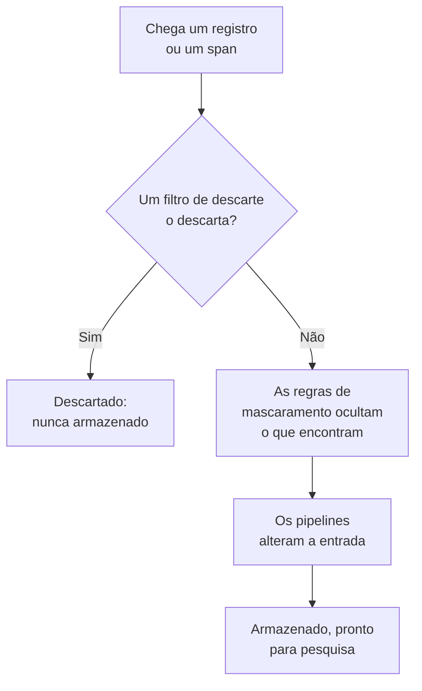

# Filtros de descarte e regras de mascaramento

Os filtros de descarte e as regras de mascaramento agem sobre os seus registros e spans à medida que chegam, antes que qualquer coisa seja armazenada. Um filtro de descarte joga fora as entradas de que você nunca precisa, ou mantém só uma amostra delas. Uma regra de mascaramento oculta dados pessoais e segredos, como endereços de e-mail, números de cartão e senhas, para que nunca cheguem ao seu armazenamento.

:::cards
- [Onde eles rodam](#onde-eles-rodam): Antes dos pipelines, antes do armazenamento.
- [Descartar ou amostrar entradas](#descartar-ou-amostrar-entradas): Selecionar entradas e depois descartá-las ou manter uma parte.
- [Mascarar dados sensíveis](#mascarar-dados-sensíveis): Ocultar, mascarar ou trocar por um hash o que um padrão encontra.
- [Verificar o que um filtro descartou](#verificar-o-que-um-filtro-descartou): Contagens em cada filtro.
:::

## Onde eles rodam

Os registros têm os seus em **Registros → Configurações**, e os spans em **Traços → Configurações**. Quando uma entrada chega, o OneUptime os executa nesta ordem:



- **Eles agem só sobre entradas novas.** Uma regra que você cria ou altera se aplica às entradas que chegam cerca de um minuto depois. As entradas já armazenadas não mudam.
- **Uma entrada descartada se foi.** Nenhuma pesquisa, gráfico, monitor ou regra de gravação a vê, e nenhuma exceção é criada a partir dela. No OneUptime Cloud, ela também não é cobrada.
- **Cada lista roda em ordem.** Arraste as linhas de uma lista para mudar a ordem. Só os filtros e as regras habilitados rodam.

Os filtros de descarte e as regras de mascaramento de registros valem igualmente para os registros do OpenTelemetry, do Syslog, do Fluent Bit e do Fluentd. [Pipelines de registros](/docs/telemetry/log-pipelines) explica a etapa seguinte.

## Antes de começar

- **Registros ou spans chegando.** Veja [OpenTelemetry](/docs/telemetry/open-telemetry).
- **Uma função que altere as configurações de telemetria.** Project Owner ou Project Admin, ou uma função personalizada com a permissão para o que você altera, como Create Log Drop Filter ou Create Trace Scrub Rule. As funções de Telemetry podem ver os filtros e as regras, mas não alterá-los.

## Descartar ou amostrar entradas

:::steps
### Abrir os filtros de descarte

Acesse **Registros → Configurações → Filtros de descarte**, ou **Traços → Configurações → Filtros de descarte** para os spans.

### Selecionar as entradas

Clique em **Criar: Log Descarte Filtro**, ou em **Criar: Trace Descarte Filtro** para os spans. Em **Corresponder**, dê ao filtro um **Nome** e monte a sua **Consulta do filtro**: um campo, um operador e um valor para cada condição, e se devem corresponder **Todas as condições** ou **Qualquer condição**. Clique em **Próximo**.

### Escolher a ação

Em **Ação**, mantenha **Descartar** para jogar fora cada entrada correspondente, ou escolha **Amostra** e informe a **Porcentagem de amostragem** a manter, de 1 a 99. Depois crie o filtro.
:::

O filtro começa a descartar em até um minuto. Para salvá-lo sem descartar nada ainda, desative **Habilitado** em **Avançado** antes de criá-lo.

> [!WARNING]
> Uma entrada descartada não pode ser recuperada. Mantenha a consulta de um filtro restrita, e acompanhe a contagem **Dropped** dele depois de criá-lo.

Um filtro pode testar estes campos, e qualquer atributo com **Custom Attribute...**:

| Entradas | Campos |
| --- | --- |
| Registros | **Gravidade**, **Corpo do registro**, **ID do serviço** |
| Spans | **Nome do span**, **Tipo de span**, **Status**, **Mensagem de status**, **ID do serviço**, **Tem exceção**, **É span raiz** |

| Operador | Corresponde a |
| --- | --- |
| **é igual a** | O valor exato, com as suas maiúsculas e minúsculas: `Debug` corresponde, `DEBUG` não. |
| **não é igual a** | Qualquer coisa exceto o valor exato. |
| **contém** | O valor em qualquer ponto do campo, sem diferenciar maiúsculas e minúsculas. Um `%` no valor é um curinga. |
| **é um de** | Um de uma lista de valores exatos, separados por vírgulas. |

**Preview query** mostra a consulta que as condições formam. Esta descarta as linhas de depuração de uma verificação de integridade:

```text
severityText = 'Debug' AND body LIKE 'healthcheck'
```

A amostragem decide entrada por entrada: com uma **Porcentagem de amostragem** de 10, cerca de uma em cada dez entradas correspondentes é mantida. Os filtros rodam na ordem da lista, e o primeiro que descarta uma entrada decide; uma entrada que uma amostra mantém segue para o filtro seguinte.

## Mascarar dados sensíveis

:::steps
### Abrir as regras de mascaramento

Acesse **Registros → Configurações → Regras de mascaramento**, ou **Traços → Configurações → Regras de mascaramento** para os spans.

### Escolher o que procurar

Clique em **Criar: Log Limpar Regra**, ou em **Criar: Trace Limpar Regra** para os spans, e escolha um **Tipo de padrão**. A regra recebe o nome dele, como **Limpar endereços de e-mail**, até você digitar um nome seu. Para **Regex personalizado**, informe também o **Padrão Regex Personalizado**.

### Escolher como mascarar

Em **Avançado**, escolha a **Ação de limpeza** e os **Campos a depurar**, ou deixe-os como estão: uma regra nova substitui cada correspondência por `[REDACTED]`, onde quer que esteja na entrada. Depois crie a regra.
:::

| Tipo de padrão | O que encontra |
| --- | --- |
| **Endereço de e-mail** | Endereços de e-mail, como `jane@example.com` |
| **Número do cartão de crédito** | Dezesseis dígitos em grupos de quatro, como `4111 1111 1111 1111` |
| **SSN (Número de Seguro Social)** | Números do Seguro Social dos EUA, como `123-45-6789` |
| **Número de telefone** | Números de telefone norte-americanos, como `555-123-4567` |
| **Endereço IP** | Endereços IPv4, como `192.168.1.1` |
| **Sensitive Attribute Keys** | O valor inteiro de qualquer atributo cuja chave pareça secreta, como `password`, `token`, `api_key`, `authorization` ou `cookie` |
| **Regex personalizado** | A sua própria expressão regular, escrita sem barras nem flags, e comparada diferenciando maiúsculas e minúsculas |

| Ação de limpeza | No que uma correspondência se transforma |
| --- | --- |
| **Ocultar** | `[REDACTED]`, o padrão |
| **Máscara** | Quase toda oculta: um e-mail mantém a primeira letra e o fim do domínio, um número de cartão, de telefone ou do Seguro Social os últimos quatro dígitos, e uma correspondência personalizada ou um valor secreto o primeiro e o último caractere. Um endereço IP é ocultado por completo. |
| **Hash** | Um hash curto do valor, sempre o mesmo para o mesmo valor, para que as repetições ainda possam ser contadas |

Por exemplo, uma regra de **Endereço de e-mail** armazena este corpo de registro:

```text
Payment failed for jane@example.com
```

de uma destas formas, conforme a sua **Ação de limpeza**:

```text
Redact: Payment failed for [REDACTED]
Mask:   Payment failed for j***@***.com
Hash:   Payment failed for [HASHED:8c87b489]
```

**Campos a depurar** é **Ambos (Corpo e atributos)** para uma regra de registros, a menos que você escolha **Apenas o corpo** ou **Apenas atributos**, e **Todos (Nome, Atributos e Eventos)** para uma regra de spans, a menos que você escolha **Somente nome do span**, **Apenas atributos** ou **Apenas atributos do evento**. Uma regra de **Sensitive Attribute Keys** sempre mascara valores de atributos, já que lê as chaves dos atributos.

- **As exceções vêm da entrada mascarada.** Uma exceção encontrada em um registro é criada depois do mascaramento, e as regras que mascaram os eventos dos spans também mascaram as exceções registradas neles.
- **As Session Replays também são mascaradas.** As regras de mascaramento de registros também rodam sobre as gravações de Session Replay, além do mascaramento que o gravador faz no navegador.
- **As regras rodam na ordem da lista.** Cada regra vê o que as regras anteriores deixaram.
- **Um padrão personalizado leva tempo na proporção da entrada.** Ele mantém a sintaxe e as respostas do JavaScript, lookaheads e lookbehinds incluídos, seja qual for a forma como foi escrito. Uma referência retroativa, como `\1`, não pode ser executada assim: uma regra com uma delas é recusada ao salvar, assim como um padrão grande demais para ser executado. Se encontrar cada correspondência exigisse ler um valor longo repetidas vezes, a regra mascara o valor inteiro. Os filtros de descarte, as regras de mascaramento e os pipelines de um projeto também dividem uma cota de trabalho para cada lote que ele envia, na proporção do tamanho do lote: quando os padrões deles precisam de mais, uma regra de mascaramento personalizada mascara o valor inteiro, e um filtro que não pode ser respondido não se aplica à entrada.

## Verificar o que um filtro descartou

A lista **Filtros de descarte** mostra de cada filtro a contagem **Dropped** e quando foi o seu **Last Dropped**. **Nothing dropped yet** significa que ele nunca correspondeu. A página de um filtro mostra o mesmo em **Atividade**, atualizado em até um minuto após um descarte. O seu cartão **Condições de filtro** mostra o que ele seleciona, e você pode alterar as condições ali.

## Solução de problemas

:::details Um filtro de descarte não descarta nada
**é igual a**, **não é igual a** e **é um de** comparam o texto exato, incluindo maiúsculas e minúsculas. As gravidades são `Information` e `Warning`, não `INFO` ou `WARN`. Verifique se o filtro está habilitado, e espere um minuto depois de uma alteração.
:::

:::details Faltam registros que eu esperava
Veja a contagem **Dropped** e a hora do **Last Dropped** de cada filtro de descarte. Desative **Habilitado** naquele de que você suspeita, e os próximos registros voltam a chegar.
:::

:::details Uma regra de mascaramento personalizada mostra Não limpa nada
O padrão dela está vazio, não é uma expressão regular válida ou não pode ser executado, por exemplo porque tem uma referência retroativa como `\1`, então ela não mascara nada. Edite a regra e dê a ela um padrão que corresponda a pelo menos um caractere.
:::

:::details Entradas antigas ainda mostram os dados que uma regra nova mascara
As regras de mascaramento agem quando as entradas chegam. As entradas armazenadas antes da regra mantêm o que tinham até o fim da sua retenção. Veja [Retenção de dados](/docs/telemetry/data-retention).
:::

## Próximos passos

:::cards
- [Pipelines de registros](/docs/telemetry/log-pipelines): Analise e enriqueça os registros que você mantém.
- [Explorador de registros](/docs/telemetry/logs-explorer): Pesquise o que foi armazenado.
- [Explorador de traços](/docs/telemetry/traces-explorer): Acompanhe os spans que você mantém.
- [Retenção de dados](/docs/telemetry/data-retention): Decida por quanto tempo eles são mantidos.
:::
