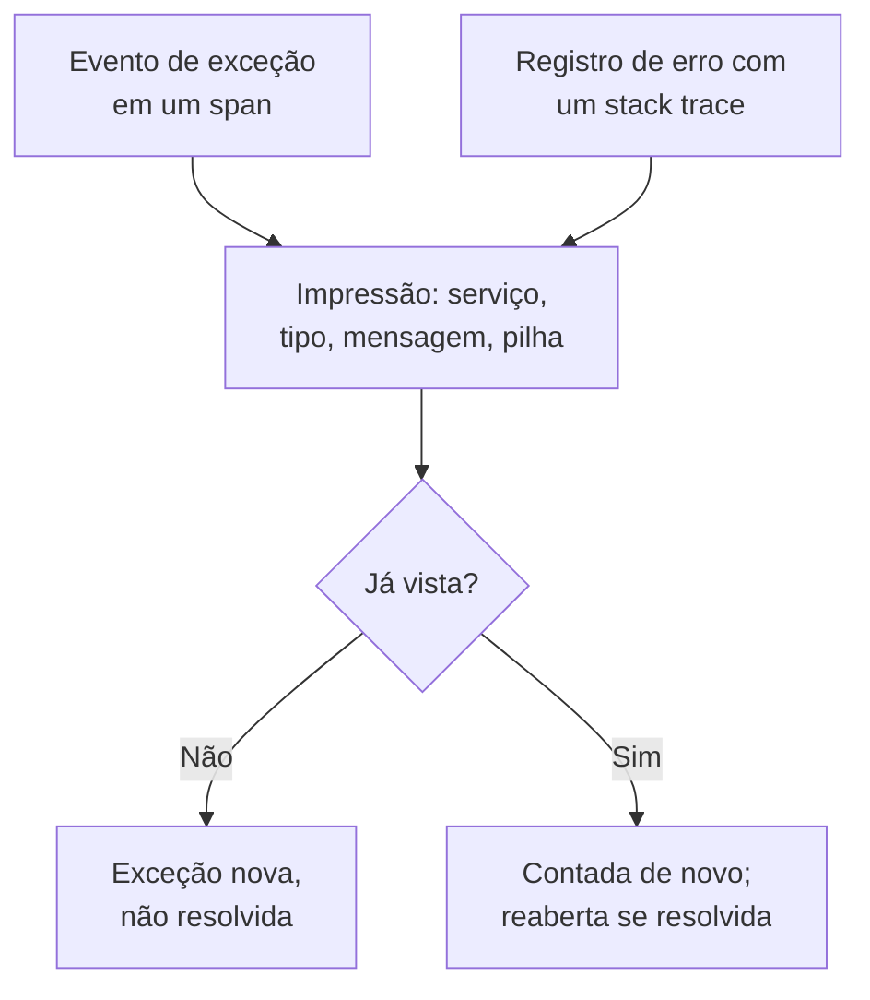

# Rastreamento de exceções

O rastreamento de exceções reúne os erros que seu código lança e agrupa cada ocorrência do mesmo erro em uma única exceção, com o stack trace, a tendência e as requisições em que ela aconteceu. Trate-as como uma lista de tarefas: corrija, resolva ou arquive o ruído, e deixe a IA abrir um pull request para as que ela consegue corrigir.

:::cards
- [De onde vêm as exceções](#de-onde-vêm-as-exceções): Spans e registros que seus serviços já enviam.
- [Fazer a triagem da lista](#fazer-a-triagem-da-lista): O não resolvido primeiro, o ruído oculto.
- [A página de uma exceção](#a-página-de-uma-exceção): Stack trace, ocorrências e contexto.
- [Corrigir com IA](#corrigir-com-ia): Um pull request com a correção, ou um teste de regressão.
- [Encontrar e corrigir exceções novas ou em alta com IA](#encontrar-e-corrigir-exceções-novas-ou-em-alta-com-ia): Pull requests para as exceções que o OneUptime encontra.
:::

## De onde vêm as exceções

Você não envia exceções separadamente. O OneUptime as encontra na telemetria que seus serviços já enviam:

- um evento de exceção em um span, que é o que o `recordException()` do OpenTelemetry grava;
- um registro com os atributos `exception.type`, `exception.message` ou `exception.stacktrace`;
- um registro com gravidade Error ou Fatal cuja mensagem contém um stack trace, quando o registro não foi escrito dentro de um span (o span já a informa).

Cada ocorrência é agrupada com as anteriores do mesmo erro em uma única exceção:

- **Uma exceção por serviço e erro.** A impressão digital é calculada a partir do serviço, do tipo de exceção, da mensagem e do stack trace. Antes, saem os valores que mudam de uma chamada para outra: UUIDs e outros IDs, timestamps, endereços IP e de e-mail, e números com sete ou mais dígitos. Assim, `Order id=1042 not found` e `Order id=2077 not found` são uma única exceção. Uma exceção nova é agrupada, em vez disso, pelo seu tipo e pelas funções e arquivos do seu próprio código no stack trace: números de linha, frames de bibliotecas e a mensagem ficam de fora, então variantes lançadas pelo mesmo código são uma exceção só. Sem stack trace, é a mensagem que a agrupa, como acima. As exceções registradas antes deste agrupamento mantêm o delas.
- **Uma nova ocorrência reabre uma exceção resolvida.** Se ela acontecer de novo depois que você a resolveu, a correção não se sustentou, e a exceção é marcada como **Regressão**. Uma ocorrência anterior à resolução que só chega ao OneUptime depois não a reabre.
- **Uma exceção arquivada continua arquivada.** As novas ocorrências dela continuam sendo contadas, mas deixam de gerar notificações.

> [!TIP]
> Para manter um erro esperado fora do rastreamento de exceções, como uma entrada inválida que seu serviço rejeitou, defina o atributo `error.class` como `user-error` ou `expected-denial` no evento de exceção do span. Assim o OneUptime não registra exceção nenhuma para ele.

## Antes de começar

- **Spans ou registros chegando.** Instrumente seus serviços com [OpenTelemetry](/docs/telemetry/open-telemetry). A aba **Guia de configuração** mostra o código para a sua linguagem.
- **Uma função que possa ler telemetria.** Project Owner, Project Admin, Project Member, Viewer, Telemetry Admin, Telemetry Member ou Telemetry Viewer, ou uma função personalizada com a permissão Read Telemetry Service Exception. Resolver e arquivar exige Project Owner ou Project Admin, ou a permissão Edit Telemetry Service Exception.

## Fazer a triagem da lista

:::steps
### Abrir as exceções

Acesse **Produtos → Observabilidade → Exceções**. O selo da aba **Exceções** conta os problemas não resolvidos, e a lista abre nas exceções **Não resolvido**.

### Escolher um status

Alterne entre **Não resolvido**, **Resolvido**, **Arquivado** e **Todos**. O gráfico acima da lista mostra quantas ocorrências foram **Não tratado** e quantas **Tratado** ao longo do tempo. Uma linha marcada como **Regressão** voltou depois de ser resolvida, e uma marcada como **Novo** foi vista pela primeira vez nas últimas 24 horas.

Cada linha mostra também quantos usuários a exceção afetou no intervalo escolhido e um pequeno gráfico das suas ocorrências nesse intervalo. Uma ocorrência indica o seu usuário com o atributo `user.id`, `enduser.id` ou `enduser.pseudo.id`, no evento da exceção, no seu span ou registro de log, ou no seu recurso; ocorrências que não indicam nenhum usuário não são contadas.

### Escolher o que conta como problema

**Problemas**, o padrão, oculta erros de usuário e negações esperadas, para que a lista mostre o que precisa de correção. **User errors** mostra só esses, e **Todos** mostra todas as exceções.

### Pesquisar e filtrar

Digite uma consulta como `type:TypeError env:production`, veja [Sintaxe de pesquisa](/docs/telemetry/search-syntax#exceções), ou clique em um valor da barra lateral **Filtros**: um serviço, um host ou outro recurso, um **Tipo de exceção**, um **Ambiente** ou uma **Error Class**. **Atribuídas a mim** mostra só as exceções atribuídas a você, e o menu de ordenação ordena a lista por **Visto pela última vez**, **Visto pela primeira vez** ou **Mais eventos**.

**Visualizações salvas** guarda a lista com um nome, para todos no projeto: a pesquisa, os filtros, o intervalo de tempo, o status, o que conta como problema, **Atribuídas a mim**, a ordenação e o tamanho da página. Uma visualização com **Atribuídas a mim** mostra a cada pessoa as exceções atribuídas a ela, e **Limpar visualização** devolve a lista a como ela abre da primeira vez. O endereço da página nomeia a visualização que você escolheu, então um link que você compartilha a abre. No resto, as visualizações salvas funcionam como no [Explorador de registros](/docs/telemetry/logs-explorer#salvar-uma-visualização).

### Abrir uma exceção

Clique em uma linha para abrir a página da exceção.
:::

## A página de uma exceção

O menu lateral da página agrupa o que você faz com uma exceção:

| Página | O que mostra |
| --- | --- |
| **Visão geral** | A mensagem, o serviço, quantas vezes ela aconteceu e quando foi vista pela primeira e pela última vez, a tendência ao longo do tempo e a ocorrência mais recente: release, ambiente, span, traço e sessão do usuário. No topo, a explicação da OneUptime AI sobre o que aconteceu, quando a IA está ligada. |
| **Stack trace** | Os frames da pilha. Para código de navegador, os arquivos e as linhas originais, depois que você enviar os [Source maps](/docs/telemetry/source-maps) da release. |
| **Occurrences** | Cada ocorrência, com a hora, a mensagem e o traço em que aconteceu. |
| **Context** | Os atributos da ocorrência mais recente, a gravação da sessão quando houver uma, e as etapas que levaram a ela. |
| **Registros** | Os registros escritos em torno da ocorrência mais recente. |
| **AI Assistance** | Tarefas de IA que corrigem a exceção ou a testam. |
| **Configurações** | Resolver ou arquivar a exceção. Fica em **Gerenciar**, que começa recolhido. |

## Resolver, reabrir e arquivar

Os botões no topo da página da exceção, a página **Configurações** dela e o menu ⋯ da linha dela na lista mudam o status:

| Ação | Quando usar | O que acontece depois |
| --- | --- | --- |
| **Resolver** | Você implantou a correção. | Ela sai da lista **Não resolvido**. Uma nova ocorrência a reabre. |
| **Resolver na próxima versão** | A correção sai na sua próxima versão. | Ela sai da lista **Não resolvido**. Ocorrências da versão em que foi vista por último não a reabrem, e uma de qualquer outra versão a reabre. |
| **Reabrir** | A correção não funcionou. | Ela volta a estar não resolvida. |
| **Arquivar** | É ruído que você não pretende corrigir. | Ela sai da lista. As novas ocorrências são contadas, mas deixam de gerar notificações. |
| **Desarquivar** | Você quer voltar a ouvir falar dela. | Ela volta para a lista a que pertence. |

**Resolver na próxima versão** fica no menu ao lado de **Resolver**, no menu ⋯ da linha, em **Ações em massa** e em **Configurações**, enquanto as ocorrências da exceção informarem sua versão: o atributo de recurso `service.version`.

**Configurações** mostra quem resolveu ou arquivou a exceção por último, e quando. Os botões dela dizem **Marcar como resolvido** ou **Marcar como não resolvido**, e **Arquivar** ou **Desarquivar**.

Para mudar várias de uma vez, marque as linhas delas na lista, ou a caixa acima das linhas para todas as exceções da página, e use as mesmas ações em **Ações em massa**. O resultado diz quais exceções mudaram, quais ficaram como estavam e por quê.

**Atribuir** no cabeçalho da exceção a entrega a uma pessoa ou a uma equipe, e remover a escolha desfaz a atribuição. Cada linha mostra a quem ela pertence, o menu ⋯ dela oferece **Atribuir a mim**, e **Atribuir a…** em **Ações em massa** atribui várias de uma vez. A pessoa a quem ela é atribuída, ou cada membro da equipe, recebe uma notificação conforme a linha **Exceção atribuída a mim** das suas [Configurações de notificação](/docs/notifications/notification-settings); quem a atribuiu não recebe.

**Atividade**, no fim da **Visão geral** da exceção, diz quem a alterou e quando, as mais recentes primeiro: quem a resolveu, reabriu, arquivou ou atribuiu, mesclou outra exceção a ela ou desfez a mesclagem de uma, e quando ela voltou a ocorrer depois de resolvida. Toda alteração está ali, feita na página da exceção, na lista, em **Ações em massa**, pela API ou pela própria OneUptime, e uma alteração feita com uma chave de API leva o nome da chave.

## Classes de erro

Cada exceção tem uma classe de erro, que diz de quem é o problema. O OneUptime AI a define quando faz a triagem de um insight sobre a exceção, como uma exceção nova ou que disparou: veja [AI SRE](/docs/ai/ai-sre#insights-detecção-proativa). Uma exceção que ele não triou continua `unknown`.

| Classe | O que significa | Em **Problemas** |
| --- | --- | --- |
| `code-fault` | Um defeito no código. A única classe que a IA corrige por conta própria. | Sim |
| `infrastructure` | Um tempo limite esgotado, uma conexão interrompida ou recursos esgotados. | Sim |
| `unknown` | Ainda não classificada. | Sim |
| `user-error` | O resultado de uma entrada inválida de um usuário. | Não |
| `expected-denial` | Uma verificação fazendo seu trabalho, como um login recusado. | Não |

Com **Arquivar exceções esperadas** ativado, nas configurações dos insights de IA, as exceções que a triagem identifica como negações esperadas são arquivadas por você.

## Explicar com IA

No topo da **Visão geral** de uma exceção, **Explicar com OneUptime AI** pergunta à OneUptime AI o que deu errado. Ela lê o stack trace, o traço e os registros da ocorrência mais recente, e os deploys do serviço por volta do momento em que a exceção começou, e responde no cartão **O que aconteceu**:

| Parte | O que diz |
| --- | --- |
| **O que aconteceu** | Uma ou duas frases, quão segura a OneUptime AI está e onde está a falha: o código, uma dependência, a infraestrutura, uma entrada inválida ou a configuração. |
| **Causa raiz provável** | A causa, e o frame, o span, a linha de log ou o deploy que a mostra. |
| **Correção sugerida** | O que mudar. |
| **Onde olhar** | Os frames do stack trace a abrir primeiro. |
| **Próximos passos** | No máximo três passos para confirmá-la ou corrigi-la. |

A explicação fica guardada na exceção, então a próxima pessoa que a abre já a lê, e **Explicar novamente** pede uma nova. **Abrir uma pull request com a correção** abre a página **AI Assistance** da exceção, e **Fazer uma pergunta de acompanhamento** abre o Ask AI sobre a exceção.

IDs, endereços de e-mail e IP e tokens são retirados de tudo o que é enviado, e dos atributos de um span só alguns são enviados, como a rota e o código de status. A explicação usa o provedor de LLM e os créditos de IA do projeto, e não é oferecida enquanto **Habilitar IA** estiver desligado. Qualquer pessoa que possa ler a exceção pode pedir uma.

Abaixo dos cartões, **Exceções semelhantes** lista até cinco outras exceções parecidas com esta: a **Mesma mensagem** depois de tirados os valores, o **Mesmo local no código** do seu código, ou uma **Mensagem semelhante** com a maioria das mesmas palavras. Uma mesma causa pode cair em várias exceções, então **Verificar com a OneUptime AI** diz de cada uma se é **Provavelmente o mesmo bug**, **Um bug relacionado** ou **Um bug diferente**, e por quê. A verificação usa os créditos de IA do projeto e não é oferecida enquanto **Habilitar IA** está desligado. A resposta é guardada até a próxima ocorrência.

Mescle a esta exceção uma que a OneUptime AI chame de **Provavelmente o mesmo bug**, do mesmo serviço, com **Mesclar** ao lado: suas ocorrências, as anteriores e cada nova, passam a contar nesta exceção e aparecem na página dela, e ela sai da lista. **Mescladas a esta exceção**, abaixo, lista o que foi mesclado, e **Desfazer mesclagem** ao lado de cada uma, ou na página de uma exceção mesclada, devolve a ela o seu lugar na lista, com as ocorrências desde então. Mesclar e desfazer a mesclagem exigem permissão para editar exceções.

## Corrigir com IA

A página **AI Assistance** oferece três tarefas. Cada uma roda como uma tarefa de IA que abre um pull request no seu repositório de código:

| Tarefa | O que o pull request faz |
| --- | --- |
| **Fix this exception with AI** | Corrige a causa raiz. Inicie-a com **Corrigir com IA**. |
| **Generate Regression Test** | Adiciona um teste que falha até o bug ser corrigido. |
| **Melhorar o tratamento de erros** | Para erros esperados: valida a entrada mais cedo, mantém os dados do usuário fora das mensagens e marca o erro como tratado. |

Antes, a IA precisa de três coisas: um provedor de LLM, um repositório conectado (no GitHub, GitLab, Forgejo ou Gitea, ou em qualquer servidor Git) e um agente de IA online para executar a tarefa. A página verifica cada uma e leva ao que estiver faltando. As tarefas ficam pausadas enquanto a exceção estiver resolvida ou arquivada. Veja [Código](/docs/ai/ai-agent). Iniciar uma tarefa exige permissão para editar o repositório em que ela trabalha: quem só pode ler a exceção vê as tarefas dela, mas não pode iniciar nenhuma.

## Encontrar e corrigir exceções novas ou em alta com IA

A cada 15 minutos o OneUptime procura, nas suas exceções, as novas, as que de repente acontecem com muito mais frequência e os serviços cujas exceções não trazem stack trace, e registra o que encontra como insights de IA, com as evidências. Em seguida, o OneUptime AI analisa cada um e abre um pull request para os que puder corrigir. Nada é mesclado: sua equipe revisa cada pull request.

| Constatação | Quando o OneUptime a registra | O pull request |
| --- | --- | --- |
| **Nova exceção** | Uma exceção vista pela primeira vez nas últimas 24 horas que já aconteceu 3 vezes ou mais. | Corrige a exceção, ou a trata melhor. |
| **Pico de exceções** | Uma exceção que aconteceu 10 vezes ou mais na última hora, a 5 vezes ou mais o seu ritmo por hora das 24 horas anteriores. | Corrige a exceção, ou a trata melhor. |
| **Stack trace ausente** | As exceções que um serviço registrou no último dia não trazem stack trace e, juntas, aconteceram 20 vezes ou mais. | Faz o serviço registrar um stack trace com cada exceção. |

O pull request de uma exceção nova ou em alta é a própria tarefa de IA da exceção, a que a página **AI Assistance** dela inicia, e ele espera o OneUptime AI analisar a constatação. Se ele encontra o código culpado (`code-fault`), o pull request o corrige, como faz **Fix this exception with AI**. Se encontra um erro esperado (`user-error` ou `expected-denial`), o pull request trata melhor o erro, como faz **Melhorar o tratamento de erros**. Qualquer outro veredito não abre nenhum pull request por conta própria. Com **Arquivar exceções esperadas** ativado, uma negação esperada é arquivada em vez disso e não recebe nenhum pull request.

O OneUptime AI abre um por conta própria só para uma exceção lançada no seu próprio código: uma cujo stack trace tem um frame do seu código, e não só frames de bibliotecas ou do runtime. Um pull request que alguém fechou sem mesclar pausa os automáticos para essa exceção. Qualquer pessoa ainda pode pedir qualquer um deles com **Corrigir com IA** na constatação.

### Ativar

**Exceções → IA → Configurações** contém a chave **Encontrar e corrigir exceções novas ou em alta**, ativada em projetos novos. Enquanto ela estiver desativada, as exceções novas ou em alta ficam com os insights de IA, como antes: veja [AI SRE](/docs/ai/ai-sre#insights-detecção-proativa). Com **Habilitar IA** desativado, elas continuam sendo encontradas, mas o OneUptime AI não faz nada com elas. Para abrir pull requests, o OneUptime AI precisa de um repositório conectado em [Código](/docs/ai/ai-agent): a página diz primeiro o que falta. O código de cada repositório é alterado no Runner que o repositório escolhe em Código.

O OneUptime AI abre por conta própria no máximo 5 pull requests por dia (UTC), um por constatação, e nunca mais do que o limite de pull requests de IA abertos de um repositório.

### Regras de IA

Sem regras, o OneUptime AI analisa imediatamente cada exceção que encontra e abre um pull request para cada uma que puder corrigir. As **Regras de IA** em **Mais configurações** restringem isso, em três etapas:

| Etapa | O que ela decide |
| --- | --- |
| **Corresponder** | Quais serviços: os escolhidos, os que têm certos rótulos ou aqueles cujo nome corresponde a um padrão. |
| **Investigar** | **Imediatamente**, ou **Só se ainda for encontrado após uma espera**: uma exceção que desaparece durante a espera não é analisada. |
| **Correção** | **Não corrigir**, **Perguntar antes de corrigir** ou **Corrigir sem perguntar**. Perguntar antes deixa o pull request para uma pessoa: a constatação oferece **Corrigir com IA**. |

Em **Mais campos** uma regra escolhe os repositórios de código, os servidores MCP e o provedor de LLM que o OneUptime AI pode usar para ela. Se nada for escolhido, ele pode usar qualquer um, e o provedor de LLM padrão do projeto.

### Ver o que ele fez

- **Exceções → IA → Insights** lista o que o OneUptime encontrou, cada constatação com suas evidências, incluindo os frames do seu código no stack trace dela. **View Exception Group** abre a exceção e, nos stack traces ausentes de um serviço, **Abrir em Exceções** abre as exceções não resolvidas dele do último dia.
- **Exceções → IA → Registros** lista cada investigação e cada pull request, do mais recente, com a situação de cada um e o que cada investigação encontrou.
- O pull request diz por que foi aberto, com um link para a constatação. O de uma exceção nova ou em alta também leva à exceção e aparece na página **AI Assistance** dela. Em Código, a tarefa dele nomeia a exceção que corrige, ou a constatação de onde veio.

## Insights de exceções

A aba **Insights** conta suas exceções **Não resolvido**, **Resolvido** e **Arquivado** e sua taxa de resolução, e lista as exceções mais frequentes, os serviços que elas afetam e as vistas mais recentemente.

**Novidades**, no topo da aba, pede à OneUptime AI, com **Resumir com a OneUptime AI**, que resuma as exceções vistas pela primeira vez nas últimas 24 horas e as que voltaram depois de resolvidas: algumas frases sobre todas, depois cada uma em uma linha, a mais urgente primeiro, com um link para a exceção. O resumo é escrito quando você pede e guardado até a próxima ocorrência, então pedir de novo não custa nada; usa os créditos de IA do projeto e não é oferecido enquanto **Habilitar IA** está desligado.

## Solução de problemas

:::details Uma exceção que acabei de lançar não está na lista
Verifique primeiro a lente: **Problemas** oculta erros de usuário e negações esperadas, então escolha **Todos**. Depois amplie o intervalo de tempo e verifique se a exceção foi gravada em um span, ou em um registro com um stack trace.
:::

:::details Um erro aparece como várias exceções
A impressão digital inclui a mensagem e o stack trace. Quando eles diferem, por exemplo quando uma mensagem inclui um número curto ou um nome que muda a cada chamada, cada variante é uma exceção própria. As exceções novas são agrupadas pelas funções do seu próprio código, então isto afeta sobretudo exceções registradas antes; mescle duas que sejam o mesmo bug em **Exceções semelhantes**.
:::

:::details Uma exceção resolvida sempre volta
Uma nova ocorrência reabre uma exceção resolvida de propósito: o erro ainda acontece. Verifique se a correção chegou à release que a informa, ou arquive a exceção se não quiser mais ouvir falar dela. Se pods antigos da versão continuarem a informá-la durante um rollout, use **Resolver na próxima versão**.
:::

## Próximos passos

:::cards
- [Monitor de exceções](/docs/monitor/exceptions-monitor): Receber alertas quando as exceções dispararem.
- [Source maps](/docs/telemetry/source-maps): Stack traces legíveis para código de navegador.
- [Código](/docs/ai/ai-agent): Como a IA corrige código e abre pull requests.
- [Explorador de traços](/docs/telemetry/traces-explorer): Ver a requisição em que uma exceção aconteceu.
:::
