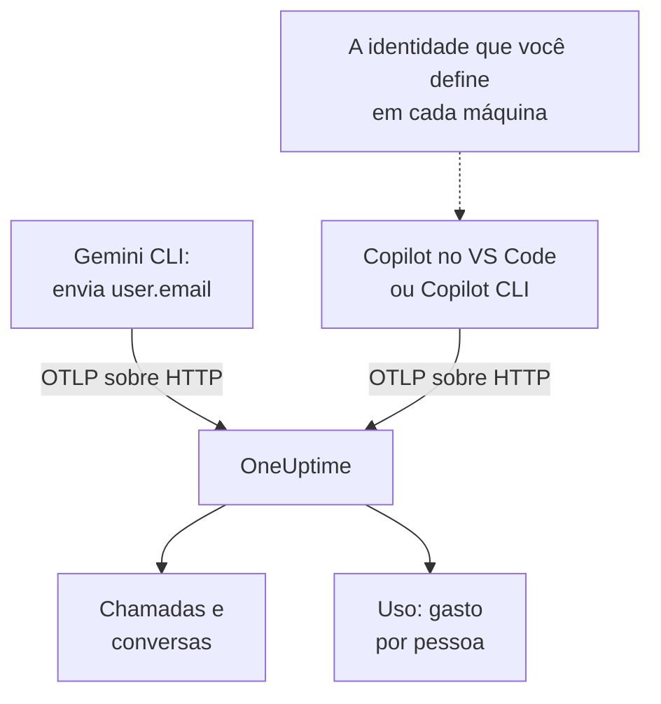

# Gemini CLI e GitHub Copilot

O Gemini CLI e o GitHub Copilot exportam OpenTelemetry por conta própria: aponte-os para o OneUptime e as chamadas ao modelo, os tokens, os custos e as chamadas de ferramentas deles chegam em [AI / LLM](/docs/telemetry/ai-llm-observability), ao lado das chamadas de IA dos seus próprios apps. Eles diferem no que mais importa para o rateio de custos: o Gemini CLI nomeia a pessoa em cada registro, o Copilot não nomeia ninguém, então é você quem nomeia cada desenvolvedor.

:::cards
- [Gemini CLI](#configure-o-gemini-cli): Ative a telemetria, com traces, e envie-a direto ao OneUptime.
- [GitHub Copilot](#configure-o-github-copilot): Exporte do VS Code ou do Copilot CLI.
- [Nomeie cada desenvolvedor](#nomeie-cada-desenvolvedor): A identidade que o Copilot deixa de fora.
- [Solução de problemas](#solução-de-problemas): O que verificar quando nada chega.
:::

## Como funciona



| | Gemini CLI | GitHub Copilot |
| --- | --- | --- |
| Envia | Traces, métricas e logs | Traces, métricas e eventos, só das superfícies de agente |
| Nomeia a pessoa | `user.email`, com login feito | Ninguém: você define `enduser.id` e `user.email` |
| Texto dos prompts | Enviado a menos que você desative `logPrompts` | Não enviado a menos que você ative `captureContent` |
| De fábrica envia para | `http://localhost:4317`, via gRPC | `http://localhost:4318`, via HTTP |

## Antes de começar

- Uma chave de ingestão: abra **Configurações do projeto → Telemetria e APM → Chaves de ingestão** e clique em **Criar chave de ingestão**.
- A sua URL base de OTLP: `https://oneuptime.com/otlp`, ou `https://YOUR-ONEUPTIME-HOST/otlp` se você hospeda o OneUptime por conta própria.
- A chave viaja no cabeçalho `x-oneuptime-token` de cada requisição de exportação.

## Configure o Gemini CLI

O Gemini CLI envia traces, métricas e eventos de log, e coloca `user.email` em cada registro quando alguém fez login. O OneUptime lê `user.email` como o funcionário, então o gasto de cada pessoa aparece sem tabela de correspondência e sem configurar cada máquina.

:::steps
### Ative a telemetria

Adicione um bloco `telemetry` ao arquivo de configurações do usuário de cada máquina, ou ao `.gemini/settings.json` de um repositório:

```json title="~/.gemini/settings.json"
{
  "telemetry": {
    "enabled": true,
    "target": "local",
    "otlpEndpoint": "https://oneuptime.com/otlp",
    "otlpProtocol": "http",
    "otlpHeaders": {
      "x-oneuptime-token": "YOUR_INGESTION_TOKEN"
    },
    "traces": true,
    "logPrompts": false
  }
}
```

### Inicie uma nova sessão

O Gemini CLI lê as configurações ao iniciar, então inicie-o de novo e rode um prompt.

### Confira se os dados chegam

Abra **Produtos → AI / LLM → Chamadas**: as chamadas aparecem sob o serviço `gemini-cli`, com o modelo e os tokens.
:::

Três configurações desse bloco importam mais que as outras:

- `otlpProtocol: "http"`. Sem indicação, o Gemini CLI usa gRPC. Via HTTP, ele acrescenta sozinho `/v1/traces`, `/v1/metrics` e `/v1/logs` à URL base. O OneUptime também aceita gRPC na porta 443 (veja [OTLP sobre gRPC](/docs/telemetry/open-telemetry#otlp-sobre-grpc)), mas HTTP é mais simples.
- `traces: true`. Vem desativado por padrão, e sem ele os spans do Gemini CLI não trazem nem modelo nem contagem de tokens, então nada pode ser precificado. O Gemini CLI também não envia uma métrica de custo: ative os traces para ver quanto custam as chamadas dele.
- `logPrompts: false`. Leia o aviso abaixo.

> [!WARNING]
> `logPrompts` é `true` por padrão, então ativar a telemetria envia o texto que os seus engenheiros digitam: muitas vezes código-fonte, dados de clientes e credenciais coladas. Defina-o como `false` na mesma mudança que ativa a telemetria. Se você quiser prompts para depuração, decida isso de propósito, e mascare o que for preciso com regras de limpeza em **Traços → Configurações**.

### Configurações para uma frota

Cada configuração tem uma variável de ambiente, e as variáveis prevalecem sobre o `.gemini/settings.json` de um repositório, o que as torna o lugar certo para uma política de frota distribuída por MDM:

```bash
export GEMINI_TELEMETRY_ENABLED=true
export GEMINI_TELEMETRY_TARGET=local
export GEMINI_TELEMETRY_OTLP_ENDPOINT="https://oneuptime.com/otlp"
export GEMINI_TELEMETRY_OTLP_PROTOCOL=http
export GEMINI_TELEMETRY_OTLP_HEADERS="x-oneuptime-token=YOUR_INGESTION_TOKEN"
export GEMINI_TELEMETRY_TRACES_ENABLED=true
export GEMINI_TELEMETRY_LOG_PROMPTS=false
```

| Configuração | Variável | Padrão | O que faz |
| --- | --- | --- | --- |
| `enabled` | `GEMINI_TELEMETRY_ENABLED` | `false` | Ativa a telemetria |
| `target` | `GEMINI_TELEMETRY_TARGET` | `local` | `local` envia ao endpoint que você define; `gcp` envia ao Google Cloud |
| `otlpEndpoint` | `GEMINI_TELEMETRY_OTLP_ENDPOINT` | `http://localhost:4317` | Para onde vai a telemetria |
| `otlpProtocol` | `GEMINI_TELEMETRY_OTLP_PROTOCOL` | `grpc` | `grpc` ou `http` |
| `otlpHeaders` | `GEMINI_TELEMETRY_OTLP_HEADERS` | Nenhum | Cabeçalhos em cada exportação: um objeto no arquivo, pares `key=value` ou JSON na variável |
| `traces` | `GEMINI_TELEMETRY_TRACES_ENABLED` | `false` | Coloca o modelo, os tokens e os conteúdos nos spans |
| `logPrompts` | `GEMINI_TELEMETRY_LOG_PROMPTS` | `true` | Coloca o texto dos prompts nos eventos de log |
| `outfile` | `GEMINI_TELEMETRY_OUTFILE` | Nenhum | Grava a telemetria em um arquivo, para ver o que seria enviado |

As flags de linha de comando prevalecem sobre as variáveis `GEMINI_TELEMETRY_*`, que prevalecem sobre as variáveis padrão `OTEL_EXPORTER_OTLP_*`, que prevalecem sobre o `settings.json`. O Gemini CLI também lê `OTEL_EXPORTER_OTLP_HEADERS`, então um cabeçalho que você já definiu para outras ferramentas chega até ele.

:::details Enviar por um OpenTelemetry Collector
Um coletor em cada máquina, ou um por equipe, pode agrupar, tentar de novo e rotear a telemetria antes que ela chegue ao OneUptime. Deixe o Gemini CLI nos padrões dele, que enviam gRPC para `http://localhost:4317`, e deixe o coletor acrescentar a chave:

```yaml title="otel-collector-config.yaml"
receivers:
  otlp:
    protocols:
      grpc:
        endpoint: 0.0.0.0:4317
      http:
        endpoint: 0.0.0.0:4318

exporters:
  otlphttp:
    endpoint: "https://oneuptime.com/otlp"
    headers:
      "x-oneuptime-token": "YOUR_INGESTION_TOKEN"

service:
  pipelines:
    traces:
      receivers: [otlp]
      exporters: [otlphttp]
    metrics:
      receivers: [otlp]
      exporters: [otlphttp]
    logs:
      receivers: [otlp]
      exporters: [otlphttp]
```

Veja [OpenTelemetry](/docs/telemetry/open-telemetry) para rodar um coletor.
:::

### O que o Gemini CLI envia

| Métrica | O que carrega |
| --- | --- |
| `gen_ai.client.token.usage` | Tokens de entrada e de saída: a série que o OneUptime conta |
| `gemini_cli.token.usage` | Os mesmos tokens com o nome próprio do Gemini CLI, mais os tokens `thought`, `cache` e `tool` dele; não contada, para que os tokens nunca contem em dobro |
| `gen_ai.client.operation.duration` | Quanto durou cada chamada ao modelo |
| `gemini_cli.api.request.count` | Chamadas ao modelo |
| `gemini_cli.tool.call.count` | Chamadas de ferramentas |
| `gemini_cli.session.count` | Sessões iniciadas |
| `gemini_cli.lines.changed` | Linhas alteradas pelo agente |

Entre os eventos de log dele estão `gemini_cli.user_prompt`, `gemini_cli.api_request`, `gemini_cli.api_response`, `gemini_cli.api_error`, `gemini_cli.tool_call` e `gemini_cli.file_operation`. Cada registro traz `session.id`, `installation.id`, `active_approval_mode` e, quando alguém fez login, `user.email`. O OneUptime lê `session.id` como ID de conversa, então uma sessão inteira do Gemini CLI aparece como uma única conversa em **Conversas**, quantos traces ela tenha levado.

As métricas são métricas comuns do OpenTelemetry: mostre qualquer uma delas em um dashboard, ou alerte sobre uma com um [monitor de métricas](/docs/monitor/metrics-monitor).

## Configure o GitHub Copilot

O GitHub documenta OpenTelemetry só para as superfícies de agente do Copilot:

| Superfície | Envia OpenTelemetry |
| --- | --- |
| Copilot Chat e o modo agente no VS Code | Sim |
| Copilot CLI | Sim |
| Copilot SDK | Sim |
| Fluxos de agente nas IDEs JetBrains | Sim, definido nas configurações do plugin do Copilot |
| Completações inline, Copilot no github.com, revisão de código do Copilot | Não documentado |

Então uma equipe que usa principalmente completações inline parece parada no OneUptime, seja qual for a configuração da exportação.

:::tabs
@tab VS Code
```json title="settings.json"
{
  "github.copilot.chat.otel.enabled": true,
  "github.copilot.chat.otel.exporterType": "otlp-http",
  "github.copilot.chat.otel.otlpEndpoint": "https://oneuptime.com/otlp",
  "github.copilot.chat.otel.captureContent": false
}
```
@tab Copilot CLI
```bash
export COPILOT_OTEL_ENABLED=true
export OTEL_EXPORTER_OTLP_ENDPOINT="https://oneuptime.com/otlp"
export OTEL_EXPORTER_OTLP_HEADERS="x-oneuptime-token=YOUR_INGESTION_TOKEN"
```
@tab Configurações gerenciadas
```json
{
  "telemetry": {
    "enabled": true,
    "endpoint": "https://oneuptime.com/otlp",
    "protocol": "http/protobuf",
    "serviceName": "github-copilot",
    "captureContent": false,
    "lockCaptureContent": true,
    "headers": {
      "x-oneuptime-token": "YOUR_INGESTION_TOKEN"
    }
  }
}
```
:::

- As configurações do VS Code não têm chave para cabeçalhos: defina `OTEL_EXPORTER_OTLP_HEADERS` no ambiente a partir do qual o VS Code inicia, como no Copilot CLI. As variáveis de ambiente prevalecem sobre as configurações do VS Code.
- As configurações gerenciadas, distribuídas por uma empresa ao VS Code e ao Copilot CLI, levam a chave em `headers` e prevalecem sobre o que cada desenvolvedor define. `lockCaptureContent` mantém a captura de prompts desativada para todos. `protocol` ali é o formato de transmissão, `http/protobuf` ou `http/json`.
- `captureContent` vem desativado por padrão, então prompts e respostas não são enviados a menos que você o ative.

## Nomeie cada desenvolvedor

O Copilot não envia nenhuma identidade que o OneUptime possa usar. A configuração `captureIdentity` dele acrescenta `user.name`, e o Copilot CLI pode acrescentar `enduser.pseudo.id`, mas o OneUptime não lê nenhum dos dois como o funcionário. Sem identidade, todo o gasto do Copilot cai em uma única linha **Sem atribuição** na aba **Uso**.

Defina a identidade em cada máquina, no ambiente a partir do qual o VS Code e o Copilot CLI iniciam: um perfil de shell, ou um script que o seu MDM executa.

```bash
export OTEL_RESOURCE_ATTRIBUTES="enduser.id=alice@example.com,user.email=alice@example.com,team.id=platform,cost_center=eng-tools"
```

| Atributo | O OneUptime o lê como |
| --- | --- |
| `enduser.id` | O ID do funcionário |
| `user.email` | O e-mail do funcionário: o nome que a aba **Uso** mostra |
| `team.id`, `team`, `cost_center`, `department` | A equipe ou o centro de custo |

Esses são atributos de recurso, então chegam como `resource.enduser.id`, `resource.user.email` e assim por diante: o OneUptime lê cada chave de identidade e de equipe com ou sem o prefixo `resource.`. O Gemini CLI já envia `user.email`; dê a ele `OTEL_RESOURCE_ATTRIBUTES` só para a equipe.

- Defina a identidade antes da primeira chamada: chamadas que chegaram sem ela não podem ser atribuídas depois.
- Deixe `resourceAttributes` fora das configurações gerenciadas do Copilot: elas prevalecem sobre `OTEL_RESOURCE_ATTRIBUTES` e substituiriam a identidade que você define em cada máquina.
- Não use `gen_ai.user` nem `llm.user`. Em um app que atende clientes, eles nomeiam o cliente, então o OneUptime nunca os lê como o funcionário.

## Como são os dados do Copilot

O Copilot segue as convenções GenAI do OpenTelemetry, então as chamadas dele aparecem em **Chamadas**, **Conversas** e **Uso** como as dos seus próprios apps.

| Span | Um por |
| --- | --- |
| `invoke_agent` | Turno do agente |
| `chat` | Chamada ao modelo |
| `execute_tool` | Chamada de ferramenta |
| `execute_hook` | Execução de hook |

Os spans dele trazem o modelo, `gen_ai.usage.input_tokens`, `gen_ai.usage.output_tokens` e `gen_ai.conversation.id`, então um turno inteiro do agente aparece como uma única conversa. As duas superfícies também enviam as métricas `gen_ai.client.token.usage` e `gen_ai.client.operation.duration`, e eventos pelo sinal de logs do OTLP: mantenha um pipeline `logs` em qualquer coletor que você colocar no meio.

O OneUptime precifica cada chamada a partir do modelo e dos tokens, com as tarifas de **Preços**. É quanto os tokens custariam pelo preço de tabela, não o que o GitHub cobra de você: o Copilot é pago por licença e por requisição premium.

Licenças, atividade das licenças e cobrança de requisições premium não estão no OpenTelemetry de jeito nenhum: estão na API REST do GitHub, que o OneUptime não lê. Pegue os números de licenças e de cobrança no GitHub.

## Solução de problemas

:::details Nada chega do Gemini CLI
A causa habitual é `otlpProtocol` no padrão `grpc` enquanto o endpoint é a URL HTTP. Defina `otlpProtocol` como `http` e confira se `otlpEndpoint` é a URL base, terminada em `/otlp`, e se o cabeçalho `x-oneuptime-token` está definido. Defina `outfile` por um instante para ver o que o Gemini CLI enviaria.
:::

:::details As chamadas do Gemini CLI chegam sem modelo, tokens ou custo
`traces` está desativado. Ative-o: sem ele, os spans do Gemini CLI não trazem nem modelo nem contagem de tokens, e ele não envia nenhuma métrica de custo.
:::

:::details O gasto do Copilot aparece sem atribuição
A identidade não chegou ao exportador. Confira se `OTEL_RESOURCE_ATTRIBUTES` está definida no ambiente a partir do qual o VS Code ou o Copilot CLI iniciou, e se as configurações gerenciadas do Copilot não definem `resourceAttributes`, que a substituiria.
:::

:::details O Copilot não envia nada
Confira se as pessoas que você espera usam uma superfície de agente, não completações inline, e se `OTEL_EXPORTER_OTLP_HEADERS` leva a chave: as configurações próprias do VS Code não conseguem.
:::

:::details A chave é recusada
O OneUptime responde `401` para uma chave ausente, desconhecida ou expirada, e `422` para uma chave desativada ou uma chave de navegador. Use uma chave de servidor, enviada em `x-oneuptime-token`.
:::

## Próximos passos

:::cards
- [Assistentes de código com IA](/docs/telemetry/ai-coding-assistants): Quem usa qual ferramenta, e quanto gasta cada pessoa e cada equipe.
- [Observabilidade de IA / LLM](/docs/telemetry/ai-llm-observability): Os atributos que o OneUptime lê, como o custo é calculado e os orçamentos diários.
- [Gateways de IA](/docs/telemetry/ai-gateways): Ferramentas sem exportação própria, por meio de um gateway.
:::
