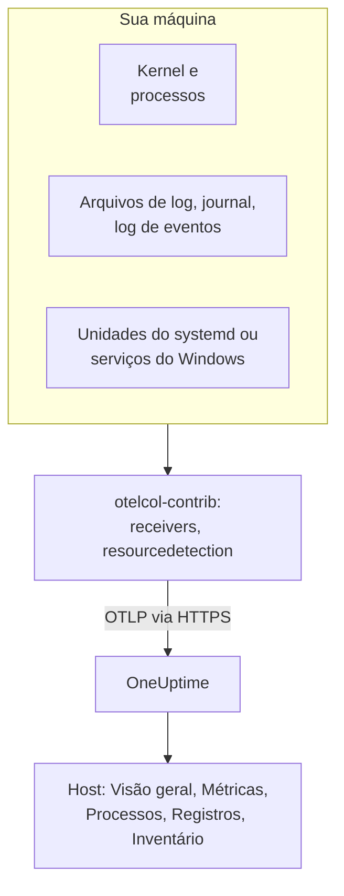

# Coletor OpenTelemetry no host

Execute o OpenTelemetry Collector em uma máquina Linux, macOS ou Windows para enviar as métricas, os processos, os logs e os estados de serviço dela ao OneUptime. A máquina aparece em **Produtos → Infraestrutura → Hosts** com páginas próprias, sem nenhum agente do OneUptime para instalar: o coletor é a versão upstream `otelcol-contrib`. Os [monitores de hosts](/docs/monitor/host-monitor) alertam com base no que ele envia.

:::cards
- [Instale o coletor](#instale-o-coletor): Três etapas no Linux, macOS ou Windows.
- [Escolha o que coletar](#escolha-o-que-coletar): Métricas, logs de arquivos, o journal, logs de eventos e estados de serviço.
- [Atributos de inventário](#atributos-de-inventário-ip-mac-número-de-série-fabricante-modelo-firmware): IP, MAC, número de série, fabricante, modelo e firmware para o seu CMDB.
- [Envie menos](#reduzindo-o-volume-de-dados-coletados): Menos linhas de log, intervalos maiores, menos séries.
:::

## Como funciona

O coletor lê a máquina por meio dos receivers, marca cada registro com a identidade da máquina e o envia ao OneUptime via OTLP com a sua chave de ingestão. O OneUptime registra o host a partir das primeiras métricas e preenche as páginas dele conforme os dados chegam.



| O que você vê no host | De onde vem |
| --- | --- |
| **Visão geral** e **Métricas** | O receiver `hostmetrics`: CPU, memória, discos, sistemas de arquivos, rede, carga, paginação. |
| **Processos** | O scraper `process` do `hostmetrics`: um conjunto de séries por processo. |
| **Registros** | Os receivers `filelog`, `journald` e `windowseventlog`. |
| **Systemd Units** (Linux) | O receiver `systemd`. |
| **Serviços** (Windows) | O receiver `windows_service`. |
| O item de inventário | O processor `resourcedetection`, mais os [atributos que você marca](#atributos-de-inventário-ip-mac-número-de-série-fabricante-modelo-firmware). |
| **Versão do agente** | `oneuptime.agent.version` no processor `resource`. |

Um host é registrado quando um lote que carrega `host.name` também carrega métricas de `hostmetrics` ou `process`, ou um atributo `os.type`. O processor `resourcedetection` define todos eles, e é por isso que toda configuração o coloca em primeiro lugar. `host.id` ou `host.arch` sozinhos não registram um host, e a telemetria que carrega uma identidade do Kubernetes (`k8s.cluster.name`, `k8s.node.name`, `k8s.pod.name`) é arquivada no cluster dela: monitore os nós do Kubernetes com o [agente Kubernetes](/docs/telemetry/kubernetes-agent).

## Antes de começar

- Uma chave de ingestão. Crie uma em **Configurações do projeto → Telemetria e APM → Chaves de ingestão** e copie o valor. O coletor a envia no cabeçalho `x-oneuptime-token`.
- Direitos de administrador na máquina: `sudo` no Linux e no macOS, um prompt do PowerShell com privilégios elevados no Windows.
- HTTPS de saída da máquina para a sua URL do OneUptime.
- A distribuição contrib do coletor, `otelcol-contrib`. A build core `otelcol` não tem os receivers e processors que estas configurações usam. O receiver `systemd` (Linux) funciona a partir da v0.143.0 e o receiver `windows_service` (Windows) a partir da v0.155.0; os comandos abaixo instalam a v0.161.0, a versão que o OneUptime fixa.

## Instale o coletor

:::steps
### Salve a configuração

Salve isto como `config.yaml` na pasta de onde você vai executar os comandos de instalação e substitua `YOUR_TELEMETRY_INGESTION_TOKEN` pela sua chave de ingestão (e o endpoint pela sua própria URL, se você hospedar por conta própria).

:::tabs
@tab Linux
```yaml title="config.yaml"
receivers:
  hostmetrics:
    collection_interval: 30s
    scrapers:
      cpu:
        metrics:
          system.cpu.utilization:
            enabled: true
          system.cpu.logical.count:
            enabled: true
      memory:
        metrics:
          system.memory.utilization:
            enabled: true
      disk:
      filesystem:
        metrics:
          system.filesystem.utilization:
            enabled: true
      load:
      network:
      paging:
      processes:
      process:
        mute_process_name_error: true
        mute_process_exe_error: true
        mute_process_io_error: true
        metrics:
          process.cpu.utilization:
            enabled: true
          process.memory.utilization:
            enabled: true

  # The systemd journal: every unit's logs, info and above.
  journald:
    directory: /var/log/journal
    priority: info

  # Powers the Systemd Units tab (otelcol-contrib v0.143.0+).
  systemd:
    collection_interval: 30s
    units: ["*.service"]
    metrics:
      systemd.service.cpu.time:
        enabled: false

processors:
  # Stamps host.name, host.id and os.type: this is how OneUptime attaches
  # telemetry to the host. Without it the host's pages stay empty.
  resourcedetection:
    detectors: [system, env]
    system:
      hostname_sources: [os]
      resource_attributes:
        host.name:
          enabled: true
        host.id:
          enabled: true
        host.arch:
          enabled: true
        host.ip:
          enabled: true
        host.mac:
          enabled: true
        os.type:
          enabled: true
        os.description:
          enabled: true
        os.version:
          enabled: true
  # The collector release this config is for: the host's Agent Version.
  resource:
    attributes:
      - key: oneuptime.agent.version
        value: "0.161.0"
        action: upsert
  batch:

exporters:
  otlphttp/oneuptime:
    endpoint: https://oneuptime.com/otlp
    headers:
      x-oneuptime-token: YOUR_TELEMETRY_INGESTION_TOKEN

service:
  pipelines:
    metrics:
      receivers: [hostmetrics, systemd]
      processors: [resourcedetection, resource, batch]
      exporters: [otlphttp/oneuptime]
    logs:
      receivers: [journald]
      processors: [resourcedetection, resource, batch]
      exporters: [otlphttp/oneuptime]
```
@tab macOS
```yaml title="config.yaml"
receivers:
  hostmetrics:
    collection_interval: 30s
    scrapers:
      cpu:
        metrics:
          system.cpu.utilization:
            enabled: true
          system.cpu.logical.count:
            enabled: true
      memory:
        metrics:
          system.memory.utilization:
            enabled: true
      disk:
      filesystem:
        metrics:
          system.filesystem.utilization:
            enabled: true
      load:
      network:
      paging:
      processes:
      process:
        mute_process_name_error: true
        mute_process_exe_error: true
        mute_process_io_error: true
        metrics:
          process.cpu.utilization:
            enabled: true
          process.memory.utilization:
            enabled: true

  filelog/system:
    include:
      - /var/log/install.log
      - /var/log/wifi.log
    start_at: end

processors:
  # Stamps host.name, host.id and os.type: this is how OneUptime attaches
  # telemetry to the host. Without it the host's pages stay empty.
  resourcedetection:
    detectors: [system, env]
    system:
      hostname_sources: [os]
      resource_attributes:
        host.name:
          enabled: true
        host.id:
          enabled: true
        host.arch:
          enabled: true
        host.ip:
          enabled: true
        host.mac:
          enabled: true
        os.type:
          enabled: true
        os.description:
          enabled: true
        os.version:
          enabled: true
  # The collector release this config is for: the host's Agent Version.
  resource:
    attributes:
      - key: oneuptime.agent.version
        value: "0.161.0"
        action: upsert
  batch:

exporters:
  otlphttp/oneuptime:
    endpoint: https://oneuptime.com/otlp
    headers:
      x-oneuptime-token: YOUR_TELEMETRY_INGESTION_TOKEN

service:
  pipelines:
    metrics:
      receivers: [hostmetrics]
      processors: [resourcedetection, resource, batch]
      exporters: [otlphttp/oneuptime]
    logs:
      receivers: [filelog/system]
      processors: [resourcedetection, resource, batch]
      exporters: [otlphttp/oneuptime]
```
@tab Windows
```yaml title="config.yaml"
receivers:
  hostmetrics:
    collection_interval: 30s
    scrapers:
      cpu:
        metrics:
          system.cpu.utilization:
            enabled: true
          system.cpu.logical.count:
            enabled: true
      memory:
        metrics:
          system.memory.utilization:
            enabled: true
      disk:
      filesystem:
        metrics:
          system.filesystem.utilization:
            enabled: true
      load:
      network:
      paging:
      processes:
      process:
        mute_process_name_error: true
        mute_process_exe_error: true
        mute_process_io_error: true
        metrics:
          process.cpu.utilization:
            enabled: true
          process.memory.utilization:
            enabled: true

  windowseventlog/system:
    channel: System
    start_at: end

  windowseventlog/application:
    channel: Application
    start_at: end

  windowseventlog/security:
    channel: Security
    start_at: end

  # Powers the Services tab (otelcol-contrib v0.155.0+).
  windows_service:
    collection_interval: 30s

processors:
  # Stamps host.name, host.id and os.type: this is how OneUptime attaches
  # telemetry to the host. Without it the host's pages stay empty.
  resourcedetection:
    detectors: [system, env]
    system:
      hostname_sources: [os]
      resource_attributes:
        host.name:
          enabled: true
        host.id:
          enabled: true
        host.arch:
          enabled: true
        host.ip:
          enabled: true
        host.mac:
          enabled: true
        os.type:
          enabled: true
        os.description:
          enabled: true
        os.version:
          enabled: true
  # The collector release this config is for: the host's Agent Version.
  resource:
    attributes:
      - key: oneuptime.agent.version
        value: "0.161.0"
        action: upsert
  batch:

exporters:
  otlphttp/oneuptime:
    endpoint: https://oneuptime.com/otlp
    headers:
      x-oneuptime-token: YOUR_TELEMETRY_INGESTION_TOKEN

service:
  pipelines:
    metrics:
      receivers: [hostmetrics, windows_service]
      processors: [resourcedetection, resource, batch]
      exporters: [otlphttp/oneuptime]
    logs:
      receivers:
        - windowseventlog/system
        - windowseventlog/application
        - windowseventlog/security
      processors: [resourcedetection, resource, batch]
      exporters: [otlphttp/oneuptime]
```
:::

Cada configuração é a que o dashboard escreve em **Produtos → Infraestrutura → Hosts → Documentação**, com um pipeline de logs adicionado: os processors são `resourcedetection`, `resource` e `batch`, e o exporter é `otlphttp/oneuptime`. Ela não define nenhum `service.name`, então a telemetria do host pertence ao próprio host, arquivada como `host/<hostname>`. Adicione um `service.name` ao processor `resource` só se quiser que ela seja arquivada em um serviço de telemetria com esse nome.

### Instale e inicie o coletor

:::tabs
@tab Linux
No Debian ou Ubuntu:

```bash
VERSION=0.161.0                      # the release OneUptime pins
ARCH=$(dpkg --print-architecture)   # amd64 or arm64

curl -fL -o /tmp/otelcol-contrib.deb \
  "https://github.com/open-telemetry/opentelemetry-collector-releases/releases/download/v${VERSION}/otelcol-contrib_${VERSION}_linux_${ARCH}.deb"
sudo dpkg -i /tmp/otelcol-contrib.deb
```

No RHEL, CentOS, Fedora ou Amazon Linux:

```bash
VERSION=0.161.0
ARCH=$(uname -m | sed 's/x86_64/amd64/;s/aarch64/arm64/')

curl -fL -o /tmp/otelcol-contrib.rpm \
  "https://github.com/open-telemetry/opentelemetry-collector-releases/releases/download/v${VERSION}/otelcol-contrib_${VERSION}_linux_${ARCH}.rpm"
sudo rpm -Uvh /tmp/otelcol-contrib.rpm
```

O pacote instala `/usr/bin/otelcol-contrib` e uma unidade do systemd, e a inicia com uma configuração padrão. Coloque a sua no lugar, permita que o usuário do coletor leia o journal e reinicie-o:

```bash
sudo install -m 0644 config.yaml /etc/otelcol-contrib/config.yaml
sudo usermod -aG systemd-journal otelcol-contrib
sudo systemctl enable otelcol-contrib
sudo systemctl restart otelcol-contrib
sudo systemctl status otelcol-contrib
```

A unidade do pacote executa o coletor como o usuário sem privilégios `otelcol-contrib`. O grupo `systemd-journal` permite que ele leia o journal; para acompanhar arquivos em `/var/log` (legíveis pelo grupo `adm` no Debian e no Ubuntu), adicione também esse grupo. Para que o scraper `process` veja os processos de outros usuários, dê a ele a capability `CAP_SYS_PTRACE`.
@tab macOS
```bash
VERSION=0.161.0
ARCH=$(uname -m | sed 's/x86_64/amd64/')   # arm64 on Apple silicon, amd64 on Intel

curl -fL -o /tmp/otelcol-contrib.tar.gz \
  "https://github.com/open-telemetry/opentelemetry-collector-releases/releases/download/v${VERSION}/otelcol-contrib_${VERSION}_darwin_${ARCH}.tar.gz"

sudo mkdir -p /usr/local/otelcol-contrib /usr/local/bin /etc/otelcol-contrib
sudo tar -xzf /tmp/otelcol-contrib.tar.gz -C /usr/local/otelcol-contrib
sudo ln -sf /usr/local/otelcol-contrib/otelcol-contrib /usr/local/bin/otelcol-contrib
sudo install -m 0644 config.yaml /etc/otelcol-contrib/config.yaml
```

Crie `/Library/LaunchDaemons/com.oneuptime.otelcol-contrib.plist` para que o launchd inicie o coletor junto com o Mac e o reinicie se ele parar:

```xml title="/Library/LaunchDaemons/com.oneuptime.otelcol-contrib.plist"
<?xml version="1.0" encoding="UTF-8"?>
<!DOCTYPE plist PUBLIC "-//Apple//DTD PLIST 1.0//EN" "http://www.apple.com/DTDs/PropertyList-1.0.dtd">
<plist version="1.0">
<dict>
  <key>Label</key><string>com.oneuptime.otelcol-contrib</string>
  <key>ProgramArguments</key>
  <array>
    <string>/usr/local/bin/otelcol-contrib</string>
    <string>--config=/etc/otelcol-contrib/config.yaml</string>
  </array>
  <key>RunAtLoad</key><true/>
  <key>KeepAlive</key><true/>
  <key>StandardOutPath</key><string>/var/log/otelcol-contrib.out.log</string>
  <key>StandardErrorPath</key><string>/var/log/otelcol-contrib.err.log</string>
</dict>
</plist>
```

Carregue-o:

```bash
sudo launchctl load -w /Library/LaunchDaemons/com.oneuptime.otelcol-contrib.plist
sudo launchctl list | grep otelcol-contrib
```

Use este tarball, não o Homebrew: a fórmula do Homebrew é a build core, que se recusa a iniciar com esta configuração.
@tab Windows
Em um prompt do PowerShell com privilégios elevados, na pasta que contém `config.yaml`, execute este bloco inteiro: cada linha depende das variáveis acima dela.

```powershell
$VERSION = "0.161.0"                          # the release OneUptime pins; v0.155.0+ has the Services tab
$ARCH    = "amd64"                            # use "arm64" on ARM hosts
$dest    = "C:\Program Files\otelcol-contrib"
$tar     = "$env:TEMP\otelcol-contrib.tar.gz"

# Note the "-contrib" in the asset name; otelcol_... is the wrong archive.
$url = "https://github.com/open-telemetry/opentelemetry-collector-releases/releases/download/v$VERSION/otelcol-contrib_${VERSION}_windows_${ARCH}.tar.gz"

New-Item -ItemType Directory -Force -Path $dest | Out-Null
Invoke-WebRequest -Uri $url -OutFile $tar
tar -xf $tar -C $dest                          # tar.exe ships with Windows 10 1803+ / Server 2019+
Get-ChildItem $dest                            # expect otelcol-contrib.exe, not otelcol.exe
Copy-Item config.yaml "$dest\config.yaml" -Force

# --% hands the rest of the line to sc.exe unchanged, so its quoting
# survives PowerShell — keep the command on one line.
sc.exe --% create "otelcol-contrib" binPath= "\"C:\Program Files\otelcol-contrib\otelcol-contrib.exe\" --config=\"C:\Program Files\otelcol-contrib\config.yaml\"" start= auto DisplayName= "OpenTelemetry Collector (OneUptime)"
sc.exe description "otelcol-contrib" "Collects host telemetry and forwards it to OneUptime over OTLP."
sc.exe start "otelcol-contrib"
sc.exe query "otelcol-contrib"
```

O serviço é executado como `LocalSystem`, que pode ler o log de eventos `Security` e todos os serviços do Windows. No Windows, o scraper `load` apenas emula uma média de carga a partir do contador *Processor Queue Length*, começando em 0.

O nome do asset precisa começar com `otelcol-contrib_`. O arquivo core `otelcol_<version>_windows_amd64.tar.gz` extrai `otelcol.exe`, que não tem os receivers `windowseventlog` nem `windows_service`; renomeá-lo para `otelcol-contrib.exe` não os adiciona. Prefere um instalador? A mesma [página de versões](https://github.com/open-telemetry/opentelemetry-collector-releases/releases) tem um `otelcol-contrib_<version>_windows_x64.msi` assinado, que registra o serviço para você: aponte-o para este `config.yaml` e mantenha o serviço em `LocalSystem`.
:::

### Verifique se o host aparece

Abra **Produtos → Infraestrutura → Hosts → Todos os hosts**. O host aparece com o nome de host dele assim que as primeiras métricas chegam, normalmente em 30 segundos, e as páginas **Visão geral**, **Métricas**, **Processos** e **Registros** são preenchidas. Se ele não aparecer, leia os logs do próprio coletor:

:::tabs
@tab Linux
```bash
sudo journalctl -u otelcol-contrib -f
```
@tab macOS
```bash
tail -f /var/log/otelcol-contrib.err.log
```
@tab Windows
```powershell
Get-WinEvent -LogName Application -MaxEvents 20 | Where-Object ProviderName -eq "otelcol-contrib"
```
:::
:::

Para gerar uma linha de log de teste, execute `logger "hello from oneuptime"` (Linux, macOS) ou `eventcreate /T INFORMATION /ID 999 /L APPLICATION /SO OneUptimeTest /D "hello from oneuptime"` (Windows, com privilégios elevados) e depois veja a página **Registros** do host.

## Escolha o que coletar

Todas as configurações seguem o mesmo formato: receivers para o que ler, os processors `resourcedetection`, `resource` e `batch`, e o exporter `otlphttp/oneuptime`. Adicione os receivers abaixo a `receivers:` e ao pipeline deles, e depois reinicie o coletor (`sudo systemctl restart otelcol-contrib`, `launchctl unload` e `load` em um Mac, `Restart-Service otelcol-contrib` no Windows). Mescle cada trecho nas seções que a sua configuração já tem: uma segunda chave `processors:` ou `service:` substitui a primeira.

### Métricas do host

`hostmetrics` funciona em todos os sistemas operacionais. Ele lê CPU, memória, discos, sistemas de arquivos, rede, carga, paginação e processos do kernel, a cada `collection_interval`. As métricas `*.utilization` e `system.cpu.logical.count` vêm desativadas no receiver por padrão, e os gráficos do host e os modelos de alerta Host as leem, então mantenha-as ativadas como fazem as configurações acima. O scraper `process` alimenta a página **Processos**; ele também é a maior fonte de séries (veja [Envie menos](#reduzindo-o-volume-de-dados-coletados)).

No Linux, o coletor lê `/proc` e `/sys`. Um coletor em um contêiner precisa montar os do host e definir `HOST_PROC` e `HOST_SYS` (veja [Em um contêiner Docker](#em-um-contêiner-docker)); uma instalação nativa não precisa de nada.

### Logs de arquivos

Acompanhe qualquer arquivo de log no disco com um receiver `filelog` e adicione-o ao pipeline `logs`:

```yaml
receivers:
  filelog/app:
    include:
      - /var/log/myapp/*.log
    start_at: end
    multiline:
      # A new entry starts with a timestamp; continuation lines (the
      # "at ...", "File ...", "Caused by: ..." frames) are folded into it.
      line_start_pattern: '^\d{4}-\d{2}-\d{2}[ T]\d{2}:\d{2}:\d{2}'
```

`start_at: end` lê só as linhas novas; use `beginning` para ler os arquivos desde o início na primeira execução. O coletor guarda a posição em cada arquivo, então retoma corretamente depois de um reinício.

O OneUptime procura stack traces nas linhas de log de erro e fatais e as agrupa em **Exceções**, no host. Para isso, um stack trace de várias linhas (Java, Python, .NET, Ruby) precisa chegar como um único registro, que é o que `multiline` faz; sem ele, cada frame vira um log separado. Se a sua aplicação puder escrever ela mesma os atributos do OpenTelemetry `exception.type`, `exception.message` e `exception.stacktrace`, é ainda mais confiável.

Em um host com systemd, `/var/log/syslog` e `/var/log/messages` repetem o que o journal já contém, então leia um ou outro.

### Journal do systemd

Em um host com systemd, o receiver `journald` lê os logs de todas as unidades em um só lugar, com os campos estruturados delas. A configuração Linux acima lê todos a partir de `info`; restrinja-a a algumas unidades:

```yaml
receivers:
  journald:
    directory: /var/log/journal
    units:
      # Drop this list to ingest everything; restrict it to limit volume.
      - ssh.service
      - cron.service
      - nginx.service
    priority: info
```

O receiver executa `journalctl`, que todo host com systemd tem, e o usuário do coletor precisa estar no grupo `systemd-journal`.

### Serviços do Linux (unidades do systemd, métricas)

A página **Systemd Units** do host lista cada unidade e o estado dela, a partir do [`systemdreceiver`](https://github.com/open-telemetry/opentelemetry-collector-contrib/tree/main/receiver/systemdreceiver) (tipo de configuração `systemd`), o equivalente no Linux da página **Serviços** do Windows. A configuração Linux acima o ativa:

```yaml
receivers:
  systemd:
    collection_interval: 30s
    # The service manager to read: "system" (default) or "user".
    scope: system
    # Which units to scrape, as systemctl unit patterns. The default is
    # every service; widen it to include timers, sockets or mounts, or
    # narrow it to cut volume on hosts with hundreds of units:
    units: ["*.service"]
    # units: [nginx.service, postgresql.service, "*.timer"]
    metrics:
      # Per-service CPU time is on by default and doubles this receiver's
      # datapoint count. The Systemd Units tab does not use it, so turn it
      # off unless you chart it. On v0.142.0 the key is
      # systemd.unit.cpu.time — naming a metric the running build does not
      # have stops the collector at startup.
      systemd.service.cpu.time:
        enabled: false

service:
  pipelines:
    metrics:
      receivers: [hostmetrics, systemd]
      processors: [resourcedetection, resource, batch]
```

O receiver chegou primeiro no `otelcol-contrib` v0.142.0, e a v0.143.0 é a primeira versão que vale a pena executar. Em qualquer versão anterior, adicionar `systemd` falha na inicialização com `'receivers' unknown type: "systemd"`; só a v0.142.0 chama a métrica de CPU de `systemd.unit.cpu.time` e procura estatísticas de cgroup em todas as unidades, o que registra um erro de scrape para cada unidade que não é `.service`.

Ele emite `systemd.unit.state` como um conjunto de estados: a cada scrape, cada unidade recebe um ponto de dados por estado possível (`active`, `reloading`, `inactive`, `failed`, `activating`, `deactivating`, `maintenance`, `refreshing`), `1` para o estado em que está e `0` para o resto. O nome da unidade é o atributo de recurso `systemd.unit.name`, e o estado é o atributo de ponto de dados `systemd.unit.active_state`. Como o nome da unidade é um atributo de recurso, `resourcedetection` precisa ficar no pipeline de métricas: ele marca `host.name` no recurso de cada unidade e, sem ele, as amostras nunca se associam a um host.

Ele lê o estado das unidades pelo D-Bus do sistema, com as chamadas somente leitura que `systemctl list-units` faz e que o systemd permite sem privilégios. Assim, o serviço do pacote, que é executado como o usuário `otelcol-contrib` e não como root, não precisa de direitos extras. Ele precisa, porém, do bus: um coletor em um contêiner não tem `/run/dbus/system_bus_socket`, a menos que você monte o do host, então use uma instalação nativa. O receiver está em fase alfa e só funciona no Linux.

> [!WARNING]
> O conjunto de estados custa oito pontos de dados por unidade a cada scrape, e `systemd.service.cpu.time`, ativada por padrão, adiciona mais dois (`user` e `system`): 10 pontos de dados por unidade a cada scrape. Um host que acompanha 300 unidades a cada 30 segundos envia cerca de 6.000 pontos de dados por minuto só desse receiver, ou cerca de 4.800 com a métrica de CPU desativada. Restrinja `units:` aos serviços sobre os quais você alerta, ou aumente `collection_interval`, antes de ativá-lo em toda uma frota.

### Apple Unified Log

O macOS grava os logs do sistema no Apple Unified Log, lido com `log show` e `log stream`, em vez de em `/var/log/system.log`. Para coletá-lo, transmita-o para um arquivo com um pequeno script, `/usr/local/otelcol-contrib/log-stream.sh`:

```bash title="/usr/local/otelcol-contrib/log-stream.sh"
#!/bin/bash
exec /usr/bin/log stream --style ndjson --level info \
  --predicate 'subsystem != "com.apple.cfnetwork"' \
  >> /var/log/apple-unified.log
```

Torne-o executável e execute-o com o launchd (ou com `nohup` para um teste rápido) e depois aponte um receiver `filelog` para o arquivo:

```yaml
receivers:
  filelog/apple-unified:
    include:
      - /var/log/apple-unified.log
    start_at: end
    operators:
      - type: json_parser
        timestamp:
          parse_from: attributes.timestamp
          layout: "%Y-%m-%d %H:%M:%S.%f%j"
```

Muitas frotas de Mac funcionam bem com as métricas do host e alguns logs de arquivos, sem o log unificado.

### Logs de eventos do Windows

A configuração Windows acima assina os canais `System`, `Application` e `Security`. Para restringir o canal `Security`, de alto volume, a alguns IDs de evento:

```yaml
windowseventlog/security:
  channel: Security
  start_at: end
  query: "*[System[(EventID=4625 or EventID=4740)]]"
```

Para ler outro canal (qualquer um em *Event Viewer → Applications and Services Logs*), use o nome exato dele:

```yaml
windowseventlog/iis:
  channel: Microsoft-IIS-Logging/Logs
  start_at: end
```

### Serviços do Windows (métricas)

A página **Serviços** do host lista cada serviço do Windows com o estado e o tipo de inicialização, a partir do [`windowsservicereceiver`](https://github.com/open-telemetry/opentelemetry-collector-contrib/tree/main/receiver/windowsservicereceiver) (tipo de configuração `windows_service`). Ele vem no `otelcol-contrib` a partir da v0.155.0: em versões anteriores, adicionar `windows_service` falha na inicialização com `'receivers' unknown type: "windows_service"`. A configuração Windows acima o ativa:

```yaml
receivers:
  windows_service:
    collection_interval: 30s
    # Collect every service by default. To cut volume — and avoid the
    # "access denied" noise from services the collector can't open —
    # list just the ones you care about:
    # include_services: [Spooler, W3SVC, MSSQLSERVER]
    # Or collect everything except a few:
    # exclude_services: [TrustedInstaller]

service:
  pipelines:
    metrics:
      receivers: [hostmetrics, windows_service]
```

Ele emite um gauge `windows.service.status` por serviço, o estado do serviço Win32 (`4` é em execução, `1` é parado), com os atributos `name` e `startup_mode`. O coletor lê todos os serviços como `LocalSystem` e ignora os que não consegue abrir. O receiver está em fase alfa e só funciona no Windows; se um erro de scrape ou um `access denied` em um serviço afetar os outros, restrinja-o com `include_services`.

`include_services` só consegue restringir o conjunto. Se você listar serviços e ainda vir todos, a configuração editada não chegou ao coletor em execução: reinicie o serviço, verifique se `include_services` é uma lista preenchida com o mesmo recuo de `collection_interval` e dê alguns minutos à página **Serviços**, até que os serviços relatados antes da alteração saiam da janela móvel dela. Os nomes são os nomes de chave exatos dos serviços, com diferenciação de maiúsculas e minúsculas (`Spooler`, `W3SVC`), que `Get-Service | Select-Object Name` lista.

### Rótulos

Qualquer atributo de recurso que comece com `oneuptime.label.` vira um rótulo de projeto no host: `oneuptime.label.<dimension>=<value>` é o rótulo `<dimension>:<value>`. Adicione um processor para eles e cite-o nos pipelines:

```yaml
processors:
  resource/oneuptime-labels:
    attributes:
      - key: oneuptime.label.team
        value: payments
        action: upsert
      - key: oneuptime.label.env
        value: production
        action: upsert

service:
  pipelines:
    metrics:
      processors: [resourcedetection, resource, resource/oneuptime-labels, batch]
```

Os rótulos são comparados sem diferenciar maiúsculas de minúsculas, então um rótulo `Production` existente é reutilizado em vez de duplicado, e o coletor nunca remove rótulos adicionados no OneUptime.

### Atributos de inventário (IP, MAC, número de série, fabricante, modelo, firmware)

Todo host também recebe um item de inventário: o registro que uma exportação para um CMDB lê. Os detalhes dele são preenchidos diretamente a partir dos atributos de recurso da telemetria que você envia, então o que chega é o que uma sincronização com o CMDB pode buscar.

| O que você quer | Atributo | De onde vem |
| --- | --- | --- |
| Endereços IP | `host.ip` | `resourcedetection`, separados por vírgula quando a máquina tem vários |
| Endereços MAC | `host.mac` | `resourcedetection`, um por interface ativa, separados por vírgula |
| Arquitetura | `host.arch` | `resourcedetection` |
| ID da máquina | `host.id` | `resourcedetection`: o GUID da máquina no Windows, `/etc/machine-id` no Linux |
| Sistema operacional | `os.type`, `os.description`, `os.version` | `resourcedetection` |
| Número de série | `host.serial_number` | Marcado por você, a partir do WMI ou do DMI |
| Fabricante | `device.manufacturer` | Marcado por você, a partir do WMI ou do DMI |
| Modelo | `device.model.name` | Marcado por você, a partir do WMI ou do DMI |
| Versão do firmware (BIOS ou UEFI) | `device.firmware.version` | Marcada por você, a partir do WMI ou do DMI |

As configurações acima ativam todos os atributos detectados: no detector system, só `host.name` e `os.type` vêm ativados por padrão, e é por isso que elas listam os demais em `resource_attributes`. Se você montar uma configuração própria, mantenha esse bloco `resourcedetection`: sem ele não há `host.name`, e portanto nem host nem item de inventário.

#### Número de série, fabricante, modelo e versão do firmware não têm detector

Eles ficam no firmware da máquina, que o coletor não lê. No Linux isso não é uma configuração que você possa mudar: o coletor do pacote é executado como o usuário sem privilégios `otelcol-contrib`, e `/sys/class/dmi/id/product_serial` só pode ser lido pelo root. Então leia-os uma vez, quando a máquina for provisionada, e marque-os no recurso com um processor próprio:

```yaml
processors:
  resource/oneuptime-hardware:
    attributes:
      - key: host.serial_number
        value: "7XYZ123"
        action: upsert
      - key: device.manufacturer
        value: "Dell Inc."
        action: upsert
      - key: device.model.name
        value: "OptiPlex 7090"
        action: upsert
      - key: device.firmware.version
        value: "1.21.0"
        action: upsert

service:
  pipelines:
    metrics:
      processors: [resourcedetection, resource, resource/oneuptime-hardware, batch]
```

Adicione `resource/oneuptime-hardware` à lista de processors que você já tem, em vez de colar esta linha por cima: se você remover `resource`, o host perde a **Versão do agente**. De qualquer forma, mantenha `resourcedetection` em primeiro lugar: é ele que associa o lote ao host.

`host.manufacturer`, `host.model.name`, `host.firmware.version` e `host.bios.version` são aceitos como grafias alternativas e armazenados nas chaves `device.*` acima, então uma configuração escrita de qualquer uma das formas vai para o mesmo lugar; quando os dois estão presentes, o valor `device.*` prevalece. O número de série vai no sentido contrário: `device.serial_number` é aceito e armazenado como `host.serial_number`.

> [!NOTE]
> Em um recurso sem identidade de host, `device.manufacturer` significa "aplicativo móvel": é um dos atributos que marcam um lote como Real User Monitoring móvel. O recurso de um host sempre carrega `host.name` ou `host.id`, então uma configuração de coletor como a de cima nunca é confundida com um celular, mas não reutilize o mesmo bloco na configuração do SDK de um aplicativo móvel.

#### Lendo os valores

No Windows, em um prompt do PowerShell com privilégios elevados. Ele imprime o bloco YAML da máquina em que você o executa:

```powershell
$bios = Get-CimInstance -ClassName Win32_BIOS
$cs   = Get-CimInstance -ClassName Win32_ComputerSystem

# Quote for YAML: trim, escape any embedded quote, wrap in single quotes.
# The cast to string first is what keeps this working on machines whose
# firmware leaves a field empty — .Trim() on $null throws.
function Format-YamlValue($value) {
  "'" + ("$value".Trim() -replace "'", "''") + "'"
}

@"
  resource/oneuptime-hardware:
    attributes:
      - key: host.serial_number
        value: $(Format-YamlValue $bios.SerialNumber)
        action: upsert
      - key: device.manufacturer
        value: $(Format-YamlValue $cs.Manufacturer)
        action: upsert
      - key: device.model.name
        value: $(Format-YamlValue $cs.Model)
        action: upsert
      - key: device.firmware.version
        value: $(Format-YamlValue $bios.SMBIOSBIOSVersion)
        action: upsert
"@
```

Ele imprime uma entrada de processor, já recuada: adicione-a dentro do bloco `processors:` que você tem, não como uma segunda chave `processors:`. Use `Get-CimInstance`, não o obsoleto `Get-WmiObject`, que o PowerShell 7 e versões posteriores não têm mais. Um campo que o firmware deixa vazio é impresso como `''`: remova esse atributo em vez de enviar um em branco. Máquinas virtuais muitas vezes não têm número de série nenhum.

No Linux, como root:

```bash
cat /sys/class/dmi/id/product_serial   # host.serial_number
cat /sys/class/dmi/id/sys_vendor       # device.manufacturer
cat /sys/class/dmi/id/product_name     # device.model.name
cat /sys/class/dmi/id/bios_version     # device.firmware.version
```

`bios_version` é o único dos quatro que qualquer usuário pode ler. Em máquinas sem `/sys/class/dmi`, `dmidecode -s system-serial-number`, `-s system-manufacturer`, `-s system-product-name` e `-s bios-version` retornam os mesmos valores. Máquinas virtuais informam aqui o hypervisor delas (`QEMU`, `VMware, Inc.`, `Amazon EC2`), que normalmente é o que você quer em um CMDB.

Em um Mac:

```bash
ioreg -l | awk -F'"' '/IOPlatformSerialNumber/{print $4}'   # host.serial_number
sysctl -n hw.model                                          # device.model.name
system_profiler SPHardwareDataType | awk -F': ' '/System Firmware Version/{print $2}'   # device.firmware.version
```

O fabricante é `Apple Inc.` `hw.model` retorna o identificador do modelo, como `Mac14,7` ou `MacBookPro18,3`, não o nome comercial, que o Mac não informa: mapeie o identificador no seu CMDB se precisar de um. Coloque-o mesmo assim em `device.model.name`: `device.model.identifier` marca um lote como aplicativo móvel não importa o que mais ele carregue, então um Mac marcado com ele é arquivado como um celular e desvinculado do host.

#### Usando variáveis de ambiente em vez disso

O detector `env` está ativado, então `OTEL_RESOURCE_ATTRIBUTES` funciona no lugar do processor:

```text
OTEL_RESOURCE_ATTRIBUTES=host.serial_number=7XYZ123,device.manufacturer=Dell%20Inc.,device.model.name=OptiPlex%207090
```

Codifique cada valor com percent-encoding. A variável é lida como uma lista `key=value` de W3C Baggage, em que `,` e `=` separam as entradas e os espaços não são portáveis entre versões do coletor; aspas não ajudam, e `device.manufacturer="Dell Inc."` pode chegar com as aspas no valor. No Windows, `[System.Uri]::EscapeDataString($value)` codifica um valor.

Defina-a no próprio serviço do coletor, nunca para a máquina toda:

- **Linux:** `sudo systemctl edit otelcol-contrib`, depois uma seção `[Service]` com `Environment="OTEL_RESOURCE_ATTRIBUTES=…"`.
- **Windows:** o valor `Environment` (do tipo `REG_MULTI_SZ`) em `HKLM\SYSTEM\CurrentControlSet\Services\otelcol-contrib`. `sc.exe create` não consegue definir variáveis de ambiente de serviço, e `setx` define uma variável que o serviço em execução nunca volta a ler.

> [!WARNING]
> Não a defina para a máquina toda (`setx /M`, `/etc/environment`). Todo processo com SDK do OpenTelemetry na máquina herda `OTEL_RESOURCE_ATTRIBUTES`, então as suas aplicações informariam o `device.manufacturer` da máquina como sendo delas, e um recurso de aplicação com `device.manufacturer` e sem `host.name` ou `host.id` é lido como aplicativo móvel, o que o desvincula do serviço dele.

O processor é mais fácil de acertar: ele é restrito ao coletor por construção, e os valores nunca mudam para uma máquina. Prefira-o, a menos que você já gere arquivos de ambiente a partir de modelos.

#### Um endereço MAC não é um valor marcado

`host.mac` vem do detector `system`, assim como `host.ip`: um endereço por interface de rede ativa, sem o loopback, no formato IEEE que o OpenTelemetry especifica (`AC-DE-48-23-45-67`). Uma máquina que executa Docker ou Hyper-V informa também os switches virtuais, e é por isso que o valor é uma lista. Uma interface que informa o marcador todo zerado (`00-00-00-00-00-00`) fica de fora.

Nada na máquina informa uma versão de firmware disponível como atualização, então o OneUptime registra a versão instalada.

#### Verificando se funcionou

Abra o item do host em **Produtos → Inventário** e veja o cartão **Detalhes do ativo**. Os valores aparecem alguns minutos depois do próximo lote; um detalhe que o coletor não informou aparece como desconhecido, com um link para esta seção. Como eles são marcados e não detectados, não se atualizam sozinhos: marque-os de novo depois de uma troca de placa-mãe, de uma atualização do firmware ou de uma reinstalação.

## Outras formas de executar o coletor

### Em um contêiner Docker

Execute o coletor em um contêiner que enxergue os processos e os sistemas de arquivos do host, a partir da pasta que contém `config.yaml`:

```bash
docker run -d \
  --name otel-collector \
  --restart unless-stopped \
  --network host \
  --pid host \
  -v $(pwd)/config.yaml:/etc/otelcol-contrib/config.yaml:ro \
  --volume /:/hostfs:ro,rslave \
  -e HOST_PROC=/hostfs/proc \
  -e HOST_SYS=/hostfs/sys \
  -e HOST_ETC=/hostfs/etc \
  -e HOST_VAR=/hostfs/var \
  -e HOST_RUN=/hostfs/run \
  -e HOST_DEV=/hostfs/dev \
  otel/opentelemetry-collector-contrib:0.161.0 \
  --config /etc/otelcol-contrib/config.yaml
```

`--network host`, `--pid host`, a montagem `/hostfs` e as variáveis `HOST_*` permitem que `hostmetrics` e `process` leiam o kernel do host em vez do kernel do contêiner. Use só o pipeline de métricas da configuração: a imagem não tem `journalctl`, e o receiver `systemd` precisa do D-Bus do host.

### A partir do tarball da versão

Onde pacotes não são uma opção, extraia o binário estático e dê a ele uma unidade do systemd própria:

```bash
VERSION=0.161.0
ARCH=$(uname -m | sed 's/x86_64/amd64/;s/aarch64/arm64/')

curl -fL -o /tmp/otelcol.tar.gz \
  "https://github.com/open-telemetry/opentelemetry-collector-releases/releases/download/v${VERSION}/otelcol-contrib_${VERSION}_linux_${ARCH}.tar.gz"
sudo mkdir -p /opt/otelcol-contrib
sudo tar -xzf /tmp/otelcol.tar.gz -C /opt/otelcol-contrib
sudo install -m 0644 config.yaml /opt/otelcol-contrib/config.yaml
```

```ini title="/etc/systemd/system/otelcol-contrib.service"
[Unit]
Description=OpenTelemetry Collector
After=network.target

[Service]
ExecStart=/opt/otelcol-contrib/otelcol-contrib --config /opt/otelcol-contrib/config.yaml
Restart=on-failure
RestartSec=5s
User=root

[Install]
WantedBy=multi-user.target
```

```bash
sudo systemctl daemon-reload
sudo systemctl enable --now otelcol-contrib
```

`User=root` permite que esta unidade leia todos os arquivos de log e todos os processos; a instalação por pacote acima é a alternativa sem privilégios.

### Em nós do Kubernetes

Nós do Kubernetes não são hosts no OneUptime: a telemetria deles carrega uma identidade do Kubernetes e é arquivada no cluster. Instale o [agente Kubernetes](/docs/telemetry/kubernetes-agent): cada nó aparece na página **Nós** do cluster, ao lado dos pods dele.

## Atualizando o coletor

Toda configuração desta página marca a versão do coletor a que se destina como `oneuptime.agent.version`, no processor `resource`. O OneUptime a mostra como a **Versão do agente** na **Visão geral** do host, com um sinal de aviso ao lado quando o OneUptime fixa uma versão mais nova. Selecione o sinal para ver como atualizar do jeito que você instalou.

Para atualizar manualmente, instale a nova versão do mesmo jeito que instalou esta, com a nova `VERSION` (no Debian e no Ubuntu, `sudo dpkg -i --force-confold` mantém a sua configuração sem perguntar), defina `oneuptime.agent.version` em `config.yaml` com a mesma versão e reinicie o coletor. Um coletor cuja configuração não marca nenhuma versão não mostra nenhuma, e nunca um sinal.

## Reduzindo o volume de dados coletados

A configuração é sua, então nada sai da máquina a menos que um receiver que você adicionou o leia. Se um host envia mais do que você quer (o que aparece como mais ingestão e, no OneUptime Cloud, mais custo), corte aqui. As duas maiores alavancas são quais logs você lê e com que frequência você coleta métricas; um processor `filter` faz o resto. Mude uma alavanca de cada vez e reinicie o coletor depois de cada edição.

### De onde vem o volume

| Sinal | Maior fator | Reduza com |
| --- | --- | --- |
| Logs | Cada linha de cada arquivo, unidade do journal ou canal de eventos | Menos receivers, um `units:` ou `query:` mais restrito, um `filter` por severidade |
| Métricas do host | Com que frequência você coleta, vezes o número de séries | Um `collection_interval` maior, menos scrapers |
| Cardinalidade de métricas | Métricas por processo: um conjunto de séries por processo | Deixar de fora, ou restringir, o scraper `process` |
| Unidades do systemd | 10 pontos de dados por unidade a cada scrape (conjunto de estados e CPU) | Um `units:` mais restrito, a métrica de CPU desativada, um `collection_interval` maior |

### Leia só os logs de que você precisa

Os logs são quase sempre a maior parte, e o coletor lê só o que você lista, então liste menos:

- Aponte `filelog` para arquivos específicos, não para globs amplos: `/var/log/myapp/error.log` em vez de `/var/log/**`.
- Restrinja `journald` às unidades que interessam a você e aumente `priority` para descartar `info` e `debug` antes que saiam da máquina:

```yaml
receivers:
  journald:
    directory: /var/log/journal
    units:
      - ssh.service
      - nginx.service
    priority: warning # info and debug are dropped before export
```

- Restrinja o canal de eventos `Security`, de alto volume, aos IDs de evento que você audita com uma `query:` (como em [Logs de eventos do Windows](#logs-de-eventos-do-windows)), ou descarte o canal.

### Colete métricas com menos frequência

O volume de `hostmetrics` acompanha `collection_interval`: se uma resolução de 30 segundos é mais do que você precisa, 60 segundos reduzem os pontos de dados pela metade.

```yaml
receivers:
  hostmetrics:
    collection_interval: 60s
```

### Restrinja o scraper por processo

O scraper `process` emite um conjunto de séries para cada processo em execução, então, em uma máquina movimentada, ele é a maior fonte de séries. Deixe-o de fora se você não precisa da página **Processos**, ou limite-o aos processos que importam (mantenha `processes`, um punhado de contagens de processos, em qualquer caso):

```yaml
receivers:
  hostmetrics:
    collection_interval: 60s
    scrapers:
      cpu:
      memory:
      disk:
      filesystem:
      network:
      load:
      paging:
      processes: # aggregate counts only — cheap
      process:
        mute_process_name_error: true
        mute_process_exe_error: true
        mute_process_io_error: true
        include:
          names: [nginx, postgres, node]
          match_type: strict
```

Isso reduz o receiver às métricas padrão: coloque de volta os blocos `metrics:` das configurações acima em `cpu`, `memory`, `filesystem` e `process` se você usa os gráficos do host e os modelos de alerta Host.

### Restrinja as unidades do systemd

O receiver `systemd` envia um ponto de dados por estado e por unidade a cada scrape, oito por unidade, mais dois para `systemd.service.cpu.time`, ativada por padrão, então o volume dele depende de quantas unidades `units:` corresponde. O padrão `["*.service"]` inclui as dezenas de unidades de execução única que nunca mudam de estado. Liste as unidades sobre as quais você alerta e desative a métrica de CPU, a menos que a mostre em um gráfico:

```yaml
receivers:
  systemd:
    collection_interval: 60s
    units: [nginx.service, postgresql.service, ssh.service]
    metrics:
      # On otelcol-contrib v0.142.0 this key is systemd.unit.cpu.time.
      systemd.service.cpu.time:
        enabled: false
```

Juntas, essas mudanças levam um host com 300 unidades de cerca de 6.000 pontos de dados por minuto para bem menos de 100. As unidades retiradas da lista saem da página **Systemd Units** alguns minutos depois, quando as últimas amostras delas saem da janela móvel.

### Descarte registros com um processor filter

Quando você quer um receiver, mas não toda a saída dele, adicione um processor [`filter`](https://github.com/open-telemetry/opentelemetry-collector-contrib/tree/main/processor/filterprocessor). Ele avalia uma condição [OTTL](https://github.com/open-telemetry/opentelemetry-collector-contrib/blob/main/pkg/ottl/README.md) e descarta cada registro que corresponde, antes de enviar qualquer coisa.

Descarte logs abaixo de uma severidade:

```yaml
processors:
  filter/drop-low-severity:
    error_mode: ignore
    logs:
      log_record:
        # Drop anything less severe than WARN (info, debug, trace).
        # The UNSPECIFIED guard is required — see the warning below.
        - "severity_number != SEVERITY_NUMBER_UNSPECIFIED and severity_number < SEVERITY_NUMBER_WARN"
```

> [!WARNING]
> Mantenha a proteção `UNSPECIFIED`. `SEVERITY_NUMBER_UNSPECIFIED` é `0` e `SEVERITY_NUMBER_WARN` é `13`, então um `severity_number < SEVERITY_NUMBER_WARN` sozinho é verdadeiro para todo registro cuja severidade nunca foi analisada. Um receiver `filelog` simples não extrai severidade nenhuma da linha, então, sem a proteção, a condição apaga em silêncio cada linha que ele lê, sem erro algum. Com a proteção, os registros não analisados são mantidos e chegam com a severidade `Unspecified`, o que mostra que você precisa de um analisador de severidade.

Para filtrar logs de arquivos por severidade corretamente, extraia-a primeiro com um operador [`severity_parser`](https://github.com/open-telemetry/opentelemetry-collector-contrib/blob/main/pkg/stanza/docs/operators/severity_parser.md) no receiver:

```yaml
receivers:
  filelog/app:
    include:
      - /var/log/myapp/*.log
    start_at: end
    operators:
      # Pull a level out of lines like "2026-01-01 ERROR something broke".
      - type: regex_parser
        regex: '(?i)(?P<level>TRACE|DEBUG|INFO|WARN(?:ING)?|ERROR|FATAL)'
        parse_from: body
        # Lines with no recognisable level fall through unparsed rather
        # than being discarded, and are then kept by the guard above.
        on_error: send
      - type: severity_parser
        parse_from: attributes.level
        preset: default
        mapping:
          warn: warning
          error: err
          fatal: panic
```

Em um host com systemd, o journal não precisa de nada disso: o `priority:` do `journald` filtra por nível no próprio `journalctl`.

Descarte as métricas que você não mostra em gráficos, por nome exato ou por padrão:

```yaml
processors:
  filter/drop-metrics:
    error_mode: ignore
    metrics:
      metric:
        # Exact metric name.
        - 'name == "system.paging.faults"'
        # Or a whole family. IsMatch is RE2 and UNANCHORED, so anchor it
        # yourself with ^ when you mean "starts with".
        - 'IsMatch(name, "^system\\.paging\\.")'
```

Para enviar só um conjunto fixo de métricas, inverta a condição: `filter` descarta o que corresponde, então `not (...)` descarta tudo o que você não citou. Mantenha a condição em uma única linha:

```yaml
processors:
  filter/allowlist:
    error_mode: ignore
    metrics:
      metric:
        - 'not (name == "system.cpu.utilization" or name == "system.memory.utilization" or name == "system.filesystem.utilization")'
```

Uma allowlist é um martelo pesado: tudo o que você esquecer de citar some, junto com os monitores construídos sobre isso. Prefira descartar as poucas métricas que você não quer, ou deixar de fora o scraper que as produz: uma métrica que nunca é coletada não custa nada para filtrar.

Depois adicione o processor ao pipeline dele, antes de `batch`:

```yaml
service:
  pipelines:
    metrics:
      receivers: [hostmetrics]
      processors: [filter/drop-metrics, resourcedetection, resource, batch]
      exporters: [otlphttp/oneuptime]
    logs:
      receivers: [journald]
      processors: [filter/drop-low-severity, resourcedetection, resource, batch]
      exporters: [otlphttp/oneuptime]
```

Um pipeline que cita um processor ou exporter que a configuração não define impede o coletor de iniciar. Mantenha `resourcedetection`, que associa a telemetria ao host, e `resource`, que informa a versão do coletor. `filter` é um processor contrib, então a build core recusa esta configuração.

### Um ponto de partida enxuto

Um host só com métricas, com um intervalo amplo e sem séries por processo, é a menor pegada útil:

```yaml title="config.yaml"
receivers:
  hostmetrics:
    collection_interval: 60s
    scrapers:
      cpu:
        metrics:
          system.cpu.utilization:
            enabled: true
          system.cpu.logical.count:
            enabled: true
      memory:
        metrics:
          system.memory.utilization:
            enabled: true
      disk:
      filesystem:
        metrics:
          system.filesystem.utilization:
            enabled: true
      load:
      network:
      paging:
      processes:

processors:
  # Stamps host.name, host.id and os.type: this is how OneUptime attaches
  # telemetry to the host. Without it the host's pages stay empty.
  resourcedetection:
    detectors: [system, env]
    system:
      hostname_sources: [os]
      resource_attributes:
        host.name:
          enabled: true
        host.id:
          enabled: true
        host.arch:
          enabled: true
        host.ip:
          enabled: true
        host.mac:
          enabled: true
        os.type:
          enabled: true
        os.description:
          enabled: true
        os.version:
          enabled: true
  # The collector release this config is for: the host's Agent Version.
  resource:
    attributes:
      - key: oneuptime.agent.version
        value: "0.161.0"
        action: upsert
  batch:

exporters:
  otlphttp/oneuptime:
    endpoint: https://oneuptime.com/otlp
    headers:
      x-oneuptime-token: YOUR_TELEMETRY_INGESTION_TOKEN

service:
  pipelines:
    metrics:
      receivers: [hostmetrics]
      processors: [resourcedetection, resource, batch]
      exporters: [otlphttp/oneuptime]
```

Adicione de volta um pipeline `logs`, com um receiver `filelog` ou `journald` restrito, quando precisar.

> [!CAUTION]
> Cuidado com o que você corta. Um monitor de logs precisa que os logs dele cheguem, então filtrar uma severidade ou um canal silencia os monitores que o observam, e os modelos de alerta Host precisam das métricas `*.utilization`. Corte os dados sobre os quais você não age, não os dados que um monitor observa, e confira a queda em **Configurações do projeto → Histórico de uso** um ou dois dias depois (o uso é contado por dia) antes de mexer na próxima alavanca.

## OneUptime auto-hospedado e proxies

Em um OneUptime auto-hospedado, aponte o exporter para a sua própria instância; use `http://` e a porta dela se ela for só HTTP:

```yaml
exporters:
  otlphttp/oneuptime:
    endpoint: https://your-oneuptime-host.example.com/otlp
    headers:
      x-oneuptime-token: YOUR_TELEMETRY_INGESTION_TOKEN
```

Atrás de um proxy, o coletor usa as variáveis padrão `HTTPS_PROXY`, `HTTP_PROXY` e `NO_PROXY`. Defina-as no serviço dele:

- **Linux:** um drop-in, `/etc/systemd/system/otelcol-contrib.service.d/proxy.conf`, com uma seção `[Service]` e `Environment="HTTPS_PROXY=http://proxy.example.com:3128"`; depois `sudo systemctl daemon-reload` e reinicie o coletor.
- **macOS:** um dicionário `EnvironmentVariables` no plist.
- **Windows:** o valor `Environment` em `HKLM\SYSTEM\CurrentControlSet\Services\otelcol-contrib`.

## Agente de IA

O coletor envia o que um host informa; o **Agente de IA de host** permite que a OneUptime AI pergunte ao próprio host enquanto investiga um incidente ou alerta nele. Ele executa comandos somente leitura — `systemctl status nginx --no-pager -n 50`, `journalctl -u nginx -n 200 --no-pager`, `df -h`, `free -m`, `ps aux --sort=-%cpu`, `ss -tulpn` — e, só se você permitir, aplica correções como reiniciar uma unidade específica do systemd. É um contêiner Linux (imagem `oneuptime/resource-ai-agent:release`) com um instalador próprio, que precisa do Docker (o mecanismo do sistema, não o Docker rootless) e do plugin Docker Compose:

```bash
curl -fsSL https://raw.githubusercontent.com/OneUptime/oneuptime/master/agents/HostAIAgent/install.sh -o install.sh
sudo bash install.sh
```

- **As investigações de IA vêm ativadas por padrão.** Assim que o agente se conecta, a OneUptime AI investiga com ele os incidentes e alertas deste host, e a **Visão geral** do host mostra o status do agente. Para parar, defina `ONEUPTIME_AI_INVESTIGATION=false` onde o agente é executado (**Alterar**, em **O que a IA pode fazer** na página do agente de IA, mostra como), ou remova o agente.
- Ele se registra com `HOST_NAME`; deixe vazio para usar o nome de host da própria máquina, que é o que este coletor informa como `host.name`, a menos que você defina outro nome. Os dois precisam coincidir, para que o agente atenda o host que este coletor criou. Ele aparece na página **Agente de IA** do host no OneUptime.
- Ele executa os programas do próprio host entrando nos namespaces do host com `nsenter`, então é executado com privilégios, como root, com `pid: host`: ele é root no host. O limite é a política de comandos do agente: comandos somente leitura, a menos que você defina `ONEUPTIME_AI_ALLOW_WRITES=true`, nunca um shell, `sudo` ou um programa fora da lista dele, e nunca ele mesmo, a unidade deste coletor ou qualquer coisa em `ONEUPTIME_AI_PROTECTED_TARGETS`.
- Com `ONEUPTIME_AI_ALLOW_WRITES=true`, `ONEUPTIME_AI_WRITE_TARGETS` (nomes completos de unidades, como `nginx.service,app-*`) limita quais unidades uma correção pode tocar. `ONEUPTIME_AI_FIXES` diz como as correções são executadas — `ask-for-approval` (uma pessoa aprova cada uma), `automatic` ou `bypass-approval` — e a página do agente de IA mostra isso somente para leitura; o instalador grava os dois, a partir do ambiente dele, no `.env` do agente ([O que a IA pode fazer, definido pelo agente](/docs/ai/infrastructure-ai-agents#what-ai-may-do-set-by-the-agent)).

O que ele pode executar, como as correções funcionam e como solucionar problemas: [Infrastructure AI Agents](/docs/ai/infrastructure-ai-agents#hosts).

## Solução de problemas

:::details Nenhum host aparece no OneUptime
1. Leia os logs do coletor em busca de erros de exportação (veja [Verifique se o host aparece](#verifique-se-o-host-aparece)). Adicione `service.telemetry.logs.level: debug` à configuração para ter mais detalhes.
2. Um HTTP `401` significa que a chave de ingestão está ausente, errada ou expirada; `422` significa que ela foi desativada ou é uma chave de navegador, que não pode enviar telemetria de host. Crie uma chave em **Configurações do projeto → Telemetria e APM → Chaves de ingestão** e atualize `x-oneuptime-token`.
3. Verifique se a máquina consegue chegar ao OneUptime: `curl -v https://oneuptime.com/otlp` (ou a sua URL auto-hospedada) a partir da mesma máquina.
4. Mantenha `resourcedetection` no pipeline de métricas: ele define `host.name`, que é como o OneUptime reconhece o host.
:::

:::details O coletor não consegue ler o journal ou um arquivo de log
O coletor do pacote é executado como o usuário sem privilégios `otelcol-contrib`. Adicione-o ao grupo que pode ler os logs e depois reinicie-o: `sudo usermod -aG systemd-journal otelcol-contrib` para o journal, e o grupo `adm` para a maior parte de `/var/log` no Debian e no Ubuntu. Para o `journald`, `journalctl` precisa estar no `PATH` do coletor e `/var/log/journal` precisa existir (`sudo systemd-tmpfiles --create --prefix /var/log/journal` o cria).
:::

:::details O serviço do Windows falha com Error 2: The system cannot find the file specified
O Service Control Manager não encontra o programa com que o serviço foi registrado. Execute `sc.exe qc "otelcol-contrib"` e compare `BINARY_PATH_NAME` com o que está em `C:\Program Files\otelcol-contrib`. Quase sempre foi baixado o arquivo core `otelcol_<version>_windows_amd64.tar.gz`: ele extrai `otelcol.exe`, enquanto o serviço cita `otelcol-contrib.exe`, que só o arquivo `otelcol-contrib_<version>_...` tem. Baixe de novo o asset contrib; não renomeie `otelcol.exe`, o que dá em vez disso o `1064` abaixo. A outra causa é um `binPath=` sem aspas: um caminho que passa por `C:\Program Files` se divide no espaço, a menos que esteja entre aspas exatamente como a etapa de instalação mostra.
:::

:::details O serviço do Windows falha com Error 1064
O gerenciador de serviços iniciou o programa, mas o coletor saiu durante a inicialização. Um `otelcol.exe` renomeado faz isso: a build core não tem os receivers `windowseventlog` nem `windows_service`, então rejeita a configuração. O mesmo acontece com um caminho de `--config` sem aspas, que se divide no espaço de `Program Files`. Verifique o que você tem:

- `otelcol-contrib.exe --version` deve imprimir `otelcol-contrib version ...`; `otelcol version ...` é a build core, renomeada.
- `otelcol-contrib.exe components` deve listar `windowseventlog` e `windows_service` entre os receivers (não `hostmetrics`, que a build core também tem).
- Execute-o em primeiro plano para ver o erro real: `& "C:\Program Files\otelcol-contrib\otelcol-contrib.exe" --config="C:\Program Files\otelcol-contrib\config.yaml"`.
- *Event Viewer → Windows Logs → Application*, origem `otelcol-contrib`, registra o erro de inicialização que o gerenciador de serviços engoliu.
:::

:::details O log de eventos Security retorna acesso negado
Faltam direitos ao serviço. Execute-o como `LocalSystem` (o padrão de `sc.exe create`) ou conceda à conta dele o direito de usuário *Manage auditing and security log*.
:::

:::details O receiver do systemd relata um erro de D-Bus, ou a página Systemd Units está vazia
- O coletor não consegue chegar ao bus do sistema: verifique se `/run/dbus/system_bus_socket` existe e se o usuário do coletor consegue abri-lo; `systemctl list-units` executado como esse usuário é a verificação mais rápida. Não é preciso ser root. Um coletor em um contêiner não enxerga nenhum bus, a menos que você monte o socket do host.
- A página está vazia enquanto o receiver funciona: mantenha `resourcedetection` no mesmo pipeline de métricas. O receiver associa só `systemd.unit.name` ao recurso de cada unidade, então, sem `resourcedetection`, não há `host.name` e as amostras nunca se associam a um host.
- Um erro de scrape por unidade, ou um coletor que se recusa a iniciar por causa de uma métrica desconhecida, é diferença de versão: a v0.142.0 lê estatísticas de cgroup em todas as unidades e chama a métrica de CPU de `systemd.unit.cpu.time`; a v0.143.0 e posteriores leem só serviços e a chamam de `systemd.service.cpu.time`. Execute a v0.143.0 ou posterior e use a chave que a sua build tem em qualquer substituição de `metrics:`.
:::

:::details Os gráficos de CPU e memória ou os modelos de alerta Host não mostram dados
Eles leem `system.cpu.utilization`, `system.memory.utilization` e `system.filesystem.utilization`, que o `hostmetrics` deixa desativadas a menos que você as ative. Copie os blocos `metrics:` em `cpu`, `memory` e `filesystem` das configurações acima para a sua e reinicie o coletor.
:::

:::details Dados demais, ou uma conta alta
Veja [Reduzindo o volume de dados coletados](#reduzindo-o-volume-de-dados-coletados): restrinja os receivers (canais do Windows, unidades do systemd, arquivos de log), colete com menos frequência, restrinja o scraper por processo ou descarte registros com um processor `filter` antes que sejam enviados.
:::

## Próximos passos

:::cards
- [Monitor de hosts](/docs/monitor/host-monitor): Alerte sobre CPU, memória, disco e processos.
- [Monitor de logs](/docs/monitor/logs-monitor): Alerte sobre padrões de log, como logons com falha em uma janela de 5 minutos.
- [Exportar para um CMDB](/docs/inventory/cmdb-sync): Envie os atributos de inventário para o seu CMDB.
- [Monitor de servidor / VM](/docs/monitor/server-monitor): Acompanhe também a disponibilidade de um servidor de fora.
:::
