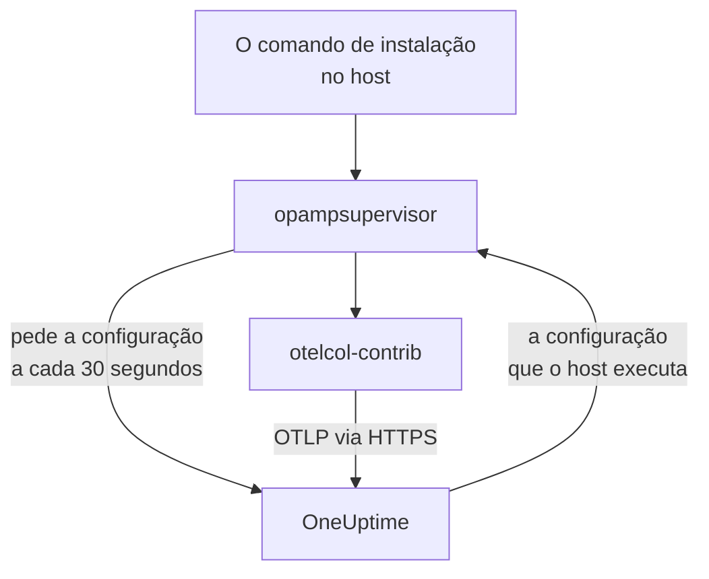

# Hosts

Adicione uma máquina Linux, Windows ou macOS ao OneUptime com um único comando. O comando instala o OpenTelemetry Collector no host, e o OneUptime envia ao coletor a configuração dele e a mantém atualizada: não há `config.yaml` para escrever, copiar para cada host ou manter em sincronia. Para mudar o que seus hosts coletam, edite uma configuração do coletor uma vez, e cada host ao qual ela se aplica recebe a mudança em até um minuto.

:::cards
- [Adicionar um host](#adicionar-um-host): Um comando no Linux, Windows ou macOS.
- [Mudar o que os hosts coletam](#mudar-o-que-os-hosts-coletam): Configurações do coletor por sistema e rótulo, com cada versão guardada.
- [Verificar o coletor de um host](#verificar-o-coletor-de-um-host): A configuração que ele executa, a versão dela e por que uma configuração não iniciou.
- [O que uma configuração pode fazer](#o-que-uma-configuração-pode-fazer): Ler o host e enviar somente para esta instância do OneUptime.
:::

## Como funciona

O comando instala dois programas das versões publicadas do OpenTelemetry Collector, cada um verificado com o SHA-256 que a sua versão publica: `otelcol-contrib`, o coletor que lê o host, e `opampsupervisor`, que executa o coletor e o mantém na configuração que o OneUptime envia por OpAMP, o OpenTelemetry Agent Management Protocol. Os dois são executados como o serviço `oneuptime-collector`.



O supervisor pede ao OneUptime a configuração do host a cada 30 segundos, aproximadamente, com a sua chave de ingestão, e informa qual configuração o host executa e se ela iniciou. O host é registrado em **Hosts** quando o supervisor se conecta pela primeira vez, com o nome da máquina, e as páginas dele se preenchem à medida que chegam as métricas e os logs.

Cada host executa uma configuração, escolhida nesta ordem:

| O host executa | Quando |
| --- | --- |
| A configuração escolhida para ele na página **Coletor** | Alguém escolheu uma. |
| A primeira das **Configurações do coletor** que se aplica a ele | Uma configuração se aplica quando é para o sistema do host e, se nomeia rótulos, o host tem um deles. |
| O padrão do OneUptime para o sistema dele | Nenhuma configuração se aplica. |

O padrão do OneUptime lê CPU, memória, discos, sistemas de arquivos, rede e processos em qualquer sistema; o journal e as unidades do systemd no Linux, onde o host os tem; os logs de eventos System, Application e Security e os serviços do Windows no Windows; e os logs de instalação e de Wi-Fi em `/var/log` no macOS. Ele deixa de fora os sistemas de arquivos que estão cheios por design, como os pacotes snap e o `/dev` do macOS, para que nunca mantenham o modelo High Filesystem Usage disparado. Ele acompanha as versões do OneUptime, então um host no padrão recebe as melhorias que o OneUptime fizer nele.

## Antes de começar

- Uma chave de ingestão. **Adicionar host** cria uma para você, ou escolha uma que você criou em **Configurações do projeto → Telemetria e APM → Chaves de ingestão**.
- Direitos de administrador no host: `sudo` no Linux e no macOS, PowerShell executado como administrador no Windows.
- Linux com systemd, Windows 10 ou Windows Server 2019 e posteriores, ou macOS em Apple Silicon ou Intel.
- HTTPS de saída do host para a URL do seu OneUptime, direto ou por um proxy.

## Adicionar um host

:::steps
### Abra Adicionar host

Abra **Produtos → Infraestrutura → Hosts** e selecione **Adicionar host**. Escolha o que o host executa: Linux, Windows ou macOS. Os nós de um cluster Kubernetes são monitorados pelo [Kubernetes Agent](/docs/telemetry/kubernetes-agent).

### Escolha uma chave de ingestão

Escolha uma chave ou crie uma pela caixa de diálogo. O comando abaixo a preenche.

### Execute o comando no host

Copie o comando da caixa de diálogo e execute-o no host. Leva cerca de um minuto. Estes são os mesmos comandos, com a URL do seu OneUptime e a sua chave no lugar dos exemplos:

:::tabs
@tab Linux
```bash
curl -fsSL https://oneuptime.com/docs/static/scripts/host-collector/install.sh | sudo sh -s -- --url https://oneuptime.com --key YOUR_INGESTION_KEY
```
@tab macOS
```bash
curl -fsSL https://oneuptime.com/docs/static/scripts/host-collector/install.sh | sudo sh -s -- --url https://oneuptime.com --key YOUR_INGESTION_KEY
```
@tab Windows
```powershell
[Net.ServicePointManager]::SecurityProtocol = [Net.ServicePointManager]::SecurityProtocol -bor [Net.SecurityProtocolType]::Tls12; & ([scriptblock]::Create((Invoke-RestMethod -Uri 'https://oneuptime.com/docs/static/scripts/host-collector/install.ps1'))) -Url 'https://oneuptime.com' -Key 'YOUR_INGESTION_KEY'
```
:::

Cada instância do OneUptime fornece os próprios instaladores, então uma instância auto-hospedada entrega o instalador da própria versão: substitua `https://oneuptime.com` pela sua URL nos dois lugares.

### Aguarde o host

A última etapa da caixa de diálogo informa quando o host se conecta, com um link para ele. Na lista, ele aparece como **Iniciando** até chegarem as primeiras métricas, geralmente em até um minuto, e depois como conectado, com o coletor **Em execução**. A página **Topologia** do host desenha em um único mapa o que roda nele, o que o chama e o que ele chama: veja [Topologia](/docs/telemetry/topology#abrir-o-mapa-próprio-de-um-recurso).
:::

## Rotular hosts

Adicione rótulos ao comando, e o host os tem desde o momento em que se conecta:

:::tabs
@tab Linux
```bash
curl -fsSL https://oneuptime.com/docs/static/scripts/host-collector/install.sh | sudo sh -s -- --url https://oneuptime.com --key YOUR_INGESTION_KEY --label env=production --label team=payments
```
@tab macOS
```bash
curl -fsSL https://oneuptime.com/docs/static/scripts/host-collector/install.sh | sudo sh -s -- --url https://oneuptime.com --key YOUR_INGESTION_KEY --label env=production --label team=payments
```
@tab Windows
```powershell
[Net.ServicePointManager]::SecurityProtocol = [Net.ServicePointManager]::SecurityProtocol -bor [Net.SecurityProtocolType]::Tls12; & ([scriptblock]::Create((Invoke-RestMethod -Uri 'https://oneuptime.com/docs/static/scripts/host-collector/install.ps1'))) -Url 'https://oneuptime.com' -Key 'YOUR_INGESTION_KEY' -Label 'env=production','team=payments'
```
:::

`env=production` vira o rótulo `env:production`. Os rótulos são adicionados e nunca removidos: execute o comando de novo com outro rótulo e o host terá os dois. Você também pode rotular hosts na lista **Hosts** ou com **Regras de Rótulos**. Uma configuração do coletor que nomeia rótulos vale apenas para hosts com um deles, então o mesmo comando com rótulos diferentes dá a cada grupo de hosts a sua própria configuração.

## Mudar o que os hosts coletam

:::steps
### Crie uma configuração do coletor

Abra **Produtos → Infraestrutura → Hosts → Configurações do coletor** e selecione **Criar: Configuração do coletor**. Dê a ela um nome, o sistema dos hosts aos quais ela se destina e, para alcançar apenas alguns deles, os rótulos deles. A configuração começa como o padrão do OneUptime para esse sistema.

### Edite o config.yaml dela

Na página da configuração, selecione **Editar configuração**, mude o YAML e salve. O OneUptime o verifica primeiro e recusa, explicando o motivo, uma configuração que não pode enviar: veja [O que uma configuração pode fazer](#o-que-uma-configuração-pode-fazer).

### Acompanhe a chegada aos hosts

Cada alteração salva é uma nova versão, e os hosts aos quais ela se aplica a recebem em até um minuto. A lista **Hosts** da configuração mostra cada host, o estado do coletor dele e a versão que ele executa.
:::

Um host executa a primeira configuração da lista que se aplica a ele: arraste as linhas em **Configurações do coletor** para mudar a ordem. Coloque primeiro as configurações mais específicas, como uma para servidores web com `env:production`, e as amplas, como uma para todos os hosts Linux, depois delas. O cartão **Padrões do OneUptime** abaixo da lista mostra o que um host executa quando nenhuma configuração se aplica.

### Versões e restauração

A lista **Versões** de uma configuração guarda cada alteração salva, a mais recente primeiro, com quem salvou e quando. Selecione **Ver** para ler uma versão e **Restaurar** para enviá-la de novo aos hosts: ela é salva como uma nova versão que diz qual restaurou, então a lista sempre mostra o que cada host recebeu.

### Escolha uma configuração para um único host

Na página **Coletor** de um host, selecione **Mudar configuração** e escolha uma configuração só para esse host. São oferecidas as configurações para o sistema do host e para qualquer sistema. Escolha Automático para devolver o host à lista. Um host cuja configuração escolhida é excluída volta sozinho para a lista.

### Quando uma configuração não inicia

O supervisor verifica uma nova configuração com o coletor antes de passar para ela e volta para a última configuração que funcionou quando uma não inicia. O host continua enviando o tempo todo. A página **Coletor** dele mostra **Falha na configuração** com o motivo do coletor, como um arquivo de log que o coletor não pode ler, e o OneUptime não envia essa configuração ao host de novo até que ela mude. Depois de corrigir a causa no host, selecione **Tentar novamente** para enviá-la mais uma vez.

## O que uma configuração pode fazer

Uma configuração que o OneUptime envia é executada em cada host ao qual se aplica, por isso o OneUptime a verifica sempre que ela é salva e recusa a que viola uma regra:

| Regra | Por quê |
| --- | --- |
| Apenas os receivers, processors, exporters, extensions e connectors da lista do OneUptime | Ela lê o host e os serviços nele. Um componente que executa programas ou lê credenciais de nuvem ou de cluster não está na lista. |
| Os dados só saem do host pelo exporter `otlp_http`, para `${env:ONEUPTIME_URL}/otlp` com o cabeçalho `x-oneuptime-token: ${env:ONEUPTIME_INGESTION_KEY}` | Cada host envia para esta instância do OneUptime, com a chave com que foi instalado. Nenhuma configuração contém uma chave. |
| `${env:NAME}` é o único `${...}` que ela pode usar | Um `${file:...}` ou `${https:...}` seria lido em cada host e poderia ser repassado. |
| Nenhuma configuração que execute um programa ou envie um arquivo que lê, como o `journalctl_path` do journald | Uma configuração não pode ir além de ler o host. |

Ainda assim, uma configuração pode ser uma que um host não consegue executar, como um receiver de outro sistema ou um arquivo de log que não existe lá. O coletor de cada host verifica isso antes de trocar, como descreve [Quando uma configuração não inicia](#quando-uma-configuração-não-inicia).

## Verificar o coletor de um host

Abra o host e a página **Coletor** dele. Ela mostra a situação do coletor, a configuração que ele executa e **Por que esta configuração**, a versão que ele executa, o **Último relatório** e a **Versão do coletor**. Em **No host** estão os comandos para verificá-lo a partir de um shell no host: se o serviço está em execução, o log e uma reinicialização.

:::tabs
@tab Linux
```bash
sudo systemctl status oneuptime-collector
sudo journalctl -u oneuptime-collector -n 50
sudo systemctl restart oneuptime-collector
```
@tab macOS
```bash
sudo launchctl print system/com.oneuptime.collector
sudo tail -n 50 /usr/local/oneuptime-collector/log/collector.log
sudo launchctl kickstart -k system/com.oneuptime.collector
```
@tab Windows
```powershell
Get-Service oneuptime-collector
Get-WinEvent -FilterHashtable @{ LogName = 'Application'; ProviderName = 'oneuptime-collector' } -MaxEvents 50 | Format-List TimeCreated, Message
Restart-Service oneuptime-collector
```
:::

No Linux, o coletor é executado como o usuário sem privilégios `oneuptime-collector`, nos grupos `systemd-journal` e `adm`, para poder ler o journal e os logs em `/var/log`. No macOS, ele é executado como root, como os daemons do launchd, e no Windows como LocalSystem, para poder ler todos os logs de eventos e serviços do Windows.

## Hosts configurados manualmente

Um host cujo coletor você mesmo instalou, com o guia [OpenTelemetry Collector para hosts](/docs/telemetry/host-otel-collector), continua enviando como antes, e o OneUptime não envia configuração a ele. Para entregá-lo ao OneUptime, abra a página **Coletor** do host: o comando dela adiciona `--replace-existing`, que para e desativa o coletor instalado manualmente (o serviço `otelcol-contrib`), para que o host não envie tudo em dobro. O host mantém o nome, o histórico e os rótulos.

## Opções de instalação

Execute o comando de novo para mudar qualquer uma destas opções, ou para passar para uma versão mais nova: ele substitui o que instalou e mantém o host como está no OneUptime.

| Linux e macOS | Windows | O que faz |
| --- | --- | --- |
| `--url URL` | `-Url URL` | Onde fica o OneUptime. |
| `--key KEY` | `-Key KEY` | Uma chave de ingestão de telemetria do seu projeto. |
| `--label KEY=VALUE` | `-Label KEY=VALUE` | Rotula o host. Repita a opção para mais rótulos; no Windows, liste-os separados por vírgulas. |
| `--env NAME=VALUE` | `-EnvVar NAME=VALUE` | Dá ao coletor uma variável de ambiente, para configurações que leem `${env:NAME}`. |
| `--version VERSION` | `-Version VERSION` | A versão do coletor a instalar, 0.161.0 por padrão. |
| `--download-url URL` | `-DownloadUrl URL` | Baixa as versões de um espelho com a mesma estrutura de pastas do GitHub. |
| `--proxy URL` | `-Proxy URL` | Envia os downloads e todo o tráfego do coletor por um proxy HTTP. |
| `--replace-existing` | `-ReplaceExisting` | Para e desativa um coletor instalado manualmente. |
| `--uninstall` | `-Uninstall` | Remove o coletor e tudo o que o comando instalou. |

## Desinstalar

:::tabs
@tab Linux
```bash
curl -fsSL https://oneuptime.com/docs/static/scripts/host-collector/install.sh | sudo sh -s -- --uninstall
```
@tab macOS
```bash
curl -fsSL https://oneuptime.com/docs/static/scripts/host-collector/install.sh | sudo sh -s -- --uninstall
```
@tab Windows
```powershell
& ([scriptblock]::Create((Invoke-RestMethod -Uri 'https://oneuptime.com/docs/static/scripts/host-collector/install.ps1'))) -Uninstall
```
:::

O host continua no OneUptime com o histórico: arquive-o ou exclua-o na lista **Hosts**.

## Solução de problemas

:::details O comando diz que o OneUptime recusou a chave
HTTP `401`: a chave está errada, expirou ou foi excluída. HTTP `422`: ela está desativada, é uma chave de navegador ou está fixada a um único serviço. Escolha uma chave de servidor ativa em **Adicionar host** e execute o comando de novo: ele substitui a chave no host.
:::

:::details O host não aparece
Verifique se o host consegue alcançar a URL do seu OneUptime por HTTPS e depois leia o log do coletor com o comando do sistema dele em [Verificar o coletor de um host](#verificar-o-coletor-de-um-host).
:::

:::details O host diz que a configuração dele falhou
A página **Coletor** dele mostra por que a configuração não iniciou. O host continua executando a última configuração que funcionou e recebe de novo a que falhou quando a configuração muda ou quando você seleciona **Tentar novamente**.
:::

:::details O host mostra "Não reportando"
O OneUptime não tem notícias do supervisor do host há mais de 15 minutos. Verifique se o serviço `oneuptime-collector` está em execução e se o host ainda consegue alcançar o OneUptime.
:::

## Próximos passos

:::cards
- [OpenTelemetry Collector para hosts](/docs/telemetry/host-otel-collector): Instale o coletor e escreva a configuração dele você mesmo.
- [Monitor de host](/docs/monitor/host-monitor): Receba alertas sobre o que seus hosts informam.
- [Chaves de ingestão](/docs/telemetry/ingestion-keys): Crie, restrinja e troque as chaves com que os hosts enviam.
- [Kubernetes Agent](/docs/telemetry/kubernetes-agent): Monitore os nós e as cargas de trabalho de um cluster.
:::
