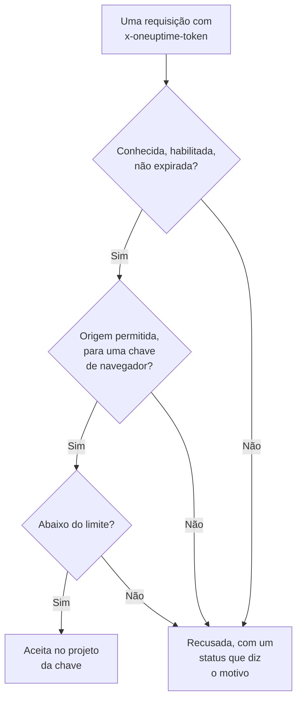

# Chaves de ingestão

Uma chave de ingestão liga a sua telemetria ao seu projeto. Aplicações, OpenTelemetry Collectors e agentes a enviam em cada requisição, e o OneUptime arquiva os registros, traços e métricas deles no projeto ao qual a chave pertence. Esta página mostra como criar uma chave, qual tipo escolher e como manter as chaves seguras.

:::cards
- [Criar uma chave de ingestão](#criar-uma-chave-de-ingestão): Um nome, um tipo e um segredo para copiar.
- [Servidor ou navegador](#servidor-ou-navegador): O tipo de chave de que um remetente precisa.
- [Proteger uma chave de navegador](#proteger-uma-chave-de-navegador): Origens, um nome de serviço e um limite.
- [Trocar, desativar ou excluir uma chave](#trocar-desativar-ou-excluir-uma-chave): O que fazer quando uma chave vaza.
:::

## Como uma chave é verificada

Cada requisição leva o segredo da chave, normalmente em um cabeçalho `x-oneuptime-token`. O OneUptime procura a chave, verifica se ela ainda pode enviar e só então aceita os dados no projeto da chave.



- **A chave decide o projeto.** Você nunca envia um ID de projeto: os dados enviados com uma chave vão para o projeto ao qual a chave pertence.
- **As mudanças chegam a todos os servidores em até um minuto.** Desativar uma chave, redefinir o segredo dela ou mudar as origens, a expiração ou o limite tem efeito em cerca de um minuto.
- **Uma chave de servidor é uma senha.** Qualquer pessoa que a tenha pode enviar telemetria para o seu projeto. Guarde-a nos segredos dos seus servidores, nunca no controle de versão nem em uma página web.

## Servidor ou navegador

Escolha o tipo pelo lugar onde a chave vai ficar. O tipo não pode ser mudado depois que a chave é criada.

| | **Servidor** | **Navegador** |
| --- | --- | --- |
| Para | Aplicações, collectors e agentes em máquinas que você opera | Páginas web, e React Native Session Replay |
| Envia | Todo tipo de telemetria, para todos os endpoints | Traços, registros, métricas e Session Replays |
| É um segredo | Sim: mantenha-a nos seus servidores | Não: qualquer pessoa que veja a página pode lê-la |
| Origens | Não verificadas | Só as origens listadas são aceitas |
| Requisições por minuto | Sem limite, a menos que você defina um | 6.000, a menos que você defina outro limite |

Em qualquer outro lugar, o OneUptime recusa uma chave de navegador, como por gRPC e MQTT, para perfis, Syslog, Fluent Bit e Fluentd, e para envio de source maps. Para passar um remetente para o outro tipo, crie uma chave desse tipo, troque o remetente para ela e depois exclua a chave antiga.

## Antes de começar

- **Uma função que gerencie chaves de ingestão.** Project Owner ou Project Admin, ou uma função personalizada com a permissão Create Telemetry Ingestion Key. As funções de Telemetry não incluem as chaves de ingestão.
- **No OneUptime Cloud, um método de pagamento.** A telemetria é cobrada conforme o uso, então um projeto no plano Free precisa de um método de pagamento antes de poder criar uma chave. A caixa de criação termina então com uma etapa **Cobrança** que mostra os preços.

## Criar uma chave de ingestão

:::steps
### Abrir as chaves de ingestão

Acesse **Configurações do projeto → Telemetria e APM → Chaves de ingestão**. **Telemetria e APM** começa recolhido no menu lateral: clique nele para abri-lo. A lista mostra de cada chave as colunas **Nome**, **Tipo**, **Last Used** e **Descrição**.

### Dar um nome à chave e escolher o tipo

Clique em **Criar chave de ingestão**. A caixa começa com o nome **Chave de servidor** e o tipo **Servidor**. Escolha o **Tipo de chave** e renomeie a chave conforme o que vai usá-la, como `checkout-collector`. Uma **Descrição** fica em **Avançado**.

### Adicionar as origens de uma chave de navegador

Uma chave **Navegador** pede as suas **Origens permitidas** na etapa seguinte, **Configurações do navegador**, com o seu **Nome do serviço fixado** em **Avançado**. Veja [Proteger uma chave de navegador](#proteger-uma-chave-de-navegador).

### Criar a chave e copiar o segredo

Clique em **Criar chave de ingestão**. A página da chave abre: copie a **Chave secreta** e entregue-a aos seus remetentes.
:::

O **Guia de configuração** de cada produto começa com **Escolha uma chave de ingestão**, que lista as chaves que esse guia pode usar e cria uma ali mesmo. Os trechos do guia passam então a levar essa chave.

## Enviar telemetria com a chave

Os remetentes colocam o segredo em um cabeçalho `x-oneuptime-token`:

```text
x-oneuptime-token: YOUR_ONEUPTIME_INGESTION_KEY
```

- Os SDKs do OpenTelemetry o leem de `OTEL_EXPORTER_OTLP_HEADERS`. Veja o [início rápido do OpenTelemetry](/docs/telemetry/open-telemetry#início-rápido).
- Por OTLP/gRPC, ele vai nos metadados `x-oneuptime-token`.
- Um dispositivo MQTT o envia como senha. Veja [Dispositivos IoT](/docs/telemetry/iot-devices).
- O OneUptime também lê a chave de um cabeçalho `x-oneuptime-ingestion-key` ou `x-oneuptime-service-token`, que algumas configurações mais antigas enviam.

## Proteger uma chave de navegador

Uma chave de navegador fica na sua página, onde qualquer pessoa pode copiá-la. Estas configurações limitam o que uma cópia pode fazer. Mude-as na página da chave com **Editar: Telemetria Ingestão Key**.

| Configuração | O que faz |
| --- | --- |
| **Origens permitidas** | As únicas origens das quais a chave é aceita. Uma requisição de qualquer outra origem, ou sem nenhum cabeçalho `Origin`, é recusada. Uma chave de navegador precisa manter pelo menos uma. |
| **Nome do serviço fixado** | Arquiva tudo o que a chave envia por OTLP/HTTP sob este único serviço, seja qual for o `service.name` que o remetente definiu. Uma cópia da chave só pode então gravar nesse serviço. |
| **Requests Per Minute Limit** | O máximo de requisições pelas quais a chave é aceita a cada minuto, compartilhado por todos os visitantes. Uma chave de navegador recebe 6.000 quando você deixa o campo vazio. |
| **Expira em** | A data depois da qual a chave é recusada, para que uma cópia publicada pare de funcionar. |

Uma origem é um esquema, um host e uma porta opcional: `https://app.example.com` não cobre `https://app.example.com:8443`. Um `*.` no início cobre todos os subdomínios, mas não o próprio domínio. O React Native Session Replay envia uma identidade `app://` exata, que não aceita curingas:

```json
[
  "https://app.example.com",
  "https://*.example.com",
  "app://com.example.mobile"
]
```

O [Catálogo de serviços](/docs/telemetry/services#como-um-serviço-entra-no-catálogo) mostra como um nome fixado decide o serviço. O Runner e o agente de IA do agente Kubernetes, e os agentes de IA de infraestrutura, não se registram com uma chave fixada: dê a eles uma chave de servidor sem nome fixado.

## Trocar, desativar ou excluir uma chave

A página de uma chave mostra o seu **Status**, a sua **Chave secreta** por trás de **Click to reveal**, e o seu **Last Used At**: a última vez que o OneUptime aceitou dados enviados com ela.

| Para | Faça isto | O que os remetentes veem |
| --- | --- | --- |
| Parar uma chave na hora, podendo desfazer depois | Clique em **Editar: Telemetria Ingestão Key**, abra **Acesso e limites** e desative **Habilitado**. O status mostra **Disabled — telemetry refused**. | `422` até você reativá-la |
| Substituir um segredo vazado | Clique em **Redefinir chave secreta** e confirme. A chave mantém as configurações e recebe um novo segredo. | `401` até eles enviarem o novo segredo |
| Parar uma chave de vez | Clique em **Excluir: Telemetria Ingestão Key** no fim da página dela. | `401` |

Para trocar um segredo sem perder dados, crie uma segunda chave, passe os seus remetentes para ela e exclua a chave antiga quando o **Last Used At** dela parar de mudar. **Last Used At** é atualizado a cada poucos minutos, não a cada requisição.

## Solução de problemas

Uma requisição recusada recebe um status e uma frase que diz o motivo.

| Resposta | O que significa |
| --- | --- |
| `401` com `Missing ingestion token` | A requisição não tem chave. Envie-a em `x-oneuptime-token`. |
| `401` com `Invalid ingestion token` | Nenhuma chave tem este segredo: ele foi digitado errado, redefinido ou excluído. |
| `401` com `This telemetry ingestion key expired.` | A data **Expira em** já passou. Defina uma data posterior ou use outra chave. |
| `402` com `Add a payment method` | No OneUptime Cloud, o projeto está no plano Free e ainda não tem método de pagamento. |
| `422` com `This telemetry ingestion key has been disabled.` | Alguém desativou **Habilitado**. |
| `422` com `A browser ingestion key cannot be used for` | Uma chave de navegador chegou a um endpoint que só aceita chaves de servidor. |
| `422` com `did not send an Origin header` | Uma chave de navegador foi enviada de fora de um navegador. Use ali uma chave de servidor. |
| `422` com `is not allowed for this browser ingestion key` | A origem da página não está em **Origens permitidas**. |
| `422` com `is pinned to a single service` | Uma chave com um **Nome do serviço fixado** foi usada para registrar um agente. Use uma chave de servidor sem nome fixado. |
| `429` com `Too many telemetry requests for this ingestion key` | A chave atingiu o seu **Requests Per Minute Limit**. Os exportadores tentam de novo depois do tempo de `Retry-After`. |

Para as outras respostas que um exportador OTLP pode receber, veja [Respostas](/docs/telemetry/open-telemetry#respostas).

:::details Ainda chegam dados um minuto depois de eu desativar a chave
Cada servidor do OneUptime guarda o que sabe de uma chave por até um minuto, então uma mudança chega a todos eles em cerca de um minuto. As requisições depois disso são recusadas.
:::

:::details Uma chave de navegador funciona no meu notebook, mas não em produção
Uma origem inclui o esquema e a porta. `http://localhost:3000` e `https://app.example.com` são origens diferentes: liste cada uma de onde a página é servida.
:::

:::details Last Used At ainda mostra Nunca
Nada enviou dados com esta chave desde que o OneUptime começou a registrar o uso dela. Verifique se os seus remetentes têm o segredo desta chave e se as requisições deles chegam ao OneUptime.
:::

## Próximos passos

:::cards
- [OpenTelemetry](/docs/telemetry/open-telemetry): Envie traços, métricas e registros com a sua chave.
- [Catálogo de serviços](/docs/telemetry/services): Veja os serviços sob os quais a sua telemetria é arquivada.
- [Retenção de dados](/docs/telemetry/data-retention): Decida por quanto tempo os dados são mantidos.
- [Filtros de descarte e regras de mascaramento](/docs/telemetry/drop-filters-and-scrub-rules): Descarte ou mascare dados antes de serem armazenados.
:::
