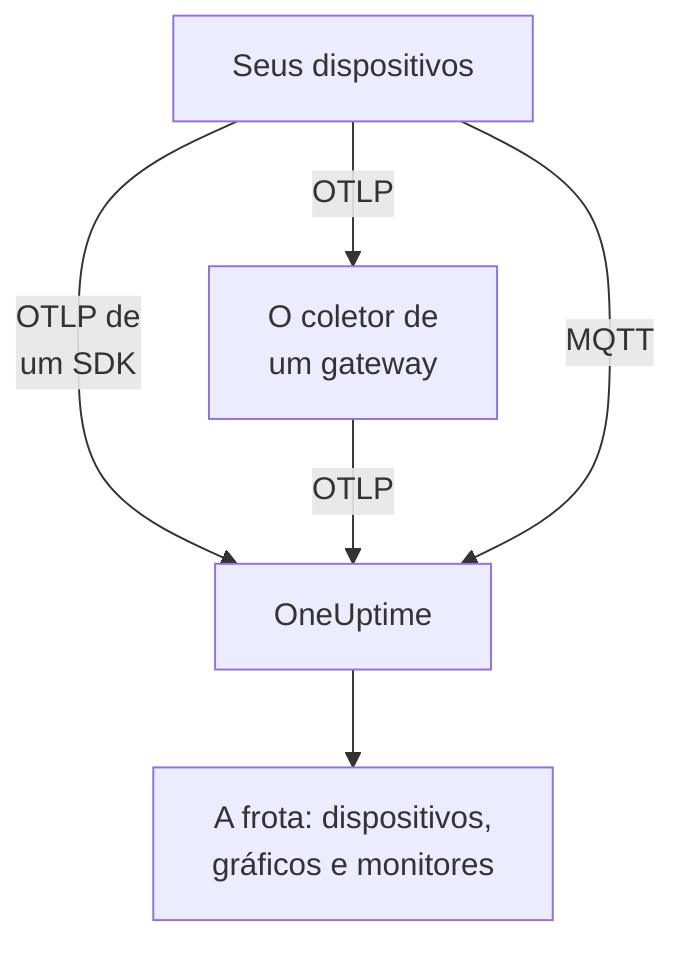

# Dispositivos IoT

O OneUptime monitora frotas de dispositivos IoT — sensores, gateways, controladores e equipamentos de borda — a partir de um pequeno conjunto de métricas `iot_*` que eles enviam. Ele agrupa os dispositivos em frotas, mantém um inventário dos dispositivos de cada frota e mostra em gráficos a bateria, o sinal, a temperatura, a CPU, a memória e a disponibilidade deles. Não há agente do OneUptime para instalar em um dispositivo: os dispositivos enviam OpenTelemetry padrão ou publicam no endpoint MQTT do OneUptime. Os [monitores de dispositivos IoT](/docs/monitor/iot-device-monitor) alertam com base no que eles enviam.

:::cards
- [Escolha como enviar](#escolha-como-enviar): Um SDK do OpenTelemetry, um coletor em um gateway ou MQTT.
- [Enviando métricas via MQTT](#enviando-métricas-via-mqtt): Tópicos, credenciais por dispositivo e Last Will.
- [Convenções de métricas](#convenções-de-métricas): Os nomes `iot_*` que o OneUptime mostra em gráficos e usa para alertar.
- [Solução de problemas](#solução-de-problemas): Frotas faltando, dispositivos faltando, mudanças para offline.
:::

## Como funciona

Toda leitura pertence a uma frota e a um dispositivo. O OneUptime cria a frota a partir da primeira leitura dela, adiciona cada dispositivo novo ao inventário da frota e atualiza os valores mais recentes do dispositivo a cada leitura seguinte. Leituras enviadas por OpenTelemetry e por MQTT alimentam as mesmas frotas, o mesmo inventário, os mesmos gráficos e monitores.



## Como o OneUptime modela IoT

- **Frota**: um grupo de dispositivos, como `building-a-sensors` ou `field-gateways`. Ela vem do atributo de recurso `iot.fleet.name` e aparece no OneUptime como o serviço de telemetria `iot/<fleet>`. Defina também `service.name=iot/<fleet>`, para que logs e métricas fiquem no mesmo serviço.
- **Dispositivo**: um dispositivo em uma frota, identificado pelo atributo `device.id` em cada ponto de dados. O inventário da frota é indexado por `device.id`.

| Atributo | Definido em | Obrigatório | Descrição |
| --- | --- | --- | --- |
| `iot.fleet.name` | Recurso | Sim | A frota a que o dispositivo pertence. Ela vira o serviço `iot/<fleet>` do OneUptime. |
| `device.id` | Cada ponto de dados | Sim | Um ID estável para o dispositivo, único na frota dele. |
| `iot.device.kind` | Cada ponto de dados | Não | A classe do dispositivo, como `Device`, `Sensor` ou `Gateway`. O padrão é `Device`. |
| `iot.device.type` | Cada ponto de dados | Não | Um tipo ou modelo mais específico para filtrar monitores, como `temp-sensor`. |
| `iot.device.firmware` | Cada ponto de dados | Não | A versão de firmware que o dispositivo informa. |

Por MQTT, o tópico define a frota e o dispositivo para você.

## Escolha como enviar

| Forma | Use quando | Precisa de |
| --- | --- | --- |
| [SDK do OpenTelemetry](#enviando-métricas-via-sdk-do-opentelemetry) | O dispositivo executa um SDK do OpenTelemetry e alcança o OneUptime sozinho. | Uma chave de ingestão no dispositivo. |
| [OpenTelemetry Collector](#enviando-métricas-via-um-opentelemetry-collector) | Muitos dispositivos enviam por meio de um gateway. | Um gateway que execute o coletor. |
| [MQTT](#enviando-métricas-via-mqtt) | O dispositivo já fala MQTT, ou deve aparecer como offline no momento em que cai. | Qualquer cliente MQTT que se conecte via WebSocket. |

## Antes de começar

- Uma chave de ingestão. Crie uma em **Configurações do projeto → Telemetria e APM → Chaves de ingestão** e copie o valor. Os dispositivos a enviam no cabeçalho `x-oneuptime-token`, ou como a senha do MQTT.
- Acesso de rede do dispositivo ou do gateway para a sua URL do OneUptime.
- Um nome de frota para cada grupo de dispositivos e um ID estável para cada dispositivo.

## Enviando métricas via SDK do OpenTelemetry

:::steps
### Aponte o SDK para o OneUptime

Defina as variáveis de ambiente padrão do OpenTelemetry no dispositivo. Substitua a chave, o nome da frota e o ID do dispositivo pelos seus:

```bash
export OTEL_EXPORTER_OTLP_ENDPOINT=https://oneuptime.com/otlp
export OTEL_EXPORTER_OTLP_PROTOCOL=http/protobuf
export OTEL_EXPORTER_OTLP_HEADERS=x-oneuptime-token=YOUR_TELEMETRY_INGESTION_TOKEN
export OTEL_RESOURCE_ATTRIBUTES=iot.fleet.name=building-a-sensors,device.id=sensor-001,service.name=iot/building-a-sensors
```

Mantenha `iot.fleet.name` estável: mudá-lo registra uma nova frota.

### Registre as leituras como métricas de IoT

Emita cada leitura como uma métrica com um dos [nomes convencionais](#convenções-de-métricas) e dê a cada ponto de dados um atributo `device.id`:

| Métrica | Valor | Atributo do ponto de dados |
| --- | --- | --- |
| `iot_device_up` | `1` | `device.id=sensor-001` |
| `iot_battery_percent` | `87` | `device.id=sensor-001` |
| `iot_temperature_celsius` | `21.5` | `device.id=sensor-001` |

O inventário é indexado pelo `device.id` do ponto de dados, não pelo do recurso, então defina-o em cada medição, além de em `OTEL_RESOURCE_ATTRIBUTES`.
:::

Depois [verifique se a frota aparece](#verifique-se-a-frota-aparece).

## Enviando métricas via um OpenTelemetry Collector

Quando muitos dispositivos enviam por meio de um gateway, execute um OpenTelemetry Collector no gateway. Ele recebe OTLP dos seus dispositivos, marca a frota em cada leitura e as encaminha ao OneUptime.

:::steps
### Salve a configuração do gateway

Salve isto como `config.yaml` no gateway:

```yaml title="config.yaml"
receivers:
  otlp:
    protocols:
      grpc:
        endpoint: 0.0.0.0:4317
      http:
        endpoint: 0.0.0.0:4318

processors:
  batch:
    send_batch_size: 512
    timeout: 5s
  resource:
    attributes:
      - key: iot.fleet.name
        value: field-gateways
        action: upsert
      - key: service.name
        value: iot/field-gateways
        action: upsert

exporters:
  otlphttp:
    endpoint: "https://oneuptime.com/otlp"
    headers:
      "x-oneuptime-token": "YOUR_TELEMETRY_INGESTION_TOKEN"

service:
  pipelines:
    metrics:
      receivers: [otlp]
      processors: [resource, batch]
      exporters: [otlphttp]
```

- `otlp` recebe dos seus dispositivos via gRPC (`4317`) e HTTP (`4318`). Receba leituras de qualquer outra forma que o coletor suporte (uma ponte MQTT, logs de arquivos) e envie-as pelo mesmo pipeline.
- `resource` marca cada leitura com a frota. Defina `iot.fleet.name`, e o `service.name=iot/<fleet>` correspondente, por gateway, para que os dispositivos de cada gateway caiam na frota deles.
- Mantenha `device.id`, e qualquer um de `iot.device.kind`, `iot.device.type` e `iot.device.firmware`, em cada ponto de dados, para que o OneUptime consiga diferenciar os dispositivos da frota.
- `otlphttp` envia ao OneUptime via HTTPS com a chave de ingestão. Tanto a codificação protobuf padrão quanto `encoding: json` são aceitas.

### Execute o coletor no gateway

:::tabs
@tab Docker
Execute-o a partir da pasta que contém `config.yaml`:

```bash
docker run -d \
  --name otel-collector \
  --restart unless-stopped \
  -p 4317:4317 \
  -p 4318:4318 \
  -v $(pwd)/config.yaml:/etc/otelcol-contrib/config.yaml:ro \
  otel/opentelemetry-collector-contrib:0.161.0 \
  --config /etc/otelcol-contrib/config.yaml
```
@tab otelcol-contrib
Se o gateway já tem o `otelcol-contrib`, aponte-o para o arquivo:

```bash
otelcol-contrib --config config.yaml
```
:::

Os dispositivos então enviam OTLP ao gateway, por exemplo com `OTEL_EXPORTER_OTLP_ENDPOINT=http://<gateway-host>:4318` no SDK de cada dispositivo.
:::

Depois [verifique se a frota aparece](#verifique-se-a-frota-aparece).

## Enviando métricas via MQTT

O OneUptime tem um endpoint MQTT próprio, então dispositivos que falam MQTT publicam as leituras diretamente nele, sem SDK, coletor ou ponte. O que chega por MQTT passa pelo mesmo pipeline que o OTLP: as frotas são criadas, o inventário é atualizado e todo monitor e modelo de alerta de IoT funciona do mesmo jeito.

### Endpoints

| Transporte | Endereço | Observações |
| --- | --- | --- |
| MQTT sobre WebSocket | `wss://<your-host>/mqtt` | Funciona em toda implantação, pela porta HTTPS normal. |
| MQTT sobre TCP | `<app-host>:1883` | Só auto-hospedado, e interno à rede do cluster ou do Compose até que você o exponha. A porta é `MQTT_INGEST_PORT`. |

### Autenticação

- **Com a chave de ingestão**: envie-a como a senha do MQTT. O nome de usuário é ignorado; se o seu cliente só tem um campo de nome de usuário, coloque a chave nele. Isso serve para um gateway que publica por muitos dispositivos.
- **Com uma credencial por dispositivo**: recomendado para dispositivos que se conectam diretamente. Abra a página **Device Registry** da frota e registre o dispositivo, com o **Device ID** que ele usa como `device.id`. O **MQTT Username** do dispositivo é o nome de usuário dele, e o **MQTT Password (Secret)** dele é a senha.

A credencial de um dispositivo só pode publicar nos próprios tópicos `oneuptime/<fleet>/<device>/`. Você pode revogar um dispositivo sem mexer no resto da frota: desligue o interruptor **Habilitado** dele, ou exclua-o, e um dispositivo conectado é desconectado em cerca de um minuto. Um dispositivo registrado que fica em silêncio continua no inventário como offline, e o modelo de alerta Device Offline dispara para ele, mesmo que ele caia sem um Last Will.

O OneUptime recusa credenciais inválidas no CONNECT com o código de retorno 4 (nome de usuário ou senha inválidos), então um dispositivo mal configurado falha de forma visível. Chaves de navegador são recusadas por MQTT.

### Tópicos e payloads

Publique sob o prefixo fixo `oneuptime/`. Os segmentos de frota e de dispositivo não podem conter `/`, `+` ou `#`, não podem começar com `$` e têm no máximo 100 caracteres.

| Tópico | Payload |
| --- | --- |
| `oneuptime/<fleet>/<device>/telemetry` | Um objeto JSON de leituras: `{"metrics":{"iot_temperature_celsius":21.5}}`, ou um objeto plano cujos campos numéricos são as métricas. |
| `oneuptime/<fleet>/<device>/metrics/<metricName>` | Um valor: um número puro (`23.4`) ou `{"value":23.4}`. |
| `oneuptime/<fleet>/<device>/status` | `online` ou `offline` (também `1` ou `0`, `true` ou `false`, `up` ou `down`). Ele define `iot_device_up`. |

Um payload de telemetria também pode carregar `"attributes"`, um mapa de strings marcado em cada ponto de dados (use-o para `iot.device.kind`, `iot.device.type`, `iot.device.firmware` ou os seus próprios rótulos), e `"timestamp"`, em ISO 8601 ou em segundos ou milissegundos Unix. Os dois são opcionais: sem um `timestamp`, é usado o horário em que o OneUptime recebe a leitura.

### Detecção de offline com Last Will

Registre um Last Will do MQTT em `oneuptime/<fleet>/<device>/status` com o payload `offline`. Se o dispositivo cair ou sair da rede, o OneUptime publica `iot_device_up = 0` para ele no momento em que a sessão termina, o que dispara o modelo de alerta Device Offline incluído e marca o dispositivo como fora do ar no inventário, sem polling. Publique `online` no mesmo tópico depois de se conectar, para que o dispositivo volte a aparecer como no ar.

### Exemplos

:::tabs
@tab mosquitto_pub
Por TCP puro, em uma instância auto-hospedada:

```bash
mosquitto_pub -h YOUR-ONEUPTIME-APP-HOST -p 1883 \
  -u oneuptime -P "YOUR_TELEMETRY_INGESTION_TOKEN" \
  -t "oneuptime/building-a-sensors/sensor-001/telemetry" \
  -m '{"metrics":{"iot_device_up":1,"iot_battery_percent":87,"iot_temperature_celsius":21.5},"attributes":{"iot.device.type":"temp-sensor","iot.device.firmware":"1.4.2"}}'
```
@tab Node.js
Com o pacote `mqtt`, via WebSocket, contra oneuptime.com ou qualquer instância auto-hospedada:

```javascript
const mqtt = require("mqtt");

const client = mqtt.connect("wss://oneuptime.com/mqtt", {
  username: "oneuptime", // ignored — the token below is what authenticates
  password: "YOUR_TELEMETRY_INGESTION_TOKEN",
  will: {
    topic: "oneuptime/building-a-sensors/sensor-001/status",
    payload: "offline",
  },
});

client.on("connect", () => {
  client.publish("oneuptime/building-a-sensors/sensor-001/status", "online");
  setInterval(() => {
    client.publish(
      "oneuptime/building-a-sensors/sensor-001/telemetry",
      JSON.stringify({
        metrics: {
          iot_device_up: 1,
          iot_battery_percent: readBattery(),
          iot_temperature_celsius: readTemperature(),
        },
      }),
    );
  }, 60 * 1000);
});
```
@tab Python
Com `paho-mqtt`, via WebSocket:

```python
import json
import paho.mqtt.client as mqtt

client = mqtt.Client(transport="websockets")
client.username_pw_set("oneuptime", "YOUR_TELEMETRY_INGESTION_TOKEN")
client.tls_set()
client.will_set("oneuptime/building-a-sensors/sensor-001/status", "offline")
client.ws_set_options(path="/mqtt")
client.connect("oneuptime.com", 443)

client.publish("oneuptime/building-a-sensors/sensor-001/status", "online")
client.publish(
    "oneuptime/building-a-sensors/sensor-001/telemetry",
    json.dumps({"metrics": {"iot_device_up": 1, "iot_temperature_celsius": 21.5}}),
)
```
:::

### Limites e entrega

- O endpoint só recebe leituras: assinaturas são recusadas (uma falha de SUBACK), e mensagens retidas não são guardadas.
- A ingestão é pelo menos uma vez. Use QoS 1 para que o OneUptime confirme cada publicação; um reenvio com QoS 1 ou 2 depois de uma confirmação perdida pode gerar pontos de dados duplicados.
- Uma publicação acima de 128 KB, ou com mais de 100 métricas, é descartada, e um pacote que declare mais do que isso fecha a conexão.
- Uma publicação fora desses tópicos, ou com um payload malformado, é aceita e descartada, porque o MQTT 3.1.1 não tem erro por mensagem. O OneUptime registra um aviso com o motivo (`MQTT: dropped publish to …`).
- No endpoint WebSocket, mantenha o keepalive do MQTT abaixo de 5 minutos. O ingress fecha um WebSocket que fica ocioso por 300 segundos, o que dispara o Last Will e um falso alerta de Device Offline. Os padrões das bibliotecas de cliente (60 segundos para `mqtt` e `paho-mqtt`) estão bons, e o endpoint TCP não tem esse limite.

## Convenções de métricas

O OneUptime reconhece estes nomes de métricas `iot_*`. Envie só os que fazem sentido para o seu dispositivo: os que faltarem não aparecem nos gráficos. Cada ponto de dados carrega o `device.id` do dispositivo (por MQTT, o tópico identifica o dispositivo).

| Nome da métrica | Significado |
| --- | --- |
| `iot_device_up` | Disponibilidade: `1` é no ar e acessível, `0` é fora do ar. O monitor IoT Device a lê. |
| `iot_device_info` | Só identidade. Ela carrega `device.id`, a classe, o tipo e o firmware, para que um dispositivo apareça no inventário antes de informar leituras. |
| `iot_battery_percent` | Carga da bateria, de `0` a `100` (%). |
| `iot_signal_strength_dbm` | Intensidade do sinal sem fio em dBm, como o RSSI de Wi-Fi, LoRa ou celular. |
| `iot_temperature_celsius` | Temperatura do dispositivo ou do sensor em °C. |
| `iot_cpu_usage_ratio` | Uso de CPU como uma razão de `0` a `1`. O OneUptime a armazena e a mostra como porcentagem. |
| `iot_memory_usage_bytes` | Memória em uso, em bytes. |
| `iot_memory_size_bytes` | Memória total do dispositivo, em bytes. |
| `iot_uptime_seconds` | Segundos desde a última inicialização do dispositivo. |

## Verifique se a frota aparece

1. Verifique se o dispositivo, o coletor do gateway ou o cliente MQTT envia sem erros: procure falhas de exportação e respostas HTTP `401` ou `422` nos logs dele, ou uma conexão recusada com o código de retorno 4.
2. Abra **Produtos → Infraestrutura → IoT → All Fleets**. A frota aparece como `iot/<fleet>` em cerca de um minuto depois das primeiras leituras dela.
3. Abra a página **Devices** da frota. Cada dispositivo que você enviou deve aparecer com os valores mais recentes de bateria, sinal, temperatura, CPU, memória e status no ar ou fora do ar.
4. Abra a página **Métricas** da frota para mostrar em gráfico qualquer uma das séries `iot_*`.

## OneUptime auto-hospedado

Aponte o endpoint para a sua própria instância:

```bash
export OTEL_EXPORTER_OTLP_ENDPOINT=https://your-oneuptime-host.example.com/otlp
```

Ou, em um coletor:

```yaml
exporters:
  otlphttp:
    endpoint: https://your-oneuptime-host.example.com/otlp
    headers:
      "x-oneuptime-token": "YOUR_TELEMETRY_INGESTION_TOKEN"
```

Para MQTT, conecte-se a `wss://your-oneuptime-host.example.com/mqtt`, ou exponha a porta TCP pura do MQTT do serviço app (`MQTT_INGEST_PORT`, `1883` por padrão) para dispositivos que não podem usar WebSocket. Defina `MQTT_INGEST_ENABLED=false` no serviço app para desligar os dois listeners MQTT. Se a instância for só HTTP, use `http://` (e `ws://` para MQTT) e a porta dela.

## Solução de problemas

:::details A frota não aparece
1. Verifique se `iot.fleet.name` é um atributo de recurso (não um rótulo de ponto de dados) e se `service.name` é `iot/<fleet>`.
2. Verifique se o endpoint é `https://oneuptime.com/otlp` (ou o seu `…/otlp` auto-hospedado) e se o cabeçalho `x-oneuptime-token` carrega uma chave de ingestão válida.
3. Por MQTT, verifique se o tópico segue exatamente `oneuptime/<fleet>/<device>/…`: é o segmento de frota do tópico que cria a frota.
:::

:::details Faltam dispositivos no inventário
1. Dê a cada ponto de dados um rótulo `device.id`: os dispositivos são indexados por ele. Por MQTT, ele é o segmento de dispositivo do tópico.
2. Para um dispositivo que ainda não informou leituras, envie `iot_device_info` (ou, por MQTT, uma mensagem `status`) para que ele apareça no inventário.
3. Mantenha os valores de `device.id` estáveis: um ID que muda cria dispositivos duplicados.
:::

:::details HTTP 401 ou 422 do exportador
`401` significa que a chave de ingestão está ausente, errada ou expirada; `422` significa que ela foi desativada ou é uma chave de navegador, que não pode enviar telemetria de dispositivos. Crie uma nova em **Configurações do projeto → Telemetria e APM → Chaves de ingestão** e atualize o cabeçalho `x-oneuptime-token`.
:::

:::details A conexão MQTT é recusada com "bad username or password"
O OneUptime recusa credenciais inválidas no CONNECT com o código de retorno 4. Verifique se a senha é uma chave de ingestão válida que não foi desativada nem expirou, ou, para um dispositivo registrado, o segredo da credencial com o **MQTT Username** dele como nome de usuário. Chaves de navegador são recusadas por MQTT.
:::

:::details Os dispositivos ficam offline enquanto estão funcionando
No endpoint WebSocket, o ingress fecha uma conexão que fica ociosa por 300 segundos, o que dispara o Last Will e um falso alerta de Device Offline. Mantenha o keepalive do MQTT abaixo de 5 minutos: os padrões das bibliotecas de cliente, de 60 segundos, estão bons.
:::

:::details As leituras não aparecem nos gráficos da frota
1. Use os nomes `iot_*` exatos de [Convenções de métricas](#convenções-de-métricas): outros nomes são armazenados como métricas genéricas e não preenchem os gráficos de IoT.
2. Envie `iot_cpu_usage_ratio` como uma razão de `0` a `1`; o OneUptime a mostra como porcentagem.
3. Espere até um minuto para que os primeiros pontos de dados apareçam depois que um dispositivo começa a enviar.
:::

## Próximos passos

:::cards
- [Monitor de dispositivos IoT](/docs/monitor/iot-device-monitor): Alerte quando um dispositivo ficar offline, estiver com pouca bateria ou superaquecer.
- [OpenTelemetry](/docs/telemetry/open-telemetry): Como o OneUptime recebe OTLP de qualquer SDK ou coletor.
- [Coletor OpenTelemetry no host](/docs/telemetry/host-otel-collector): Monitore o próprio gateway Linux, macOS ou Windows.
:::
