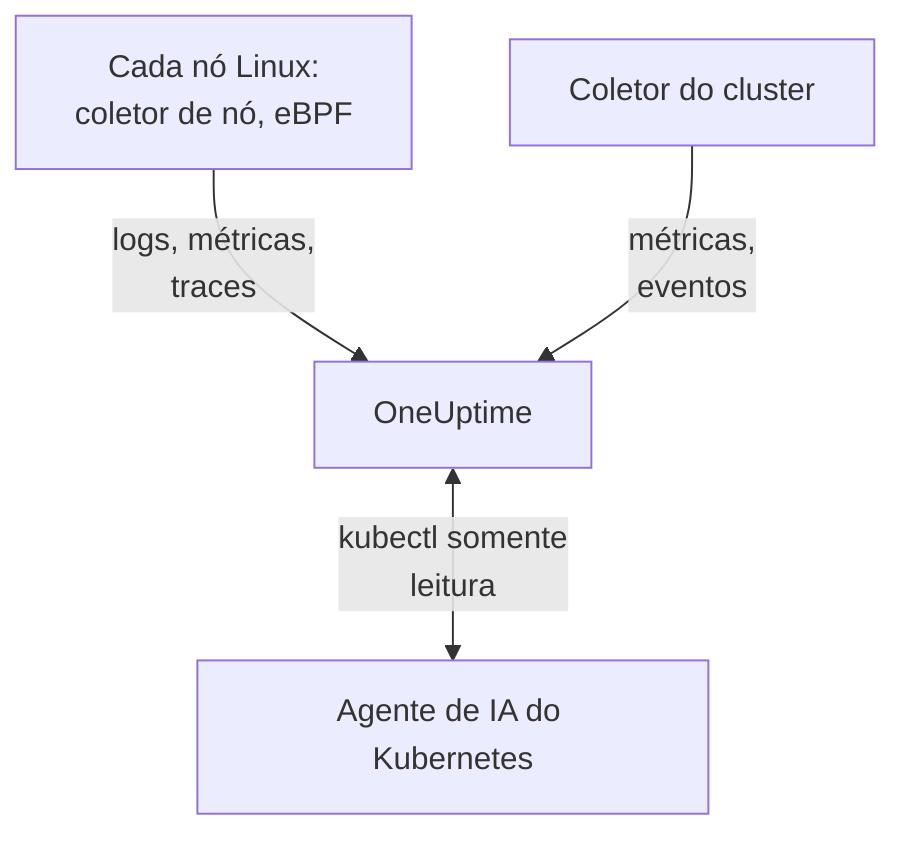

# Agente Kubernetes

O agente Kubernetes do OneUptime é um chart Helm que coleta as métricas, os eventos e os logs de pods do seu cluster e, com eBPF, os traces, as métricas de requisições, o grafo de serviços e os fluxos de rede de cada pod, sem mudanças de código e sem SDKs. Ele também executa o [agente de IA do Kubernetes](#agente-de-ia-do-kubernetes), que permite à OneUptime AI executar `kubectl` somente leitura enquanto investiga um incidente ou alerta. Um único `helm install` o coloca no ar; os [monitores de Kubernetes](/docs/monitor/kubernetes-monitor) alertam com base no que ele envia.

:::cards
- [Instale o agente](#instale-o-agente): Quatro etapas com Helm.
- [Opções de configuração](#opções-de-configuração): Filtros, amostragem, plano de controle, service mesh, custos e rótulos.
- [Agente de IA do Kubernetes](#agente-de-ia-do-kubernetes): `kubectl` somente leitura para a OneUptime AI, e correções quando você as permitir.
- [Envie menos](#reduzindo-o-volume-de-dados-coletados): As alavancas, em ordem de impacto.
:::

## Como funciona

O chart executa algumas cargas de trabalho no próprio namespace. Cada uma envia o que coleta para a sua URL do OneUptime via OTLP, com a chave de ingestão que você fornece, e o cluster se registra com o nome que você define em `clusterName`.



| Carga de trabalho | Tipo | O que faz | Executa |
| --- | --- | --- | --- |
| Coletor do cluster | Deployment | Métricas do cluster, eventos do Kubernetes e as especificações de pods, nós e cargas de trabalho, a partir da API do Kubernetes. | Sempre |
| Coletor de nó | DaemonSet | Logs de pods de `/var/log/pods`, métricas do kubelet e do cAdvisor e as métricas do sistema operacional do nó. | Em todo lugar, exceto no EKS Fargate |
| Instrumentação eBPF (OBI) | DaemonSet | Traces e métricas de requisições HTTP, gRPC, SQL e Redis de cada pod, e o mapa de serviços. | Por padrão, exceto no GKE Autopilot e no EKS Fargate |
| Agente de IA do Kubernetes | Deployment | `kubectl` somente leitura para a OneUptime AI enquanto ela investiga um incidente ou alerta. | Por padrão |
| Leitor de logs | Deployment | Logs de pods pela API do Kubernetes, onde o coletor de nó não consegue lê-los. | Com os presets `gke-autopilot` e `eks-fargate` |
| Motor de custos e coletor de custos | Deployments | Gastos por namespace, carga de trabalho e pod. | Com `cost.enabled=true` |

Toda imagem do agente é só para Linux, então toda carga de trabalho fica fixada em nós Linux.

## Antes de começar

- Um cluster Kubernetes com v1.23 ou posterior, e `kubectl` configurado para alcançá-lo.
- Helm 3. As atualizações usam `--reset-then-reuse-values`, que exige o Helm 3.14 ou posterior.
- Uma chave de ingestão. Crie uma em **Configurações do projeto → Telemetria e APM → Chaves de ingestão**. O agente a envia no cabeçalho `x-oneuptime-token`, então uma chave de API do projeto não funciona aqui.
- Um nome para o cluster, único no seu projeto e estável, como `prod-us-east-1`: o cluster aparece no OneUptime com esse nome.
- HTTPS de saída do cluster para a sua URL do OneUptime.

## Instale o agente

:::steps
### Adicione o repositório Helm

```bash
helm repo add oneuptime https://helm-chart.oneuptime.com
helm repo update
```

### Instale o chart

Substitua `YOUR_ONEUPTIME_URL`, `YOUR_ONEUPTIME_API_KEY` (a chave de ingestão) e o nome do cluster pelos seus valores, e escolha a aba da sua plataforma (veja [Escolha um preset](#escolha-um-preset)).

:::tabs
@tab Standard
Clusters autogerenciados, EKS on EC2, GKE Standard, AKS, minikube, kind e k3s:

```bash
helm install kubernetes-agent oneuptime/kubernetes-agent \
  --namespace oneuptime-agent \
  --create-namespace \
  --set oneuptime.url="YOUR_ONEUPTIME_URL" \
  --set oneuptime.apiKey="YOUR_ONEUPTIME_API_KEY" \
  --set clusterName="my-cluster" \
  --set aiAgent.enabled=true
```
@tab GKE Autopilot
```bash
helm install kubernetes-agent oneuptime/kubernetes-agent \
  --namespace oneuptime-agent \
  --create-namespace \
  --set oneuptime.url="YOUR_ONEUPTIME_URL" \
  --set oneuptime.apiKey="YOUR_ONEUPTIME_API_KEY" \
  --set clusterName="my-cluster" \
  --set aiAgent.enabled=true \
  --set preset=gke-autopilot
```
@tab EKS Fargate
```bash
helm install kubernetes-agent oneuptime/kubernetes-agent \
  --namespace oneuptime-agent \
  --create-namespace \
  --set oneuptime.url="YOUR_ONEUPTIME_URL" \
  --set oneuptime.apiKey="YOUR_ONEUPTIME_API_KEY" \
  --set clusterName="my-cluster" \
  --set aiAgent.enabled=true \
  --set preset=eks-fargate
```
:::

**As investigações de IA vêm ativadas por padrão.** `aiAgent.enabled=true` executa o [agente de IA do Kubernetes](#agente-de-ia-do-kubernetes) ao lado do coletor: quando um incidente ou alerta é aberto neste cluster, a OneUptime AI o investiga com `kubectl` somente leitura (`get`, `describe`, `logs`, `events`, `top`) e não altera nada. As correções ficam desativadas até que você as permita. Para instalar sem ele, use `--set aiAgent.enabled=false`.

### Verifique se os pods estão em execução

```bash
kubectl get pods -n oneuptime-agent
```

Todo pod deve chegar a `Running` em um ou dois minutos:

:::tabs
@tab Standard
O coletor do cluster, o agente de IA e, em cada nó, um coletor de nó e um pod de eBPF:

```text
NAME                                          READY   STATUS    RESTARTS   AGE
kubernetes-agent-xxxxxxxxxx-xxxxx             1/1     Running   0          1m
kubernetes-agent-ai-agent-xxxxxxxxxx-xxxxx    1/1     Running   0          1m
kubernetes-agent-ebpf-xxxxx                   1/1     Running   0          1m
kubernetes-agent-logs-xxxxx                   1/1     Running   0          1m
```
@tab GKE Autopilot
O coletor de nó continua em execução, lendo as métricas do kubelet e do cAdvisor sem `hostPath`, e um Deployment de leitor de logs lê os logs de pods pela API do Kubernetes:

```text
NAME                                          READY   STATUS    RESTARTS   AGE
kubernetes-agent-xxxxxxxxxx-xxxxx             1/1     Running   0          1m
kubernetes-agent-ai-agent-xxxxxxxxxx-xxxxx    1/1     Running   0          1m
kubernetes-agent-logs-yyyyyyyyyy-yyyyy        1/1     Running   0          1m
kubernetes-agent-logs-xxxxx                   1/1     Running   0          1m
```
@tab EKS Fargate
Três Deployments e nenhum DaemonSet: o Fargate dá a cada pod uma micro-VM própria e nunca agenda DaemonSets, então as métricas de nó não estão disponíveis lá:

```text
NAME                                          READY   STATUS    RESTARTS   AGE
kubernetes-agent-xxxxxxxxxx-xxxxx             1/1     Running   0          1m
kubernetes-agent-ai-agent-xxxxxxxxxx-xxxxx    1/1     Running   0          1m
kubernetes-agent-logs-yyyyyyyyyy-yyyyy        1/1     Running   0          1m
```
:::

### Encontre o cluster no OneUptime

Abra **Produtos → Infraestrutura → Kubernetes → Todos os clusters**. O cluster aparece com o `clusterName` dele em poucos minutos, e os nós, pods e cargas de trabalho dele são preenchidos. O agente de IA do Kubernetes aparece como conectado na página **Agente** do cluster, em **IA**.
:::

## Escolha um preset

`preset` escolhe os padrões que funcionam na sua plataforma: se os logs de pods são lidos do nó via `hostPath` ou pela API do Kubernetes, e quais cargas de trabalho podem ser executadas com privilégios.

| `preset` | Use para | Logs de pods | Métricas de nó |
| --- | --- | --- | --- |
| `standard` (padrão) | Clusters autogerenciados, **EKS on EC2**, **GKE Standard**, **AKS**, minikube, kind, k3s | O coletor de nó lê `/var/log/pods` via `hostPath` (menor sobrecarga) | Kubelet, cAdvisor e as métricas do sistema operacional do nó |
| `gke-autopilot` | **GKE Autopilot** | O leitor de logs os lê pela API do Kubernetes (sem `hostPath`, sem acesso ao host) | Kubelet e cAdvisor, sem `hostPath` |
| `eks-fargate` | **EKS Fargate** | O leitor de logs os lê pela API do Kubernetes (sem `hostPath`, sem acesso ao host) | Nenhuma: o Fargate não executa DaemonSets |

Se não tiver certeza, comece com `standard`. Se a instalação falhar com um erro de Pod Security que cite `hostPath`, instale de novo com `preset=gke-autopilot` (ou `eks-fargate` no Fargate). O GKE Autopilot e o EKS Fargate também recusam pods privilegiados, de que o eBPF e o profiler precisam, então esses dois presets deixam os dois de fora.

## O que é coletado

| Categoria | Dados |
| --- | --- |
| Métricas de nó | Uso de CPU, memória, sistema de arquivos e rede |
| Métricas de pod | CPU, memória, rede e reinícios |
| Métricas de contêiner | CPU e memória por contêiner |
| Métricas do cluster | Condições dos nós, recursos alocáveis, contagem de pods |
| Eventos do Kubernetes | Avisos, erros e eventos de agendamento |
| Logs de pods | stdout e stderr de cada contêiner (via `hostPath` em clusters padrão, pela API do Kubernetes no Autopilot e no Fargate) |
| Traces de aplicação (eBPF, ativados por padrão) | Spans HTTP, gRPC, SQL e Redis de cada pod, sem SDK nem mudanças de código |
| Métricas RED de HTTP (eBPF) | `http.server.request.duration` e os tamanhos dos corpos de requisição e resposta, por serviço |
| Grafo de serviços (eBPF) | Arestas de taxa de requisições, latência e erros entre chamador e chamado, que desenham o mapa de serviços |
| Métricas de fluxo de rede (eBPF) | Contadores de bytes e pacotes TCP e UDP de pod para pod, com metadados do Kubernetes |
| Estatísticas de TCP (eBPF) | Contadores de tempo de ida e volta, conexões com falha e retransmissões por nó |
| Custos de cargas de trabalho (opcional, `cost.enabled=true`) | Gastos por namespace, carga de trabalho e pod, com ociosidade e eficiência, e custos por hora de nós e volumes: veja [Observabilidade de custos do Kubernetes](/docs/telemetry/kubernetes-cost) |

## Opções de configuração

Cada opção abaixo é um valor do Helm. Defina-a na instalação, ou em um agente instalado com `helm upgrade ... --reset-then-reuse-values --set <value>`.

### Filtragem por namespace

`namespaceFilters.rules` aplica padrões de namespace a quatro escopos, cada um por conta própria:

| Escopo | Onde filtra | O que afeta |
| --- | --- | --- |
| `podLogs` | No receiver filelog de hostPath ou no leitor de logs da API | Só stdout e stderr dos pods; eventos do Kubernetes e logs de auditoria não são afetados |
| `ebpfDiscovery` | Na descoberta de processos do OBI | Tanto os traces quanto as métricas de eBPF das cargas de trabalho correspondentes |
| `metrics` | No coletor, depois que os metadados do Kubernetes são adicionados | Séries de métricas com namespace; séries de nó e de cluster sem namespace são mantidas |
| `traces` | No coletor, depois que os metadados do Kubernetes são adicionados | Tanto os spans de eBPF quanto os spans que as aplicações enviam via OTLP |

Um padrão corresponde ao nome inteiro do namespace e pode usar `*` (`team-*`). Se um escopo tiver alguma regra `include`, só os namespaces correspondentes são mantidos para esse escopo, e as regras `exclude` sempre prevalecem. A regra padrão exclui `kube-system` só de `podLogs` e `ebpfDiscovery`.

Para limitar os logs de pods e a descoberta de eBPF a alguns namespaces:

```bash
helm install kubernetes-agent oneuptime/kubernetes-agent \
  --namespace oneuptime-agent \
  --create-namespace \
  --set oneuptime.url="YOUR_ONEUPTIME_URL" \
  --set oneuptime.apiKey="YOUR_ONEUPTIME_API_KEY" \
  --set clusterName="my-cluster" \
  --set-json 'namespaceFilters.rules=[{"action":"include","namespaces":["default","production","staging"],"scopes":["podLogs","ebpfDiscovery"]}]'
```

Para parar os logs de um namespace barulhento mantendo os traces de eBPF, o mapa de serviços e as métricas dele, limite a exclusão a `podLogs`:

```bash
  --set-json 'namespaceFilters.rules=[{"action":"exclude","namespaces":["kube-system"],"scopes":["podLogs","ebpfDiscovery"]},{"action":"exclude","namespaces":["noisy-*"],"scopes":["podLogs"]}]'
```

As regras de `podLogs` e `ebpfDiscovery` filtram na origem: arquivos de log excluídos nunca são abertos, e cargas de trabalho excluídas nunca são instrumentadas. As regras de `metrics` e `traces` agem depois, no coletor, quando o namespace já foi associado aos dados.

#### Filtrando métricas e traces por namespace

Adicione esses escopos a uma regra para filtrar também métricas ou spans com namespace:

```bash
  --set-json 'namespaceFilters.rules=[{"action":"exclude","namespaces":["kube-system","noisy-*"],"scopes":["podLogs","ebpfDiscovery","metrics","traces"]}]'
```

> [!NOTE]
> As métricas de nível de nó e de cluster são sempre mantidas. Um namespace pertence a um pod, não a um nó, então séries como CPU do nó, memória do nó e uso do sistema de arquivos não têm com o que corresponder e nunca são descartadas: uma regra limitada a `metrics` reduz as séries por pod sem esconder um nó que está falhando.

Os eventos do Kubernetes não podem ser filtrados por namespace no agente: eles chegam do receiver `k8sobjects` sem um atributo `k8s.namespace.name` (o namespace fica dentro do corpo do evento), então não há nada para um filtro corresponder. Descarte-os no OneUptime, com **Registros → Configurações → Filtros de descarte**.

### Filtragem por severidade de log

`filters.logs.minSeverity` descarta registros de log de pods abaixo de uma severidade, no agente, antes de qualquer envio:

```bash
  --set filters.logs.minSeverity=WARN
```

Ele aceita `TRACE`, `DEBUG`, `INFO`, `WARN`, `ERROR` e `FATAL`. `WARN` mantém WARN, ERROR e FATAL e descarta INFO, DEBUG e TRACE; o padrão (`""`) mantém tudo. Ele vale nos dois modos de log (pelo coletor no modo `daemonset`, dentro do leitor de logs no modo `api`), então um preset nunca o desativa sem você saber.

Os runtimes de contêiner não registram severidade, então o agente a lê do próprio texto do log (`[ERROR]`, `WARN:`, `"level":"info"`, …). O que acontece com uma linha sem nível reconhecível depende do modo de log, porque os dois modos sabem coisas diferentes:

| Modo | Uma linha sem nível | Por quê |
| --- | --- | --- |
| `daemonset` | `stderr` conta como ERROR (mantida), `stdout` como INFO (descartada por um limite WARN) | O runtime de contêiner registra de qual fluxo veio cada linha. |
| `api` | Sempre mantida | A API `pods/log` do Kubernetes junta stdout e stderr em um único fluxo sem marcação por linha, então, em vez de adivinhar, o agente mantém a linha. |

Assim, o modo `api` descarta estritamente menos que o modo `daemonset`, de propósito: um traceback do Python ou um `npm ERR!` não traz nenhuma palavra-chave de severidade, e apagá-lo em silêncio é exatamente a falha da qual um limite deveria proteger você. No modo híbrido (`logs.windowsPods.enabled`), as duas linhas valem, conforme o sistema operacional do nó: pods Linux seguem `daemonset`, pods Windows seguem `api`.

Eventos de várias linhas são remontados antes da filtragem nos dois modos, então um stack trace Java é avaliado pela primeira linha e mantido ou descartado por inteiro.

> [!IMPORTANT]
> Eventos do Kubernetes e especificações de recursos nunca são filtrados por isto. Eles chegam da API do Kubernetes sem severidade própria, então um limite apagaria o feed inteiro, incluindo os avisos `FailedScheduling`, `BackOff` e `OOMKilling` de que você mais precisa. Eles são poucos e valiosos, então o agente sempre os envia; para reduzi-los, use **Registros → Configurações → Filtros de descarte** no OneUptime.

### Incluindo ou excluindo métricas por nome

`filters.metrics` decide quais métricas saem do cluster, em todos os receivers.

Descarte algumas métricas barulhentas (uma denylist, geralmente o que você quer):

```bash
  --set-json 'filters.metrics.exclude=["k8s.volume.available","k8s.volume.capacity"]'
```

Envie só um conjunto fixo (uma allowlist: todo o resto é descartado):

```bash
  --set-json 'filters.metrics.include=["k8s.pod.cpu.utilization","k8s.pod.memory.usage"]'
```

Corresponda por padrão em vez de pelo nome exato:

```bash
  --set filters.metrics.matchType=regexp \
  --set-json 'filters.metrics.exclude=["^container_network_"]'
```

| Chave | Significado |
| --- | --- |
| `filters.metrics.exclude` | Nomes de métricas a descartar. Aplicada depois de `include`, então uma exclusão sempre prevalece. |
| `filters.metrics.include` | Quando não está vazia, só essas métricas são enviadas. |
| `filters.metrics.matchType` | `strict` (o nome exato, o padrão) ou `regexp` (RE2, sem âncora). |

- `regexp` não tem âncora: `system.cpu` também corresponde a `system.cpu.time`. Ancore-a (`^system\.cpu$`) quando quiser exatamente uma métrica.
- O RE2 não tem lookahead, então `^(?!container_)` não compila. Expresse "tudo exceto" com `include`, não com um padrão negativo.
- `include` vale para todos os receivers de uma vez. Uma allowlist que esquece uma métrica remove em silêncio os monitores construídos sobre ela, então prefira `exclude`, a menos que você queira um conjunto fechado.
- Use `--set-json` (ou um arquivo de valores) para listas: um `--set` simples substitui uma lista em vez de acrescentar a ela.

> [!WARNING]
> Teste um padrão antes de distribuí-lo. O coletor compila os padrões ao iniciar, então um inválido não se comporta mal em silêncio: o coletor se recusa a iniciar e entra em crash-loop, levando junto os logs desse coletor além das métricas. O Helm não compila RE2, então `helm upgrade` aceita um padrão inválido sem reclamar.

### Amostragem de traces

Os filtros acima removem uma categoria de telemetria: um namespace, uma severidade, um nome de métrica. A amostragem mantém todas as categorias e, em vez disso, reduz a população. Defina `sampling.traces.percentage` com a parcela de traces a manter:

```bash
helm upgrade kubernetes-agent oneuptime/kubernetes-agent \
  --namespace oneuptime-agent --reset-then-reuse-values \
  --set sampling.traces.percentage=10
```

Isso mantém um trace em cada dez e descarta os outros nove no agente, antes que saiam do seu cluster.

- **Você recebe traces inteiros, não fragmentos.** A decisão é um hash do ID do trace, não um cara ou coroa por span, então todos os spans de um trace são mantidos ou descartados juntos, e os traces que sobram podem ser lidos do início ao fim.
- **Os seus monitores baseados em métricas não mudam.** O OBI calcula as métricas RED de eBPF (taxa de requisições, taxa de erros, duração) a partir de cada requisição, e elas passam pelo pipeline de métricas, onde o amostrador não fica. A 10%, você recebe um décimo dos traces e taxa, erros e latência exatos.
- **Os seus monitores baseados em spans, sim, mudam.** Tudo o que o OneUptime conta a partir dos próprios spans cai junto com a taxa: veja o aviso abaixo.

| Chave | Significado |
| --- | --- |
| `sampling.traces.percentage` | A porcentagem de traces a manter, de 0 a 100. Padrão `100` (manter tudo). |
| `sampling.traces.hashSeed` | A semente do hash do ID do trace. Padrão `22`. |

- `0` não mantém trace nenhum. É uma taxa, não um interruptor: ele apaga todos os traces enquanto o DaemonSet de eBPF continua executando e custando. Para não ter traces, use `ebpf.enabled=false`; para não ter traces mas manter as métricas RED e o mapa de serviços, deixe o eBPF ativado e defina `0` de propósito.
- Só vale quando `ebpf.enabled` está ativado: caso contrário não há pipeline de traces, e o valor não faz nada.
- Só amostra traces. Não há `sampling.logs` nem `sampling.metrics`, de propósito: veja a observação abaixo.
- Frações exigem `--set-json` e têm um piso. `--set sampling.traces.percentage=0.5` falha porque o Helm lê `0.5` como texto: use `--set-json 'sampling.traces.percentage=0.5'` ou um arquivo de valores. Abaixo de cerca de `0.0061`, a taxa é arredondada para zero e se comporta exatamente como `0`, sem erro; `0.01` (um em dez mil) é o menor valor que faz o que diz.
- Vários clusters funcionam por padrão. Dois agentes mantêm o mesmo trace só se concordarem tanto em `hashSeed` quanto em `percentage`, e os dois têm os mesmos padrões em todo lugar, então um trace que atravessa dois clusters sobrevive inteiro. Mude `hashSeed` só para tornar independentes dois níveis de amostragem: com a mesma semente, uma taxa menor mantém um subconjunto dos traces da taxa maior.
- Os logs de pods nunca são amostrados, então, com `ebpf.logToTraceCorrelation: true`, todo registro de log continua carregando um ID de trace enquanto só existe a parcela mantida desses traces. Cerca de (100 − `percentage`)% dos registros de log então apontam para um trace que não existe; seguir de um trace para os logs dele não é afetado.

> [!WARNING]
> Reajuste os seus monitores baseados em spans quando definir isto. A amostragem reduz os spans que chegam ao OneUptime, então tudo o que os conta conta menos: um monitor de **Traços** em `Span Count` e um monitor de **Exceções** em `Exception Count` veem cerca de `percentage`% do volume de ontem. Um limite ajustado com tráfego sem amostragem deixa de ser ultrapassado em silêncio: o monitor não dá erro, só fica calado. Divida esses limites pelo mesmo fator; a taxa vale para o cluster todo, então nenhum serviço pode ficar de fora. O agrupamento de erros piora mais do que linearmente: uma exceção comum ainda aparece, mas uma exceção rara e isolada tem mais chance de sumir do que de aparecer um décimo das vezes.

> [!NOTE]
> Por que não há amostragem de logs nem de métricas: o amostrador do coletor não consegue amostrar métricas. Ele consegue amostrar logs, mas tira a aleatoriedade do ID do trace, que os logs de pods não têm, então todo registro de log teria o mesmo hash, e uma taxa de logs manteria tudo ou apagaria tudo, dependendo da semente. Em vez de oferecer uma configuração que apaga os seus logs em silêncio, o chart não oferece nenhuma. Reduza os logs com [Filtragem por severidade de log](#filtragem-por-severidade-de-log) e [Filtragem por namespace](#filtragem-por-namespace), que são precisas sobre o que removem.

### Desative a coleta de logs

Se você não precisa dos logs de pods:

```bash
helm install kubernetes-agent oneuptime/kubernetes-agent \
  --namespace oneuptime-agent \
  --create-namespace \
  --set oneuptime.url="YOUR_ONEUPTIME_URL" \
  --set oneuptime.apiKey="YOUR_ONEUPTIME_API_KEY" \
  --set clusterName="my-cluster" \
  --set logs.enabled=false
```

As suas métricas não são afetadas: o coletor de nó continua em execução para as métricas do kubelet, do cAdvisor e do host, e só para de ler os logs de pods. Os alertas baseados em logs param, e nada mais.

### Force um modo específico de coleta de logs

`logs.mode` substitui a escolha do preset e sempre prevalece sobre ela:

- `logs.mode=daemonset`: o DaemonSet de hostPath (menor sobrecarga; precisa de `hostPath`).
- `logs.mode=api`: o Deployment do leitor de logs da API do Kubernetes (funciona em qualquer cluster).
- `logs.mode=disabled`: sem logs de pods.

O modo só decide de onde vêm os logs de pods: as métricas de nó são coletadas de qualquer forma, então `api` e `disabled` mantêm as suas métricas do kubelet, do cAdvisor e do host. A exceção é a plataforma: o EKS Fargate não consegue agendar DaemonSets, então não tem coletor de nó nem métricas de nó, pod ou contêiner. O GKE Autopilot executa o coletor de nó, mas bloqueia `hostPath`, então coleta as métricas do kubelet e do cAdvisor sem as do `hostmetrics` (E/S de disco, inodes, erros de placa de rede), que leem `/proc` e `/sys` do host.

Em clusters com pools de nós Windows, o modo `daemonset` cobre só os nós Linux, porque toda imagem do agente é só para Linux. Adicione `--set logs.windowsPods.enabled=true` para executar o leitor de logs da API ao lado dele só para os pods em nós Windows: os pods Linux continuam com a leitura local dos arquivos no nó, e os dois nunca enviam a mesma linha duas vezes. Isso exige uma imagem `kubernetes-log-tailer` pelo menos tão recente quanto o chart: uma imagem mais antiga ignora a restrição e envia os logs Linux duas vezes.

### Ative o monitoramento do plano de controle

A página **Plano de controle** do cluster mostra gráficos do etcd, do API server, do scheduler e do controller manager. O agente coleta os quatro quando `controlPlane.enabled` é `true`:

```bash
helm upgrade kubernetes-agent oneuptime/kubernetes-agent \
  --namespace oneuptime-agent \
  --reset-then-reuse-values \
  --set controlPlane.enabled=true
```

Cada componente é coletado nos endereços da própria lista: `controlPlane.etcd.endpoints`, `controlPlane.apiServer.endpoints`, `controlPlane.scheduler.endpoints` e `controlPlane.controllerManager.endpoints`. A coleta é feita no pod do agente, que não tem rede do host, então os padrões (`https://localhost:<port>/metrics`) apontam para esse mesmo pod: defina cada lista com um endereço que o pod consiga alcançar. Dentro de qualquer cluster, o API server responde em `https://kubernetes.default.svc:443/metrics`:

```bash
helm upgrade kubernetes-agent oneuptime/kubernetes-agent \
  --namespace oneuptime-agent \
  --reset-then-reuse-values \
  --set controlPlane.enabled=true \
  --set "controlPlane.apiServer.endpoints={https://kubernetes.default.svc:443/metrics}"
```

`controlPlane.enabled` ativa as quatro coletas de uma vez. Onde um componente não pode ser alcançado nos endpoints dele (o etcd, o scheduler e o controller manager em um cluster gerenciado, ou nos padrões `localhost` deles), a coleta dele falha a cada intervalo: o coletor registra um erro de scrape e informa o alvo como fora do ar, e nada mais muda.

O agente coleta só por HTTPS, com o token da service account e sem certificado de cliente. Portanto:

- **etcd** precisa de um endereço de métricas HTTPS que não peça certificado de cliente. As portas de métricas habituais do etcd ficam fora de alcance: HTTP simples na `2381` (o `--listen-metrics-urls` do kubeadm) é coletado como HTTPS e falha, e a `2379` exige certificados de cliente.
- **O scheduler** (`10259`) e **o controller manager** (`10257`) servem HTTPS e aceitam o token, mas o kubeadm os vincula a `127.0.0.1` nos nós do plano de controle: eles precisam de um `--bind-address` que o pod do agente consiga alcançar.

Os serviços de Kubernetes gerenciados (EKS, GKE, AKS) não expõem o etcd, o scheduler nem o controller manager, então essas abas ficam vazias lá. Até que as métricas de uma aba cheguem, a página **Plano de controle** mostra, no lugar dos gráficos dela, o que definir, com o comando para copiar.

### Ative as métricas do CoreDNS

A aba **CoreDNS** da página **Plano de controle** mostra gráficos de consultas DNS, latência, cache e encaminhamento. A coleta delas vem desativada por padrão:

```bash
helm upgrade kubernetes-agent oneuptime/kubernetes-agent \
  --namespace oneuptime-agent \
  --reset-then-reuse-values \
  --set coreDns.enabled=true
```

O agente coleta a porta `9153` dos pods com o rótulo `k8s-app=kube-dns` em `kube-system`, que é como o CoreDNS é executado em clusters kubeadm, no EKS e no AKS. Se o seu é executado de outra forma, defina também `coreDns.namespace`, `coreDns.service` (o rótulo `k8s-app`) e `coreDns.port`. O GKE executa kube-dns (dnsmasq) ou Cloud DNS em vez do CoreDNS, então a aba fica vazia lá.

### Ative as métricas do service mesh

A página **Service Mesh** do cluster mostra gráficos do Istio e do Linkerd. O agente coleta um mesh, o que `serviceMesh.provider` cita (`istio` ou `linkerd`):

```bash
helm upgrade kubernetes-agent oneuptime/kubernetes-agent \
  --namespace oneuptime-agent \
  --reset-then-reuse-values \
  --set serviceMesh.enabled=true \
  --set serviceMesh.provider=istio
```

No Istio, ele lê as estatísticas do Envoy de cada sidecar `istio-proxy` (porta `15090`); no Linkerd, a porta de administração de cada `linkerd-proxy`. O plano de controle de nenhum dos dois meshes é coletado: o istiod (o cartão **Pilot**) e os componentes identity, destination e proxy-injector do Linkerd (o cartão **Plano de controle**) servem as métricas em portas de administração próprias, então esses cartões dizem isso no lugar dos gráficos.

### Métricas que o agente não coleta

Alguns gráficos mostram métricas para as quais o agente não tem coleta: **kube-proxy** na página **Plano de controle**; **Cilium** (com Hubble) na página **Service Mesh**; e, nas abas Istio e Linkerd, os planos de controle dos próprios meshes (**istiod** e os componentes identity, destination e proxy-injector do Linkerd). Eles são preenchidos quando essas métricas chegam ao OneUptime de outra forma, por exemplo pelo seu próprio [OpenTelemetry Collector](/docs/telemetry/open-telemetry) coletando-as, com o atributo de recurso `k8s.cluster.name` definido com o nome do cluster (o `clusterName` do agente). Clusters que funcionam sem kube-proxy não têm métrica nenhuma de kube-proxy.

### Ative a observabilidade de custos

Veja na página **Costs** do cluster quanto custa cada namespace, carga de trabalho e pod, com a capacidade ociosa e quanto de cada request é usado:

```bash
helm upgrade kubernetes-agent oneuptime/kubernetes-agent \
  --namespace oneuptime-agent \
  --reset-then-reuse-values \
  --set cost.enabled=true
```

Só isso já é uma instalação completa: o chart traz o motor de código aberto [OpenCost](https://opencost.io) (com o pequeno Prometheus de que ele precisa) e precifica os seus nós e volumes a partir dos preços de tabela públicos do seu provedor de nuvem, sem credenciais. Ele adiciona dois pods pequenos, e os primeiros custos aparecem depois da primeira hora fechada. Já usa Kubecost ou OpenCost? Adicione `--set cost.engine.url=<its service URL>` em vez disso, e nada é incluído. Clusters on-premises podem definir uma tabela de preços com `cost.opencost.customPricing`. O guia completo, com preços on-premises e solução de problemas, é [Observabilidade de custos do Kubernetes](/docs/telemetry/kubernetes-cost).

### Rotule automaticamente com rótulos do projeto

Todo atributo de recurso que começa com `oneuptime.label.` vira um rótulo do projeto, associado ao cluster e aos serviços e hosts que este agente informa: `oneuptime.label.<dimension>=<value>` é o rótulo `<dimension>:<value>`. Passe rótulos na instalação com `--set oneuptime.labels.<key>=<value>`:

```bash
helm install kubernetes-agent oneuptime/kubernetes-agent \
  --namespace oneuptime-agent \
  --create-namespace \
  --set oneuptime.url="YOUR_ONEUPTIME_URL" \
  --set oneuptime.apiKey="YOUR_ONEUPTIME_API_KEY" \
  --set clusterName="prod" \
  --set oneuptime.labels.team=payments \
  --set oneuptime.labels.env=production \
  --set oneuptime.labels.region=us-east-1
```

Ou mantenha-os em um arquivo de valores:

```yaml title="values.yaml"
oneuptime:
  url: YOUR_ONEUPTIME_URL
  apiKey: YOUR_ONEUPTIME_API_KEY
  labels:
    team: payments
    env: production
    region: us-east-1
clusterName: prod
```

Os rótulos são comparados sem diferenciar maiúsculas de minúsculas, então um rótulo `Production` existente que você criou à mão é reutilizado em vez de duplicado, e o agente nunca remove rótulos adicionados no OneUptime.

## Traces de aplicação e métricas HTTP via eBPF (ativados por padrão)

O chart executa um DaemonSet com o [OpenTelemetry eBPF Instrumentation (OBI)](https://opentelemetry.io/docs/zero-code/obi/) em cada nó. Ele carrega programas eBPF no kernel e captura o tráfego HTTP e HTTPS, gRPC, SQL e Redis de todo runtime compatível (Go, .NET, Java, Node.js, Python, Ruby, Rust), sem SDK e sem sidecar. Os traces e as métricas de requisições então fluem pelo coletor do cluster até o OneUptime.

Ele exige o kernel Linux 5.8 ou posterior com BTF (o padrão no Debian 11+, Ubuntu 20.10+, Fedora 34+, RHEL e Stream 9+), e o DaemonSet dele é executado com privilégios, porque carregar programas eBPF exige isso.

### Como são os traces de eBPF

O eBPF enxerga chamadas de rede, não o seu código, então um trace é montado a partir das requisições que um serviço atende e das chamadas que ele faz enquanto as atende:

- **Uma requisição e as chamadas dela formam um trace.** A requisição que entra em um serviço é o span raiz, chamado `<METHOD> <route>`, e as chamadas HTTP, gRPC, SQL e Redis que o serviço faz enquanto a atende são os filhos dela. (No Node.js, isso depende do agente Node.js do OBI, que o chart ativa com `ebpf.nodejs.enabled`.) Chamadas que requisições simultâneas enviam por uma conexão compartilhada, algo comum em clientes Redis, nem sempre podem ser diferenciadas, então algumas delas não entram no trace da própria requisição.
- **Uma chamada para um serviço em outro nó inicia um novo trace**, a menos que algo leve o contexto do trace adiante: um SDK do OpenTelemetry, ou a propagação de contexto opcional descrita abaixo. Quando as duas pontas são executadas no mesmo nó, o OBI vê as duas e as liga sozinho.
- **Trabalho que nenhuma requisição iniciou fica isolado.** Um worker de fila que consulta o Redis, ou um cron job, não tem requisição a que as chamadas dele possam pertencer.
- **Servidores de banco de dados geralmente ficam isolados.** Os protocolos de rede de bancos de dados não carregam contexto de trace, então, a menos que o chamador seja executado no mesmo nó, o span que o OBI registra dentro de um servidor de banco de dados para cada comando é um trace de um único span.

Essas chamadas isoladas a bancos de dados chegam como traces de um único span, com o nome de um comando solto (`set`, `evalsha`, `SELECT`), e em um cluster movimentado podem ser a maior parte do que o OBI captura. Por padrão, o agente as descarta antes que saiam do cluster: o span do próprio servidor de banco de dados, que sempre duplica o do chamador (`ebpf.dropDatabaseServerSpans=true`), e a chamada de uma aplicação que não pertence a nenhum trace (`ebpf.dropUnlinkedDatabaseCalls=true`). As chamadas de banco de dados de uma aplicação dentro do trace de uma requisição são mantidas, os spans que as suas aplicações enviam pelos próprios SDKs nunca são tocados, e as métricas de banco de dados continuam contando cada comando.

Uma contrapartida: o OneUptime descobre os bancos de dados, e os desenha no mapa de serviços, a partir dos spans de cliente de banco de dados. Um banco de dados com que só o trabalho em segundo plano conversa (a fila de um worker, o warehouse de um cron job) deixa então de ser descoberto a partir dos traces e aparece no mapa de serviços como um endpoint remoto. As métricas dele não são afetadas. Defina `ebpf.dropUnlinkedDatabaseCalls=false` para manter esses spans.

As chamadas HTTP e gRPC do trabalho em segundo plano (um worker que consulta o ClickHouse via HTTP, um controller que renova o lease dele no Kubernetes) também chegam como traces de um único span (`POST /`, `PUT /apis/*/...`). Defina `ebpf.dropUnlinkedClientCalls=true` para descartá-las também, junto com as chamadas que o OBI não conseguiu colocar no trace da própria requisição, que têm a mesma aparência; ele nunca descarta chamadas de banco de dados, de mensageria ou de GenAI (MCP incluído). Ele vem desativado por padrão porque custa dados: quando o serviço chamado é executado no mesmo nó, o OBI liga a requisição que ele atendeu sob a chamada, então a chamada é a raiz desse trace, e descartá-la deixa o trace sem raiz. Com `ebpf.contextPropagation` ativado, isso acontece em qualquer nó, e também com um serviço que tem SDK do OpenTelemetry próprio. O mapa de serviços também lê essas chamadas: uma dependência que só o trabalho em segundo plano chama passa a ser desenhada apenas a partir das métricas do grafo de serviços do OBI, e uma aresta também vista dentro de requisições conta só essas chamadas. A visão geral de um serviço conta os spans dele, então um worker ou uma sonda cujos spans são em sua maioria chamadas desse tipo mostra bem menos requisições, com taxa de erros e latência p95 calculadas sobre os spans restantes. As métricas de requisições de cliente do OBI continuam contando cada chamada.

Em um OneUptime auto-hospedado, atualize o servidor antes do agente: o tracer eBPF que este chart executa (OBI v0.14) nomeia os serviços chamados e informa os spans dos próprios message brokers de formas que servidores OneUptime mais antigos não leem.

Os nomes vêm do tráfego. Os spans HTTP usam o template de rota da aplicação quando o OBI consegue lê-lo e, caso contrário, um padrão feito a partir da URL com os segmentos parecidos com IDs substituídos por `*`; defina `ebpf.routes.patterns` para nomeá-los você mesmo. O OBI lê os templates de rota de aplicações em Go (net/http, Gorilla mux, Gin), Java (Spring, JAX-RS), Node.js (Express, Fastify, Koa, NestJS, Next.js), Python (Django, FastAPI, Flask), Ruby (Rails), .NET (rotas por atributos do ASP.NET Core) e PHP (Symfony, Laravel, Slim). Nomes de nível de aplicação, como `OrderService.charge`, existem só no código e exigem um SDK do OpenTelemetry.

Se uma aplicação já exporta traces com um SDK do OpenTelemetry, o OBI percebe e para de enviar traces de eBPF para ela, para que ela não seja rastreada duas vezes (`ebpf.excludeOtelInstrumentedServices=true`, o padrão do OBI). Defina como `false` se esse SDK envia para outro projeto e você também quer traces de eBPF da aplicação neste.

### Desative a autoinstrumentação de eBPF

Desative o eBPF quando:

- Você instalar no **GKE Autopilot** ou no **EKS Fargate**: essas plataformas recusam pods privilegiados, então `preset=gke-autopilot` e `preset=eks-fargate` já deixam o eBPF de fora para você, e o profiler junto.
- Os nós executarem um kernel anterior ao 5.8 sem backports de BTF.
- Você já enviar traces dos SDKs do OpenTelemetry em todas as aplicações e também não quiser as métricas de eBPF. (Só pelos traces não é preciso: o OBI para de enviar traces de eBPF para uma aplicação que ele vê exportando os próprios, como descrito acima.)

```bash
helm install kubernetes-agent oneuptime/kubernetes-agent \
  --namespace oneuptime-agent \
  --create-namespace \
  --set oneuptime.url="YOUR_ONEUPTIME_URL" \
  --set oneuptime.apiKey="YOUR_ONEUPTIME_API_KEY" \
  --set clusterName="my-cluster" \
  --set ebpf.enabled=false
```

### Ative ou desative famílias de sinais individuais

Todas vêm ativadas por padrão, exceto uma. Desative qualquer uma com `--set ebpf.features.<name>=false`:

| `ebpf.features.*` | Padrão | O que adiciona |
| --- | --- | --- |
| `httpMetrics` | ativada | Métricas RED de HTTP e gRPC (taxa de requisições, latência, erros) por serviço |
| `spanMetrics` | ativada | Contagem de chamadas e duração dos spans (`traces.span.metrics.*`) |
| `serviceGraph` | ativada | Métricas de arestas entre chamador e chamado, que desenham o mapa de serviços |
| `networkMetrics` | ativada | Contadores de fluxos TCP e UDP de pod para pod |
| `networkInterZoneMetrics` | desativada | A variante entre zonas das métricas de rede (dobra a cardinalidade delas) |
| `tcpStats` | ativada | Contadores de tempo de ida e volta TCP, conexões com falha e retransmissões por nó |

A propagação do contexto de trace entre serviços, em que o OBI injeta um `traceparent` do W3C para que uma requisição que passa do pod A para o pod B apareça como um único trace sem SDK nenhum, vem desativada por padrão. Ative-a com `--set ebpf.contextPropagation=true`. Ela não exige nenhum kernel além do que o resto do agente exige, e nenhuma versão de kernel a torna inativa.

Ela vem desativada porque injetar o cabeçalho significa reescrever tráfego que já está em trânsito: requisições HTTP em texto puro são ampliadas no próprio kernel, enquanto TLS e TCP bruto recebem uma opção TCP acrescentada a partir de um hook de Traffic Control. Se a contabilidade de bytes da conexão não for corrigida com exatidão, o fluxo sai de sincronia; o sintoma relatado são transferências por um proxy L7 como o nginx que travam no meio do corpo quando a resposta passa de cerca de 64KB, enquanto requisições pequenas continuam funcionando. Não descarte isso pela idade do kernel: abaixo do kernel 5.17, o OBI recorre a programas de varredura limitada e reescreve o tráfego do mesmo jeito. Traces, métricas RED e o mapa de serviços não dependem dela; para ligar serviços entre si, um SDK do OpenTelemetry propaga `traceparent` no espaço do usuário, sem reescrita no kernel, e é a escolha mais segura.

## Agente de IA do Kubernetes

Quando um incidente ou alerta é aberto neste cluster, a OneUptime AI o investiga. O **Agente de IA do Kubernetes** do chart dá a ela um terminal: ele executa `kubectl` somente leitura como faria um engenheiro de plantão (descreve o pod com falha, lê os eventos dele, acompanha os logs do contêiner que está travando, verifica a capacidade dos nós) e cita cada comando na página do incidente.

O agente vem **ativado por padrão** e é **somente leitura**: um Deployment pequeno (`kubernetes-agent-ai-agent`, rótulo de pod `component=ai-agent`, imagem `oneuptime/kubernetes-ai-agent`) cuja ServiceAccount só pode ler. Ele se registra com os mesmos `oneuptime.apiKey` e `clusterName` que o coletor usa, então não há nada a configurar no dashboard: a página **Agente de IA** do cluster (Kubernetes → cluster → IA → Agente) o mostra como conectado em um minuto, e **Testar conexão**, no menu **⋯** ao lado desse status, executa `kubectl version` e `kubectl auth can-i --list` por meio dele. Tudo o que a IA fez com ele fica na página **Registros de IA** do cluster (IA → Registros), e o que vale saber sobre o cluster — os problemas que continuam voltando e por quê, o nó ou a carga de trabalho por trás da maioria deles, o que a IA corrigiu — na página **AI Insights** (IA → Insights). O agente vem com um kubectl fixado (v1.36.4). Ele não é um Runner e nunca aparece em Runbooks → Runners: o OneUptime nunca entrega uma credencial a ele, nunca executa runbooks nele, e ele nunca é aceito como Runner de comandos de uma regra de remediação automática.

Em um agente instalado antes de o agente de IA existir, atualize primeiro o índice do seu chart e depois faça a atualização (em um OneUptime auto-hospedado, atualize primeiro o OneUptime — veja [Atualizando o agente](#atualizando-o-agente)):

```bash
helm repo update
helm upgrade kubernetes-agent oneuptime/kubernetes-agent \
  --namespace oneuptime-agent --reset-then-reuse-values \
  --set aiAgent.enabled=true
```

Use o nome de release e o namespace com que você instalou o agente, se forem diferentes (`helm list -A | grep kubernetes-agent` os mostra). Sem `helm repo update`, o Helm pode resolver o chart a partir do qual você instalou, que não conhece `aiAgent` e falha com `Additional property aiAgent is not allowed`. As versões publicadas do chart acompanham a versão do OneUptime, então, se `helm show values oneuptime/kubernetes-agent | grep aiAgent` não imprimir nada, o seu índice ainda está antigo. Para executar o chart sem o agente de IA, passe `--set aiAgent.enabled=false`.

### O que a IA pode fazer

O que a OneUptime AI pode fazer no cluster é definido no chart, com dois valores, e a página do agente de IA do cluster os mostra em **O que a IA pode fazer**, sem permitir alterá-los ali:

- `aiAgent.investigation` — `true`: a IA executa `kubectl` somente leitura enquanto investiga um incidente ou alerta no cluster. `false`: ela investiga mesmo assim, com os dados que o OneUptime já tem.
- `aiAgent.fixes` — `off`, `ask-for-approval`, `automatic` ou `bypass-approval` (abaixo). Todo nível, exceto `off`, dá ao agente de IA acesso de escrita; `off` não dá nenhum, e então o próprio agente recusa toda escrita.

O agente de IA informa os dois ao OneUptime, que os aplica ao cluster e recusa uma mudança feita em qualquer outro lugar — na página do agente de IA, pela API ou pelo Terraform. **Alterar** nessa página mostra o comando para a opção que você escolher. Nenhum dos dois vem definido em `values.yaml`: uma release que não define nenhum deixa o agente usar os padrões dele (investigação ativada, correções desativadas), e o OneUptime os aplica só a um cluster cujas configurações ninguém escolheu na página do agente de IA dele — as configurações escolhidas ali são mantidas como estão, e a página mostra como levá-las para o chart.

### Deixe a IA corrigir o que encontrar

As correções ficam desativadas até que você as ative com `aiAgent.fixes` — uma etapa separada e opcional que também dá ao agente de IA acesso de escrita. A forma recomendada o concede só nos namespaces em que a IA pode corrigir, com as operações de nó desativadas:

```bash
helm repo update
helm upgrade kubernetes-agent oneuptime/kubernetes-agent \
  --namespace oneuptime-agent --reset-then-reuse-values \
  --set aiAgent.enabled=true \
  --set aiAgent.investigation=true \
  --set aiAgent.fixes=ask-for-approval \
  --set "aiAgent.remediation.namespaces={web,api}" \
  --set aiAgent.remediation.nodeOperations=false
```

Ou para o cluster inteiro:

```bash
helm repo update
helm upgrade kubernetes-agent oneuptime/kubernetes-agent \
  --namespace oneuptime-agent --reset-then-reuse-values \
  --set aiAgent.enabled=true \
  --set aiAgent.investigation=true \
  --set aiAgent.fixes=ask-for-approval \
  --set-json 'aiAgent.remediation.namespaces=[]'
```

Todo namespace que você listar precisa já existir: o chart cria um RoleBinding em cada um e nunca cria um namespace, então um que esteja faltando faz a atualização inteira falhar — inclusive a do coletor — com `namespaces "api" not found`. Crie-o primeiro, ou tire-o da lista, e tire um namespace da lista antes de excluí-lo. Deixar a flag de fora em uma atualização mantém a lista armazenada; `--set-json 'aiAgent.remediation.namespaces=[]'` (Helm 3.10+) volta ao cluster inteiro — não `={}`, que o Helm lê como um único nome vazio. `--set aiAgent.remediation.namespaces=null` não redefine uma lista armazenada com `--reuse-values`: o Helm mantém a lista armazenada. `aiAgent.remediation.nodeOperations=false` mantém as correções longe dos nós; defina como `true` para deixar a IA fazer cordon, uncordon, drain e taint nos nós.

`aiAgent.fixes` escolhe como as correções são executadas; para desativá-las de novo, atualize com `--set aiAgent.fixes=off`, o que também remove o acesso de escrita:

- **ask-for-approval** — a OneUptime AI monta o plano exato de `kubectl` e uma pessoa o aprova com um clique no incidente;
- **automatic** — mudanças seguras são executadas sozinhas; uma mudança mais arriscada, nunca. Quando a rodada só conseguiu encontrar correções mais arriscadas, ela termina propondo exatamente essas para aprovação com um clique; quando também executou uma correção segura, a mais arriscada só é proposta se a verificação mostrar que a correção segura não recuperou o sinal (a rodada de acompanhamento, que pergunta);
- **bypass-approval** — a IA não pergunta: toda mudança que a política permite é executada sozinha, rodadas de acompanhamento incluídas, exceto que uma rodada pergunta quando o circuit breaker por hora dispara, quando outra rodada não supervisionada da OneUptime AI ainda está alterando ou verificando o mesmo cluster, ou quando ela vem depois de uma correção cujo rollback não foi concluído.

Seja qual for o modo, uma escrita em kube-system, kube-public ou kube-node-lease sempre precisa de uma pessoa, assim como um `drain`, um `taint` e um `patch` de um nó (um drain remove pods de todos os namespaces, inclusive o do próprio agente, e um taint `NoExecute` também, seja aplicado por `kubectl taint` ou por um `patch` do nó); um recurso personalizado é avaliado pelo namespace dele, mesmo um que tenha o nome de um tipo nativo; e o agente de IA nunca altera nada no próprio namespace, fora de `aiAgent.remediation.namespaces` ou em um nó com `aiAgent.remediation.nodeOperations=false`. O OneUptime lê esse escopo a partir do que o agente de IA informa e recusa uma correção desse tipo quando ela é proposta ou aprovada, não só no agente. Nos dois modos não supervisionados, uma rodada propõe o plano para aprovação em vez de executá-lo quando o circuit breaker por hora dispara ou outra rodada não supervisionada já ocupa o cluster. Veja [AI SRE — Acesso ao cluster](/docs/ai/ai-sre) para saber o que cada modo pode executar e o que a política de comandos recusa de imediato.

**O que o acesso de escrita significa.** Patch/update em cargas de trabalho, pods e CronJobs, e create em Jobs, em um namespace equivalem a executar qualquer imagem como qualquer ServiceAccount desse namespace e ler os Secrets dele — um template de pod pode citar qualquer imagem, ServiceAccount e volume de Secret. Então o RBAC do chart limita *onde* o agente de IA pode escrever, não o que uma escrita pode fazer: a política de comandos recusa patches de segurança em templates de pod, patches que substituem a especificação do pod ou uma lista `containers` inteira, `set serviceaccount`, `create … --image`, `expose --overrides` (que pode criar um Job ou qualquer outro tipo de objeto em vez de um Service) e corpos de patch que não sejam JSON. Ela não recusa `set image` nem o patch de um campo de imagem: essa é uma mudança mais arriscada — a nova imagem é executada como a própria ServiceAccount da carga de trabalho, com os Secrets dela — que uma pessoa aprova, a menos que o cluster ignore aprovações ou que a allowlist dele cite o comando. Com `aiAgent.remediation.namespaces` vazio, o papel de escrita é vinculado ao cluster inteiro, e o RBAC não consegue mantê-lo fora de kube-system, kube-public, kube-node-lease nem do próprio namespace do agente; ali são a política e o agente de IA que seguram a linha. Liste namespaces e o chart o vincula só neles, e uma escrita em qualquer outro lugar é recusada quando é proposta ou aprovada, e de novo pelo agente de IA.

### Valores do agente de IA

`aiAgent.remediation.*` e `aiAgent.extraEnv` não vêm definidos em `values.yaml`, então um valor armazenado na antiga chave `aiAccess` continua valendo até que você os defina (veja [Atualizando o agente](#atualizando-o-agente)). Os padrões que a tabela dá para eles só valem quando nem a chave `aiAgent` nem a chave `aiAccess` estão definidas. `aiAgent.investigation` e `aiAgent.fixes` também não vêm definidos, então as configurações de IA escolhidas na página do agente de IA de um cluster continuam valendo até que você defina um deles.

| Valor | Padrão | O que faz |
| --- | --- | --- |
| `aiAgent.enabled` | `true` | Executa o agente de IA do Kubernetes com RBAC somente leitura (no cluster inteiro). `false` o remove. |
| `aiAgent.investigation` | não definido (`true`) | Se a OneUptime AI executa `kubectl` somente leitura enquanto investiga. A página do agente de IA do cluster mostra isso somente para leitura. |
| `aiAgent.fixes` | não definido (`off`) | `off`, `ask-for-approval`, `automatic` ou `bypass-approval`. Todo nível, exceto `off`, concede os verbos de escrita abaixo. A página do agente de IA do cluster mostra isso somente para leitura. |
| `aiAgent.remediation.enabled` | `false` | Substituído por `aiAgent.fixes` e lido só enquanto este não estiver definido. Concede também os verbos de escrita que as correções da OneUptime AI usam: patch/update em Deployments, StatefulSets, DaemonSets, ReplicaSets (e o sub-recurso scale deles), Jobs, CronJobs, Pods e HPAs; create em Jobs e HPAs; delete só em Pods e Jobs. Ele nunca concede Secrets, `exec`, `attach`, `port-forward`, CRDs nem escritas de RBAC, então uma mudança em qualquer outro tipo — excluir um Deployment, rotular um Service ou um ConfigMap — falha com `Forbidden` mesmo quando aprovada. |
| `aiAgent.remediation.namespaces` | `[]` | Vincula o papel de escrita só nestes namespaces, com um RoleBinding em cada; uma escrita em outro lugar é recusada quando é proposta ou aprovada, e pelo agente de IA. Cada um precisa já existir, ou a atualização falha. Vazio, vincula ao cluster inteiro; `--set-json 'aiAgent.remediation.namespaces=[]'` redefine uma lista armazenada (`--set aiAgent.remediation.namespaces=null` não redefine uma lista armazenada com `--reuse-values`). O próprio namespace do agente não pode ser listado. |
| `aiAgent.remediation.nodeOperations` | `true` | Com `remediation.enabled`, concede também cordon/uncordon/taint (patch em nós) e drain (remoções de pods), no cluster inteiro. Defina `false` para manter as correções longe dos nós: sem RBAC de nó, as operações de nó são recusadas quando propostas ou aprovadas, e o agente de IA as recusa (`ONEUPTIME_KUBECTL_ALLOW_NODE_OPERATIONS=false`). |
| `aiAgent.image.repository` | `oneuptime/kubernetes-ai-agent` | A imagem do agente. Aponte-a para o seu espelho se os nós não conseguem baixar do Docker Hub. |
| `aiAgent.image.tag` | `release` | `release` acompanha cada versão do OneUptime; fixe uma versão para mantê-la. |
| `aiAgent.image.pullPolicy` | `Always` para `release`, `IfNotPresent` para uma tag fixada | Deixe vazio para usar esse padrão, assim o agente em cache de um nó nunca sobrevive a uma atualização. |
| `aiAgent.imagePullSecrets` | `[]` | Secrets de pull para um registry privado ou um espelho, como `[{name: <secret>}]`. |
| `aiAgent.resources` | Requests `50m` / `64Mi`, limits `500m` / `256Mi` | O agente fica ocioso entre os comandos. |
| `aiAgent.extraEnv` | `[]` | Objetos `EnvVar` extras para o contêiner do agente — por exemplo, `HTTPS_PROXY` / `NO_PROXY` atrás de um proxy de saída, que o agente respeita. Nomes que o próprio chart define (como `ONEUPTIME_KUBECTL_ALLOW_WRITES`, `ONEUPTIME_KUBECTL_WRITE_NAMESPACES`, `ONEUPTIME_KUBECTL_ALLOW_NODE_OPERATIONS` ou `ONEUPTIME_KUBERNETES_CLUSTER_NAME`) fazem a renderização falhar em vez de substituir em silêncio o valor do chart. |

### Se o agente de IA não se conectar

Se a página do agente de IA ainda disser que o agente não está conectado depois de alguns minutos, leia o log dele:

```bash
kubectl logs -n oneuptime-agent -l component=ai-agent --tail=100
```

- **"This OneUptime server does not have the Kubernetes AI agent API"** — o chart é mais novo que o seu servidor OneUptime. Atualize o OneUptime ou instale a versão do chart que corresponde ao seu servidor (`--version <your OneUptime version>`). O agente tenta de novo a cada 5 minutos.
- **Uma recusa que se resolve sozinha** — um pod anterior do agente que ainda se reporta (um pod substituído sem um desligamento limpo), ou o antigo Runner do cluster ainda desligando durante uma atualização. O agente tenta de novo depois da espera que o servidor indicar.
- **Uma recusa que precisa de você** — um `clusterName` vazio ou longo demais, ou um projeto que atingiu o limite de agentes de IA; o log diz o que mudar. Se um agente nunca se conecta e o log dele diz `Another Kubernetes AI agent for cluster "<name>" is online`, duas instalações compartilham um `clusterName` (a página do agente de IA também avisa sobre isso): o que já está conectado fica com ele enquanto estiver em execução, então dê a cada cluster um `clusterName` próprio ou remova a release extra. Uma chave de ingestão com um **Pinned Service Name** não consegue registrar o agente — dê ao chart uma chave sem isso.

**Redefinir agente**, no menu **⋯** ao lado do status do agente na página do agente de IA, faz o servidor esquecer a chave do agente assim que você confirma (um Project Owner, um Project Admin ou **Edit Auto Remediation Rule** pode fazer isso); o pod se reconecta sozinho em poucos minutos. A prontidão do agente não depende do OneUptime, então um agente de IA mal configurado nunca faz `helm upgrade --wait` falhar — só um pod que não consegue baixar a imagem faz isso.

## Atualizando o agente

Quando o agente é mais antigo que o seu OneUptime, um sinal de aviso aparece ao lado de **Versão do agente** nos **Detalhes do cluster** do cluster. Selecione-o para ver este comando.

```bash
helm repo update
helm upgrade kubernetes-agent oneuptime/kubernetes-agent \
  --namespace oneuptime-agent \
  --reset-then-reuse-values
```

`--reset-then-reuse-values` (Helm 3.14+) mantém os valores que você definiu (preset, nome do cluster, filtros) e pega todos os outros valores do novo chart; passe as novas substituições `--set` junto com ele. No Helm 3.13 ou anterior, atualize com os valores que você definiu:

```bash
helm repo update
helm get values kubernetes-agent --namespace oneuptime-agent -o yaml > values.yaml && \
  helm upgrade kubernetes-agent oneuptime/kubernetes-agent \
  --namespace oneuptime-agent -f values.yaml
```

Não use `--reuse-values`: ele também mantém os padrões do chart a partir do qual você atualiza, então os padrões de um chart mais novo (inclusive a imagem de eBPF dele) nunca são aplicados. Quando uma release roda com os padrões de um chart mais antigo, as notas que o Helm imprime depois da instalação ou da atualização terminam com um aviso e o comando que corrige isso.

Se a atualização falhar com `namespaces "<name>" not found`, `aiAgent.remediation.namespaces` (ou o antigo `aiAccess.remediation.namespaces`) lista um namespace que não existe (ou não existe mais): o chart coloca um RoleBinding em cada namespace listado e nunca cria um. Crie o namespace, ou atualize com a lista sem esse namespace (`--set "aiAgent.remediation.namespaces={web}"`), ou com `--set-json 'aiAgent.remediation.namespaces=[]'` para voltar à vinculação no cluster inteiro. `--set aiAgent.remediation.namespaces=null` não redefine uma lista armazenada com `--reuse-values`, então falha com o mesmo erro.

> **As métricas de span do eBPF têm nomes novos.** `ebpf.features.spanMetrics` agora envia `traces.span.metrics.calls` e `traces.span.metrics.duration` (segundos) em vez de `traces_spanmetrics_calls_total` e `traces_spanmetrics_latency`: as mesmas séries, com os nomes que o OBI mantém (ele tornou os antigos obsoletos). Um dashboard, gráfico ou monitor de métricas sobre um nome antigo não recebe dados novos depois da atualização, sem erro nenhum — passe-o para o novo nome e atualize qualquer entrada `filters.metrics` que cite um antigo.

### Atualizando para o agente de IA do Kubernetes

O chart agora executa o [agente de IA do Kubernetes](#agente-de-ia-do-kubernetes) por padrão. Ele substitui o Runner do cluster (`component=ai-runner`) que `aiAccess.enabled=true` instalava nas versões anteriores. Antes de atualizar:

- **OneUptime auto-hospedado: atualize primeiro o servidor OneUptime.** O agente de IA precisa de uma API que os servidores mais antigos não têm. Contra um deles, ele registra "This OneUptime server does not have the Kubernetes AI agent API" e tenta de novo a cada 5 minutos — e a atualização já removeu o antigo Runner do cluster, então a OneUptime AI fica sem acesso ao kubectl até que o servidor seja atualizado. Se você ainda não puder atualizar o servidor, instale a versão do chart que corresponde a ele (`--version <your OneUptime version>`).
- **A atualização adiciona um pod que baixa `docker.io/oneuptime/kubernetes-ai-agent`.** Se os seus nós baixam por meio de um espelho ou de uma allowlist de imagens, e você atualiza com `--wait` ou `--atomic`, com o Terraform ou com o Flux (os dois esperam por padrão), espelhe a imagem primeiro e defina `aiAgent.image.repository` (e `aiAgent.imagePullSecrets` para um registry privado) — ou passe `--set aiAgent.enabled=false`. Caso contrário, o pod nunca fica pronto, a atualização expira e `--atomic` reverte a release inteira, inclusive o coletor.

As suas configurações de `aiAccess` são mantidas:

- O acesso de escrita (`aiAccess.enabled` com `aiAccess.remediation.enabled`), `aiAccess.remediation.namespaces`, `aiAccess.remediation.nodeOperations` e `aiAccess.extraEnv` continuam valendo até que você defina o valor `aiAgent.*` correspondente, que sempre prevalece. Revogue o acesso de escrita com `--set aiAgent.fixes=off`, volte ao cluster inteiro com `--set-json 'aiAgent.remediation.namespaces=[]'` e limpe uma configuração de proxy armazenada com `--set-json 'aiAgent.extraEnv=[]'`.
- `aiAccess.enabled=false` não desativa o agente de IA; `--set aiAgent.enabled=false` desativa.
- `aiAccess.image` e `aiAccess.resources` não são mantidos: o agente de IA é uma imagem diferente, com `aiAgent.image` e `aiAgent.resources` próprios.
- No OneUptime, cada cluster mantém as configurações de IA dele, com duas mudanças feitas quando o servidor é atualizado: um cluster cujo Runner alguém havia desvinculado ou excluído (o Runner do cluster ou qualquer outro) começa com **Investigar com o kubectl** e as correções desativadas (ative-as de novo na página do agente de IA dele), e **Automático** ou **Ignorar aprovação** em um cluster cujo projeto nunca ativou **Enable AI Command Execution** passa a ser **Pedir aprovação** — esse interruptor segurava essas correções, e as correções pelo agente de IA não precisam mais dele.

Para voltar atrás, use `helm rollback kubernetes-agent <revision> --namespace oneuptime-agent` (`helm history` lista as revisões), não `helm upgrade --version <older version>`: o schema de um chart mais antigo recusa os valores `aiAgent` armazenados na release. Até uma semana depois da atualização, o rollback traz de volta o Runner do cluster, e ele se reconecta sozinho assim que o agente de IA para. Depois disso, o OneUptime pode ter removido o antigo Runner (o **Feed** do cluster diz quando). O Runner revertido então se conecta, mas não é usado até que você o vincule de novo ao cluster com a API ou o Terraform (o **AI Access Runner** do cluster; um Project Owner, um Project Admin ou **Edit Auto Remediation Rule** pode fazer isso), ou atualize o chart de novo.

O agente de IA do Kubernetes não tem relação com o AI Agent descontinuado no OneUptime 12.

## Desinstalando o agente

```bash
helm uninstall kubernetes-agent --namespace oneuptime-agent
kubectl delete namespace oneuptime-agent
```

O cluster continua no OneUptime com os dados que enviou, mostrado como desconectado. Se não precisar mais dele, exclua-o com **Excluir cluster** no menu dele.

## Reduzindo o volume de dados coletados

De fábrica, o agente é ajustado para cobertura: ele envia métricas, logs de pods e traces de eBPF do cluster inteiro, para que todo dashboard e todo monitor funcione desde o primeiro dia. Em um cluster grande ou movimentado, isso pode ser mais do que você precisa, o que aparece como mais ingestão (e, no OneUptime Cloud, mais custo). Nada aqui é obrigatório, mas se um cluster envia mais do que você quer, estas são as configurações a mudar, mais ou menos em ordem de impacto. Cada uma é um valor do Helm: aplique-a com `--set` em `helm upgrade --reset-then-reuse-values` e desfaça-a do mesmo jeito.

### De onde vem o volume

| Sinal | Maior fator | Reduza com |
| --- | --- | --- |
| Logs de pods | Cada linha de cada contêiner, no cluster inteiro | `namespaceFilters`, `filters.logs.minSeverity`, `logs.enabled`, `logs.mode` |
| Traces de eBPF e métricas de span | Um trace por requisição de cada processo instrumentado | `sampling.traces.percentage`, `ebpf.enabled`, `ebpf.features.*`, `ebpf.autoTargetExe`, `ebpf.excludeExePaths` |
| Pontos de dados de métricas | Com que frequência o agente coleta, vezes os pods e contêineres | `collectionInterval`, `hostMetrics.collectionInterval`, `cadvisor.scrapeInterval` |
| Cardinalidade de métricas | O número de séries distintas (por contêiner, por PVC, …) | `filters.metrics.exclude`, `namespaceFilters.rules` com o escopo `metrics`, `cadvisor.metricsAllowlist`, `kubeletstats.volumeMetrics` |
| Extras opcionais | Profiling, logs de auditoria, o plano de controle, métricas entre zonas | Deixá-los desativados, como vêm por padrão |

Há três formas de reduzir o volume, e vale saber qual delas você está usando:

- **No receiver**: os dados nunca são coletados. `namespaceFilters` nos logs de pods, `cadvisor.metricsAllowlist`, um `collectionInterval` maior. Não custa nada para executar e economiza CPU, tráfego de saída e ingestão de uma vez, então prefira essa forma quando ela cobrir o seu caso.
- **No processor filter**: os dados são coletados e depois descartados antes do envio. `filters.logs.minSeverity`, `filters.metrics.*` e `namespaceFilters.rules` limitado a `metrics` ou `traces`. Um pouco mais de CPU no coletor, mas funciona em todos os receivers e consegue expressar o que um receiver não consegue.
- **No amostrador**: os dados são coletados e depois uma parcela representativa é mantida. `sampling.traces.percentage`. As outras duas formas removem uma categoria inteira de telemetria; a amostragem mantém todas as categorias e as reduz, então o que sobra continua completo e representativo.

As três são irreversíveis: o que você descarta nunca chega ao OneUptime, e as três podem deixar um monitor em silêncio. As duas primeiras silenciam um monitor removendo o que ele observa. A amostragem é mais restrita: as métricas RED de eBPF são calculadas antes do amostrador, então os monitores de métricas continuam exatos, mas os monitores que contam spans (**Traços** em `Span Count`, **Exceções** em `Exception Count`) veem proporcionalmente menos e precisam ter os limites reajustados. Para decidir depois, descarte os dados no OneUptime (**Registros → Configurações → Filtros de descarte**, **Métricas → Configurações → Regras de pipeline**): isso ainda custa tráfego de saída, mas você muda sem reimplantar.

### Corte primeiro os logs de pods

Os logs de contêineres são quase sempre a maior parte da ingestão: um registro por linha, de cada contêiner do cluster.

- Quer só os logs de alguns namespaces? Use uma regra include de `podLogs`. A correspondência acontece na origem, então os namespaces filtrados nunca são lidos, e a telemetria de eBPF não é afetada:

```bash
helm upgrade kubernetes-agent oneuptime/kubernetes-agent \
  --namespace oneuptime-agent --reset-then-reuse-values \
  --set-json 'namespaceFilters.rules=[{"action":"include","namespaces":["default","production"],"scopes":["podLogs"]}]'
```

- Para manter todos os namespaces, exceto uma família de namespaces barulhentos, use uma regra exclude com `"namespaces":["noisy-*"]` e `"scopes":["podLogs"]`.
- Só se importa com avisos e erros? `filters.logs.minSeverity` descarta o resto no agente. Em um cluster falante, este costuma ser o maior corte isolado, porque INFO e DEBUG são a maior parte do que as aplicações escrevem (veja [Filtragem por severidade de log](#filtragem-por-severidade-de-log) para saber como a severidade é lida):

```bash
helm upgrade kubernetes-agent oneuptime/kubernetes-agent \
  --namespace oneuptime-agent --reset-then-reuse-values \
  --set filters.logs.minSeverity=WARN
```

- Não precisa de logs de pods no OneUptime? Desative-os:

```bash
helm upgrade kubernetes-agent oneuptime/kubernetes-agent \
  --namespace oneuptime-agent --reset-then-reuse-values \
  --set logs.enabled=false
```

Isso para só os logs de pods. As métricas de nós, pods e contêineres continuam fluindo, e os monitores construídos sobre elas (OOM kills, throttling de CPU, pouco espaço em PVC) continuam funcionando: o coletor de nó fica, só para de ler `/var/log/pods`. O mesmo vale para `logs.mode: api` e `logs.mode: disabled`.

### Reduza a autoinstrumentação de eBPF

O eBPF dá a você traces, métricas RED, o mapa de serviços e métricas de fluxo de rede sem mudanças de código, mas também é a segunda maior fonte de dados: um span por requisição e várias famílias de métricas por serviço.

- Já envia traces de SDKs do OpenTelemetry, ou não quer traces automáticos? Desative o eBPF:

```bash
helm upgrade kubernetes-agent oneuptime/kubernetes-agent \
  --namespace oneuptime-agent --reset-then-reuse-values \
  --set ebpf.enabled=false
```

- Mantenha os traces e descarte as famílias de métricas pesadas. A [tabela de famílias de sinais](#ative-ou-desative-famílias-de-sinais-individuais) lista cada flag `ebpf.features.*`; as métricas de rede e de span são as maiores, e desativá-las mantém os traces, as métricas RED de HTTP e o mapa de serviços:

```bash
helm upgrade kubernetes-agent oneuptime/kubernetes-agent \
  --namespace oneuptime-agent --reset-then-reuse-values \
  --set ebpf.features.networkMetrics=false \
  --set ebpf.features.tcpStats=false \
  --set ebpf.features.spanMetrics=false
```

- Deixe `ebpf.features.networkInterZoneMetrics` desativada, o padrão dela: ela dobra as séries de fluxo de rede.
- Instrumente só os runtimes que interessam a você. Por padrão, o OBI se conecta a todo processo que reconhece (`ebpf.autoTargetExe: "*"`); restrinja isso, ou adicione binários à lista de exclusão (`ebpf.excludeExePaths` nos valores do chart), para reduzir os serviços e os traces que o agente produz. `--set` divide nas vírgulas, então escape a que fica entre os dois padrões:

```bash
helm upgrade kubernetes-agent oneuptime/kubernetes-agent \
  --namespace oneuptime-agent --reset-then-reuse-values \
  --set 'ebpf.autoTargetExe=*/python\,*/java'
```

### Colete com menos frequência

O volume de métricas é proporcional à frequência com que o agente coleta. Dobrar um intervalo reduz aproximadamente pela metade os pontos de dados daquela métrica, com a mesma cobertura e uma resolução mais grosseira. Se a resolução de 30 segundos é mais do que você precisa, 60 ou 120 segundos são um corte grande e seguro:

```bash
helm upgrade kubernetes-agent oneuptime/kubernetes-agent \
  --namespace oneuptime-agent --reset-then-reuse-values \
  --set collectionInterval=60s \
  --set hostMetrics.collectionInterval=60s \
  --set cadvisor.scrapeInterval=60s
```

- `collectionInterval` (padrão `30s`) controla as métricas de nós, pods e contêineres (`kubeletstats`) e as métricas de estado do cluster (`k8s_cluster`): a maior parte do volume de métricas.
- `hostMetrics.collectionInterval` e `cadvisor.scrapeInterval` cobrem as métricas do sistema operacional dos nós e os contadores de throttling e OOM.
- `resourceSpecs.interval` (padrão `300s`) define com que frequência as especificações completas dos recursos (rótulos, anotações, status) são lidas: aumente-o se as mudanças de especificação não precisarem aparecer rapidamente.
- As coletas opcionais têm os próprios: `kubeStateMetrics.scrapeInterval`, `serviceMesh.*.scrapeInterval`, `coreDns.scrapeInterval`, `csi.scrapeInterval`.

### Mantenha a cardinalidade de métricas limitada

A cardinalidade, o número de séries distintas, importa tanto quanto a frequência, porque cada série é armazenada e cobrada separadamente.

- O cAdvisor usa uma allowlist de propósito. O receiver do cAdvisor (ativado por padrão) pode emitir centenas de métricas; o chart encaminha só as poucas que os monitores usam (`cadvisor.metricsAllowlist`). Mantenha a lista curta: cada entrada é mantida por contêiner, então uma métrica a mais se multiplica pelo número de contêineres do cluster. O kube-state-metrics vem desativado por padrão; se você o ativar (`kubeStateMetrics.enabled=true`), a `kubeStateMetrics.metricsAllowlist` dele funciona do mesmo jeito.
- As métricas de volume por PVC (`kubeletstats.volumeMetrics.enabled`, ativadas por padrão) emitem uma série por PVC por pod: tudo bem na maioria dos clusters, mas é muito em cargas de trabalho com estado (Kafka, bancos de dados) com milhares de PVCs. Desative-as ali, se você não acompanha o espaço em disco dos PVCs, com `--set kubeletstats.volumeMetrics.enabled=false`.
- As métricas de saturação (`kubeletstats.utilizationMetrics.enabled`, ativadas por padrão) adicionam 8 famílias derivadas de "% do request ou do limit". Elas não custam coleta extra, mas, se você não usa os monitores de CPU e memória em relação ao limit, descarte-as com `--set kubeletstats.utilizationMetrics.enabled=false`.
- Descarte métricas por nome com `filters.metrics.exclude`, que vale para todos os receivers, para tudo o que as allowlists dos receivers não conseguem expressar (veja [Incluindo ou excluindo métricas por nome](#incluindo-ou-excluindo-métricas-por-nome)):

```bash
helm upgrade kubernetes-agent oneuptime/kubernetes-agent \
  --namespace oneuptime-agent --reset-then-reuse-values \
  --set filters.metrics.matchType=regexp \
  --set-json 'filters.metrics.exclude=["^container_network_"]'
```

- Descarte as métricas de um namespace inteiro com uma regra exclude limitada a `metrics`. As séries por pod e por contêiner são filtradas, e as séries de nó e de cluster sem namespace são sempre mantidas:

```bash
helm upgrade kubernetes-agent oneuptime/kubernetes-agent \
  --namespace oneuptime-agent --reset-then-reuse-values \
  --set-json 'namespaceFilters.rules=[{"action":"exclude","namespaces":["noisy-*"],"scopes":["metrics"]}]'
```

### Deixe desativados os recursos opcionais pesados

Eles vêm desativados por padrão porque adicionam carga. Ative um só quando usar o que ele oferece, e desative de novo se só estava testando:

| Valor | Adiciona |
| --- | --- |
| `profiling.enabled` | Um DaemonSet de profiling contínuo de CPU, mais pesado que os traces de eBPF |
| `auditLogs.enabled` | Cada requisição à API do Kubernetes como um registro de log (alto volume) |
| `controlPlane.enabled` | Métricas do etcd, do API server, do scheduler e do controller manager |
| `kubeStateMetrics.enabled` | Métricas de CrashLoop, ImagePull e motivos de agendamento (adiciona um Deployment do kube-state-metrics e uma coleta) |
| `ebpf.features.networkInterZoneMetrics` | Dobra as séries de fluxo de rede |
| `serviceMesh.enabled` / `csi.enabled` / `coreDns.enabled` | Mais jobs de coleta do Prometheus |
| `cost.enabled` | Custos de cargas de trabalho (traz o OpenCost e um Prometheus pequeno; linhas de custo por hora e uma coleta de métricas com allowlist restrita; ingestão modesta, dois pods a mais) |

### Amostre traces em vez de descartá-los

Cada configuração acima compra volume abrindo mão de algo: um namespace que você deixa de observar, uma severidade que você deixa de manter, uma família de métricas que você deixa de coletar. A amostragem é a exceção, e em um cluster movimentado costuma ser o maior corte com a menor perda:

```bash
helm upgrade kubernetes-agent oneuptime/kubernetes-agent \
  --namespace oneuptime-agent --reset-then-reuse-values \
  --set sampling.traces.percentage=10
```

Isso dá 90% a menos de volume de traces, e os traces que você mantém são inteiros, enquanto as suas métricas RED continuam exatas. Você abre mão principalmente de traces de exemplo: quando um monitor dispara, você tem um décimo deles para abrir. Em um cluster que faz milhares de requisições idênticas por segundo, isso costuma ser uma boa troca; em um tranquilo, não, porque você pode ficar sem nenhum exemplo da requisição rara que falhou. Confira primeiro os monitores que contam spans (veja [Amostragem de traces](#amostragem-de-traces)) e prefira desativar recursos de eBPF quando quiser parar de instrumentar algo por completo.

### Um ponto de partida enxuto

Para enviar menos mantendo todo monitor funcionando, este perfil mantém a cobertura completa de métricas e corta as duas coisas que geram o volume, linhas de log e spans de eBPF:

```yaml title="lean-values.yaml"
# lean-values.yaml
oneuptime:
  url: YOUR_ONEUPTIME_URL
  apiKey: YOUR_ONEUPTIME_API_KEY
clusterName: my-cluster

# Halve the metric data points. Coarser resolution, same coverage.
collectionInterval: 60s
hostMetrics:
  collectionInterval: 60s
cadvisor:
  scrapeInterval: 60s

# Keep pod logs, but only ship the ones worth alerting on. (Metrics do
# not depend on this — the node collector runs either way.)
logs:
  enabled: true
  mode: daemonset

filters:
  logs:
    minSeverity: WARN # drop INFO / DEBUG / TRACE at the agent

namespaceFilters:
  rules:
    - action: exclude
      namespaces: [kube-system]
      scopes: [podLogs, ebpfDiscovery]
    - action: exclude
      namespaces: [noisy-*]
      scopes: [podLogs]

ebpf:
  enabled: true
  features:
    networkMetrics: false # the heaviest eBPF families
    tcpStats: false
    spanMetrics: false
```

```bash
helm upgrade --install kubernetes-agent oneuptime/kubernetes-agent \
  --namespace oneuptime-agent --create-namespace \
  -f lean-values.yaml
```

Aperte mais conforme precisar: suba `minSeverity` para `ERROR`, adicione `metrics` aos escopos de uma regra de namespace, ou defina `ebpf.enabled=false` se você já envia traces de SDKs do OpenTelemetry.

> [!CAUTION]
> Cuidado com o que você corta. Alguns monitores dependem de sinais específicos: desativar `cadvisor` remove os monitores de OOM kill e throttling de CPU, desativar `kubeletstats.volumeMetrics` remove o monitor de pouco espaço em PVC, e desativar os logs remove os alertas baseados em logs. `sampling.traces.percentage` não remove nenhum monitor, mas reduz os baseados em spans (**Traços** em `Span Count`, **Exceções** em `Exception Count`), então reajuste os limites deles. Corte os sinais sobre os quais você não age, não os que um monitor observa.

### Meça o efeito

O uso de telemetria é contado por dia, então confira a tendência em **Configurações do projeto → Histórico de uso** ao longo de um ou dois dias: ela não muda no momento em que você aplica uma alteração. Mude uma configuração de cada vez (logs desativados, depois o intervalo maior, depois o eBPF reduzido) para saber o que cada uma fez, em vez de reduzir tudo de uma vez e perder um monitor em que você confiava.

## Solução de problemas

Comece pelo script de diagnóstico. Ele verifica a saúde dos pods, decodifica e valida a chave de ingestão, verifica se o cluster consegue chegar ao OneUptime e pergunta ao OneUptime se ele aceita a sua chave, e então imprime um veredito que cita a causa mais provável:

```bash
curl -fsSL https://raw.githubusercontent.com/OneUptime/oneuptime/master/HelmChart/Public/kubernetes-agent/troubleshoot.sh \
  | bash -s -- -n oneuptime-agent
```

Ele só lê o estado do cluster e executa algumas sondagens; não altera nada. Para o teste de saída mais preciso, instale primeiro com `--set debug.enabled=true`: isso adiciona um pequeno sidecar com ferramentas de rede aos pods do agente, para que o script teste o próprio caminho de saída do coletor.

:::details A instalação falha com "hostPath volumes are not allowed" ou um erro de Pod Security
O seu cluster recusa `hostPath`, como fazem o GKE Autopilot e o EKS Fargate. Mude para o preset do modo API. Ele também deixa de fora o eBPF e o profiler, que precisam de pods privilegiados que essas plataformas recusam:

```bash
helm repo update
helm upgrade kubernetes-agent oneuptime/kubernetes-agent \
  --namespace oneuptime-agent \
  --reset-then-reuse-values \
  --set preset=gke-autopilot   # or eks-fargate
```
:::

:::details O cluster aparece como desconectado
O status de conexão de um cluster acompanha a telemetria que chega: se nenhum dado chegar por cerca de 15 minutos, o cluster aparece como desconectado. Então "desconectado" e "sem métricas" quase sempre têm a mesma causa: o OneUptime não está aceitando a telemetria do agente.

O motivo mais comum, principalmente depois de uma reinstalação, é uma chave de ingestão errada ou revogada. O OneUptime recusa uma chave assim: os endpoints OTLP respondem HTTP `401` para uma chave ausente, desconhecida ou expirada e `422` para uma chave desativada ou uma chave de navegador. Nenhum dos dois é repetido, então o coletor descarta cada lote e registra um erro `Exporting failed. Dropping data.` por lote, enquanto os pods continuam Running e Ready, o que faz a linha passar despercebida com facilidade.

1. Verifique se os pods do agente estão em execução: `kubectl get pods -n oneuptime-agent`
2. Verifique os logs do coletor de métricas: `kubectl logs -n oneuptime-agent -l component=metrics-collector -c otel-collector` (uma linha `Exporting failed` que informa `HTTP Status Code 401` ou `422` significa que a chave foi recusada)
3. Pergunte ao OneUptime se a sua chave é aceita (`200` é válida, `401` é desconhecida ou revogada):

```bash
curl -i -H "x-oneuptime-token: <YOUR_API_KEY>" https://oneuptime.com/otlp/v1/validate
```

4. Se a resposta for `401`, a chave na sua release está errada ou foi revogada. Copie uma chave ativa de **Configurações do projeto → Telemetria e APM → Chaves de ingestão** e implante-a:

```bash
helm upgrade kubernetes-agent oneuptime/kubernetes-agent \
  --namespace oneuptime-agent --reset-then-reuse-values \
  --set oneuptime.apiKey=<LIVE_KEY>
```

5. Verifique se `oneuptime.url` está correta e se o cluster consegue alcançá-la pela rede.
6. Se você mudou `clusterName` em uma reinstalação, o agente aparece como um cluster novo, e o antigo continua desconectado: isso é esperado, ele está obsoleto.
:::

:::details Nenhuma métrica aparece
1. Descarte primeiro uma chave de ingestão recusada: é a causa mais comum e é difícil de ver do lado do agente. Veja *O cluster aparece como desconectado* acima, ou execute o script de diagnóstico.
2. Verifique se o **Nome do cluster (clusterName)** do cluster corresponde ao `clusterName` que você passou. Ele fica na página **Configurações** do cluster, em **Detalhes do cluster**; para corrigi-lo, escolha **Editar detalhes** e abra **Mais campos**.
3. Verifique as permissões de RBAC: `kubectl get clusterrolebinding | grep kubernetes-agent`
4. Procure erros de exportação nos logs do coletor.
:::

:::details Nenhum log de pod aparece (modo API)
1. Verifique se o pod do leitor de logs está Ready: `kubectl get pods -n oneuptime-agent -l component=log-collector`
2. Verifique o `/healthz` dele: o leitor de logs responde na porta `13133` com o número de fluxos ativos e o último erro de exportação.
3. Leia os logs dele: `kubectl logs -n oneuptime-agent deployment/kubernetes-agent-logs`
4. Em um cluster muito grande, uma única réplica pode ser um gargalo: divida os namespaces entre releases com regras include limitadas a `podLogs` em `namespaceFilters.rules`.
:::

:::details Os pods de eBPF reiniciam em loop ou não iniciam
Leia os logs deles:

```bash
kubectl logs -n oneuptime-agent -l component=ebpf-instrument --tail=200
```

- **O kernel é antigo demais ou não tem BTF.** O OBI precisa do Linux 5.8 ou posterior com BTF; execute `uname -r` em um nó. Se não puder atualizar, desative o eBPF com `--set ebpf.enabled=false`.
- **Pods privilegiados são recusados.** No GKE Autopilot e no EKS Fargate, os presets deles já deixam o eBPF de fora; em outros clusters restritos, desative o eBPF.
- **`debugfs` ou `tracefs` não está montado no host.** A família `tcpStats` se conecta a tracepoints do kernel que precisam deles. O chart monta os dois via `hostPath`; se os seus hosts não os têm, desative só essa família com `--set ebpf.features.tcpStats=false`.
:::

:::details Nenhum trace de aplicação aparece
1. Verifique se o DaemonSet de eBPF está saudável: `kubectl get pods -n oneuptime-agent -l component=ebpf-instrument`
2. Ative a impressão de traces do OBI para verificar se ele captura tráfego: `--set ebpf.printTraces=true --set ebpf.logLevel=debug`, e depois leia `kubectl logs -n oneuptime-agent -l component=ebpf-instrument --tail=200`.
3. Se o OBI imprime spans que o dashboard não mostra, o problema é a exportação do coletor para o OneUptime: leia os logs do coletor de métricas.
:::

## Próximos passos

:::cards
- [Monitor de Kubernetes](/docs/monitor/kubernetes-monitor): Alerte sobre crash loops, OOM kills, throttling de CPU e discos cheios.
- [Observabilidade de custos do Kubernetes](/docs/telemetry/kubernetes-cost): Veja quanto custa cada carga de trabalho e quais requests reduzir.
- [Bancos de dados](/docs/telemetry/databases): As cargas de trabalho de banco de dados do cluster são encontradas e ganham páginas próprias.
- [Coletor OpenTelemetry no host](/docs/telemetry/host-otel-collector): Monitore máquinas Linux, macOS e Windows fora do Kubernetes.
:::
