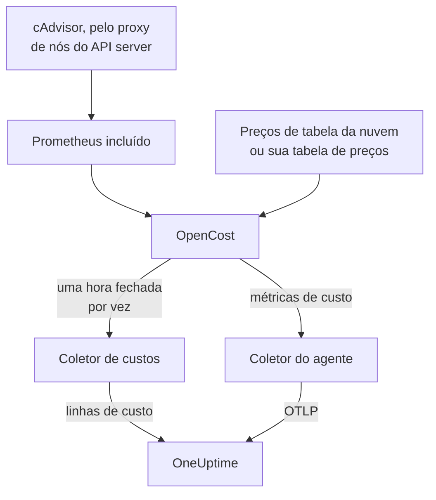

# Observabilidade de custos do Kubernetes

Veja quanto custa cada carga de trabalho do Kubernetes — gastos por namespace, carga de trabalho e pod, capacidade ociosa e quanto de cada request é usado — ao lado das métricas, dos logs e dos traces que o [agente Kubernetes](/docs/telemetry/kubernetes-agent) já coleta. Um único valor do Helm ativa isso, sem credenciais de nuvem, e a página **Costs** do cluster então diz quais requests reduzir.

:::cards
- [Ative](#ative-a-observabilidade-de-custos): Um único `helm upgrade`.
- [Use o seu próprio motor](#já-usa-o-kubecost-ou-o-opencost): Aponte o agente para o Kubecost ou o OpenCost.
- [Right-sizing](#right-sizing): Recomendações de requests, e como elas são feitas.
- [Solução de problemas](#solução-de-problemas): Páginas vazias, recomendações faltando.
:::

## Como funciona

Com `cost.enabled=true`, o chart executa quatro coisas ao lado do agente:



1. **OpenCost**, o motor de custos de código aberto (Apache-2.0, CNCF; o [cost-model](https://github.com/kubecost/cost-model) que também move o Kubecost). Ele observa o cluster, precifica os seus nós, volumes e load balancers e calcula quanto custa cada carga de trabalho.
2. **Um Prometheus pequeno**, de que o OpenCost precisa para o histórico de uso e de preços. Ele executa uma réplica, guarda 7 dias de histórico e coleta exatamente dois alvos: o cAdvisor pelo proxy de nós do API server, e o próprio OpenCost (que emite as próprias métricas de requests de recursos, então o kube-state-metrics não participa). Ele nunca é exposto fora do cluster, e os dados dele nunca saem de lá.
3. **O coletor de custos** (`cost.agent`). Uma vez por hora fechada, ele lê a Allocation API do OpenCost e envia ao OneUptime uma linha de custo por carga de trabalho: CPU, memória, GPU, volumes, rede, load balancers e ociosidade, com a eficiência. Cada hora é enviada uma vez; o servidor ignora uma hora que já tem, então um reinício não consegue contar os gastos duas vezes.
4. **Uma coleta de métricas de custo** (`cost.metrics`). O coletor do agente coleta as métricas de custo do OpenCost e as envia junto com o resto das métricas do cluster.

O OpenCost precifica os nós a partir dos preços de tabela públicos do seu provedor de nuvem (AWS, Google Cloud, Azure), sem credenciais. Clusters sem preço de tabela na nuvem definem uma [tabela de preços](#preços-on-premises-e-bare-metal) em vez disso.

## Ative a observabilidade de custos

:::steps
### Atualize o agente com cost.enabled

```bash
helm upgrade kubernetes-agent oneuptime/kubernetes-agent \
  --namespace oneuptime-agent \
  --reset-then-reuse-values \
  --set cost.enabled=true
```

Essa é uma instalação completa: dois pods pequenos a mais, o OpenCost e o Prometheus dele. Se você instalou o agente com outro nome de release ou em outro namespace, use os seus (`helm list -A | grep kubernetes-agent` os mostra).

### Aguarde a primeira hora fechada

Os primeiros custos aparecem depois que a primeira hora completa fecha, e o OpenCost precisa de alguns minutos depois de iniciar para precificar a primeira hora.

### Abra as páginas de custos

- **Produtos → Infraestrutura → Kubernetes → Costs** mostra os gastos de todos os clusters do projeto.
- Em um cluster, **Costs** mostra a tendência de gastos dele, **Spend by Namespace** com a divisão entre CPU, memória e armazenamento, **Spend by Workload**, os gastos ociosos, a eficiência e o cartão **Right-Sizing**.
:::

As métricas de custo (`node_total_hourly_cost`, `pv_hourly_cost` e as demais) são métricas comuns: elas estão no explorador de métricas, em dashboards personalizados e em monitores de métricas. Para um dashboard pronto, vá até **Produtos → Painéis**, selecione **Criar: Painel** e escolha **Kubernetes Cost Dashboard**: tendências do custo por hora dos nós, custos unitários de CPU e memória, e gastos com volumes e load balancers.

## Já usa o Kubecost ou o OpenCost?

Aponte o agente para o seu motor em vez disso, e nada é incluído:

```bash
helm upgrade kubernetes-agent oneuptime/kubernetes-agent \
  --namespace oneuptime-agent \
  --reset-then-reuse-values \
  --set cost.enabled=true \
  --set cost.engine.url=http://kubecost-cost-analyzer.kubecost.svc.cluster.local:9090
```

| Motor | URL habitual do serviço |
| --- | --- |
| OpenCost | `http://opencost.opencost.svc.cluster.local:9003` |
| Kubecost | `http://kubecost-cost-analyzer.kubecost.svc.cluster.local:9090` |

O caminho da Allocation API é encontrado sozinho (`/model/allocation` para o Kubecost, `/allocation/compute` ou `/allocation` para o OpenCost). Defina `cost.engine.allocationPath` só em uma instalação incomum. Para recomendações de memória, defina também `cost.engine.prometheusUrl` (veja [Os dados por trás](#os-dados-por-trás)).

## Preços on-premises e bare metal

Clusters cujos nós não têm preço de tabela público na nuvem podem definir uma tabela de preços. O OpenCost então precifica cada recurso a partir destes valores, todos em USD por hora de recurso:

```yaml title="values.yaml"
cost:
  enabled: true
  opencost:
    customPricing:
      enabled: true
      cpuPerCoreHour: "0.031611"       # ~$23 per core-month
      ramPerGiBHour: "0.004237"        # ~$3 per GiB-month
      storagePerGBHour: "0.00005479452" # ~$0.04 per GB-month
      gpuPerHour: "0.95"
```

## Configurações que vale conhecer

Todas opcionais; o `values.yaml` do chart tem a lista completa:

```yaml title="values.yaml"
cost:
  agent:
    windowSeconds: 3600   # allocation window length (hourly = native)
    includeIdle: true     # ship the engine's __idle__ allocation
    currency: USD         # currency code shown in the UI (informational)
  prometheus:
    retention: 7d         # bundled TSDB history; right-sizing reads peaks back over days
    persistence:
      enabled: false      # set true for a small PVC; emptyDir otherwise
  metrics:
    enabled: true         # cost metrics for dashboards / Metric Explorer
    scrapeInterval: 60s
```

## Right-sizing

O cartão **Right-Sizing** na página **Costs** de um cluster recomenda um request de CPU e um de memória para cada contêiner do qual tem histórico suficiente, ordenados por quanto cada mudança economiza por mês.

Uma recomendação é a demanda observada mais 25% de folga, arredondada para um valor que você pode colar em um manifesto (10m de CPU, 16Mi de memória):

- A CPU é dimensionada a partir do percentil 95 do uso médio por hora: alto o bastante para cobrir a carga real, baixo o bastante para que um pico isolado não infle o request por um mês.
- A memória é dimensionada a partir do pico do working set, nunca de uma média (veja [Os dados por trás](#os-dados-por-trás)).

São recomendados requests; limits, não. Um request é o que o scheduler reserva e de onde a conta é calculada, então é o número que move o custo. Um limit é uma decisão sobre se um contêiner com mau comportamento deve sofrer throttling ou ser encerrado, e essa decisão os dados de uso não podem tomar por você.

Cada contêiner é comparado com o request atual dele:

| Veredito | O que significa |
| --- | --- |
| Superprovisionado | Ele reserva claramente mais do que usa. É daqui que vem a economia. |
| Subprovisionado | Ele reserva menos do que usa, então sofre throttling ou corre risco de OOM kill. Corrigir isso custa dinheiro, e o cartão mostra isso como um aumento. |
| Sem request definido | Não há nada a reduzir, mas o scheduler não consegue posicionar o contêiner com segurança, e ele é o primeiro a ser removido sob pressão. |

Um contêiner a até 15% da recomendação conta como bem dimensionado e fica de fora: ninguém deveria editar um manifesto para tirar 3% de um request.

Duas proteções mantêm as recomendações honestas. Uma carga de trabalho precisa de pelo menos 24 horas de janelas de custo antes de ser dimensionada, porque uma janela de quatro horas pode pegar um job em lote noturno em repouso e recomendar reduzi-lo a nada. E a economia é projetada a partir da duração da janela que você está vendo, não do número de linhas, então a economia de um Deployment não é multiplicada pelo número de réplicas dele. A estimativa supõe que os gastos acompanham o que o motor alocou, que é `max(request, usage)`; para um contêiner superprovisionado, isso é o request, então o número da economia é exato.

### Os dados por trás

Além dos gastos, o coletor de custos coleta o que uma recomendação precisa: os requests, os limits e o uso de CPU e memória de cada contêiner.

A memória precisa de mais uma fonte. A Allocation API informa só uma média de cada janela, e uma média por hora esconde o pico que causa o OOM kill de um contêiner, então dimensionar a memória a partir dela seria perigoso. O coletor de custos lê, em vez disso, o pico de memória de cada contêiner no Prometheus, juntado por `(namespace, pod, container)`:

- Com o motor incluído (o padrão), ele usa o próprio Prometheus do chart. Nada a definir.
- Com o seu próprio motor (`cost.engine.url`), aponte `cost.engine.prometheusUrl` para um Prometheus que colete o cAdvisor, e defina `cost.engine.prometheusCadvisorJob` se o job de coleta dele não se chamar `kubernetes-nodes-cadvisor`.
- Sem Prometheus, as recomendações de CPU continuam funcionando, a partir das médias por hora armazenadas, e as recomendações de memória ficam de fora em vez de serem adivinhadas.

Uma queda do Prometheus nunca interrompe a coleta de gastos: os picos são um extra, e uma hora é enviada sem eles. A CPU de propósito não usa o Prometheus: um request de CPU grande demais só causa throttling, enquanto um request de memória pequeno demais encerra o contêiner, então as médias por hora são seguras para a CPU, e consultar a taxa de CPU de cada contêiner em um cluster inteiro é pesado o bastante para derrubar um Prometheus pequeno.

## Alertas sobre custos

As métricas de custo são métricas comuns, então um [monitor de métricas](/docs/monitor/metrics-monitor) pode alertar sobre elas como sobre qualquer outra coisa: por exemplo, quando a média de `node_total_hourly_cost` passa de um orçamento, ou quando `pv_hourly_cost` aparece para uma classe de volume que não deveria existir em um cluster.

## Modelo de dados e retenção

As linhas de custo são armazenadas no ClickHouse, uma por cluster, janela, namespace, controller, pod e contêiner. Elas seguem a retenção de telemetria do cluster: o `retainTelemetryDataForDays` do cluster, ou a retenção de dados do projeto quando ele não está definido. A capacidade ociosa e a não alocada são armazenadas como linhas comuns nos namespaces `__idle__` e `__unallocated__`, então são agrupadas e filtradas como os gastos das cargas de trabalho.

## Solução de problemas

:::details As páginas de custos estão vazias
Leia os logs do coletor de custos: `kubectl logs -n oneuptime-agent deploy/kubernetes-agent-cost`. (O deployment é `<release>-kubernetes-agent-cost` quando o nome da release não contém `kubernetes-agent`; `kubectl get deploy -n oneuptime-agent` os lista.) `HTTP 401` significa que o OneUptime recusou a chave de ingestão. `did not answer any known allocation path` significa que o motor ainda não está no ar (o OpenCost incluído precisa de alguns minutos para precificar as primeiras horas) ou que `cost.engine.url` está errada.
:::

:::details O OpenCost incluído não está pronto
Leia os logs dele: `kubectl logs -n oneuptime-agent deploy/kubernetes-agent-opencost`. Eles dizem qual provedor de nuvem ele detectou e se os dados de preço foram carregados.
:::

:::details O log do OpenCost diz mkdir /var/configs: permission denied
Um chart mais antigo executava o OpenCost sem um diretório de configuração gravável, então `Error downloading default pricing data` deixava a Allocation API dele sem conseguir responder e o coletor de custos parado, enquanto o pod continuava `Running`, o `/healthz` continuava verde e as métricas de custo dos nós continuavam sendo publicadas. Os charts atuais corrigem isso: execute `helm repo update` e depois atualize com `--reset-then-reuse-values`. As linhas de custo aparecem na próxima coleta.
:::

:::details O Kubernetes Cost Dashboard não mostra dados
O modelo lê as métricas de custo coletadas: verifique se `cost.metrics.enabled` é `true`.
:::

:::details O cartão Right-Sizing está vazio
Ou o intervalo de tempo é menor que as 24 horas de que uma recomendação precisa (amplie-o), ou todo contêiner já está a até 15% do request recomendado, o que o cartão informa.
:::

:::details As recomendações de memória mostram -, mas as de CPU funcionam
Nenhum pico de memória chegou ao OneUptime, então a memória ficou sem dimensionamento em vez de ser adivinhada a partir de uma média. Com o seu próprio motor, defina `cost.engine.prometheusUrl`. O cartão diz quantos contêineres isso afeta.
:::

:::details Os números diferem da interface do próprio motor
O OneUptime inclui os ajustes de reconciliação do motor em cada componente de custo e envia horas inteiras e fechadas: os gastos da hora atual aparecem depois que ela fecha.
:::

:::details O Prometheus incluído foi reiniciado
Com o armazenamento `emptyDir` padrão, um reinício perde algumas horas de histórico de uso, então os custos dessas horas podem sair menores. Defina `cost.prometheus.persistence.enabled=true` se isso importar para você.
:::

## Próximos passos

:::cards
- [Agente Kubernetes](/docs/telemetry/kubernetes-agent): Instale o agente, e tudo mais que ele coleta.
- [Monitor de métricas](/docs/monitor/metrics-monitor): Alerte quando os gastos passarem de um orçamento.
- [Monitor de Kubernetes](/docs/monitor/kubernetes-monitor): Alerte também sobre a saúde do cluster.
:::
