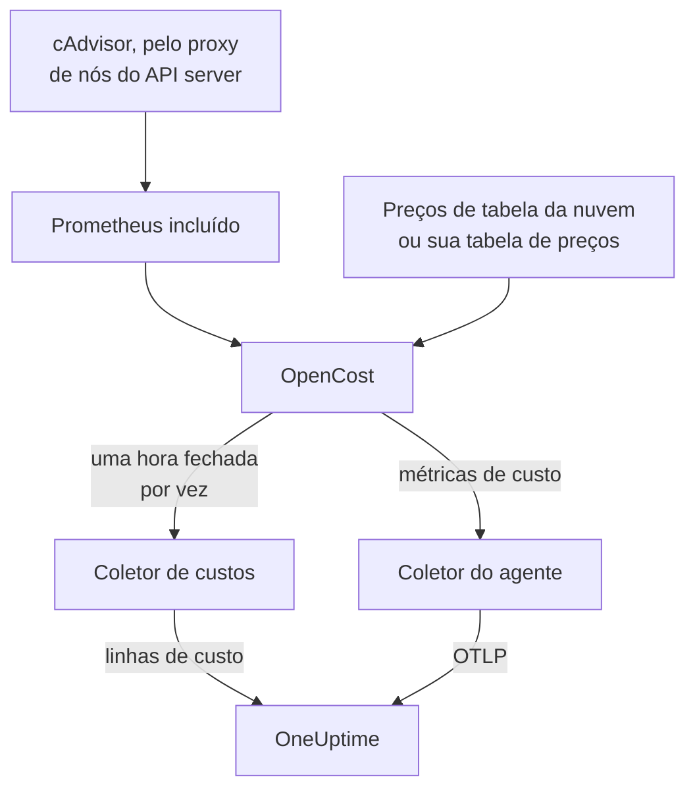

# Observabilidade de custos do Kubernetes

Veja quanto custa cada carga de trabalho do Kubernetes — gastos por namespace, carga de trabalho e pod, capacidade ociosa e quanto de cada request é usado — ao lado das métricas, dos logs e dos traces que o [agente Kubernetes](/docs/telemetry/kubernetes-agent) já coleta. Isso vem ativado por padrão, sem credenciais de nuvem: a visão geral do cluster diz quanto ele custa, a página **Custos** dele diz quais requests reduzir, e as métricas de custo podem ser exibidas em gráficos e usadas em alertas como quaisquer outras.

:::cards
- [Ative](#ative-a-observabilidade-de-custos): Ativado por padrão; um único `helm upgrade` onde não estiver.
- [Alertas sobre custos](#alertas-sobre-custos): Custo por cluster, namespace e carga de trabalho, como métricas.
- [O seu próprio motor](#já-usa-o-kubecost-ou-o-opencost): O Kubecost ou o OpenCost que você já usa é detectado e lido.
- [Right-sizing](#right-sizing): Recomendações de requests, e como elas são feitas.
- [Solução de problemas](#solução-de-problemas): Páginas vazias, recomendações faltando.
:::

## Como funciona

Com o monitoramento de custos ativado, como vem por padrão (`cost.enabled: auto`), o chart executa quatro coisas ao lado do agente:



1. **OpenCost**, o motor de custos de código aberto (Apache-2.0, CNCF; o [cost-model](https://github.com/kubecost/cost-model) que também move o Kubecost). Ele observa o cluster, precifica os seus nós, volumes e load balancers e calcula quanto custa cada carga de trabalho.
2. **Um Prometheus pequeno**, de que o OpenCost precisa para o histórico de uso e de preços. Ele executa uma réplica, guarda 7 dias de histórico e coleta exatamente dois alvos: o cAdvisor pelo proxy de nós do API server, mantendo só as séries que o OpenCost lê, e o próprio OpenCost (que emite as próprias métricas de requests de recursos, então o kube-state-metrics não participa). Ele nunca é exposto fora do cluster, e os dados dele nunca saem de lá.
3. **O coletor de custos** (`cost.agent`). Uma vez por hora fechada, ele lê a Allocation API do OpenCost e envia ao OneUptime uma linha de custo por carga de trabalho: CPU, memória, GPU, volumes, rede, load balancers e ociosidade, com a eficiência. Cada hora é enviada uma vez; o servidor ignora uma hora que já tem, então um reinício não consegue contar os gastos duas vezes. O OneUptime também grava as [métricas de custo](#alertas-sobre-custos) a partir dessas linhas.
4. **Uma coleta de métricas de custo** (`cost.metrics`). O coletor do agente coleta as métricas de preço do OpenCost, quanto cada nó, volume e load balancer custa por hora, e as envia junto com o resto das métricas do cluster.

O OpenCost precifica os nós a partir dos preços de tabela públicos do seu provedor de nuvem (AWS, Google Cloud, Azure), sem credenciais. Em outros ambientes, ele usa as tarifas padrão dele, que você pode substituir por uma [tabela de preços](#preços-on-premises-e-bare-metal) própria.

Juntos, os três pods solicitam cerca de 150m de CPU e 450Mi de memória. O monitoramento de custos vem desativado por padrão nos presets `gke-autopilot` e `eks-fargate`: essas plataformas cobram cada pod pelos requests dele, então os pods de custos aumentariam a própria conta que medem, e o OpenCost precifica nós, enquanto nenhuma das duas plataformas cobra por nó.

## Ative a observabilidade de custos

Uma instalação nova não precisa de nada: o monitoramento de custos vem ativado por padrão. Atualize um agente instalado antes disso, ou ative-o com o preset `gke-autopilot` ou `eks-fargate`:

:::steps
### Atualize o agente

```bash
helm upgrade kubernetes-agent oneuptime/kubernetes-agent \
  --namespace oneuptime-agent \
  --reset-then-reuse-values \
  --set cost.enabled=true
```

Essa é uma instalação completa: três pods pequenos a mais, o OpenCost, o Prometheus dele e o agente de custos. Se você instalou o agente com outro nome de release ou em outro namespace, use os seus (`helm list -A | grep kubernetes-agent` os mostra). Para desativar o monitoramento de custos, defina `--set cost.enabled=false` da mesma forma.

### Aguarde a primeira hora fechada

Os primeiros custos aparecem depois que a primeira hora completa fecha, e o OpenCost precisa de alguns minutos depois de iniciar para precificar a primeira hora.

### Abra as páginas de custos

- **Produtos → Infraestrutura → Kubernetes → Custos** mostra os gastos de todos os clusters do projeto.
- Em um cluster, a visão geral mostra os gastos dele nas últimas 24 horas, uma projeção mensal, os gastos ociosos, a eficiência e os namespaces e as cargas de trabalho mais caros.
- Em um cluster, **Custos** mostra a tendência de gastos dele, **Spend by Namespace** com a divisão entre CPU, memória e armazenamento, **Spend by Workload**, os gastos ociosos, a eficiência e o cartão **Right-Sizing**.
:::

As métricas de custo (`node_total_hourly_cost`, `pv_hourly_cost` e as demais) são métricas comuns: elas estão no explorador de métricas, em dashboards personalizados e em monitores de métricas. Para um dashboard pronto, vá até **Produtos → Painéis**, selecione **Criar painel** e escolha **Kubernetes Cost Dashboard**: tendências do custo por hora dos nós, custos unitários de CPU e memória, e gastos com volumes e load balancers.

Abaixo dos números, a visão geral e a página **Custos** dizem de onde vêm os preços que mostram: os preços de tabela de uma nuvem, a sua tabela de preços ou as tarifas padrão do OpenCost. A eficiência é um único número em todo lugar, inclusive na métrica de eficiência: quanto da CPU e da memória solicitadas foi usado, com a hora de cada contêiner ponderada pelo custo da CPU e da memória dele, para que um job barato que não usa nada não consiga puxar para baixo um cluster bem aproveitado, e a capacidade ociosa não é contada.

## Já usa o Kubecost ou o OpenCost?

O agente de custos encontra o seu motor e o lê no lugar do OpenCost incluído, então o cluster é precificado como você o configurou: a sua tabela de preços, ou a sua fatura de nuvem por trás do Kubecost. Ao iniciar, e depois a cada hora, ele procura pela API do Kubernetes, em qualquer namespace, os Services que os próprios charts dos motores criam (`cost-analyzer` ou `frontend` do Kubecost, o do chart do OpenCost e o Service `opencost` que o manifesto dele cria), primeiro o Kubecost. Ele ignora um motor que não responde, que exige login ou que responde por vários clusters, e então lê o incluído.

A visão geral do cluster então mostra o nome do seu motor e diz que o OpenCost incluído não é necessário. Pare de executá-lo:

```bash
helm upgrade kubernetes-agent oneuptime/kubernetes-agent \
  --namespace oneuptime-agent \
  --reset-then-reuse-values \
  --set cost.engine.url=auto
```

Com `cost.engine.url=auto`, nada é incluído, e o agente lê o seu motor onde quer que ele rode; sem nenhum motor instalado, nada é precificado. O chart não consegue procurar um motor sozinho: o `lookup` do Helm não vê nada com `helm template`, com o Argo CD ou em uma execução de teste. Para manter o OpenCost incluído ao lado do seu próprio motor, defina `cost.engine.preferExisting=false`; para indicar o motor a ser lido, defina `cost.engine.url` como o Service dele:

| Motor | URL habitual do serviço |
| --- | --- |
| OpenCost | `http://opencost.opencost.svc.cluster.local:9003` |
| Kubecost | `http://kubecost-cost-analyzer.kubecost.svc.cluster.local:9090` |

O caminho da Allocation API é encontrado sozinho (`/model/allocation` para o Kubecost, `/allocation/compute` ou `/allocation` para o OpenCost). Defina `cost.engine.allocationPath` só em uma instalação incomum. Com `auto` ou uma URL, nada é incluído, então para recomendações de memória defina também `cost.engine.prometheusUrl` (veja [Os dados por trás](#os-dados-por-trás)).

## Preços on-premises e bare metal

Clusters cujos nós não têm preço de tabela público na nuvem podem definir uma tabela de preços. Sem ela, o OpenCost precifica esses nós pelas tarifas padrão dele (on-premises, bare metal, kind, k3s), que podem ficar longe do que o seu hardware custa, e a visão geral e a página **Custos** do cluster avisam isso; em uma nuvem que ele reconhece, um nó mantém o preço de tabela dele, e uma tabela de preços só precifica o que falta nos preços de tabela. Com uma tabela de preços, o OpenCost então precifica cada recurso a partir destes valores, todos em USD por hora de recurso:

```yaml title="values.yaml"
cost:
  enabled: true
  opencost:
    customPricing:
      enabled: true
      cpuPerCoreHour: "0.031611"       # ~$23 per core-month
      ramPerGiBHour: "0.004237"        # ~$3 per GiB-month
      storagePerGBHour: "0.00005479452" # ~$0.04 per GB-month
      gpuPerHour: "0.95"
```

Estas são as tarifas padrão do próprio OpenCost: coloque os seus próprios valores, ou a página **Custos** continuará dizendo que o cluster é precificado pelas tarifas padrão do OpenCost.

## Configurações que vale conhecer

Todas opcionais; o `values.yaml` do chart tem a lista completa:

```yaml title="values.yaml"
cost:
  enabled: auto           # on, except with the gke-autopilot and eks-fargate presets
  agent:
    windowSeconds: 3600   # allocation window length (hourly = native)
    includeIdle: true     # ship the engine's __idle__ allocation
    currency: USD         # currency code shown in the UI (informational)
  prometheus:
    retention: 7d         # bundled TSDB history; right-sizing reads peaks back over days
    persistence:
      enabled: false      # set true for a small PVC; emptyDir otherwise
  metrics:
    enabled: true         # cost metrics for dashboards / Metric Explorer
    scrapeInterval: 60s
```

## Right-sizing

O cartão **Right-Sizing** na página **Custos** de um cluster recomenda um request de CPU e um de memória para cada contêiner do qual tem histórico suficiente, ordenados por quanto cada mudança economiza por mês.

Uma recomendação é a demanda observada mais 25% de folga, arredondada para um valor que você pode colar em um manifesto (10m de CPU, 16Mi de memória):

- A CPU é dimensionada a partir do percentil 95 do uso médio por hora: alto o bastante para cobrir a carga real, baixo o bastante para que um pico isolado não infle o request por um mês.
- A memória é dimensionada a partir do pico do working set, nunca de uma média (veja [Os dados por trás](#os-dados-por-trás)).

São recomendados requests; limits, não. Um request é o que o scheduler reserva e de onde a conta é calculada, então é o número que move o custo. Um limit é uma decisão sobre se um contêiner com mau comportamento deve sofrer throttling ou ser encerrado, e essa decisão os dados de uso não podem tomar por você.

Cada contêiner é comparado com o request atual dele:

| Veredito | O que significa |
| --- | --- |
| Superprovisionado | Ele reserva claramente mais do que usa. É daqui que vem a economia. |
| Subprovisionado | Ele reserva menos do que usa, então sofre throttling ou corre risco de OOM kill. Corrigir isso custa dinheiro, e o cartão mostra isso como um aumento. |
| Sem request definido | Não há nada a reduzir, mas o scheduler não consegue posicionar o contêiner com segurança, e ele é o primeiro a ser removido sob pressão. |

Um contêiner a até 15% da recomendação conta como bem dimensionado e fica de fora: ninguém deveria editar um manifesto para tirar 3% de um request.

Duas proteções mantêm as recomendações honestas. Uma carga de trabalho precisa de pelo menos 24 horas de janelas de custo antes de ser dimensionada, porque uma janela de quatro horas pode pegar um job em lote noturno em repouso e recomendar reduzi-lo a nada. E a economia é projetada a partir da duração da janela que você está vendo, não do número de linhas, então a economia de um Deployment não é multiplicada pelo número de réplicas dele. A estimativa supõe que os gastos acompanham o que o motor alocou, que é `max(request, usage)`; para um contêiner superprovisionado, isso é o request, então o número da economia é exato.

### Os dados por trás

Além dos gastos, o coletor de custos coleta o que uma recomendação precisa: os requests, os limits e o uso de CPU e memória de cada contêiner.

A memória precisa de mais uma fonte. A Allocation API informa só uma média de cada janela, e uma média por hora esconde o pico que causa o OOM kill de um contêiner, então dimensionar a memória a partir dela seria perigoso. O coletor de custos lê, em vez disso, o pico de memória de cada contêiner no Prometheus, juntado por `(namespace, pod, container)`:

- Com o motor incluído (o padrão), ele usa o próprio Prometheus do chart. Nada a definir.
- Com `cost.engine.url` definida (`auto` ou a URL do seu motor), aponte `cost.engine.prometheusUrl` para um Prometheus que colete o cAdvisor, e defina `cost.engine.prometheusCadvisorJob` se o job de coleta dele não se chamar `kubernetes-nodes-cadvisor`.
- Sem Prometheus, as recomendações de CPU continuam funcionando, a partir das médias por hora armazenadas, e as recomendações de memória ficam de fora em vez de serem adivinhadas.

Uma queda do Prometheus nunca interrompe a coleta de gastos: os picos são um extra, e uma hora é enviada sem eles. A CPU de propósito não usa o Prometheus: um request de CPU grande demais só causa throttling, enquanto um request de memória pequeno demais encerra o contêiner, então as médias por hora são seguras para a CPU, e consultar a taxa de CPU de cada contêiner em um cluster inteiro é pesado o bastante para derrubar um Prometheus pequeno.

## Alertas sobre custos

O OneUptime grava quatro métricas a partir das linhas de custo de cada hora, já precificadas e com nomes que dizem o que são, para que o custo possa ser exibido em gráficos, colocado em um dashboard e usado em alertas em um [monitor de Kubernetes](/docs/monitor/kubernetes-monitor) ou em um [monitor de métricas](/docs/monitor/metrics-monitor):

| Métrica | O que é | Atributos |
| --- | --- | --- |
| `oneuptime.kubernetes.cost.total` | Quanto o cluster custou em cada hora, incluindo a capacidade ociosa | `k8s.cluster.name` |
| `oneuptime.kubernetes.cost.idle` | A parte disso que nenhuma carga de trabalho usou: capacidade ociosa e não alocada | `k8s.cluster.name` |
| `oneuptime.kubernetes.cost.workload` | Quanto cada carga de trabalho custou em cada hora; somado por namespace, quanto o namespace custou | `k8s.cluster.name`, `k8s.namespace.name` e o nome da carga de trabalho sob o tipo dela, como `k8s.deployment.name` |
| `oneuptime.kubernetes.cost.efficiency` | Quanto da CPU e da memória solicitadas cada carga de trabalho usou, em porcentagem, ponderado pelo custo | Os da carga de trabalho, como acima |

Cada ponto é o custo de uma hora, na moeda do agente (USD por padrão), com o timestamp do início da hora, e é gravado cerca de uma hora depois que ela termina: some os pontos em uma janela de horas, e os de um dia somam o custo do dia. Eles vêm do que o cluster já enviou, então não são cobrados como métricas ingeridas, e são mantidos pelo mesmo tempo que as outras métricas do cluster.

O monitor de Kubernetes tem três modelos para elas: Cluster Daily Cost Over Budget, Namespace Daily Cost Over Budget e High Idle Spend, cada um com um orçamento para você ajustar ao seu. As métricas de preço do OpenCost também são métricas comuns: um monitor de métricas pode alertar quando a média de `node_total_hourly_cost` passa de um orçamento, ou quando `pv_hourly_cost` aparece para uma classe de volume que não deveria existir em um cluster.

## Modelo de dados e retenção

As linhas de custo são armazenadas no ClickHouse, uma por cluster, janela, namespace, controller, pod e contêiner. Elas seguem a retenção de telemetria do cluster: o `retainTelemetryDataForDays` do cluster, ou a retenção de dados do projeto quando ele não está definido. A capacidade ociosa e a não alocada são armazenadas como linhas comuns nos namespaces `__idle__` e `__unallocated__`, então são agrupadas e filtradas como os gastos das cargas de trabalho.

## Solução de problemas

:::details As páginas de custos estão vazias
Nos presets `gke-autopilot` e `eks-fargate`, o monitoramento de custos vem desativado por padrão: ative-o com `--set cost.enabled=true`. Caso contrário, leia os logs do coletor de custos: `kubectl logs -n oneuptime-agent deploy/kubernetes-agent-cost`. (O deployment é `<release>-kubernetes-agent-cost` quando o nome da release não contém `kubernetes-agent`; `kubectl get deploy -n oneuptime-agent` os lista.) `HTTP 401` significa que o OneUptime recusou a chave de ingestão. `did not answer any known allocation path` significa que o motor ainda não está no ar (o OpenCost incluído precisa de alguns minutos para precificar as primeiras horas) ou que `cost.engine.url` está errada.
:::

:::details O OpenCost incluído não está pronto
Leia os logs dele: `kubectl logs -n oneuptime-agent deploy/kubernetes-agent-opencost`. Eles dizem qual provedor de nuvem ele detectou e se os dados de preço foram carregados.
:::

:::details A visão geral diz que o OpenCost incluído não é necessário
O cluster executa o próprio Kubecost ou OpenCost, e o agente de custos lê esse motor, então o OpenCost e o Prometheus que o chart incluiu não precificam nada. Atualize com `--set cost.engine.url=auto` para parar de executá-los, ou defina `cost.engine.preferExisting=false` para ler o motor incluído em vez disso.
:::

:::details O agente de custos não lê o seu motor
O log dele diz qual motor ele lê e por que ignorou os outros: `kubectl logs -n oneuptime-agent deploy/kubernetes-agent-cost`. Ele ignora um motor que não responde (por causa de uma NetworkPolicy entre os namespaces, por exemplo), que exige login ou que responde por vários clusters, como faz um Kubecost que federa outros. Indique o motor a ser lido com `cost.engine.url`.
:::

:::details O log do OpenCost diz mkdir /var/configs: permission denied
Um chart mais antigo executava o OpenCost sem um diretório de configuração gravável, então `Error downloading default pricing data` deixava a Allocation API dele sem conseguir responder e o coletor de custos parado, enquanto o pod continuava `Running`, o `/healthz` continuava verde e as métricas de custo dos nós continuavam sendo publicadas. Os charts atuais corrigem isso: execute `helm repo update` e depois atualize com `--reset-then-reuse-values`. As linhas de custo aparecem na próxima coleta.
:::

:::details O Kubernetes Cost Dashboard não mostra dados
O modelo lê as métricas de custo coletadas: verifique se `cost.metrics.enabled` é `true`.
:::

:::details O cartão Right-Sizing está vazio
Ou o intervalo de tempo é menor que as 24 horas de que uma recomendação precisa (amplie-o), ou todo contêiner já está a até 15% do request recomendado, o que o cartão informa.
:::

:::details As recomendações de memória mostram -, mas as de CPU funcionam
Nenhum pico de memória chegou ao OneUptime, então a memória ficou sem dimensionamento em vez de ser adivinhada a partir de uma média. Com o seu próprio motor, defina `cost.engine.prometheusUrl`. O cartão diz quantos contêineres isso afeta.
:::

:::details Os números diferem da interface do próprio motor
O OneUptime inclui os ajustes de reconciliação do motor em cada componente de custo e envia horas inteiras e fechadas: os gastos da hora atual aparecem depois que ela fecha.
:::

:::details O Prometheus incluído foi reiniciado
Com o armazenamento `emptyDir` padrão, um reinício perde algumas horas de histórico de uso, então os custos dessas horas podem sair menores. Defina `cost.prometheus.persistence.enabled=true` se isso importar para você.
:::

## Próximos passos

:::cards
- [Agente Kubernetes](/docs/telemetry/kubernetes-agent): Instale o agente, e tudo mais que ele coleta.
- [Monitor de métricas](/docs/monitor/metrics-monitor): Alerte quando os gastos passarem de um orçamento.
- [Monitor de Kubernetes](/docs/monitor/kubernetes-monitor): Alerte também sobre a saúde do cluster.
:::
