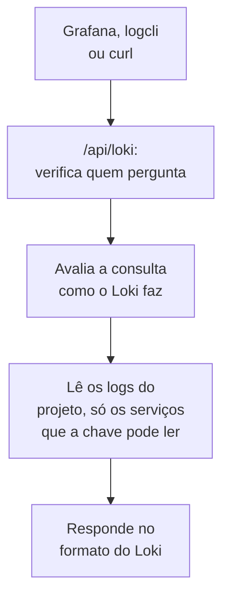

# Consultar logs com LogQL

LogQL é a linguagem de consulta do Grafana Loki. O OneUptime responde à API de consultas do Loki sobre os logs do seu projeto, então a fonte de dados Loki do Grafana, o logcli ou qualquer cliente do Loki os lê, e os painéis e as consultas salvas que você escreveu para o Loki continuam funcionando.

:::cards
- [Conectar o Grafana](#conectar-o-grafana): Adicionar o OneUptime como fonte de dados Loki.
- [Os rótulos dos logs](#os-rótulos-dos-logs): O que um seletor de stream encontra.
- [O que o LogQL cobre](#o-que-o-logql-cobre): Consultas de logs, parsers e consultas de métricas.
- [Limites](#limites): O que uma consulta pode ler, e com que frequência.
:::

## Como funciona

O Grafana pergunta ao OneUptime como pergunta ao Loki. O OneUptime verifica se a chave de API pode ler os logs do projeto, lê só os serviços que ela pode ler e avalia a consulta como o Loki faz.



## Antes de começar

- **Logs chegando.** Envie-os com o [OpenTelemetry](/docs/telemetry/open-telemetry), ou do Promtail, Grafana Alloy, Fluent Bit ou Vector pela [API push do Loki](/docs/telemetry/compatible-endpoints).
- **Uma chave de API do projeto que leia logs**, com a função Proprietário do projeto, Administrador do projeto, Membro do projeto, Visualizador, Administrador de telemetria, Membro de telemetria ou Visualizador de telemetria, ou com a permissão Read Logs. Uma chave limitada a alguns serviços lê só os logs deles. Veja [Criar uma chave de API](/docs/api-reference/api-reference#criar-uma-chave-de-api). No OneUptime Cloud, as chaves de API precisam do plano **Growth**.
- **Não uma chave de ingestão.** Uma chave de ingestão envia telemetria e não lê nada, então o Grafana não consegue entrar com ela.

## Conectar o Grafana

:::steps
### Criar uma chave de API

No OneUptime, abra **Configurações do projeto → Avançado → Chaves de API** e clique em **Criar: Chave de API**. Dê à chave uma função que possa ler telemetria, ou a permissão Read Logs.

### Adicionar uma fonte de dados Loki

No Grafana, abra **Connections → Data sources → Add data source** e escolha **Loki**.

### Informar a URL

Defina **URL** como o endereço do seu OneUptime seguido de `/api/loki`. No OneUptime Cloud, é `https://oneuptime.com/api/loki`.

### Enviar a chave de API

Em **HTTP headers**, adicione o cabeçalho `Authorization` com o valor `Bearer` seguido de um espaço e da sua chave de API. A autenticação básica também funciona: qualquer nome de usuário, com a chave de API como senha.

### Salvar e testar

Clique em **Save & test**. O Grafana executa uma consulta e diz que a fonte de dados funciona.
:::

O Explore, o volume de logs acima das linhas, os navegadores de rótulos e os painéis passam então a ler o OneUptime como leem o Loki. O logcli e qualquer outro cliente do Loki funcionam do mesmo jeito. Com o curl:

```bash title="Query OneUptime's Loki API"
curl -G -H "Authorization: Bearer $ONEUPTIME_API_KEY" \
  "https://oneuptime.com/api/loki/loki/api/v1/query_range" \
  --data-urlencode 'query={service_name="checkout"} |= "error"'
```

## Os rótulos dos logs

Um seletor de stream encontra os atributos de um log, nomeados como o Loki 3 nomeia os logs do OpenTelemetry:

| No OneUptime | No LogQL |
| --- | --- |
| Um atributo de recurso `service.name` | O rótulo `service_name` |
| Um atributo de recurso `k8s.pod.name` | O rótulo `k8s_pod_name` |
| Um atributo `http.method` | O rótulo `http_method` |
| Um rótulo enviado por um cliente do Loki, como `job` | O rótulo `job` |
| A gravidade do log | O rótulo `detected_level`: `trace`, `debug`, `info`, `warn`, `error`, `fatal` ou `unknown` |

- **Cada atributo é um rótulo.** Uma consulta de logs responde com um stream por conjunto de rótulos, então logs com atributos diferentes são streams diferentes, como o Loki 3 responde para logs com metadados estruturados.
- **O atributo próprio de um log vem primeiro** quando o recurso dele tem um com o mesmo nome.
- **Um seletor nomeia um valor**, como o Loki pede: pelo menos um seletor que um log sem o rótulo não atende, como `{service_name="checkout"}` ou `{service_name=~"check.+"}`.

Algumas consultas para começar:

```text title="LogQL"
# The checkout service's lines that say error
{service_name="checkout"} |= "error"

# Requests slower than 250ms, read from JSON lines
{service_name="checkout"} | json | duration > 250ms

# Error logs per second, by service
sum by (service_name) (rate({detected_level="error"} [5m]))
```

## O que o LogQL cobre

- **Consultas de logs**: seletores de stream com `=`, `!=`, `=~` e `!~`; filtros de linha `|=`, `!=`, `|~` e `!~`, com `or`; os parsers `json` e `logfmt`; filtros de rótulos sobre texto, números, durações e tamanhos, com `and`, `or` e `__error__`; `line_format` com `{{.label}}`; `drop`, `keep` e `decolorize`.
- **Consultas de métricas**: `count_over_time`, `rate`, `bytes_over_time`, `bytes_rate` e `absent_over_time`; sobre um rótulo tomado com `unwrap` (com `duration()` ou `bytes()`), `rate`, `sum_over_time`, `avg_over_time`, `min_over_time`, `max_over_time`, `first_over_time`, `last_over_time`, `stddev_over_time`, `stdvar_over_time` e `quantile_over_time`; e `offset`.
- **Ao redor delas**: `sum`, `avg`, `min`, `max`, `count`, `stddev`, `stdvar`, `topk` e `bottomk`, com `by` ou `without`; aritmética, comparações (com `bool`), `and`, `or` e `unless`, com `on`, `ignoring`, `group_left` e `group_right`; `sort`, `sort_desc`, `label_replace` e `vector()`.

Os parsers `pattern`, `regexp` e `unpack`, `label_format`, `json` com campos nomeados, os filtros `ip()` e os modelos de `line_format` além de `{{.label}}` ainda não estão disponíveis. Uma consulta que use um deles é recusada com uma mensagem que o nomeia.

## A API

A API responde às rotas da API HTTP do Loki, com `GET` ou `POST`, em `/api/loki`:

| Rota | O que responde |
| --- | --- |
| `/loki/api/v1/query_range` | As linhas de uma consulta de logs de `start` a `end`, ou uma consulta de métricas a cada `step`. |
| `/loki/api/v1/query` | Uma consulta de métricas num instante (`time`, por padrão agora). |
| `/loki/api/v1/labels` | Nomes de rótulos, dos logs que `query` seleciona ou de todos os logs. |
| `/loki/api/v1/label/<name>/values` | Os valores de um rótulo. |
| `/loki/api/v1/series` | Os conjuntos de rótulos dos logs que `match[]` seleciona. |

Os instantes são nanossegundos desde 1970, segundos Unix ou RFC 3339, e um intervalo é a hora antes de `end`, a menos que se diga outra coisa. Uma consulta de logs responde com `limit` linhas, 100 por padrão, as mais recentes primeiro, a menos que haja `direction=forward`. As respostas estão no formato do Loki, e os erros são texto simples, como o Loki os escreve. `/loki/api/v1/status/buildinfo` responde como um servidor Loki 3.

## Limites

Toda consulta é limitada, para que um painel com muitos gráficos não possa sobrecarregar o OneUptime:

| Limite | Valor |
| --- | --- |
| Linhas com que uma consulta de logs responde | 5.000 |
| Logs que uma consulta de logs lê, quando filtros depois dos seus parsers descartam alguns | 20.000 |
| Logs que uma consulta de métricas lê sozinha, quando o ClickHouse não consegue contá-los | 100.000 |
| Séries com que uma consulta de métricas responde | 500 |
| Pontos em uma série de uma consulta de intervalo | 11.000 |
| Logs que uma leitura devolve | 64 MB |
| Tempo que uma leitura pode levar | 30 segundos |
| Consultas que um projeto pode enviar por minuto | 1.200 |

Uma consulta de métricas cujo pipeline é só de filtros de linha, como `sum(count_over_time({service_name="checkout"} |= "error" [5m]))`, é contada onde os logs estão, então não lê nenhuma linha.

## Solução de problemas

:::details O Grafana diz que a fonte de dados não funciona
Confira se a URL termina em `/api/loki` e se o cabeçalho `Authorization` contém `Bearer`, um espaço e a chave de API. Uma chave de ingestão, ou uma chave de API sem uma função que leia logs, é recusada: dê à chave essa função em **Configurações do projeto → Avançado → Chaves de API**.
:::

:::details "queries require at least one regexp or equality matcher that does not have an empty-compatible value"
O seletor encontra logs sem nomear um valor, como `{service_name=~".*"}`. Adicione um seletor que nomeie um, como `{service_name="checkout"}`.
:::

:::details "This project sent more queries this minute than OneUptime answers."
Os painéis e os clientes do projeto enviaram mais de 1.200 consultas à API neste minuto. Os gráficos voltam a carregar no minuto seguinte; atualize os painéis com menos frequência para ficar abaixo disso.
:::

## Próximos passos

:::cards
- [Explorador de registros](/docs/telemetry/logs-explorer): Pesquisar e filtrar logs sem escrever uma consulta.
- [PromQL](/docs/telemetry/promql): Consultar métricas com PromQL, inclusive pela fonte de dados Prometheus do Grafana.
- [Monitor de logs](/docs/monitor/logs-monitor): Alertar sobre o volume e o conteúdo dos logs.
:::
