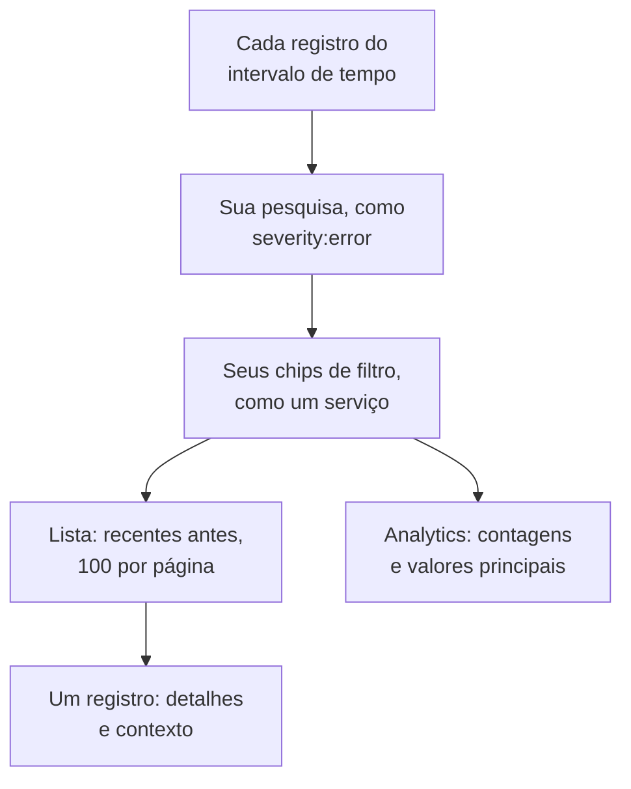

# Explorador de registros

O explorador de registros é onde você pesquisa e lê os registros que seus serviços, hosts e agentes enviam ao OneUptime. Reduza milhões de linhas às poucas que importam, acompanhe as novas à medida que chegam, transforme-as em gráficos e salve as visualizações às quais sua equipe sempre volta.

:::cards
- [Encontrar uma linha de registro](#encontrar-uma-linha-de-registro): Um intervalo de tempo, uma pesquisa e alguns filtros.
- [Ler um registro](#ler-um-registro): Seus atributos, seu traço e as linhas ao redor.
- [Acompanhar registros ao vivo](#acompanhar-registros-ao-vivo): Linhas novas a cada 10 segundos.
- [Salvar uma visualização](#salvar-uma-visualização): Guardar uma pesquisa, seus filtros e suas colunas para todos.
- [Insights de registros](#insights-de-registros): Principais erros, gravidades e quem registra o quê.
- [Encontrar e corrigir com IA logs de erro, ausentes ou ruidosos](#encontrar-e-corrigir-com-ia-logs-de-erro-ausentes-ou-ruidosos): Pull requests que corrigem erros, registram o que não é registrado e silenciam linhas ruidosas.
:::

## Como o explorador reduz seus registros

Tudo na aba **Visualizador** trabalha sobre um único conjunto de registros: os do intervalo de tempo que correspondem à sua pesquisa e a cada chip de filtro. Mude qualquer um deles e a lista, o gráfico de volume e as contagens da barra lateral mudam juntos.

O explorador tem cinco abas:

| Aba | Para que serve |
| --- | --- |
| **Visualizador** | Pesquisar, filtrar e ler registros. Abre na última hora, os mais recentes primeiro, 100 registros por página. |
| **Insights** | O que seus serviços registraram em um intervalo de tempo, e o que deu errado. |
| **IA** | Os logs de erro, os logs ausentes e os logs ruidosos que o OneUptime encontra nos seus logs, e o que o OneUptime AI fez a respeito. Veja [Encontrar e corrigir com IA logs de erro, ausentes ou ruidosos](#encontrar-e-corrigir-com-ia-logs-de-erro-ausentes-ou-ruidosos). |
| **Guia de configuração** | Como enviar registros com OpenTelemetry, Fluent Bit ou Fluentd, usando uma das suas [chaves de ingestão](/docs/telemetry/ingestion-keys). |
| **Configurações** | O que acontece com os registros quando chegam: **Pipelines**, **Filtros de descarte**, **Regras de mascaramento** e **Regras de gravação**. |

## Antes de começar

- **Registros chegando.** Envie-os com [OpenTelemetry](/docs/telemetry/open-telemetry), [Fluent Bit](/docs/telemetry/fluentbit), [Fluentd](/docs/telemetry/fluentd) ou [Syslog](/docs/telemetry/syslog). A aba **Guia de configuração** mostra a configuração para a sua linguagem ou o seu coletor.
- **Uma função que possa ler telemetria.** Project Owner, Project Admin, Project Member, Viewer, Telemetry Admin, Telemetry Member ou Telemetry Viewer, ou uma função personalizada com a permissão Read Telemetry Service Log. O escopo dela decide de quem são os registros que você vê: veja [Telemetria](/docs/permissions/index#telemetria).

## Encontrar uma linha de registro

:::steps
### Abrir o Visualizador

Acesse **Produtos → Observabilidade → Registros**. O **Visualizador** lista os registros da última hora, os mais recentes primeiro, com **Hora**, **Serviço**, **Gravidade** e **Mensagem**.

### Escolher o intervalo de tempo

Escolha um intervalo no seletor de tempo, ou arraste sobre o gráfico de volume acima da lista para dar zoom em um pico. Clique duas vezes no gráfico para voltar. Veja [Aplicar zoom em um intervalo de tempo](/docs/telemetry/charts-and-time-ranges).

### Pesquisar

Digite uma consulta na caixa de pesquisa e pressione Enter, por exemplo `severity:error service:checkout timeout`. Palavras soltas pesquisam a mensagem, e `@key:value` pesquisa um atributo. Veja [Sintaxe de pesquisa](/docs/telemetry/search-syntax#registros).

### Refinar com filtros

Clique em um valor da barra lateral **Filtros** para adicioná-lo como chip: uma gravidade, um serviço, ou um host, cluster ou outro recurso que enviou registros. Cada valor mostra quantos registros o têm. Em um celular, toque em **Filtros** para abrir a barra lateral.

### Abrir um registro

Clique em uma linha. Os detalhes dela abrem ao lado da lista.
:::

Sua pesquisa, seus chips e o intervalo de tempo ficam no endereço da página, então uma atualização, um favorito ou um link compartilhado abre os mesmos registros.

## Ler um registro

O painel de detalhes tem duas abas:

| Aba | O que mostra |
| --- | --- |
| **Detalhes** | O **Corpo do registro**, o **ID do Traço**, o **ID do span** e a **Sessão** quando ele os tem, e os **Atributos** dele, como lista ou como JSON. |
| **Context** | O registro entre os vizinhos. **Nearby (service + time)** mostra as cinco linhas antes e depois dele do mesmo serviço, e **This trace** mostra até 100 registros do traço dele. |

- Clique no ID do traço para abrir a requisição inteira no [Explorador de traços](/docs/telemetry/traces-explorer).
- Aponte para um atributo e clique no ícone de filtro para pesquisar esse valor, ou copie-o. Você pode copiar todos os atributos de uma vez como JSON.
- **This trace** só aparece para um registro escrito dentro de um traço.

## Acompanhar registros ao vivo

Clique em **Ao vivo** acima da lista. O explorador vai para a primeira página, ordenada do mais recente para o mais antigo, e procura registros novos a cada 10 segundos, então as linhas aparecem à medida que seus serviços as escrevem.

O modo ao vivo se desliga sozinho quando você muda a pesquisa, um filtro ou o intervalo de tempo, ou vai para outra página de resultados: ele só mostra os registros mais recentes. Clique em **Ao vivo** de novo para retomar.

## Escolher colunas e exportar

- **Colunas** escolhe o que a lista mostra. **Hora**, **Serviço**, **Gravidade** e **Mensagem** vêm primeiro; adicione **ID do Traço**, **ID do span** ou qualquer atributo, mova as colunas para cima e para baixo, ou volte ao padrão com **Redefinir**.
- **Exportar** baixa os registros da página que você está vendo. **Exportar como CSV** grava as colunas exibidas; **Exportar como JSON** grava cada campo de cada registro, com todos os atributos dele.
- Aponte para a linha de cabeçalho e arraste o traço no fim do nome de uma coluna para alargá-la ou estreitá-la, ou clique duas vezes no traço para ajustar a coluna ao conteúdo. A lista guarda suas larguras neste navegador; **Redefinir larguras**, no fim da linha de cabeçalho, devolve a cada coluna a própria largura.

## Salvar uma visualização

Uma visualização salva guarda uma pesquisa, seus chips de filtro, o intervalo de tempo, as colunas, a ordenação e o tamanho da página, com um nome.

:::steps
### Preparar a visualização

Pesquise, filtre e escolha as colunas que quer guardar.

### Salvá-la

Abra **Visualizações salvas** e clique em **+ Salvar visualização atual**. Informe um **Nome**, marque **Definir como padrão** se esta visualização deve abrir sempre que alguém abrir os registros, e clique em **Salvar visualização**.

### Usá-la

Escolha a visualização em **Visualizações salvas** para aplicá-la, e **Limpar visualização** para voltar à última hora sem filtros. Aponte para uma visualização da lista para **Editar** ou **Excluir**, ou, enquanto ela estiver aplicada, para **Atualizar** com suas mudanças.
:::

As visualizações salvas pertencem ao projeto, então todos nele veem a mesma lista. Um intervalo móvel, como a última hora, continua móvel: a visualização mostra a hora anterior à abertura, não a hora em que você a salvou. Enquanto o projeto não tiver visualização padrão, a próxima visualização salva passa a ser a padrão, e um projeto tem uma única padrão por vez.

## Transformar seus registros em gráficos

Mude a lista para **Analytics** para contar registros em vez de lê-los. Escolha uma série temporal, uma lista dos principais ou uma tabela; conte cada registro, ou os valores únicos de um campo; e agrupe por gravidade, serviço, traço, span ou qualquer atributo, e depois por um segundo campo. Uma lista dos principais ou uma tabela mostra os 5, 10, 25 ou 50 primeiros grupos.

Clique em **Lista** para voltar às próprias linhas.

## Abrir traços e métricas relacionados

Os botões **Traços** e **Métricas** ao lado de **Visualizações salvas** abrem o [Explorador de traços](/docs/telemetry/traces-explorer) ou o [Explorador de métricas](/docs/telemetry/metrics-explorer) na mesma janela de tempo, com tanto da sua filtragem quanto esse explorador puder usar. Aponte para um botão para ver o que ele não consegue levar junto.

## Insights de registros

A aba **Insights** mostra o que seus serviços registraram em um intervalo de tempo, e o que deu errado. Limite-a a alguns serviços, hosts ou clusters com a lista suspensa ao lado do seletor de tempo.

| Painel | O que mostra |
| --- | --- |
| Cartões de resumo | **Total de registros**, **Erros**, **Distinct errors** e **Reporting sources**. |
| **Severity distribution** | Como os registros se dividem por gravidade. |
| **Top errors** | As mensagens distintas registradas com gravidade Error ou Fatal, as mais frequentes primeiro. |
| **Sources reporting logs** | O volume e o sinal de erros de cada serviço, host ou outra origem. |

Selecione um dos principais erros para ver o que acontecia ao redor dele: quando ocorreu, o que as ocorrências têm em comum, onde ocorre, os traços que o carregam e as linhas mais recentes dele. **Open matching logs** os abre no **Visualizador**, e **Explicar com IA** abre o [Pergunte à IA](/docs/ai/ask-ai) com o erro e as evidências dele como um prompt que você pode editar.

## Encontrar e corrigir com IA logs de erro, ausentes ou ruidosos

A cada hora o OneUptime procura, nos logs da última hora de cada serviço, erros que ele registra repetidas vezes, falhas que ele não registra e linhas que inundam seus logs, e registra o que encontra como insights de IA, com as evidências. Em seguida, o OneUptime AI analisa cada um e abre um pull request para corrigi-lo. Nada é mesclado: sua equipe revisa cada pull request.

O OneUptime registra três tipos de constatação:

| Constatação | Quando o OneUptime a registra | O pull request |
| --- | --- | --- |
| **Log de erro** | Um serviço registrou uma mesma mensagem em Error ou Fatal 20 vezes ou mais na hora, uma mensagem com palavras próprias e sem exceção. Uma mensagem registrada com uma exceção, ou com um stack trace dentro, é acompanhada em [Rastreamento de exceções](/docs/telemetry/exceptions) em vez disso. | Corrige o motivo de o erro ser registrado, ou o registra no nível que ele merece. |
| **Logs ausentes** | Pelo menos 20 spans de uma operação falharam na hora, 5% ou mais deles, enquanto pelo menos 100 logs do serviço trazem um ID de traço, e nenhuma das 20 requisições com falha mais recentes da operação escreveu uma linha de log. Ou um serviço enviou 500 logs ou mais e 100 spans ou mais na hora, e menos de 1% dos seus logs trazem um ID de traço. | Registra a falha onde ela acontece, ou faz os logs do serviço trazerem o ID de traço. |
| **Log ruidoso** | Uma mensagem registrada abaixo de Error é 25% ou mais das linhas de um serviço na hora, cerca de 10.000 linhas ou mais. | Registra a linha menos: em Debug, uma vez por lote ou nunca. |

Uma constatação guarda uma mensagem como o seu padrão: as partes que mudam de uma linha para outra, como números e IDs, são mascaradas. O pull request é pedido com esse padrão, nunca com uma linha como foi registrada, e o OneUptime AI é instruído a nunca registrar segredos ou dados pessoais, nem copiar linhas de log para o pull request.

O OneUptime AI abre por conta própria o pull request de um log de erro só quando encontra o código culpado. Um erro que vem de outro lugar, como uma dependência fora do ar, não recebe pull request, a menos que alguém peça um com **Corrigir com IA**.

### Ativar

**Registros → IA → Configurações** contém a chave **Encontrar e corrigir logs de erro, ausentes ou ruidosos**, ativada em projetos novos. Com **Habilitar IA** desativado, os logs de erro, ausentes ou ruidosos continuam sendo encontrados, mas o OneUptime AI não faz nada com eles. Para abrir pull requests, o OneUptime AI precisa de um repositório conectado em [Código](/docs/ai/ai-agent): a página diz primeiro o que falta. O código de cada repositório é alterado no Runner que o repositório escolhe em Código.

O OneUptime AI abre por conta própria no máximo 5 pull requests por dia (UTC), para toda a telemetria que corrige, um por constatação, e nunca mais do que o limite de pull requests de IA abertos de um repositório.

### Regras de IA

Sem regras, o OneUptime AI analisa imediatamente cada problema que encontra nos seus logs e abre um pull request para cada um que puder corrigir. As **Regras de IA** em **Mais configurações** restringem isso, em três etapas:

| Etapa | O que ela decide |
| --- | --- |
| **Corresponder** | Quais serviços: os escolhidos, os que têm certos rótulos ou aqueles cujo nome corresponde a um padrão. |
| **Investigar** | **Imediatamente**, ou **Só se ainda for encontrado após uma espera**: um problema que desaparece durante a espera não é analisado. |
| **Correção** | **Não corrigir**, **Perguntar antes de corrigir** ou **Corrigir sem perguntar**. Perguntar antes deixa o pull request para uma pessoa: a constatação oferece **Corrigir com IA**. |

Em **Mais campos** uma regra escolhe os repositórios de código, os servidores MCP e o provedor de LLM que o OneUptime AI pode usar para ela. Se nada for escolhido, ele pode usar qualquer um, e o provedor de LLM padrão do projeto.

### Ver o que ele fez

- **Registros → IA → Insights** lista o que o OneUptime encontrou, cada constatação com suas evidências e **Abrir em Registros**, que abre as linhas de que ela trata, da hora em que foi encontrada, no **Visualizador**. Uma falha que não escreve nenhuma linha de log não tem linhas a abrir: **Abrir em Traços** abre os seus spans com falha em vez disso. Em um log de erro, **Criar monitor** configura um monitor de logs que conta as linhas da mensagem.
- **Registros → IA → Atividade** lista cada investigação e cada pull request, do mais recente, com a situação de cada um. Uma investigação concluída também diz o que o OneUptime AI encontrou, como a causa de um erro fora do código, e é por isso que aquele log de erro não recebeu pull request por conta própria.
- Em Código, a tarefa diz que o OneUptime a iniciou, com um link para a constatação, e o pull request diz por que foi aberto.

## O que acontece com os registros quando chegam

A aba **Configurações** reúne as regras que o OneUptime aplica a cada registro antes de armazená-lo. Elas agem sobre os registros que chegam depois, não sobre os já armazenados. Por quanto tempo cada registro é mantido também é decidido quando ele chega: veja [Retenção de dados](/docs/telemetry/data-retention).

| Regra | O que faz |
| --- | --- |
| **Filtros de descarte** | Descartar os registros que você não quer guardar, ou guardar só uma amostra deles. Veja [Descartar ou amostrar entradas](/docs/telemetry/drop-filters-and-scrub-rules#descartar-ou-amostrar-entradas). |
| **Regras de mascaramento** | Mascarar dados sensíveis, como endereços de e-mail e números de cartão. Veja [Mascarar dados sensíveis](/docs/telemetry/drop-filters-and-scrub-rules#mascarar-dados-sensíveis). |
| **Pipelines** | Extrair campos da mensagem, corrigir a gravidade, renomear atributos. Veja [Pipelines de registros](/docs/telemetry/log-pipelines). |
| **Regras de gravação** | Transformar os registros correspondentes em métricas. Veja [Regras de gravação de registros](/docs/telemetry/log-recording-rules). |

## Atalhos de teclado

Pressione `?` no Visualizador para vê-los.

| Tecla | O que faz |
| --- | --- |
| `j` / `k` | Ir para o registro seguinte ou anterior. |
| Enter | Abrir ou fechar o registro selecionado. |
| Esc | Fechar o painel de detalhes. |
| `/` | Ir para a caixa de pesquisa. |
| ⌘ + Enter ou Ctrl + Enter | Aplicar a pesquisa. |
| `?` | Mostrar ou ocultar os atalhos. |

## Solução de problemas

:::details Nenhum registro aparece
Amplie primeiro o intervalo de tempo: o Visualizador abre na última hora. Se a lista continuar vazia, compare sua configuração com o **Guia de configuração** e verifique se o escopo da sua função cobre o serviço que envia os registros.
:::

:::details A pesquisa diz que ficou sem tempo
Uma pesquisa que demora mais de 45 segundos é interrompida. Escolha um intervalo de tempo menor, ou adicione um valor exato, como um serviço, para que o OneUptime possa usar o índice dele. Veja [Sintaxe de pesquisa](/docs/telemetry/search-syntax#bom-saber).
:::

:::details O modo ao vivo continua se desligando
O modo ao vivo só acompanha os registros mais recentes, então mudar a pesquisa, um filtro, o intervalo de tempo ou a página o desliga. Clique em **Ao vivo** de novo quando seus filtros estiverem prontos.
:::

## Próximos passos

:::cards
- [Sintaxe de pesquisa](/docs/telemetry/search-syntax): Todos os filtros que a caixa de pesquisa entende.
- [Monitor de logs](/docs/monitor/logs-monitor): Receber alertas quando aparecerem os registros que você procura.
- [Pipelines de registros](/docs/telemetry/log-pipelines): Transformar partes de uma linha de registro em atributos filtráveis.
- [Explorador de traços](/docs/telemetry/traces-explorer): Acompanhar a requisição de um registro pelos seus serviços.
:::
