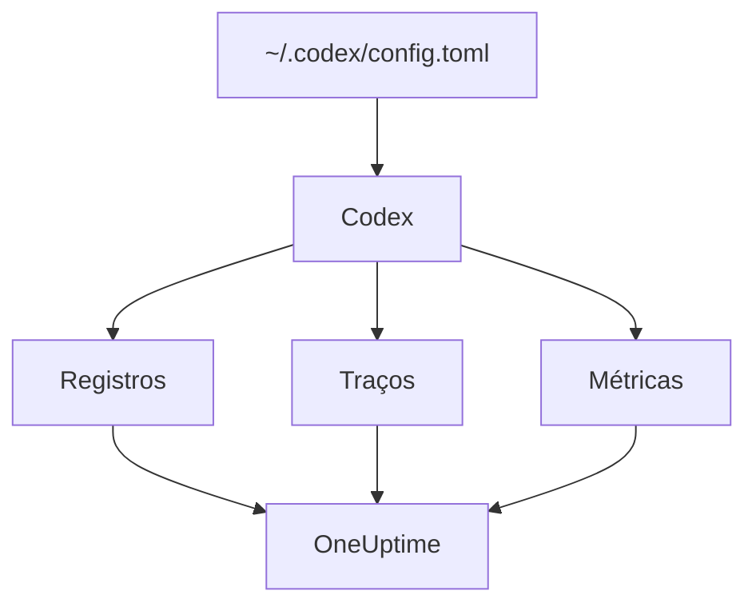

# OpenAI Codex

O Codex CLI tem três exportadores do OpenTelemetry embutidos, um para logs, um para traces e um para métricas. Aponte-os para o OneUptime em `~/.codex/config.toml` e cada turno do Codex chega com seus tokens e seu custo, sem wrapper nem proxy no meio.

:::cards
- [Configure o Codex](#configure-o-codex): Um bloco `[otel]`, com uma URL completa por sinal.
- [Atribua o uso a uma pessoa](#atribua-o-uso-do-codex-a-uma-pessoa): O Codex não cita ninguém em spans ou métricas, então você faz isso.
- [Tokens e custo](#tokens-e-custo): Qual sinal o OneUptime lê, e o que isso mostra.
- [Solução de problemas](#solução-de-problemas): O que verificar quando nada chega.
:::

## Como funciona

Cada exportador envia um sinal para a sua própria URL. Traces e logs ficam desativados até você configurá-los; as métricas, não.



> [!WARNING]
> O Codex envia suas métricas para a OpenAI, a menos que você mude isso. Em uma build de release, `metrics_exporter` é `statsig` por padrão, o que as envia para `https://ab.chatgpt.com/otlp/v1/metrics`. Definir `metrics_exporter` como um exportador OTLP, como abaixo, ou como `none` interrompe isso. `[analytics]` com `enabled = false` também interrompe o padrão Statsig, mas deixa funcionando um exportador de métricas OTLP que você configurou.

## Antes de começar

1. Crie uma chave de ingestão de telemetria em **Configurações do projeto → Telemetria e APM → Chaves de ingestão**.
2. Seu endpoint OTLP é `https://oneuptime.com/otlp`, ou `https://YOUR-ONEUPTIME-HOST/otlp` se você hospeda o OneUptime por conta própria.
3. Cada exportação envia a chave no cabeçalho `x-oneuptime-token`.

## Configure o Codex

:::steps
### Adicione o bloco otel

Coloque isto em `~/.codex/config.toml`. Isso ativa os três sinais, e de quebra substitui o padrão Statsig:

```toml title="~/.codex/config.toml"
[otel]
environment = "prod"
log_user_prompt = false

[otel.exporter.otlp-http]
endpoint = "https://oneuptime.com/otlp/v1/logs"
protocol = "binary"
headers = { "x-oneuptime-token" = "YOUR_INGESTION_TOKEN" }

[otel.trace_exporter.otlp-http]
endpoint = "https://oneuptime.com/otlp/v1/traces"
protocol = "binary"
headers = { "x-oneuptime-token" = "YOUR_INGESTION_TOKEN" }

[otel.metrics_exporter.otlp-http]
endpoint = "https://oneuptime.com/otlp/v1/metrics"
protocol = "binary"
headers = { "x-oneuptime-token" = "YOUR_INGESTION_TOKEN" }

[otel.span_attributes]
"user.id" = "dev@example.com"
"user.email" = "dev@example.com"
"team" = "platform"
```

### Dê a cada exportador sua URL completa

O Codex usa cada `endpoint` exatamente como está escrito: ele não adiciona `/v1/logs`, `/v1/traces` ou `/v1/metrics` como a maioria dos SDKs faz. Três exportadores apontados para o simples `https://oneuptime.com/otlp` não enviam nada para lugar nenhum, sem erro.

### Execute um turno

Inicie uma sessão interativa do `codex`, pergunte algo pequeno e deixe o turno terminar. Depois abra **Registros** no OneUptime: os eventos do Codex, como `codex.conversation_starts`, `codex.api_request` e `codex.turn_cost`, aparecem ali.
:::

> [!IMPORTANT]
> O Codex ignora as chaves que não conhece em `[otel]`, sem aviso. Suas chaves são em snake_case (`trace_exporter`, `metrics_exporter`, `span_attributes`), mas os nomes dos exportadores e os campos de TLS são em kebab-case (`otlp-http`, `ca-certificate`). Um `trace-exporter` desativa os traces sem erro nenhum.

## Chaves de configuração

| Chave | Padrão | O que faz |
| --- | --- | --- |
| `environment` | `"dev"` | Define o atributo de recurso `env` |
| `log_user_prompt` | `false` | Envia o texto do prompt em `codex.user_prompt`; caso contrário, ele diz `[REDACTED]` |
| `log_agent_responses` | `false` | Envia as respostas finais do agente ao exportador de logs |
| `exporter` | `none` | O exportador de logs |
| `trace_exporter` | `none` | O exportador de traces |
| `metrics_exporter` | `statsig` | O exportador de métricas: defina-o |
| `span_attributes` | — | Atributos adicionados a cada span exportado |
| `tracestate` | — | Membros `tracestate` do W3C |
| `tool_result` | `{ max_bytes = 2048 }` | Quanto do resultado de uma ferramenta um registro de log guarda, em bytes UTF-8 |

Um exportador é `none`, `statsig`, `otlp-http` ou `otlp-grpc`. `otlp-http` aceita `endpoint`, `headers`, `protocol` (`"binary"` ou `"json"`, ambos aceitos pelo OneUptime) e `tls` (`ca-certificate`, `client-certificate`, `client-private-key`); `otlp-grpc` aceita o mesmo sem `protocol`.

## Atribua o uso do Codex a uma pessoa

O Codex cita o desenvolvedor em um único lugar:

- **Os registros de log** carregam `user.account_id` e `user.email`.
- **Os spans** não: o Codex deixa os dois fora dos seus traces de propósito.
- **As métricas** também não: elas carregam `auth_mode`, `session_source`, `originator`, `service_name`, `model` e `app.version`, e nenhuma pessoa.

O OneUptime lê as pessoas dos spans e dos pontos de dados das métricas, nunca dos registros de log. Então coloque você mesmo a identidade em cada span, em `[otel.span_attributes]`:

```toml title="~/.codex/config.toml"
[otel.span_attributes]
"user.id" = "dev@example.com"
"user.email" = "dev@example.com"
"team" = "platform"
"cost_center" = "eng-123"
```

`user.id` é a chave que o OneUptime prefere, e `user.email` preenche a coluna de e-mail. O Codex não tem atributos de recurso, então defina aqui também as chaves de equipe (`team.id`, `team`, `cost_center`, `department`). Este bloco fica no arquivo de configuração de cada desenvolvedor: distribua-o por desenvolvedor, pelos seus dotfiles ou por um perfil de MDM. Um único arquivo compartilhado com uma só identidade atribuiria o gasto de todos a uma pessoa.

## Tokens e custo

| Sinal | O que o Codex envia | O que o OneUptime faz com isso |
| --- | --- | --- |
| Traces | `gen_ai.usage.input_tokens`, `gen_ai.usage.output_tokens` e os tokens de cache, mas nenhum modelo | Conta os tokens por pessoa; não consegue calcular o preço deles |
| Métricas | `codex.turn.token_usage` por `token_type`, e `codex.turn.cost_microusd`, em milionésimos de USD | Converte o custo para USD; lê as métricas só onde os spans não informam nada |
| Logs | `codex.turn_cost`, com `usage.estimated_usd` e a pessoa | Armazena no explorador de **Registros**; não liga ao gasto |

Com a configuração acima, na aba **Uso** o resultado é este:

- Os tokens vêm dos spans, por pessoa, e `codex.turn.token_usage` não é somado por cima: os dois nunca são somados ([por quê](/docs/telemetry/ai-llm-observability#primeiro-os-spans-as-métricas-completam)).
- Os spans do Codex não citam nenhum modelo, então o OneUptime não consegue calcular o preço deles, e o custo deles é 0. Os totais de custo então pegam o custo do Codex de `codex.turn.cost_microusd`, convertido para USD para você.
- As tabelas **Funcionário**, **Equipe** e **Modelo** mostram as linhas dos spans: tokens por pessoa, mas nenhum custo por pessoa.
- Sem traces, são as métricas que preenchem essas tabelas, só com o custo, tudo em **Sem atribuição**, já que as métricas do Codex não citam ninguém.

O custo por turno mais preciso, com a pessoa, é o registro de log `codex.turn_cost`. O OneUptime ainda não liga registros de log ao gasto, mas mantenha o exportador de logs ativado: o histórico estará lá quando isso acontecer.

## Codex em CI e como servidor MCP

`codex`, `codex exec` e `codex mcp-server` constroem a telemetria a partir do mesmo bloco `[otel]`, com os três exportadores. As execuções de `codex exec` carregam o `originator` `codex_exec`, e `codex mcp-server` exporta como `codex_mcp_server`, então você consegue separar as execuções de CI e de MCP das sessões interativas por esses valores.

## Privacidade

`log_user_prompt` e `log_agent_responses` são `false` por padrão: deixe-os assim. O evento `codex.user_prompt` continua chegando, com o prompt substituído por `[REDACTED]`, então você mantém o turno, seus tokens e seu custo sem o texto do prompt. A pessoa (`user.email`, `user.account_id`) está nos registros de log não importa o que essas chaves digam.

Se você ativar o conteúdo para uma investigação, as **Regras de mascaramento** e os **Filtros de descarte** dos traces, em **Traços → Configurações**, mascaram ou descartam o conteúdo antes que ele seja armazenado.

## Usar a API da OpenAI em vez do Codex

A API da plataforma da OpenAI não envia OpenTelemetry por conta própria: cada span vem da instrumentação do seu próprio cliente. Três instrumentações funcionam com o OneUptime:

- **OpenTelemetry**: `opentelemetry-instrumentation-genai-openai` para Python, que substitui `opentelemetry-instrumentation-openai-v2`. `OTEL_INSTRUMENTATION_GENAI_CAPTURE_MESSAGE_CONTENT` decide se as mensagens são registradas.
- **OpenLLMetry** (Traceloop): `opentelemetry-instrumentation-openai`.
- **OpenInference** (Arize): `openinference-instrumentation-openai`.

Aponte qualquer uma delas para o OneUptime como mostra [Observabilidade de IA / LLM](/docs/telemetry/ai-llm-observability). Nenhuma delas sabe quem é o seu funcionário: defina você mesmo `user.id`.

O **OpenAI Agents SDK** envia traces para o endpoint da própria OpenAI, não via OTLP. Faça a ponte com `opentelemetry-instrumentation-openai-agents-v2` ou `openinference-instrumentation-openai-agents`, que entregam os spans do SDK a um exportador OTLP.

## Solução de problemas

:::details Nada chega
Verifique primeiro os três valores de `endpoint`: cada um precisa terminar em `/v1/logs`, `/v1/traces` ou `/v1/metrics`. Depois verifique o cabeçalho `x-oneuptime-token`: o OneUptime recusa uma chave errada.
:::

:::details Os traces nunca chegam, mas os logs sim
Procure uma chave escrita errado em `[otel]`: o Codex a ignora em silêncio. `trace-exporter` em vez de `trace_exporter` é o erro mais comum.
:::

:::details O custo do Codex aparece nos totais, mas cada pessoa mostra US$ 0
Isso é esperado: os spans do Codex carregam tokens mas nenhum modelo, então não têm preço, e a métrica de custo não cita ninguém. Veja [Tokens e custo](#tokens-e-custo).
:::

:::details O gasto de todos aparece sob uma única pessoa
A mesma identidade de `[otel.span_attributes]` está em todas as máquinas. Dê a cada desenvolvedor a sua.
:::

## Próximos passos

:::cards
- [Assistentes de programação com IA](/docs/telemetry/ai-coding-assistants): Como o gasto é atribuído em todos os assistentes de programação.
- [Observabilidade de IA / LLM](/docs/telemetry/ai-llm-observability): Conversas, alertas, custo e orçamentos para as suas próprias chamadas de IA.
- [Gateways de IA](/docs/telemetry/ai-gateways): Um gateway que faz o trace e calcula o preço de cada chamada a modelos.
:::
