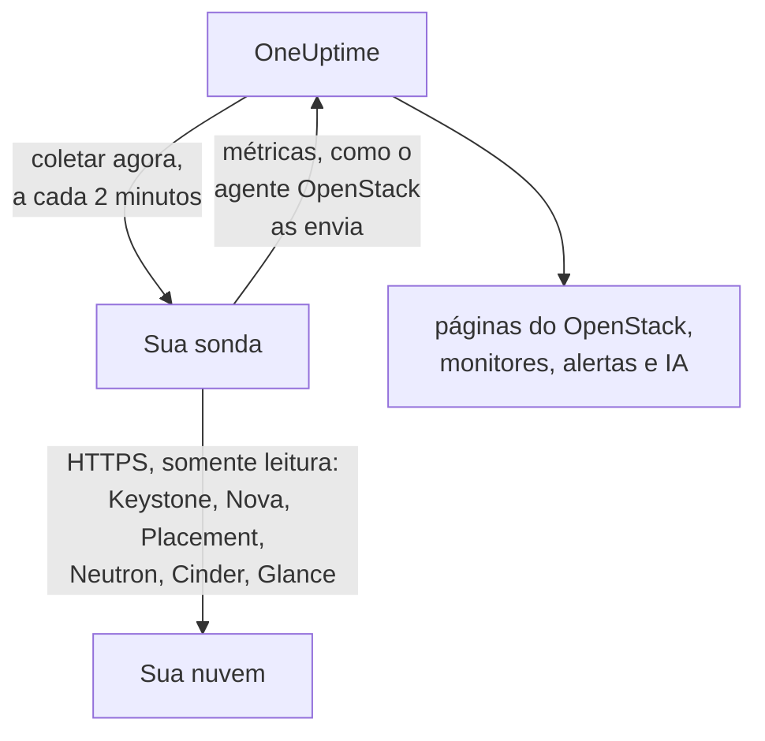

# OpenStack sem agente

Monitore uma nuvem OpenStack sem instalar nada: informe no OneUptime o endereço do Keystone e uma credencial de aplicação, escolha a sonda que alcança a nuvem, e a sonda coleta os mesmos dados que o [agente OpenStack](/docs/telemetry/openstack) coletaria. Não há agente para instalar, atualizar ou manter em execução, nem máquina própria para provisionar.

> [!IMPORTANT]
> Uma sonda só fala HTTPS com a nuvem. Uma credencial ou seu token nunca é enviado por HTTP puro, e o DevStack e o Kolla-Ansible servem suas APIs em HTTP puro por padrão. Para uma nuvem assim, ative o TLS nas APIs dela ou use o [agente OpenStack](/docs/telemetry/openstack), que roda ao lado dela. O teste de conexão avisa quando encontra um endereço em HTTP puro.

:::cards
- [Antes de começar](#antes-de-começar): Uma sonda que alcance as APIs e uma credencial.
- [Conectar uma nuvem](#conectar-uma-nuvem): O endereço, uma credencial, um teste e um nome.
- [Solução de problemas](#solução-de-problemas): O que cada mensagem significa e o que a corrige.
:::

## Como funciona



A cada dois minutos a sonda lê cada serviço de cada região escolhida e envia o que encontrou ao OneUptime. Os dados chegam exatamente como os do agente OpenStack, então todas as páginas do OpenStack, o [monitor OpenStack](/docs/monitor/openstack-monitor) e os modelos de alerta os leem da mesma forma.

Cada serviço é lido por conta própria e ao mesmo tempo que os outros. Um Neutron que falha ou trava custa as séries do Neutron, e os dados do Nova chegam normalmente, com uma ressalva que o próprio Nova cria: ele consulta o Neutron sobre cada instância que lista. Por isso, enquanto o Neutron está fora do ar, a sonda mantém as instâncias que leu por último e pergunta apenas o que mudou. Se uma instância mudou, ou a sonda acabou de iniciar, o Nova também não consegue responder a essa lista: o Nova aparece como falhando, suas outras séries continuam chegando, e cada instância permanece na página como estava até o Neutron voltar.

Heat, Magnum, Manila, Trove, Gnocchi, Designate, Swift e Barbican são lidos onde o catálogo do Keystone os cita. Uma nuvem que não executa nenhum deles não paga nada por eles, não ouve nada sobre eles no teste de conexão e [não mostra nenhum vestígio deles](/docs/telemetry/openstack#heat-e-magnum).

Em uma nuvem cujo catálogo tem o Octavia, a sonda lê seus balanceadores de carga, pools, listeners e amphorae com uma listagem cada, depois os membros de cada pool e os contadores de tráfego de cada balanceador de carga e listener que esteja `ACTIVE`, uma requisição cada. Uma nuvem com 3 balanceadores de carga, 1 pool e 1 listener custa 9 requisições por coleta; o DevStack real que a bancada de testes registrou custou exatamente isso. No máximo os membros de 25 pools e 50 contadores são lidos em uma coleta, começando pelos que estão há mais tempo sem leitura, e os demais mostram o que mostraram na última leitura. Os contadores do Octavia são cumulativos, então a sonda guarda a última leitura de cada um e desenha a diferença por segundo entre duas leituras: um gráfico começa na segunda coleta, e um contador que diminui (um listener recriado) não desenha nada naquele intervalo. O provedor OVN informa 0 em todos os contadores, o que é uma linha plana e não uma falha.

As amphorae exigem a regra de administrador do Octavia para toda leitura. Uma credencial abaixo de administrador vê os balanceadores de carga, pools, listeners e membros do seu próprio projeto, e seus próprios contadores, e nenhuma amphora: a página Balanceadores de carga informa isso, e nada alerta. O papel de monitoramento, em um projeto sem balanceadores de carga, não vê nenhum. O `load-balancer_global_observer` tem tudo recusado nesta versão.

Uma API do Octavia parada é `up 0` para a sonda, algo que o exportador do agente não consegue dizer.

## Sonda ou agente?

| | Uma sonda (esta página) | O agente OpenStack |
|---|---|---|
| O que você executa | Uma sonda que você já executa, ou uma nova | O agente, em uma máquina própria |
| Onde a credencial fica guardada | Criptografada no OneUptime, enviada apenas à sonda | No arquivo `clouds.yaml` do agente |
| O que precisa alcançar | O Keystone e a API de cada serviço, por HTTPS | O Keystone e a API de cada serviço |
| APIs em HTTP puro | Não são coletadas: um token nunca é enviado sem criptografia | Coletadas |
| Maior nuvem | Testada com [200.000 instâncias](/docs/telemetry/openstack-very-large-clouds) em uma nuvem simulada, não real, em até dez envios de 48 MiB | Ainda não testado em nenhum tamanho: [sua coleta esgota o tempo](/docs/telemetry/openstack-very-large-clouds#pelo-agente) bem antes disso |
| Registros de serviço e o agente de IA | Não incluídos | Incluídos |
| Sobre o que a nuvem se apoia: RabbitMQ, MariaDB, Memcached, HAProxy, OVN, libvirt | Não incluído: a sonda lê as APIs da nuvem | Incluído, com seus alvos nomeados |
| CPU, memória e disco reais de cada instância, do libvirt ou do Ceilometer | Não incluídos | Incluídos, com seus exportadores nomeados |
| Logins no Keystone | Um por vida do token, geralmente uma hora | Um por coleta |
| Um `reader` simples em um projeto | As instâncias, volumes e redes desse projeto | Os volumes e redes desse projeto, e nenhuma instância |

Ambos enviam as mesmas séries, então as páginas e os monitores funcionam com qualquer um. Uma sonda também envia o que só um cliente nativo consegue ler: os endereços de uma instância, o estado da tarefa e a mensagem de falha, a imagem a partir da qual ela iniciou, se um operador forçou um serviço do Nova a ficar inativo, quais redes um agente DHCP atende, qual pool guarda um volume, quando uma instância, volume ou imagem mudou pela última vez, e o status de cada snapshot e backup de volume. O Cinder só informa qual pool guarda um volume a uma credencial que ele trata como administrador. Em uma nuvem que executa [Heat ou Magnum](/docs/telemetry/openstack#heat-e-magnum), ela também envia por que uma stack ou um cluster falhou, quais instâncias e volumes uma stack possui, o projeto, o template e a versão do Kubernetes de cada cluster, e se cada engine do Heat e cada conductor do Magnum está ativo.

Escolha o agente para registros de serviço, para o agente de IA, para o que a nuvem usa como base e o uso real de cada instância, para uma nuvem cujas APIs só falam HTTP puro, como o DevStack e o Kolla-Ansible fazem por padrão, ou para uma nuvem tão grande que precisa ser [lida a partir de seus bancos de dados](/docs/telemetry/openstack-very-large-clouds#o-caminho-pelo-banco-de-dados). Escolha uma sonda para todo o resto: não há nada para instalar, e ela lê mais do que o Nova e o Cinder informam. [Nuvens OpenStack muito grandes](/docs/telemetry/openstack-very-large-clouds) diz quanto cada opção custa em qualquer tamanho.

Você pode alternar uma nuvem de um para o outro a qualquer momento na página **Configurações** dela.

## Antes de começar

- **Uma sonda que alcance o Keystone e a API de cada serviço por HTTPS.** Normalmente é uma [sonda personalizada](/docs/probe/custom-probe) na rede da nuvem. O catálogo do Keystone informa onde cada serviço responde, e a sonda se conecta a esses endereços, então cada um precisa ser alcançável pela sonda e cada um precisa ser HTTPS. No OneUptime Cloud, as sondas compartilhadas nunca recebem uma credencial do OpenStack, então adicione uma sonda sua. Em uma instância self-hosted, as sondas da própria instância também podem coletar.
- **Uma credencial.** Uma credencial de aplicação é a melhor opção, porque pode ser limitada à leitura e pode expirar. Um nome de usuário e uma senha também funcionam, e podem fazer tudo o que a conta deles pode.

O OpenStack não tem um papel global somente leitura, então o quanto a sonda enxerga depende da credencial:

| Nível | O que precisa | O que a sonda lê |
|---|---|---|
| Visão completa | Uma credencial de aplicação em uma conta com `admin` em um projeto próprio, limitada por regras de acesso à leitura | Tudo, exceto os usuários e grupos do Keystone, que as regras deixam de fora de propósito |
| Somente infraestrutura | Os papéis `oneuptime_monitoring` e `reader` em um projeto próprio que não contém nada e tem cota zero, e os arquivos de política que o agente OpenStack fornece | Hipervisores, serviços do Nova, agentes do Neutron, pools de endereços, Placement, a lista de projetos e as instâncias de cada projeto. Volumes, redes e roteadores apenas onde o papel está atribuído. Não o estado de `cinder-volume` e `cinder-scheduler` nem os pools de armazenamento: o próprio código do Cinder exige um administrador |
| Visão do projeto | Um `reader` simples em um projeto | As instâncias, volumes e redes desse projeto, e nenhuma infraestrutura |

O teste de conexão informa a qual desses níveis uma credencial corresponde e avisa quando o próprio projeto dela contém recursos: onde o Cinder tem `enforce_new_defaults` desativado, que é o padrão dele, qualquer papel em um projeto pode criar os volumes desse projeto, inclusive `reader`.

> [!IMPORTANT]
> Uma credencial de aplicação limitada por regras de acesso é recusada com um `401` por qualquer serviço cujo `keystonemiddleware` não tenha `service_type` definido. O teste de conexão informa isso para cada leitura. Defina-o na configuração de cada serviço e reinicie-o. [Criar a credencial](/docs/telemetry/openstack#crie-a-credencial) traz as regras, os arquivos de política e as configurações de cada serviço, e [o que cada nível lê](/docs/telemetry/openstack#o-que-cada-nível-lê) é o que nuvens reais responderam.

## Conectar uma nuvem

:::steps
### Abra suas nuvens
No OneUptime, abra **OpenStack → Todas as nuvens** e clique em **Conectar nuvem**.

### Informe o endereço e a credencial
Informe o `auth_url` do seu arquivo `clouds.yaml` ou `openrc`, como `https://keystone.example.com:5000/v3`, e o ID e o segredo da credencial de aplicação. Escolha a sonda que alcança a nuvem.

### Teste a conexão
Clique em **Testar conexão**. A sonda faz login, tenta cada leitura que uma coleta faz em cada região e faz logout. Ela informa quais regiões o catálogo cita, o que a credencial pode ler, o que é recusado, quais páginas ficam sem dados por isso e a linha que libera o acesso. Uma leitura que falha não interrompe o teste.

### Confie no certificado da nuvem
Uma nuvem com sua própria autoridade certificadora apresenta um certificado em que a sonda não confia. O teste então mostra o certificado e o host que o apresentou. Compare a impressão digital dele com a da própria API e clique em **Confiar neste certificado**. Uma nuvem com um host por serviço pode ter um certificado por serviço, e você pode confiar em até 32.

### Escolha as regiões e conecte
Escolha as regiões a ler, dê um nome à nuvem e clique em **Conectar nuvem**. A página da nuvem é aberta.
:::

A **Visão geral** da nuvem mostra um cartão **Coleta de dados**. Ele mostra **Verificando** até a primeira coleta, que começa em até um minuto, depois **Coletando**, e as páginas são preenchidas. Quando alguns serviços foram lidos e outro não, ele informa qual. Se nenhuma sonda vier buscar a nuvem por 15 minutos, porque está offline ou é antiga demais, ele mostra **Sem coleta** e informa isso, qualquer que seja o resultado da última coleta.

O cartão **Coleta de dados** na página **Configurações** da nuvem guarda aquilo com que você a conectou:


## Conectar uma nuvem pela API ou pelo Terraform

As configurações de conexão de uma nuvem são campos comuns do [recurso OpenStack Cloud](/reference/open-stack-cloud) na API, em `/api/openstack-cloud`, então uma nuvem pode ser conectada sem nenhum painel. Com o Terraform, isso é `oneuptime_openstack_cloud`:

```hcl
resource "oneuptime_openstack_cloud" "prod_eu" {
  name                      = "prod-eu"
  collection_method         = "Probe"
  auth_url                  = "https://keystone.example.com:5000/v3"
  credential_kind           = "applicationCredential"
  application_credential_id = var.openstack_application_credential_id
  credential_secret         = var.openstack_application_credential_secret
  collection_probe_id       = oneuptime_probe.eu_west.id
  collection_regions        = jsonencode(["RegionOne"])

  # A cloud with its own certificate authority: the fingerprints it presents.
  trusted_certificate_fingerprints = jsonencode(["AB:CD:EF:..."])
}
```

Para um nome de usuário e senha, defina `credential_kind` como `password`, com `keystone_username`, `project_name` e, quando não forem `Default`, `user_domain_name` e `project_domain_name`. `endpoint_interface`, `collection_interval_in_minutes` e `collection_options` são o que o formulário agrupa em **Mais campos**. Apenas `name` é obrigatório, porque uma nuvem que o agente envia não tem nenhum desses campos.

`credential_secret` é somente de escrita, então nenhuma leitura o retorna e o Terraform o mantém fora dos planos e das saídas. [As regras para uma credencial salva](#a-credencial-salva) valem aqui também: alterar o endereço, a sonda ou os certificados confiáveis exige o segredo na mesma requisição. O que a sonda informa, como `collection_status`, `collection_error` e `presented_certificate`, pode ser lido e não pode ser definido.

## O que isso custa à sua nuvem

O monitoramento nunca deve ser o que derruba uma nuvem, então uma coleta é gentil por construção:

- **Um login, mantido.** O token é usado até cinco minutos antes de expirar. Um login é o que um Keystone com problemas menos pode suportar.
- **Listas em páginas.** Toda lista é lida mil linhas por vez, com `limit` e `marker`.
- **Instâncias pelo que mudou.** Entre leituras completas, a cada meia hora, a sonda pergunta ao Nova apenas o que mudou desde a última leitura, com `changes-since`.
- **Os inventários de um hipervisor, uma vez.** O Placement avança a generation de um provider sempre que eles mudam, o que uma única chamada de listagem informa para todos, então eles só são lidos de novo nesse caso.
- **Uma carga declarada.** O que é uma chamada por item é feito em rodízio acima de 2.000 por coleta, e acima de 250 projetos para os limites. O que não foi lido desta vez é enviado como na última leitura, então nenhuma série tem lacuna, e a carga deixa de crescer com a nuvem.
- **Somente os campos que ela lê.** As listas do Neutron nomeiam seus campos, e os grupos de segurança são consultados apenas pelos IDs.
- **Nunca empilhadas.** Uma coleta que leva mais que seu intervalo é ignorada, não executada ao lado da próxima.
- **Um orçamento de tempo.** Uma coleta tem nove décimos do seu intervalo, e no máximo dez minutos. O que foi lido até lá é enviado, e o serviço que ficou sem tempo informa isso.
- **Recuando.** Quando pedem para esperar com um `429` ou `Retry-After`, a sonda espera. Um serviço que responde `429`, `503` ou não responde nada é deixado em paz por um minuto, depois dois, depois quatro, até meia hora, e suas séries continuam dizendo que ele está fora do ar enquanto isso.
- **Desacelerando.** Uma resposta três vezes mais lenta do que o serviço costuma responder, e de pelo menos um segundo, ou de cinco segundos seja qual for o usual, atrasa a próxima requisição a esse serviço pelo mesmo tempo. O cartão **Coleta de dados** informa quando isso aconteceu.
- **Uma credencial recusada espera mais.** Repeti-la é o que bloqueia uma conta, então ela espera cinco minutos, depois dez, até uma hora. Uma credencial que você corrigiu é tentada de imediato.

- **Menos de uma nuvem grande.** Acima de 5.000 instâncias, uma nuvem mantém contagens e suas partes, e nenhuma série por instância ou por volume, a menos que você escolha o contrário em **Uso real por instância** na página **Configurações** dela. O que mudou, o que você escolheu manter e o que um alerta está observando continua indo em toda coleta. O restante vai em rodízio, e o cartão **Coleta de dados** informa quanto tempo leva uma volta.

A cada coleta, com os padrões, uma região custa 7 chamadas ao Nova, 7 ao Neutron e 5 ao Cinder, uma chamada ao Placement e mais duas por hipervisor, até 4 a mais para perguntar ao Placement [quantos de cada flavor cabem](/docs/telemetry/openstack#capacidade) e, a cada cerca de cinco minutos, 5 ao Keystone e 1 ao Glance. O inventário de um hipervisor é lido uma vez, e de novo apenas quando o Placement diz que mudou. Uma lista com mais de mil linhas leva uma chamada por mil. Cada instância que mudou leva mais uma chamada ao Nova, para ler o que ela passou, e no máximo 25 são lidas em uma coleta: uma nuvem tranquila não faz nenhuma. No ML2/OVS, o Neutron leva mais uma chamada por roteador, para perguntar quais agentes L3 o guardam, e a cada dez minutos uma chamada por agente DHCP, no máximo 20, para perguntar quais redes ele atende. Uma nuvem com mais agentes DHCP passa por eles em rodízio, uma nuvem acima do tamanho do resumo deixa isso de fora, e um Neutron lento não é consultado de forma alguma. Uma nuvem em OVN não tem nenhum a consultar. [Nuvens OpenStack muito grandes](/docs/telemetry/openstack-very-large-clouds#a-carga-sobre-o-seu-plano-de-controle) mostra a quantas requisições por minuto isso chega, em cada tamanho.

Uma nuvem que executa o Manila paga, a cada cerca de cinco minutos, 2 chamadas a ele, uma que executa o Trove paga 1, o Gnocchi 1 e o Barbican 3. O Designate leva 2, e mais uma para cada zona que não esteja `ACTIVE`, no máximo 50 por coleta. O Swift leva 1 para o projeto da própria credencial e, com `ResellerAdmin`, mais uma para cada outro projeto, no máximo 200 por coleta. Uma nuvem que executa o Heat ou o Magnum paga, a cada cerca de cinco minutos, 2 chamadas ao Heat e 3 ao Magnum. Nenhuma das listas diz tudo: a do Magnum não diz de quem é um cluster nem por que ele falhou, e a do Heat não diz o que uma stack possui. Por isso a sonda também lê um cluster ou uma stack por conta própria quando o status deles mudou, no máximo 25 de cada por coleta. Uma nuvem com mais continua preenchendo nas coletas seguintes, e uma que fica parada nunca é lida duas vezes.

Três coisas ficam desativadas a menos que você as ative, em **O que ela lê além do padrão** no cartão **Coleta de dados** na página **Configurações** da nuvem, ou em **Mais campos** ao conectá-la, porque cada uma custa mais à sua nuvem:

| Opção | O que você obtém | O que custa |
|---|---|---|
| Portas | Uma série por porta, e quantas não têm endereço ou um balanceador de carga que está fora do ar | Uma lista paginada por rede ou projeto que você nomear, ou de todas as portas se você não nomear nenhum. Uma lista de portas sem escopo pode saturar o Neutron em uma nuvem grande |
| Limites de projeto | Cotas e limites por projeto | Quatro chamadas por projeto, no máximo 250 projetos por coleta |
| Servidores de armazenamento do Swift | Se cada um responde, sua replicação e se todos têm os mesmos rings, onde você informa a porta `/recon` de cada servidor como `host:port`. Apenas uma nuvem que executa o Swift oferece isso, na página **Configurações** dela depois que a primeira coleta tiver lido o Swift | 5 chamadas por servidor em cada coleta. Nenhuma credencial vai para eles |

## Certificados

A sonda nunca ignora a verificação de certificado. Toda conexão completa um handshake TLS inteiro e, em seguida:

- sem nenhum certificado confiável, o certificado de uma API deve vir de uma autoridade em que a máquina da sonda confia, para o endereço em que ela responde;
- com certificados confiáveis, uma API deve apresentar um exatamente desses, identificados por suas impressões digitais SHA-256. Nada mais é aceito, nem mesmo um publicamente confiável.

Para verificar uma impressão digital, execute isto na máquina da sonda:

```bash
openssl s_client -connect keystone.example.com:5000 </dev/null | openssl x509 -noout -fingerprint -sha256
```

Quando um certificado é renovado, a coleta é interrompida com **O certificado da API mudou** e o novo certificado é exibido. Nada é enviado até que você confie nele, na **Visão geral** ou na página **Configurações** da nuvem.

## A credencial salva

O segredo é criptografado e somente de escrita: ninguém consegue lê-lo de volta, e a API nunca o retorna. Ele é enviado apenas à sonda que coleta a nuvem, que o mantém na memória.

Uma credencial salva só é enviada ao endereço, pela sonda e para os certificados para os quais foi informada. Alterar o endereço, a sonda ou os certificados confiáveis pede o segredo novamente, de modo que ninguém que possa editar a nuvem consiga enviá-lo para outro lugar. Confiar no certificado que a sonda encontrou no endereço salvo o mantém, e confiar em menos certificados também.

O catálogo está sujeito às mesmas regras do endereço que você digitou, porque um token vai para onde ele disser. A sonda não se conecta a um endereço de loopback, link-local ou de metadados de nuvem, seja porque o catálogo o cita ou porque um nome de host resolve para ele, e ela se conecta aos endereços que verificou, não ao que o DNS disser um instante depois. Ela não segue redirecionamentos.

## Alternar entre o agente e uma sonda

Abra a página **Configurações** da nuvem. O cartão **Coleta de dados** dela oferece **Coletar com uma sonda** para uma nuvem que o agente envia, e **Usar o agente OpenStack** para uma que uma sonda coleta. Alternar para o agente esquece a credencial salva.

> [!WARNING]
> Pare o agente OpenStack assim que a primeira coleta da sonda for bem-sucedida. Enquanto os dois estiverem em execução, cada métrica chega duas vezes.

Acima de [5.000 instâncias](/docs/telemetry/openstack-very-large-clouds#modo-resumo), a primeira coleta de uma sonda conhece a nuvem inteira e envia uma parte dela, então as listas de uma nuvem nova são preenchidas durante o primeiro ciclo, e o cartão **Coleta de dados** informa quando todas estarão lá.

## Bare metal

Em uma nuvem cujo catálogo tem o Ironic, a sonda lê seus nós e pede cada campo pelo nome, então o `driver_info` de um nó nunca é lido em uma coleta. Ela acrescenta o que o exportador do agente não tem: o driver de um nó, seu conductor, sua falha e o motivo dela. O Ironic pode esvaziar `last_error` em cerca de um minuto, então uma página guarda o último que uma coleta viu e informa quando.

Uma sonda lê o catálogo primeiro, então pode dizer que a API do Ironic está fora do ar, o que o exportador do agente não consegue. Uma nuvem sem Ironic não é consultada sobre ele.

O Ironic mostra a um projeto apenas os nós que ele possui e recusa a ele a lista de conductors. Pela política padrão do Ironic, apenas uma credencial com escopo de sistema lê esses dados, e a credencial de uma sonda não pode ter escopo de sistema, porque ela lê as listas do Nova pela mesma credencial. Portanto, a menos que a política da nuvem dê ao seu papel `baremetal:node:list_all` e `baremetal:conductor:get`, uma sonda vê os nós que seu projeto possui e nenhum conductor, e as páginas informam isso. [Bare metal](/docs/telemetry/openstack#bare-metal) traz o restante.

## Referência

| Configuração | Padrão | Observações |
|---|---|---|
| Coletar a cada | 2 minutos | De 1 a 60 minutos. Colete uma nuvem grande com menos frequência para pesar menos sobre ela. O Keystone e o Glance são lidos a cada cerca de cinco minutos, não importa com que frequência o restante seja lido. |
| Interface do endpoint | public | Qual das URLs do catálogo usar: public, internal ou admin. |
| Coletas simultâneas | 4 por sonda | Uma coleta mais lenta que seu intervalo é ignorada, nunca empilhada. |
| Maior envio | 48 MiB | Uma coleta vai em quantos envios forem necessários, até dez. Acima de [5.000 instâncias](/docs/telemetry/openstack-very-large-clouds#modo-resumo), o que não mudou vai em rodízio. |
| Requisições a cada serviço | Uma de cada vez | As chamadas por provider do Placement vão quatro de cada vez. |
| Espera por uma resposta | 60 segundos | Tentada três vezes no total quando é um `429` ou um erro de servidor. |
| Teste de conexão | 90 segundos para iniciar | Um teste que nenhuma sonda pegue a tempo, ou que dure mais de 3 minutos, recebe a resposta de falha. Cinco podem esperar ou executar ao mesmo tempo em um projeto. |

## Solução de problemas

:::details O certificado da API não é confiável
A nuvem apresenta um certificado da sua própria autoridade. Compare a impressão digital exibida com o certificado da API e clique em **Confiar neste certificado**.
:::

:::details O certificado da API mudou
O certificado foi renovado, ou alguém está no meio do caminho. Nada é enviado até que você confie no novo. Verifique a impressão digital dele e depois confie.
:::

:::details A URL de autenticação não é válida
Informe o endereço do Keystone por HTTPS, como `https://keystone.example.com:5000/v3`. Um endereço em HTTP puro é recusado antes de qualquer envio. Para uma nuvem cujas APIs só falam HTTP puro, ative o TLS ou use o [agente OpenStack](/docs/telemetry/openstack).
:::

:::details O catálogo cita um endpoint em HTTP puro
O token de uma credencial nunca é enviado sem criptografia. Ative o TLS nessa API, escolha outra interface de endpoint ou use o [agente OpenStack](/docs/telemetry/openstack) para esta nuvem. O teste de conexão falha até que cada API que ele lê esteja em HTTPS. Em uma coleta, apenas o serviço com esse endpoint fica sem dados: os outros são lidos normalmente.
:::

:::details O Keystone recusou a credencial
O ID, o segredo ou a senha está errado, ela expirou ou foi excluída, ou sua conta perdeu o papel no projeto. Crie uma nova e informe-a com **Editar conexão** na página **Configurações** da nuvem.
:::

:::details A conta não tem papel nesse projeto
Um nome de usuário e senha fizeram login, mas não nesse projeto. Verifique o nome do projeto e os dois domínios. Uma credencial de aplicação evita isso: ela recebe o escopo quando é criada.
:::

:::details A credencial não pode ler o que o monitoramento precisa
O teste lista cada leitura que foi recusada, o que fica sem dados por isso e a linha que libera o acesso. Um `401` em uma credencial com regras de acesso significa que elas não listam esse caminho, ou que o `keystonemiddleware` desse serviço não tem `service_type` definido e não foi reiniciado.
:::

:::details A sonda não recebe resposta da nuvem
A rede da sonda não alcança essa API. Libere-a no firewall ou escolha uma sonda na rede da nuvem. O endereço de cada serviço é próprio dele: a mensagem nomeia o que não respondeu.
:::

:::details Nada responde nessa porta
Verifique o endereço e a porta. O Keystone costuma servir na 5000, ou na 443 atrás de um caminho como `/identity`.
:::

:::details A conexão segura falhou
O endereço provavelmente aponta para uma porta que não fala HTTPS. Verifique-o. Se as APIs da nuvem só falam HTTP puro, ative o TLS ou use o agente OpenStack.
:::

:::details O OneUptime não se conecta a este endereço
O endereço, ou algo que o catálogo cita, é ou resolve para um endereço de loopback, link-local ou de metadados de nuvem. Use o endereço em que a API responde na sua rede.
:::

:::details Este endereço não é o Keystone
Informe o endpoint de Identity do seu arquivo `clouds.yaml` ou `openrc`: o `auth_url` dele.
:::

:::details Uma região não está no catálogo
Escolha entre as regiões que o catálogo cita. O teste de conexão as lista.
:::

:::details O Keystone está falhando
O Keystone respondeu com um erro de servidor. A sonda espera mais entre os logins até ele se recuperar, e nada mais pode ser lido sem um login. Verifique o serviço do Keystone e o banco de dados por trás dele.
:::

:::details Um serviço está parado ou ocupado demais para responder
Ele continuou respondendo `429` ou um erro de servidor, então a sonda espera mais entre as coletas até ele se recuperar. Verifique se está em execução e depois sua carga. Coletar com menos frequência ajuda um serviço ocupado.
:::

:::details A coleta demorou demais
A nuvem respondeu devagar demais para este intervalo. Colete com menos frequência ou verifique a carga dela.
:::

:::details A sonda não pegou esta tarefa
A sonda está offline ou executa uma versão do OneUptime anterior à coleta do OpenStack. Verifique se ela está conectada na página **Sondas** e atualize-a. O cartão de uma nuvem também informa isso quando uma coleta está 15 minutos atrasada, qualquer que tenha sido o resultado da última, e volta ao normal sozinho quando a sonda volta.
:::

:::details Esta nuvem é grande demais para ser coletada por uma sonda
Suas métricas são mais do que uma coleta pode enviar, e esta nuvem está configurada para manter as séries de todas as instâncias. Deixe-a manter contagens, em **Uso real por instância** na página **Configurações** dela, ou use o [agente OpenStack](/docs/telemetry/openstack). O [modo resumo](/docs/telemetry/openstack-very-large-clouds#modo-resumo) diz o que isso deixa de oferecer.
:::

## Próximos passos

:::cards
- [Monitor OpenStack](/docs/monitor/openstack-monitor): Alerte sobre serviços, hipervisores, instâncias, redes e volumes.
- [Sonda personalizada](/docs/probe/custom-probe): Execute uma sonda na rede da nuvem.
- [Agente OpenStack](/docs/telemetry/openstack): Colete uma nuvem com o agente.
:::
