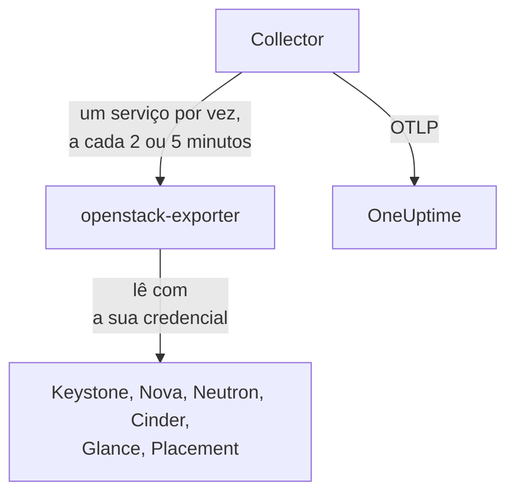

# Agente OpenStack

O agente OpenStack do OneUptime monitora uma nuvem OpenStack: seus serviços e agentes, hipervisores, instâncias, redes, roteadores, volumes, pools de armazenamento, imagens e projetos, em todas as regiões. Ele lê as APIs da nuvem com uma credencial que você escolhe e envia o que encontra ao OneUptime, onde a nuvem aparece com suas regiões, hipervisores e projetos. Os [monitores OpenStack](/docs/monitor/openstack-monitor) geram alertas sobre o que chega, e uma [probe](/docs/telemetry/openstack-agentless) pode coletar uma nuvem sem nada para instalar.

:::cards
- [Probe ou agente?](/docs/telemetry/openstack-agentless#sonda-ou-agente): Qual escolher, para uma nuvem que poderia usar qualquer um dos dois.
- [Escolha quanto ele enxerga](#escolha-quanto-o-agente-enxerga): O OpenStack não tem uma função global somente leitura, então há três níveis.
- [Instale o agente](#instale-o-agente): Uma credencial e depois o script de instalação, o Docker Compose ou nenhum Docker.
- [Quanto custa para a sua nuvem](#quanto-custa-para-a-sua-nuvem): O que cada configuração lê e como alterá-la.
- [Capacidade](#capacidade): Quantas unidades a mais de cada flavor cabem e em quantos dias cada recurso estará cheio.
- [Gastos](#gastos): Quem está usando o quê, quanto isso representa nos seus preços ou conforme o CloudKitty tarifou, e o que poderia ser recuperado.
- [Páginas de status e avisos aos projetos](#páginas-de-status-e-avisos-aos-projetos): Uma página por região em uma única etapa, e avisar apenas os projetos que uma falha atinge.
- [Logs de serviço](#logs-de-serviço): Interpretados, com uma requisição acompanhada entre os serviços.
- [Eventos de ciclo de vida](#eventos-de-ciclo-de-vida): Ações em instâncias no feed e nos gráficos, a partir de notificações ou de uma probe.
- [Quem fez o quê](#quem-fez-o-quê): Trilhas de auditoria em Eventos de segurança.
- [Rastrear uma requisição](#rastreie-requisições-pelo-plano-de-controle): Uma requisição assinada, acompanhada pelo plano de controle.
- [Verifique de fora](#verifique-a-nuvem-de-fora): Se alguém consegue de fato iniciar uma instância, a partir de uma probe fora da nuvem.
- [Sem internet](#sem-internet): As quatro imagens do agente e como copiá-las para um registry seu.
- [Por ferramenta de implantação](/docs/telemetry/openstack-deployment-tools): Kolla-Ansible, OpenStack-Ansible, OpenStack-Helm, Atmosphere, Sunbeam, Red Hat e Mirantis.
- [Solução de problemas](#solução-de-problemas): Um script de diagnóstico e os problemas mais comuns.
:::

## Como funciona

O agente é formado por dois programas upstream fixados em versões específicas e pela configuração deles, em uma única máquina: o [openstack-exporter](https://github.com/openstack-exporter/openstack-exporter) lê as APIs da nuvem e as transforma em séries `openstack_*`, e um OpenTelemetry Collector pede a ele um serviço OpenStack por vez, marca cada série com a nuvem e a região de onde veio e as envia ao OneUptime. Nada roda nos seus controllers ou nós de computação, a menos que você adicione o [perfil de logs](#logs-de-serviço) opcional, que lê os logs deles.



A nuvem se registra com os primeiros dados, com o nome que o agente grava em cada métrica como `openstack.cloud.name`. Um agente monitora uma nuvem: um Keystone, com uma região ou várias.

## Antes de começar

- Docker Engine 20.10 ou posterior com o plugin Docker Compose v2 ou, para rodar sem Docker, uma máquina Linux (x86_64 ou arm64) com systemd 235 ou posterior, glibc 2.34 ou posterior (RHEL 9, Ubuntu 22.04, Debian 12) e acesso root.
- Uma rota dessa máquina até o Keystone e até o endpoint público de cada serviço.
- A linha de comando `openstack`, usada por alguém que possa criar a credencial abaixo.
- Uma chave de ingestão. Crie uma em **Configurações do projeto → Telemetria e APM → Chaves de ingestão** e copie o valor dela.
- HTTPS de saída dessa máquina para a URL do seu OneUptime.

### Onde executar o agente

Execute o agente fora da nuvem que ele monitora: uma VM pequena em hardware separado, um host de gerenciamento, outra nuvem. Um agente dentro de uma nuvem que falhou fica mudo junto com ela, e o silêncio parece uma nuvem saudável que parou de reportar.

## Escolha quanto o agente enxerga

O OpenStack não tem uma função global somente leitura, e essa é a parte mais difícil de monitorá-lo:

- `reader` tem escopo de projeto em todo lugar, exceto no Keystone e no Ironic.
- Hipervisores, serviços, agentes, pools e o Placement exigem admin por padrão.
- Uma substituição de política não consegue abrir listas de todos os projetos no Neutron ou no Cinder, que as restringem pelo contexto de admin no próprio código.
- Os serviços e os pools de armazenamento do Cinder respondem `403` a qualquer um que não seja admin, a partir do código do próprio Cinder, depois que a política já foi aprovada. Nenhuma substituição abre esses também.
- O Neutron e o Cinder respondem a um reader simples com `200` e apenas o projeto desse reader. Parece que funcionou, mas não funcionou.
- Onde o Cinder tem `enforce_new_defaults` desativado, que é o padrão do próprio Cinder, qualquer função em um projeto pode criar os volumes desse projeto, inclusive `reader` e `oneuptime_monitoring`. No Epoxy, no Flamingo e no Gazpacho, um reader simples e a função em um projeto real criaram um volume (`202`). No Hibiscus ambos foram recusados (`403`), porque o DevStack só ativa `enforce_new_defaults` ali. Uma função somente leitura em um projeto real não é somente leitura.

Portanto há três níveis, e cada um tem um custo. Comece pelo primeiro, se puder.

| Nível | O que exige | O que enxerga | O que fica de fora |
| --- | --- | --- | --- |
| **1. Visão completa** | Uma credencial de aplicação em uma conta com `admin` em um projeto próprio, limitada por regras de acesso à leitura, com `service_type` definido em cada serviço | Todas as leituras que o agente faz, além do estado de `cinder-volume` e `cinder-scheduler` e dos pools de armazenamento, que só este nível enxerga | Os usuários e grupos do Keystone, de propósito. Ele não consegue escrever: toda escrita respondeu `401` |
| **2. Somente infraestrutura** | As funções `oneuptime_monitoring` e `reader` em um projeto próprio que não contém nada e tem cota zero, e as substituições de política que o agente fornece | Todos os projetos, domínios, serviços e endpoints do Keystone, todo o Nova, incluindo os servidores de todos os projetos, todo o Placement, e os agentes e as disponibilidades de IP do Neutron | As redes, sub-redes, roteadores, IPs flutuantes e portas do Neutron, e os volumes e snapshots do Cinder, são apenas os do próprio projeto, então em um projeto vazio só os compartilhados e externos. Sem o estado de `cinder-volume` ou `cinder-scheduler` nem pools de armazenamento. Ele não consegue escrever: toda escrita respondeu `403`, ou `409` e `413` por causa da cota |
| **3. Visão do projeto** | Um `reader` simples em um projeto real, para uma equipe que monitora a própria parte de uma nuvem operada por outra pessoa | Os volumes, redes e roteadores desse projeto, a partir do Cinder e do Neutron | Toda a infraestrutura: sem hipervisores, serviços, agentes, pools ou capacidade. Pelo agente, também sem instâncias, porque a leitura de todos os projetos feita pelo exporter é recusada. E em muitas nuvens o `reader` pode escrever ali |

Os templates **Block Storage Service Down**, **Storage Pool Warning** e **Storage Pool Critical** exigem o nível 1. **Compute Service Down**, **Network Agent Down** e os templates do Placement e dos hipervisores exigem o nível 1 ou 2, e nada no nível 3 lê uma instância.

### O que cada nível lê

Isto é o que cinco nuvens reais responderam, no Epoxy, no Flamingo, no Gazpacho (OVN e OVS) e no Hibiscus. Cada célula foi escrita a partir dessas gravações.

| Leitura | Nível 1: Visão completa | Nível 2: Somente infraestrutura | Nível 3: Visão do projeto |
| --- | --- | --- | --- |
| Keystone: projetos | tudo | tudo | recusado |
| Keystone: domínios | tudo | tudo | recusado |
| Keystone: regiões | tudo | o que qualquer um vê | o que qualquer um vê |
| Keystone: serviços | tudo | tudo | recusado |
| Keystone: endpoints | tudo | tudo | recusado |
| Nova: servidores, todos os projetos | tudo | tudo | recusado |
| Nova: serviços | tudo | tudo | recusado |
| Nova: hipervisores | tudo | tudo | recusado |
| Nova: agregados | tudo | tudo | recusado |
| Nova: zonas de disponibilidade, detalhe | tudo | tudo | recusado |
| Nova: flavors | tudo | o que qualquer um vê | o que qualquer um vê |
| Nova: uso por projeto | tudo | tudo | recusado |
| Placement: resource providers | tudo | tudo | recusado |
| Neutron: agentes | tudo | tudo | nada |
| Neutron: redes | tudo | somente o próprio projeto | somente o próprio projeto |
| Neutron: sub-redes | tudo | somente o próprio projeto | somente o próprio projeto |
| Neutron: roteadores | tudo | somente o próprio projeto | somente o próprio projeto |
| Neutron: IPs flutuantes | tudo | somente o próprio projeto | somente o próprio projeto |
| Neutron: disponibilidades de IP | tudo | tudo | nada |
| Neutron: grupos de segurança | tudo | 409, esperado | somente o próprio projeto |
| Neutron: portas | tudo | somente o próprio projeto | somente o próprio projeto |
| Neutron: cotas | tudo | recusado | recusado |
| Cinder: volumes, todos os projetos | tudo | somente o próprio projeto | somente o próprio projeto |
| Cinder: serviços | tudo | recusado | recusado |
| Cinder: pools | tudo | recusado | recusado |
| Cinder: snapshots, todos os projetos | tudo | somente o próprio projeto | somente o próprio projeto |
| Cinder: backups, todos os projetos | tudo | nenhum registrado | nenhum registrado |
| Cinder: tipos de volume | tudo | o que qualquer um vê | o que qualquer um vê |
| Glance: imagens | tudo | o que qualquer um vê | o que qualquer um vê |

- **todas as**: as mesmas linhas que um admin viu.
- **somente o próprio projeto**: as linhas desse projeto e tudo o que é compartilhado ou externo. Em um projeto que não contém nada, são apenas as compartilhadas e externas.
- **recusado**: um `401` ou um `403`.
- **o que qualquer um vê**: toda credencial viu todas as linhas, em nuvens que só têm flavors, tipos de volume e imagens públicos. Um privado em outro projeto exige o nível 1.
- **nada**: um `200` sem linhas, em um projeto que também tem redes. Parece que funcionou, mas não funcionou.
- **nenhum registrado**: um `200` sem linhas onde um admin também não viu nenhuma, então não havia como distinguir.
- **409, esperado**: o Neutron tenta criar o grupo de segurança padrão do projeto ao listá-los, e a cota zero não permite, então ele responde `409 Quota exceeded`. Isso é inofensivo e não há nada para corrigir.

Octavia, Ironic, Heat, Magnum, Manila, Designate, Barbican, Swift, Trove e Gnocchi não estão aqui porque essas nuvens não os executam. O [script de diagnóstico](#solução-de-problemas) também pergunta a eles, onde a nuvem os tem, e lê cada caminho com a sua credencial real e diz o que essa credencial consegue ver.

O que o exporter do agente obteve com cada uma, em séries por serviço. As contagens dependem do que a nuvem contém quando é consultada, então compare-as entre si e não com as suas:

| Serviço do exporter | Admin | Nível 1: Visão completa | Nível 2: Somente infraestrutura | Nível 3: Visão do projeto |
| --- | --- | --- | --- | --- |
| identity | 14 | 13 | 13 | 4 |
| compute | 33 | 33 | 33 | 15 |
| placement | 25 | 25 | 25 | 1 |
| network | 36 a 40 | 36 a 40 | 24 a 26 | 14 |
| volume | 33 | 33 a 41 | 23 | 29 a 37 |
| image | 4 | 4 | 4 | 4 |

## Instale o agente

Todo OneUptime serve o script de instalação do agente e os arquivos da própria versão: os comandos abaixo os baixam de `https://oneuptime.com`, então em um OneUptime auto-hospedado substitua pela sua URL. O script de instalação é salvo primeiro como `install.sh`, para que você possa lê-lo antes de executá-lo.

:::steps
### Crie a credencial

Escolha o nível que você definiu. Cada um cria uma credencial de aplicação, que imprime um `id` e um `secret`: o segredo é exibido uma única vez. Defina uma expiração e nunca use `--unrestricted`, que permitiria a ela criar mais credenciais.

:::tabs
@tab Level 1: Full view
Como admin, crie um projeto e uma conta para o agente:

```bash
openstack project create --domain default oneuptime-monitoring
openstack user create --domain default --password-prompt oneuptime-monitoring
openstack role add --project oneuptime-monitoring --user oneuptime-monitoring admin
```

Depois, autenticado com essa conta nesse projeto, crie a credencial. As regras são os caminhos `GET` exatos que o agente usa, ajustados à sua nuvem:

```bash
curl -fsSLO https://oneuptime.com/install/openstack-agent/access/application-credential-access-rules.json
curl -fsSLO https://oneuptime.com/install/openstack-agent/access/access-rules-for-cloud.py
openstack catalog list -f json | python3 access-rules-for-cloud.py \
  application-credential-access-rules.json > access-rules-for-this-cloud.json
openstack application credential create oneuptime-agent \
  --role admin \
  --access-rules "$(cat access-rules-for-this-cloud.json)" \
  --expiration 2027-11-01T00:00:00
```

Uma regra de acesso é comparada com o caminho que o serviço vê. Um serviço atrás de um prefixo de caminho, como `https://cloud.example/compute/v2.1`, vê `/compute/v2.1/servers` e recusa com `401` a regra fornecida para `/v2.1/servers`. O `access-rules-for-cloud.py` adiciona cada regra novamente sob o prefixo do respectivo serviço, lido do seu catálogo.

Duas leituras do exporter usam regras fáceis de perder à mão. Ele lê a raiz do Octavia antes de qualquer outra coisa e, atrás do Apache, um serviço a vê como `/load-balancer//`, com duas barras. Se recusada, o exporter responde com um `200` vazio, e a nuvem parece não executar o Octavia. E ele lista a conta do Swift com uma barra final, que `/v1/*` não cobre. Se recusada, `openstack_object_store_up` mostra `0`. As regras ajustadas incluem ambas. As regras de uma credencial não podem ser alteradas, então, se a sua foi criada a partir de uma cópia mais antiga delas, crie uma nova.

As regras de acesso também exigem `service_type` definido no keystonemiddleware de cada serviço e uma reinicialização desse serviço. Sem isso, o serviço recusa a credencial com `401`:

```ini title="nova.conf"
[keystone_authtoken]
service_type = compute
```

| Arquivo de configuração | `service_type` |
| --- | --- |
| `nova.conf` | `compute` |
| `neutron.conf` | `network` |
| `cinder.conf` | `block-storage`. As regras também incluem `volume` e `volumev3`, para um Cinder configurado assim |
| `glance-api.conf` | `image` |
| `placement.conf` | `placement` |
| `octavia.conf` | `load-balancer` |
| `ironic.conf` | `baremetal` |
| `heat.conf` | `orchestration` |
| `magnum.conf` | `container-infra` |
| `manila.conf` | `sharev2`. As regras também incluem `shared-file-system`, para um Manila configurado assim |
| `designate.conf` | `dns` |
| `barbican.conf` | `key-manager` |
| `trove.conf` | `database` |
| `gnocchi.conf` | `metric` |
| `cloudkitty.conf` | `rating` |
| `proxy-server.conf`, em `[filter:authtoken]` | `object-store`, e `include_service_catalog = True` ao lado. O keystonemiddleware confere as regras com o catálogo do token, então com `False`, que o DevStack define, o Swift responde `500` à credencial |

Só os serviços que a sua nuvem executa precisam de uma linha.

Nos serviços que uma nuvem pode não executar, o que cada nível obteve em nuvens reais difere das tabelas acima em quatro pontos:

- O **Ironic** responde à credencial de um projeto, até à de um admin, apenas com os nós que esse projeto possui, e recusa seus conductors. Somente o escopo de sistema lê todos os nós e os conductors, e a credencial do agente fica em um projeto. Para ler um nó com ela, faça desse projeto o proprietário: `openstack baremetal node set --owner`.
- O **Swift** lista os containers do projeto da própria credencial, e de nenhum outro. A conta de outro projeto responde `403`, a menos que a credencial tenha `ResellerAdmin`.
- O **Barbican** responde a uma credencial apenas sobre o próprio projeto e recusa um reader simples. O OneUptime não lê nenhum segredo.
- O **Gnocchi** permite que qualquer função em um projeto crie uma métrica, então, em uma nuvem que o executa, os níveis 2 e 3 podem escrever ali.

O Keystone não precisa de nada. Com as regras ajustadas, `service_type` definido e as APIs reiniciadas, toda leitura respondeu `200` e toda escrita `401`, em todas as versões que registramos. O exporter obtém o que um admin obtém, exceto os usuários e grupos do Keystone, de propósito. Isso vale também para os serviços que uma nuvem pode não executar: registrado no DevStack, o nível 1 obteve as mesmas séries que a credencial de um admin em cada um que o exporter lê, e toda escrita respondeu `401`.

Se você não fizer essa alteração, crie a mesma credencial sem `--access-rules`: uma credencial de aplicação admin simples. Ela funciona e pode escrever, por isso o script de diagnóstico a identifica como tal.
@tab Level 2: Infrastructure only
Como admin, crie a função, um projeto que não contém nada e tem cota zero, e uma conta:

```bash
openstack role create oneuptime_monitoring
openstack project create --domain default --description "OneUptime monitoring: holds nothing" oneuptime-monitoring
openstack quota set --instances 0 --cores 0 --ram 0 --key-pairs 0 oneuptime-monitoring
openstack quota set --volumes 0 --gigabytes 0 --snapshots 0 --backups 0 --backup-gigabytes 0 oneuptime-monitoring
openstack quota set --networks 0 --subnets 0 --ports 0 --routers 0 --floating-ips 0 --secgroups 0 --secgroup-rules 0 oneuptime-monitoring
openstack user create --domain default --password-prompt oneuptime-monitoring
openstack role add --project oneuptime-monitoring --user oneuptime-monitoring oneuptime_monitoring
openstack role add --project oneuptime-monitoring --user oneuptime-monitoring reader
```

O projeto não contém nada e tem cota zero de propósito. Onde o Cinder tem `enforce_new_defaults` desativado, qualquer função em um projeto pode criar os volumes desse projeto. Sem nada para tocar e sem cota para criar qualquer coisa, não há nada que ela possa escrever: em todas as versões que registramos, toda escrita respondeu `403`, ou `409` e `413` por causa da cota.

Baixe as substituições de política e mescle cada arquivo, em cada controller, no arquivo indicado por `[oslo_policy] policy_file` na configuração desse serviço (`nova.conf`, `neutron.conf` e assim por diante). Esse arquivo é `/etc/nova/policy.yaml`, e assim por diante, a menos que a sua implantação diga outra coisa: o DevStack usa `policy.json`. Cada regra mantém o padrão do serviço e adiciona a função, e o oslo.policy percebe sozinho um arquivo alterado, então não é necessário reiniciar.

```bash
curl -fsSLO https://oneuptime.com/install/openstack-agent/access/policy/nova.yaml
curl -fsSLO https://oneuptime.com/install/openstack-agent/access/policy/neutron.yaml
curl -fsSLO https://oneuptime.com/install/openstack-agent/access/policy/keystone.yaml
curl -fsSLO https://oneuptime.com/install/openstack-agent/access/policy/placement.yaml
```

Não há arquivo para o Cinder. Seus `os-services` e `scheduler-stats/get_pools` respondem à função com `403 User does not have admin privileges`, nas cinco nuvens que registramos. Isso vem do código do próprio Cinder, que exige um contexto de admin depois que a política já foi aprovada, então nenhuma substituição consegue abri-los.

**Para remover as substituições, esvazie o arquivo (`{}`) e nunca o apague.** No Flamingo (2025.2) e no Epoxy (2025.1), o oslo.policy gera erro em toda verificação quando um arquivo de política que ele já leu desaparece, então esse serviço falha em todas as requisições. Quando o serviço é o Keystone, ele deixa de validar tokens e a nuvem inteira responde `503`. Se isso já aconteceu, reinicie o serviço.

Depois, autenticado com essa conta nesse projeto, crie a credencial:

```bash
openstack application credential create oneuptime-agent --expiration 2027-11-01T00:00:00
```

Colocar a função em um projeto real para ver seus volumes e roteadores também permite que a conta escreva ali, em uma nuvem onde o Cinder tem `enforce_new_defaults` desativado. O script de diagnóstico avisa quando o projeto da credencial contém recursos.
@tab Level 3: Project view
Dê a uma conta a função `reader` simples no projeto e, depois, autenticado com essa conta nesse projeto, crie a credencial:

```bash
openstack role add --project my-team --user my-monitoring-account reader
openstack application credential create oneuptime-agent --expiration 2027-11-01T00:00:00
```

O agente enxerga as linhas desse projeto no Cinder e no Neutron e nenhuma infraestrutura. Três coisas a saber antes de escolher este nível:

- **Pelo agente, não aparece nenhuma instância.** O exporter pede ao Nova os servidores de todos os projetos, o Nova recusa um reader simples, e essa leitura falha por inteiro. Somente uma probe do OneUptime, coletando sem este agente, consegue listar as instâncias de um projeto.
- **Pode ser capaz de escrever.** Em uma nuvem onde o Cinder tem `enforce_new_defaults` desativado, o `reader` simples também pode criar volumes no seu projeto. No Epoxy, no Flamingo e no Gazpacho ele criou (`202`), e no Hibiscus foi recusado (`403`), porque o DevStack só ativa `enforce_new_defaults` ali. O padrão do próprio Cinder é desativado.
- **O Placement é lido como se não respondesse.** Toda chamada que ele faz é recusada, e o exporter relata isso da mesma forma que relata um Placement parado: `openstack_placement_up 0`, nas cinco nuvens que registramos. As páginas conseguem perceber, pelo que mais está fechado a essa credencial, e dizem isso. O template [Placement API Down](/docs/monitor/openstack-monitor#templates-de-alerta-prontos) não consegue, então deixe esse de fora neste nível.
:::

### Instale e inicie o agente

:::tabs
@tab install.sh
Baixe o script de instalação e execute-o na máquina que hospedará o agente:

```bash
curl -fsSL https://oneuptime.com/install/openstack-agent -o install.sh
bash install.sh
```

O script pergunta a URL do seu OneUptime, a chave de ingestão, um nome estável para a nuvem, a URL de autenticação do Keystone, os nomes das regiões, a credencial de aplicação (um usuário e uma senha se você responder que não) e um arquivo de CA privada se a nuvem tiver a própria autoridade certificadora. Nada secreto é exibido na tela nem vai para uma linha de comando. Ele verifica a credencial no Keystone antes de gravar ou iniciar qualquer coisa, instala em `/opt/oneuptime-openstack-agent`, ou em `oneuptime-openstack-agent` na sua pasta pessoal se você não tiver direitos sobre `/opt` (basta o grupo `docker`), grava `.env` e `clouds.yaml` com o modo `0600` e inicia o agente com o Docker Compose. Toda resposta também funciona como variável de ambiente, e executar o script de novo as reaproveita em vez de perguntar outra vez, que é como você [atualiza o agente](#atualizando-o-agente).
@tab Docker Compose
Baixe `docker-compose.yml` e `otel-collector-config.yaml` do seu OneUptime para uma pasta nova:

```bash
mkdir oneuptime-openstack-agent && cd oneuptime-openstack-agent
curl -fsSLO https://oneuptime.com/install/openstack-agent/docker-compose.yml
curl -fsSLO https://oneuptime.com/install/openstack-agent/otel-collector-config.yaml
```

Crie um `clouds.yaml` ao lado deles, com uma entrada por região, **com o nome da região**, porque as séries do exporter não dizem de qual região são e o collector grava o nome da entrada nelas como `openstack.region.name`:

```yaml title="clouds.yaml"
clouds:
  RegionOne:
    region_name: RegionOne
    identity_api_version: 3
    auth_type: v3applicationcredential
    auth:
      auth_url: https://keystone.example.com:5000/v3
      application_credential_id: your-credential-id
      application_credential_secret: your-credential-secret
```

Depois um arquivo `.env`:

```bash title=".env"
ONEUPTIME_URL=YOUR_ONEUPTIME_URL
ONEUPTIME_TELEMETRY_INGESTION_KEY=YOUR_TELEMETRY_INGESTION_TOKEN
OPENSTACK_CLOUD_NAME=my-cloud
OPENSTACK_EXPORTER_CLOUDS=[RegionOne,RegionTwo]
COMPOSE_PROFILES=openstack-exporter,openstack-ai-agent
```

`OPENSTACK_EXPORTER_CLOUDS` lista todas as regiões, entre colchetes, e `COMPOSE_PROFILES` inicia o exporter incluído e o [agente de IA](#agente-de-ia). Os dois arquivos contêm segredos. O exporter roda com o uid 65532 e deve ser a única conta capaz de ler `clouds.yaml`. Inicie o agente:

```bash
chmod 600 .env
sudo chown 65532:65532 clouds.yaml
sudo chmod 600 clouds.yaml
docker compose up -d
```
@tab Without Docker
Em Linux (x86_64 ou arm64) com systemd 235 ou posterior e glibc 2.34 ou posterior, o script de instalação executa as versões upstream dos mesmos dois programas como serviços do systemd. O RHEL 8 e seus derivados têm uma glibc mais antiga, na qual a versão do exporter não consegue rodar: o script avisa e não altera nada, então use Docker nesses casos.

```bash
curl -fsSL https://oneuptime.com/install/openstack-agent -o install.sh
sudo bash install.sh --without-docker
```

As mesmas perguntas, a mesma verificação no Keystone e os mesmos arquivos. Cada arquivo de versão é conferido com um sha256 fixado no `install.sh`, e um download que não corresponde interrompe a instalação antes de qualquer alteração. O collector roda como um usuário descartável sem privilégios que nunca vê a credencial do OpenStack, e o exporter como o usuário de sistema `oneuptime-openstack`, a única conta que pode ler `clouds.yaml`, escutando somente em `127.0.0.1:9180`.

Execute um agente por nuvem: ao sair de uma instalação com Docker, execute antes `docker compose down`, ou toda métrica chegará em dobro.
:::

Já executa o openstack-exporter com `--multi-cloud`? Aponte o agente para ele e o exporter incluído nunca inicia: `OPENSTACK_EXPORTER_ADDRESS=10.0.0.5:9180 bash install.sh`, ou deixe `COMPOSE_PROFILES` fora do `.env` e defina `OPENSTACK_EXPORTER_ADDRESS` ali. O `clouds.yaml` dele precisa de uma entrada com o nome de cada região, e ele deve desativar o que o incluído desativa: veja [Quanto custa para a sua nuvem](#quanto-custa-para-a-sua-nuvem). Use um endereço que o container do agente consiga alcançar: `localhost` é o próprio container.

O exporter do Kolla-Ansible roda sem `--multi-cloud`, então não tem `/probe`, e está fixado em uma versão que diz menos. [Use o exporter que você já executa](/docs/telemetry/openstack-deployment-tools#use-o-exportador-que-você-já-executa) explica como lê-lo e exatamente o que as páginas deixam de ter. [OpenStack por ferramenta de implantação](/docs/telemetry/openstack-deployment-tools) tem o restante das etapas de cada ferramenta.

### Verifique se o agente está em execução

```bash
cd /opt/oneuptime-openstack-agent    # or the folder the script said it installed to
docker compose ps
docker logs oneuptime-openstack-agent
```

`docker compose ps` lista o collector (`oneuptime-openstack-agent`), o exporter incluído (`oneuptime-openstack-exporter`) e o [agente de IA](#agente-de-ia) (`oneuptime-openstack-ai-agent`). Os logs do collector devem mostrar esta linha depois que ele iniciar:

```text
Everything is ready. Begin running and processing data.
```

Sem Docker, consulte `systemctl status oneuptime-openstack-agent oneuptime-openstack-exporter` e `journalctl -u oneuptime-openstack-agent`.

### Encontre a nuvem no OneUptime

Abra **Produtos → Infraestrutura → OpenStack**. A nuvem aparece com o seu `OPENSTACK_CLOUD_NAME` após a primeira coleta, em poucos minutos. Compute, network, volume e Placement são lidos a cada 2 minutos, identity e images a cada 5.
:::

A **Visão geral** da nuvem informa se os dados dela estão chegando ao OneUptime, o que requer atenção primeiro e como cada serviço está:


**Hipervisores** informa o que o Nova e o Placement prometeram em cada host de computação:


**Instâncias** lista cada instância com seu status nas palavras do próprio Nova, seu projeto, flavor e hipervisor:


## Variáveis de ambiente

O script de instalação grava estas em `/opt/oneuptime-openstack-agent/.env`; uma instalação com Docker Compose as lê do `.env` ao lado de `docker-compose.yml`. Depois de alterar uma, execute `docker compose up -d` nessa pasta, ou `sudo systemctl restart oneuptime-openstack-agent` sem Docker. Somente o `clouds.yaml` contém a credencial.

| Variável | Obrigatória | Descrição |
| --- | --- | --- |
| `ONEUPTIME_URL` | Sim | A URL do seu OneUptime, como `https://oneuptime.com` ou a sua instância auto-hospedada. |
| `ONEUPTIME_TELEMETRY_INGESTION_KEY` | Sim | A chave de ingestão de **Configurações do projeto → Telemetria e APM → Chaves de ingestão**. |
| `OPENSTACK_CLOUD_NAME` | Sim | O nome da nuvem no OneUptime, gravado em cada métrica como o atributo de recurso `openstack.cloud.name`. Mantenha-o estável: alterá-lo registra uma nuvem nova. O padrão é `openstack`. |
| `OPENSTACK_AUTH_URL` | Exporter incluído | Uma resposta ao script de instalação: a URL de autenticação do Keystone. `/v3` é adicionado se estiver faltando. |
| `OPENSTACK_EXPORTER_CLOUDS` | Sim | As regiões, entre colchetes, como `[RegionOne,RegionTwo]`, cada uma o nome de uma entrada do `clouds.yaml`. O padrão é `[RegionOne]`. |
| `OPENSTACK_EXPORTER_ADDRESS` | Não | `host:port`, sem esquema, do seu próprio exporter. Deixe de fora para usar o incluído. |
| `OPENSTACK_CA_FILE` | Não | Um arquivo PEM com a autoridade certificadora de uma nuvem que tem a própria. O script de instalação guarda uma cópia como `ca.pem` ao lado do `clouds.yaml`. |
| `OPENSTACK_EXPORTER_USER` | Não | O `uid:gid` com que o container do exporter roda, que deve ser o dono do `clouds.yaml`. O padrão é `65532:65532`. |
| `COMPOSE_PROFILES` | Exporter incluído | `openstack-exporter` inicia o exporter incluído, e `openstack-ai-agent` o [agente de IA](#agente-de-ia). |
| `OPENSTACK_LIBVIRT_EXPORTER_TARGETS` | Não | Os nós de computação dos quais ler o [uso real](#uso-real) por meio do `prometheus-libvirt-exporter`, entre colchetes, como `[compute-01:9177,compute-02:9177]`. O padrão é nenhum. |
| `OPENSTACK_CEILOMETER_EXPORTER_TARGETS` | Não | O mesmo por meio do exporter do próprio Ceilometer, como `[compute-01:9101]`. O padrão é nenhum. |
| `OPENSTACK_SINGLE_CLOUD_EXPORTER_TARGETS` | Não | Um exporter já em execução sem `--multi-cloud`, como o do Kolla-Ansible: `[10.0.0.254:9198]`. Veja [Use o exporter que você já executa](/docs/telemetry/openstack-deployment-tools#use-o-exportador-que-você-já-executa). |
| `OPENSTACK_RABBITMQ_TARGETS` | Não | O plugin Prometheus do RabbitMQ em cada nó, para [no que a nuvem se apoia](#no-que-a-nuvem-se-apoia): `[10.0.0.11:15692,10.0.0.12:15692]`. O padrão é nenhum. |
| `OPENSTACK_MARIADB_TARGETS` | Não | O mysqld_exporter ao lado de cada nó MariaDB, geralmente na porta `9104`. O padrão é nenhum. |
| `OPENSTACK_MEMCACHED_TARGETS` | Não | O memcached_exporter ao lado de cada Memcached, geralmente na porta `9150`. O padrão é nenhum. |
| `OPENSTACK_HAPROXY_TARGETS` | Não | O exporter Prometheus do próprio HAProxy. O padrão é nenhum. |
| `OPENSTACK_NETWORK_EXPORTER_TARGETS` | Não | O openstack-network-exporter em cada nó, para OVN e Open vSwitch, geralmente na porta `1981`. O padrão é nenhum. |
| `OPENSTACK_LIBVIRT_HEALTH_TARGETS` | Não | O prometheus-libvirt-exporter em cada nó de computação, geralmente na porta `9177`, para saber se o libvirt responde e nada por instância. O padrão é nenhum. |
| `OPENSTACK_CONTROL_PLANE_REGION` | Não | A região de um destino acima que não informa a própria. Um destino pode informar: `RegionTwo@10.1.0.11:15692`. O padrão é a primeira região. |
| `OPENSTACK_AGENT_SERVICES` | Não | Quais serviços este agente lê, para [compartilhar uma nuvem entre agentes](/docs/telemetry/openstack-very-large-clouds#compartilhar-uma-nuvem-entre-coletores), como `compute\|placement`. O padrão é todos. |
| `OPENSTACK_AGENT_MEMORY_LIMIT_MIB` | Não | Quanto o collector pode manter na memória. A coleta de uma nuvem muito grande exige mais que o padrão de `512`. |
| `OPENSTACK_DATABASE_EXPORTER_TARGETS` | Não | O `openstack_database_exporter`, para [o caminho do banco de dados](/docs/telemetry/openstack-very-large-clouds#o-caminho-pelo-banco-de-dados): `[openstack-database-exporter:9180]`. O padrão é nenhum. As demais configurações desse caminho estão listadas lá. |

O script de instalação também lê a credencial do ambiente, para pular as perguntas: `OPENSTACK_APPLICATION_CREDENTIAL_ID` e `OPENSTACK_APPLICATION_CREDENTIAL_SECRET`, ou `OPENSTACK_USERNAME`, `OPENSTACK_PASSWORD`, `OPENSTACK_PROJECT_NAME`, `OPENSTACK_USER_DOMAIN_NAME` e `OPENSTACK_PROJECT_DOMAIN_NAME`. Elas têm nomes próprios em vez dos `OS_*` que um arquivo openrc define, para que o openrc de um admin carregado na sessão nunca se torne a credencial do agente sem que ninguém seja perguntado. Uma credencial de aplicação é melhor que um usuário e uma senha: pode ser limitada à leitura e pode expirar.

## No que a nuvem se apoia

A maioria das quedas do OpenStack começa por baixo dele: um RabbitMQ que sumiu, um Galera sem quórum, um banco de dados OVN sem líder. O agente pode ler os exporters que esses componentes já têm, a cada minuto, e isso fica desativado até você nomeá-los. Nada aqui escreve em nenhum deles, e apenas algumas séries de cada um são mantidas.

Nomeie cada um no `.env` do agente, todos os membros de um cluster, e depois execute `docker compose up -d`:

```bash
OPENSTACK_RABBITMQ_TARGETS=[10.0.0.11:15692,10.0.0.12:15692,10.0.0.13:15692]
OPENSTACK_MARIADB_TARGETS=[10.0.0.11:9104,10.0.0.12:9104,10.0.0.13:9104]
OPENSTACK_MEMCACHED_TARGETS=[10.0.0.11:9150,10.0.0.12:9150]
OPENSTACK_HAPROXY_TARGETS=[10.0.0.11:9101,10.0.0.12:9101]
OPENSTACK_NETWORK_EXPORTER_TARGETS=[10.0.0.21:1981,10.0.0.22:1981,RegionTwo@10.1.0.21:1981]
OPENSTACK_LIBVIRT_HEALTH_TARGETS=[10.0.0.21:9177,10.0.0.22:9177]
OPENSTACK_CONTROL_PLANE_REGION=RegionOne
```

Um destino pode dizer em que região está, como o último dessa lista. Um que não diz está em `OPENSTACK_CONTROL_PLANE_REGION`. No Kolla-Ansible, cujo Prometheus já conhece todos eles, o `control-plane-targets.py` imprime estas linhas para você, e [OpenStack por ferramenta de implantação](/docs/telemetry/openstack-deployment-tools) diz onde fica cada exporter nas outras.

O que cada um lê e o que o agente precisa dele:

| Configuração | Lê | Ative com |
| --- | --- | --- |
| `OPENSTACK_RABBITMQ_TARGETS` | O plugin do próprio RabbitMQ, `/metrics` e cada fila em `/metrics/detailed` | `rabbitmq-plugins enable rabbitmq_prometheus` em cada nó |
| `OPENSTACK_MARIADB_TARGETS` | O mysqld_exporter ao lado de cada nó. Os padrões dele já reportam o Galera | Nada além do exporter |
| `OPENSTACK_MEMCACHED_TARGETS` | O memcached_exporter ao lado de cada Memcached | Nada além do exporter |
| `OPENSTACK_HAPROXY_TARGETS` | O exporter do próprio HAProxy | `http-request use-service prometheus-exporter` em um `frontend` próprio |
| `OPENSTACK_NETWORK_EXPORTER_TARGETS` | O openstack-network-exporter em cada máquina com Open vSwitch ou bancos de dados do OVN | Os coletores padrão dele. Uma máquina reporta o que executa |
| `OPENSTACK_LIBVIRT_HEALTH_TARGETS` | O prometheus-libvirt-exporter em cada nó de computação, e somente se o libvirt responde | Nada além do exporter |

Então o card **Plano de controle** da nuvem tem uma linha para cada um, e uma página por dependência com uma linha por máquina. **Não monitorada** nesse card significa que você não o nomeou: ele nunca aparece como saudável. Problemas ali vão para **Requer atenção** da nuvem. A página **Recomendações** da nuvem oferece [os templates de alerta](/docs/monitor/openstack-monitor#em-que-a-nuvem-se-apoia), e o `troubleshoot.sh` verifica se cada destino responde e é o que você disse que é.

Para ver mais de um RabbitMQ ou de um banco de dados do que a saúde de uma nuvem exige, os produtos [Filas](/docs/telemetry/queues) e [Bancos de dados](/docs/telemetry/databases) os leem pelos próprios agentes, o que é mais dados que isto e em termos próprios. As páginas do Plano de controle apontam para eles. A instalação desses é separada, porque esses produtos leem as séries desses agentes e não as destes.

Duas coisas a saber sobre o openstack-network-exporter 0.3.0, a versão com a qual isto foi registrado:

- **Ele se conecta ao banco de dados do Open vSwitch uma única vez.** Depois que o Open vSwitch reinicia, `ovs_build_info`, suas bridges, suas interfaces e todas as séries do ovn-controller continuam ausentes até que o exporter também reinicie, enquanto as séries do próprio Open vSwitch voltam imediatamente. **Exporter Lost Open vSwitch's Database** avisa quando isso aconteceu.
- **Ele lê o status do cluster de um banco de dados OVN em uma máquina.** Esse é o Southbound onde uma máquina tem os dois sockets, como as do Kolla-Ansible. Portanto o líder do Northbound só aparece onde uma máquina não tem Southbound para ler.

## O que o agente coleta

O collector cria um job de coleta por serviço OpenStack, por meio do `/probe?cloud=<region>&include_services=<service>` do exporter, de modo que um Nova com falha deixa sem séries apenas o Nova:

| Job de coleta | A cada | Timeout | Séries |
| --- | --- | --- | --- |
| `oneuptime-openstack-compute` | 2 minutos | 110 s | `openstack_nova_agent_state`, `openstack_nova_running_vms`, `openstack_nova_vcpus_used`, `openstack_nova_memory_used_bytes`, `openstack_nova_local_storage_used_bytes`, `openstack_nova_total_vms`, `openstack_nova_server_status`, `openstack_nova_flavors`, `openstack_nova_availability_zones` |
| `oneuptime-openstack-network` | 2 minutos | 110 s | `openstack_neutron_agent_state`, `openstack_neutron_networks`, `openstack_neutron_subnets`, `openstack_neutron_routers`, `openstack_neutron_router`, `openstack_neutron_l3_agent_of_router`, `openstack_neutron_floating_ips`, `openstack_neutron_security_groups`, `openstack_neutron_network_ip_availabilities_total`, `openstack_neutron_network_ip_availabilities_used` |
| `oneuptime-openstack-volume` | 2 minutos | 110 s | `openstack_cinder_agent_state`, `openstack_cinder_volumes`, `openstack_cinder_volume_gb`, `openstack_cinder_snapshots`, `openstack_cinder_pool_capacity_free_gb`, `openstack_cinder_pool_capacity_total_gb` |
| `oneuptime-openstack-placement` | 2 minutos | 110 s | `openstack_placement_resource_total`, `openstack_placement_resource_usage`, `openstack_placement_resource_allocation_ratio`, `openstack_placement_resource_reserved` |
| `oneuptime-openstack-identity` | 5 minutos | 120 s | `openstack_identity_projects`, `openstack_identity_project_info`, `openstack_identity_domains`, `openstack_identity_regions` |
| `oneuptime-openstack-image` | 5 minutos | 120 s | `openstack_glance_images`, `openstack_glance_image_bytes`, `openstack_glance_image_created_at` |
| `oneuptime-openstack-load-balancer` | 5 minutos | 120 s | `openstack_loadbalancer_total_loadbalancers`, `openstack_loadbalancer_loadbalancer_status`, `openstack_loadbalancer_total_amphorae`, `openstack_loadbalancer_amphora_status`, `openstack_loadbalancer_total_pools`, `openstack_loadbalancer_pool_status` |
| `oneuptime-openstack-baremetal` | 5 minutos | 120 s | `openstack_ironic_node`, `openstack_ironic_node_updated_at`, `openstack_ironic_node_provision_updated_at` |
| `oneuptime-openstack-orchestration` | 5 minutos | 120 s | `openstack_heat_stack_status`, `openstack_heat_stack_status_counter` |
| `oneuptime-openstack-container-infra` | 5 minutos | 120 s | `openstack_container_infra_total_clusters`, `openstack_container_infra_cluster_masters`, `openstack_container_infra_cluster_nodes`, `openstack_container_infra_cluster_status` |
| `oneuptime-openstack-sharev2` | 5 minutos | 120 s | `openstack_sharev2_shares_counter`, `openstack_sharev2_share_gb`, `openstack_sharev2_share_status`, `openstack_sharev2_share_status_counter` |
| `oneuptime-openstack-dns` | 5 minutos | 120 s | `openstack_designate_zones`, `openstack_designate_zone_status`, `openstack_designate_recordsets`, `openstack_designate_recordsets_status` |
| `oneuptime-openstack-object-store` | 5 minutos | 120 s | `openstack_object_store_objects`, `openstack_object_store_bytes` |
| `oneuptime-openstack-database` | 5 minutos | 120 s | `openstack_trove_total_instances`, `openstack_trove_instance_status`, `openstack_trove_instance_volume_size_gb`, `openstack_trove_instance_volume_used_gb` |
| `oneuptime-openstack-gnocchi` | 5 minutos | 120 s | `openstack_gnocchi_status_metricd_processors`, `openstack_gnocchi_status_metric_having_measures_to_process`, `openstack_gnocchi_status_measures_to_process` |

Os nove últimos são serviços que uma nuvem pode não executar. Ao ser perguntado sobre um que não está no catálogo, o exporter faz login no Keystone, registra uma linha (`No suitable endpoint could be found in the service catalog`) e responde com nada, e essa nuvem não mostra vestígio do serviço. É um login a cada 5 minutos por serviço e região, e é por isso que todos esses são de 5 minutos. Para perguntar apenas pelos serviços que você executa, defina `OPENSTACK_AGENT_SERVICES`, como `identity|compute|placement|network|volume|image`.

Cada serviço também reporta `openstack_<service>_up`, como `openstack_nova_up`. O [monitor OpenStack](/docs/monitor/openstack-monitor#métricas-coletadas) lista cada série com o que ela significa. Toda série traz:

| Atributo | O que informa |
| --- | --- |
| `openstack.cloud.name` | O nome da nuvem, um atributo de recurso |
| `oneuptime.agent.version` | A versão dos arquivos do agente, um atributo de recurso: a versão do collector que eles fixam, com o último número incrementado a cada vez que eles mudam nesse collector |
| `openstack.region.name` | A região, a partir do nome da entrada do `clouds.yaml`, em cada ponto de dados |
| `openstack_service` | O serviço OpenStack do job (`compute`, `network`, ...), em cada ponto de dados |

Os filtros de monitor comparam por igualdade, então mantenha o processador `transform/openstack-identity` se você personalizar a configuração, e as duas remoções de `service.name` e `service.instance.id` no processador `resource`: sem as remoções, os dados registram um Service fantasma em vez de chegar à nuvem.

## Quanto custa para a sua nuvem

O monitoramento nunca deve ser o que derruba uma nuvem, então os padrões são suaves. Cada coleta faz login no Keystone de novo e faz chamadas reais de API. [Nuvens OpenStack muito grandes](/docs/telemetry/openstack-very-large-clouds) mostra quanto isso representa, em requisições por minuto e gigabytes por dia, em cada tamanho.

| Configuração | Padrão | Ativá-la ou alterá-la lhe dá | Quanto custa |
| --- | --- | --- | --- |
| Cotas de projeto | Desativado | Quanto de cada cota um projeto usou, na página dele e em **Requer atenção**, e o alerta Project Quota Nearly Reached | Quatro chamadas de API por projeto, por região, uma vez por hora (Nova uma, Cinder duas, Neutron uma), de um exporter próprio |
| Métricas lentas | Desativado | As listas de cotas do próprio Nova e o uso por servidor | Uma chamada por projeto a cada coleta, então cresce com o número de projetos |
| Séries por porta | Desativado | `openstack_neutron_port`, `openstack_neutron_ports`, `openstack_neutron_ports_no_ips`, `openstack_neutron_ports_lb_not_active` | Uma listagem sem escopo de todas as portas. Em uma nuvem grande isso [pode saturar o Neutron e causar falhas em cascata](https://github.com/openstack-exporter/openstack-exporter/issues/540), então deixe desativado a menos que você saiba que o número de portas é pequeno |
| Serviços que uma nuvem pode não executar | Ativado | Load balancers, bare metal, stacks, clusters, shares, DNS, armazenamento de objetos, bancos de dados e Gnocchi, onde a nuvem os tem | Uma nuvem sem um deles paga um login a cada 5 minutos. O Designate custa uma chamada por zona a cada coleta, então cresce com o número de zonas |
| Intervalos de coleta | 2 e 5 minutos | Dados mais recentes, ou menos carga | O dobro da frequência é o dobro de chamadas de API. Mantenha cada `scrape_timeout` abaixo do seu `scrape_interval`, para que uma coleta lenta nunca se acumule sobre a anterior |

**Cotas de projeto:** execute `install.sh` de novo com `OPENSTACK_COLLECT_QUOTAS=true`. Em uma instalação com Docker Compose, adicione `openstack-quotas` a `COMPOSE_PROFILES` no `.env` e defina `OPENSTACK_QUOTA_CLOUDS` com o que `OPENSTACK_EXPORTER_CLOUDS` diz. Qualquer um dos dois inicia um segundo exporter, o `openstack-quota-exporter`, que não lê mais nada, e o collector o consulta uma vez por hora para obter `openstack_nova_limits_*`, `openstack_neutron_quota_*`, `openstack_cinder_limits_*` e `openstack_cinder_volume_type_quota_gigabytes`. Elas mudam devagar, e um exporter lê as mesmas coisas seja qual for o job que pede, então lê-las com menos frequência exige um exporter próprio. O seu próprio exporter não tem nada disso: o agente lê o que ele informa, a cada coleta.

**Métricas lentas:** apague a linha `--disable-metric` do que você quer, no `command` do exporter em `docker-compose.yml`, ou no `ExecStart` de `oneuptime-openstack-exporter.service` sem Docker. O custo é uma chamada por projeto a cada coleta.

| Apague | Para coletar |
| --- | --- |
| `--disable-metric=nova-quota_cores` | `openstack_nova_quota_*` |
| `--disable-metric=nova-server_local_gb` | `openstack_nova_server_local_gb`, o uso por servidor. Este é um único relatório de uso que percorre todos os servidores em vez de uma chamada por projeto, e mesmo assim é lento em uma nuvem grande |

As três linhas que deixam as cotas de projeto fora deste exporter (`--disable-metric=nova-limits_vcpus_max`, `--disable-metric=neutron-quota_network`, `--disable-metric=cinder-limits_volume_max_gb`) permanecem. Apagá-las as lê a cada dois minutos também.

Cada flag nomeia a série que lê o restante da sua linha, e é por isso que uma linha desativa todas elas. Não use no lugar o `--disable-slow-metrics` do próprio exporter: ele também remove `openstack_glance_image_*`, a lista de imagens que a página Imagens lê com uma única chamada. A lista de cotas do Neutron é exclusiva de admin em todos os níveis exceto o nível 1, então `openstack_neutron_quota_*` exige esse nível.

**Séries por porta:** apague as quatro linhas `--disable-metric=neutron-port*`, no mesmo lugar.

**Intervalos:** altere `scrape_interval` e `scrape_timeout` em um job no `otel-collector-config.yaml`.

Depois execute `docker compose up -d --force-recreate`, ou `sudo systemctl daemon-reload` e reinicie os dois serviços sem Docker. Uma atualização substitui esses arquivos e guarda a sua cópia como `<file>.bak.<timestamp>`, então refaça a sua edição depois.

Mais três linhas permanecem, porque você não vai sentir falta delas. `--disable-metric=neutron-subnets_total` deixa de fora muitas séries que dizem o que os pools de endereços já dizem (`openstack_neutron_subnets_total`, `openstack_neutron_subnets_used`, `openstack_neutron_subnets_free`). `--disable-metric=nova-security_groups` deixa de fora a leitura de uma rota que o Nova não tem mais, que apenas encheria o log do exporter. `--disable-metric=gnocchi-total_metrics` deixa de fora a leitura de cada métrica no Gnocchi, página por página, para uma única contagem (`openstack_gnocchi_total_metrics`): um Gnocchi pode conter milhões.

Para ler endpoints internos em vez de públicos, adicione `--endpoint-type=internal` no mesmo lugar.

Três issues upstream em aberto moldam tudo isto, e o projeto também [pediu mantenedores](https://github.com/openstack-exporter/openstack-exporter/issues/443):

- [Issue 660](https://github.com/openstack-exporter/openstack-exporter/issues/660): um serviço com falha esvazia uma coleta inteira. Por isso há um job de coleta por serviço. Não os junte.
- [Issue 540](https://github.com/openstack-exporter/openstack-exporter/issues/540): uma listagem de portas sem escopo pode saturar o Neutron. Por isso as séries por porta ficam desativadas, e o script de diagnóstico pede uma única página pequena de portas.
- [Issue 244](https://github.com/openstack-exporter/openstack-exporter/issues/244): as coletas estouram o tempo em nuvens maiores. Por isso os intervalos são de minutos em vez de segundos, cada um com um timeout abaixo dele. Se `openstack_*_up` desaparecer para um serviço em uma nuvem grande, aumente o intervalo e o timeout desse job antes de qualquer outra coisa.

## Bare metal

Se a sua nuvem executa o Ironic, ela ganha uma seção **Bare Metal** com cada nó que o Ironic mostra à credencial: em que ponto da máquina de estados do Ironic ele está, sua energia, se alguém o colocou em manutenção e por quê, sua classe de recurso e quando o Ironic o viu mudar pela última vez. Uma nuvem sem Ironic não tem essa seção, nenhum alerta sobre isso e nenhuma linha em qualquer página.

Um nó não é um hipervisor, embora o Nova e o Placement o listem como um, com seu UUID, então ele não é contado como um lugar para executar uma máquina virtual. Quantos nós de cada classe de recurso poderiam receber uma instância aparece na página Bare Metal, para os nós que o Ironic mostra a esta credencial, e na página [Capacidade](#capacidade), para todos os nós que o Placement possui.

O que precisa de alguém, nas mesmas linhas dos [templates de alerta](/docs/monitor/openstack-monitor#templates-de-alerta-prontos):

| Leitura | Significa |
| --- | --- |
| Um estado de falha, como `clean failed` ou `deploy failed`, ou `error` | Permanece com falha até que alguém aja: o Ironic não repete nenhum deles e nem sempre coloca o nó em manutenção |
| O mesmo estado transitório, como `wait call-back`, por 2 horas | O Ironic desiste de esperar após 30 minutos por padrão, então outra coisa o está segurando. Um apagamento longo de disco pode de fato demorar isso: a página lê o tempo do próprio Ironic, que os heartbeats de um apagamento mantêm em movimento, e um alerta lê apenas a palavra |
| Em manutenção por 7 dias | Planejado até lá, como um serviço que alguém desativou, então nada diz que precisa de atenção antes disso |
| `active` com a energia desligada | O que roda nele parou. Se o proprietário parou a instância nele, a página do nó diz que é planejado. Um alerta lê uma série e não consegue saber |

### O que ele não consegue ver

Cada um destes foi registrado em um DevStack real, e cada página diz isso onde importa:

- **O Ironic mostra a um projeto apenas os nós que ele possui.** O Placement responde a todos, então, onde ele tem um nó que o Ironic não listou, a página diz que a lista não é a da nuvem inteira. Pela política padrão do Ironic, somente uma credencial com escopo de sistema lê todos os nós, ou uma cuja função tenha `baremetal:node:list_all`.
- **O exporter não traz o motivo pelo qual um nó falhou.** Ele tem um motivo de manutenção e nenhum `last_error`, e o Ironic pode esvaziar `last_error` em cerca de um minuto de qualquer forma, com o nó ainda em falha: isso aconteceu com uma limpeza que falhou e deixou o de uma implantação que falhou. Então olhe imediatamente com `openstack baremetal node show <node> -c last_error`, ou no log do conductor. Uma [probe](/docs/telemetry/openstack-agentless) lê `last_error` e guarda o último que viu.
- **O exporter não tem conductors.** Somente uma probe os lê, e o Ironic recusa a lista à credencial de um projeto, a menos que sua política diga outra coisa (`baremetal:conductor:get`).
- **Um Ironic parado é lido como nenhum Ironic.** Perguntado sobre um que está parado, o exporter responde um 200 vazio, como faz para uma nuvem que nunca o teve. Por isso uma página diz apenas que não teve notícias do Ironic e que os nós estão como foram lidos pela última vez. Ela nunca diz fora do ar. Duas semanas depois que o restante da nuvem reportou pela última vez sem ele, essas linhas somem, e voltam se ele voltar.

## Capacidade

"Isso cabe?" é a pergunta que mais se faz a um operador de OpenStack, e as contagens livres do Nova não a respondem: razões de alocação, reservas e fragmentação importam, então uma nuvem pode ter milhares de vCPUs livres e nenhum espaço para uma instância grande. A página **Capacidade** de uma nuvem diz quantas unidades a mais de cada flavor cabem e o que está em falta, o que acaba primeiro vem antes. Ela lê um único resumo, calculado a cada dois minutos, então o que ela carrega não cresce com o número de hosts. **Exportar CSV** na tabela de flavors baixa tudo o que está na página.

Tudo nela é alocação: o que foi prometido, não o que está ocupado. Uma instância ociosa retém tudo.

**O que é capacidade.** Para cada resource provider e classe de recurso, a capacidade é `(total - reserved) x allocation_ratio`, e o alocado é o que o Placement prometeu. Isso é somado por zona, agregado, região e nuvem. Um host cujo `nova-compute` está fora do ar continua reportando seus últimos números, e um desativado não aceita nada novo, então nenhum dos dois conta como espaço. O que eles contêm continua lá, e uma previsão o conta.

**Bare metal.** Um nó recebe uma instância inteira, então uma nuvem com Ironic ganha uma tabela própria, por classe de recurso: quantos nós, quantos poderiam receber uma instância, quantos estão em uso e quantos estão retidos, porque o driver Ironic do Nova não consegue usá-los agora. São números do próprio Placement, então são os da nuvem inteira mesmo onde o Ironic mostra a um projeto apenas o que ele possui, e não estão nas vCPUs e na memória acima. Uma probe lê qual classe um flavor pede e a conta contra eles. O exporter do agente não informa isso, então, no agente, um flavor de bare metal conta como suas vCPUs, memória e disco, nos hosts.

**Quantos a mais cabem.** Cada flavor é contado host a host, porque uma instância precisa de tudo o que pede em um único host. Ao lado da contagem está o que ela seria se tudo o que está livre estivesse em um só host, que é como se distingue uma nuvem cheia de uma fragmentada. Um flavor que nenhum host comportaria nem vazio diz **Grande demais para qualquer host**, e nada alerta sobre isso. As contagens são para uma instância iniciada a partir de uma imagem: uma iniciada a partir de um volume não pede disco raiz.

A página diz de onde veio cada contagem:

| | Por uma probe | Pelo agente |
| --- | --- | --- |
| **Contado desde** | `GET /allocation_candidates`, que é o que o scheduler do Nova pergunta, como faz o [os-capacity do StackHPC](https://github.com/stackhpc/os-capacity). Os inventários preenchem até chegar a vez de um flavor | As séries do Placement que o exporter já envia: `openstack_placement_resource_{total,reserved,allocation_ratio,usage}` |
| **Enxerga traits e providers aninhados** | Sim. As extra specs de um flavor também são consultadas, então `trait:` e `resources:` contam | Não: a série de flavors do exporter não tem extra specs, então um flavor que precisa de um trait conta todos os hosts, e a página diz isso |
| **O `max_unit` de um host** | O do próprio Placement | Considerado o total do host, que é o que o Nova define |

Uma probe pergunta com delicadeza, porque esta é a única leitura que dá trabalho ao Placement. Ela pergunta sobre um formato de flavor por vez, então flavors que pedem a mesma coisa são uma só pergunta, e no máximo 4 por coleta, em rodízio, seja qual for o número de flavors. Assim, uma nuvem de 40 flavors coletada a cada 2 minutos custa 2 chamadas por minuto e completa a volta em 20 minutos. Cada resposta é limitada a 1.000 hosts, que é o `max_placement_results` do próprio Nova: o trabalho de uma inicialização. Uma contagem tirada de uma resposta tão longa é um piso, e a página diz **Pelo menos**. Ela não pergunta nada na primeira coleta, nada quando o Placement esteve lento naquela coleta e, por uma hora, nada depois que uma credencial foi recusada, porque a contagem pelos inventários está lá de qualquer forma. Uma credencial de aplicação ou a função `oneuptime_monitoring` precisa que `/allocation_candidates` seja permitido: ele está em `access/application-credential-access-rules.json` e em `access/policy/placement.yaml`.

**Ao lado do que os hosts realmente usam.** Onde o [uso real](#uso-real) chega ao OneUptime, a página coloca a razão que você definiu ao lado do que os hosts realmente usam em seu pico ao longo de um dia, e a razão na qual chegariam à linha de 90% que **Hypervisor CPU Saturated** e **Hypervisor Memory Pressure** traçam. É uma reta a partir de um dia de uma carga de trabalho, então diz até onde uma razão poderia ir, não que você deva movê-la. Ela não diz nada até que mais da metade dos hosts de uma zona reporte.

**Quando as coisas enchem.** Cada classe de recurso de uma zona, os endereços IPv4 de cada rede externa e cada pool de armazenamento têm uma previsão: uma reta traçada pelo que foi alocado na última semana, contra o que há hoje. Uma nuvem nova diz **Histórico insuficiente** até ter um dia de histórico.

**Se uma zona pode perder um host.** O que está alocado na zona, também no host perdido, contra o que seus outros hosts poderiam prometer sem o maior deles, como o Host failure do VMware pergunta a um cluster. Ela compara quantidades em vez de onde cada instância cairia, então uma zona que passa tem espaço para uma evacuação, não uma promessa de que toda instância encontra um host: a tabela de flavors mostra o que está fragmentado. Uma zona de um só host não tem nada a dizer, nem uma com um host que alguém desativou, porque isso é trabalho planejado.

**Alocações que nenhuma instância explica.** Quando o Placement retém em um host mais do que a soma dos flavors de suas instâncias, por mais de meia hora, a página nomeia o host. Geralmente é uma [alocação órfã](https://docs.openstack.org/nova/latest/admin/troubleshooting/orphaned-allocations.html), deixada por uma exclusão ou uma migração que falhou no meio, e consome capacidade em silêncio. Ela compara vCPUs e memória, porque uma instância iniciada a partir de um volume não retém nada do disco do seu flavor. Ela não diz nada sobre um host com algo em movimento nele, nem sobre uma instância de um flavor que a nuvem não lista mais. Para ver o que são e removê-las depois de verificar que cada uma realmente não é de nenhuma instância nem migração:

```bash
nova-manage placement audit --verbose
nova-manage placement audit --verbose --delete
```

**Alertas.** **Flavor Can No Longer Be Placed**, **Capacity Forecast Under 14 Days** e **Reserved Headroom Gone** leem séries que o OneUptime grava a partir do mesmo resumo. Eles estão nos [templates do monitor](/docs/monitor/openstack-monitor#templates-de-alerta-prontos) e na página **Recomendações** da nuvem.

**Quanto custa.** Nada no agente. Uma probe acrescenta as chamadas acima. O OneUptime grava cerca de 2 séries para cada classe de recurso de zona, rede externa e pool de armazenamento, e uma para cada flavor que as pessoas podem pedir, a cada dois minutos, cobradas como qualquer outra métrica.

## Gastos

Nuvens privadas ainda custam dinheiro, e quem opera uma é questionado sobre quem está usando o quê e o que poderia ser recuperado. A página **Gastos** de uma nuvem responde às duas perguntas e funciona sem nenhuma configuração. Ela mostra uso e estimativas para planejar. O OneUptime não fatura ninguém, e nada aqui é um valor que um tenant deve.

**Este mês contra o anterior** está no topo, depois quem está crescendo, depois cada projeto, do maior para o menor, com **Exportar CSV**. Os domínios, e o que foi usado em qual flavor e tipo de volume, ficam abaixo. A página de um projeto tem o mês dele linha a linha e os meses anteriores.

### Como o uso é calculado

A cada 15 minutos, um worker lê o que cada projeto contém no inventário da nuvem e soma isso para o tempo desde a última leitura: horas de vCPU e horas de memória por flavor, horas de GB de volume por tipo, horas de IP flutuante e armazenamento de imagens e snapshots. Nenhuma série por instância é lida ou gravada, então não custa nada ao armazenamento de métricas nem à fatura de telemetria, e funciona igual em uma nuvem no [modo de resumo](/docs/telemetry/openstack-very-large-clouds#modo-resumo).

O que isso significa para os números:

- **Um redimensionamento move horas de um flavor para o outro**, e uma exclusão as interrompe. Uma mudança é contada a partir da primeira leitura que a mostra, então cada uma pode ter até 15 minutos de erro. Uma instância que viveu menos que isso pode nunca ser vista.
- **Uma parte conta até o inventário soltá-la,** o que leva até 15 minutos depois que ela saiu. Em uma nuvem grande lida em rodízio, uma mudança leva o tempo da sua vez para chegar.
- **Uma instância mantém seu flavor desde que é alocada até ser excluída.** Uma desligada ainda conta, em sua própria linha, porque o Nova mantém suas vCPUs e memória reservadas no host. Uma que nunca chegou a um host não conta, nem uma que foi arquivada (shelved) fora do host.
- **Um volume ou snapshot com erro, ou ainda sendo criado, não conta,** porque no total não tem espaço por trás.
- **Horas em que o OneUptime não estava lendo não são estimadas.** Uma lacuna maior que uma hora conta a sua última hora, e a página diz quantas horas não foram contadas.
- **O exporter do agente informa quantos snapshots existem, não quais,** então o armazenamento de snapshots só é contado em uma nuvem [conectada sem um agente](/docs/telemetry/openstack-agentless).

### Preços

Os preços são seus e são opcionais. Sem eles, a página mostra o uso. Em **Preços**, defina uma moeda e um preço por hora para uma vCPU, um GB de memória, um GB de volume, um IP flutuante, um GB de imagem e um GB de snapshot. **Avançado** tem um preço por hora de instância por flavor, que passa a ser o preço inteiro desse flavor, um preço por tipo de volume e uma opção para deixar de fora as instâncias desligadas. Um mês tem cerca de 730 horas.

Um preço zero significa sem preço, não uma nuvem gratuita. O que não tem preço é dito como sem preço, e um projeto que usou algo sem preço é contado na página, para que um total do que tem preço nunca seja passado como o total de tudo. Os preços de hoje se aplicam a todo período mostrado, inclusive o do mês passado, para que alterar um preço não pareça uma mudança no uso de um projeto. Um preço alterado agora aparece em até 15 minutos.

### CloudKitty

Se a nuvem executa o [CloudKitty](https://github.com/openstack/cloudkitty), o que ele tarifou substitui o cálculo, projeto a projeto, e a página diz qual foi usado. Uma probe pergunta uma vez por hora, para este mês e o anterior, e pergunta a `GET /v2/summary`, ou a `GET /v1/report/summary` em um CloudKitty antigo demais para ele. São no máximo duas requisições por 1.000 projetos por hora, mais uma requisição pela versão dele a cada leitura.

- **Somente uma [probe](/docs/telemetry/openstack-agentless) consegue lê-lo.** O exporter do agente não tem séries para o CloudKitty, então uma nuvem conectada por um agente calcula, e diz isso.
- **O que ele enxerga é o que a credencial pode ver.** A política do próprio CloudKitty mostra a uma credencial de admin todos os projetos, com regras de acesso ou sem, e a qualquer coisa menos que isso apenas o próprio projeto. Os projetos que ele não tarifa continuam sendo calculados a partir dos seus preços.
- **Um CloudKitty por região se soma.** Cada um é lido no seu tempo, e a cifra de um projeto é o que eles tarifaram entre si. Um CloudKitty que o catálogo lista para várias regiões é consultado uma vez.
- **As cifras dele são a única parte disto que é telemetria.** Elas chegam ao OneUptime como `openstack_cloudkitty_rated`, um ponto de dados por projeto e mês, uma vez por hora: 20.000 por hora com 10.000 projetos, o que é quase nada ao lado do restante de uma nuvem desse tamanho.
- **Ele não informa uma moeda.** Uma tarifa é mostrada na moeda da sua lista de preços, se você definiu uma, e apenas como número se não.
- **Se ele parar de responder,** o que cada projeto tinha sido tarifado permanece como estava, e a página diz quando foi lido pela última vez. **Rating API Down** alerta sobre isso.
- **Um CloudKitty real respondeu a isto,** no `stable/2026.1`, com InfluxDB por trás, tarifando o que o Ceilometer gravou no Gnocchi. Essa é a única configuração em que ele foi lido. Sem nenhuma regra ativada, ele tarifa cada projeto como `0`, e sem nada tarifado ainda, responde sem linhas. Em ambos os casos, esses projetos continuam sendo calculados a partir dos seus preços.

### Orçamentos

Um orçamento diz quanto um projeto, ou uma nuvem inteira, pode custar em um mês, na moeda dos seus preços. Como nos [orçamentos de uma nuvem conectada](/docs/telemetry/cloud-costs), ele gera um alerta na primeira vez em um mês que a estimativa passa cada fração dele (80% e 100%, a menos que você diga outra coisa), e um quando manter o que está retido agora o ultrapassaria antes do fim do mês. Um mês novo começa do zero, e os alertas do mês passado são resolvidos. Um orçamento só alerta: não interrompe nada. Sem preços nem CloudKitty não há nada a comparar, então ele fica quieto e a linha dele diz que não foi verificado.

### O que poderia ser recuperado

A página **Recomendações** da nuvem lista o que foi deixado sem uso, o que cada item liberaria e o comando que o lista, uma vez por hora. O OneUptime nunca remove nada, e cada um destes é uma pergunta para quem for o dono.

| O quê | Quando é nomeado | O que libera | O comando que os lista |
|---|---|---|---|
| Hipervisores que poderiam ser esvaziados | 20% ou menos das vCPUs e da memória alocadas, tudo nele cabe nos outros hosts da sua zona e agregados, e a zona ainda poderia perder um host depois | O host inteiro | `openstack hypervisor list --long` |
| Instâncias desligadas há muito tempo | Desligadas por 30 dias | Suas vCPUs, memória e disco local | `openstack server list --all-projects --status SHUTOFF --long` |
| Volumes anexados a nada | Disponíveis por 30 dias, anexados a nada, e que não sejam volumes `image-<id>` do próprio Cinder, que o comando também lista | Seu armazenamento | `openstack volume list --all-projects --status available --long` |
| Snapshots de volume antigos | Criados há 90 dias. Somente probe | Seu armazenamento | `openstack volume snapshot list --all-projects --long` |
| Imagens a partir das quais nada foi iniciado | Privadas ou compartilhadas, com 30 dias, não protegidas, e nenhuma instância ou volume veio dela. Somente probe | Seu armazenamento | `openstack image list --long` |
| IPs flutuantes que ninguém usa | Sem associação por 7 dias | Um endereço | `openstack floating ip list --status DOWN --long` |

Nada em uso é nomeado. Há quanto tempo algo está assim vem do relógio da própria nuvem, onde uma probe informa um. Por um agente, é há quanto tempo o OneUptime o vê assim, então no dia em que você conecta uma nuvem nada é antigo ainda. Uma regra que não pode ter certeza diz isso em vez de adivinhar: o agente não sabe de qual imagem uma instância foi iniciada, então uma imagem em uso pareceria sem uso, e ele não consegue listar snapshots, então essas duas regras esperam por uma probe. Um host é nomeado pelo que está alocado e não pelo quanto está ocupado, nunca é nomeado em uma zona com um host perdido ou desativado, e os hosts são tomados do mais vazio ao menos vazio para que tudo o que for nomeado possa ser feito. Ele não enxerga traits nem qualquer outra coisa de que uma instância precise de um host.

### Em cada tamanho

Uma leitura custa o mesmo, com que frequência as instâncias mudem, e o que ela custa cresce com o que é citado aqui. Isto é testado no Postgres, com as instruções contadas exatamente e o tempo do maior tamanho mantido dentro de um orçamento.

| Hipervisores | Instâncias | Projetos | Instruções por leitura | Linhas mantidas | O que a página lê |
|---|---|---|---|---|---|
| 10 | 100 | 10 | 13 | 750 | Uma linha da nuvem, uma página de projetos |
| 500 | 20.000 | 1.000 | 14 | 75.000 | Uma linha da nuvem, uma página de projetos |
| 5.000 | 200.000 | 10.000 | 37 | 750.000 | Uma linha da nuvem, uma página de projetos |

Quando uma nuvem tem um mês anterior, uma leitura lê esse também, uma instrução por 2.000 projetos. As regras de hora em hora leem cinco listas de no máximo 5.000 linhas e percorrem a linha de cada instância uma vez para ver o que está em uso.

No maior tamanho, o que cada projeto contém é lido em menos de 5 segundos, uma leitura inteira leva menos de 30, e a linha que a página lê fica abaixo de 2 MB. As linhas mantidas são uma por projeto para cada um dos 13 meses, e uma por projeto para cada um dos últimos 62 dias. Elas não dependem de quantas instâncias existem, e nada disso conta como telemetria.

## Uso real

O Nova e o Placement dizem o que está prometido em um hipervisor, não o que está ocupado: uma instância ociosa retém todas as suas vCPUs. Por isso nada no OneUptime chama esses números de uso. Para ver o que está realmente ocupado, aponte o agente para qualquer uma destas que a sua nuvem já execute. O OpenTelemetry Collector não tem um receiver de libvirt próprio.

| Fonte | Onde roda | Como ativar |
| --- | --- | --- |
| [`prometheus-libvirt-exporter`](https://github.com/inovex/prometheus-libvirt-exporter) | Porta 9177 em cada nó de computação. O Kolla-Ansible o executa quando o Prometheus e o KVM estão ativados. | Defina `OPENSTACK_LIBVIRT_EXPORTER_TARGETS=[compute-01:9177,compute-02:9177]` |
| O exporter do próprio Ceilometer, a partir da 2025.1 | Porta 9101 em cada nó de computação, ao lado do seu agente de polling. | No `ceilometer.conf`, em `[polling]`, defina `enable_prometheus_exporter = true`, `prometheus_listen_addresses` com um endereço que o agente alcance e `batch_size` maior que o maior número de instâncias em um nó. Depois defina `OPENSTACK_CEILOMETER_EXPORTER_TARGETS=[compute-01:9101]` |

Depois de alterar qualquer um, execute `docker compose up -d`. Cada exporter fala por um nó de computação, então nomeie todos os nós que você quer ler.

O Ceilometer só informa o que o seu `polling.yaml` pede, e o arquivo que ele traz deixa parte disto de fora. Adicione estes medidores a ele para ter o quadro completo:

| Medidor | Sem ele |
| --- | --- |
| `vcpus` | A CPU de uma instância é medida contra o que o seu flavor diz. O Epoxy não tem esse medidor. |
| `memory.resident` | Nada diz o que as instâncias retêm no hipervisor, então não há **Hypervisor Memory Pressure** |
| `disk.device.read.latency`, `disk.device.write.latency` | Sem latência de disco, então não há **Instance Disk Latency High** |

O OneUptime transforma ambas em um único conjunto de séries conforme chegam, ao lado das originais: `openstack.instance.*` para cada instância, pelo seu UUID, e `openstack.hypervisor.instances.*` para o que as instâncias de um hipervisor somam. O [monitor OpenStack](/docs/monitor/openstack-monitor#métricas-coletadas) as lista. Assim, páginas e alertas significam a mesma coisa seja qual for a fonte de uma nuvem:

| O que lê | libvirt | Ceilometer |
| --- | --- | --- |
| CPU em uso | Quanto tempo de CPU passou, sobre o tempo entre duas leituras | O mesmo, a partir de um número cumulativo em nanossegundos |
| CPU em espera, o que o guest chama de steal | `libvirt_domain_vcpu_delay_seconds_total` | `ceilometer_cpu_delay`, quando uma versão o tiver. Nenhum Ceilometer lançado o tem ainda, do Epoxy ao Hibiscus, então estes não mostram leitura |
| Memória em uso | O que o driver de balloon do guest diz: disponível menos utilizável | `ceilometer_memory_usage`, que é a mesma conta. Sem um driver de balloon nenhum dos dois tem isto, e é deixado de fora em vez de estimado |
| Memória no hipervisor | `libvirt_domain_memory_stats_rss_bytes` | `ceilometer_memory_resident`. Contém mais que o tamanho do flavor, porque o próprio QEMU está nela |
| Disco e rede | Taxas por disco e interface, e latência como o tempo que as requisições levaram sobre quantas houve | O mesmo |

As leituras do Ceilometer só mudam a cada ciclo de polling, cinco minutos por padrão, não importa com que frequência sejam lidas. Uma taxa é calculada entre os momentos em que uma leitura mudou, para que não apareça 0, 0 e depois cinco vezes a verdade, e uma leitura que não mudou não acrescenta dados. O primeiro valor visto não diz nada sobre quando foi coletado, então a primeira taxa leva dois ciclos. Depois que um ciclo moveu algo sobre uma instância, o que ele deixou como estava aparece como 0, e uma leitura de uma instância em que nada se move aparece como 0 depois de 11 minutos. Um contador que volta para trás reiniciou, depois que uma instância reiniciou ou foi migrada, e conta a partir de zero. `libvirt_domain_info_memory_usage_bytes` não é lido como uso: é o tamanho do balloon, que em uma instância ociosa é a memória do seu flavor.

Uma instância desligada não tem leitura de nenhuma das fontes: o libvirt reporta um tempo de CPU de 0 e o Ceilometer não diz nada, e nenhum dos dois é uma instância sem fazer nada. Um config drive é um CD-ROM, que o exporter do libvirt deixa de fora e o Ceilometer não, então com o Ceilometer uma instância que tem um mostra um disco a mais, geralmente `hda`, sem leitura.

A página de uma instância mostra CPU, memória, disco e rede ao lado do tamanho do seu flavor, com seus gráficos em **Uso**. A página de um hipervisor mostra o que suas instâncias usam, medido contra o que ele tem antes de qualquer razão de alocação, e nomeia as mais ocupadas ao lado do que cada uma recebeu, com seus gráficos em **Métricas**. Acima de um limite, diz quais instâncias são responsáveis e quais estão sendo forçadas a esperar. Sem uma fonte, cada página diz isso e o que adicionar. Onde o [agente de host](/docs/telemetry/hosts) do OneUptime roda em um hipervisor, a página dele lê de lá a CPU, a memória, o disco e a rede da própria máquina, o que inclui os processos do próprio host, então ele pode passar do limite enquanto suas instâncias não passam.

O script de solução de problemas do agente lê cada exporter que você nomeou, diz quantas instâncias ele conhece e quais medidores o Ceilometer não está coletando, e quanto cada um custa a você.

Quatro [templates de alerta](/docs/monitor/openstack-monitor#templates-de-alerta-prontos) leem isto: **Hypervisor CPU Saturated**, **Hypervisor Memory Pressure**, **Instance CPU Saturated** e **Instance Disk Latency High**. Sem uma fonte, ficam quietos.

### Quanto custa

Séries por instância se multiplicam rápido, então mantê-las é uma escolha, nas **Configurações** da nuvem, em **Uso real por instância**:

| Escolha | O que mantém |
| --- | --- |
| Automático, o padrão | Todas as instâncias enquanto a nuvem tem 500 ou menos, e nenhuma acima disso |
| Todas as instâncias | Todas as instâncias, em qualquer tamanho |
| Somente os projetos e agregados que eu escolher | As instâncias desses projetos e as que estão nos hipervisores desses agregados |
| Nenhuma | Nenhuma série de instância |

Uma instância não mantida perde também as séries originais, então a escolha interrompe todo o custo, e ela ainda conta para os totais do seu hipervisor, que são cinco séries por hipervisor seja qual for a sua escolha. Os jobs de coleta do agente mantêm apenas o que o OneUptime lê de cada exporter. Acima de 5.000 instâncias, a mesma escolha também decide quem mantém uma [série de seu status](/docs/telemetry/openstack-very-large-clouds#modo-resumo).

O que custa uma instância, com duas vCPUs, um disco e uma interface de rede:

| Fonte | Séries por instância | Linhas por hora | Linhas por mês, 100 instâncias | Linhas por mês, 1.000 instâncias |
| --- | --- | --- | --- | --- |
| `prometheus-libvirt-exporter`, lido a cada minuto | 30 | 1.800 | 131.400.000 | 1.314.000.000 |
| Exporter do Ceilometer, lido a cada minuto e coletado a cada 5 | 24 | 864 | 63.072.000 | 630.720.000 |

Cada disco adicional acrescenta 12 séries a qualquer um, e cada interface adicional 4. Cada vCPU adicional acrescenta 1 no libvirt. O collector do agente mantém isso na memória a caminho da saída, então uma nuvem grande pode querer mais que seus 512 MiB padrão. A calculadora do guia, em **OpenStack → Documentação**, coloca um preço nisto para uma nuvem do seu tamanho.

## Projetos e domínios

Uma nuvem abriga muitos tenants, então o OneUptime acompanha de quem é cada coisa.

- **Projetos** lista cada projeto com seu domínio, o que ele executa, o que requer atenção nele e os incidentes e alertas abertos em suas partes. A página de um projeto diz o mesmo por inteiro e nomeia qualquer host que esteja fora do ar sob ele.
- **Domínios** diz quantos projetos cada domínio contém.
- **Toda lista do que um projeto possui** pode ser restringida a um projeto e, em uma nuvem com mais de um, a um domínio. Ambos funcionam por ID, então renomear um projeto ou um domínio não quebra nada.

### Envie os alertas de um projeto para a sua equipe

Na página de um projeto, adicione uma regra em **Quem é avisado sobre isto** ou **Rótulos no que é aberto sobre isto**. **Domínios** tem os mesmos dois para um domínio inteiro. A partir daí, todo alerta e incidente que atinge esse projeto ou domínio recebe esses proprietários ou rótulos.

Uma regra aqui é uma **Regra de proprietário de nuvem OpenStack** ou uma **Regra de rótulo de nuvem OpenStack** com o ID do projeto ou do domínio, então ela também aparece nas configurações **Regras de proprietário** ou **Regras de Rótulos** da nuvem, onde você pode escrever uma à mão em **Um projeto ou domínio**. Uma regra com qualquer um dos IDs não acrescenta nada à própria nuvem. As condições na nuvem continuam valendo, e uma regra criada em **Domínios** nomeia a sua nuvem, porque toda nuvem tem um domínio chamado `default`. Se você renomear essa nuvem, atualize a condição de nome da regra.

Um alerta ou incidente em uma parte da nuvem atinge cada projeto que tem algo nessa parte, sejam quantos forem. Somente um monitor consegue dizer o que ele atinge, então uma regra como esta não alcança um incidente que alguém declara à mão. Os rótulos são aplicados quando o alerta abre, e os proprietários logo depois.

Regras escritas antes como um par de regras de alerta e incidente, que correspondem a ``OpenStack project `<id>` `` or ``OpenStack domain `<id>` `` na descrição, continuam funcionando e também são listadas aqui. Uma descrição nomeia no máximo 50 dos projetos que ela atinge, então um par assim para por aí. Remova-o e adicione a regra de novo para eliminar esse limite.

### Cotas

Com as cotas ativadas, a página de um projeto mostra quanto de cada uma ele usou: instâncias, cores, RAM, gigabytes de volumes, redes, portas e IPs flutuantes. Um projeto em 90% de uma delas, ou acima, aparece em **Requer atenção**. Um limite de -1 significa sem limite, então nunca está em nada. Elas são lidas uma vez por hora. Uma leitura com mais de três horas é mostrada, mas deixa de ser avaliada, porque as cotas podem ter sido desativadas.

Elas ficam desativadas por padrão por causa do que custam: veja [Quanto custa para a sua nuvem](#quanto-custa-para-a-sua-nuvem). A cota do OpenStack sobre quantos volumes um projeto pode conter não é mostrada, porque o exporter lê apenas os gigabytes.

### Rótulos a partir de metadados do Nova

Para ver uma chave de metadados do Nova como rótulo, adicione `--nova.metadata-extra-labels=team` ao comando do exporter, com mais chaves depois de uma vírgula. A página de um projeto mostra os valores que suas instâncias carregam.

## Topologia e raio de impacto

A página **Topologia** de uma nuvem a desenha região por região: zonas de disponibilidade, hipervisores e as instâncias neles, pools de armazenamento e volumes, redes, roteadores e IPs flutuantes, e as APIs e serviços. Cada parte é colorida pelas mesmas regras de **Requer atenção**, então um hipervisor cujo `nova-compute` parou fica vermelho, com suas instâncias abaixo dele.

Acima de 5.000 partes, o mapa lê o que falhou e o que isso leva junto em vez de tudo, abre nos hosts que falharam e diz o que deixou de fora. **Requer atenção** o restringe a todo o resto. [Infraestrutura](/docs/telemetry/topology) desenha a nuvem ao lado dos seus hosts e clusters.

Com o `nova-compute` parado em um host, o host fica vermelho com suas instâncias abaixo dele, e a página conta o incidente e o alerta abertos:


O raio de impacto de uma parte é o que ela leva junto, por contagem e por projeto:

| Quando isto falha | Atinge |
| --- | --- |
| Um hipervisor, ou o seu `nova-compute` | Suas instâncias |
| Um pool de armazenamento | Seus volumes e as instâncias às quais eles estão anexados |
| Um agente L3 | Os roteadores que nenhum outro agente pode assumir e seus IPs flutuantes |
| A API de uma região | Tudo o que essa API atende na região, em todos os projetos |

A página de uma parte o mostra. Um alerta ou incidente na parte o diz na descrição, como "3 instances in 2 projects", com seus nomes.

O exporter não diz em qual rede uma instância está nem qual pool contém um volume, então nenhum dos dois é desenhado para uma nuvem que o agente coleta. O mapa diz isso, e o raio de impacto de um pool de armazenamento diz que não consegue saber em vez de responder nenhum. Uma [probe](/docs/telemetry/openstack-agentless) diz os dois. O mapa então liga um volume ao seu pool, quando o Cinder trata a credencial como admin, e o raio de impacto de um pool conta seus volumes e as instâncias às quais eles estão anexados. Ele também liga uma instância a cada rede em que ela tem um endereço. O Nova nomeia essas redes apenas pelo nome, e o Neutron permite duas com o mesmo nome, então o mapa procura uma no projeto da instância, depois uma compartilhada com ele, depois qualquer uma com esse nome, e não desenha ligação quando duas são igualmente prováveis. O que ainda é desconhecido permanece no aviso do mapa.

## Páginas de status e avisos aos projetos

Muitas nuvens são operadas para outras pessoas. Quando um host falha, elas querem avisar exatamente os projetos que ele afeta e publicar como vai cada região. Tudo aqui é construído a partir do que o OneUptime já tem, e cada coisa que ele cria continua editável onde sempre esteve. Abra a página **Páginas de status** de uma nuvem para começar.

### Uma página de status em uma etapa

**Criar página de status** primeiro mostra o que vai criar, monitor por monitor, e não cria nada até você dizer. Cada região é um grupo, e cada serviço que a região executa é uma linha: Compute, Networking, Block Storage, Images, Identity e Load Balancing, cada um apoiado pelos monitores que dizem se ele funciona. Um serviço que a sua nuvem não executa não tem linha.

Um monitor que já observa uma linha é usado como está, então uma falha ainda abre um único incidente. Em uma nuvem com várias regiões, um monitor que você criou para a nuvem inteira não pode ser a linha de uma região, porque uma falha em outro lugar a deixaria vermelha. Essa linha ganha um monitor próprio, que apenas diz como a linha aparece, e o seu continua abrindo o incidente.

A página é privada até você dizer o contrário. É uma página de status comum: seus grupos, linhas e quem pode lê-la estão todos nas próprias páginas dela.

**Criar objetivos** cria um objetivo por linha, em [Objetivos de nível de serviço](/docs/slo/introduction): 99,9% dos últimos 30 dias, a partir da disponibilidade de seus monitores e, onde uma [verificação de fora](#verifique-a-nuvem-de-fora) está ativada, também do monitor dessa verificação. Execute de novo e ele deixa em paz os que já criou.

### Quem um incidente nomeia

Um incidente em uma parte da nuvem assume o seu [raio de impacto](#topologia-e-raio-de-impacto) e, por meio de [regras de proprietário em um projeto](#envie-os-alertas-de-um-projeto-para-a-sua-equipe), adiciona as equipes que são donas dos projetos afetados. Um hipervisor com falha diz "42 instances in 7 projects" e os nomeia.

Tudo isso fica sob a linha **In this cloud** na descrição do incidente e é sempre apenas para a sua equipe. Uma página de status e seus assinantes leem a descrição até essa linha, então o nome de um cliente nunca chega à página de outro.

### Avisar um projeto

Um **aviso de projeto** é um endereço de e-mail ou webhook que é notificado quando uma parte que afeta esse projeto tem um incidente ou uma manutenção planejada. Adicione um na página **Páginas de status** da nuvem ou na página do próprio projeto.

Um aviso começa desativado. Ativá-lo é sempre a partir da sua prévia, que mostra quem ele avisa, o projeto de que trata e o que uma falha diria. Altere o endereço e ele volta a ficar desativado, porque esse já não é quem você viu.

O que é comunicado diz respeito apenas a esse projeto: o que ele contém na parte, em nossas palavras. Um aviso nunca diz o nome de um host, que o próprio OpenStack esconde de um projeto, e nunca diz nada de outro projeto. Toda palavra vinda da sua nuvem é tratada como texto, então um projeto com um nome estranho não faz nada em um cliente de e-mail nem para o que quer que leia um webhook, e um e-mail não carrega nada de fora.

| Linha | Quem é avisado |
| --- | --- |
| Três projetos em um host, um ativado | Esse, com o que ele contém ali |
| Um projeto com avisos desativados | Ninguém, e o feed do incidente diz isso |
| Uma parte que atinge 500 projetos | Cada um que está ativado, além dos 50 que a descrição de um incidente nomeia |
| Uma instância sem projeto | Ninguém. Conta no total, e a prévia diz isso |
| Um projeto que foi excluído, com uma instância deixada para trás | Ninguém, seja qual for a configuração do aviso |
| Um segundo incidente em uma parte sobre a qual já se avisou | Ninguém, até que ambos terminem. Então é avisado uma vez de que terminou |
| Um aviso desativado no minuto anterior ao envio | Ninguém, e **O que foi enviado** diz por quê |
| Um host que alguém desativou, sem evento de manutenção | Ninguém. Aciona a sua equipe, e o que um projeto executa ali continua |

Cada aviso sai no máximo uma vez. Se um worker parar no meio do envio, esse aviso não é enviado de novo, e **O que foi enviado** diz que ele pode ou não ter saído. Um webhook é um POST de JSON com um `id` que não muda, e só uma resposta dizendo que não foi aceito (`429` ou um `5xx`) é tentada de novo.

### A página privada de um projeto

**Criar página privada**, na página de um projeto, cria uma página de status privada para as pessoas que usam esse projeto: uma linha para cada serviço que ele usa, em cada região em que está. Uma linha fica vermelha apenas quando uma falha atinge esse projeto, e um comunicado diz o que aconteceu, nas mesmas palavras que um aviso usa.

Ninguém pode lê-la até você adicioná-los em **Usuários privados**, e uma sessão na página de um projeto não lê a de nenhum outro. A página lista apenas monitores próprios, nos quais nenhum incidente é aberto, então nada sobre outro projeto pode ser lido por meio dela, na página ou pela sua API.

### Trabalho planejado em um host ou uma zona

**Agendar manutenção**, na página de um hipervisor ou de uma zona de disponibilidade, cria um evento de manutenção apenas para isso. Ele mostra primeiro quem seria avisado. Quando é criado, seu feed nomeia os projetos que ele atinge, e quem pediu para ser avisado sobre esses projetos é notificado. Enquanto estiver ativo, o que esse host ou os hosts dessa zona dizem fica em silêncio, inclusive na linha de uma página de status, e todas as outras partes continuam acionando.

Um evento ligado à nuvem sem hosts ou zonas nomeados diz respeito à nuvem inteira.

`openstack compute service set --disable` é esperado durante um evento nesse host, e a página do hipervisor diz isso. Fora de um, ninguém disse por quê, então o template **Compute Service Disabled** aciona sobre isso. Adicione esse monitor se um host desativado à mão é algo sobre o qual você quer saber. Ele aciona você e não avisa nenhum projeto, porque o que um projeto já executa ali continua. Um `nova-compute` que se desativou porque o libvirt caiu é uma falha e um incidente: **libvirt Service Down** diz isso, e este fica quieto enquanto aquele estiver aberto.

## Integrado ao restante do OneUptime

Um incidente raramente fica só no OpenStack. Um pod está lento porque a instância do seu nó fica em um hipervisor cheio cujos volumes ficam em um pool Ceph degradado. Cada um desses reporta ao OneUptime por conta própria, e estas são as ligações.

Nenhuma ligação é feita por suposição. Um nome que corresponde a duas partes não liga a nenhuma, de qualquer ponta que você o leia: um host chamado `compute-01` ao lado de dois hipervisores chamados `compute-01.east.example` e `compute-01.west.example` não está em nenhum dos dois, e um hipervisor que dois hosts poderiam ser não tem host. O mesmo UUID em duas nuvens, como uma cópia restaurada, não liga a nenhuma, a menos que uma delas esteja arquivada.

| O quê | Liga a | Como |
| --- | --- | --- |
| Um [host](/docs/telemetry/hosts) executando o agente do OneUptime em um nó de computação | Seu hipervisor | Por nome, onde exatamente um host e um hipervisor correspondem. Um nome curto corresponde a um completo, e dois nomes completos em domínios diferentes são duas máquinas |
| Um host dentro de um guest | Sua instância | Seu `host.id` é o UUID da instância, que o detector de recursos `nova` do collector reporta. Coloque-o primeiro, para que prevaleça sobre `system`: `detectors: [nova, system, env]`. Deixe `host.name` com `system` usando `nova: { resource_attributes: { host.name: { enabled: false } } }`, ou o nome do host muda para o da instância |
| Um nó do Kubernetes | Sua instância | Seu `spec.providerID`, `openstack:///<uuid>` ou `openstack://<region>/<uuid>`, que o `openstack-cloud-controller-manager` define |
| Um serviço | A instância ou o hipervisor em que ele roda | O host que a telemetria dele nomeia, ou o nó do Kubernetes em que estão os seus pods |
| Um pool de armazenamento do Cinder | Seu cluster Ceph | Veja abaixo |

Cada página liga à seguinte: um host, um nó do Kubernetes e um serviço dizem onde rodam, uma instância diz o que mais ela é, e [Infraestrutura](/docs/telemetry/topology) desenha os serviços de um host ligado sob a instância dele. A ligação de um host é feita uma vez e deixada em paz. Ela é verificada a cada cinco minutos até poder ser feita, e nunca é sobrescrita. Quando mais de uma nuvem poderia ser a dele, escolha uma em **Nuvem OpenStack** na página de Configurações do host.

As páginas do RabbitMQ e do MariaDB em **No que ela se apoia** levam a [Filas](/docs/telemetry/queues) e [Bancos de dados](/docs/telemetry/databases), que se aprofundam depois que o próprio agente deles os lê.

Quando um hipervisor falha, o seu raio de impacto segue além da nuvem, e a descrição de um alerta e a IA do OneUptime leem a mesma resposta: suas instâncias, a própria máquina, os hosts e nós do Kubernetes que são suas instâncias, os clusters em que eles estão e os serviços nesses hosts e nós. Uma investigação que começa em um serviço lento pode descer até o seu hipervisor.

### Um pool de armazenamento e o Ceph

O que cada fonte diz sobre um pool decide como ele é ligado:

| Fonte | O que diz | O que acontece |
| --- | --- | --- |
| Uma [probe](/docs/telemetry/openstack-agentless) no nível Visão completa | O driver RBD do Cinder nomeia o fsid e o pool do cluster Ceph em `location_info` | Liga sozinho, quando um [cluster Ceph](/docs/telemetry/ceph) daqui reporta esse fsid. Um cluster Ceph só o reporta com `ceph.cluster.fsid` definido na configuração do seu agente |
| O exporter do agente | O nome do pool, o nome do seu backend e o seu fornecedor, que aparece como `Open Source` tanto para LVM quanto para RBD | Nada diz que ele está no Ceph. Um pool Ceph de mesmo nome em exatamente um cluster é oferecido, para alguém confirmar uma vez na página do pool, a menos que outro pool do Cinder também tenha esse nome. Sem essa correspondência, é possível escolher um cluster ou dizer que não está no Ceph |

Depois de ligado, a página do pool diz como o seu cluster aparece, e `HEALTH_WARN` ou `HEALTH_ERR` aparece em **Requer atenção** da nuvem. Uma sugestão que ninguém confirmou não gera nada. Uma resposta que alguém deu pode ser alterada na página do pool. Somente a credencial Visão completa consegue ver pools: veja [Escolha quanto o agente enxerga](#escolha-quanto-o-agente-enxerga).

## Heat e Magnum

Se a sua nuvem executa o Heat ou o Magnum, eles aparecem por conta própria: não há nada para ativar. Uma nuvem que não executa nenhum dos dois não mostra vestígio deles, sem entrada de menu, sem card em **Serviços** e sem alerta para escolher. O que diz isso é a resposta da própria nuvem, nunca uma configuração: o agente pergunta sobre cada um a cada coleta, e um serviço que o catálogo do Keystone não nomeia responde com nada.

Uma nuvem com Heat ganha **Stacks** em **Orquestração**, e uma com Magnum ganha **Clusters Kubernetes**. Cada uma lista cada stack ou cluster com seu status na palavra do próprio serviço, e cada um tem uma página. Uma stack ou cluster em estado de falha chega a **Requer atenção** pelo nome, e o mesmo vale para um ainda em andamento depois de duas horas, o que é o dobro do que qualquer um dos serviços dá a um por conta própria. O Magnum cria um cluster com uma stack do Heat, então um cluster com falha e sua stack com falha aparecem como uma só linha, pelo nome do cluster, e cada página liga à outra.

### O que cada forma de coletar enxerga

O exporter diz menos sobre esses serviços do que uma leitura das suas APIs, e nenhum dos dois serviços mostra a nuvem inteira a ninguém além de um admin. Por isso cada página diz o que o coletor da sua nuvem não consegue ver.

| O quê | Agente, Visão completa | Probe, Visão completa | Qualquer coisa menos que isso |
| --- | --- | --- | --- |
| As stacks de todos os projetos e seu status | Sim | Sim | No máximo as do próprio projeto, sem projeto nelas, e nenhum erro avisa |
| De quem é uma stack | Sim | Sim | Não |
| Por que uma stack falhou | Não. Execute `openstack stack failures list` | Sim | Não |
| Os clusters Kubernetes de todos os projetos e seu status | Sim | Sim | Nenhum de outro projeto, e nenhum erro avisa |
| De quem é um cluster | A partir da sua stack do Heat | A partir do Magnum | Não |
| Por que um cluster falhou, seu template e sua versão do Kubernetes | Não. Execute `openstack coe cluster show` | Sim | Não |
| Os engines do Heat e os conductors do Magnum em **Serviços** | Não | Sim | Não |
| Quais instâncias e volumes uma stack possui | Não | Sim | No máximo os do próprio projeto |

Duas falhas aparecem de forma diferente, e ambas são o que uma nuvem real faz:

- **Um `heat-engine` parado** aparece como **Orchestration API Down**, em qualquer um dos coletores. A API do Heat pede suas listas a um engine, então sem nenhum restante ela não consegue respondê-las, após uma espera de um minuto por um timeout de RPC. Uma stack que um engine deixou em andamento pode continuar em andamento depois que o engine volta, e aparece como **Stack Stuck In Progress** depois de passadas duas horas.
- **Um `magnum-conductor` parado** não aparece em lugar nenhum em uma nuvem que o agente coleta, porque a API do Magnum continua respondendo sem um e o exporter não lê conductors. Os clusters dele apenas param de se mover. Uma probe com uma credencial Visão completa os lê, que é a única forma de ver isso, ou execute `openstack coe service list`.

Quais instâncias e volumes uma stack possui depende de mais uma leitura dessa stack, que o exporter do agente não faz. Em uma nuvem que uma probe coleta, a página de uma stack os lista, e a página e os alertas de uma instância ou de um volume nomeiam a stack. Uma credencial Visão completa recebe resposta sobre as stacks de todos os projetos. Qualquer coisa menos que isso tem as de outro projeto recusadas, e a página de uma stack diz quando nada a leu. Em uma nuvem que o agente coleta, execute `openstack stack resource list`.

### Um cluster com o agente do Kubernetes

Instale o [agente do Kubernetes](/docs/telemetry/kubernetes-agent) em um cluster que o Magnum criou e os dois se ligam nos dois sentidos, sem nada para configurar: a página do cluster Magnum nomeia o cluster Kubernetes, e a página do cluster Kubernetes nomeia o cluster Magnum e a nuvem em que ele está. A página de cada nó já diz qual instância e qual hipervisor ele é.

O que faz disso uma ligação é que o `spec.providerID` dos nós nomeia instâncias, e os nomes dessas instâncias são os que o driver Heat do Magnum dá aos servidores da stack desse cluster: `<stack>-master-0`, `<stack>-node-0`. Então são necessárias três coisas, e sem qualquer uma delas não há ligação e nem erro:

- O provedor de nuvem OpenStack no cluster, que é o que define `spec.providerID` e que o Magnum ativa por padrão.
- Uma credencial que possa ler o Heat, porque o nome da stack vem de lá.
- Um cluster criado com o driver Heat. Um driver que não cria uma stack do Heat não tem nada em que se basear para ligar.

Uma ligação nunca é uma suposição. Um agente instalado duas vezes com dois nomes, ou um cluster que contém servidores de dois clusters Magnum, não liga a nenhum. Uma máquina que você juntou ao cluster à mão, ou um grupo de nós com uma stack própria, não diz nada em nenhum sentido.

Um servidor de um cluster Magnum nomeia o seu cluster na própria página e em qualquer alerta sobre ele, e **O que ele leva junto** de um hipervisor nomeia cada cluster Magnum que tenha um servidor nele.

Se um serviço sai do catálogo do Keystone, suas linhas somem cerca de 15 minutos depois que o exporter começa a responder com nada sobre ele, desde que o restante da nuvem ainda esteja respondendo. Uma coleta que falhou, ou um Keystone em que ninguém consegue fazer login, não remove nada. Um incidente que um monitor tinha aberto sobre ele permanece aberto até que alguém o resolva, porque o silêncio nunca fecha um incidente.

## Manila

Se a sua nuvem executa o Manila, ela ganha **Shares** em **Armazenamento** por conta própria, e uma que não executa não mostra vestígio dele. Cada share tem seu status na palavra do próprio Manila, o espaço que comporta, seu protocolo e de quem é, e uma página própria. Um share em estado de erro chega a **Requer atenção** pelo nome, e o mesmo vale para um que ainda está a caminho depois de uma hora: o Manila não tem timeout próprio para um backend lento, então um que travou aparece igual a um lento até lá. Um share sendo migrado ou copiado é deixado em paz, porque essas operações duram o quanto os dados levarem para ser copiados.

| O quê | Agente, Visão completa | Probe, Visão completa | Qualquer coisa menos que isso |
| --- | --- | --- | --- |
| Os shares de todos os projetos e seu status | Sim | Sim | No máximo os do próprio projeto, e a função de monitoramento nenhum, e nenhum erro avisa |
| Qual backend contém um share, e se suas regras de acesso estão em vigor | Não. Execute `openstack share show` | Sim | Não |
| Por que um share falhou | Não. Execute `openstack share message list` | Não. Execute o mesmo | Não |
| Quanto de um share está em uso | Não: somente o backend sabe | Não | Não |
| `manila-share`, `manila-scheduler` e `manila-data` em **Serviços** | Não. Execute `openstack share service list` | Sim | Não |

A API do Manila continua respondendo sem seus outros serviços, então, em uma nuvem que o agente coleta, um `manila-share` parado não aparece em lugar nenhum: seus shares apenas deixam de mudar, e **Share Stuck** é o que acaba avisando. Uma probe com uma credencial Visão completa os lê, e **Manila Service Down** então avisa. O Manila diz `stopped` para um serviço que foi desligado de forma limpa, e `down` só para um que morreu, depois que o seu heartbeat envelheceu.

Uma nuvem sem Manila não paga nada por ele: o exporter responde com nada, e isso não cria linha. Se o Manila sai do catálogo do Keystone, suas linhas somem cerca de 15 minutos depois que isso começa, [como as do Heat e do Magnum](#heat-e-magnum).

## Octavia

Se a sua nuvem executa o Octavia, ela ganha **Balanceadores de carga** em **Rede** por conta própria, e uma que não executa não mostra vestígio dele. Cada balanceador de carga tem seu status de provisionamento e seu status operacional nas palavras do próprio Octavia, seu provider (`amphora` ou `ovn`), seu IP virtual e de quem é. Pools e amphorae têm páginas próprias, e uma amphora liga à instância em que roda.

Um balanceador de carga em `ERROR`, um preso em `PENDING_UPDATE` ou `PENDING_CREATE` por uma hora, um pool com todos os membros falhando na verificação de saúde, uma amphora em `ERROR`, um par ativo-standby com dois masters e uma amphora cujo certificado tem menos de 14 dias restantes chegam todos a **Requer atenção** pelo nome. O certificado de uma amphora dura exatamente 30 dias a partir do dia em que ela é criada (registrado), e a manutenção do Octavia renova um com 14 dias restantes por padrão, então uma linha em 30 dias dispararia em toda amphora durante toda a sua vida.

| O quê | Agente, Visão completa | Qualquer coisa menos que isso |
| --- | --- | --- |
| Os balanceadores de carga e pools de todos os projetos, com os dois status | Sim | No máximo os do próprio projeto, e a função de monitoramento nenhum |
| Amphorae, sua função, sua instância e seu certificado | Sim | Não: o Octavia só permite a um admin listá-las |
| Listeners e membros | Não: o exporter não tem séries para eles. Uma [probe](/docs/telemetry/openstack-agentless) os lê | Uma probe: os do próprio projeto |
| Tráfego: conexões, bytes, erros de requisição | Não: o exporter não tem séries `stats_*`, e a API do Octavia é o único lugar que informa. Uma probe a lê e traça a taxa entre duas leituras | Uma probe: a do próprio projeto |
| Os workers do próprio Octavia em **Serviços** | Não: nada que o agente lê os lista | Não |

Um pool cujos membros todos falham na verificação de saúde fica `ERROR` no status operacional enquanto ele e seu balanceador de carga permanecem `ACTIVE` no provisionamento, registrado, então uma página que lesse apenas o provisionamento não mostraria nada de errado. Um balanceador de carga em `ERROR` de provisionamento aparece como `OFFLINE` operacional. O provider OVN reporta 0 em todo contador de tráfego, o que não é uma falha.

Uma API do Octavia parada dá ao exporter uma resposta vazia em vez de `openstack_loadbalancer_up 0`, igual a uma nuvem sem Octavia. Assim, em uma nuvem que o agente coleta, o template Load Balancers API Down fica quieto e as páginas dizem quando se teve notícias do Octavia pela última vez. Se o Octavia sai do catálogo do Keystone, suas linhas somem depois de muito mais tempo que as do Heat, porque uma resposta vazia não distingue um serviço que saiu de um que parou.

## Designate

Uma nuvem que executa o Designate ganha **Zonas DNS** em **Rede** por conta própria, e uma que não executa não mostra vestígio dele. Cada zona tem seu status na palavra do próprio Designate, quantos recordsets contém e de quem é, e uma página própria, que lista qualquer um de seus recordsets que não estejam `ACTIVE`. Somente esses têm linhas: uma zona pode conter qualquer número de recordsets, e a pergunta é quais deles deram errado. Um sai da lista quando volta a aparecer como `ACTIVE`, na próxima varredura do inventário.

Uma zona em `ERROR` chega a **Requer atenção** pelo nome, e o mesmo vale para uma `PENDING` depois de meia hora. O worker do Designate desiste sozinho bem antes disso, então o que permanece `PENDING` não tem nada trabalhando nele. Os `SOA` e `NS` da própria zona aparecem como `ERROR` junto com ela, então isso é dito uma vez, pela zona.

| O quê | Agente, Visão completa | Probe, Visão completa | Qualquer coisa menos que isso |
| --- | --- | --- | --- |
| As zonas de todos os projetos e seu status | Sim | Sim | Nada: veja abaixo |
| Recordsets que não estão `ACTIVE` | Sim | Sim, de até 50 zonas por coleta | Não |
| Quantos recordsets cada zona contém | Sim | Somente de uma zona que não está `ACTIVE` | Não |
| Por que uma zona falhou | Não: verifique o log do `designate-worker` | Não | Não |
| Os serviços do Designate | Não. Execute `openstack dns service list` | Sim | Não |

Duas coisas aparecem de forma diferente de todo outro serviço aqui, ambas registradas:

- **Uma API do Designate parada não diz nada.** O exporter lê primeiro suas versões, não obtém resposta e responde um `200` vazio, exatamente como para uma nuvem sem Designate. Então nada vindo do exporter consegue distinguir os dois, e o OneUptime não afirma que consegue. Uma nuvem que tinha Designate aparece como se tivesse ficado em silêncio depois de 20 minutos, em **Serviços** e em **Requer atenção**. Suas linhas somem depois de duas semanas disso, e voltam se ele voltar. Nenhum alerta consegue dizer isso em uma nuvem que o agente coleta. Uma probe lê o catálogo do Keystone por conta própria, então **DNS API Down** consegue.
- **`openstack_designate_up` com leitura 0 significa uma recusa.** O exporter pede as zonas de todos os projetos, o que só um admin pode. Então uma credencial que nunca as leu recebe essa informação, em vez de que o Designate está fora do ar, e não lhe são oferecidos os alertas do Designate.

Um `designate-worker` parado deixa a API do Designate respondendo e a própria lista dele indicando `UP` por um tempo, porque ele se guia por um heartbeat. As mudanças são aceitas e não executadas, e **DNS Zone Stuck Pending** é o que avisa.

## Trove

Uma nuvem que executa o Trove ganha **Bancos de dados** por conta própria, e uma que não executa não mostra vestígio dele. Cada banco de dados tem seu status na palavra do próprio Trove, o que ele executa, seu volume e de quem é, e uma página própria. Um em estado de erro chega a **Requer atenção** pelo nome, e o mesmo vale para um ainda a caminho depois de uma hora, ou um acima de 85% do seu volume.

| O quê | Agente, Visão completa | Probe, Visão completa | Qualquer coisa menos que isso |
| --- | --- | --- | --- |
| Os bancos de dados de todos os projetos e seu status | Sim | Sim | Nada: veja abaixo |
| Quão cheio está o volume de um banco de dados em execução | Sim | Sim | Não |
| Por que um banco de dados falhou e o que estava fazendo | Não. Execute `openstack database instance show` | Sim | Não |
| `trove-taskmanager` e `trove-conductor` | Não: o Trove não tem uma lista deles | Não | Não |

O exporter lê a API mgmt do Trove, que só um admin pode. O Trove recusa qualquer coisa menos que isso, e o exporter lê uma recusa exatamente como lê o Trove parado: `openstack_trove_up` mostra 0 e nada mais é dito. Então uma credencial que nunca leu o Trove recebe essa informação, em vez de que o Trove está fora do ar, e não lhe são oferecidos os alertas do Trove. Uma probe lê a mesma lista e distingue os dois: o Trove respondeu, então sua API aparece como no ar, e o teste de conexão diz que foi recusada. Depois que ele leu o Trove, um 0 aparece como fora do ar, que é também como aparece uma credencial que depois perdeu o acesso.

Um `trove-taskmanager` parado não aparece em lugar nenhum, porque as listas do Trove respondem sem ele e ele não tem lista de workers: o que ele estava fazendo apenas para de se mover, e **Database Instance Stuck** é o que avisa. O Trove desiste de um guest sozinho bem antes dessa hora.

Nada foi registrado de um banco de dados chegando a `ACTIVE`, porque o Nova recusou o guest em toda execução de teste, então como aparece o quanto um volume está cheio só foi verificado com números inventados. Uma instância que não está em execução mostra 0 usado, e isso é lido como nada, não como vazio.

## Gnocchi

Uma nuvem que executa o Gnocchi ganha sua API em **Serviços** por conta própria, e uma que não executa não mostra vestígio dele. O Gnocchi não tem partes que alguém abra uma a uma, então o que ele diz vai na página da própria API: quantas medições e métricas estão esperando e quantos processadores ele tem.

Nenhum processador chega a **Requer atenção**, e o mesmo vale para um backlog acima de 10.000 medições. A API do Gnocchi continua respondendo e aceitando medições com o `gnocchi-metricd` parado, registrado, então seus processadores são o único lugar que mostra. Nada se perde enquanto isso dura, mas nada mais recente pode ser lido.

| O quê | Agente, Visão completa | Probe, Visão completa | Qualquer coisa menos que isso |
| --- | --- | --- | --- |
| Se sua API responde | Sim | Sim | Nada: veja abaixo |
| Quantas medições e métricas estão esperando e quantos processadores ele tem | Sim | Sim | Não |

O exporter lê o status do Gnocchi, que só um admin pode. O Gnocchi recusa qualquer coisa menos que isso, e o exporter lê uma recusa exatamente como lê o Gnocchi parado: `openstack_gnocchi_up` mostra 0. Então uma credencial que nunca leu o Gnocchi recebe essa informação, em vez de que o Gnocchi está fora do ar, e não lhe são oferecidos os alertas dele. Uma probe distingue os dois: o Gnocchi respondeu, então sua API aparece como no ar, e o teste de conexão diz que foi recusada.

**Gnocchi Backlog Growing** lê uma reta pelas últimas duas horas. O backlog de uma nuvem ocupada nunca mostra 0, então um grande que está diminuindo está bem, e um que não está diminuindo é o que ele avisa. Nossas nuvens de teste só chegaram a um backlog de 10 medições, então a sua reta só foi verificada com números inventados.

## Swift

Uma nuvem que executa o Swift ganha **Armazenamento de objetos** em **Armazenamento** por conta própria, e uma que não executa não mostra vestígio dele. Ele lista os containers do projeto da própria credencial, quanto cada um contém e quantos objetos, e cada um tem uma página própria.

| O quê | Agente, Visão completa | Probe, Visão completa | Probe, com `ResellerAdmin` | Qualquer coisa menos que isso |
| --- | --- | --- | --- | --- |
| Os containers do projeto desta credencial e quanto cada um contém | Sim, sem projeto | Sim | Sim | Nada: veja abaixo |
| Se seu proxy responde | Sim | Sim | Sim | Não |
| Os containers de outro projeto | Não | Não | Sim, até 200 projetos por coleta | Não |
| Um servidor de objetos, containers ou contas parado | Não | Não | Não | Não |

O Swift mantém a conta de cada projeto fora do alcance das credenciais de todos os outros, registrado, então sem `ResellerAdmin` esta lista nunca é a da nuvem inteira. O exporter pede apenas a própria conta de qualquer forma. Uma probe cuja credencial tem essa função lê a de cada projeto em sequência, uma leitura por conta, e diz de quem é cada container.

Uma credencial que o Swift recusa mostra `openstack_object_store_up` 0, exatamente como um proxy parado. Então uma credencial que nunca leu o Swift recebe essa informação, em vez de que o Swift está fora do ar, e não lhe são oferecidos os alertas dele. Uma probe distingue os dois: o Swift respondeu, então sua API aparece como no ar, e o teste de conexão diz que foi recusada. Uma credencial de aplicação com regras de acesso também precisa de `include_service_catalog = True` no `proxy-server.conf`.

Um servidor de objetos parado não muda nada do que o exporter diz, registrado: as listas do Swift vêm de seus servidores de contas e de containers, e seu proxy continua respondendo. Somente o que cada servidor de armazenamento diz por meio do próprio `/recon` avisa, e isso não está no catálogo do Keystone.

Então uma probe o lê onde você os nomeia: em **O que ela lê além do padrão**, no card **Coleta de dados**, liste a porta `/recon` de cada servidor de armazenamento como `host:port`. Isso custa 5 chamadas por servidor a cada coleta, e nenhuma credencial vai para eles. Você passa então a ter **Swift Storage Server Not Answering**, **Swift Rings Differ** e **Swift Replication Stale**, e o que eles somam na página do próprio Swift. Uma gravação só tinha um servidor para ler, então anéis que diferem só foram verificados com números inventados. O mesmo vale para a replicação ter ficado obsoleta, que em uma nuvem de teste termina a cada poucos minutos.

**Object Container Growth Forecast** lê uma reta pela última semana de cada container e olha uma semana adiante. O Swift não diz aqui nada sobre quanto espaço uma nuvem tem, então sua linha de 1 TiB é uma sobre a qual ser avisado, não uma em que algo quebra. Altere-a para se adequar à sua nuvem. Nenhuma nuvem de teste contém uma semana de crescimento, então só foi verificado com números inventados.

## Barbican

O exporter não tem leitor para o Barbican: pedir a ele `key-manager` resulta em um `400`, registrado. Então uma nuvem que o agente coleta não mostra vestígio dele, quer o execute ou não, e somente uma [probe](/docs/telemetry/openstack-agentless) diz alguma coisa.

Uma probe lê o Barbican onde o catálogo do Keystone o nomeia e o coloca em **Serviços**: se sua API responde e quantos segredos, pedidos e containers o projeto da própria credencial contém. O Barbican responde sobre um projeto por vez, também a um admin, então esses números nunca são os da nuvem. O OneUptime não lê nenhum segredo: uma lista diz apenas que um existe, e ele pede a única linha necessária para obter o total.

O Barbican recusa um reader simples, e isso aparece como o que é: sua API respondeu, então aparece como no ar, e as contagens não dizem nada.

## Logs de serviço

O agente acima lê as APIs de uma nuvem de fora. O motivo de uma instância ter falhado ao ser criada está em outro lugar: no `nova-api`, `nova-conductor`, `nova-scheduler`, `nova-compute`, no Neutron e no Cinder, em várias máquinas. Um perfil de logs opcional envia essas linhas ao OneUptime, interpretadas, com um stack trace como um único registro. Diferentemente do agente, ele roda nos próprios controllers e nós de computação da nuvem, e apenas lê.

:::cards
- [Instale o perfil de logs](#instale-o-perfil-de-logs): Um comando por máquina, ou um valor de chart.
- [Acompanhe uma requisição](#acompanhe-uma-requisição): Da página de uma instância até a linha dela no scheduler em dois cliques.
- [Alertas de log](#alertas-de-log): As falhas que todo operador conhece pelas palavras.
- [O que ele mantém e custa](#o-que-ele-mantém-e-custa): Os filtros com que ele começa e o que eles economizam.
- [Segredos](#segredos-nos-logs): O que nunca é armazenado e como isso é feito.
:::

### Instale o perfil de logs

Onde os serviços de uma nuvem registram logs depende do que a implantou:

| Implantada com | Onde seus serviços registram logs | O que executar |
| --- | --- | --- |
| Kolla-Ansible | Arquivos em `/var/log/kolla`, no volume Docker `kolla_logs` | `install-logs.sh files` em cada nó. Um container que pode ler esses arquivos e nada mais |
| OpenStack-Ansible | O journal, com o dos containers repassado ao host | `install-logs.sh journald` em cada host. Um serviço systemd no grupo `systemd-journal` |
| DevStack | O journal, nas units `devstack@*` | `install-logs.sh journald` |
| OpenStack-Helm, Atmosphere, a distribuição da Red Hat | Pods | O [agente do Kubernetes](/docs/telemetry/kubernetes-agent), com os valores de chart abaixo |

```bash
curl -fsSLO https://oneuptime.com/install/openstack-agent/install-logs.sh
sudo bash install-logs.sh
```

Sem argumento, o script examina a máquina e pergunta se não consegue saber. Ele pergunta a URL do seu OneUptime, a chave de ingestão, o nome da nuvem, que deve ser o nome que a nuvem tem no OneUptime, e a região que esta máquina atende. Toda resposta também funciona como variável de ambiente, então uma execução em uma frota não pergunta nada: `ONEUPTIME_URL`, `ONEUPTIME_TELEMETRY_INGESTION_KEY`, `OPENSTACK_CLOUD_NAME`, `OPENSTACK_REGION_NAME`, `OPENSTACK_NODE_NAME` e `OPENSTACK_LOGS_PROFILE`. Executá-lo de novo é a atualização, e mantém todas as respostas.

| Variável | Para que serve |
| --- | --- |
| `OPENSTACK_REGION_NAME` | A região que esta máquina atende, pela qual a página Registros da nuvem filtra. O padrão é `RegionOne`. Uma máquina configurada antes disso não tem região, então seus logs só aparecem em **Todas as regiões** até você executar o script de novo |
| `OPENSTACK_NODE_NAME` | O nome desta máquina, pelo qual as páginas de um hipervisor e de um serviço leem logs. O padrão é o nome da própria máquina |
| `OPENSTACK_LOGS_DIRECTORY` | Onde estão os logs do Kolla-Ansible, se não for em seu volume Docker habitual |
| `OPENSTACK_LOGS_TIMEZONE` | O fuso em que o oslo.log escreve seus horários. O padrão é `UTC` |
| `OPENSTACK_LOGS_UNITS` | As units do journal a ler, entre colchetes. O padrão é as de todo serviço OpenStack |

O perfil de arquivos lê os serviços do OpenStack pelo nome, então RabbitMQ, MariaDB, HAProxy e libvirt na mesma pasta são deixados em paz. Um collector reiniciado depois continua da linha a que tinha chegado.

Em um cluster, nomeie a nuvem nos valores do agente do Kubernetes, com os namespaces em que seus serviços rodam. Os pods nesses namespaces têm então seus stack traces unidos, e seus logs vão para a nuvem além do cluster. Isso usa o modo de log DaemonSet do agente: o log tailer que os presets restritos usam não o lê.

```yaml title="values.yaml"
logs:
  openStack:
    cloudName: my-cloud
    namespaces:
      - openstack
```

### Acompanhe uma requisição

Toda linha que o OneUptime lê tem seu nível, serviço, máquina, requisição, usuário, projeto e instância como atributos, seja qual for a configuração do serviço: o formato padrão do oslo.log, o formato do journal do DevStack, `use_json` e `use_journal` são lidos como a mesma coisa. Assim:

- A aba **Registros** de uma instância mostra o que nomeia o seu UUID, começando pelas requisições a que essas linhas pertencem, as que falharam primeiro. A de um hipervisor mostra o que veio dessa máquina, e a de um serviço o que é dele.
- Qualquer linha que tenha um ID de requisição mostra **Acompanhar requisição**, que abre essa requisição na página Registros da nuvem: todas as linhas que contêm o seu ID ou o seu ID global, em todos os serviços, em ordem de tempo.

Os serviços se unem quando o que os chama envia um ID global de requisição. O Nova envia um ao Neutron, ao Cinder e ao Glance, e algo que você escreveu pode não enviar. Então a página diz quais serviços se uniram e nomeia os que escreveram linhas de outras requisições nos mesmos instantes, dos quais o OneUptime não consegue saber se participaram ou não.

### Alertas de log

A página **Recomendações** da nuvem oferece estes ao lado dos outros [templates de alerta](/docs/monitor/openstack-monitor#o-que-os-serviços-dizem):

| Alerta | Dispara com |
| --- | --- |
| **No Valid Host** | `No valid host was found` |
| **RabbitMQ Connection Lost** | `AMQP server on <host> is unreachable`, ou `MessagingTimeout` |
| **Database Connection Lost** | `DBConnectionError`, ou `Lost connection` e `Can't connect` do MySQL |
| **Too Many Errors from a Service** | Um serviço em uma máquina escrevendo muitas linhas `ERROR` |
| **Token Validation Failing** | Um serviço dizendo `Authorization failed for token`, ou o Keystone `not a recognized Fernet token`: é assim que aparece um controller cujas chaves Fernet diferem das dos outros |

### O que ele mantém e custa

Uma nuvem escreve muito que ninguém lê. Na primeira vez que os logs do OpenStack de um projeto chegam, ele recebe estes como [filtros de descarte](/docs/telemetry/drop-filters-and-scrub-rules), onde podem ser contados, alterados ou desativados. Desativados, continuam desativados, e o mesmo vale para um que você exclui enquanto qualquer um dos outros permanece. Exclua os três e os próximos logs trazem os três de volta, então desative o que você não quer.

| Filtro | O que descarta | O que economiza | O que custa a você |
| --- | --- | --- | --- |
| **OpenStack: DEBUG lines** | Toda linha `DEBUG`. É onde os segredos de uma nuvem vazaram | Com `debug = True`, a maior parte do que uma nuvem escreve: 85 a 87% das linhas e 70 a 76% dos bytes em nossas nuvens de teste, em três versões. Nada com `debug = False` | O detalhe para ler o qual você ativa `debug`. Desative este enquanto depura um serviço |
| **OpenStack: health checks** | Um balanceador de carga pedindo a cada API `/` ou `/healthcheck`: uma linha a cada poucos segundos, por API, por controller | Com uma verificação a cada 2 segundos, 43.200 linhas por dia para cada API em cada controller. Com os 220 a 490 bytes que essas linhas tinham em nossas nuvens de teste, são 10 a 21 MB por dia. Isto é aritmética a partir do tamanho de uma linha: nossas nuvens de teste não têm balanceador de carga | Nada que uma pessoa leia. A mesma linha vinda de uma pessoa tem a mesma aparência |
| **OpenStack: routine notifications** | `metrics.update`, e todo `*.exists` e `*.usage`. Veja [Eventos de ciclo de vida](#eventos-de-ciclo-de-vida) | Não medido: nossas gravações são curtas demais para conter muitos. Cresce com o número de instâncias | Nada que diga que algo mudou. Desative este para manter toda notificação |

Esses filtros correspondem apenas ao que o OneUptime leu dos logs de uma nuvem, então nada mais em um projeto é tocado.

### Segredos nos logs

Os logs de debug do OpenStack já vazaram tokens e senhas, e um token Fernet em um log é um login. Antes de a linha de uma nuvem ser armazenada, sejam quais forem as regras que um projeto definiu, o OneUptime remove tokens Fernet, JWS e PKI pelo formato, o valor de qualquer coisa nomeada como segredo (`password`, `token`, `X-Auth-Token`, `adminPass` e similares), a senha em uma URL como um `transport_url` e chaves privadas. Uma linha longa demais para ser mantida inteira é cortada primeiro, e um segredo em que o corte caiu no meio também sai. Nada desativa isso. Quatro [regras de limpeza](/docs/telemetry/drop-filters-and-scrub-rules) cobrem os mesmos formatos nos outros logs de um projeto, como os de um pod sem nuvem nomeada. Essas são suas para alterar.

O oslo.log mascara bastante coisa por conta própria, mas não tudo: o Cinder de nossas nuvens de teste escreveu `connection_info` às claras, inclusive a senha CHAP. O OneUptime remove isso também, embora qualquer pessoa que consiga ler o log do próprio serviço ainda possa lê-lo lá.

## Eventos de ciclo de vida

"O que mudou logo antes disto?" é a primeira pergunta em qualquer incidente, e o OpenStack responde por meio de suas notificações: instâncias migradas, um hipervisor desativado, um volume desanexado. Elas vão para um barramento de mensagens que ninguém lê, e conectar um consumidor a um RabbitMQ de produção é um risco que os operadores com razão recusam. Por isso o OneUptime não pede consumidor algum. O driver `log` do oslo.messaging escreve cada notificação como JSON, com as senhas mascaradas, no log do próprio serviço, e o [perfil de logs](#instale-o-perfil-de-logs) a transporta.

Cada uma se torna:

- Uma linha no **Feed** da parte e no da nuvem.
- Um marcador nos gráficos da parte e um suspeito quando a IA do OneUptime investiga um incidente nela.
- A hora real em que o estado de uma parte mudou, em vez de quando a coleta seguinte percebeu.
- Para o que falhou, alertas **Instance Action Failed** e **Scheduling Failed**, cada um com o motivo que ele dá.

### Ative as notificações

Cada serviço usa a mesma configuração, e o Nova mais uma, porque o padrão dele é `unversioned`:

```ini title="nova.conf"
[oslo_messaging_notifications]
driver = log

[notifications]
notification_format = versioned
```

Defina `driver = log` também em `neutron.conf`, `cinder.conf` e `glance-api.conf`. Cada serviço precisa ser reiniciado para lê-la, e como isso é feito depende do que o implantou:

| Implantada com | Onde vai | O que reinicia |
| --- | --- | --- |
| Kolla-Ansible | `/etc/kolla/config/global.conf` para todos os serviços, e `/etc/kolla/config/nova.conf` para o do Nova | `kolla-ansible reconfigure -i <inventory> -t nova,neutron,cinder,glance` |
| OpenStack-Ansible | `nova_nova_conf_overrides`, `neutron_neutron_conf_overrides`, `cinder_cinder_conf_overrides` e `glance_glance_api_conf_overrides` em `user_variables.yml` | `openstack-ansible openstack.osa.nova`, e o mesmo para cada serviço. Uma versão mais antiga nomeia seus playbooks `os-nova-install.yml` |
| OpenStack-Helm | `conf.nova.oslo_messaging_notifications.driver` e `conf.nova.notifications.notification_format` nos valores do chart, e o mesmo para o chart de cada serviço | `helm upgrade`, que reinicia os pods cuja configuração mudou |
| Distribuição da Red Hat | `customServiceConfig` de cada serviço no recurso `OpenStackControlPlane`. Isto vem da documentação da Red Hat: não o executamos | Seus operators, quando o recurso muda |
| DevStack | O arquivo de cada serviço em `/etc`. O `iniset` faz isso | `sudo systemctl restart "devstack@n-*" "devstack@q-*" "devstack@c-*" "devstack@g-*"` |

Uma nuvem que também envia isso ao Ceilometer pode nomear dois: `driver` pode ser definido mais de uma vez. Se esse Ceilometer lê a forma mais antiga do Nova, use `notification_format = both`. O OneUptime lê a versão versionada de cada par, então nada aparece duas vezes.

Deixe `notify_on_state_change` como está. Ele só acrescenta linhas `instance.update`, que são [etapas do caminho](#o-que-é-mantido), e os outros eventos do Nova já dizem quando o estado de uma parte mudou.

### Sem notificações

Uma nuvem cuja configuração não é sua para alterar ainda pode ter ações com falha. Uma [probe](/docs/telemetry/openstack-agentless) lê `os-instance-actions` das instâncias que mudaram desde a última vez que olhou e diz cada coisa como a notificação que o Nova teria enviado, com o motivo que o Nova dá. Custa uma chamada por instância que mudou, algumas por coleta no máximo, e nenhuma em uma nuvem quieta. Ela fica quieta quando as notificações da própria nuvem chegam, então nada é dito duas vezes.

O Nova mantém isso apenas por instância, e sem um registro que tenha mudado nada a traz à tona. Um attach de volume que falhou pode deixar sua instância como estava, então uma probe não consegue ver. As notificações conseguem.

O Nova também pode dar baixa em uma criação sem nada em sua ação: em nossas nuvens de teste, uma criação que falhou no host de computação deixou a ação com aparência normal e o motivo na falha da instância. Então a ação mais recente de uma instância em `ERROR` conta como falha, com essa falha como motivo.

### O que é mantido

Três níveis de evento, como o [filtro de descarte](#o-que-ele-mantém-e-custa) os lê:

| Nível | O quê | Para onde vai |
| --- | --- | --- |
| Rotina | `metrics.update`, `*.exists` e `*.usage`, que dizem que nada aconteceu | Descartado, a uma configuração de ser mantido. Mantidos, são logs e não vão a nenhum outro lugar |
| Trilha | Etapas do caminho: `*.start`, uma porta atualizada enquanto uma instância é criada, `instance.update` | Logs, para acompanhar uma requisição |
| Mudança | Algo aconteceu | Logs, o feed, marcadores nos gráficos e a IA do OneUptime |

## Quem fez o quê

As equipes de segurança precisam saber quem mudou o quê em uma nuvem: concessões de função, logins com falha e ações de admin. O OpenStack pode escrever tudo isso, e segue o mesmo caminho de tudo acima: para os logs, sem barramento. O OneUptime o lê como uma fonte de [Eventos de segurança](/docs/telemetry/security-events).

Qualquer que você ative, o OneUptime o lê quando **Encontrar eventos de segurança nos seus logs** está ativado, em **Eventos de segurança → Conexões**. [O guia de cada ferramenta](/docs/telemetry/openstack-deployment-tools) diz onde estas configurações ficam nela.

### Ative a trilha de auditoria do Keystone

```ini title="keystone.conf"
[DEFAULT]
notification_format = cadf
notification_opt_out = identity.authenticate.pending

[oslo_messaging_notifications]
driver = log
```

Defina `notification_opt_out` você mesmo. A documentação do Keystone diz que todo login é deixado de fora por padrão. No Epoxy, no Flamingo e no Hibiscus, o próprio padrão envia os logins com falha e deixa de fora os que funcionaram: 24 logins errados enviaram 24 notificações, o usuário existindo ou não, e logins corretos não enviaram nenhuma. Nomear apenas `pending` envia uma linha por login, com falha ou não. **OpenStack admin credential used from a new address** lê os que funcionaram. Para enviar somente logins com falha, adicione `identity.authenticate.success`, e essa detecção passa a ler o que o filtro de auditoria viu.

### Ative o filtro de auditoria

As notificações do Keystone cobrem a identidade. Para saber quem fez o quê pelo Nova, Neutron, Cinder e Glance, o filtro de auditoria do keystonemiddleware registra cada chamada. Ele vai no arquivo paste do serviço, com um arquivo de mapa do pyCADF, em `etc/pycadf` no ambiente Python em que o serviço roda:

```ini title="api-paste.ini"
[filter:audit]
paste.filter_factory = keystonemiddleware.audit:filter_factory
audit_map_file = /path/to/venv/etc/pycadf/nova_api_audit_map.conf
```

```ini title="nova.conf"
[audit_middleware_notifications]
driver = log
```

Em cada pipeline, `audit` vai logo depois de `authtoken` e do filtro de contexto que o segue. Não no final: o filtro `extensions` do Neutron responde por seus roteadores e grupos de segurança, e um filtro depois dele nunca os vê.

O filtro escreve duas linhas por chamada, e a maioria das chamadas são leituras. Uma leitura não diz nada a menos que tenha sido recusada, então o OneUptime mantém o que mudou algo e o que foi recusado, que é a aparência de alguém sondando uma nuvem. `ignore_req_list = GET, HEAD` na seção do filtro deixa as leituras fora dos logs também, e as leituras recusadas junto.

### O que chega a Eventos de segurança

| O quê | Quem, o quê e sobre o quê |
| --- | --- |
| Um login, com falha ou não | Quem, de qual endereço, no Keystone |
| Uma função concedida ou retirada | Quem, qual função, a quem, em qual projeto ou domínio |
| Uma alteração nos registros do Keystone | Quem, qual alteração e qual projeto, usuário ou credencial de aplicação |
| Uma chamada pelo filtro de auditoria | Quem, qual ação, em qual parte e se foi recusada |
| Um grupo de segurança aberto para o mundo | Quem, qual grupo, qual projeto e a porta sensível que ele abriu |
| Uma imagem tornada pública | Quem, qual imagem e de quem era |

O Keystone não envia nada para uma função dada no sistema, então nada aqui vê uma. Quando um usuário entra em um grupo, ele diz apenas que o grupo mudou, e não quem entrou. Um login de um usuário que não existe nomeia o que foi digitado, no qual alguém pode ter digitado errado uma senha. Para manter isso fora, adicione uma [regra de limpeza](/docs/telemetry/drop-filters-and-scrub-rules) para o `user_name` nessas linhas.

Um projeto e uma parte são nomeados a partir do inventário da nuvem onde o OneUptime os conhece, então um caso aparece como `project payments` e `instance web-1` e não pelos IDs. O projeto de uma parte é o que a linha dela diz, seja qual for o projeto do token que a tocou. Os usuários do Keystone não estão no inventário, porque o acesso que o agente pede os deixa de fora de propósito. Um usuário é nomeado quando um dos eventos da nuvem disse o nome dele, e pelo ID até lá. Uma função é nomeada pelo ID, porque nenhum evento diz o nome dela.

A página da nuvem diz o que Eventos de segurança encontrou sobre ela, um caso nomeia a nuvem, e a página de cada parte tem **Quem alterou isto**: quem fez o quê por volta do momento em que o estado dela mudou pela última vez. Ela lê a trilha de auditoria e, sem uma, o próprio autor de uma notificação, e não aparece quando nenhum dos dois diz nada.

Estas seis [detecções](/docs/telemetry/security-events) vêm da biblioteca de regras:

| Detecção | O que diz |
| --- | --- |
| **OpenStack failed logins burst** | Dez ou mais logins com falha a partir de um endereço em cinco minutos |
| **OpenStack role granted on a protected project** | Uma função dada em `admin` ou `service`. Adicione seus próprios projetos à lista da regra. Ela lê o nome de um projeto, então precisa do inventário da nuvem |
| **OpenStack admin credential used from a new address** | A conta `admin` usada a partir de um endereço que ela não usou em trinta dias: um login, uma alteração ou uma chamada pelo filtro de auditoria. Atrás de um balanceador de carga que não repassa o endereço do cliente, todo endereço é o do balanceador |
| **OpenStack application credential created** | Uma foi criada. A notificação do Keystone aparece igual para uma sem restrições, então isto dispara em todas e diz isso. `openstack application credential show` diz qual era |
| **OpenStack security group opened to the world** | `0.0.0.0/0`, `::/0` ou nenhum endereço, de entrada, em uma porta sensível ou em todas as portas |
| **OpenStack public image published** | Uma imagem vista como pública pela primeira vez em trinta dias. Uma edição em uma já conhecida fica quieta, porque o Glance diz o que uma imagem é e não o que era. Então uma tornada privada e pública de novo dentro desses trinta dias não é dita duas vezes |

### O que nunca é armazenado

Um evento CADF pode conter o que não deveria ser guardado: a credencial do seu iniciador contém parte de um token, o anexo de uma senha inválida contém parte do seu hash, e uma requisição de API pode conter qualquer coisa. O OneUptime mantém uma lista de campos nomeados e nada mais de um evento, então o que uma nova versão acrescenta fica de fora até que alguém o leia e o adicione. Um caminho de requisição não mantém query string. Os corpos de requisição e resposta ficam de fora: o filtro de auditoria não os escreve, e eles não seriam mantidos se escrevesse. Os registros de auditoria mantêm a retenção própria de [Eventos de segurança](/docs/telemetry/security-events), e uma linha passa pelas regras de limpeza de logs de um projeto antes de ser lida.

## Rastreie requisições pelo plano de controle

"Por que iniciar uma instância leva quatro minutos?" atravessa o Nova, o Neutron, o Keystone e o Glance, e os logs só mostram os pedaços. Um trace mostra para onde o tempo foi. A forma do OpenStack de fazer um é o [OSProfiler](https://docs.openstack.org/osprofiler/latest/), e o OneUptime mostra o que ele envia em [Traces](/docs/telemetry/traces-explorer), ligado às partes da nuvem e aos seus logs.

Fique claro sobre o que você está ativando:

- **Fica desativado até você pedir, e é por requisição.** Um span só existe para uma requisição [assinada com uma chave HMAC](https://docs.openstack.org/osprofiler/latest/user/integration.html) que os seus serviços possuem. Sem nada assinado, nada é enviado, então isto nunca é um feed sempre ativo.
- **Seu [driver OTLP](https://github.com/openstack/osprofiler/blob/master/osprofiler/drivers/otlp.py) é marcado como experimental** pelo OpenStack, então experimente primeiro em uma nuvem que possa suportá-lo.
- **Ele só consegue enviar HTTP simples**, e é por isso que um collector em cada máquina recebe seus spans e os encaminha ao OneUptime por TLS.
- **Ele precisa de `opentelemetry-sdk` e `opentelemetry-exporter-otlp` em cada serviço**, que as imagens de nenhuma ferramenta de implantação contêm.

> [!WARNING]
> Fique abaixo da versão 1.44 do SDK do OpenTelemetry. Essa versão trava um serviço quando ele inicia um subprocesso ([o bug dela](https://github.com/open-telemetry/opentelemetry-python/issues/5789)). Em nossa nuvem de teste 2026.2, cujos pins nomeiam 1.44.0, isso deixou a API do Neutron sem nunca responder, e o cinder-volume parou de funcionar. Os comandos aqui pedem menos que 1.44, e isso se sustentou na mesma nuvem: com a 1.43.0 todo serviço voltou com o driver ativado, e o Neutron está no trace. O arquivo de constraints da 2026.2 nomeia 1.44.0, então ele as recusa: deixe-o de fora desta instalação.

:::cards
- [O que um trace mostra](#o-que-um-trace-mostra): O que é rastreado, e o que não é, em uma nuvem padrão.
- [Ative os traces](#ative-os-traces): O collector, as bibliotecas e a configuração.
- [Rastrear uma requisição](#rastrear-uma-requisição): O comando para a sua nuvem e onde está o trace dela.
- [Quanto custa o tracing](#quanto-custa-o-tracing): O que foi contado e o que ninguém mediu.
:::

### O que um trace mostra

Tudo aqui foi lido do que o driver realmente enviou para uma inicialização assinada no DevStack, no OpenStack 2025.2 e 2026.2, e não da sua documentação. Uma requisição é um trace, sejam quais forem os serviços que ela atravessa, e seu Trace ID é o que o cliente imprime. Cada serviço é nomeado como você o conhece e ligado à sua página. Um trace também é ligado ao que suas requisições nomearam: uma inicialização à instância que ela criou, sua imagem e sua rede.

| Serviço | Em uma nuvem padrão | O que você pode fazer |
| --- | --- | --- |
| `nova-api`, `nova-compute`, `neutron-server`, `keystone`, `glance-api`, `cinder-api`, `cinder-scheduler` | No trace | |
| Placement | Não envia nada. Ele mantém uma configuração própria sem `[profiler_otlp]`, então o driver para assim que inicia, com `no such option profiler_otlp` no log | [Uma linha](#placement-uma-linha) do código dele. Com `trace_requests` ativado, o `nova-compute` mostra as próprias chamadas ao Placement sem ela |
| `nova-conductor`, `nova-scheduler` | Na 2025.2 não enviam nada enquanto rodam mais de um worker: criam o driver e depois fazem fork no eventlet, e nada que um worker bifurcado criou chegou. Na 2026.2 rodam em threads e estão no trace | Na 2025.2, [um worker cada](#conductor-e-scheduler-do-nova-um-worker-cada) |
| `cinder-volume` | Não envia nada: sempre executa cada backend em um worker bifurcado, na 2026.2 também | Nada para configurar |
| Servidor RPC do Neutron | Não envia nada. Ele nunca diz que iniciou o OSProfiler, e a API do Neutron diz | Nada para configurar |

Assim, em uma nuvem 2025.2 padrão, um span que um desses chamou chega com um pai que nunca chega. O `build_and_run_instance` do `nova-compute` é chamado pelo `nova-conductor`, então tudo o que o `nova-compute` fez para uma inicialização fica sob um span cujo pai está faltando. De resto o trace está completo, ele diz **Não está neste trace** acima da cascata, e as linhas desses serviços ainda estão em [os logs dessa requisição](#do-trace-aos-seus-logs).

Na 2026.2 um trace também pode conter o que não é da sua requisição e perder o que é. Os workers do Nova ali mantêm o contexto de uma requisição assinada em suas threads, então a parte do `nova-compute` ao anexar um volume chegou sob a inicialização anterior, mais de um minuto depois dessa inicialização, e não sob o attach. Os spans do conductor de uma inicialização com falha fizeram o mesmo. Leia os tempos de um trace além dos seus serviços.

### Ative os traces

Abra a página **Traços** da sua nuvem. Ela tem estas etapas para a ferramenta que implantou a sua nuvem, com seus caminhos e variáveis. O guia de nenhuma dessas ferramentas foi seguido em uma implantação real dessa ferramenta: o que foi executado é a mesma configuração no DevStack, e cada guia diz isso.

:::steps
#### Execute o collector em cada máquina

Em cada controller e nó de computação cujos serviços você quer rastrear. Ele escuta somente nesta máquina, remove o que uma chamada recebeu, diz de qual nuvem e máquina um span é e encaminha o restante por TLS.

```bash
curl -fsSLO https://oneuptime.com/install/openstack-agent/install-traces.sh
sudo -E bash install-traces.sh
```

#### Dê as bibliotecas a cada serviço

No ambiente de onde cada serviço roda. Sem elas, um serviço avisa em seu log e continua, sem rastreamento. Na 2026.2, deixe o arquivo de constraints dela fora desta instalação, porque ele nomeia 1.44.0.

```bash
pip install 'opentelemetry-sdk<1.44' 'opentelemetry-exporter-otlp<1.44'
```

#### Ative o OSProfiler

Crie uma chave com `openssl rand -hex 32` e dê a mesma chave a todos os serviços. Quem a possuir pode fazer qualquer requisição ser rastreada, então guarde-a como você guarda uma senha. Se deixar `hmac_keys` sem definir, o OSProfiler usa o valor literal `SECRET_KEY`. Adicione isto a `nova.conf`, `neutron.conf`, `cinder.conf`, `glance-api.conf` e `keystone.conf` e reinicie-os.

```ini
[profiler]
enabled = True
hmac_keys = <your key>
connection_string = otlp://127.0.0.1:4318
trace_sqlalchemy = False
```

#### Verifique se cada serviço o iniciou

O log de cada serviço deve conter esta linha ao iniciar, e nenhum `Could not initialize driver`:

```text
osprofiler is enabled with connection string: otlp://127.0.0.1:4318
```
:::

### Placement, uma linha

Sem isto, uma requisição assinada ainda chega ao Placement e funciona, e a parte do próprio Placement nela não está no trace. Com isto, uma inicialização atravessa o Placement, inclusive `allocation_candidates` e as alocações da instância: isto foi executado na 2025.2 e na 2026.2. É uma alteração no código do OpenStack nas suas máquinas, então é sua para manter entre atualizações. Execute-a com o Python do ambiente do Placement, adicione a mesma seção `[profiler]` ao `placement.conf` e reinicie-o:

```bash
sed -i '/profiler\.set_defaults(config)/a\        config.register_opts(profiler._OTLP_OPTS, group="profiler_otlp")' "$(python3 -c 'import placement.wsgi as module; print(module.__file__)')"
```

### Conductor e scheduler do Nova, um worker cada

Na 2026.2 eles rodam em threads e enviam spans como estão, então isto é para a 2025.2. Com um worker cada, eles rodam no processo que criou o driver. Isso foi executado na 2025.2: com a linha do Placement também, o trace de uma inicialização não teve nenhum span sem pai, do `nova-api` por ambos até o `nova-compute`, e um agendamento com falha apareceu como um span com falha, `No valid host was found`. Um worker também é toda a capacidade que cada um desses processos passa a ter, então isto é para uma nuvem de teste, ou uma hora tranquila investigando algo, e não para uma nuvem ocupada rodar assim.

```ini title="nova.conf"
[conductor]
workers = 1

[scheduler]
workers = 1
```

O chart do Nova do OpenStack-Helm já define ambos como 1 e escala por pods.

### Rastrear uma requisição


**Rastrear uma requisição**, na página **Traços** da sua nuvem, tem os comandos para esta nuvem. Eles pedem a sua chave sem exibi-la na tela, o que a mantém fora do histórico do seu shell e da lista de processos da máquina:

```bash
read -rs OS_PROFILE && export OS_PROFILE
openstack server list
openstack server create --wait --flavor <flavor> --image <image> --network <network> oneuptime-trace-test
openstack server delete --wait oneuptime-trace-test
unset OS_PROFILE
```

`openstack --os-profile <key> server create ...` faz o mesmo, com a chave no seu histórico. Cada comando imprime `Trace ID: ...`, tenha sido algo rastreado ou não, então cole-o na página para abrir esse trace. Dê alguns segundos, porque os spans são enviados em lotes. Na 2025.2, os spans de uma API podem esperar pela próxima requisição desse worker: 15 segundos depois de um `server list` assinado, os do `nova-api` não tinham chegado em nossa nuvem de teste, e vieram com a requisição seguinte.

Um `server list` assinado atravessa `nova-api`, `keystone`, `neutron-server` e `glance-api`. Uma inicialização assinada acrescenta o `nova-compute`, ligado à instância que ela criou. Se eles estão lá, funciona.

| O que você vê | O que significa |
| --- | --- |
| Nenhuma linha `Trace ID` | O cliente não tem OSProfiler e ignora a sua chave sem ele. `pip install osprofiler` onde você executa `openstack` |
| Um `Trace ID` e nenhum trace | Uma chave errada não é um erro: a requisição simplesmente não é rastreada. Verifique a chave, se o serviço foi reiniciado, o log dele e se o collector responde a `curl -i -X POST http://127.0.0.1:4318/v1/traces` |
| Um span sem pai | Foi chamado por um serviço que não envia nada. Veja [O que um trace mostra](#o-que-um-trace-mostra) |
| Um serviço trava ou não responde depois de uma reinicialização | `pip list \| grep opentelemetry-sdk` onde ele roda. A versão 1.44 o trava assim que ele executa um comando. Instale uma abaixo dela, ou tire `[profiler]` desse serviço. `py-spy dump --pid <worker>` o mostra preso em `TracerProvider._handle_fork`. Se ele já tinha travado, reinicie de novo depois de instalar abaixo dela: em nossa nuvem de teste a primeira reinicialização ainda não respondeu, porque a API do Nova estava esperando os workers travados do Neutron, e a seguinte respondeu. O que travou também pode permanecer após uma reinicialização, então encerre o que restar |

Seus traces estão na página **Traços** da nuvem, os de uma instância, de um volume e de uma rede estão na aba **Traços** dela, e os de um serviço e de uma API nas deles. Uma instância que uma requisição criou é encontrada pelas requisições que a nomearam: o `POST` da própria inicialização não consegue nomeá-la, e o que vem depois consegue.

### O plano de controle

A página **Traços** da nuvem desenha o plano de controle a partir dos seus traces mais recentes: qual serviço chamou qual, com que frequência e quanto tempo levou. É o que essas requisições atravessaram e nada mais, então um serviço que nenhuma requisição rastreada alcançou não está nela, e uma chamada de um serviço que não envia nada não é desenhada.

### Do trace aos seus logs

Nenhum span contém um ID de requisição, e nenhuma linha de log contém o de um trace, porque o OSProfiler e o oslo.log não se conhecem. Com o [perfil de logs](#logs-de-serviço) ativado, o card acima de um trace encontra suas requisições pelo que os dois têm em comum e diz o quanto tem certeza de cada uma:

| Diz | O que significa |
| --- | --- |
| Suas linhas nomeiam uma instância que este trace tocou | Tão bom quanto um ID: em uma inicialização real, isso dá o ID de requisição que as próprias ações de instância do Nova dão |
| Uma API registrou a mesma chamada no mesmo instante | Certo, a menos que outra pessoa tenha feito a mesma chamada nesse instante |
| Apenas os mesmos serviços no mesmo instante | Em uma nuvem quieta essa é a requisição, e em uma ocupada pode não ser |

Cada uma abre [essa requisição](#acompanhe-uma-requisição), em todos os serviços, o que inclui os que não enviam spans.

### Quanto custa o tracing

Nada até que uma requisição seja assinada. Com o OSProfiler ativado e nada assinado, uma requisição custa uma verificação falha de um header. O OpenStack [não dá nenhum número](https://docs.openstack.org/osprofiler/latest/user/integration.html) do que custa uma assinada, e nós também não, porque ninguém mediu. Uma requisição assinada faz mais trabalho em cada serviço que atravessa, envia cada span por HTTP a partir de cada um deles e leva a sua chave pelo barramento de mensagens em seu contexto. Assine o que você está investigando, não o tráfego.

O que foi contado é o que uma inicialização assinada envia, em um DevStack de uma só máquina:

| Configurações | Na 2025.2: spans e o que o collector envia adiante | Na 2026.2: spans e o que o collector envia adiante |
| --- | --- | --- |
| Os padrões acima | Cerca de 100, 50 KB | Cerca de 180, 80 KB |
| `trace_requests = True` | Cerca de 150, 90 KB | Cerca de 320, 170 KB |
| `trace_sqlalchemy = True` | Cerca de 900, 1 MB | Cerca de 1.000, 1 MB |

Na 2026.2 o `nova-conductor` também envia, e trabalho posterior cai no trace, então desses 180 cerca de 130 tinham chegado 15 segundos depois da inicialização.

Com o collector parado, uma inicialização assinada ainda funcionou e seus spans foram perdidos, então o tracing não atrapalhou a requisição.

### O que um span contém

O driver do OSProfiler copia para o span o que uma chamada rastreada recebeu, escrito como o Python o imprimiria: a senha de admin e os dados de usuário de uma instância, e as informações de conexão de um volume. O collector remove `args`, `kwargs`, `result` e `db.params` antes de saírem da máquina, e o OneUptime os remove na chegada para um span que veio de outro modo. Nada desativa isso. Uma instrução de `trace_sqlalchemy` é mantida com seus placeholders, e seus valores não.

A sua chave não está em nenhum dos dois. Ela viaja entre as partes de um mesmo serviço, no contexto de cada mensagem do seu barramento de mensagens, enquanto uma requisição assinada durar.

### Traces em um agendamento

Um trace só existe quando uma requisição é assinada, então nada aqui rastreia uma nuvem por conta própria. [A verificação de ciclo de vida](#a-verificação-de-ciclo-de-vida) assina as próprias escritas quando recebe a chave, cada etapa em um trace próprio, então uma inicialização lenta que ela vê tem um trace. A chave é o único lugar em que o OneUptime guarda uma: criptografada, somente para escrita e para essa verificação apenas.

## Verifique a nuvem de fora

Todo serviço pode reportar saúde enquanto ninguém consegue iniciar uma instância, então o teste mais fiel é fazer o que os usuários fazem, de onde eles estão. Uma probe faz isso de fora da nuvem, porque uma verificação dentro de uma nuvem que falhou não diz nada. Execute estas em [uma probe sua](/docs/probe/custom-probe), em algum lugar que alcance os endpoints públicos da nuvem como os seus usuários alcançam. No OneUptime Cloud, as probes compartilhadas nunca recebem credenciais do OpenStack.

As duas estão na página **Verificações** da nuvem. [Os templates do monitor OpenStack](/docs/monitor/openstack-monitor#verificações-externas) transformam o que elas encontram em incidentes.

### Verificações de API

A cada minuto por padrão, e somente leitura. O Keystone emite um token, cada serviço do catálogo responde a uma leitura autenticada de uma linha, e o certificado de cada endpoint é lido para saber quando expira. O que o catálogo nomeia é o que é perguntado, então não há lista para manter.

Uma nuvem que uma probe já coleta precisa de um clique: **Ativar verificações de API** usa a mesma probe, endereço e credencial. Uma nuvem que o agente coleta não tem nada disso em uma probe, então ele os pede. Qualquer credencial capaz de fazer login serve, porque um serviço que a recusa ainda assim respondeu.

Custa um login e uma pequena leitura por serviço por região, a cada minuto, sem novas tentativas. Uma credencial que o Keystone recusa é perguntada de novo mais tarde, e não a cada minuto, porque repeti-la é o que bloqueia uma conta.

### A verificação de ciclo de vida

A cada 30 minutos por padrão, e somente se você optar. Em um projeto só dela, com uma credencial própria, ela cria um servidor, espera por `ACTIVE`, opcionalmente anexa um IP flutuante e faz ping nele, opcionalmente cria e anexa um volume, e depois exclui tudo. A duração de cada etapa é uma série, e uma execução com falha nomeia a sua etapa e a falha que o Nova ou o Cinder deu.

:::warning
Esta verificação escreve na sua nuvem. Tudo abaixo é o que mantém isso restrito a um projeto, e é verificado antes de cada execução.
:::

Crie o projeto, com espaço para três execuções ao mesmo tempo, porque o que uma execução que morreu deixou para trás conta contra a cota até que o janitor o remova:

```bash
openstack project create --domain default --description "OneUptime lifecycle check" oneuptime-checks
openstack quota set --instances 3 --cores 3 --ram 2048 --volumes 3 --gigabytes 3 \
  --floating-ips 3 --secgroups 6 --secgroup-rules 20 --ports 8 oneuptime-checks
openstack user create --domain default --password-prompt oneuptime-check
openstack role add --project oneuptime-checks --user oneuptime-check member
```

Dê ao projeto uma rede para iniciar, como esse usuário nesse projeto. O roteador serve apenas para a parte do IP flutuante:

```bash
openstack network create oneuptime-check-net
openstack subnet create --network oneuptime-check-net --subnet-range 192.168.250.0/24 oneuptime-check-subnet
openstack router create oneuptime-check-router
openstack router set --external-gateway public oneuptime-check-router
openstack router add subnet oneuptime-check-router oneuptime-check-subnet
```

Depois crie a credencial dele, ainda como esse usuário:

```bash
openstack application credential create --role member oneuptime-check
```

Na página **Verificações**, escolha **Ativar a verificação de ciclo de vida**, nomeie o projeto e cole o ID e o segredo da credencial. Deixe o flavor, a imagem e a rede vazios e cada execução os escolhe: a imagem de teste pequena, se houver, o menor flavor que a comporta e a única rede do projeto. Se não conseguir saber qual você quer dizer, ela diz isso em vez de adivinhar.

#### O que ela cria

Tudo tem um nome exatamente desta forma, no projeto da verificação, e nada mais é criado:

```text
oneuptime-check-<key>-<when>-<random>-<part>
```

`<key>` são doze caracteres hexadecimais de um hash desta verificação, de modo que duas verificações que compartilham um projeto nunca tocam nas da outra. `<when>` é quando a execução começou, em UTC. `<part>` diz o que é:

| Parte | O que é | Quando |
| --- | --- | --- |
| `server` | Um servidor, do menor flavor que o comporta | Em toda execução |
| `sg` | Um grupo de segurança, permitindo a entrada de ICMP de qualquer lugar | Com a parte do IP flutuante |
| `fip` | Um IP flutuante. Um IP flutuante não tem nome, então esta é a sua descrição | Com a parte do IP flutuante |
| `volume` | Um volume, de 1 GiB a menos que você diga o contrário | Com a parte do volume |

O Nova também cria a porta do servidor e a exclui junto com ele.

#### No que ela pode tocar

Ela exclui o que uma execução acabou de criar e o que o janitor encontra. O janitor só exclui algo se tudo isto valer, e nada que apenas pareça semelhante vale:

- Seu nome tem exatamente a forma acima, para a chave desta verificação e para o que ele é: `oneuptime-check-web`, uma cópia chamada `...-server-old` ou um volume com o nome de um servidor são todos deixados em paz.
- Ele não nomeia nenhum outro projeto.
- É mais antigo que dois intervalos, tanto pelo que o nome diz quanto pelo que o serviço diz. Uma execução ainda em andamento é mais nova que um.
- Para um volume, ele não está anexado a nada que esta verificação não tenha criado.

Cada execução começa pelo janitor, então o que uma falha deixou para trás some em até dois intervalos e uma execução. Até lá, uma execução se pula se algo com o nome da verificação for mais novo do que uma execução pode levar, porque uma execução pode ainda estar em andamento, e uma execução nunca começa enquanto outra está.

#### O que ela recusa

Antes de cada execução, e de novo antes de cada escrita, ela se recusa a continuar com uma credencial que possa alcançar mais longe que o projeto que lhe foi dado. Uma execução recusada não escreve nada, e a página diz por quê.

- Seu token não tem escopo de projeto, ou tem escopo de outro. Depois da primeira execução, o ID do projeto é fixado, então um projeto novo com o mesmo nome também é recusado.
- Qualquer uma de suas funções tem `admin` ou `service` no nome, ou o Keystone a chama de seu projeto admin.
- É uma credencial de aplicação criada com `--unrestricted`, que poderia criar mais credenciais.
- Ela pode ler o que só um admin pode: todos os projetos, todos os hipervisores ou todos os agentes de rede. Uma função pode ter qualquer nome, então isto é perguntado além dos nomes.

Uma credencial de aplicação é melhor que uma senha aqui, porque não pode ter escopo de nenhum outro projeto.

#### Rastreie uma inicialização lenta

Salve a sua chave do [OSProfiler](#rastreie-requisições-pelo-plano-de-controle) na página **Verificações** e as escritas de cada etapa são assinadas, cada etapa em seu próprio trace, de modo que uma inicialização lenta tem um trace contendo a inicialização e nada mais. As esperas não são assinadas, porque uma requisição assinada faz mais trabalho em cada serviço que atravessa. A chave é criptografada e somente para escrita, como a credencial: vai para esta probe e para cada assinatura, e não volta de lugar nenhum.

#### Desativando

Desative a verificação e nenhuma execução nova começa. Até não restar nada com o nome dela, a probe continua executando apenas o janitor, e é por isso que a credencial é mantida por esse tempo. Depois o OneUptime esquece a credencial e a chave, e você pode excluir o projeto. Excluir a nuvem no OneUptime as esquece de imediato e não limpa nada, então desative a verificação primeiro e espere a página parar de dizer que está limpando. Se a credencial sumir antes, encontre o que sobrou pelo nome:

```bash
openstack server list --name '^oneuptime-check-'
openstack volume list --name 'oneuptime-check-'
```

### O tracing do próprio OpenStack

O oslo.middleware 8.2.0 e o oslo.messaging 18.3.1, na 2026.2, conseguem rastrear sem nada assinado, então poderiam um dia ser um feed sempre ativo. Nós os executamos, e o OneUptime ainda não os lê, porque, como são entregues, eles não acompanham uma requisição entre serviços:

- O oslo.messaging sozinho não envia nada e registra `has no attribute 'trace_exporter'` a cada chamada.
- Com o filtro do oslo.middleware adicionado ao pipeline de cada API, uma chamada de API é um trace próprio. Uma inicialização gerou 83 traces, e nenhum atravessou dois serviços, porque nada repassa o trace em uma chamada HTTP de saída. O Keystone e o Placement não têm pipeline para adicioná-lo.
- Esses spans não contêm ID de requisição, e os spans de RPC contêm.

Se você os ativar, seus spans ainda chegam à página **Traços** desta nuvem pelo collector, com seus próprios nomes.

## Agente de IA

O `docker-compose.yml` do agente também executa o **Agente de IA do OpenStack**, `oneuptime-openstack-ai-agent` (imagem `oneuptime/resource-ai-agent:release`). Enquanto a IA do OneUptime investiga um incidente ou alerta nesta nuvem, ela executa por meio dele comandos `openstack` somente leitura — `openstack compute service list --host compute-01`, `openstack server list --all-projects --limit 50 --host compute-01`, `openstack server event list ID`, `openstack network agent list`, `openstack volume service list` — e cita o que executou. Não há binário `openstack` no agente nem shell: cada comando se torna um `GET` ao serviço que o responde, com a credencial do próprio agente. O agente se registra com o mesmo `OPENSTACK_CLOUD_NAME` que o collector reporta, então atende esta nuvem.

- **As investigações de IA vêm ativadas por padrão.** Depois que o agente se conecta, a IA do OneUptime investiga incidentes e alertas desta nuvem com ele, e a **Visão geral** da nuvem mostra o status do agente. Para interromper, defina `ONEUPTIME_AI_INVESTIGATION=false` onde o agente roda. **IA → Agente de IA** tem o status do agente, **Testar conexão**, **Redefinir agente** e as instruções de instalação, **IA → Insights** o que ele fez, e **IA → Registros** os comandos que ele executou.
- **Ele lê, até você dizer o contrário.** As correções ficam desativadas até você optar duas vezes e usam uma credencial própria: veja [Correções](#correções). Os usuários, credenciais e atribuições de função do Keystone, os consoles, o que um guest imprimiu e os segredos do Barbican estão fora do alcance dele, para ler ou alterar.
- **A credencial é o limite rígido.** Ele usa a credencial do `clouds.yaml` que o exporter lê, então enxerga o que o nível que você escolheu em [Escolha quanto o agente enxerga](#escolha-quanto-o-agente-enxerga) permite. Se você criou essa credencial com regras de acesso, crie uma nova a partir das [regras](https://oneuptime.com/install/openstack-agent/access/application-credential-access-rules.json) atuais: elas ganharam alguns caminhos `GET` para o agente (as ações de uma instância, uma rede, sub-rede, roteador, IP flutuante, porta ou imagem), e as antigas ainda funcionam para todo o resto. Para usar uma credencial própria, defina `ONEUPTIME_AI_OPENSTACK_APPLICATION_CREDENTIAL_ID`, `ONEUPTIME_AI_OPENSTACK_APPLICATION_CREDENTIAL_SECRET` e `OPENSTACK_AUTH_URL`, e `OPENSTACK_AI_CLOUDS_FILE=/dev/null` se não houver `clouds.yaml` ao lado do agente, como com o seu próprio exporter.
- **Os segredos ficam de fora.** O `user_data` de uma instância, sua senha de admin, o `direct_url` de uma imagem e o `provider_auth` de um volume, além dos segredos genéricos que todo agente de IA mascara, são removidos da saída antes de ela chegar ao modelo ou a um log.
- O `install.sh` o inicia com o exporter que ele inclui (o perfil Compose `openstack-ai-agent`). Com o seu próprio exporter não há `clouds.yaml` ao lado dele, então ele precisa de uma credencial própria e inicia quando você adiciona esse perfil a `COMPOSE_PROFILES` no `.env`. O `install.sh --without-docker` não o executa: use a instalação com Docker se quiser que a IA do OneUptime leia esta nuvem.
- Ele roda como o dono do `clouds.yaml`, sem capabilities e com um sistema de arquivos raiz somente leitura. Exclua o serviço `oneuptime-openstack-ai-agent` do `docker-compose.yml` se você não usa a IA do OneUptime. Uma nova execução do `install.sh` o recoloca e guarda o seu arquivo editado como `docker-compose.yml.bak.<timestamp>`, então exclua-o de novo depois de uma [atualização](#atualizando-o-agente).

O que ele pode executar e como solucionar problemas: [Agentes de IA de infraestrutura](/docs/ai/infrastructure-ai-agents#nuvens-openstack). As investigações da IA do OneUptime também leem o Requer atenção desta nuvem, o raio de impacto, os logs de serviço e os eventos de ciclo de vida, onde você os ativou.

### Correções

A IA do OneUptime pode fazer dez alterações em uma nuvem, e apenas dez. Ela nunca exclui nada e nunca toca no Keystone, nas cotas nem nos grupos de segurança.

| Nível | A alteração |
| --- | --- |
| Seguro | `openstack server start SERVER-ID`, `openstack server reboot --soft SERVER-ID`, `openstack compute service set --enable HOST nova-compute`, `openstack network agent set --enable AGENT-ID` |
| Mais arriscado | `openstack server reboot --hard SERVER-ID`, `openstack server migrate SERVER-ID [--host HOST]`, `openstack server migrate live SERVER-ID [--host HOST]`, `openstack compute service set --disable --disable-reason "REASON" HOST nova-compute`, `openstack network agent set --disable AGENT-ID` |
| Sempre pergunta a uma pessoa | `openstack server evacuate SERVER-ID... [--host HOST]`, em todos os modos, seja o que a lista de permissões disser. O número de instâncias que uma evacuação pode tocar sem perguntar é zero: o Nova só aceita uma depois que o host está fora do ar, então toda evacuação que pode ser executada é de um hipervisor morto |
| Negado, quem quer que aprove | Qualquer coisa que exclua (`server delete`, `volume delete`, `project delete`...), qualquer coisa no Keystone, nas cotas e nos grupos de segurança, `--state` e `--down`, e todo comando que não esteja nesta tabela |

Cada alteração tem uma única grafia, nessa ordem: outra ordem de flags, uma abreviação ou uma flag que o cliente real também aceita é recusada. Assim, o que uma pessoa aprova, o que uma entrada da lista de permissões nomeia e o que é executado são as mesmas palavras. Um `server migrate` a frio deixa a instância em `VERIFY_RESIZE` até que uma pessoa confirme, o que a IA do OneUptime nunca faz.

**As correções ficam desativadas até você optar duas vezes.** No agente, `ONEUPTIME_AI_ALLOW_WRITES=true` e uma credencial para alterações. Na nuvem, **O que a IA pode fazer** diferente de Off, ou `ONEUPTIME_AI_FIXES` no agente. Uma primeira conexão as deixa desativadas, diferentemente dos outros tipos de recurso.

**Antes que uma pessoa aprove uma alteração,** o agente lê o que ela toca, e o card diz quantas instâncias e projetos, e quais. O card de uma evacuação também diz em que estado está o host e o que mais ele contém que o plano não nomeia. Uma evacuação que o agente não consegue ler por inteiro não é proposta. Toda correção é um evento de mudança no feed de cada parte que ela tocou, e no da nuvem, com quem a aprovou.

**Onde uma alteração pode cair.** Ambas as configurações aceitam `project:ID`, `host:NAME` e `instance:ID`, separados por vírgulas, e cada um pode conter um `*`. Um projeto e uma instância são identificados pelos IDs, porque um nome pode ser reutilizado: uma entrada que nomeia um de outra forma mantém o agente somente leitura até ser corrigida.

- `ONEUPTIME_AI_PROTECTED_TARGETS` é o que nunca é tocado. Ele prevalece sobre qualquer outra configuração, inclusive um destino de escrita que nomeia a mesma coisa e a aprovação de uma pessoa. Coloque aqui a instância em que este agente roda, se ele rodar nesta nuvem.
- `ONEUPTIME_AI_WRITE_TARGETS` limita onde as alterações podem cair. Uma movimentação que não nomeia `--host` é recusada quando um host está listado em qualquer um dos dois: o scheduler poderia colocá-la em qualquer lugar.

O agente lê em qual projeto e host uma instância está logo antes de alterá-la, com a sua credencial de leitura. O que ele não consegue ler, ele não altera.

#### A credencial para alterações

As alterações usam uma credencial própria, e nunca aquela com que o agente lê: o agente se recusa a rodar com a mesma nos dois lugares.

O Nova só entrega a instância de outro projeto a um contexto de admin, no próprio código dele depois que a política passou, então nenhuma função mais restrita consegue reiniciar uma instância no projeto de outra pessoa. Por isso a função desta credencial é `admin`, e o que a limita é tudo ao redor dessa função:

1. **Uma conta própria, em um projeto vazio sem cota.** Não há nada para tocar ali e nenhuma cota para criar qualquer coisa.

   ```bash
   openstack role create oneuptime_remediation
   openstack project create --domain default --description "OneUptime fixes: holds nothing" oneuptime-remediation
   openstack quota set --instances 0 --cores 0 --ram 0 --key-pairs 0 oneuptime-remediation
   openstack quota set --volumes 0 --gigabytes 0 --snapshots 0 --backups 0 --backup-gigabytes 0 oneuptime-remediation
   openstack quota set --networks 0 --subnets 0 --ports 0 --routers 0 --floating-ips 0 --secgroups 0 --secgroup-rules 0 oneuptime-remediation
   openstack user create --domain default --password-prompt oneuptime-remediation
   openstack role add --project oneuptime-remediation --user oneuptime-remediation admin
   openstack role add --project oneuptime-remediation --user oneuptime-remediation oneuptime_remediation
   ```

2. **Regras de acesso: quatro caminhos e nada mais.** Autenticado com essa conta nesse projeto, ajustadas à sua nuvem:

   ```bash
   curl -fsSLO https://oneuptime.com/install/openstack-agent/access/write-application-credential-access-rules.json
   curl -fsSLO https://oneuptime.com/install/openstack-agent/access/access-rules-for-cloud.py
   openstack catalog list -f json | python3 access-rules-for-cloud.py \
     write-application-credential-access-rules.json > write-access-rules-for-this-cloud.json
   openstack application credential create oneuptime-agent-fixes \
     --role admin --role oneuptime_remediation \
     --access-rules "$(cat write-access-rules-for-this-cloud.json)" \
     --expiration 2027-11-01T00:00:00
   ```

   As regras de acesso precisam de `service_type` definido no keystonemiddleware do Nova (`compute`) e do Neutron (`network`), e de uma reinicialização de cada um.

3. **Um arquivo de política, para o que as regras de acesso não enxergam.** `POST /servers/{id}/action` é um único caminho para um start e uma exclusão forçada. `https://oneuptime.com/install/openstack-agent/access/policy/write-nova.yaml` retira da função `oneuptime_remediation` toda ação nesse caminho que o agente nunca faz, e deixa os padrões de todos os outros como estão. Uma credencial roubada então inicia, reinicia, move e evacua, e nada mais.

Depois coloque o ID e o segredo dela no `.env` do agente e execute `docker compose up -d`:

```bash
ONEUPTIME_AI_ALLOW_WRITES=true
ONEUPTIME_AI_OPENSTACK_WRITE_APPLICATION_CREDENTIAL_ID=...
ONEUPTIME_AI_OPENSTACK_WRITE_APPLICATION_CREDENTIAL_SECRET=...
```

Onde cada forma de implantar uma nuvem guarda essas duas configurações. Somente a primeira linha foi executada, em um DevStack real, onde esta credencial reativou um `nova-compute` real e o Nova aceitou a evacuação das instâncias de um host morto, e tudo o mais que ela tentou foi recusado: leituras e outros serviços com 401, e outras ações em um servidor com 403. As demais dizem o que a documentação de cada ferramenta diz, e não foram seguidas em uma implantação real:

| Implantação | `service_type` | O arquivo de política |
| --- | --- | --- |
| À mão, pacotes ou DevStack | `[keystone_authtoken] service_type` em `/etc/nova/nova.conf` e `/etc/neutron/neutron.conf`, depois reinicie as APIs deles | Mescle em `/etc/nova/policy.yaml` |
| Kolla-Ansible | A mesma seção em `/etc/kolla/config/nova.conf` e `/etc/kolla/config/neutron.conf`, depois `kolla-ansible reconfigure -t nova,neutron` | `/etc/kolla/config/nova/policy.yaml`, com o mesmo `reconfigure` |
| OpenStack-Ansible | `nova_nova_conf_overrides` e `neutron_neutron_conf_overrides` em `user_variables.yml`, depois execute o playbook de cada serviço | `nova_policy_overrides` em `user_variables.yml` |
| OpenStack-Helm | `conf.nova.keystone_authtoken.service_type` e `conf.neutron.keystone_authtoken.service_type` nos valores de cada chart, depois `helm upgrade` | `conf.policy` nos valores do Nova |
| Atmosphere | Os mesmos valores, por meio de `openstack_helm_nova_values` e `openstack_helm_neutron_values` | `conf.policy`, por meio de `openstack_helm_nova_values` |
| Canonical Sunbeam | Não oferecido pelos charms, então regras de acesso também não: esta é a credencial simples abaixo | Não oferecido pelos charms |
| Red Hat OpenStack on OpenShift | `customServiceConfig` dos templates de API do Nova e do Neutron no `OpenStackControlPlane` | `defaultConfigOverwrite` do template de API do Nova, como `policy.yaml` |
| Mirantis MOSK | Valores de `services` para o Nova e o Neutron no `OpenStackDeployment` | `features.policies` no `OpenStackDeployment` |

Uma nuvem em que você não faça nenhuma destas alterações ainda pode usar uma credencial de aplicação nessa conta sem `--access-rules`. Ela funciona e pode fazer tudo o que um admin pode, com nada além da política do próprio agente entre ela e isso. Tenha isso em mente ao decidir quem pode ler o `.env` do agente.

### Runbooks para as falhas comuns

A página **Agente de IA** da nuvem oferece um runbook para cada uma destas, para adicionar e tornar da sua equipe: o que verificar, com a leitura para verificá-lo, e a qual correção ele pode levar e de que nível ela é. Cada um é uma sequência de etapas manuais, para uma pessoa marcar. Nada em um deles roda por conta própria, porque uma alteração na nuvem passa por uma correção e sua política.

| Falha | A correção a que pode levar |
| --- | --- |
| Serviço de computação fora do ar | Seguro: ativá-lo. Mais arriscado: desativá-lo. Sempre pergunta a uma pessoa: evacuar o que ele continha |
| Instância travada | Seguro: iniciá-la, ou reiniciá-la suavemente. Mais arriscado: reiniciá-la à força, ou movê-la |
| Volume travado | À mão: nada aqui altera um volume, e redefinir o estado dele é para uma pessoa que leu os logs |
| Roteador sem um agente | Seguro: ativar o agente. Mais arriscado: desativá-lo |
| Partição do RabbitMQ | À mão, nas máquinas: o RabbitMQ está abaixo do OpenStack, e nenhum comando que a IA do OneUptime tem o alcança |
| Galera perdeu o quórum | À mão, nas máquinas, a partir do nó com o maior `wsrep_last_committed` |

### Correções a partir de um workflow

Um workflow pode começar de um alerta do OpenStack e propor uma correção: a etapa **Propose an OpenStack fix** recebe o alerta ou incidente e o comando. Ela passa pela mesma política, o mesmo escopo de escrita e a mesma leitura do que uma alteração toca que uma correção proposta pela IA do OneUptime, não precisa de modelo de IA, e uma pessoa a aprova no alerta. Um workflow não pode fazer a alteração por conta própria nem aprovar o que propõe, seja qual for o modo de correção da nuvem. O template **Propose taking a failing OpenStack compute service out of scheduling** é um lugar para começar.

## Execute como um serviço systemd

Para iniciar o agente com a máquina e reiniciá-lo quando falhar, instale a unit systemd dele. Ela presume que o agente fica em `/opt/oneuptime-openstack-agent`, onde o script de instalação o coloca. Uma instalação sem Docker já é um serviço systemd.

```bash
sudo curl -fsSL https://oneuptime.com/install/openstack-agent/systemd/oneuptime-openstack-agent.service -o /etc/systemd/system/oneuptime-openstack-agent.service
sudo systemctl daemon-reload
sudo systemctl enable --now oneuptime-openstack-agent
```

## Atualizando o agente

O agente reporta a versão dos seus arquivos como **Versão do agente**: a versão do collector que eles fixam, com o último número incrementado a cada vez que os arquivos mudam nesse collector. Quando ela é mais antiga que a versão que esta versão do OneUptime fixa, um sinal de aviso aparece ao lado. Selecione-o para ver estes comandos.

A imagem do collector é fixada no `docker-compose.yml` e sua configuração é um arquivo ao lado dele, então apenas fazer pull não avança o agente. Execute `install.sh` de novo, com `sudo` se você instalou sem Docker: ele reaproveita todos os valores do seu `.env` existente e a credencial do `clouds.yaml` (nada é perguntado de novo), verifica a credencial no Keystone, atualiza os arquivos do agente (um arquivo que você editou é guardado como `<file>.bak.<timestamp>`), faz pull das imagens e recria o agente para que o collector leia a nova configuração.

```bash
curl -fsSL https://oneuptime.com/install/openstack-agent -o install.sh
bash install.sh
```

Instalou com o Docker Compose? Na pasta do agente, baixe os dois arquivos de novo (e refaça qualquer alteração que você tenha feito neles), depois faça pull das imagens e recrie o agente:

```bash
curl -fsSLO https://oneuptime.com/install/openstack-agent/docker-compose.yml
curl -fsSLO https://oneuptime.com/install/openstack-agent/otel-collector-config.yaml
docker compose pull
docker compose up -d --force-recreate
```

Para alterar o que está no `clouds.yaml`, mova o arquivo para o lado e execute o script de novo, que pergunta apenas a credencial. Ou exporte o que muda, como `OPENSTACK_EXPORTER_CLOUDS=RegionOne,RegionTwo` para adicionar uma região. O arquivo antigo é guardado como `clouds.yaml.bak.<timestamp>`, tão privado quanto era. Ele contém a credencial antiga, então exclua-o quando o agente reportar com a nova. Para substituir uma credencial, crie a segunda antes de excluir a primeira, para que o agente nunca fique sem uma.

## Desinstalando o agente

```bash
cd /opt/oneuptime-openstack-agent
docker compose down
cd /
sudo rm -r /opt/oneuptime-openstack-agent
```

Se ele foi instalado na sua pasta pessoal, use `~/oneuptime-openstack-agent` nesses comandos, sem `sudo`. Se você [o executa como um serviço systemd](#execute-como-um-serviço-systemd), retire a unit primeiro:

```bash
sudo systemctl disable --now oneuptime-openstack-agent
sudo rm -f /etc/systemd/system/oneuptime-openstack-agent.service
sudo systemctl daemon-reload
```

Sem Docker:

```bash
sudo systemctl disable --now oneuptime-openstack-agent oneuptime-openstack-exporter
sudo rm -f /etc/systemd/system/oneuptime-openstack-agent.service /etc/systemd/system/oneuptime-openstack-exporter.service
sudo systemctl daemon-reload
sudo rm -r /opt/oneuptime-openstack-agent
sudo userdel oneuptime-openstack
```

Depois exclua a credencial: `openstack application credential delete oneuptime-agent`. Se você usou as substituições de política, retire-as do arquivo de cada serviço, ou esvazie o arquivo (`{}`). Nunca exclua o arquivo.

## Sem internet

Um agente atrás de um air gap precisa de duas coisas de fora dele: o script de instalação e seus arquivos, que o seu próprio OneUptime serve, e as imagens que o `docker-compose.yml` executa, que você copia para um registry do seu lado. O agente só envia para a URL do seu OneUptime e lê a sua nuvem.

As imagens são fixadas no `docker-compose.yml`, então o que você espelha é exatamente o que o agente executa:

| Imagem | De onde vem | Para quê |
| --- | --- | --- |
| `otel/opentelemetry-collector-contrib:0.161.0` | Docker Hub | O collector. Sempre, e os perfis de [logs](#logs-de-serviço) e de [traces](#rastreie-requisições-pelo-plano-de-controle) executam o mesmo |
| `ghcr.io/openstack-exporter/openstack-exporter:2.0.0-alpha@sha256:2a864f41db28a1656a5034e8a17831fb37986e8856fd3f5361586a05f928950a` | GitHub Container Registry | O exporter incluído e o que lê as cotas de projeto. Desnecessária se você [executa o seu próprio exporter](#instale-e-inicie-o-agente) |
| `oneuptime/resource-ai-agent:release` | Docker Hub | O [agente de IA](#agente-de-ia). Desnecessária se você retirar o serviço dele do `docker-compose.yml`. A tag `release` acompanha cada versão do OneUptime, então copie-a de novo quando atualizar |
| `ghcr.io/vexxhost/openstack-database-exporter:v1.2.0@sha256:cae2c794f14f84f697d802a60b866ce69a99ebcffade7dd5e6e0e46f44457508` | GitHub Container Registry | Somente o [caminho do banco de dados](/docs/telemetry/openstack-very-large-clouds#o-caminho-pelo-banco-de-dados) |

As duas que nomeiam um digest são copiadas por digest, então um espelho que mantém o digest contém os mesmos bytes. Em uma máquina que alcança a internet e o seu registry, o `crane copy` o mantém (`skopeo copy --all --preserve-digests` também). Ou salve-as em um arquivo com `docker save`, leve-o para o outro lado e use `docker load` na máquina do agente.

```bash
crane copy otel/opentelemetry-collector-contrib:0.161.0 registry.example.com/otel/opentelemetry-collector-contrib:0.161.0
crane copy ghcr.io/openstack-exporter/openstack-exporter:2.0.0-alpha@sha256:2a864f41db28a1656a5034e8a17831fb37986e8856fd3f5361586a05f928950a registry.example.com/openstack-exporter/openstack-exporter:2.0.0-alpha
crane copy oneuptime/resource-ai-agent:release registry.example.com/oneuptime/resource-ai-agent:release
```

Depois, na máquina do agente, execute [o script de instalação](#instale-e-inicie-o-agente) como de costume, a partir do seu próprio OneUptime. Ele tenta fazer pull das imagens, avisa quando não consegue e inicia com as que a máquina tem. Com um registry, altere cada `image:` no `docker-compose.yml` para a sua cópia e execute `docker compose up -d`. O `install.sh` substitui o `docker-compose.yml` a cada execução e guarda o seu editado como `docker-compose.yml.bak.<timestamp>`, então refaça a edição depois de uma [atualização](#atualizando-o-agente).

Não use `--without-docker` atrás de um air gap. Ele baixa os arquivos de versão do collector e do exporter do GitHub, sem opção de baixar de um espelho.

As imagens do próprio OneUptime atravessam o gap de outra forma: [Instalação em ambiente isolado](/docs/installation/air-gapped) cobre as da plataforma, e não as do agente. As imagens do agente não estão nesse pacote.

## Solução de problemas

:::details Execute primeiro o script de diagnóstico
O agente traz um script, o [`troubleshoot.sh`](https://oneuptime.com/install/openstack-agent/troubleshoot.sh), que verifica a cadeia inteira no caminho de rede que o agente usa: os containers ou serviços, o `clouds.yaml`, o exporter, o DNS, o TLS, o Keystone, cada serviço do catálogo, o nome da nuvem e se o OneUptime aceita a chave de ingestão. O OneUptime recusa uma chave inválida com `401` (`422` para uma chave desativada ou uma chave de navegador), e o collector descarta cada lote recusado com uma única linha de log `Exporting failed`, fácil de passar despercebida.

```bash
curl -fsSL https://oneuptime.com/install/openstack-agent/troubleshoot.sh -o troubleshoot.sh
sudo bash troubleshoot.sh    # add -d <dir> if you installed outside /opt/oneuptime-openstack-agent
```

Ele lê cada caminho de que o agente precisa com a credencial real, uma página pequena por vez, e reporta cada um como **lê tudo**, **pode ser só do próprio projeto**, **recusado** ou **não implantado**, com quais páginas e alertas ficam sem ele e o que fazer. Depois diz a que nível as respostas correspondem, avisa quando o projeto da própria credencial contém recursos e termina com um veredito que nomeia a causa mais provável.
:::

:::details Nenhuma nuvem aparece no OneUptime
1. Leia os logs do collector: `docker logs oneuptime-openstack-agent`, ou `journalctl -u oneuptime-openstack-agent` sem Docker. Um `401` na exportação significa uma chave de ingestão inválida; conexão recusada significa um `ONEUPTIME_URL` errado.
2. Verifique se o exporter responde. O exporter incluído não publica a porta no host, então pergunte de dentro da rede dele: `docker run --rm --network container:oneuptime-openstack-exporter curlimages/curl -s "http://localhost:9180/probe?cloud=RegionOne&include_services=identity" | head` deve imprimir linhas `openstack_identity_*`.
3. Dê a ele um intervalo de coleta: 2 minutos para compute, 5 para identity.
:::

:::details O exporter fica reiniciando, ou diz que não consegue ler a configuração
O exporter deve ser o dono do `clouds.yaml`. A imagem dele roda como uid 65532. Executado como root, o `install.sh` dá o arquivo a esse usuário; executado como qualquer outro, ele roda o exporter como esse usuário e diz isso em `OPENSTACK_EXPORTER_USER`. Execute o `install.sh` de novo para acertar, ou `sudo chown 65532:65532 clouds.yaml` quando a variável não estiver definida.
:::

:::details Erros de x509 ou TLS do Keystone
A imagem do exporter confia nas autoridades certificadoras públicas, não nas da sua máquina. Dê a ele a da própria nuvem: `OPENSTACK_CA_FILE=/path/to/ca.pem bash install.sh`.
:::

:::details Toda leitura responde 401 com uma credencial de regras de acesso
Um serviço atrás de um prefixo de caminho recusa as regras fornecidas: ajuste-as à sua nuvem com o `access-rules-for-cloud.py`. Cada serviço também precisa de `service_type` definido no keystonemiddleware e de uma reinicialização. Ambos estão em [Crie a credencial](#instale-o-agente), no nível 1.
:::

:::details Hipervisores ou serviços estão vazios
Uma credencial do nível 3 não consegue lê-los, e uma função sem as substituições de política também não. Use o nível 1, ou o nível 2 com os arquivos de política mesclados no arquivo que `[oslo_policy] policy_file` nomeia. Um arquivo que o serviço não lê não altera nada: o script de diagnóstico diz quais leituras foram recusadas.
:::

:::details Os serviços ou pools de armazenamento do Cinder estão vazios
Somente o nível 1 enxerga o estado de `cinder-volume` e `cinder-scheduler` e os pools de armazenamento. O código do próprio Cinder responde a qualquer outro com `403 User does not have admin privileges`, depois que a política já foi aprovada, então nenhuma substituição os abre.
:::

:::details Os grupos de segurança respondem 409 Quota exceeded
Isso é esperado no nível 2 e inofensivo. O Neutron tenta criar o grupo de segurança padrão de um projeto ao listá-los, e um projeto com cota zero não consegue ter um. Não há nada para corrigir.
:::

:::details Volumes e roteadores mostram apenas um projeto
O Neutron e o Cinder respondem a qualquer um que não seja admin com um `200` e apenas o próprio projeto, o que parece que funcionou. Ver todos os projetos exige o nível 1. Uma função em um projeto real mostra esse projeto e, em muitas nuvens, permite que a conta escreva ali.
:::

:::details Nenhuma instância no nível 3
O exporter pede ao Nova os servidores de todos os projetos, o Nova recusa um reader simples, e essa leitura falha por inteiro. Use o nível 1 ou 2, ou uma [probe](/docs/telemetry/openstack-agentless), que consegue listar as instâncias de um projeto.
:::

:::details Os dados de um serviço estão faltando
Isso é o projeto funcionando: os outros continuam reportando. O script de diagnóstico diz se o serviço responde. Depois leia o log do exporter: `docker logs oneuptime-openstack-exporter`, ou `journalctl -u oneuptime-openstack-exporter` sem Docker. Uma credencial de regras de acesso criada a partir de uma cópia mais antiga das regras causa isso no Swift, e no Octavia atrás de um caminho, mesmo que as leituras do próprio script passem: crie uma nova.
:::

:::details Todo serviço OpenStack falha depois de retirar um arquivo de política
No Flamingo e no Epoxy, o oslo.policy gera erro em toda verificação quando um arquivo de política que ele já leu desaparece, e quando o serviço é o Keystone a nuvem inteira responde `503`. Reinicie o serviço. Para remover as substituições, esvazie o arquivo (`{}`) e nunca o exclua.
:::

:::details Os logs de serviço de uma nuvem não chegam
Leia o log do collector: `docker logs oneuptime-openstack-logs` para o perfil de arquivos, ou `journalctl -u oneuptime-openstack-logs` para o do journal. Um `401` significa uma chave de ingestão inválida. Se as linhas chegam sem nuvem, `OPENSTACK_CLOUD_NAME` não é o nome que a nuvem tem no OneUptime: execute o `install-logs.sh` de novo com o correto.
:::

:::details As linhas chegam sem nível, requisição ou serviço
O OneUptime lê os formatos próprios do oslo.log. Uma nuvem que alterou `logging_context_format_string` ou `logging_default_format_string` escreve outra coisa, e essas linhas são mantidas como estão, sem nada lido a partir delas. Restaure o formato, ou ative `use_json`, que é lido da mesma forma seja qual for o formato.
:::

:::details O Feed continua vazio
Cada serviço precisa de `driver = log` e de uma reinicialização, e o Nova também de `notification_format = versioned`: veja [Ative as notificações](#ative-as-notificações). Para verificar um serviço, use grep no log dele por `oslo.messaging.notification`. Se não houver nada, olhe `default_log_levels`: um nível acima de `INFO` para `oslo.messaging` silencia a maioria delas. Uma nuvem cuja configuração não é sua para alterar pode usar uma [probe](#sem-notificações).
:::

## Próximos passos

:::cards
- [Monitor OpenStack](/docs/monitor/openstack-monitor): Alerte sobre serviços, hipervisores, instâncias, redes e pools de armazenamento.
- [OpenStack sem agente](/docs/telemetry/openstack-agentless): Colete uma nuvem a partir de uma probe, sem nada para instalar.
- [Host OpenTelemetry Collector](/docs/telemetry/host-otel-collector): A visão no nível do SO de cada controller e hipervisor.
:::
