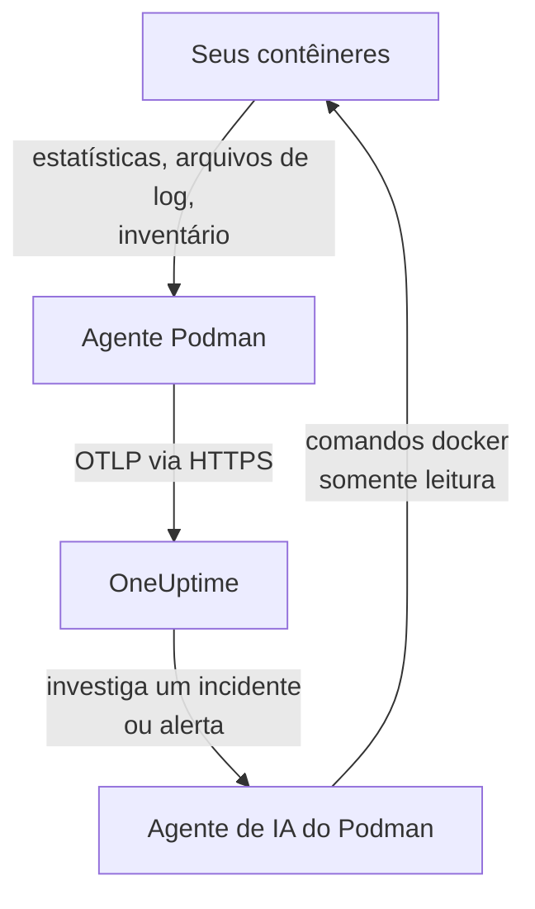

# Agente Podman

O agente Podman do OneUptime é um contêiner que você executa em um host Podman. Ele lê as estatísticas e os arquivos de log de cada contêiner do host e os envia ao OneUptime, onde o host aparece com os contêineres, as métricas e os logs dele. Um segundo contêiner, o agente de IA do Podman, permite que a OneUptime AI investigue o host. Os [monitores de Podman](/docs/monitor/podman-monitor) alertam com base no que o agente envia.

:::cards
- [Instale o agente](#instale-o-agente): Dois contêineres, com `podman run` ou Podman Compose.
- [O que o agente coleta](#o-que-o-agente-coleta): Métricas, logs e um inventário de cada contêiner.
- [Logs de contêineres precisam de k8s-file](#logs-de-contêineres-precisam-do-driver-de-log-k8s-file): O Podman grava os logs no journald, a menos que você mude.
- [Solução de problemas](#solução-de-problemas): Loops de reinício, métricas faltando, logs faltando.
:::

## Como funciona

O agente é um OpenTelemetry Collector com a configuração do OneUptime embutida. Pelo socket de API compatível com Docker do Podman, ele lê as estatísticas de cada contêiner a cada 30 segundos e lista cada contêiner, imagem, rede e volume a cada 5 minutos. Ele acompanha os arquivos de log dos contêineres e envia tudo para a sua URL do OneUptime via OTLP, com a chave de ingestão que você fornece.



O host se registra com os primeiros dados, com o nome que você define em `PODMAN_HOST_NAME`. O agente de IA é opcional: deixe-o de fora e o coletor funciona do mesmo jeito.

## Antes de começar

- Podman 4.0 ou posterior e acesso root no host.
- O socket de API do Podman em `/run/podman/podman.sock`. Ative-o com `sudo systemctl enable --now podman.socket`.
- Uma chave de ingestão. Crie uma em **Configurações do projeto → Telemetria e APM → Chaves de ingestão** e copie o valor.
- HTTPS de saída do host para a sua URL do OneUptime.
- Para logs de contêineres, contêineres que usam o driver de log `k8s-file`. O Podman rootful grava os logs por padrão no `journald`, que o agente não consegue ler. Veja [Logs de contêineres precisam do driver de log k8s-file](#logs-de-contêineres-precisam-do-driver-de-log-k8s-file).

## Instale o agente

:::steps
### Inicie o agente

Substitua `YOUR_ONEUPTIME_URL` pela sua URL do OneUptime, `YOUR_TELEMETRY_INGESTION_TOKEN` pela chave de ingestão e `my-podman-host` por um nome para este host, como `prod-podman-01`. O nome é como o host aparece no OneUptime, então mantenha-o estável: um nome novo registra um host novo.

:::tabs
@tab Podman CLI
```bash
podman run -d \
  --name oneuptime-podman-agent \
  --user 0:0 \
  --restart unless-stopped \
  -v /run/podman/podman.sock:/run/podman/podman.sock:ro \
  -v /var/lib/containers/storage:/var/lib/containers/storage:ro \
  -e ONEUPTIME_URL="YOUR_ONEUPTIME_URL" \
  -e ONEUPTIME_SERVICE_TOKEN="YOUR_TELEMETRY_INGESTION_TOKEN" \
  -e PODMAN_HOST_NAME="my-podman-host" \
  oneuptime/podman-agent:release
```

Depois inicie o [agente de IA](#agente-de-ia) ao lado dele, com os mesmos valores. **As investigações de IA vêm ativadas por padrão**: enquanto a OneUptime AI investiga um incidente ou alerta neste host, ela executa comandos `docker` somente leitura pelo agente de IA, contra a API compatível com Docker do Podman, e não altera nada a menos que você permita correções. Para instalar sem investigações de IA, pule este comando.

```bash
podman run -d \
  --name oneuptime-podman-ai-agent \
  --user 0:0 \
  --restart unless-stopped \
  --read-only --tmpfs /tmp \
  -v /run/podman/podman.sock:/run/podman/podman.sock:ro \
  -e ONEUPTIME_URL="YOUR_ONEUPTIME_URL" \
  -e ONEUPTIME_SERVICE_TOKEN="YOUR_TELEMETRY_INGESTION_TOKEN" \
  -e ONEUPTIME_AI_AGENT_RESOURCE_TYPE=podman \
  -e PODMAN_HOST_NAME="my-podman-host" \
  oneuptime/resource-ai-agent:release
```
@tab Podman Compose
Salve isto como `docker-compose.yml` em uma pasta no host. O segundo serviço é o [agente de IA](#agente-de-ia): deixe-o de fora para executar o coletor sem investigações de IA.

```yaml title="docker-compose.yml"
services:
  oneuptime-podman-agent:
    image: oneuptime/podman-agent:release
    container_name: oneuptime-podman-agent
    user: "0:0"
    restart: unless-stopped
    volumes:
      - /run/podman/podman.sock:/run/podman/podman.sock:ro
      - /var/lib/containers/storage:/var/lib/containers/storage:ro
    environment:
      - ONEUPTIME_URL=YOUR_ONEUPTIME_URL
      - ONEUPTIME_SERVICE_TOKEN=YOUR_TELEMETRY_INGESTION_TOKEN
      - PODMAN_HOST_NAME=my-podman-host
    logging:
      driver: json-file
      options:
        max-size: "10m"
        max-file: "3"
  oneuptime-podman-ai-agent:
    image: oneuptime/resource-ai-agent:release
    container_name: oneuptime-podman-ai-agent
    user: "0:0"
    restart: unless-stopped
    read_only: true
    tmpfs:
      - /tmp
    volumes:
      - /run/podman/podman.sock:/run/podman/podman.sock:ro
    environment:
      - ONEUPTIME_URL=YOUR_ONEUPTIME_URL
      - ONEUPTIME_SERVICE_TOKEN=YOUR_TELEMETRY_INGESTION_TOKEN
      - ONEUPTIME_AI_AGENT_RESOURCE_TYPE=podman
      - PODMAN_HOST_NAME=my-podman-host
```

Inicie-o nessa pasta:

```bash
podman compose up -d
```
:::

### Verifique se o agente está em execução

```bash
podman ps --filter name=oneuptime-podman-agent
podman logs -f oneuptime-podman-agent
```

Os logs devem mostrar esta linha assim que o coletor iniciar:

```text
Everything is ready. Begin running and processing data.
```

### Encontre o host no OneUptime

Abra **Produtos → Infraestrutura → Podman → Todos os hosts**. O host aparece com o `PODMAN_HOST_NAME` dele em cerca de um minuto, com os contêineres, as métricas e os logs dele. O agente de IA aparece como conectado na página **Agente de IA** do host e no fim da **Visão geral** dele.
:::

## Variáveis de ambiente

| Variável | Obrigatória | Descrição |
| --- | --- | --- |
| `ONEUPTIME_URL` | Sim | A sua URL do OneUptime, como `https://oneuptime.com` ou a sua instância auto-hospedada. Use `http://` e a porta dela se a instância for só HTTP. |
| `ONEUPTIME_SERVICE_TOKEN` | Sim | A chave de ingestão de **Configurações do projeto → Telemetria e APM → Chaves de ingestão**. |
| `PODMAN_HOST_NAME` | Não | O nome do host no OneUptime. O padrão é `podman-host`, então dê um nome próprio a cada host. |
| `DOCKER_API_VERSION` | Não | A versão da API do Docker que o agente usa com o socket do Podman. O padrão é `1.44`. Reduza-a se o socket informar um máximo mais antigo, ou defina um valor vazio para negociá-la (veja [Solução de problemas](#solução-de-problemas)). |

Para mudar um valor, remova o agente e execute o comando dele de novo (Podman CLI), ou edite `docker-compose.yml` e execute `podman compose up -d` (Podman Compose).

## O que o agente coleta

| Dados | O que é |
| --- | --- |
| Métricas de contêineres | CPU (uso, porcentagem, throttling), memória (uso, limite, porcentagem), E/S de rede e de bloco, tempo de atividade, reinícios e número de processos, por contêiner, a cada 30 segundos. |
| Logs de contêineres | stdout e stderr de cada contêiner, a partir do arquivo `ctr.log` que o driver de log `k8s-file` grava. |
| Inventário | Todo contêiner em qualquer estado, e toda imagem, rede e volume, a cada 5 minutos. |

As métricas e os logs de cada contêiner são arquivados em um serviço com o nome do contêiner. Cada linha de log recebe uma severidade a partir do nível que ela cita, como `[ERROR]`, `level=warn` ou `{"level":"info"}`; uma linha que não cita nenhum fica com a do fluxo dela: stderr é `ERROR`, stdout é `INFO`. Linhas que começam com espaço em branco ou com um colchete de fechamento se juntam à linha anterior, então um stack trace chega como um único registro. Os logs do próprio agente ficam de fora.

[Monitor de Podman](/docs/monitor/podman-monitor#métricas-coletadas) lista cada métrica e o que ela significa.

## Logs de contêineres precisam do driver de log k8s-file

O agente acompanha `/var/lib/containers/storage/overlay-containers/*/userdata/ctr.log`, os arquivos que o driver de log `k8s-file` do Podman grava (`json-file` é o mesmo driver no Podman). O driver padrão do Podman rootful é `journald`, que não deixa arquivo para ler, e o mesmo vale para um driver remoto como `syslog`. As métricas de um contêiner assim continuam chegando; os logs, não.

Verifique o driver de log de um contêiner e o padrão do Podman:

```bash
podman inspect <container> --format '{{.HostConfig.LogConfig.Type}}'
podman info --format '{{.Host.LogDriver}}'
```

Execute um contêiner com `k8s-file`, ou mude um serviço do Compose para ele:

```bash
podman run --log-driver k8s-file --log-opt max-size=100m ... <image>
```

```yaml
services:
  my-app:
    image: my-app:latest
    logging:
      driver: "k8s-file"
      options:
        max-size: "100m"
```

Ou torne-o o padrão para todo contêiner criado depois, em `containers.conf` (`/etc/containers/containers.conf` no modo rootful, `~/.config/containers/containers.conf` no modo rootless):

```toml title="containers.conf"
[containers]
log_driver = "k8s-file"
log_size_max = 104857600
```

Depois recrie os contêineres. Um contêiner mantém o driver de log com que foi criado, então reiniciá-lo não basta.

## Atualizando o agente

Quando o agente é mais antigo que o seu OneUptime, um sinal de aviso aparece ao lado de **Versão do agente** na **Visão geral** do host. Selecione-o para ver estes comandos.

:::tabs
@tab Podman CLI
```bash
podman pull oneuptime/podman-agent:release
podman pull oneuptime/resource-ai-agent:release
podman rm -f oneuptime-podman-agent oneuptime-podman-ai-agent
```

Depois execute de novo os dois comandos `podman run` de [Inicie o agente](#inicie-o-agente).
@tab Podman Compose
```bash
podman compose pull
podman compose up -d
```
:::

A tag `release` sempre aponta para a versão mais recente. Para fixar uma versão, use `oneuptime/podman-agent:<version>`, como `oneuptime/podman-agent:10.0.31`. A mesma imagem está no GitHub Container Registry como `ghcr.io/oneuptime/podman-agent:release`.

## Desinstalando o agente

:::tabs
@tab Podman CLI
```bash
podman rm -f oneuptime-podman-agent
podman rm -f oneuptime-podman-ai-agent
```
@tab Podman Compose
```bash
podman compose down
```
:::

O host continua no OneUptime com os dados que enviou. Se não precisar mais dele, exclua-o com **Excluir host** no menu dele.

## Agente de IA

Os comandos e o arquivo do Compose acima, o `install.sh` do agente Podman e o `docker-compose.yml` no [diretório PodmanAgent](https://github.com/OneUptime/oneuptime/tree/master/agents/PodmanAgent) dele executam todos o **Agente de IA do Podman**: um segundo contêiner, `oneuptime-podman-ai-agent` (imagem `oneuptime/resource-ai-agent:release`), que executa os comandos somente leitura que a OneUptime AI pede enquanto investiga um incidente ou alerta neste host — pela API compatível com Docker do Podman, com a CLI `docker`: `docker ps -a`, `docker logs --tail 200 web`, `docker container inspect web` — e, só se você permitir, aplica correções como reiniciar um contêiner específico. Ele lê os mesmos `ONEUPTIME_URL`, `ONEUPTIME_SERVICE_TOKEN` e `PODMAN_HOST_NAME` que o coletor, então atende exatamente este host, e aparece na página **Agente de IA** do host no OneUptime.

- **As investigações de IA vêm ativadas por padrão.** Assim que o agente se conecta, a OneUptime AI investiga com ele os incidentes e alertas deste host, e a **Visão geral** do host mostra o status do agente. Para parar, defina `ONEUPTIME_AI_INVESTIGATION=false` onde o agente é executado (**Alterar**, em **O que a IA pode fazer** na página do agente de IA, mostra como), ou deixe o agente de fora.
- Ele é somente leitura, a menos que você o inicie com `ONEUPTIME_AI_ALLOW_WRITES=true`; `ONEUPTIME_AI_WRITE_TARGETS` (por exemplo `web-*,api-*`) limita quais contêineres uma correção pode tocar. Inicie-o também com `ONEUPTIME_AI_FIXES`, para dizer como as correções são executadas — `ask-for-approval` (uma pessoa aprova cada uma), `automatic` ou `bypass-approval` — e a página do agente de IA mostra isso somente para leitura ([O que a IA pode fazer, definido pelo agente](/docs/ai/infrastructure-ai-agents#what-ai-may-do-set-by-the-agent)).
- Ele precisa do mesmo socket que o coletor e é executado como root com ele montado, porque o socket pertence ao root — e, no Podman rootful, quem pode usar o socket é root neste host, com `:ro` ou não. O limite é a política de comandos do agente: ele nunca executa `exec`, `run`, `rm` ou `prune`, e nunca altera a si mesmo, o coletor ou qualquer coisa em `ONEUPTIME_AI_PROTECTED_TARGETS` (globs de nomes de contêineres).
- `install.sh --no-ai-agent` o deixa de fora; `podman rm -f oneuptime-podman-ai-agent` o remove. Atualize-o como o coletor: `podman pull oneuptime/resource-ai-agent:release`, remova-o e inicie-o de novo.

O que ele pode executar, como as correções funcionam e como solucionar problemas: [Infrastructure AI Agents](/docs/ai/infrastructure-ai-agents#docker-and-podman-hosts).

## Solução de problemas

:::details O agente reinicia com "client version is too new"
Os logs do agente mostram:

```text
Error: cannot start pipelines: failed to start "docker_stats" receiver:
Error response from daemon: client version 1.44 is too new.
Maximum supported API version is 1.41
```

Um servidor de API do Docker que impõe uma versão máxima de cliente recusa uma mais nova, então o receiver nunca inicia e o coletor sai junto com ele. Verifique a versão da API que o socket do Podman informa:

```bash
curl -s -o /dev/null -D - --unix-socket /run/podman/podman.sock http://localhost/_ping | grep -i '^api-version'
```

Depois adicione `-e DOCKER_API_VERSION=1.41` (ou o valor que você obteve) a `podman run`, ou defina `DOCKER_API_VERSION` no Compose. Servidores mais novos continuam atendendo versões mais antigas da API, então a configuração continua válida depois de uma atualização.

Prefere não procurar o número? Defina `DOCKER_API_VERSION` como a string vazia. O agente então negocia a versão com o socket (um `HEAD /_ping` e depois o máximo que o socket informa) em vez de fixar uma:

```bash
podman run -d ... -e DOCKER_API_VERSION= ...
```
:::

:::details Permissão negada no socket do Podman, ou nenhum socket
O agente precisa ser executado como root para ler `/run/podman/podman.sock`. Verifique se `--user 0:0` está no seu comando `podman run`, ou `user: "0:0"` no Compose, e se o socket está ativo: `sudo systemctl enable --now podman.socket`. O Podman rootless tem o socket em `/run/user/<uid>/podman/podman.sock` (`systemctl --user enable --now podman.socket`): monte esse caminho no lugar de `/run/podman/podman.sock`.
:::

:::details O host aparece como desconectado
1. Verifique se o agente está em execução: `podman ps --filter name=oneuptime-podman-agent`
2. Procure erros nos logs dele: `podman logs oneuptime-podman-agent 2>&1 | grep -i error`
3. Verifique `ONEUPTIME_URL` e `ONEUPTIME_SERVICE_TOKEN`: a chave precisa ser uma chave de ingestão válida que não foi desativada.
4. Verifique se o host consegue alcançar a sua URL do OneUptime pela rede.
:::

:::details Nenhuma métrica aparece
1. Verifique se o socket do Podman está montado no agente. A imagem dele não tem shell, então olhe a partir de um contêiner descartável que compartilhe as montagens dele: `podman run --rm --volumes-from oneuptime-podman-agent alpine:3.19 ls -la /run/podman/podman.sock`
2. Procure erros de exportação nos logs dele: `podman logs oneuptime-podman-agent 2>&1 | tail -100`
3. Verifique se a chave de ingestão é válida e não expirou.
:::

:::details As métricas chegam, mas os logs dos contêineres não
Os seus contêineres provavelmente usam `journald`, o driver de log padrão do Podman. Verifique quais arquivos o agente observa e qual driver um contêiner usa:

```bash
podman logs oneuptime-podman-agent 2>&1 | grep -E "Started watching file|no files match"
podman inspect <container> --format '{{.HostConfig.LogConfig.Type}}'
```

Se o agente informar `no files match the configured criteria`, mude os contêineres para `k8s-file` e recrie-os, como mostra [Logs de contêineres precisam do driver de log k8s-file](#logs-de-contêineres-precisam-do-driver-de-log-k8s-file).
:::

:::details Os logs estão em outro host, ou o host se chama podman-host
O nome do host vem de `PODMAN_HOST_NAME`. Um agente iniciado sem ele informa `podman-host`, então todo host configurado assim parece ser o mesmo; mude o nome depois e o OneUptime registra um segundo host, que passa a ter os dados novos. Defina `PODMAN_HOST_NAME` com um nome próprio em cada host e recrie o agente. Para verificar o nome que o agente informa:

```bash
podman inspect oneuptime-podman-agent --format '{{range .Config.Env}}{{println .}}{{end}}' | grep PODMAN_HOST_NAME
```
:::

## Próximos passos

:::cards
- [Monitor de Podman](/docs/monitor/podman-monitor): Alerte sobre CPU, memória e reinícios dos contêineres.
- [Bancos de dados](/docs/telemetry/databases): Os contêineres de banco de dados do host são encontrados e ganham páginas próprias.
- [Agente Kubernetes](/docs/telemetry/kubernetes-agent): Monitore um cluster Kubernetes em vez disso.
- [Coletor OpenTelemetry no host](/docs/telemetry/host-otel-collector): Monitore a própria máquina: CPU, discos, processos e logs.
:::
