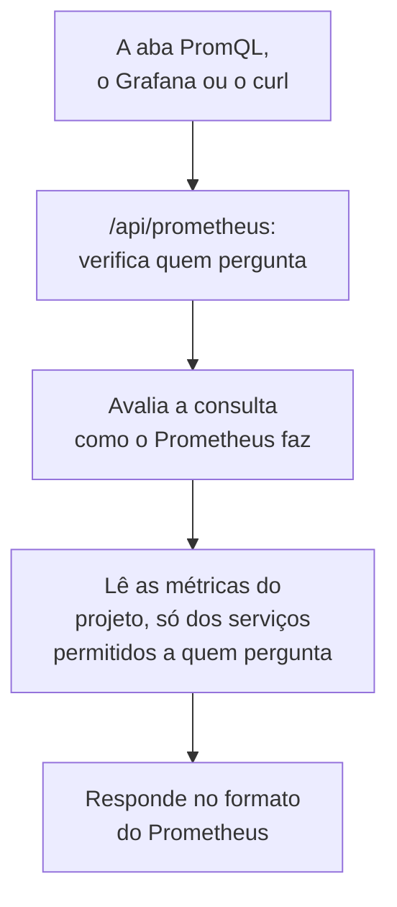

# Consultar métricas com PromQL

PromQL é a linguagem de consulta do Prometheus, e a que a maioria das pessoas que fazem gráficos de métricas já conhece. O OneUptime lê as métricas do seu projeto com ela: na aba **PromQL** de Métricas, e por meio de uma API compatível com o Prometheus, para a qual o Grafana, ou qualquer ferramenta com uma fonte de dados Prometheus, pode apontar.

:::cards
- [Escrever uma consulta](#escrever-uma-consulta): Executar PromQL na página Métricas e ver um gráfico ou uma tabela.
- [Como as métricas são nomeadas](#como-as-métricas-são-nomeadas): Como os nomes e os atributos do OpenTelemetry são lidos no PromQL.
- [Conectar o Grafana](#conectar-o-grafana): Adicionar o OneUptime como fonte de dados Prometheus.
- [Limites](#limites): O que uma consulta pode ler, e por quanto tempo.
:::

## Como funciona

A aba PromQL e o Grafana consultam a mesma API. O OneUptime verifica se quem faz a chamada pode ler as métricas do projeto, lê apenas os serviços que ele pode ler e avalia a consulta como o Prometheus faz.



## Antes de começar

- **Métricas chegando.** Envie-as com [OpenTelemetry](/docs/telemetry/open-telemetry), ou de um agente como o [coletor OpenTelemetry para hosts](/docs/telemetry/host-otel-collector).
- **Uma função que possa ler métricas.** Project Owner, Project Admin, Project Member, Viewer, Telemetry Admin, Telemetry Member ou Telemetry Viewer, ou uma função personalizada com a permissão Read Metrics. Uma função limitada a alguns serviços lê só as métricas deles.
- **Para o Grafana ou um script: uma chave de API do projeto** com uma dessas funções ou com a permissão Read Metrics. Veja [Criar uma chave de API](/docs/api-reference/api-reference#criar-uma-chave-de-api). No OneUptime Cloud, as chaves de API precisam do plano **Growth**.

## Escrever uma consulta

:::steps
### Abrir o PromQL

Abra **Métricas** e clique na aba **PromQL**.

### Escrever a consulta

Digite-a no editor, escolha um exemplo em **Exemplos**, ou comece por **Adicionar um nome de métrica**, que lista as métricas do seu projeto com os nomes que o PromQL dá a elas.

### Executá-la

Clique em **Executar consulta**, ou pressione Ctrl+Enter (⌘+Enter no Mac). **Gráfico** desenha a consulta ao longo do intervalo de tempo; **Tabela** mostra o valor de cada série no final dele.
:::

Algumas consultas para começar:

```text title="PromQL"
# Requests per second, by service
sum by (job) (rate(http_requests_total[5m]))

# The 95th percentile of a latency histogram
histogram_quantile(0.95, sum by (le) (rate(http_server_request_duration_bucket[5m])))

# The five hosts using the most memory
topk(5, system_memory_usage)
```

O editor mostra o que deu errado em uma consulta que não é executada, e onde: com `rate(http_requests_total)`, por exemplo, ele diz que a função precisa de um intervalo como `[5m]`.

## Como as métricas são nomeadas

O OneUptime armazena as métricas do jeito do OpenTelemetry. O PromQL as lê com os nomes que o próprio suporte a OpenTelemetry do Prometheus dá a elas, então uma consulta escrita para o Prometheus funciona aqui:

| No OneUptime | No PromQL |
| --- | --- |
| Um gauge `system.cpu.utilization` | `system_cpu_utilization` |
| Um contador `http.requests` | `http_requests`, ou `http_requests_total` |
| Um histograma `http.server.request.duration` | `http_server_request_duration_bucket` (com `le`), `_count` e `_sum` |
| Um summary `rpc.latency` | `rpc_latency` (com `quantile`), `_count` e `_sum` |
| Um atributo `http.route` | O rótulo `http_route` |
| Um atributo de recurso `service.name` | O rótulo `resource_service_name`, e `job` |
| Um atributo de recurso `service.instance.id` | O rótulo `resource_service_instance_id`, e `instance` |

- **Pontos e hifens viram sublinhados** nos nomes de métricas e de rótulos. Para se referir a uma métrica ou a um rótulo exatamente como está armazenado, coloque o nome entre aspas, como faz o Prometheus 3: `{"http.server.request.duration", "http.route"="/checkout"}`.
- **Os contadores delta são somados** a partir do início do intervalo de tempo da consulta, então `rate()` e `increase()` os leem como qualquer outro contador.
- **Os histogramas exponenciais** têm `_count` e `_sum`, mas não têm buckets.

## Conectar o Grafana

:::steps
### Criar uma chave de API

No OneUptime, abra **Configurações do projeto → Avançado → Chaves de API** e clique em **Criar: Chave de API**. Dê à chave uma função que possa ler telemetria, ou a permissão Read Metrics.

### Adicionar uma fonte de dados Prometheus

No Grafana, abra **Connections → Data sources → Add data source** e escolha **Prometheus**.

### Informar a URL do servidor

Defina **Prometheus server URL** como o endereço do seu OneUptime seguido de `/api/prometheus`. No OneUptime Cloud, é `https://oneuptime.com/api/prometheus`. A aba **PromQL** mostra o endereço do seu próprio servidor, com um botão para copiar.

### Enviar a chave de API

Em **HTTP headers**, adicione o cabeçalho `Authorization` com o valor `Bearer` seguido de um espaço e da sua chave de API. A autenticação básica também funciona: qualquer nome de usuário, com a chave de API como senha.

### Salvar e testar

Clique em **Save & test**. O Grafana executa uma consulta e diz que a fonte de dados funciona.
:::

Qualquer outro cliente do Prometheus funciona do mesmo jeito. Com o curl:

```bash title="Query OneUptime's Prometheus API"
curl -H "Authorization: Bearer $ONEUPTIME_API_KEY" \
  "https://oneuptime.com/api/prometheus/api/v1/query?query=up"
```

## A API

A API responde às rotas da API HTTP do Prometheus, com `GET` ou `POST`, em `/api/prometheus`:

| Rota | O que ela responde |
| --- | --- |
| `/api/v1/query` | Uma consulta em um único instante (`time`, por padrão agora). |
| `/api/v1/query_range` | Uma consulta a cada `step`, de `start` a `end`. |
| `/api/v1/series` | As séries que `match[]` seleciona. |
| `/api/v1/labels` | Nomes de rótulos, das séries que `match[]` seleciona ou de todas as métricas. |
| `/api/v1/label/<name>/values` | Os valores de um rótulo. `__name__` lista os nomes das métricas. |
| `/api/v1/metadata` | O tipo, o texto de ajuda e a unidade de cada métrica. |

Os horários são em segundos Unix ou RFC 3339, as durações são em segundos ou uma duração como `15s`, e as respostas vêm no formato do Prometheus. `/api/v1/status/buildinfo` responde como um servidor Prometheus 3; as regras e os alertas vêm vazios, porque o OneUptime alerta com [monitores](/docs/monitor/metrics-monitor).

## O que o PromQL cobre

- **Seletores** com todos os operadores de correspondência (`=`, `!=`, `=~`, `!~`), intervalos, `offset`, `@` (com `start()` e `end()`) e subconsultas.
- **Operadores**: aritmética, comparações (com `bool`), `and`, `or`, `unless`, e correspondência de vetores com `on`, `ignoring`, `group_left` e `group_right`.
- **Agregações**: `sum`, `avg`, `min`, `max`, `count`, `group`, `stddev`, `stdvar`, `topk`, `bottomk`, `quantile` e `count_values`, com `by` ou `without`.
- **Funções**: `rate`, `irate`, `increase`, `delta`, `idelta`, `deriv`, `predict_linear`, `histogram_quantile`, todas as funções `*_over_time`, `changes`, `resets`, `absent`, `label_replace`, `label_join`, `sort`, `clamp`, `round`, as funções matemáticas e de data, e outras.

As funções de histogramas nativos do Prometheus, como `histogram_count()`, não estão disponíveis: o OneUptime armazena os histogramas com buckets, que `histogram_quantile()` e as séries `_count` e `_sum` leem.

## Limites

Toda consulta tem limites, para que um painel com muitos gráficos não sobrecarregue o OneUptime:

| Limite | Valor |
| --- | --- |
| Pontos em uma série de uma consulta de intervalo | 11.000 |
| Amostras que uma consulta pode ler e manter | 5.000.000 |
| Pontos de métrica que um seletor pode ler | 1.000.000 |
| Tempo que uma leitura pode levar | 30 segundos |
| Tempo que a avaliação pode levar | 30 segundos |
| Quanto tempo para trás um seletor procura a amostra mais recente de uma série | 5 minutos |
| O passo de uma subconsulta, quando a consulta não o informa | 1 minuto |

## Solução de problemas

:::details O Grafana diz que a fonte de dados não funciona
Verifique se a URL termina em `/api/prometheus` e se o cabeçalho `Authorization` contém `Bearer`, um espaço e a chave de API. Uma chave sem nenhuma função que possa ler métricas é recusada: dê uma a ela em **Configurações do projeto → Avançado → Chaves de API**.
:::

:::details Uma métrica do explorador não retorna nada
O nome dela no PromQL tem sublinhados onde o nome armazenado tem pontos, e um histograma é lido por meio de `_bucket`, `_count` ou `_sum`. **Adicionar um nome de métrica**, na aba PromQL, lista cada nome como o PromQL o escreve.
:::

:::details "The query reads more than 1,000,000 metric points"
A consulta pede mais do que uma leitura pode conter. Adicione filtros de rótulo, encurte o intervalo de tempo ou use um passo maior.
:::

## Próximos passos

:::cards
- [Explorador de métricas](/docs/telemetry/metrics-explorer): Fazer gráficos de métricas sem escrever uma consulta.
- [Monitor de métricas](/docs/monitor/metrics-monitor): Alertar quando uma métrica ultrapassar um limite.
- [Fontes de dados externas](/docs/dashboards/data-sources): Mostrar um Prometheus externo nos seus painéis.
:::
